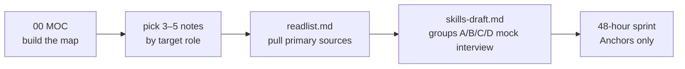

# PersonalSkills

**Communications x Heterogeneous Compute x AI — Interview Preparation, Knowledge Framework and Knowledge Graph**

> Language: English (current) · [简体中文](README.cn.md)

This repository holds interview-preparation material and per-domain knowledge notes for the intersection of **communications technology, heterogeneous compute, and AI**: **5 source documents plus 1 Obsidian knowledge graph (31 notes)**.

---

## 1. Project Purpose

Everything is organised around a single thesis:

> Cellular/WLAN protocol stacks, heterogeneous compute, and on-device AI are converging into one scheduling problem — deciding *what* runs *where*, *when*, under a fixed latency and power budget.

So this is not a list of facts. It treats the **RAN MAC scheduler, the cloud-edge-end task orchestrator, and the LLM inference engine** as three instances of the same problem shape, and states explicitly where the analogy holds and where it breaks.

Four cross-cutting threads run through the whole vault:

1. **Determinism** — tail latency / P99 is the shared KPI across Wi-Fi 8 UHR, URLLC, and agent orchestration.
2. **Memory semantics** — KV cache, memory pooling, and UnifiedBus global addressing are the same battle fought at three layers.
3. **Interface semantics** — L1 accelerator ↔ L2 general-purpose core, NPU ↔ CPU, coordinator ↔ worker: the boundary always costs more than the compute.
4. **Verification methodology** — simulation → data replay → hardware-in-the-loop is the only credible path for both AI schedulers and AI-native PHY.

---

## 2. Quick Start: Recommended Reading Path



| Stage | What to do | Output |
| --- | --- | --- |
| 1. Build the map | Read `knowledge-graph/00 MOC ...` end to end | A unified mental model and a domain map |
| 2. Read by target role | See the selection table below | 3-5 domain threads you can drill into |
| 3. Go to primary sources | Use the matching section of `readlist.md` to pull books, papers and standards | A first-hand citation behind every claim you make |
| 4. Mock interview | Self-test with groups A/B/C/D of `skills-draft.md` (or `skills-draft.cn.md`) | A parameter-level answer for every question |
| 5. 48-hour sprint | Read only the **Anchors** section of each note plus Part III, Section 4 of `skills-draft.md` | Numbers, timelines and architecture diagrams on demand |

**Selection by target role**

| Target role | Priority notes |
| --- | --- |
| RAN system architect | 01-1 → 01-2 → 01-6 → 01-5 → 01-3 → 05-1 → 07-1 |
| Edge AI / cloud-edge-end architect | 06-3 → 05-2 → 06-1 → 06-2 → 08-1 → 04-2 → 04-5 |
| Embedded / Linux platform | 04-3 → 04-1 → 04-2 → 04-4 → 04-5 → 01-6 → 07-1 → 05-1 → 08-1 |
| WLAN / gateway | 02-1 → 02-2 → 02-3 → 02-5 → 02-6 → 02-7 → 02-4 → 03-1 → 04-3 |
| WLAN security / client stack | 02-5 → 02-6 → 02-7 → 02-1 → 02-3 → 08-2 |
| Low-power / IoT devices | 02-2 → 03-1 → 01-4 → 01-5 → 04-1 |
| Software / language foundation (any role) | 08-2 → 08-3 → 08-1 |
| Algorithm modelling or DSP prototyping | 08-4 → 08-5 → 08-3 |

---

## 3. Directory Structure

```
261022,PersonalSkills/
├── README.md                       Project README (English, default, this file)
├── README.cn.md                    Project README (Chinese)
├── background.md                   Personal Background and Task Statement (English, default)
├── background.cn.md                个人背景与任务说明（中文）
├── skills-draft.md                 Knowledge Framework and Interview Outline (English, default)
├── skills-draft.cn.md              知识框架与面试题纲（中文）
├── readlist.md                     Reading list (Chinese/English books, papers, standards; descriptions in English)
├── knowledge-graph/                Obsidian knowledge graph (vault, 31 notes)
│   ├── 00 MOC - Comms x Compute x AI Knowledge Graph.md      <- entry index
│   ├── 01-1 5G-Advanced and 6G Radio Access.md
│   ├── 01-2 5G NR RAN Layer 2 Protocol Stack.md
│   ├── 01-3 AI-ML for RAN and O-RAN RIC.md
│   ├── 01-4 Cellular IoT RedCap eRedCap and NTN.md
│   ├── 01-5 NR Random Access - UE RACH Procedure, Signalling and Tuning.md
│   ├── 01-6 NR DU MAC Scheduler - Resource Allocation, HARQ and Real-Time Implementation.md
│   ├── 02-1 WLAN - Wi-Fi Generations Evolution.md
│   ├── 02-2 WLAN - Power Saving Mechanisms and Evolution.md
│   ├── 02-3 WLAN Ecosystem - WFA, EasyMesh and prpl.md
│   ├── 02-4 WLAN - Packet TX-RX Datapath and Offload Evolution.md
│   ├── 02-5 WLAN - STA-AP Discovery, Authentication and Association.md
│   ├── 02-6 WLAN - Multi-AP Roaming, Healing and Steering.md
│   ├── 02-7 WLAN - Wi-Fi EasyMesh, Operation, Tuning and Troubleshooting.md
│   ├── 03-1 Wireless Sensor Networks and Low-Power MAC.md
│   ├── 04-1 Embedded Systems RTOS and Hardware Interfaces.md
│   ├── 04-2 Linux Embedded Development - Drivers, Applications and Core Subsystems.md
│   ├── 04-3 Embedded Software Architecture - Patterns, Layering and Wireless System Structure.md
│   ├── 04-4 Linux Interrupts - Types, Handlers, Threaded IRQs and Deferred Work.md
│   ├── 04-5 Linux Concurrency - Kernel and User Mode, Processes, Threads and IPC.md
│   ├── 05-1 DPDK User Plane and 5G UPF.md
│   ├── 05-2 Cloud-Edge-End Collaboration and Heterogeneous Computing.md
│   ├── 06-1 LLM Inference Engines and xLLM.md
│   ├── 06-2 Agent Systems and Edge Orchestration.md
│   ├── 06-3 Machine Learning - Foundations, Core Algorithms and Applications.md
│   ├── 07-1 RISC-V for Communication Infrastructure.md
│   ├── 08-1 Programming Languages Toolchain and Performance Engineering.md
│   ├── 08-2 C and C++ Programming - Language Features, STL and Systems Practice.md
│   ├── 08-3 Python Programming - Language, Object Model and Engineering Practice.md
│   ├── 08-4 MATLAB and Simulink - Programming, Modelling and Code Generation.md
│   └── 08-5 Verilog HDL - RTL Design, Verification and Synthesis Practice.md
└── .workbuddy/                     Project working data (do not delete)
```

---

## 4. Document Inventory

### 4.1 Source documents

| File | Language | Role | Content |
| --- | --- | --- | --- |
| `README.md` | English | Project README | This file: purpose, reading path, directory structure, inventory, conventions, fact-checking strategy |
| `README.cn.md` | Chinese | Project README | Same, in Chinese |
| `background.md` | English | Input source | Original profile + structured breakdown (education / certifications / role trajectory / domains / tech stack) + task statement |
| `background.cn.md` | Chinese | Input source | Same, in Chinese |
| `skills-draft.md` | English | Main document | 2026 knowledge framework (6 domains) + interview outline (layers A/B/C/D) + Word production structure |
| `skills-draft.cn.md` | Chinese | Main document | Same, in Chinese |
| `readlist.md` | Descriptions in English, titles in their original language | References | Books, papers, standards and documentation across 33 themed sections numbered `GG-x` to match the vault: 01-1 5G-A and 6G, 01-2 NR L2, 01-3 AI-RAN and O-RAN, 01-4 RedCap/eRedCap/NTN, 01-5 NR random access (RACH), 01-6 NR DU MAC scheduler, 02-1 WLAN generations, 02-2 WLAN power saving, 02-3 WLAN ecosystem, 02-4 WLAN packet datapath and offload, 02-5 WLAN discovery, authentication and association, 02-6 WLAN roaming, healing and steering, 02-7 EasyMesh operation and troubleshooting, 03-1 WSN, 04-1 embedded RTOS, 04-2 Linux embedded, 04-3 embedded software architecture, 04-4 Linux interrupts, 04-5 concurrency, processes, threads and IPC, 05-1 DPDK/UPF, 05-2 cloud-edge-end, 06-1 LLM inference and xLLM, 06-2 agent systems, 06-3 machine learning foundations, 07-1 RISC-V, 08-1 languages and performance, 08-2 C and C++, 08-3 Python, 08-4 MATLAB and Simulink, 08-5 Verilog HDL — plus 31 primary standards repositories, 32 a reading order, and 33 verification and maintenance |

### 4.2 Knowledge graph notes

| No. | Domain | Core coverage |
| --- | --- | --- |
| **00 MOC** | Root index | Unified mental model, domain navigation, numbering scheme, cross-cutting threads, vault conventions |
| **01-1** | 5G-A / 6G radio access | Rel-19/20/21 timeline, AI-native air interface, ISAC, U6G ELAA, NTN |
| **01-2** | 5G NR RAN L2 | MAC/RLC/PDCP/SDAP, HARQ, BSR, grant lifecycle, QoS mapping |
| **01-3** | AI/ML for RAN and O-RAN | near-RT/non-RT RIC, xApp/rApp, DRL scheduling, sim-to-real |
| **01-4** | Cellular IoT | RedCap tiers, eRedCap, NTN, Ambient IoT, LP-WUS |
| **01-5** | **NR random access (RACH)** | The full UE random-access procedure: MAC-level triggers and what each failure means at RRC, RA-type and feature-partitioned resource selection (RedCap/SDT/NSAG/Msg3 repetition), PRACH formats 0–3 and A1–C2 with their CP-implied cell radii, open-loop power and the ramping rules, RA-RNTI and MSGB-RNTI arithmetic, the RAR MAC PDU and the Backoff Indicator table, Msg3 scheduling (`k2 + Δ`) and payloads, contention resolution, 2-step MsgA/MsgB with successRAR and fallbackRAR, CFRA and beam failure recovery, the SDT / NTN / RedCap variants, a latency budget, every tuning knob, and a layered troubleshooting tree with a symptom table — **plus the whole procedure retold from each side: §9 is the UE's state machine and counters, §10 the gNB's detection, RAR assembly and CU-DU split, and §10.4 tabulates what each side knows that the other does not** |
| **01-6** | **NR DU MAC scheduler** | The scheduler as a DU implements it: the CU/DU split and the 7-2x fronthaul with its four planes and eight C-plane section types, the FAPI L2/L1 interface and its per-slot message sequence, the four resources a scheduler allocates at once, the per-slot time budget with the O-RAN T1a/T2a/Ta3/Ta4 windows and the k0/k1/k2 floors, twelve internal modules, the eleven-step decision pipeline, the two-stage TD/FD downlink allocation with the ranking policies and the TBS computation, the SR/BSR/grant uplink chain and configured grants, the HARQ process state machine and the PUCCH acknowledgement problem, the PDCCH and CCE budgets with the candidate hash, TDD and DRX, the real-time execution model, the KPI set and a troubleshooting tree |
| **02-1** | WLAN generational evolution | Wi-Fi 4 to 9, MLO, OFDMA, UHR, multi-AP coordination, per-feature design detail |
| **02-2** | **WLAN power saving** | Energy equation and the four mechanism families; legacy PS/PS-Poll, U-APSD, SMPS, VHT TXOP PS and OM control, 802.11ah TWT/RAW/TIM segmentation, 802.11ax TWT and trigger-enabled SPs, 802.11ba wake-up radio, 802.11be r-TWT, 802.11bn AP Power Save / DPS / cross-link PS, 802.11bp ambient power — with per-generation mechanism tables, Mermaid diagrams, implementation split and failure modes |
| **02-3** | WLAN ecosystem | WFA certification, EasyMesh, prplMesh/prplOS/prpl LCM |
| **02-4** | **WLAN packet datapath and offload** | End-to-end TX (socket → qdisc/AQL → mac80211 header/TID/SN/crypto → descriptor → EDCA/A-MPDU → PHY) and RX (sync → MPDU delimiter scan → FCS/address/decrypt → reorder buffer → DMA/NAPI/GRO → TCP) with byte-level accounting; the five offload planes (per-packet assists, FullMAC vs SoftMAC vs hybrid, AP flow offload with PPE/NSS/Runner and WED, kernel bypass, control plane); MLO reordering; power-save interaction; a symptom→layer debugging table |
| **02-5** | **WLAN discovery, authentication and association** | The join sequence phase by phase: passive/active scanning and 6 GHz discovery (RNR, PSC, FILS Discovery, no wildcard probes), the three MLME states and their reason codes, Open System vs Shared Key vs SAE (Dragonfly, H2E, Dragonblood) vs OWE vs 802.1X/EAP, association and the AID, the PMK→PMK-R0/R1→PTK key hierarchy and each 4-way message, PMF/SA Query, FT with 802.11k/v and FILS, MLO setup with per-STA profiles, the hostapd/wpa_supplicant/mac80211 split, and a symptom→phase debugging table |
| **02-6** | **WLAN multi-AP roaming, healing and steering** | Why 802.11 leaves the roam decision to the station, and what the network can do about it: the four transition variants and their cost (full join / PMKSA caching / FT / FILS), 802.11k Neighbor and Beacon Reports, one end-to-end transition sequence, FT at ESS scale (R0KH placement, `0x890D` over-the-DS remote frames, five field failures, what the data plane has to rebuild), steering by BTM / MBO / assoc control / EasyMesh client steering with the decision function and its ping-pong failure, mesh healing as a backhaul state machine with topology repair and channel change, MLO at MLD granularity, and Wi-Fi 8 SMD / MAPC |
| **02-7** | **Wi-Fi EasyMesh — operation, tuning and troubleshooting** | What EasyMesh standardises and what it deliberately does not; releases v1.0→v6.0 and Profile-1/2/3; IEEE 1905.1 CMDU and TLV mechanics with the real message and TLV numbers (`0x893A`, `0x8003`, `0x8014`, `0x8019`, `0x9B`); onboarding by WPS/PBC and by DPP (`mapBackhaulSta`, `mapAgent`, CCE, proxied encapsulation); AP-autoconfiguration M1/M2 and the Multi-AP IE (`0xDD`, OUI `50-6F-9A`, type `0x1B`, extension bit map); the four-address backhaul and `multi_ap=1/2/3`; the four measurement families; channel selection, the three steering mechanisms and backhaul optimisation; deployment trade-offs; every tunable policy field; and a layered troubleshooting method with a symptom table |
| **03-1** | WSN and low-power MAC | Clustering routing, UAV-assisted collection, TSCH, AoI |
| **04-1** | Embedded RTOS | FreeRTOS, PendSV, I2C/SPI/UART/CAN, DMA, cache coherency |
| **04-2** | Linux embedded development | Boot chain, device tree, drivers, IPC, network stack, virtualization, PREEMPT_RT |
| **04-3** | Embedded software architecture | Layering and HAL/BSP separation, execution models (superloop / time-triggered / RTOS / active object), scheduling theory, HSM and event-driven design, design patterns, data ownership and mailbox interfaces, wireless stack decomposition (L1/L2 boundary, CU/DU, O-RAN 7-2x), memory and power architecture, OTA/rollback, ISO 26262 / IEC 61508 safety architecture |
| **04-4** | **Linux interrupts** | The interrupt subject end to end in English: the five orthogonal type axes (synchronous/async, maskable/NMI and pseudo-NMI, level/edge, wire versus MSI-X, private/shared/IPI), the three controllers (ARM GICv2/v3/v4 with the full INTID map and ITS/LPI model, x86 IDT plus LAPIC/IOAPIC/MSI, RISC-V PLIC and CLINT versus the AIA with APLIC and IMSIC), the generic IRQ layer (`irq_desc`, `irq_chip`, `irq_domain`, the five flow handlers, chained versus nested), the entry path with Mermaid diagrams, top-half discipline with the permitted/forbidden table, the four bottom halves with the ten fixed softirq vectors and the 2 ms / 10-restart brakes, the rise and fall of tasklets versus `WQ_BH`, threaded IRQs at `SCHED_FIFO` priority 50, six worked applications (NAPI, DMA rings, GPIO keys, IIO triggers, UIO/VFIO, rpmsg doorbells), affinity and isolation and coalescing tuning, and a symptom-to-fix debugging table |
| **04-5** | **Concurrency, kernel and user mode, processes, threads and IPC** | The concurrency subject end to end: the privilege boundary across x86 rings, ARM exception levels and RISC-V modes, and what each mode may touch; the five kernel execution contexts with the sleep/preempt/user-memory matrix; the four preemption models and `preempt_count`; the process model (`task_struct`, TGID versus TID, the `clone` flag table, copy-on-write and its absence on no-MMU systems, the lifecycle and PID 1); threads (NPTL 1:1 versus LinuxThreads versus NGPT, what is shared versus private, stack size, per-thread signal masks); kernel threads and their naming; ITC over atomics and the futex with private versus shared keying, robust and PI variants, and a worked lock-free ring; the seven-axis IPC comparison with a decision tree, the shared-memory-plus-doorbell pattern with `SCM_RIGHTS`, the fd-everything event loop, and a worked multi-process daemon; plus the bug taxonomy and the TSan/`lockdep`/`perf sched` toolchain |
| **05-1** | DPDK and 5G UPF | mbuf/mempool, PFCP, PDR/FAR/QER, QoS enforcement, small-packet pps |
| **05-2** | Cloud-edge-end and heterogeneous compute | UnifiedBus, memory pooling, MFU, RDMA |
| **06-1** | LLM inference engines and xLLM | KV cache, PagedAttention, quantization, operator fusion, prefill/decode |
| **06-2** | Agent systems and edge orchestration | GRAFT, multi-device SLM mesh, safety-bounded execution |
| **06-3** | **Machine learning foundations, core algorithms and applications** | A beginner-to-practitioner path in English: what AI, ML, deep learning and generative modelling mean and where the boundaries are; the model / loss / optimiser triad and the learning loop; supervised, unsupervised, self-supervised, semi-supervised and reinforcement learning with a paradigm-selection decision tree; the end-to-end pipeline, splits and cross-validation, and six data-leakage patterns; representations per data type, encoding, scaling and the curse of dimensionality; linear and logistic regression with hand-computed gradients, bias-variance and regularisation, decision trees with a worked Gini split, bagging versus boosting, k-NN, SVM, naive Bayes, k-means, DBSCAN and PCA; neural networks with a numeric backpropagation example, optimisers and regularisation; CNN, RNN/LSTM, transformer, transfer learning and generative architectures with worked sizing arithmetic; training at scale, precision and the three parallelism strategies; evaluation metrics from one confusion matrix, tuning methods, application directions, MLOps, failure modes and a staged learning path |
| **07-1** | RISC-V for communications infrastructure | Baseband clusters, software-defined PHY, H extension, L1/L2 interface |
| **08-1** | Languages, toolchain and performance engineering | Build systems, kernel-bypass selection, performance methodology, how the languages fit together |
| **08-2** | C and C++ programming and STL | C23/C++26 language features, templates and compile-time computation, memory model and concurrency, STL containers/iterators/algorithms, systems idioms and the UB catalogue |
| **08-3** | **Python programming** | CPython execution model (bytecode, specialisation, JIT, GIL and free-threading), the dunder object protocol, attribute lookup and C3 MRO, class system from dataclass to Protocol to metaclass, generators and asyncio, typing timeline, NumPy strided array model, performance decision tree, packaging and test practice |
| **08-4** | **MATLAB and Simulink** | Column-major array semantics and copy-on-write, vectorisation, `classdef` value vs handle classes, `arguments` validation, events, System objects, Simulink sample time and solver selection, Stateflow, fixed-point word-length design, Embedded/HDL Coder, SIL/PIL/HIL |
| **08-5** | **Verilog HDL** | IEEE 1364→1800 lineage, nets vs variables and four-state logic, blocking vs non-blocking scheduling, FSM and reset discipline, timing equations, CDC and async FIFO, testbenches and SystemVerilog classes/UVM, FPGA vs ASIC synthesis, DSP RTL patterns |

---

## 5. Using the Knowledge Graph

1. **Opening it**: in Obsidian choose "Open folder as vault" and point it at `knowledge-graph/` — not at the project root.
2. **Entry point**: `00 MOC` is the only navigation page. The other 29 notes are connected bidirectionally through `[[wikilinks]]`; use Graph View to see connection density.
3. **Naming rule**: notes are numbered `GG-x` by domain group — `00 MOC` is the index, and the eight domain groups are numbered **contiguously from `01`**: `01-x` cellular and mobile communications, `02-x` WLAN, `03-x` low-power and sensor networking, `04-x` embedded and systems software, `05-x` data plane and heterogeneous compute, `06-x` AI inference and agent systems, `07-x` silicon and ISA, `08-x` programming languages and engineering practice (toolchain and performance, C/C++, Python, MATLAB/Simulink, Verilog HDL). Group numbers follow the signal path outward, from the air interface to the silicon and language foundations. The file name *is* the topic, so notes sort by number and are searchable by name.
4. **Note structure**: body of knowledge points → **Anchors** → **Related**. This three-part shape is fixed.
5. **Diagrams**: notes use Mermaid code blocks, which render natively in Obsidian's reading view. Every note carries diagrams in the sections where structure matters — release timelines, protocol stacks and data paths, control loops, decision trees and state machines — 192 blocks across the vault.
6. **Search tips**: start with `tags` and `aliases` (defined in frontmatter), then full-text search on specification numbers (for example `38.914`, `802.11bn`).

---

## 6. Repository Conventions

1. **Language and file naming**: every note under `knowledge-graph/` is written in **English** so it can be reused directly with international teams and in English interviews. Source documents exist in both languages one-to-one, with **English as the default (no suffix)** and Chinese marked `.cn`: `README.md` / `README.cn.md`, `background.md` / `background.cn.md`, `skills-draft.md` / `skills-draft.cn.md`. `readlist.md` is the single exception — it has no separate Chinese edition because its titles are already kept in their original published form with English descriptions.
2. **Frontmatter**: every `.md` file carries YAML frontmatter with `title`, `lang`, `category`, `last-updated`, and `copyright`; bilingual pairs also carry `sibling` pointing at the other language, and documents that change carry `version`.
3. **Fact anchors**: every note ends with an **Anchors** section containing only checkable facts with a date or number (specification numbers, freeze dates, paper DOIs, release versions).
4. **Doubtful items**: anything not independently confirmed is marked **`VERIFY`** rather than asserted.
5. **Bidirectional links**: `[[wikilinks]]` are deliberate — a link means the two concepts are argued about together in interviews; link integrity is verifiable.
6. **Encoding and formatting**: all files are UTF-8; body text uses standard Markdown, tables for comparisons, and blockquotes for thesis/principle statements.
7. **Copyright header**: every file carries copyright information in both its frontmatter and its footer.
8. **Reference rule**: in `readlist.md`, titles are kept in their original published form (Chinese books keep the Chinese title and `《》` brackets) and are never translated; every entry's description is written in English.

---

## 7. Fact Checking and Update Strategy

**Division of labour between source documents and the knowledge graph**

- `skills-draft.md` / `skills-draft.cn.md` faithfully preserve the wording and judgement of the original draft, so the original line of thinking stays traceable;
- verified facts live in the **Anchors** section of each note under `knowledge-graph/`.

**Facts already corrected (cite the Anchors, not the draft)**

| Item | Original draft | Verified conclusion |
| --- | --- | --- |
| eRedCap release | attributed to Rel-19 | It is **Rel-18** (frozen 2024-06; 5 MHz, 1 Rx, HD-FDD, ~10 Mbps). Rel-19's contribution is the NTN extension, LP-WUS, and Ambient IoT |
| Wi-Fi 8 progress | Draft 1.0 (2025-08) | **Draft 1.0 was 2025-07**; Draft 2.0 passed WG ballot on 2026-09-02 at 76.5%; WFA certification around **2028-01** |
| Rel-21 milestones | "complete 2029, commercial 2030" | Four official milestones: Stage-1 **2027-03** / Stage-2 **2028-06** / Stage-3 **2028-12** / ASN.1+OpenAPI **2029-03** |
| PREEMPT_RT | not covered | Merged into mainline in **Linux 6.12 (2024-11)** for x86/arm64/RISC-V; 32-bit ARM added in 7.1 |
| C/C++ standard status | mentions only "C/C++" | **C23 = ISO/IEC 9899:2024** (published 2024-10-31, `__STDC_VERSION__` = 202311L); **C++26 shipped by WG21 on 2026-03-28** (working draft N5046), to be published as ISO/IEC 14882:2026 |
| AUTOSAR / MISRA versions | not covered | **AUTOSAR R25-11** is current (Release Event 2025-12-04); **MISRA C:2025** is the current C edition and supersedes MISRA C:2023; **MISRA C++:2023** (TC1:2026) targets C++17 — so a MISRA-conformant C++ project is not on C++20/23/26 |
| TWT origin | often attributed to 802.11ax | It originated in **802.11ah-2016** (Wi-Fi HaLow) and was carried into 802.11ax. 802.11be then added **r-TWT**, which is a latency mechanism first and a power mechanism second |
| 802.11bi | sometimes described as a wake-up-radio amendment | It is **Enhanced Privacy Protection**, approved for publication **2026-09-25** — see note 02-2. The wake-up radio amendment is **802.11ba-2021** |
| r-TWT deployment | assumed present in Wi-Fi 7 devices | r-TWT is **optional** in 802.11be and **not required for Wi-Fi CERTIFIED 7**; a 2026 CWNP review reports shipping clients and APs did not advertise support. Treat as `VERIFY` before claiming deployment |
| Linux bottom halves | "tasklet is the fast deferred-work mechanism" | Tasklets are **deprecated**. The API was modernised around 5.9 and the replacement is **WQ_BH**, merged for **6.9** with `system_bh_wq` and `system_bh_highpri_wq`; it runs in softirq context, may not sleep and requires `max_active = 0`. The tasklet API still exists and conversion is ongoing — see note 04-4 |
| Power ramping after a contention loss | "a UE that loses contention restarts from Msg1 without ramping power" | It **does** ramp. TS 38.321 clause 5.1.3 increments `PREAMBLE_POWER_RAMPING_COUNTER` on four transmission conditions only — the attempt counter is above one, the SSB/CSI-RS is unchanged, the PHY has not sent the power-ramping-suspension notification, and no LBT failure was reported — with **no carve-out for contention-resolution losses**. The narrow statement that is true is the beam rule: no ramping when the beam changes, whatever the cause. Note that this also removes a common shortcut — collisions cannot be told apart from coverage misses by the power column — see note 01-5 §9.3 |

| NR HARQ process count | "16 by default" | It is **8** when `nrofHARQ-ProcessesForPDSCH` is absent; 16 is the maximum, not the default. And more is not automatically better: every process holds a soft buffer and total UE soft-buffer memory is a capability, so n16 on a cell that only needs six can reduce the combining gain available to each retransmission — see note 01-6 §8.3 |
**Update triggers**

- 3GPP TSG plenary meetings (4 per year) → update 01-1/01-2/01-4
- New 3GPP TS 38.321 / 38.331 versions and RAN1/RAN2 agreements on random access → update 01-5 (field sizes, counters, windows and parameter ranges are release-specific; TS 38.321 v17.3.0, 2023-01, is the quoted baseline)
- IEEE 802.11 WG sessions and WFA certification announcements → update 02-1/02-2/02-3
- TGbn and TGbp ballot milestones, WFA power-management certifications → update 02-2 (AP Power Save is a draft feature; P802.11bp is at D1.0 WG ballot)
- Linux mainline and LTS releases → update 08-1/04-2/04-4/04-5 (the quoted baseline this cycle: PREEMPT_RT merged in 6.12, WQ_BH in 6.9, EEVDF in 6.6, clone3/pidfd_open in 5.3, RISC-V AIA drivers in 6.10)
- xLLM / agent framework releases and papers → update 06-1/06-2
- Major framework releases (scikit-learn, PyTorch, JAX) and textbook editions → update 06-3 (the quoted baseline is scikit-learn 1.9.1 and PyTorch 2.14.1, both September 2026)
- WG21 / WG14 meetings and GCC / Clang major releases → update 08-2
- CPython feature releases (annual, October) and PEP acceptances, NumPy major releases → update 08-3
- MATLAB / Simulink releases (March and September each year) and HDL / Embedded Coder capability changes → update 08-4
- IEEE 1800 revisions and IEEE 1800.2 (UVM) revisions → update 08-5
- AUTOSAR releases (annual, each November), MISRA document revisions, Zephyr six-month releases and LTS branches → update 04-3
- RISC-V International ratifications and the AIA document revisions, plus Arm GIC specification updates → update 04-4/07-1 (the quoted baseline: AIA v1.0 ratified June 2023, document revision 2025-03-12; APLIC/IMSIC drivers merged in Linux 6.10)
- Workqueue and deferred-work conversions in mainline (the tasklet → WQ_BH migration), scheduler changes (EEVDF, sched_ext) and rt-tests releases → update 04-4/04-5
- Wi-Fi Alliance Multi-AP / EasyMesh specification revisions and prplMesh releases → update 02-7 (v6.0 is current and has been mandatory for newly tested mesh devices since 2024-12-31; message and TLV numberings grow with each release)

---

## 8. Maintainer

Washington Ruan — communications software / embedded software / wireless protocol stack engineer and system architect; focus on 5G RAN L2, WLAN/WFA, IoT/WSN, embedded systems and Linux, AI/ML, cloud-edge-end collaboration and heterogeneous compute.

---

## Copyright

Copyright (c) 2026 **Washington Ruan**. All rights reserved.

All documents and notes in this repository are the copyrighted work of Washington Ruan. Commercial publication or redistribution requires written permission.

---

© 2026 Washington Ruan. All rights reserved.
