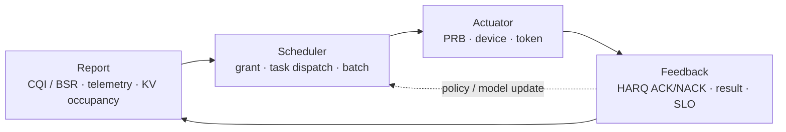
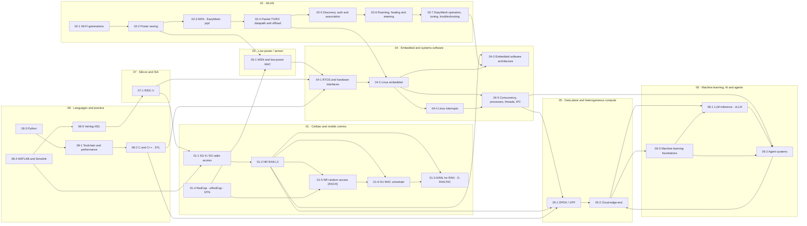

# Communications x Heterogeneous Compute x AI — Knowledge Graph

This vault is the English-language knowledge base behind one career thesis:

> Cellular/WLAN protocol stacks, heterogeneous compute, and on-device AI are converging into a single scheduling problem — deciding *what* runs *where*, *when*, under a hard latency and power budget.

## The unifying mental model

A RAN MAC scheduler, an edge task router, and an LLM inference scheduler are all solving the same shape of problem:

| RAN L2 scheduler | Edge/agent orchestrator | LLM inference engine |
| --- | --- | --- |
| UE capability | Device capability (CPU/GPU/NPU) | Hardware backend / block pool |
| CQI / BSR report | Telemetry / budget report | KV cache occupancy |
| Grant / PRB allocation | Task partition + dispatch | Batch + block allocation |
| HARQ RTT deadline | Sync barrier | Prefill / decode SLO |
| PF / EXP policy | Capability-aware policy routing | Continuous batching |

Carrying this analogy into interviews is the differentiator versus a pure AI-infra or pure modem background. See [[05-2 Cloud-Edge-End Collaboration and Heterogeneous Computing]].

All three are the same closed loop instantiated at a different time scale:

Only two things change: the unit of the budget, and who owns the loop. Sub-slot and the DU for RAN; tens of milliseconds and the orchestrator for the edge; per-iteration and the runtime for the inference engine.

## Numbering scheme

Notes are numbered `GG-x`: `GG` is a **domain group** numbered sequentially from `01`, and `x` indexes within the group. `00 MOC` is the index and sits outside the sequence. Group numbers are **contiguous** — a group number is stable only as long as the group order is, so adding a domain means appending a new group number rather than relabelling existing ones.

| Group | Domain | Notes |
| --- | --- | --- |
| `01-x` | Cellular and mobile communications | 01-1 … 01-6 |
| `02-x` | WLAN | 02-1 … 02-7 |
| `03-x` | Low-power and sensor networking | 03-1 |
| `04-x` | Embedded and systems software | 04-1 … 04-5 |
| `05-x` | Data plane and heterogeneous compute | 05-1, 05-2 |
| `06-x` | Machine learning, AI inference and agent systems | 06-1 … 06-3 |
| `07-x` | Silicon and instruction-set architecture | 07-1 |
| `08-x` | Programming languages and engineering practice | 08-1 … 08-5 |

The order is deliberate: it walks the signal path outward — air interface and RAN (`01`), then the wireless LAN and sensor edges (`02`, `03`), then the software that runs on the devices (`04`), then the data plane and the compute fabric (`05`), then the AI workloads that consume it (`06`), and finally the silicon and language foundations underneath everything (`07`, `08`).

## Domains

Vault map — the eight groups and the edges that carry arguments between them:

### 01 · Cellular and mobile communications
- [[01-1 5G-Advanced and 6G Radio Access]] — Rel-19/20/21 timeline, AI-native air interface, ISAC, U6G, NTN
- [[01-2 5G NR RAN Layer 2 Protocol Stack]] — MAC / RLC / PDCP / SDAP, HARQ, BSR, grant lifecycle, QoS mapping
- [[01-3 AI-ML for RAN and O-RAN RIC]] — near-RT/non-RT RIC, xApps/rApps, DRL scheduling, sim-to-real
- [[01-4 Cellular IoT RedCap eRedCap and NTN]] — RedCap tiers, eRedCap, NTN, Ambient IoT, LP-WUS
- [[01-5 NR Random Access - UE RACH Procedure, Signalling and Tuning]] — the whole UE random-access procedure end to end: triggers and their RRC meaning, resource and RA-type selection, PRACH formats and open-loop power ramping, RA-RNTI and the RAR, Msg3 timing and payloads, contention resolution, 2-step MsgA/MsgB with fallback, CFRA and BFR, and the SDT / NTN / RedCap variants — then the same procedure retold from the UE side and from the gNB side, with what each side knows that the other does not
- [[01-6 NR DU MAC Scheduler - Resource Allocation, HARQ and Real-Time Implementation]] — the scheduler itself: the CU/DU split and the 7-2x fronthaul, the four resources it allocates at once, the per-slot time budget, twelve modules, the eleven-step pipeline, the two-stage DL allocation, the UL chain, HARQ and PUCCH and PDCCH budgets, TDD and DRX, and the real-time execution model

### 02 · WLAN
- [[02-1 WLAN - Wi-Fi Generations Evolution]] — 802.11n/ac/ax/be/bn, Wi-Fi 4→9, MLO, OFDMA, UHR, multi-AP coordination
- [[02-2 WLAN - Power Saving Mechanisms and Evolution]] — legacy PS / PS-Poll, U-APSD, SMPS, TXOP PS, TWT and r-TWT, wake-up radio, AP power save, ambient power
- [[02-3 WLAN Ecosystem - WFA, EasyMesh and prpl]] — certification, Multi-AP control plane, prplMesh/prplOS
- [[02-7 WLAN - Wi-Fi EasyMesh, Operation, Tuning and Troubleshooting]] — the EasyMesh control plane end to end: what the Multi-AP specification does and does not standardise, releases v1.0→v6.0 and Profile-1/2/3, IEEE 1905.1 CMDU mechanics with the real message and TLV numbers, onboarding by WPS/PBC and by DPP, AP-autoconfiguration M1/M2, the four-address backhaul, the measurement families, channel selection and the three steering mechanisms, deployment trade-offs, every tunable policy field, and a layered troubleshooting method with a symptom table
- [[02-4 WLAN - Packet TX-RX Datapath and Offload Evolution]] — end-to-end TX/RX path (socket → qdisc → mac80211 → descriptor → EDCA/A-MPDU/Block Ack → PHY, and back through reorder/decrypt/GRO), the five planes of offload (per-packet assists, FullMAC vs SoftMAC, AP flow offload and WED, kernel bypass, control-plane), MLO reordering, and how to localise a fault in the path
- [[02-5 WLAN - STA-AP Discovery, Authentication and Association]] — the join sequence phase by phase: scanning and 6 GHz discovery (RNR, PSC, FILS Discovery), the MLME state machine, Open System vs SAE vs OWE vs 802.1X/EAP, association and the AID, the PMK→PTK key hierarchy and the 4-way handshake, PMF and SA Query, FT/k/v and FILS roaming, MLO setup, and a symptom-to-phase debugging table
- [[02-6 WLAN - Multi-AP Roaming, Healing and Steering]] — the multi-AP control loop: why 802.11 leaves the roam decision to the station, 802.11k discovery and 802.11r at ESS scale (R0KH placement, over-the-DS encapsulation, the failure taxonomy), steering by BTM / MBO / assoc control / EasyMesh with the decision function and its ping-pong problem, mesh healing as a backhaul state machine with topology repair and channel change, MLO at MLD granularity, and Wi-Fi 8 SMD as the first standard answer

### 03 · Low-power and sensor networking
- [[03-1 Wireless Sensor Networks and Low-Power MAC]] — clustering, UAV-assisted collection, TSCH, AoI

### 04 · Embedded and systems software
- [[04-1 Embedded Systems RTOS and Hardware Interfaces]] — FreeRTOS, PendSV, I2C/SPI/UART/CAN, DMA, cache coherency
- [[04-2 Linux Embedded Development - Drivers, Applications and Core Subsystems]] — boot chain, device tree, kernel drivers, IPC, network stack, KVM/containers, PREEMPT_RT
- [[04-3 Embedded Software Architecture - Patterns, Layering and Wireless System Structure]] — layering and HAL/BSP, execution models, HSM, design patterns, AUTOSAR, safety, OTA, wireless stack decomposition
- [[04-4 Linux Interrupts - Types, Handlers, Threaded IRQs and Deferred Work]] — the interrupt subject end to end: the five orthogonal type axes (synchronous/async, maskable/NMI, level/edge, wire/MSI, private/shared/IPI), the three interrupt controllers (GICv2/v3/v4 with the full INTID map, x86 LAPIC/IOAPIC/IDT, RISC-V PLIC versus AIA), the generic IRQ layer (`irq_desc`/`irq_chip`/`irq_domain`/flow handlers), the entry path, top-half discipline, the four bottom halves with the ten fixed softirq vectors and the 2 ms/10-restart brakes, threaded IRQs at SCHED_FIFO 50, six worked applications from NAPI to rpmsg doorbells, and the tuning and debugging tables
- [[04-5 Linux Concurrency - Kernel and User Mode, Processes, Threads and IPC]] — the concurrency subject end to end: the privilege boundary across x86/ARM/RISC-V and what each mode may touch, the five kernel execution contexts and the sleep/preempt/user-memory matrix, the four preemption models, the process model (`task_struct`, TGID versus TID, `clone` flags, copy-on-write, lifecycle), threads (NPTL 1:1 versus LinuxThreads versus NGPT, what is shared, stack size, signals), kernel threads, ITC over atomics and the futex with its private/shared keying and robust-PI variants, the seven-axis IPC comparison and decision logic, the shared-memory-plus-doorbell pattern, the fd-everything event loop, a worked multi-process daemon, and the bug taxonomy with the toolchain

### 05 · Data plane and heterogeneous compute
- [[05-1 DPDK User Plane and 5G UPF]] — mbuf/mempool, PFCP, PDR/FAR/QER, QoS enforcement, small-packet pps
- [[05-2 Cloud-Edge-End Collaboration and Heterogeneous Computing]] — UnifiedBus, memory pooling, MFU, RDMA

### 06 · Machine learning, AI inference and agent systems
- [[06-3 Machine Learning - Foundations, Core Algorithms and Applications]] — read this first if the AI group is new to you: paradigms, the workflow and the leakage traps, linear and logistic models, bias and variance, trees and ensembles, k-means and PCA, networks and backpropagation with worked numbers, CNN/RNN/transformer/generative architectures, training at scale, evaluation metrics, tuning, applications, MLOps and failure modes
- [[06-1 LLM Inference Engines and xLLM]] — KV cache, PagedAttention, quantization, operator fusion, prefill/decode
- [[06-2 Agent Systems and Edge Orchestration]] — GRAFT, multi-device SLM mesh, safety-bounded execution

### 07 · Silicon and instruction-set architecture
- [[07-1 RISC-V for Communication Infrastructure]] — baseband clusters, EdgeQ, software-defined PHY, L1/L2 interface

### 08 · Programming languages and engineering practice
- [[08-1 Programming Languages Toolchain and Performance Engineering]] — build systems, Linux, profiling, kernel bypass, and how the languages fit together
- [[08-2 C and C++ Programming - Language Features, STL and Systems Practice]] — C23/C++26 language features, templates, memory model, STL containers and algorithms, systems idioms
- [[08-3 Python Programming - Language, Object Model and Engineering Practice]] — CPython execution model, dunder protocols, classes (dataclass / ABC / Protocol / metaclass), asyncio, typing, NumPy array model, performance decision tree, packaging
- [[08-4 MATLAB and Simulink - Programming, Modelling and Code Generation]] — array semantics and copy-on-write, `classdef` value vs handle classes, `arguments` validation, Simulink solvers and sample time, Stateflow, fixed point, Embedded/HDL Coder, SIL/PIL/HIL
- [[08-5 Verilog HDL - RTL Design, Verification and Synthesis Practice]] — 1364/1800 lineage, blocking vs non-blocking semantics, FSM and reset discipline, timing and CDC, SystemVerilog classes and UVM, synthesis flows, DSP RTL patterns

## Cross-cutting threads

1. **Determinism.** Tail latency / P99 is the shared KPI across Wi-Fi 8 UHR, URLLC, and agent orchestration barriers.
2. **Memory semantics.** KV cache, memory pooling, and UnifiedBus global addressing are the same battle fought at three layers.
3. **Interface semantics.** L1 accelerator ↔ L2 general-purpose core, NPU ↔ CPU, coordinator ↔ worker — the boundary always costs more than the compute.
4. **Verification methodology.** Simulation → data replay → hardware-in-the-loop is the only credible path for both AI schedulers and AI-native PHY.

## Companion documents (outside this vault)

This vault is opened at `knowledge-graph/`, so the source documents in the parent directory are **not** visible to Obsidian and cannot be wikilinked. They are plain-text references:

| Document | Purpose |
| --- | --- |
| `README.md` / `README.cn.md` | Project overview, reading path, directory structure, conventions, fact-checking strategy |
| `background.md` / `background.cn.md` | Profile, role trajectory, domains, tech stack, and the original task statement |
| `skills-draft.md` / `skills-draft.cn.md` | The 2026 knowledge framework plus interview question groups A/B/C/D |
| `readlist.md` | Books, papers, standards and reports, sectioned to mirror this vault's note numbering |

Naming convention: English is the default filename (no suffix); Chinese versions carry `.cn`.

## Conventions used in this vault

- Notes are numbered `GG-x` by domain group (see **Numbering scheme** above); `00 MOC` is the index.
- Every note carries a `last-updated` field and an **Anchors** section with dated, checkable facts (standard numbers, freeze dates, publication venues).
- Items that are plausible but not independently confirmed are marked `VERIFY` rather than stated as fact.
- Wikilinks are used deliberately: a link means the two concepts are argued about together in interviews.
- Diagrams are Mermaid, so they render in Obsidian's reading view without an external tool.

---

Copyright (c) 2026 Washington Ruan. All rights reserved.
