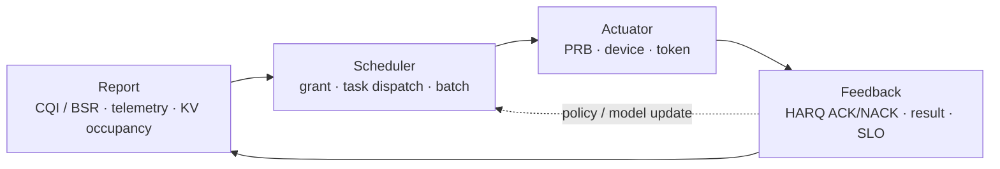
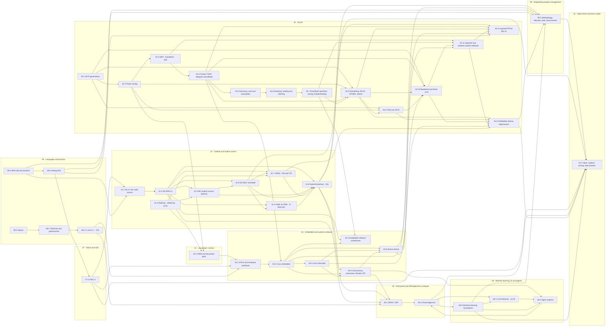

# Communications x Heterogeneous Compute x AI — Knowledge Graph

This vault is the English-language knowledge base behind one career thesis:

> Cellular/WLAN protocol stacks, heterogeneous compute, and on-device AI are converging into a single scheduling problem — deciding *what* runs *where*, *when*, under a hard latency and power budget.

## The unifying mental model

A RAN MAC scheduler, an edge task router, and an LLM inference scheduler are all solving the same shape of problem:

| RAN L2 scheduler | Edge/agent orchestrator | LLM inference engine |
| --- | --- | --- |
| UE capability | Device capability (CPU/GPU/NPU) | Hardware backend / block pool |
| CQI / BSR report | Telemetry / budget report | KV cache occupancy |
| Grant / PRB allocation | Task partition + dispatch | Batch + block allocation |
| HARQ RTT deadline | Sync barrier | Prefill / decode SLO |
| PF / EXP policy | Capability-aware policy routing | Continuous batching |

Carrying this analogy into interviews is the differentiator versus a pure AI-infra or pure modem background. See [[05-2 Cloud-Edge-End Collaboration and Heterogeneous Computing]].

All three are the same closed loop instantiated at a different time scale:

Only two things change: the unit of the budget, and who owns the loop. Sub-slot and the DU for RAN; tens of milliseconds and the orchestrator for the edge; per-iteration and the runtime for the inference engine.

## Numbering scheme

Notes are numbered `GG-x`: `GG` is a **domain group** numbered sequentially from `01`, and `x` indexes within the group. `00 MOC` is the index and sits outside the sequence. Group numbers are **contiguous** — a group number is stable only as long as the group order is, so adding a domain means appending a new group number rather than relabelling existing ones.

| Group | Domain | Notes |
| --- | --- | --- |
| `01-x` | Cellular and mobile communications | 01-1 … 01-8 |
| `02-x` | WLAN | 02-1 … 02-13 |
| `03-x` | Low-power and sensor networking | 03-1 |
| `04-x` | Embedded and systems software | 04-1 … 04-6 |
| `05-x` | Data plane and heterogeneous compute | 05-1, 05-2 |
| `06-x` | Machine learning, AI inference and agent systems | 06-1 … 06-3 |
| `07-x` | Silicon and instruction-set architecture | 07-1 |
| `08-x` | Programming languages and engineering practice | 08-1 … 08-5 |
| `09-x` | Engineering project management and delivery | 09-1 |
| `10-x` | Value-driven business model and monetisation | 10-1 |

The order is deliberate: it walks the signal path outward — air interface and RAN (`01`), then the wireless LAN and sensor edges (`02`, `03`), then the software that runs on the devices (`04`), then the data plane and the compute fabric (`05`), then the AI workloads that consume it (`06`), and finally the silicon and language foundations underneath everything (`07`, `08`). Groups `09` and `10` sit outside that path on purpose: `09` is the discipline that decides which of the technical work gets attempted, in what order, with whose time, and when the attempt is stopped, and `10` is the discipline that decides what the work is worth, who pays for it, how the payment recurs, and what stops the value leaking to customers, suppliers or imitators.

## Domains

Vault map — the ten groups and the edges that carry arguments between them:

### 01 · Cellular and mobile communications
- [[01-1 5G-Advanced and 6G Radio Access]] — Rel-19/20/21 timeline, AI-native air interface, ISAC, U6G, NTN
- [[01-2 5G NR RAN Layer 2 Protocol Stack]] — MAC / RLC / PDCP / SDAP, HARQ, BSR, grant lifecycle, QoS mapping
- [[01-3 AI-ML for RAN and O-RAN RIC]] — near-RT/non-RT RIC, xApps/rApps, DRL scheduling, sim-to-real
- [[01-4 Cellular IoT RedCap eRedCap and NTN]] — RedCap tiers, eRedCap, NTN, Ambient IoT, LP-WUS
- [[01-5 NR Random Access - UE RACH Procedure, Signalling and Tuning]] — the whole UE random-access procedure end to end: triggers and their RRC meaning, resource and RA-type selection, PRACH formats and open-loop power ramping, RA-RNTI and the RAR, Msg3 timing and payloads, contention resolution, 2-step MsgA/MsgB with fallback, CFRA and BFR, and the SDT / NTN / RedCap variants — then the same procedure retold from the UE side and from the gNB side, with what each side knows that the other does not
- [[01-7 NR HARQ - Retransmission Flow, Timelines and LTE Comparison]] — the retransmission mechanism itself: what the soft buffer stores, how NDI and RV decide new versus retry, the k0/k1/k2 timing with N1 and N2, HARQ-ACK codebooks and CBG retransmission, the four state machines, and a clause-level NR-versus-LTE comparison with the eight things an LTE engineer has to unlearn
- [[01-6 NR DU MAC Scheduler - Resource Allocation, HARQ and Real-Time Implementation]] — the scheduler itself: the CU/DU split and the 7-2x fronthaul, the four resources it allocates at once, the per-slot time budget, twelve modules, the eleven-step pipeline, the two-stage DL allocation, the UL chain, HARQ and PUCCH and PDCCH budgets, TDD and DRX, and the real-time execution model
- [[01-8 5G NR - OpenAirInterface - Architecture of an Open-Source NR Stack]] — the whole stack as a program you can read: what OAI is and who governs it, the GPL-to-OAI-PL-to-CSSL licence line and the Duranta move, the four software assets, the repository map, the four executables and what each node type is, the libconfig and command-line surface, ITTI tasks versus the real-time L1 threads with their notified FIFOs and thread pool, the FAPI L1/L2 boundary as a struct of function pointers with the P5 and P7 rhythm, nFAPI VNF/PNF, the NR MAC scheduler file by file with its preprocessor and postprocessor split, what the PHY actually implements and the USRP bandwidth ceilings, where RLC/PDCP/SDAP/RRC/NGAP/GTP-U sit relative to F1 and E1, split 8 and O-RAN 7.2x with libxran, DPDK, NETCONF/YANG and PTP, the nrUE with its actors and the k1/k2 budget, the 11-NF core, FlexRIC and the E2 and O1 interfaces, the simulator ladder from rfsim to Colosseum, the real-time tuning ladder with a worked core allocation, the measured throughput table, the independent srsRAN comparison, and a fault-localisation tree

### 02 · WLAN
- [[02-1 WLAN - Wi-Fi Generations Evolution]] — 802.11n/ac/ax/be/bn, Wi-Fi 4→9, MLO, OFDMA, UHR, multi-AP coordination
- [[02-2 WLAN - Power Saving Mechanisms and Evolution]] — legacy PS / PS-Poll, U-APSD, SMPS, TXOP PS, TWT and r-TWT, wake-up radio, AP power save, ambient power
- [[02-3 WLAN Ecosystem - WFA, EasyMesh and prpl]] — certification, Multi-AP control plane, prplMesh/prplOS
- [[02-7 WLAN - Wi-Fi EasyMesh, Operation, Tuning and Troubleshooting]] — the EasyMesh control plane end to end: what the Multi-AP specification does and does not standardise, releases v1.0→v6.0 and Profile-1/2/3, IEEE 1905.1 CMDU mechanics with the real message and TLV numbers, onboarding by WPS/PBC and by DPP, AP-autoconfiguration M1/M2, the four-address backhaul, the measurement families, channel selection and the three steering mechanisms, deployment trade-offs, every tunable policy field, and a layered troubleshooting method with a symptom table
- [[02-4 WLAN - Packet TX-RX Datapath and Offload Evolution]] — end-to-end TX/RX path (socket → qdisc → mac80211 → descriptor → EDCA/A-MPDU/Block Ack → PHY, and back through reorder/decrypt/GRO), the five planes of offload (per-packet assists, FullMAC vs SoftMAC, AP flow offload and WED, kernel bypass, control-plane), MLO reordering, and how to localise a fault in the path
- [[02-5 WLAN - STA-AP Discovery, Authentication and Association]] — the join sequence phase by phase: scanning and 6 GHz discovery (RNR, PSC, FILS Discovery), the MLME state machine, Open System vs SAE vs OWE vs 802.1X/EAP, association and the AID, the PMK→PTK key hierarchy and the 4-way handshake, PMF and SA Query, FT/k/v and FILS roaming, MLO setup, and a symptom-to-phase debugging table
- [[02-6 WLAN - Multi-AP Roaming, Healing and Steering]] — the multi-AP control loop: why 802.11 leaves the roam decision to the station, 802.11k discovery and 802.11r at ESS scale (R0KH placement, over-the-DS encapsulation, the failure taxonomy), steering by BTM / MBO / assoc control / EasyMesh with the decision function and its ping-pong problem, mesh healing as a backhaul state machine with topology repair and channel change, MLO at MLD granularity, and Wi-Fi 8 SMD as the first standard answer
- [[02-10 WLAN - Baseband and Driver Architecture for Wi-Fi 6, 7 and 8 - Qualcomm as the Reference Design]] — the box itself: what a baseband contains and which block each generation had to grow, the WCSS with its Q6 firmware processor, the WMI/HTT/HTC/CE protocol stack and the SRNG ring inventory, the transmit and receive data paths, NAPI and interrupt groups, where a frame actually waits and the measured cost of getting that wrong, MLO in silicon and in the driver, firmware crash and recovery, the SoC-side forwarding plane, how the driver family evolved from ath9k to the two-module ath12k split, what Wi-Fi 8 asks of each layer, and eight directions the architecture is moving in
- [[02-11 WLAN - OpenWrt and the Software Architecture of a Wireless System]] — the software side of the driver boundary: what OpenWrt actually is and its four downloadable artifacts, the five boundaries from intent to air, the five daemons that are always running, the ucode pipeline that turns `/etc/config/wireless` into a hostapd BSS without restarting anything, the UCI wireless device model with `wifi-device` / `wifi-iface` / `wifi-vlan` / `wifi-station`, hostapd's ubus surface and why steering is a user-space decision, netifd's device and interface state machines with their real event and state names, where a packet goes inside the box and what flow offload and WED cost, firmware / board data / MACs / regulatory as the four things that are not source, the build and update system with apk and attended sysupgrade, and how the neighbours differ — TIP OpenWiFi with APNOS, uCentral, the Cloud SDK and its device PKI, OpenSync, prplOS and RDK-B, the hobbyist forks and vendor SDKs — plus the OpenWrt One reference hardware, six honest limitations and a fault-localisation table
- [[02-12 WLAN - openwifi - An Open-Source FPGA 802.11 Platform]] — when even the low MAC is yours to rewrite: why an SDR 802.11 stack exists and the four things a commercial chip will not let you do, the Zynq plus AD9361 platform with its board and Vivado-licence table, the three repositories and the full build flow, the six FPGA IP cores file by file, the low MAC inside `xpu` with the CSMA/CA state machine and the registers that put SIFS, slot time, ACK timeouts, CCA, the contention window and the retry limit under your control, the four transmit queues and time slicing by MAC address, `sdr.c` as a mac80211 driver whose hardware owns the timing with the complete `ieee80211_ops` list, the transmit and receive paths step by step, why the split falls where it does, `sdrctl` over nl80211 testmode and sysfs, modes of operation and the 802.11b caveat, CSI / IQ / sensing, published performance and its limits, and how it compares with commercial chips, GNU Radio transceivers, `mac80211_hwsim` and simulators
- [[02-13 WLAN - Reliability, Low Latency and Determinism - What the Wi-Fi Stack Can Actually Do]] — what all of it is for: the three contracts of reliability, low latency and determinism and why they fight, the latency budget component by component and which layer owns each term, the lever map from application to low MAC, MAC retransmission with the real retry limits and the 512 TU lifetime, Minstrel and why the retry chain is capped at 26 ms, duplication as reliability without a latency cost, the roaming budget with 802.11k/v/r and OKC, the four-rung latency ladder from EDCA to r-TWT to preemption, MLO with its measured 95th-percentile table and the symmetry caveat, AQL with its constants and hysteresis, fair queueing and airtime fairness with the measured latencies, TSQ and why the kernel trades 3 ms for 3x throughput, L4S, what a bound actually requires, the honest achievability table, cross-technology comparison, measurement method, five deployment recipes, a fault table and ten answers
- [[02-9 WLAN - Time-Sensitive Networking Across Wi-Fi Generations]] — what the scheduler is for: the four numbers a time-sensitive application actually demands, the six structural reasons Wi-Fi resists a bound, the 802.1 toolbox and what each tool becomes over the air, the generation ladder from 802.11e through 802.11v, aa, mc, ak, ax and be to 802.11bn, 802.1AS over TM and FTM with the hardware-timestamping constraint, the five-rung ladder from EDCA to trigger-based access, TWT, r-TWT and preemption, SCS and the QoS Characteristics element, 802.1CB over MLO, P-EDCA, NPCA and multi-AP coordination, the wired–wireless integration model, and a deployment method with a worked latency budget, the converged wired–wireless network when both the client and the AP are TSN-aware — why convergence is
the direction of travel with the dated evidence, one gPTP time base carried across four hops with the AP as a
relay instance and the client as an end instance, what has actually been measured over the air, how priority
crosses the 802.11 Portal with the eight-to-four collapse and its traps, and why the launch time belongs to the
AP rather than the client
- [[02-8 WLAN - Scheduling - Channel Access, EDCA, OFDMA Resource Allocation, Airtime and Implementation]] — the scheduler itself: interframe spaces and the DCF backoff machine, EDCA's four access categories and its release-to-release TXOP change, the OFDMA resource-unit grid and the legal MRU set, the eight trigger-frame types and one UL OFDMA round, MU-MIMO sounding, Wi-Fi 7 scheduling across links, airtime fairness and deficit round robin, the per-TXOP pipeline, rate control, TWT, and `mac80211` with AQL

### 03 · Low-power and sensor networking
- [[03-1 Wireless Sensor Networks and Low-Power MAC]] — clustering, UAV-assisted collection, TSCH, AoI

### 04 · Embedded and systems software
- [[04-1 Embedded Systems RTOS and Hardware Interfaces]] — FreeRTOS, PendSV, I2C/SPI/UART/CAN, DMA, cache coherency
- [[04-2 Linux Embedded Development - Drivers, Applications and Core Subsystems]] — boot chain, device tree, kernel drivers, IPC, network stack, KVM/containers, PREEMPT_RT
- [[04-3 Embedded Software Architecture - Patterns, Layering and Wireless System Structure]] — layering and HAL/BSP, execution models, HSM, design patterns, AUTOSAR, safety, OTA, wireless stack decomposition
- [[04-4 Linux Interrupts - Types, Handlers, Threaded IRQs and Deferred Work]] — the interrupt subject end to end: the five orthogonal type axes (synchronous/async, maskable/NMI, level/edge, wire/MSI, private/shared/IPI), the three interrupt controllers (GICv2/v3/v4 with the full INTID map, x86 LAPIC/IOAPIC/IDT, RISC-V PLIC versus AIA), the generic IRQ layer (`irq_desc`/`irq_chip`/`irq_domain`/flow handlers), the entry path, top-half discipline, the four bottom halves with the ten fixed softirq vectors and the 2 ms/10-restart brakes, threaded IRQs at SCHED_FIFO 50, six worked applications from NAPI to rpmsg doorbells, and the tuning and debugging tables
- [[04-6 Linux Device Drivers - Model, Probe, Data Path, Power and Bring-Up]] — the driver subject end to end: the five jobs a driver does, the bus/device/driver model with sysfs and uevent and devtmpfs, matching and probe ordering with devres and `-EPROBE_DEFER`, one lifecycle state machine, the char-device read path and ioctl discipline, the interrupt-driven data path, MMIO and DMA with the buffer-ownership state machine, runtime PM using the real `rpm_status` names and the system-suspend callback order, platform versus I2C/SPI/PCI anatomy, the framework-selection tree, and a bring-up method with a symptom table
- [[04-5 Linux Concurrency - Kernel and User Mode, Processes, Threads and IPC]] — the concurrency subject end to end: the privilege boundary across x86/ARM/RISC-V and what each mode may touch, the five kernel execution contexts and the sleep/preempt/user-memory matrix, the four preemption models, the process model (`task_struct`, TGID versus TID, `clone` flags, copy-on-write, lifecycle), threads (NPTL 1:1 versus LinuxThreads versus NGPT, what is shared, stack size, signals), kernel threads, ITC over atomics and the futex with its private/shared keying and robust-PI variants, the seven-axis IPC comparison and decision logic, the shared-memory-plus-doorbell pattern, the fd-everything event loop, a worked multi-process daemon, and the bug taxonomy with the toolchain

### 05 · Data plane and heterogeneous compute
- [[05-1 DPDK User Plane and 5G UPF]] — mbuf/mempool, PFCP, PDR/FAR/QER, QoS enforcement, small-packet pps
- [[05-2 Cloud-Edge-End Collaboration and Heterogeneous Computing]] — UnifiedBus, memory pooling, MFU, RDMA

### 06 · Machine learning, AI inference and agent systems
- [[06-3 Machine Learning - Foundations, Core Algorithms and Applications]] — read this first if the AI group is new to you: paradigms, the workflow and the leakage traps, linear and logistic models, bias and variance, trees and ensembles, k-means and PCA, networks and backpropagation with worked numbers, CNN/RNN/transformer/generative architectures, training at scale, evaluation metrics, tuning, applications, MLOps and failure modes
- [[06-1 LLM Inference Engines and xLLM]] — KV cache, PagedAttention, quantization, operator fusion, prefill/decode
- [[06-2 Agent Systems and Edge Orchestration]] — GRAFT, multi-device SLM mesh, safety-bounded execution

### 07 · Silicon and instruction-set architecture
- [[07-1 RISC-V for Communication Infrastructure]] — baseband clusters, EdgeQ, software-defined PHY, L1/L2 interface

### 08 · Programming languages and engineering practice
- [[08-1 Programming Languages Toolchain and Performance Engineering]] — build systems, Linux, profiling, kernel bypass, and how the languages fit together
- [[08-2 C and C++ Programming - Language Features, STL and Systems Practice]] — C23/C++26 language features, templates, memory model, STL containers and algorithms, systems idioms
- [[08-3 Python Programming - Language, Object Model and Engineering Practice]] — CPython execution model, dunder protocols, classes (dataclass / ABC / Protocol / metaclass), asyncio, typing, NumPy array model, performance decision tree, packaging
- [[08-4 MATLAB and Simulink - Programming, Modelling and Code Generation]] — array semantics and copy-on-write, `classdef` value vs handle classes, `arguments` validation, Simulink solvers and sample time, Stateflow, fixed point, Embedded/HDL Coder, SIL/PIL/HIL
- [[08-5 Verilog HDL - RTL Design, Verification and Synthesis Practice]] — 1364/1800 lineage, blocking vs non-blocking semantics, FSM and reset discipline, timing and CDC, SystemVerilog classes and UVM, synthesis flows, DSP RTL patterns

### 09 · Engineering project management and delivery

- [[09-1 Engineering Project Management - Methodology, Lifecycle, Tools and Best Practice]] — the discipline that decides which of the technical work above gets attempted, in what order, with whose time, and when the attempt is stopped: what a project, a programme and a portfolio are and why conflating them is the commonest structural error; the empirical base — Flyvbjerg's 16,000-project database at 47.9% on budget, 8.5% on budget and on time, 0.5% on all three including benefits, McKinsey-Oxford's 45% over budget and 56% less value, CHAOS and the size effect, with the four caveats you must state when quoting them; the methodology family tree from plan-driven through iterative and adaptive to flow and systems engineering, and why "waterfall" is a misreading of Royce; a decision tree for choosing a method from requirements volatility, consequence of failure, certification and the binding constraint; the lifecycle with gates and an explicit kill branch, in PMBOK 7, PRINCE2 Version 7, NASA's phases and key decision points, and stage-gate; scope, the 100% rule and a worked WBS; scheduling from Gantt through CPM and PERT to critical chain and Monte Carlo, with a worked critical path and a fever chart; estimation as a forecast with P50 and P80, reference class forecasting, and earned value with its 1967-to-2026 lineage; risk under ISO 31000 and NASA's 70% joint confidence level; verification and validation by level in the V-model; change, baselines and configuration; organisation, decision rights and the single-threaded or chief-engineer owner; governance by exception with tolerances and non-advocacy review; the tool stack and the failure mode of each class; what a project management plan contains and a worked Wi-Fi 7 multi-link plan with milestones, buffers and a risk register; the practice sets of Toyota, Amazon, Google, NASA, USDS and the FBI Sentinel turnaround, plus what not to copy from Spotify and SAFe; the failure taxonomy from Brooks's law to 100% utilisation, Denver's baggage system and the 737 MAX report; Little's Law and the metrics that survive; and an operating rhythm with a first-30-days checklist

### 10 · Value-driven business model and monetisation

- [[10-1 Value-Driven Business Model - Methodology, Process, Tools and Best Practice]] — the commercial side of everything above: what "value-driven" means and the three senses of the phrase that get conflated (value-based management, value-based pricing, and the business-model view of creating, delivering and capturing value); the value slice — willingness to pay, price, cost, opportunity cost — and why your share is set by your added value rather than by your effort; what value-driven is *not* (cost-plus, share-driven, feature-driven, revenue-driven) and the three overstated claims about value-based pricing, recurring revenue and outcome-based contracts; the five-part value frame, the three canvases and what each hides, and the four-box model of value proposition, profit formula, key resources and key processes; the evidence base with its sources and the four caveats — Marn and Rosiello's 11.1%, McKinsey's ~8% and 8.7%, the 18.7% volume arithmetic, Adobe's designed revenue trough and its primary numbers, Rolls-Royce's 1962 Power-by-the-Hour and per-flying-hour capture, Arm's licence-plus-royalty model and the royalty-base fight, the NDRC's 2015 Qualcomm remedy fixing the base at 65% of net selling price, and the SaaS benchmark conventions; jobs-to-be-done in both lineages with the opportunity algorithm and its weakness; economic value to the customer against a named alternative; willingness-to-pay methods from Van Westendorp to conjoint and live tests, and the difference between the customer value driver tree and the financial one; eight schools of method and which leads for which uncertainty; an eight-phase process with gates, stop branches and discovery-driven planning; the tool stack with each class's failure mode; a fifteen-pattern catalogue with the value metric as the first column, a pattern-selection tree, and where value is captured across the communications and silicon stack; appropriability, complementary assets and the four claimants on the value slice; pricing as metric, structure then level, with tiers, fences, the pocket-price waterfall and the clauses that decide capture; organisation, incentives, cadence and anti-patterns; the practice sets of Toyota's target costing, Amazon's working backwards and usage pricing, Adobe's designed transition, Rolls-Royce, Michelin, Signify and Xerox, Arm's ecosystem licensing, Porter and Teisberg's outcomes-per-dollar with its critique, and what not to copy; seven failure modes with a diagnosis tree; the value dashboard; a worked industrial wireless case from job statement to unit economics, kill criteria and risk register; and ten short answers

## Cross-cutting threads

1. **Determinism.** Tail latency / P99 is the shared KPI across Wi-Fi 8 UHR, URLLC, and agent orchestration barriers.
2. **Memory semantics.** KV cache, memory pooling, and UnifiedBus global addressing are the same battle fought at three layers.
3. **Interface semantics.** L1 accelerator ↔ L2 general-purpose core, NPU ↔ CPU, coordinator ↔ worker — the boundary always costs more than the compute.
4. **Verification methodology.** Simulation → data replay → hardware-in-the-loop is the only credible path for both AI schedulers and AI-native PHY.

## Companion documents (outside this vault)

This vault is opened at `knowledge-graph/`, so the source documents in the parent directory are **not** visible to Obsidian and cannot be wikilinked. They are plain-text references:

| Document | Purpose |
| --- | --- |
| `README.md` / `README.cn.md` | Project overview, reading path, directory structure, conventions, fact-checking strategy |
| `background.md` / `background.cn.md` | Profile, role trajectory, domains, tech stack, and the original task statement |
| `skills-draft.md` / `skills-draft.cn.md` | The 2026 knowledge framework plus interview question groups A/B/C/D |
| `readlist.md` | Books, papers, standards and reports, sectioned to mirror this vault's note numbering |

Naming convention: English is the default filename (no suffix); Chinese versions carry `.cn`.

## Conventions used in this vault

- Notes are numbered `GG-x` by domain group (see **Numbering scheme** above); `00 MOC` is the index.
- Every note carries a `last-updated` field and an **Anchors** section with dated, checkable facts (standard numbers, freeze dates, publication venues).
- Items that are plausible but not independently confirmed are marked `VERIFY` rather than stated as fact.
- Wikilinks are used deliberately: a link means the two concepts are argued about together in interviews.
- Diagrams are Mermaid, so they render in Obsidian's reading view without an external tool.

---

Copyright (c) 2026 Washington Ruan. All rights reserved.
