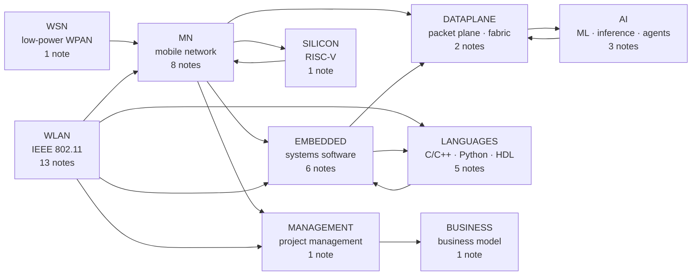

# Communications x Heterogeneous Compute x AI — Knowledge Graph

> **One thesis holds this vault together.** Cellular and WLAN protocol stacks, heterogeneous compute and on-device AI are converging into a single scheduling problem — deciding *what* runs *where*, *when*, under a hard latency and power budget. A RAN MAC scheduler, an edge task router and an LLM inference engine are the same closed loop at three different time scales. Every note states where that analogy holds and, more usefully, where it breaks.

**Ten directories · 41 notes · one index.** The directory is the domain; the note number is the order to read within it.

## 1. Start here

| You have | Do this |
| --- | --- |
| **An hour** | Read §2 and §4, then the **Anchors** section of the two notes closest to your own work |
| **A day** | One directory, end to end, in the reading order given in its section below |
| **A week** | One directory plus the `★★★` entries of that directory's `readlist.md` |
| **Four weeks** | The plan at the end of §4 |

Two rules make the difference between reading and knowing:

1. **Read the standard, not the summary, for anything you intend to quote.** Specification numbers, freeze dates and parameter values are cheap to check and expensive to get wrong — the [corrections appendix](99%20Corrections%20-%20Verified%20Facts%20That%20Popular%20Sources%20Get%20Wrong.md) exists because secondary sources repeat each other's errors.
2. **Pair every paper with its implementation.** xLLM, DPDK, prplMesh, openwifi, OpenAirInterface and the Linux drivers all ship source. Reading the code is how you find what the paper left out — usually the part an interviewer asks about.

## 2. The map

The first eight directories walk the signal path outward: air interface, then the wireless edges, then the software underneath them, then the packet plane, then the AI workloads that consume it, then the silicon and language foundations. `MANAGEMENT` and `BUSINESS` sit outside that path on purpose — one decides *which* of the technical work gets attempted, the other decides *what it is worth*.

## 3. Reading marks

Every `readlist.md` uses the same three marks, defined once here so the lists stay readable.

Every entry opens with a bracketed tag in one of two orders — `[Book · EN · ★★★]` or `[Doc · ★★★ · EN]` — carrying three things:

| Mark | Meaning |
| --- | --- |
| `Book` `Paper` `Standard` `Spec` `Doc` `Code` | What kind of source it is. `Doc` is vendor or project documentation; `Code` is a repository you are meant to read |
| `★★★` `★★` `★` | `★★★` read or skim before you quote the note · `★★` read for depth in your track · `★` look up on demand |
| `EN` `CN` `EN/CN` | Language of the edition. Titles are kept in their published form and never translated, so a Chinese edition keeps its Chinese title and `《》` |

## 4. How to read, and how to remember

**The shape of every note is fixed**, and it is a reading order in itself:

> claim → numbered sections with diagrams → **Anchors** → **Related** → **References**

Four passes, in this order: read the claim and the section headings, so you know what the note is arguing; look at the diagrams, because the architecture lives in them; read the **Anchors**, which are the dated checkable facts; then follow two or three **Related** links, because a link means the two concepts get argued about together.

**Remembering it.** Five practices, in descending order of payoff:

1. **Treat Anchors as the syllabus.** Each note carries 8–20 dated, checkable facts — a spec clause, a freeze date, a measured number. If you can state them without the file, you can defend the note.
2. **Reproduce one diagram from memory**, then diff it against the note. Recall of structure decays faster than recall of prose, and structure is what gets tested.
3. **Explain it back in 90 seconds**, without jargon, to someone outside the field. The place you reach for a term you cannot define is the place to re-read.
4. **Space the passes** — one day, three days, seven, twenty-one. A second reading of the same note is worth less than a first reading of a neighbour.
5. **Ask the two questions** at the end of each note: *what breaks if this is wrong*, and *what does it cost*. Notes that survive both are the ones worth quoting.

**A four-week plan**, if a date is already fixed:

| Week | Focus | What to read |
| --- | --- | --- |
| 1 | Anchor the map | §2 and §4 of this page; the directory matching your target role, headings only; Dahlman *5G NR* ch. 6/13/14 or Gast *802.11* DCF and IFS/NAV, whichever side you sit on |
| 2 | Your primary track | That directory's notes in reading order, plus the `★★★` entries of its `readlist.md` |
| 3 | The neighbours that get asked about | The two directories with edges into yours on the map — usually `EMBEDDED` or `DATAPLANE` |
| 4 | Consolidate | Every **Anchors** section; the corrections appendix; re-read only what you cannot state from memory |

## 5. `MN` — Mobile network

3GPP radio access from the release map down to the per-slot scheduler, plus one open-source implementation you can read end to end. This is the group that answers "explain your stack from the spec clause to the thread that missed its deadline".

**Read first:** 01-2 → 01-6 → 01-7 → 01-8, then 01-5 and 01-1; 01-3 and 01-4 branch off.

| Note | What it answers |
| --- | --- |
| [[01-1 5G-Advanced and 6G Radio Access]] | The release map Rel-18 → Rel-21 and what each release actually adds: AI-native air interface, ISAC, U6G, NTN |
| [[01-2 5G NR RAN Layer 2 Protocol Stack]] | MAC, RLC, PDCP and SDAP as layers with a contract: HARQ, BSR, the grant lifecycle, QoS mapping |
| [[01-3 AI-ML for RAN and O-RAN RIC]] | The RAN's control loop: near-RT and non-RT RIC, xApps and rApps, DRL scheduling, the sim-to-real gap |
| [[01-4 Cellular IoT RedCap eRedCap and NTN]] | The IoT corners of the same air interface: RedCap tiers, eRedCap, NTN timing, Ambient IoT |
| [[01-5 NR Random Access - UE RACH Procedure, Signalling and Tuning]] | The random-access procedure end to end, then retold from the UE side and from the gNB side |
| [[01-6 NR DU MAC Scheduler - Resource Allocation, HARQ and Real-Time Implementation]] | The scheduler as a DU implements it: four resources at once, a per-slot budget, twelve modules, eleven steps |
| [[01-7 NR HARQ - Retransmission Flow, Timelines and LTE Comparison]] | The retransmission mechanism in both generations, ending in a clause-level NR-versus-LTE comparison |
| [[01-8 5G NR - OpenAirInterface - Architecture of an Open-Source NR Stack]] | An open-source NR stack read as code: repository, threads, FAPI, scheduler, 7.2x, UE, core, RIC |

References: [`MN/readlist.md`](MN/readlist.md) — 3GPP, ITU-R, O-RAN, and the vendor documentation that explains the implementation.

## 6. `WLAN` — IEEE 802.11

Thirteen notes that take Wi-Fi apart in the order a product is built: what the generations promise, how a station joins and stays joined, how frames actually move, how the AP schedules, what the silicon does, what the software on top does, and finally whether any of it can be made deterministic.

**Read first:** 02-1 → 02-5 → 02-4 → 02-8 → 02-10; then 02-13 and 02-9, the two that answer "can it be deterministic"; 02-2, 02-3, 02-6, 02-7, 02-11, 02-12 as needed.

| Note | What it answers |
| --- | --- |
| [[02-1 WLAN - Wi-Fi Generations Evolution]] | 802.11n → 802.11bn as a feature-by-feature lineage, and what each generation was actually for |
| [[02-2 WLAN - Power Saving Mechanisms and Evolution]] | Energy as the design constraint: legacy PS, U-APSD, SMPS, TWT and r-TWT, wake-up radio, ambient power |
| [[02-3 WLAN Ecosystem - WFA, EasyMesh and prpl]] | Who certifies and who coordinates: WFA programmes, EasyMesh, prplMesh, prplOS |
| [[02-4 WLAN - Packet TX-RX Datapath and Offload Evolution]] | The packet path through host and device, and the five planes of offload that shorten it |
| [[02-5 WLAN - STA-AP Discovery, Authentication and Association]] | The join sequence phase by phase: scanning, SAE/OWE/802.1X, the 4-way handshake, PMF, FT, MLO setup |
| [[02-6 WLAN - Multi-AP Roaming, Healing and Steering]] | The roam decision, and what the network can do about it: 802.11k/v/r, steering, mesh healing |
| [[02-7 WLAN - Wi-Fi EasyMesh, Operation, Tuning and Troubleshooting]] | EasyMesh in operation: releases, 1905.1 CMDU mechanics, onboarding, metrics, tuning, troubleshooting |
| [[02-8 WLAN - Scheduling - Channel Access, EDCA, OFDMA Resource Allocation, Airtime and Implementation]] | The scheduler as an AP implements it: DCF, EDCA, the RU grid, triggers, airtime fairness, mac80211 |
| [[02-9 WLAN - Time-Sensitive Networking Across Wi-Fi Generations]] | Determinism across generations, and §11 on the converged wired–wireless network when both ends are TSN-aware |
| [[02-10 WLAN - Baseband and Driver Architecture for Wi-Fi 6, 7 and 8 - Qualcomm as the Reference Design]] | The baseband and driver stack with Qualcomm as the reference: WCSS, WMI/HTT, rings, NAPI, ath9k → ath12k |
| [[02-11 WLAN - OpenWrt and the Software Architecture of a Wireless System]] | The router as a software system: five daemons, the ucode pipeline, netifd, flow offload, firmware as the part that is not source |
| [[02-12 WLAN - openwifi - An Open-Source FPGA 802.11 Platform]] | An SDR 802.11 stack where the low MAC is yours to rewrite: Zynq and AD9361, six IP cores, CSMA/CA in Verilog |
| [[02-13 WLAN - Reliability, Low Latency and Determinism - What the Wi-Fi Stack Can Actually Do]] | What a latency or reliability target costs and who pays it: retries, roaming, MLO, AQL, TSQ, L4S |

References: [`WLAN/readlist.md`](WLAN/readlist.md) — the 802.11 amendments, WFA and Multi-AP specifications, kernel source, and the measurement papers.

## 7. `WSN` — Low-power and sensor networking

One note, and it is the counterweight to everything above: when the energy budget rather than the latency budget binds, the design inverts — sleeping becomes the default, and *age of information* replaces throughput as the metric worth optimising.

| Note | What it answers |
| --- | --- |
| [[03-1 Wireless Sensor Networks and Low-Power MAC]] | WPAN medium access, clustering, TSCH and AoI when energy is the binding constraint |

References: [`WSN/readlist.md`](WSN/readlist.md).

## 8. `EMBEDDED` — Embedded and systems software

The software the stack runs on, in the order you meet it on a box: what an RTOS guarantees, what Linux gives you instead, how the architecture decides what can still be changed later, then the three subjects that decide whether a real-time path meets its deadline — interrupts, concurrency, and the driver that owns the device.

**Read first:** 04-3 → 04-1 → 04-2 → 04-4 → 04-5 → 04-6.

| Note | What it answers |
| --- | --- |
| [[04-1 Embedded Systems RTOS and Hardware Interfaces]] | FreeRTOS internals and the buses a device actually talks: I2C, SPI, UART, CAN, DMA, cache coherency |
| [[04-2 Linux Embedded Development - Drivers, Applications and Core Subsystems]] | The embedded Linux system end to end: boot chain, device tree, drivers, IPC, networking, KVM, PREEMPT_RT |
| [[04-3 Embedded Software Architecture - Patterns, Layering and Wireless System Structure]] | Architecture as a set of decisions: layering, execution models, state machines, AUTOSAR, safety, OTA |
| [[04-4 Linux Interrupts - Types, Handlers, Threaded IRQs and Deferred Work]] | Interrupts in full: five type axes, GIC/x86/RISC-V controllers, the IRQ layer, bottom halves, threaded IRQs |
| [[04-5 Linux Concurrency - Kernel and User Mode, Processes, Threads and IPC]] | Privilege levels, execution contexts, processes and threads, the futex, seven IPC mechanisms compared |
| [[04-6 Linux Device Drivers - Model, Probe, Data Path, Power and Bring-Up]] | The driver model: bus matching, probe ordering, the char-device read path, DMA ownership, runtime PM, bring-up |

References: [`EMBEDDED/readlist.md`](EMBEDDED/readlist.md) — FreeRTOS, Zephyr, AUTOSAR, the kernel tree, and the two books worth owning.

## 9. `DATAPLANE` — Packet plane and heterogeneous compute

Where the bytes go once they leave the stack, and where the compute goes once it leaves the device. Two notes, and together they set up the question the `AI` directory answers: what runs where, and who pays for the move.

**Read first:** 05-1 → 05-2.

| Note | What it answers |
| --- | --- |
| [[05-1 DPDK User Plane and 5G UPF]] | DPDK as a forwarding plane and a 5G UPF as the workload: mbuf, PFCP, PDR/FAR/QER, small packets |
| [[05-2 Cloud-Edge-End Collaboration and Heterogeneous Computing]] | Where the work runs: UnifiedBus, memory pooling, MFU, RDMA, and the cloud-edge-end split |

References: [`DATAPLANE/readlist.md`](DATAPLANE/readlist.md).

## 10. `AI` — Machine learning, inference and agents

Written for people who will be asked to *serve* models rather than invent them: read 06-3 first if the vocabulary is new, then 06-1 for the serving engine, then 06-2 for systems that decide their own call sequence.

**Read first:** 06-3 → 06-1 → 06-2.

| Note | What it answers |
| --- | --- |
| [[06-1 LLM Inference Engines and xLLM]] | LLM serving: KV cache, PagedAttention, quantisation, operator fusion, the prefill/decode split |
| [[06-2 Agent Systems and Edge Orchestration]] | Agents as schedulers: GRAFT, multi-device SLM meshes, safety-bounded execution |
| [[06-3 Machine Learning - Foundations, Core Algorithms and Applications]] | Read first if the group is new: the learning loop, the classical algorithms, the architectures, MLOps |

References: [`AI/readlist.md`](AI/readlist.md).

## 11. `SILICON` — Silicon and instruction-set architecture

One note on the instruction set as a system decision rather than a religious one: what RISC-V changes for a baseband, and where the L1/L2 boundary lands when the accelerator shares a die with the general-purpose cores.

| Note | What it answers |
| --- | --- |
| [[07-1 RISC-V for Communication Infrastructure]] | RISC-V as communications silicon: baseband clusters, the H extension, software-defined PHY, the L1/L2 boundary |

References: [`SILICON/readlist.md`](SILICON/readlist.md).

## 12. `LANGUAGES` — Programming languages and engineering practice

Five notes on the tools rather than the theory: how to build, measure and profile; what C++26 actually gives you; how CPython's object model leaks into performance; where MATLAB and Simulink fit in a hardware programme; and what a synthesisable Verilog style looks like.

**Read first:** 08-1 → 08-2, then 08-3; 08-4 and 08-5 by track.

| Note | What it answers |
| --- | --- |
| [[08-1 Programming Languages Toolchain and Performance Engineering]] | Build, link, profile and measure: the toolchain, kernel bypass, and what a performance number actually means |
| [[08-2 C and C++ Programming - Language Features, STL and Systems Practice]] | C23 and C++26 in practice: templates, the memory model, STL, systems idioms, the UB catalogue |
| [[08-3 Python Programming - Language, Object Model and Engineering Practice]] | CPython's object model and the engineering around it: dunders, typing, asyncio, NumPy strides, packaging |
| [[08-4 MATLAB and Simulink - Programming, Modelling and Code Generation]] | Array semantics, classdef, solvers, Stateflow, fixed point, code generation, SIL/PIL/HIL |
| [[08-5 Verilog HDL - RTL Design, Verification and Synthesis Practice]] | RTL as a discipline: 1364/1800, blocking versus non-blocking, CDC, UVM, synthesis, DSP patterns |

References: [`LANGUAGES/readlist.md`](LANGUAGES/readlist.md).

## 13. `MANAGEMENT` — Engineering project management

The first of the two non-technical directories, and the one that decides whether the technical work above ever ships: which work gets attempted, in what order, with whose time, and — the question nobody writes down — when the attempt is stopped.

| Note | What it answers |
| --- | --- |
| [[09-1 Engineering Project Management - Methodology, Lifecycle, Tools and Best Practice]] | Methodology, lifecycle, planning, earned value, risk, governance, and the practice of organisations that ship |

References: [`MANAGEMENT/readlist.md`](MANAGEMENT/readlist.md).

## 14. `BUSINESS` — Value-driven business model

The second non-technical directory, and the one that decides whether the shipped work is worth anything to anyone who will pay for it: creating value, capturing a share of it, and choosing the metric you charge by.

| Note | What it answers |
| --- | --- |
| [[10-1 Value-Driven Business Model - Methodology, Process, Tools and Best Practice]] | Creating, delivering and capturing value: the value slice, the metric you charge for, pricing, tiers, clauses |

References: [`BUSINESS/readlist.md`](BUSINESS/readlist.md).

## 15. Cross-cutting threads

Four ideas recur, and the notes are more useful read as four passes over them than as ten separate domains:

1. **Determinism.** Tail latency is the shared KPI across Wi-Fi 8 UHR, URLLC and agent orchestration barriers.
2. **Memory semantics.** KV cache, memory pooling and UnifiedBus global addressing are the same battle fought at three layers.
3. **Interface semantics.** L1 accelerator ↔ L2 core, NPU ↔ CPU, coordinator ↔ worker — the boundary always costs more than the compute.
4. **Verification methodology.** Simulation → data replay → hardware-in-the-loop is the only credible path, for AI schedulers and for an AI-native PHY alike.

## 16. Contributing

The vault is meant to be corrected. Three kinds of contribution are welcome, in this order of value: **a correction with a citation** (a claim that is wrong, or right but dated), **a note that fills a gap** in an existing directory, and **a reference** worth adding to a directory's `readlist.md`.

**Before opening a pull request**, run the checklist — the first four items are what gets a PR rejected, and all of them are checkable in a minute:

- [ ] The note lives in the right directory and its number continues that directory's sequence.
- [ ] It is written in **English**, in the vault's voice: claims stated plainly, then the evidence; no marketing summary.
- [ ] Every number, date, clause and product claim has a source in **References**, and the source is primary wherever one exists.
- [ ] Anything not independently confirmed is marked **`VERIFY`** rather than asserted — a flagged doubt is worth more than a confident guess.
- [ ] The body ends with **Anchors** → **Related** → **References**, and the footer line is unchanged.
- [ ] Diagrams are Mermaid code blocks, and they carry the structural sections (architecture, data path, timing, decision logic) rather than decorating them.
- [ ] Frontmatter carries `title`, `license` and `last-updated`; `[[wikilinks]]` are on one line and point at real note names.
- [ ] The directory's `readlist.md` and the directory table on this page both mention the note.

**Workflow.** Fork, branch as `note/GG-x-short-topic` or `fix/GG-x-what`, commit with `git commit -s` (Developer Certificate of Origin — no CLA is asked for), and open one pull request per idea. Review is a factual review: if a claim cannot be traced, the fix is a citation or a `VERIFY` flag, not a rewrite. Disagreement with a judgement is welcome — say which sentence and why.

**What gets declined**: a translation of a note without the English original, a summary of other people's summaries, prose with no sources, and "current version" claims with no date attached.

**Licence of contributions.** By contributing you agree to license your contribution under the same terms as the repository — GPL-3.0-or-later or AGPL-3.0-or-later, at the user's option.

## 17. Maintenance and verification

- **Anchors** hold only checkable facts: a specification number, a clause, a freeze or publication date, a measured value, an ISBN or DOI. Everything else belongs in the body.
- **`VERIFY`** marks a claim that is plausible but not independently confirmed. Each directory carries a handful on purpose; they are the honest edge of the vault, not an embarrassment.
- **Corrections live in two places**: the note's Anchors (the verified fact) and the [corrections appendix](99%20Corrections%20-%20Verified%20Facts%20That%20Popular%20Sources%20Get%20Wrong.md) (which popular claim was wrong, and why). Cite the Anchors, never the popular source.
- **Staleness is domain-specific.** Every note carries a `last-updated` date, and the table below says what makes each directory's numbers move.

| Directory | What to watch | Baseline in the notes |
| --- | --- | --- |
| `MN` | 3GPP TSG plenaries (four a year), new TS 38.213/38.214/38.321/38.331 versions, O-RAN WG4 CUS and WG1 OAD releases, SCF FAPI revisions | TS 38.214 v18.9.0, TS 38.321 v17.3.0 |
| `WLAN` | IEEE 802.11 ballots (TGbe, TGbn, TGbp), WFA certification and Multi-AP revisions, prplMesh releases, the mac80211 merge window, hostapd and wpa_supplicant releases | 802.11be-2024, EasyMesh v6.0 effective 2024-12-31, 802.11bn at D1.x |
| `WSN` | IEEE 802.15.4 amendments and the open TSCH implementations | 802.15.4-2020 |
| `EMBEDDED` | Linux mainline and LTS, the tasklet → WQ_BH conversion, AUTOSAR each November, Zephyr's six-month cycle, ISO 26262 and IEC 61508 maintenance | PREEMPT_RT in 6.12, WQ_BH in 6.9, AUTOSAR R25-11 |
| `DATAPLANE` | DPDK LTS releases, eBPF/XDP kernel support, UPF implementations | DPDK LTS, Linux 6.x XDP |
| `AI` | xLLM, Mooncake and agent frameworks; scikit-learn, PyTorch and JAX majors | scikit-learn 1.9.1, PyTorch 2.14.1 (Sept 2026) |
| `SILICON` | RISC-V International ratifications and AIA document revisions, Arm GIC specification updates | AIA v1.0 (2023-06), revision 2025-03-12, APLIC/IMSIC in Linux 6.10 |
| `LANGUAGES` | WG21 and WG14 meetings, GCC and Clang majors, CPython each October, MATLAB R20xxa/b, IEEE 1800 and 1800.2, MISRA documents | C++26 shipped 2026-03-28, CPython 3.15.0 (2026-10-09), 1800-2023, MISRA C:2025 |
| `MANAGEMENT` | PMI, PeopleCert and ISO/TC 258 editions; the annual DORA report | PMBOK 7 (2021), PRINCE2 Version 7 (2023), EIA-748-E (2026) |
| `BUSINESS` | Company annual reports and filings, pricing benchmark surveys, competition-law decisions | Adobe FY2013, Rolls-Royce PBH 1962, NDRC 2015 |

## 18. Conventions

- One note per topic, named by its number: `GG-x`, where `GG` is the directory and `x` the order within it. The file name *is* the topic, so notes sort by number and stay searchable by name.
- Notes are **English only**, so they can be reused with international teams and in English interviews. The source documents in `other/` exist in both languages.
- The one exception inside the vault: an entry in a `readlist.md` may quote a book title in its original script, because titles are never translated. That is a citation, not prose.
- Tables for comparisons, blockquotes for claims, Mermaid for anything structural.
- Every file carries `license: GPL-3.0-or-later OR AGPL-3.0-or-later` in its frontmatter and the same licence line in its footer.

## 19. Outside this vault

Obsidian is opened at `knowledge-graph/`, so files above it are not visible to the graph and cannot be wikilinked. They are ordinary Markdown:

| Path | Purpose |
| --- | --- |
| `../README.md` | The front page: what this is, layout, quick start, licence, how to contribute — Chinese and English in one file |
| `../other/background.md` / `background.cn.md` | Profile, role trajectory, domains, and the original task statement |
| `../other/skills-draft.md` / `skills-draft.cn.md` | The 2026 knowledge framework and the A/B/C/D interview question groups |
| `../LICENSE` / `../LICENSE-AGPL` | The two licence texts |

---

_Copyright (c) 2026 Washington Ruan and contributors · licensed under **GPL-3.0-or-later** or **AGPL-3.0-or-later**, at your option · see `LICENSE` and `LICENSE-AGPL`._
