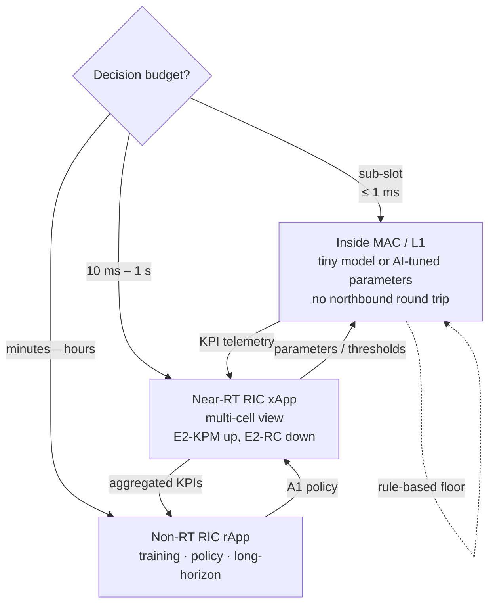
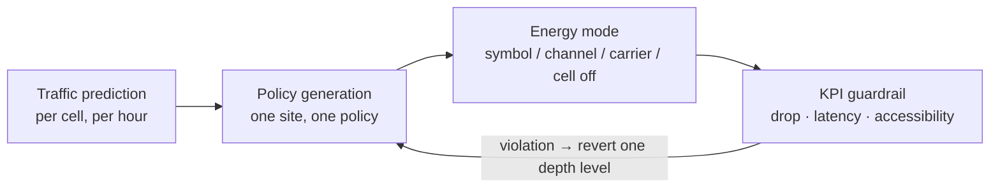

# 5G-Advanced and 6G Radio Access

## 1. Release map — the spine everything else hangs on

Reading it as an engineer: everything left of Rel-20 is deployable-now knowledge; Rel-20/21 is where you must be able to defend a design opinion with a requirement trace, not a citation.

### 1.1 Release 18 — first 5G-Advanced release
- **Frozen June 2024** (RAN#104, 18 June 2024).
- Framed as "5G-Advanced phase 1": AI/ML for the NR air interface, network energy saving, mobility optimisation, load balancing, XR awareness, NTN refinement, and **eRedCap**.
- AI/ML work entered as a study (TR 38.843) covering beam management, CSI compression and positioning; these later moved into normative work.

### 1.2 Release 19 — second and last 5G-only-Advanced release
- **Functional freeze September 2025, protocol freeze December 2025.**
- Positioning: it is still 5G, not 6G. It is the last release fully dedicated to 5G before Rel-20 mixes 5G-Advanced completion with 6G study work.
- Content pillars:
  - Massive MIMO evolution, uplink coverage, latency reduction, duplex operation, mobility
  - **Network energy efficiency** and device power consumption
  - **AI/ML inside the NR air interface** — beam management, predictive positioning, low-power wake-up (LP-WUS)
  - **Ambient IoT** — device type 1 standardised here
  - **NTN** extension for satellite NR and IoT
  - **ISAC** foundational work — channel modelling studies
  - **FR3 (7–24 GHz)** exploration for future use
  - XR enhancements

### 1.3 Release 20 — the inter-generational bridge
- Dual purpose: wrap up 5G-Advanced *and* launch formal 6G studies.
- **Stage-1 anchor TR 22.870 "6G Use Cases and Service Requirements"** approved by TSG SA within Rel-20; it anchors Rel-21 normative work.
- **TR 38.914 "6G Scenarios and Requirements"** scheduled for TSG RAN approval **June 2026**.
- Working groups are tracking a **March 2027 freeze target**.
- Study topics include regenerative satellite payloads, voice over GEO satellites via NB-IoT, mono-static sensing for UAV navigation, Ambient IoT phase 2 (device types 2a/2b), network-controlled repeaters, and computing-integrated mobile architecture.

### 1.4 Release 21 — the first normative 6G release
Timeline **agreed at TSGs#112 (June 2026)**:

| Milestone | Date |
| --- | --- |
| 5G-Advanced/6G package approval & Stage-1 freeze | March 2027 |
| Stage-2 freeze (80% completion checkpoint March 2028) | June 2028 |
| Stage-3 freeze | December 2028 |
| ASN.1 / OpenAPI freeze | March 2029 |

- TR 21.921 is the Rel-21 release-description document, published at the end of the release.
- Rel-21 alignment with the **IMT-2030** submission window is the reason the dates are immovable.
- Practical reading: silicon and pre-commercial system work must start no later than the Stage-2 freeze (2028), with commercial deployment planning around 2030.

## 2. 6G technology baseline — "inherit the proven base, enhance where it pays"

Confirmed direction from the June 2026 RAN plenary:

- **Waveform**: CP-OFDM (DL) and DFT-s-OFDM (UL) remain the baseline; no air-interface rebuild.
- **Modulation**: 5G NR constellation structure retained, with exploration of higher-order modulation and waveform-shaping extensions.
- Six key areas were assessed and judged sufficiently mature without plenary intervention: **waveform, channel coding, modulation, frame structure & numerology, channel bandwidth, synchronisation signal design**.
- Strategic lesson carried forward from 5G: avoid excessive optionality and fragmentation; commit to standalone architecture; do not chase headline peak numbers.

## 3. First-wave 6G commercial features

### 3.1 ISAC — Integrated Sensing and Communication
- Rel-19/20 completed the foundational sensing studies; **Rel-21 places native 6G ISAC in the baseline**.
- RAN1/RAN2 continue to work physical-layer sensing, ranging/imaging, and interference management.
- Deployment logic: reuse existing ELAA (Extremely Large Aperture Array) hardware; deployable in the 7 GHz U6G mid-band; no protocol-stack revolution required.
- Scenarios: low-altitude security, vehicle-to-infrastructure, factory personnel/object tracking, environment monitoring.

### 3.2 AI-native network
- **SA2 study FS_6G_ARC** treats AI-native as a core 6G architecture capability; Rel-21 fixes it into the architecture rather than bolting it on.
- Enumerated capabilities: radio-link AI optimisation, fault self-healing, AI resource scheduling, **AI-DPD** (digital pre-distortion for power amplifier linearisation).
- Business driver is operator OPEX: energy, coverage, and operations.

### 3.3 U6G mid-band ELAA
- Upper mid-band (roughly 7 GHz, inside FR3 studies) with extremely large antenna arrays — the spectrum/antenna pairing that makes ISAC practical.

### 3.4 NTN enhancement
- Non-terrestrial access moves from an add-on to a native system dimension, including regenerative payloads.

## 4. AI-native versus bolt-on AI — the architectural question

Where the inference sits is decided by the control-loop budget, not by preference:

| Dimension | 5G-Advanced "AI for NR" | 6G "AI-native" |
| --- | --- | --- |
| Placement | Function-specific, often OAM-side or xApp-side | Capability fixed inside the architecture (SA2) |
| Scope | Beam management, CSI compression, positioning | Radio-link optimisation, self-healing, resource scheduling, AI-DPD |
| Lifecycle | Vendor-defined model management | Architecture-level lifecycle management (training, deployment, monitoring) |
| Interfaces | Reuses existing measurement reporting | Requires new measurement/control exposure from L2/L1 |

Open design questions worth being able to discuss:
- Should AI inference sit **inside** the MAC scheduler (sub-slot latency budget, no northbound round trip) or in a **cross-layer controller** (better global view, longer loop)?
- How does model lifecycle management align with **O-RAN near-RT / non-RT RIC** and the A1/E2 split? (See [[01-3 AI-ML for RAN and O-RAN RIC]].)
- Where does training/inference compute physically live: DU, CU, or edge cloud? Each changes the control-loop budget by an order of magnitude.

## 5. Network energy saving — from static shutdown to AI policy

- Classic techniques: symbol shutdown, channel shutdown, carrier shutdown, cell DTX/DRX, SSB-less operation. Depth order: symbol < channel < carrier < cell, i.e. each step saves more energy and costs more in coverage and latency.
- 5G-A/6G direction: **per-site policy generation ("one site, one policy")** driven by traffic prediction and multi-objective optimisation, switching energy modes between low and high load.

- The trade is always KPI degradation versus energy saved, and the evaluation methodology matters more than the algorithm: state the baseline (always-on), the traffic profile, the guardrail thresholds and the observation window, or the percentage is meaningless.
- Two things a candidate should volunteer: sleeping cells still need a discovery/fallback path (neighbour-cell coverage assumption, SSB-less operation with on-demand SSB), and the energy saving is measured at the **site** meter — it includes the cost of waking up, not just the sleep depth.

## 6. Mobility — L1/L2-centric fast switching

- Rel-18 introduced work on mobility driven by **L1/L2 signalling only** (LTM — L1/L2 Triggered Mobility), reducing RRC-layer involvement and interruption time.
- Consequences for L2: MAC/PHY measurement and the switch decision become tightly coupled; candidate cell configuration, L1 measurement reporting and MAC-CE-based cell switch replace part of the classic RRC reconfiguration path. See [[01-2 5G NR RAN Layer 2 Protocol Stack]].

## Anchors — verified facts

- Rel-18 frozen **June 2024**; Rel-19 **functional freeze Sept 2025 / protocol freeze Dec 2025**; Rel-20 freeze target **March 2027**.
- Rel-21 timeline agreed at **TSGs#112, June 2026**: package approval + Stage-1 **Mar 2027**, Stage-2 **Jun 2028**, Stage-3 **Dec 2028**, ASN.1/OpenAPI **Mar 2029**.
- **TR 22.870** approved in Rel-20; **TR 38.914** scheduled for RAN approval **June 2026**.
- Baseline waveforms retained in 6G: **CP-OFDM / DFT-s-OFDM**.
- First-wave commercial 6G features: **ISAC, AI-native, U6G mid-band ELAA, NTN enhancement**.
- 3GPP June 2026 newsletter themes also include: Coordinated Closed Loop (CCL) for autonomous networks, AI and Agentic Protocols for 6G, post-quantum cryptography direction.

## Related

- [[01-2 5G NR RAN Layer 2 Protocol Stack]]
- [[01-3 AI-ML for RAN and O-RAN RIC]]
- [[01-4 Cellular IoT RedCap eRedCap and NTN]]
- [[01-5 NR Random Access - UE RACH Procedure, Signalling and Tuning]] — the procedure every release keeps tuning: 2-step RACH from Rel-16, feature-partitioned RA resources and SDT from Rel-17, and LTM from Rel-18 where a mobility event may run with no RACH at all
- [[07-1 RISC-V for Communication Infrastructure]]

---

Copyright (c) 2026 Washington Ruan. All rights reserved.
