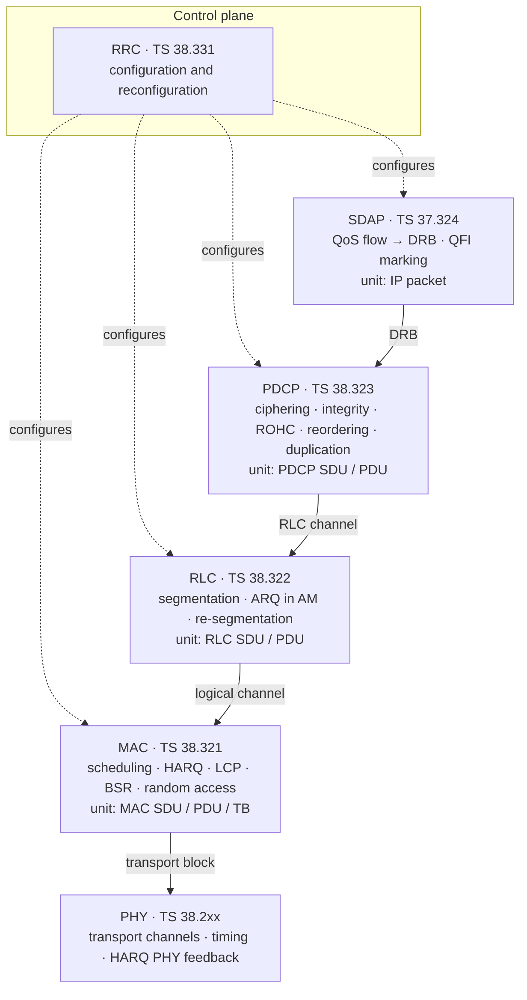
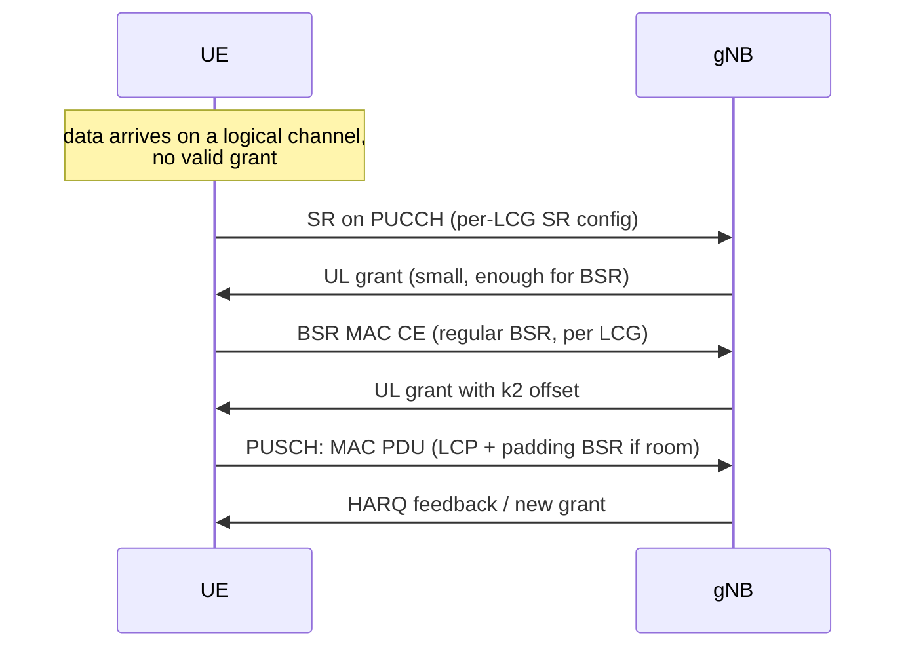
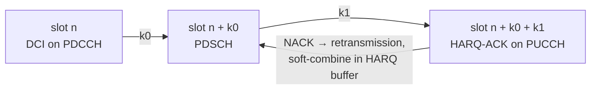
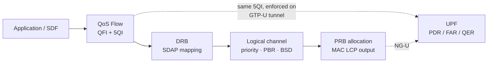

# 5G NR RAN Layer 2 Protocol Stack

The permanent core of any L2 interview. See [[01-1 5G-Advanced and 6G Radio Access]] for what is changing around it.

## 1. Layer 2 structure and specifications

| Sublayer | Spec | Core responsibility |
| --- | --- | --- |
| SDAP | TS 37.324 | QoS flow ↔ DRB mapping, QFI marking, reflective QoS |
| PDCP | TS 38.323 | Ciphering, integrity, ROHC, reordering, duplication, SDU discard |
| RLC | TS 38.322 | Segmentation, ARQ (AM only), retransmission, re-segmentation |
| MAC | TS 38.321 | Scheduling, HARQ, logical channel prioritisation, BSR, random access |

Above them RRC (TS 38.331) controls configuration; below them PHY (TS 38.2xx) provides transport channels and timing.

Downlink data path, with the unit handed across each boundary:

The boundaries are the interview: each arrow is a different unit, a different buffer, and a different owner of a timer.

## 2. Numerology, slots and the scheduler time budget

- Subcarrier spacing: **15 / 30 / 60 kHz in FR1**, **60 / 120 kHz in FR2**; additional options exist at higher bands.
- Slot duration is inversely proportional to SCS: **1 ms @15 kHz, 0.5 ms @30 kHz, 0.25 ms @60 kHz, 0.125 ms @120 kHz**.
- Mini-slots (2/4/7 symbols) exist for URLLC and for unlicensed/beam-based operation.
- **The slot duration is the hard budget for the scheduler decision.** Any AI-assisted scheduling must fit inside it — this is the single most important constraint when arguing about online learning in MAC. See [[01-3 AI-ML for RAN and O-RAN RIC]].
- BWP (Bandwidth Part): up to 4 configured DL and UL BWPs per serving cell, **one active at a time**; BWP switching is a latency/bandwidth/power trade.

## 3. MAC — the invariant core

### 3.1 Downlink
- Per slot, allocate PDSCH resources; DCI carries the grant, **k0** indicates PDSCH-to-DCI offset.
- DL HARQ in NR is **asynchronous and adaptive**; the HARQ-ACK feedback timing is **k1**, signalled in DCI.
- HARQ processes carry soft-combining buffers; the number of processes bounds the outstanding RTT.

### 3.2 Uplink grant lifecycle — the classic high-frequency question
`SR (PUCCH) → grant → BSR → PUSCH`

Total added latency before user data moves is roughly one SR period plus one PUSCH round trip — this is exactly what **configured grant** and **pre-scheduling** exist to remove.
1. UE has data; if no valid grant, sends **Scheduling Request** on PUCCH.
2. gNB grants a small initial grant (often enough only for a BSR).
3. UE reports **BSR MAC CE** — short / short-truncated / long formats, per **Logical Channel Group (LCG)**; NR defines **4 LCGs**.
4. gNB grants PUSCH; **k2** in the UL grant indicates the scheduling offset.
5. UL HARQ timing is indicated per grant rather than fixed as in LTE.

### 3.3 BSR trigger types
- **Regular BSR** — new data with higher-priority logical channel, or retxBSR-Timer expiry.
- **Periodic BSR** — periodicBSR-Timer expiry.
- **Padding BSR** — padding bits available in the MAC PDU.
- SR masking / PUCCH resource selection per logical channel is configuration-dependent.

### 3.4 Configured grant
- **Type 1**: fully RRC-configured, active without L1 signalling.
- **Type 2**: RRC-configured periodicity but **activated/deactivated by L1 DCI** (CS-RNTI), with **Configured Grant Confirmation MAC CE**.
- Target: URLLC / IIoT periodic deterministic traffic, avoiding SR latency.
- Engineering tension: pre-allocation wastes resources at low duty cycle; grant-free collides under load.

### 3.5 Logical channel prioritisation
- Each logical channel has priority, prioritisedBitRate (PBR) and bucketSizeDuration (BSD).
- Token-bucket per logical channel, then strict priority across logical channels.
- This is where QoS intent from SDAP/5QI actually lands on PRBs.

### 3.6 Scheduling policies
- **Round Robin** — fair in time, ignores channel quality.
- **Max C/I** — maximum throughput, starves cell-edge UEs.
- **Proportional Fair (PF)** — balances throughput and fairness; the industry baseline.
- **EXP / EXP-PF / M-LWDF** — add delay terms for delay-sensitive traffic.
- Worth being able to state: PF optimises a log-utility objective, so it is "fair over time" not "fair per slot".

## 4. HARQ mechanics and timing

- n+k timing: **k0** (DCI → PDSCH), **k1** (PDSCH → HARQ-ACK), **k2** (DCI → PUSCH).

- Self-contained slot structure shortens feedback latency versus LTE: at 120 kHz SCS a slot is 0.125 ms, so k0/k1/k2 are counted in slots but cost microseconds each, which is why high-SCS configurations are used for URLLC.
- HARQ entity per serving cell in CA; per-HARQ-process soft buffer.
- HARQ is fast but bounded (limited retransmissions); RLC ARQ is the slower backstop with unbounded retransmission.
- Interaction worth articulating: **HARQ below, ARQ above** — HARQ absorbs fast channel errors in ms, ARQ handles residual loss at tens of ms. Too much HARQ retransmission wastes PRBs; too little pushes load onto RLC and increases tail latency.

## 5. RLC

- Modes: **TM** (transparent), **UM** (unacknowledged), **AM** (acknowledged).
- NR UM supports segmentation of RLC SDUs; AM supports **re-segmentation of AMD PDUs** on retransmission.
- SN sizes: UM 6/12 bit; AM 12/18 bit.
- AM ARQ timers and parameters: `t-PollRetransmit`, `pollPDU`, `pollByte`, `maxRetxThreshold`, `t-Reassembly`, `t-StatusProhibit`.
- Reassembly window and duplicate detection drive the discard/reordering interaction with PDCP.

## 6. PDCP

- SN sizes 12 / 18 bit.
- Security: ciphering (NEA) and integrity protection (NIA); 128-bit keys.
- Header compression: **ROHC** profiles (TS 38.323), essential for VoNR and IoT.
- Reordering with `t-Reordering`; out-of-order delivery is an option to trade reordering delay for latency (relevant for URLLC).
- **Duplication** across carriers/legs for CA and dual connectivity (split bearers) — reliability at the cost of throughput.
- `discardTimer` — PDCP SDU discard; interacts badly with RLC ARQ if mistuned (wasted retransmissions).
- PDCP data recovery procedure after RLC re-establishment.

## 7. SDAP and the QoS chain

End-to-end QoS mapping is the most useful "system view" answer an L2 engineer can give:

`Application → QoS Flow (QFI, 5QI) → DRB (SDAP) → RLC channel → logical channel (MAC) → NG-U / GTP-U tunnel (UPF)`

- **5QI** characteristics: resource type (GBR / non-GBR / delay-critical GBR), priority level, packet delay budget (PDB), packet error rate (PER), averaging window, max data burst volume.
- **ARP** (Allocation and Retention Priority) for admission, separate from scheduling priority.
- **Reflective QoS (RQA / RQI)** lets the UE derive UL QoS flow → DRB mapping from DL marking.
- On the core side the same QoS flow is enforced by UPF via **PDR/FAR/QER** — see [[05-1 DPDK User Plane and 5G UPF]].
- Key interview point: RAN-side DRB/QoS flow mapping and UPF-side QoS enforcement are aligned within the 3GPP framework, but operate on **different time scales** (TTI/slot versus flow-level). Diagnosing whether a bottleneck is air-interface or user-plane requires separating those time scales.

## 8. Carrier aggregation and multi-connectivity

- PCell + SCells; up to 16 component carriers configured in NR.
- **Cross-carrier scheduling**: DCI on one cell schedules another, identified by the **CIF (Carrier Indicator Field)**; self-carrier scheduling is the alternative.
- Constraints that matter: HARQ entity per serving cell, HARQ-ACK bundling/multiplexing across carriers, cross-carrier scheduling timing offset, PDCCH blind-decode budget and CCE limits.
- BSR is per LCG, not per carrier — so buffer state granularity limits cross-carrier scheduling precision.
- Dual connectivity (EN-DC / NR-DC / NE-DC) adds split bearers, PDCP duplication and the primary/secondary path selection.

## 9. L1/L2 mobility (LTM)

- Rel-18 work on **L1/L2 Triggered Mobility**: candidate cell configuration pre-provisioned, L1 measurement reporting, MAC CE triggers the switch.
- Goal: reduce interruption time versus RRC reconfiguration-driven handover.
- L2 consequences: MAC must maintain candidate configurations, handle L1 measurement filtering, and execute a MAC-CE-driven switch while preserving HARQ/RLC state semantics.

## 10. What is genuinely changing at L2

| Stable | Changing |
| --- | --- |
| Per-slot PDSCH/PUSCH allocation | AI/ML-assisted scheduling and beam selection |
| SR → BSR → PUSCH lifecycle | L1/L2-driven mobility reducing RRC involvement |
| RLC ARQ / PDCP reordering and security | CA/uplink enhancement increasing HARQ entity complexity |
| HARQ as fast retransmission | ISAC introducing sensing-versus-communication resource contention |
| 5QI → DRB → logical channel chain | AI-native measurement/control interface exposure |

## Anchors — verified facts

- Spec numbers: **MAC TS 38.321, RLC TS 38.322, PDCP TS 38.323, SDAP TS 37.324, RRC TS 38.331**.
- Slot durations by SCS: 15 kHz → 1 ms; 30 kHz → 0.5 ms; 60 kHz → 0.25 ms; 120 kHz → 0.125 ms.
- NR defines **4 logical channel groups** for BSR reporting.
- HARQ timing parameters named in DCI: **k0, k1, k2**.
- Rel-18 introduced L1/L2 signalling-driven mobility work (LTM) to reduce handover interruption.

## Related
- [[01-8 5G NR - OpenAirInterface - Architecture of an Open-Source NR Stack]] — the same layers as a program: SDAP and PDCP in the CU-UP, RRC in the CU-CP, RLC and MAC in the DU, with F1 and E1 as the seams and `openair2/LAYER2/` as the code

- [[04-3 Embedded Software Architecture - Patterns, Layering and Wireless System Structure]] — the L1/L2 real-time boundary, execution contexts per layer, modem-host interface design
- [[01-1 5G-Advanced and 6G Radio Access]]
- [[01-3 AI-ML for RAN and O-RAN RIC]]
- [[05-1 DPDK User Plane and 5G UPF]]
- [[01-4 Cellular IoT RedCap eRedCap and NTN]]
- [[01-5 NR Random Access - UE RACH Procedure, Signalling and Tuning]] — the MAC procedure this note only lists: Msg1 to Msg4, MSGA/MSGB, RA-RNTI, the RAR MAC PDU, and the counters and windows that a MAC implementation must keep; §9 walks the UE-side counters and §10 walks the gNB-side RAR assembly
- [[01-7 NR HARQ - Retransmission Flow, Timelines and LTE Comparison]] — the HARQ mechanism this note only lists: soft combining, NDI and RV, the k0/k1/k2 timing, HARQ-ACK codebooks and CBG retransmission, the four state machines, and why LTE's synchronous uplink and PHICH had to go
- [[01-6 NR DU MAC Scheduler - Resource Allocation, HARQ and Real-Time Implementation]] — the implementation of the MAC responsibilities this note only lists: the two-stage TD/FD allocation, the CCE and PUCCH budgets, HARQ process management, and the eleven-step per-slot pipeline that makes them fit

---

Copyright (c) 2026 Washington Ruan. All rights reserved.
