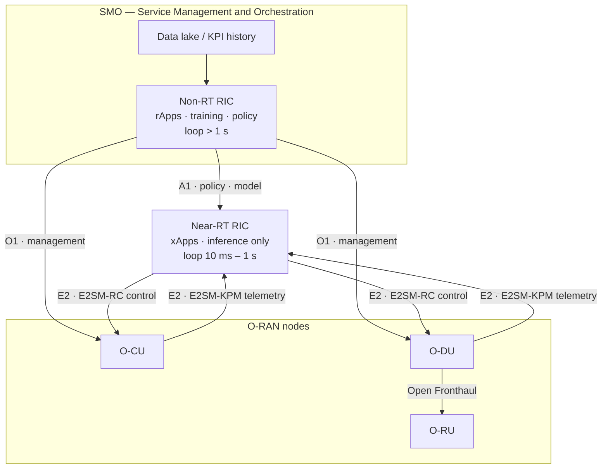
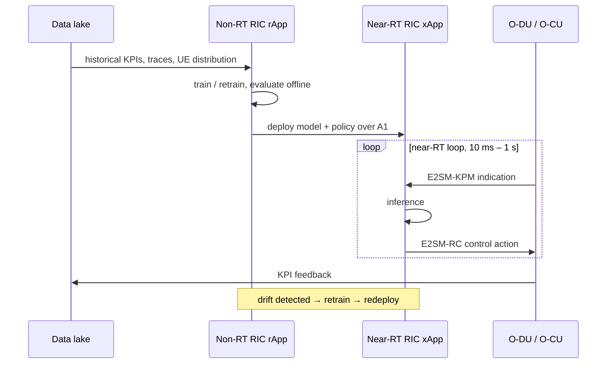
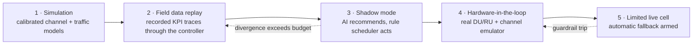

# AI/ML for the RAN and the O-RAN RIC

Where the "AI trainer" credential and the "L2 protocol stack" experience actually meet. See [[01-1 5G-Advanced and 6G Radio Access]] for the standards arc and [[01-2 5G NR RAN Layer 2 Protocol Stack]] for the machinery being optimised.

## 1. Standardisation timeline for AI in the RAN

- **Rel-18**: AI/ML for NR air interface entered as a study (TR 38.843) — beam management, CSI compression feedback, positioning. Also network-side AI/ML for energy saving, mobility optimisation and load balancing.
- **Rel-19**: AI/ML moves into the air interface proper — beam management, predictive positioning, low-power wake-up mechanisms.
- **Rel-20 / Rel-21**: AI-native becomes an architectural capability (SA2 FS_6G_ARC), with Rel-21 fixing AI capability into the 6G architecture: radio-link AI optimisation, fault self-healing, AI resource scheduling, AI-DPD.
- 3GPP SA has been working on **"AI and Agentic Protocols for 6G"** and **Coordinated Closed Loop (CCL)** for autonomous networks (2026 newsletter themes).

## 2. O-RAN RIC architecture

The one fact that settles most architectural arguments: **only inference runs in the near-RT RIC.** Training, policy generation and model management are non-RT functions.

| | Non-RT RIC | Near-RT RIC |
| --- | --- | --- |
| Location | Inside SMO (Service Management and Orchestration) | Network edge / regional cloud |
| Loop time | > 1 s (minutes to hours) | 10 ms – 1 s |
| Applications | **rApps** | **xApps** |
| RAN interface | **A1** (policy to near-RT RIC), **O1** (management) | **E2** |
| ML role | Training, model deployment, policy generation | Inference only, using pre-trained models |

### E2 service models
- **E2SM-KPM** — Key Performance Measurement; per-UE and per-cell KPIs delivered to xApps.
- **E2SM-RC** — RAN Control; xApps send control actions back to O-DU/O-CU.
- **E2SM-NI**, **E2SM-CCC** — additional service models for specific control domains.

### Model lifecycle

1. rApp trains / retrains on historical data from the data lake.
2. Model is deployed to the near-RT RIC via **A1**.
3. xApp performs inference inside the near-RT loop.
4. KPI feedback closes the loop.

### Realistic impact figures cited in industry material
- Traffic-steering xApp: decision latency 100–500 ms; reported +15–25% cell-edge throughput, −30% congestion events; ~100–500 cells per xApp instance.
- AI-driven cell-sleep xApps: 20–30% energy reduction in low-traffic periods.
- Operators report roughly 10–15% spectral-efficiency improvement from AI-driven resource allocation in Open RAN deployments. *(Industry-reported; treat as vendor-range, not a standard guarantee.)*

## 3. Learning methods used in RAN control

- **Supervised** — CSI compression, channel estimation, traffic prediction, positioning.
- **Reinforcement learning**
  - **DQN** — beam selection, resource allocation in massive MIMO.
  - **Policy gradient / PPO / A3C** — continuous power control, link adaptation.
  - **Multi-agent DRL** — distributed power allocation, inter-cell interference coordination.
  - **Hierarchical / multi-layer agents** — L3-level load balancing and interference coordination.
- **Imitation / behaviour cloning from an existing rule scheduler** — safer cold start than pure exploration.

### The boundary between RL and classic rule schedulers
- **Classic PF / EXP rules** win when: the environment is stationary, the objective is a simple concave utility, latency budget is sub-slot, and you need explainability and guaranteed worst-case behaviour.
- **RL** is justified when: the state space is high-dimensional (massive MIMO beams × users × traffic mix), the objective is multi-objective and non-convex (throughput × tail latency × energy), and the environment has structure that repeats (daily traffic patterns).
- **Honest framing**: an RL scheduler is rarely better than a well-tuned PF on average throughput; it earns its place on tail latency and multi-objective trade-offs.

### The three hard constraints to state in any interview
1. **Inference latency versus scheduling period.** A 0.5 ms slot (30 kHz SCS) or 0.125 ms (120 kHz) leaves no room for a heavy model in the per-slot loop. Practical split: heavy models in non-RT/near-RT (100 ms–1 s) for *parameter* decisions; tiny models or lookup-based inference in the per-slot loop for *resource* decisions.
2. **Sim-to-real gap.** Simulator channel models, traffic models and UE distributions never match the live cell; policies trained purely in simulation degrade on real CQI/BSR statistics. Mitigations: domain randomisation, conservative action spaces, shadow-mode deployment, and fallback to the rule scheduler.
3. **Safety and fallback.** Any online-learning controller needs a rule-based floor: bounded action space, monotonic guardrails, and an automatic revert path.

## 4. Where does the AI decision physically live?

| Placement | Loop budget | Pros | Cons |
| --- | --- | --- | --- |
| Inside MAC (DU, per slot) | sub-ms | No round trip, real channel state | Minimal compute, hard real-time, no global view |
| Near-RT RIC xApp | 10 ms – 1 s | Multi-cell view, containerised, swappable | E2 latency, still too slow for per-slot grants |
| Non-RT RIC rApp | > 1 s | Training, policy, long-horizon optimisation | Cannot react to fast fading |
| Edge cloud | tens of ms | Heavy models, cross-DU coordination | Depends on transport, jitter |

Good answer shape: put **fast per-slot resource decisions in MAC** (small model or AI-tuned parameters), **multi-cell coordination in the near-RT RIC**, and **training/policy in the non-RT RIC**, with the A1 interface carrying the policy down and E2-KPM/E2-RC carrying telemetry up and control down.

## 5. ISAC resource arbitration — an L2 design question

- Sensing waveforms and communication waveforms compete for the same time-frequency resources and the same antenna array.
- Candidate arbitration points:
  - **RRC/SMO layer** — coarse duty-cycle partitioning between sensing and communication (simplest, too slow).
  - **MAC layer** — the natural place: MAC already owns per-slot allocation, priority handling and logical-channel QoS; sensing can be modelled as a high-priority periodic "logical channel" with its own budget.
  - **PHY** — waveform-level multiplexing, but invisible to QoS policy.
- What MAC would need: a sensing grant type with period and duty-cycle semantics, a priority class that maps to 5QI-like handling, and a pre-emption rule when delay-critical communication traffic arrives.

## 6. Verification methodology

The credible ladder for AI in the RAN:

1. **Simulation** — system-level simulator with calibrated channel and traffic models.
2. **Field data replay** — recorded KPI traces and UE distributions fed back through the controller.
3. **Shadow mode** — the AI controller observes and recommends, the rule controller acts; divergence is measured.
4. **Hardware-in-the-loop / testbed** — real RU/DU with channel emulation.
5. **Limited live cell with automatic fallback.**

Being able to name this ladder, and to ask an interviewer which rung their team operates at, is a strong signal.

## Anchors — verified facts

- **TR 38.843** — AI/ML for NR air interface study (Rel-18), covering beam management, CSI compression, positioning.
- Near-RT RIC loop **10 ms – 1 s**; non-RT RIC **> 1 s**.
- Interfaces: **E2** (near-RT ↔ RAN), **A1** (non-RT → near-RT policy), **O1** (management).
- Service models: **E2SM-KPM**, **E2SM-RC**, **E2SM-NI**, **E2SM-CCC**.
- Only **inference** runs in the near-RT RIC; **training** runs in the non-RT RIC.
- SA2 **FS_6G_ARC** establishes AI-native as a core 6G architecture capability, fixed in Rel-21.
- Rel-21 AI capabilities named: radio-link AI optimisation, fault self-healing, AI resource scheduling, AI-DPD.

## Related

- [[01-1 5G-Advanced and 6G Radio Access]]
- [[01-2 5G NR RAN Layer 2 Protocol Stack]]
- [[01-5 NR Random Access - UE RACH Procedure, Signalling and Tuning]] — the canonical closed-loop target: preamble collision rate, RAR success and 2-step fallback rate observed by an xApp, and the parameter set it is allowed to retune; §10.4 lists precisely what the gNB cannot know before Msg3, which is why RACH optimisation is either a bet on collision probability or a reaction to a collision already observed
- [[01-6 NR DU MAC Scheduler - Resource Allocation, HARQ and Real-Time Implementation]] — the thing an xApp is trying to influence: the KPIs a scheduler exposes over E2, and the per-slot budget that any learned policy has to fit inside
- [[06-3 Machine Learning - Foundations, Core Algorithms and Applications]] — the algorithms themselves, before the RAN constraints are applied: paradigms, core models, evaluation, and the failure modes that an xApp inherits
- [[07-1 RISC-V for Communication Infrastructure]]
- [[06-2 Agent Systems and Edge Orchestration]]

---

Copyright (c) 2026 Washington Ruan. All rights reserved.
