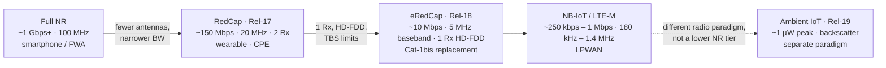
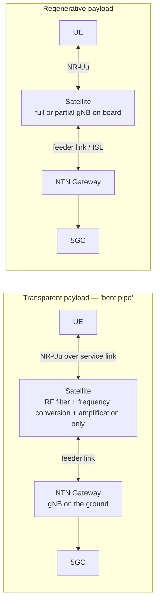

# Cellular IoT — RedCap, eRedCap and NTN

## 1. The 3GPP cellular IoT device family

| Technology | Release | Approx. peak DL | Bandwidth | Antennas | Target |
| --- | --- | --- | --- | --- | --- |
| NB-IoT | Rel-13 | ~250 kbps | 180 kHz | 1 Rx | Deep-coverage LPWAN |
| LTE-M | Rel-13 | ~1 Mbps | 1.4 MHz | 1 Rx | LPWAN with mobility |
| LTE Cat-1bis | Rel-13 | ~10 Mbps | 20 MHz | 1 Rx | The incumbent massive IoT tier |
| **RedCap** | Rel-17 | ~150 Mbps | 10–20 MHz FR1 | 2 Rx typical | Wearables, sensors, surveillance, CPE |
| **eRedCap** | Rel-18 | ~10 Mbps | **5 MHz baseband (RF up to 20 MHz)** | **1 Rx (1T1R), HD-FDD** | LTE Cat-1/1bis replacement |
| Full NR | Rel-15+ | 1 Gbps+ | up to 100 MHz FR1 / 400 MHz FR2 | 2–4 Rx | Smartphones, FWA |

Design intent: give the IoT market a **continuous range of 5G device tiers** — full NR → RedCap → eRedCap → NB-IoT — all natively on 5G NR rather than dropping back to a separate LPWA radio.

The dashed edge is the one to defend in an interview: the power axis continues down to Ambient IoT, but the *protocol* does not — Ambient IoT removes scrambling, interleaving, MIMO and L1 HARQ and does not descend from RedCap.

## 2. eRedCap in detail (Rel-18)

- Standardised in **Release 18, frozen June 2024** (RAN#104, 18 June 2024). Two-stage 3GPP process: study item through 2022 producing **TR 38.865**, work item through 2023.
- Key reductions versus Rel-17 RedCap:
  - Bandwidth: baseband bandwidth for PDSCH/PUSCH compressed to **5 MHz** (RF bandwidth can remain up to 20 MHz)
  - Antenna: **1 Rx** (or 2 Rx variants), roughly **50% fewer RF front-end components** than a conventional NR UE
  - Duplex: **HD-FDD** supported
  - Modulation order reduced from the 64QAM supported by Rel-17 RedCap towards lower-order schemes
  - Rate control via **peak rate relaxation**, limits on maximum transport block size (TBS), and limits on the number of schedulable PRBs
  - **FR1 only** — no FR2 (mmWave), and no 60 kHz SCS
- Peak rate ≈ **10 Mbps DL / ~5 Mbps UL**, essentially matching LTE Cat-1bis but on 5G NR with a 5G Standalone core.

## 3. Release 19: NTN, wake-up receivers, Ambient IoT

**Release 19 (frozen December 2025) did not add a third reduced-capability device type.** What it did add:
- Extended **RedCap to non-terrestrial networks** (satellite) — the defining new capability of the release for this family.
- **Wake-up receiver / wake-up signal (LP-WUS)** work for energy efficiency.
- Standardised **Ambient IoT device type 1** as a separate paradigm.

### Ambient IoT is not a third RedCap tier
- It is frequently described as "the next rung below eRedCap" and on a power axis it does sit lower — roughly **1 µW peak for device type 1** versus RedCap's 10 mW and above.
- But it is a **different radio paradigm, not a reduced NR device**: backscatter transmission, envelope-detection receivers, with scrambling, interleaving, MIMO and L1 HARQ removed.
- The Ambient IoT specifications do not build on RedCap and do not reference it as a parent. **Treat them as neighbouring families, not a hierarchy.** (This is a common interview trap.)
- Release 20 carries **Ambient IoT phase 2** (device types 2a / 2b).

## 4. NTN — Non-Terrestrial Networks

Two payload architectures, and they move the protocol boundary:

Regenerative payloads move part of the gNB — potentially the whole DU — onto the satellite, which shortens the HARQ loop, enables inter-satellite links, and is a Rel-20 study topic. Transparent payloads keep the entire gNB on the ground, so the radio RTT includes the full feeder-link round trip.

### 4.1 What changes versus terrestrial NR
- **Propagation delay**: GEO round-trip is on the order of hundreds of ms; LEO is far lower but still far above terrestrial. Feeder link delay adds on top for transparent payloads.
- **Timing advance and uplink synchronisation**: the TA range and update rate must cover satellite motion; LEO introduces significant Doppler that must be pre-compensated using ephemeris.
- **HARQ**: with long RTT, the HARQ RTT timer explodes. Options include disabling HARQ feedback for some traffic, increasing HARQ process counts, or leaning on RLC ARQ instead.
- **Coverage extension**: NTN needs extra repetitions, longer PRACH formats, and relaxed timing requirements.
- **Mobility**: the cell moves with the satellite; earth-fixed versus earth-moving beams changes the handover model entirely. With earth-fixed beams the UE stays in one cell while the satellite moves out of it, which produces periodic, predictable handover; with earth-moving beams the cell footprint sweeps the ground and the UE hands over continuously.
- **Order-of-magnitude numbers worth being able to quote, with the caveat that they depend on orbit and elevation angle**: GEO one-way propagation is on the order of **120 ms** (≈ 36 000 km), LEO at 600 km is on the order of **a few ms one-way** before feeder link and processing are added, and LEO Doppler at S-band reaches **tens of kHz**. Precise values are elevation- and band-dependent — `VERIFY` before quoting a single number in an interview.
- **Frequency**: NTN NR work targets the L and S bands (roughly 1.5–2.2 GHz) for handheld-class links, with Ka-band used for feeder links and fixed-satellite service backhaul.

### 4.2 L2 parameter impacts to be able to name
- `harq-RTT-Timer`, number of HARQ processes, and whether HARQ is enabled at all.
- RLC AM `t-PollRetransmit`, `t-Reassembly`, `maxRetxThreshold` must be re-scaled to satellite RTT.
- PDCP `t-Reordering` and `discardTimer` must grow or the stack discards data that is merely slow.
- BSR/SR periodicity and configured-grant periodicity relative to delay.
- TA timers (`timeAlignmentTimer`) and PRACH configuration.

### 4.3 Application-layer consequence
Long RTT makes **TCP** behave badly for small IoT packets: slow start and congestion control interact with hundreds of ms RTT, and retransmission timers at the application layer often fire before the radio stack has finished. Practical mitigations: UDP + application-level ACK, coap/QUIC tuning, larger initial congestion window, and avoiding head-of-line blocking.

## 5. Deployment reality check

- **RedCap requires a 5G Standalone core.** It will not work on 5G Non-Standalone (4G core underneath). Where SA coverage does not exist, a RedCap device falls back to LTE, and that fallback behaviour is specified.
- The practical question "is RedCap available?" is really "is 5G SA deployed at my sites?"
- Module timing: Rel-17 RedCap hardware is mature and shipping; **eRedCap modules are a 2027 proposition with volume in 2027–2028**.
- **Private 5G networks** remove the SA-coverage constraint entirely, because the operator controls the core and can deploy Standalone from day one — which is why near-term RedCap traction is strong in private networks.
- Chipset direction: multi-mode platforms combining NB-IoT, LTE-M, NTN and 5G eRedCap on a single part are the clear productisation signal. Nordic's nRF91 series and the ALT1350 / ALT1550 class of platforms sit on this roadmap. *(Model numbers: VERIFY against current vendor datasheets before quoting.)*

## 6. Design exercise: minimal L2 change to support eRedCap + NTN

A defensible minimal-change answer:
1. **Scale all RTT-derived timers** (HARQ RTT, RLC poll-retransmit, RLC reassembly, PDCP reordering, PDCP discard) from satellite RTT rather than terrestrial RTT.
2. **Decide the HARQ policy explicitly** — for long-RTT links, consider disabling HARQ feedback for delay-tolerant traffic and letting RLC ARQ carry reliability, because HARQ processes would otherwise be exhausted.
3. **Extend timing advance handling** — ephemeris-based pre-compensation, wider TA range, relaxed TA update periodicity.
4. **Re-tune PRACH** — formats and repetition levels for the coverage class.
5. **Adjust BSR/SR and configured grant periodicity** so a single-antenna half-duplex device is not burning power on control signalling.
6. **Push the policy up the stack** — tell the application the RTT so it stops using terrestrial retransmission timers.

## Anchors — verified facts

- **Rel-17 RedCap**: frozen 2022; up to 20 MHz FR1, 2 Rx typical, ~150 Mbps.
- **Rel-18 eRedCap**: frozen **June 2024**; **5 MHz baseband**, **1 Rx**, HD-FDD, **~10 Mbps DL / ~5 Mbps UL**, FR1 only, no FR2, no 60 kHz SCS.
- **Rel-19**: frozen **December 2025**; no third RedCap tier — adds **NTN extension for RedCap**, **wake-up receiver work (LP-WUS)**, and **Ambient IoT device type 1**.
- **Rel-20**: Ambient IoT phase 2 (device types 2a / 2b); final 5G-Advanced release alongside first 6G studies.
- RedCap **requires 5G SA**; falls back to LTE otherwise.
- Ambient IoT device type 1 ≈ **1 µW peak**, backscatter + envelope detection, no L1 HARQ.

## Related

- [[01-1 5G-Advanced and 6G Radio Access]]
- [[01-2 5G NR RAN Layer 2 Protocol Stack]]
- [[01-5 NR Random Access - UE RACH Procedure, Signalling and Tuning]] — what these devices actually have to do to get in: RedCap RA resource partitioning and Msg3 repetitions on one side, and NTN where the UE pre-compensates timing and Doppler from GNSS before Msg1; §9.3 has the counter rules that decide whether such a device ramps power or reselects a beam
- [[01-6 NR DU MAC Scheduler - Resource Allocation, HARQ and Real-Time Implementation]] — where these constraints bite in the scheduler: a RedCap BWP caps the PRBs allocatable per slot, and NTN runs 32 processes with per-process feedback disabling
- [[03-1 Wireless Sensor Networks and Low-Power MAC]]
- [[02-2 WLAN - Power Saving Mechanisms and Evolution]] — the WLAN-side parallel: LP-WUS vs 802.11ba wake-up radio, eDRX vs TWT, ambient IoT vs 802.11bp AMP
- [[06-2 Agent Systems and Edge Orchestration]]

---

Copyright (c) 2026 Washington Ruan. All rights reserved.
