# NR Random Access — UE RACH Procedure, Signalling and Tuning

Random access is the only NR procedure that has to establish three things at once, with nothing to build on:
**identity** (the network does not know who is transmitting), **uplink timing** (the UE has never transmitted in
this cell), and **uplink power** (open-loop only, from a downlink pathloss guess). Everything distinctive about
RACH — the four messages, the RNTI arithmetic, the power ramping, the two variants, the failure modes — follows
from those three unknowns being resolved in that order.

The procedure is specified in **MAC** (TS 38.321 clause 5.1), uses **PHY** resources defined in TS 38.211 and
procedures in TS 38.213, and carries **RRC** payloads defined in TS 38.331. It is a MAC procedure that borrows
its identity handling from RRC and its timing from PHY. Confusing which layer owns which decision is the most
common source of wrong answers in interviews on this topic.

> **The single rule to remember**: MAC only ever reports *"Random Access problem"* to upper layers. It never
> decides that the link is down. Whether a failed RACH becomes a connection-establishment failure (T300), a
> handover failure (T304), a failed resume (T319), an SCell release, or a radio link failure is decided entirely
> by **which event triggered it**. Read the trigger before reading the trace.

## 1. Where random access sits

### 1.1 Specification map

| Spec | What it owns for random access |
| --- | --- |
| TS 38.300 | Stage 2: the event list that initiates random access and what each failure means (clause 9.2.6) |
| TS 38.321 | **MAC**: initialisation (5.1.1), resource selection (5.1.2), preamble transmission (5.1.3), RAR reception (5.1.4), contention resolution (5.1.5), 2-step (5.1.2a/5.1.3a/5.1.4a), backoff (7.2), DELTA_PREAMBLE (7.3), PRACH mask index (7.4), MAC RAR / fallbackRAR / successRAR formats (6.2.3 and 6.2.3a) |
| TS 38.211 | **PHY**: PRACH preamble formats (6.3.3.1), sequence generation (6.3.3.1), time/frequency resources (6.3.3.2, Tables 6.3.3.2-2 to 6.3.3.2-4) |
| TS 38.213 | **PHY procedures**: RA procedure at the physical layer (clause 8: Msg3 PUSCH scheduling, MsgB, BFR), timing advance (clause 4.2), SSB-to-RO association (clause 8.1) |
| TS 38.214 | Time-domain allocation: `k2` tables and the numerology-dependent delay `Δ` (Table 6.1.2.1.1-5) |
| TS 38.331 | **RRC**: `RACH-ConfigCommon`, `RACH-ConfigGeneric`, `RACH-ConfigDedicated`, `BeamFailureRecoveryConfig`, `RRCSetupRequest`, `RRCResumeRequest(1)`, `UE-TimersAndConstants` |
| TS 38.101-1/2/3 | `P_CMAX,f,c` — the ceiling in the open-loop power formula |

### 1.2 Architecture: who does what

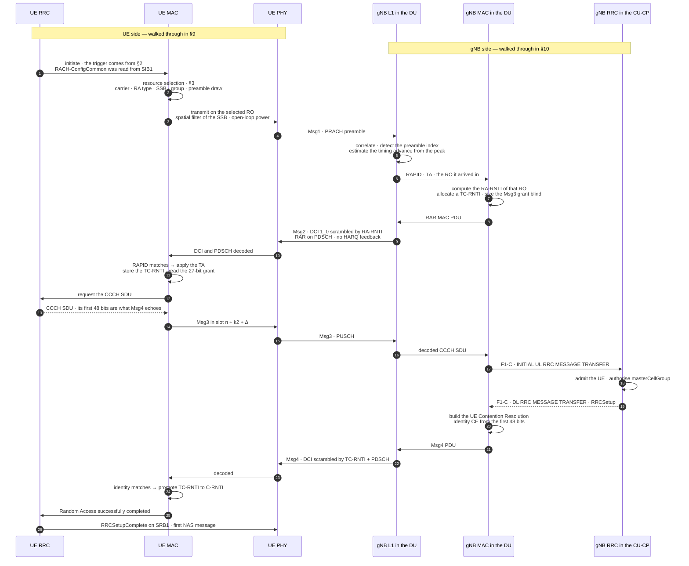

Read the participant list, not just the arrows: the vertical order is the layering, and the two sides are
not mirror images of each other. The UE ends in RRC because a finished RACH hands the connection upward; the
gNB ends in RRC because the CU-CP is what actually authors the answer.

Three consequences worth stating out loud:

1. **The PRACH detector is a DU-L1 function**, and its detection threshold is a vendor-internal number. Most
   "the network never heard us" cases are this threshold, the PRACH configuration, or the cyclic-prefix limit —
   not the RRC layer at all.
2. **The RRC content of Msg4 is built by the CU-CP**, but the `masterCellGroup` inside it is authored by the DU
   and copied verbatim. A malformed cell group in an `RRCSetup` is a DU problem visible only in a CU-side decode.
3. **Contention resolution is a MAC decision executed with an RRC payload.** The MAC CE echoes the first 48 bits
   of whatever CCCH SDU RRC handed down; MAC does not know or care whether that SDU was an `RRCSetupRequest`,
   an `RRCResumeRequest` or an `RRCSystemInfoRequest`.

### 1.3 Where RACH sits in the initial-access chain

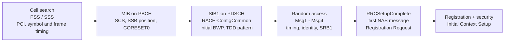

Nothing in step D can be negotiated. The UE reads `RACH-ConfigCommon` out of SIB1 and obeys it; the only
freedom it has is which preamble, which PRACH occasion and which SSB to use, and even those are constrained by
the configuration. **A UE that cannot complete RACH in a cell cannot ask that cell for anything.**

## 2. What initiates random access

TS 38.321 clause 5.1.1: *"The Random Access procedure described in this clause is initiated by a PDCCH order, by
the MAC entity itself, or by RRC for the events in accordance with TS 38.300."*

| Trigger | RRC state | Type | If RACH fails |
| --- | --- | --- | --- |
| Initial access | IDLE | CBRA | T300 expiry → establishment failure, `connEstFailReport` stored, cell reselection |
| RRC connection re-establishment | CONNECTED | CBRA | T301 expiry → back to IDLE with release cause |
| Resume from RRC_INACTIVE | INACTIVE | CBRA | T319 expiry → back to IDLE, context discarded |
| Reconfiguration with sync (handover) | CONNECTED | **CFRA** if dedicated resources provided | T304 expiry → handover failure → re-establishment |
| DL data arrival while UL is out of sync | CONNECTED | **CFRA**, via PDCCH order | Contributes to RLF if it exhausts on the SpCell |
| UL data arrival with no PUCCH SR resource | CONNECTED | CBRA | SR failure handling; RACH is the fallback SR mechanism |
| `timeAlignmentTimer` expiry | CONNECTED | CBRA | UL unusable until re-sync; HARQ buffers flushed |
| Beam failure recovery | CONNECTED | **CFRA** with dedicated BFR resources | `beamFailureRecoveryTimer` expiry → RLF |
| SCell addition / secondary TAG alignment | CONNECTED | **CFRA** by PDCCH order | SCell released; PCell unaffected |
| Request for other system information (on-demand SI) | any | CFRA by preamble partition, or CBRA | SI request retried; not a link failure |
| Consistent LBT failure on the SpCell (NR-U) | CONNECTED | CBRA | Rel-16; triggers RLF if no usable channel remains |

Three structural rules from the spec that interviewers like:

- **"There is only one Random Access procedure ongoing at any point in time in a MAC entity."** If a second
  trigger arrives while one is running, it is UE implementation whether to continue or restart (the spec's
  example is SI request).
- **"The Random Access procedure on an SCell shall only be initiated by a PDCCH order with `ra-PreambleIndex`
  different from 0b000000."** RACH on an SCell is always network-commanded.
- A repeated PDCCH order with the same preamble, mask index and UL carrier is treated as the **same** procedure,
  not a new one.

## 3. Before the first transmission: resource selection

The MAC entity resolves five questions, in this order, before a single sample goes to the air.

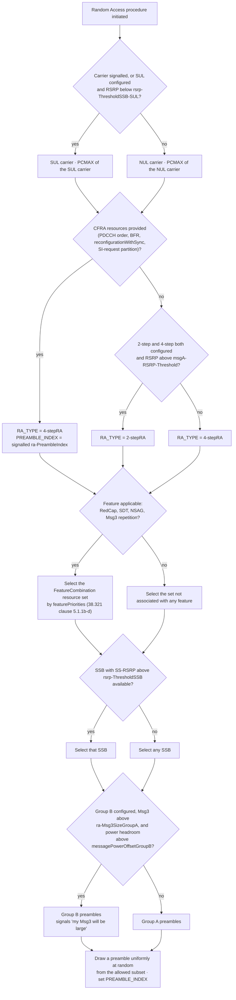

### 3.1 Feature-based partitioning (Rel-17)

Rel-17 lets a cell configure **several sets** of random-access resources, each tagged with a `FeatureCombination`,
so that one cell can serve different device classes without them contending against each other. The tag values
that matter:

| `FeatureCombination` member | Effect (TS 38.321 clause 5.1.1c) |
| --- | --- |
| `redCap` = true | Set is **not available** to a procedure for which RedCap is not applicable |
| `smallData` = true | Set is **not available** unless the procedure was triggered for SDT |
| `NSAG-List` configured | Set is **not available** unless triggered for a matching NSAG-ID |
| `msg3-Repetitions` = true | Set is **not available** unless Msg3 repetition applies (RSRP below `rsrp-ThresholdMsg3`) |

When several features apply at once and no single set covers them all, the UE picks by `featurePriorities`. This
is the mechanism behind "RedCap UEs get their own preambles" and "SDT traffic does not collide with normal
access" — both are Rel-17 MAC features, not vendor extensions. See [[01-4 Cellular IoT RedCap eRedCap and NTN]]
for the device side.

### 3.2 SSB (beam) selection and the SSB-to-RO mapping

The selected SSB does two jobs: it sets the **spatial filter** the preamble is transmitted with, and through
`ssb-perRACH-OccasionAndCB-PreamblesPerSSB` it selects the **PRACH occasions and preamble indices** the UE may
use. That is how a beamformed cell steers uplink access before any uplink measurement exists.

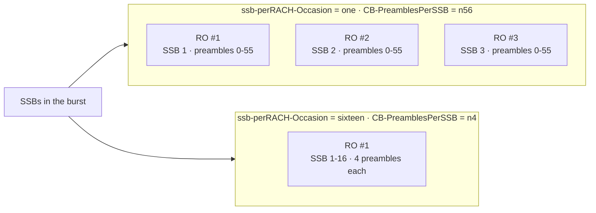

Both extremes are legitimate. The practical consequence: **RA-RNTI is computed from the RO, and the RO is shared
by every SSB mapped to it.** With `sixteen`, sixteen beams' worth of UEs compute the *same* RA-RNTI, so one RAR
MAC PDU can legitimately contain MAC RARs for UEs on completely different beams. A RAR that looks like it came
"for the wrong beam" in a log is usually that, not a fault.

The association repeats over an **association period** of 1, 2, 4, 8 or 16 PRACH configuration periods — the
shortest that covers all actually-transmitted SSBs (TS 38.213 clause 8.1).

## 4. Msg1 — the PRACH preamble

### 4.1 What a preamble is

A preamble is a **Zadoff-Chu sequence** of length `L_RA` = **839** (long formats) or **139** (short formats),
generated from `prach-RootSequenceIndex` plus a cyclic shift derived from `zeroCorrelationZoneConfig` (which sets
`N_CS`). Up to **64** preambles can be generated from consecutive roots of one logical root index; both 839 and
139 are prime, which is what gives ZC sequences their zero-autocorrelation property and lets the gNB resolve
multiple preambles in one occasion.

Preambles carry **no data**. The entire information content of Msg1 is *which* index was sent and *when and
where* it was sent. The index becomes the RAPID echoed in Msg2; the arrival time becomes the timing advance.

| Parameter | Range | Meaning |
| --- | --- | --- |
| `prach-RootSequenceIndex` | `l839` 0–837, `l139` 0–137 | Logical root the cell starts from |
| `zeroCorrelationZoneConfig` | 0–15 | `N_CS` — cyclic-shift spacing; larger = larger cell radius, fewer preambles per root |
| `restrictedSetConfig` | unrestricted / type A / type B | Restricted cyclic-shift sets for high-Doppler cells |
| `totalNumberOfRA-Preambles` | 1–63 | Contention-based portion; the remainder of the 64 is available for CFRA |
| `numberOfRA-PreamblesGroupA` | 1–64 | Boundary between group A and group B |
| `msg1-SubcarrierSpacing` | 15/30/60/120 kHz (short formats only) | PRACH SCS; also feeds `DELTA_PREAMBLE` |

### 4.2 Preamble formats

Long formats (TS 38.211 Table 6.3.3.1-1), `L_RA` = 839:

| Format | PRACH SCS | Sequence | CP | Duration | CP-implied max cell radius | Where it fits |
| --- | --- | --- | --- | --- | --- | --- |
| 0 | 1.25 kHz | 1 × 800 µs | 103.1 µs | ≈ 1 ms | ≈ 14.5 km | General-purpose macro; the default many vendors ship |
| 1 | 1.25 kHz | 2 × 800 µs | 684.4 µs | ≈ 3 ms | ≈ 100 km | Very large rural / coastal cells |
| 2 | 1.25 kHz | 4 × 800 µs | 152.6 µs | ≈ 3.5 ms | ≈ 22 km | Coverage-limited macro; repetition buys link budget |
| 3 | 5 kHz | 4 × 200 µs | 103.1 µs | ≈ 1 ms | ≈ 14.5 km | High-speed / high-Doppler; wider SCS resists Doppler |

Short formats (Table 6.3.3.1-2), `L_RA` = 139, SCS = 15·2^µ kHz:

| Format | OFDM symbols | CP (κ units) | Duration @15 kHz | CP-implied max radius | Where it fits |
| --- | --- | --- | --- | --- | --- |
| A1 | 2 | 288·2^-µ | ≈ 0.14 ms | ≈ 0.94 km | Dense small cell |
| A2 | 4 | 576·2^-µ | ≈ 0.29 ms | ≈ 2.1 km | Small / micro cell |
| A3 | 6 | 864·2^-µ | ≈ 0.43 ms | ≈ 3.5 km | Suburban; a common FR1 TDD default |
| B1 | 2 | 216·2^-µ | ≈ 0.13 ms | ≈ 0.59 km | Indoor / very dense |
| B2 | 4 | 360·2^-µ | — | ≈ 1.05 km | Paired with A2 in the config tables |
| B3 | 6 | 504·2^-µ | — | ≈ 1.76 km | Paired with A3 in the config tables |
| B4 | 12 | 936·2^-µ | ≈ 0.86 ms | ≈ 3.9 km | Beam sweeping with many repetitions (FR2) |
| C0 | 1 | 1240·2^-µ | ≈ 0.10 ms | ≈ 5.4 km | One symbol, long CP; cheapest occasion, decent range |
| C2 | 4 | 2048·2^-µ | ≈ 0.33 ms | ≈ 9.3 km | Best range available from a short format |

> **The radius column is a timing limit, not a coverage limit.** A UE 30 km out in a Format 0 cell can be
> perfectly audible and still never complete RACH, because its preamble arrives outside the detection window.
> Symptom: preambles detected with implausible TA values, or not at all, only from distant UEs.

### 4.3 Time and frequency resources

- `prach-ConfigurationIndex` (0–255) selects the preamble format **and** the frame/slot/symbol pattern, from
  Tables 6.3.3.2-2 (FR1 FDD and SUL), 6.3.3.2-3 (FR1 TDD) or 6.3.3.2-4 (FR2) in TS 38.211. Same number means
  different things in the three tables.
- `msg1-FDM` (1/2/4/8) is how many PRACH occasions are frequency-multiplexed in one time instance; `f_id` is the
  index among them (0–7).
- `msg1-FrequencyStart` (0 … maxNrofPRBs−1) is the lowest PRB of the first occasion, relative to PRB 0 of the
  UL BWP.
- `ra-ssb-OccasionMaskIndex` (Table 7.4-1) restricts which of an SSB's occasions the UE may use: 0 = all, 1–8 =
  a specific occasion index, 9 = every even occasion, 10 = every odd occasion, 11–15 reserved. `msgA-SSB-SharedRO-
  MaskIndex` does the same job for the 2-step occasions shared with 4-step.

> **Root-sequence planning is a real neighbour-planning task.** The number of roots a cell consumes is
> `ceil(64 / preambles_per_root)`, which grows as `N_CS` grows. Raising `zeroCorrelationZoneConfig` for a large
> cell silently widens its root footprint and can collide with a neighbour that was previously fine — producing
> RARs the UE never asked for and phantom uplink grants.

### 4.4 Open-loop power and ramping

```
P_PRACH = min { P_CMAX,f,c ,
                preambleReceivedTargetPower
                + PL                                  (DL pathloss estimate)
                + DELTA_PREAMBLE                      (format-dependent, TS 38.321 Table 7.3-1 / 7.3-2)
                + (PREAMBLE_POWER_RAMPING_COUNTER - 1) x powerRampingStep }
```

`DELTA_PREAMBLE` (TS 38.321 clause 7.3):

| Long format | Value | Short format | Value |
| --- | --- | --- | --- |
| 0 | 0 dB | A1, B1 | 8 + 3·µ dB |
| 1 | −3 dB | A2, B2 | 5 + 3·µ dB |
| 2 | −6 dB | A3, B3 | 3 + 3·µ dB |
| 3 | 0 dB | B4 | 3·µ dB |
|  |  | C0 | 11 + 3·µ dB |
|  |  | C2 | 5 + 3·µ dB |

Worked example — `preambleReceivedTargetPower` = −104 dBm, `powerRampingStep` = dB4, estimated pathloss 118 dB,
`P_CMAX` = 23 dBm, `DELTA_PREAMBLE` = 0:

| Attempt | Calculation | Transmit power |
| --- | --- | --- |
| 1 | −104 + 118 + 0 = 14 | 14 dBm |
| 2 | −104 + 118 + 4 = 18 | 18 dBm |
| 3 | −104 + 118 + 8 = 22 | 22 dBm |
| 4 | −104 + 118 + 12 = 26 → clipped | 23 dBm |

From attempt 4 onward the UE is at maximum power and further ramping changes nothing. Attempts 4 through
`preambleTransMax` are, in link-budget terms, identical retries: they only help against collisions and fading,
not against pathloss.

> **`PREAMBLE_POWER_RAMPING_COUNTER` is a counter of *transmissions*, not of *failures*, and it has four
> conditions.** TS 38.321 clause 5.1.3 increments it for each preamble only when all four hold: the transmission
> counter is already greater than one, the SSB or CSI-RS **has not changed** since the last attempt, the PHY has
> **not** sent lower layers' "suspend power ramping counter" notification, and no LBT failure was reported for
> the last attempt. The second is the one that matters in the field: a UE that switches beam between attempts
> deliberately does not ramp, because the new beam's pathloss is a fresh estimate rather than an under-estimate
> to correct. The consequence is that a UE oscillating between two marginal beams can burn through
> `preambleTransMax` at almost constant power — in a log this looks like ten attempts at the same power, which
> is easy to misread as a broken ramping configuration. See §9.3 for the full counter walk-through.

Two more counters worth knowing: `PREAMBLE_TRANSMISSION_COUNTER` starts at 1 and the procedure is declared a
failure at `preambleTransMax + 1`; `PREAMBLE_BACKOFF` starts at 0 ms and is set only from a Backoff Indicator in
Msg2.

## 5. Msg2 — the Random Access Response

### 5.1 Addressing: RA-RNTI and MSGB-RNTI

Neither side can be told the RNTI — signalling is the thing that has not started yet — so both compute it from
the position of the PRACH occasion (TS 38.321 clause 5.1.4):

```
RA-RNTI   = 1 + s_id + 14 x t_id + 14 x 80 x f_id + 14 x 80 x 8 x ul_carrier_id
MSGB-RNTI = RA-RNTI + 14 x 80 x 8 x 2 = RA-RNTI + 17920

  s_id           index of the first OFDM symbol of the PRACH occasion        0 .. 13
  t_id           index of the first slot of the PRACH occasion in a frame    0 .. 79
  f_id           index of the PRACH occasion in the frequency domain         0 .. 7
  ul_carrier_id  0 = normal uplink (NUL), 1 = supplementary uplink (SUL)
```

Worked example — symbol 4, slot 19, frequency index 1, NUL:

```
RA-RNTI = 1 + 4 + (14 x 19) + (14 x 80 x 1) + 0 = 1 + 4 + 266 + 1120 = 1391
MSGB-RNTI (same occasion, 2-step) = 1391 + 17920 = 19311
```

The RA-RNTI space is 1 … 17920 and MSGB-RNTI occupies 17921 … 35840. The offset is exactly the size of the
RA-RNTI space, so a 4-step and a 2-step response in the same occasion can never alias, and both blocks fit
inside the 0x0001–0xFFEF RNTI range shared with C-RNTI, P-RNTI and SI-RNTI.

The gNB effectively **addresses an occasion, not a device**. Every UE that used that occasion descrambles the
DCI successfully and reads the PDU; disambiguation happens one layer up at the RAPID subheader, and one layer
up again at contention resolution.

### 5.2 Monitoring

- The UE monitors **Type1-PDCCH common search space** for DCI format 1_0 with CRC scrambled by RA-RNTI
  (MSGB-RNTI for 2-step), configured by `ra-ControlResourceSet` and `ra-SearchSpace` in `PDCCH-ConfigCommon`.
  If those are absent, the UE looks for the RA-RNTI / TC-RNTI DCIs in the **Type0-PDCCH** common search space
  instead.
- `ra-ResponseWindow` (sl1 … sl80, typically sl10) runs from **the first PDCCH occasion after the end of the
  preamble transmission** — not from the start of the preamble. For beam failure recovery, the window configured
  in `BeamFailureRecoveryConfig` is used instead, and the UE monitors for a PDCCH addressed to its **C-RNTI** in
  `recoverySearchSpaceId`.
- **The RAR PDSCH has no HARQ feedback.** A lost RAR is recovered by the preamble retransmission machinery, not
  by HARQ.

### 5.3 RAR MAC PDU

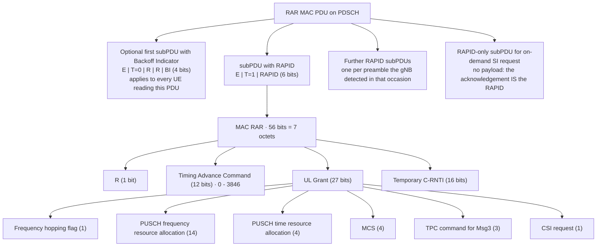

The UE walks the subheaders looking for a RAPID equal to the preamble index it sent; everything else in the PDU
belongs to other UEs and is discarded.

### 5.4 Backoff Indicator

| Index | 0 | 1 | 2 | 3 | 4 | 5 | 6 | 7 |
| --- | --- | --- | --- | --- | --- | --- | --- | --- |
| ms | 5 | 10 | 20 | 30 | 40 | 60 | 80 | 120 |

| Index | 8 | 9 | 10 | 11 | 12 | 13 | 14–15 |
| --- | --- | --- | --- | --- | --- | --- | --- |
| ms | 160 | 240 | 320 | 480 | 960 | 1920 | Reserved |

TS 38.321 Table 7.2-1. The UE waits a **uniformly random** time in [0, BI] before its next attempt, which
spreads a thundering herd with no per-UE signalling. Note that index 0 is 5 ms, not 0 ms — and that the absence
of a BI subPDU means `PREAMBLE_BACKOFF` = 0 ms, which is a different thing entirely. Prioritised random access
(`RA-Prioritization`, used for handover and BFR) can scale the BI with `scalingFactorBI` and substitute
`powerRampingStepHighPriority`.

### 5.5 Timing advance

```
T_c = 1 / (480 000 x 4096) s ≈ 0.509 ns
N_TA = T_A x 16 x 64 / 2^mu        (T_A is the 12-bit value from the RAR)
```

Worked example — `T_A` = 245 at 30 kHz (µ = 1):

```
N_TA = 245 x 16 x 64 / 2 = 125 440 T_c = 125 440 x 0.509 ns ≈ 63.8 µs
one-way propagation ≈ 31.9 µs ≈ 9.6 km of path
step size at 30 kHz = 16 x 64 / 2 = 512 T_c ≈ 0.26 µs ≈ 39 m of range resolution
```

The maximum `T_A` of 3846 corresponds to roughly 1 ms of advance at 15 kHz, i.e. about 150 km of one-way path —
which is why NTN needs a separate **common TA** on top (§13).

## 6. Msg3 — the first scheduled uplink transmission

### 6.1 Scheduling

The UE transmits PUSCH in slot **n + k2 + Δ**, where n is the slot in which the RAR PDSCH ended:

- `k2` comes from the 4-bit time-domain field of the RAR UL grant, indexing `pusch-TimeDomainAllocationList` in
  SIB1 (or the default table if it is absent).
- **Δ is numerology-dependent** (TS 38.214 Table 6.1.2.1.1-5): μ = 0 → 2 slots, μ = 1 → 3, μ = 2 → 4, μ = 3 → 6.
  The extra margin covers DL/UL switching and processing.
- The minimum gap between the last symbol of the RAR PDSCH and the first symbol of Msg3 is
  `N_T,1 + N_T,2 + 0.5 ms`, where `N_T,1` and `N_T,2` are the PDSCH processing and PUSCH preparation times.

Other Msg3 physical-layer details: the SCS comes from `subcarrierSpacing` in `BWP-UplinkCommon`; whether
transform precoding is applied comes from `msg3-transformPrecoding` (`msg3-tp`); Msg3 is transmitted on the same
serving cell the preamble was sent on; and it **is** HARQ-protected, unlike the RAR that scheduled it.

### 6.2 Contents — what Msg3 carries depends entirely on the trigger

| Trigger | Msg3 payload |
| --- | --- |
| Initial access | CCCH SDU = `RRCSetupRequest`: `ue-Identity` (39-bit `ng-5G-S-TMSI-Part1` if the UE has one, else a 39-bit `randomValue`) + `establishmentCause` + 1 spare bit |
| Resume from INACTIVE | CCCH SDU = `RRCResumeRequest` or `RRCResumeRequest1`: `resumeIdentity` (24-bit short or 40-bit full I-RNTI), `resumeMAC-I`, `resumeCause` |
| Re-establishment | CCCH SDU = `RRCReestablishmentRequest` |
| On-demand SI (Msg3-based) | CCCH SDU = `RRCSystemInfoRequest` |
| Connected-mode triggers (SR fallback, TA recovery, UL data) | **C-RNTI MAC CE** on the first transmission that can carry it, plus buffered data |

`EstablishmentCause` has sixteen codepoints and no extension marker: `emergency`, `highPriorityAccess`,
`mt-Access`, `mo-Signalling`, `mo-Data`, `mo-VoiceCall`, `mo-VideoCall`, `mo-SMS`, `mps-PriorityAccess`,
`mcs-PriorityAccess`, and `spare6 … spare1`. It is UE-asserted on SRB0, before security and before
authentication — the network admits an `emergency` claim on trust and checks it later at NAS level. That is also
why access-class and Unified Access Control barring are applied in the UE from broadcast information, rather
than by the network evaluating the cause.

Msg3 is deliberately tiny — 56 to 72 bits of RRC payload is typical — because it is sent before any
channel-quality feedback loop exists, on a grant the gNB sized blind. `ra-Msg3SizeGroupA` exists so a UE that
needs a *larger* Msg3 can say so through its preamble group choice.

## 7. Msg4 and contention resolution

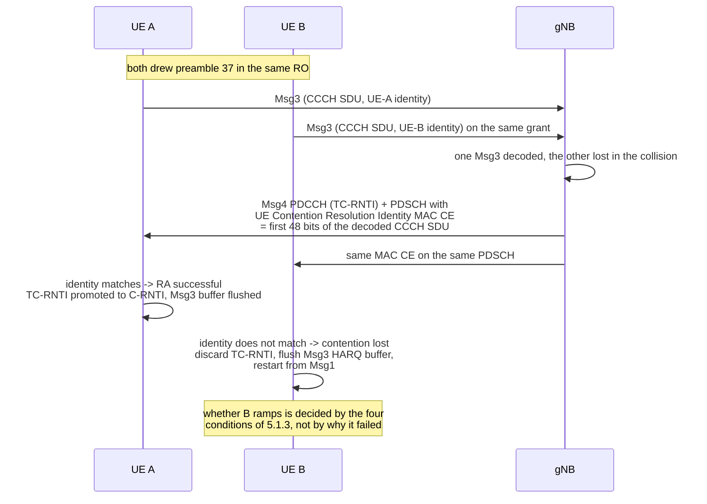

Two mechanisms exist, depending on what Msg3 carried:

- **CCCH SDU (initial access, resume, re-establishment, SI request)**: the gNB echoes the **first 48 bits** of
  the CCCH SDU in a UE Contention Resolution Identity MAC CE (TS 38.321 clause 6.1.3.3). Every UE that sent that
  preamble compares; exactly one can match.
- **C-RNTI MAC CE (already in RRC_CONNECTED)**: resolution is **implicit**. Successful reception of a PDCCH
  addressed to the UE's own C-RNTI *is* the confirmation, and no CE is needed.

A losing UE increments `PREAMBLE_TRANSMISSION_COUNTER`, flushes the Msg3 HARQ buffer and restarts from Msg1. It
gets **no** exemption from power ramping: the ramping counter is incremented in clause 5.1.3 on the four
transmission conditions alone, with no carve-out for contention-resolution losses, so a loser that stays on the
same beam ramps exactly like a UE that missed the RAR. The widespread claim that "losers do not ramp" is wrong.
What is true is the narrower rule in §4.4 — no ramping when the *beam* changes — and that rule applies to both
kinds of failure equally.

That also removes a tempting shortcut: **you cannot tell a collision from a coverage miss by power**. The tell
for a collision is the sequence — a RAR that arrived, a Msg3 that was sent, and then a mismatch or a timer
expiry — not anything in the power column.

`ra-ContentionResolutionTimer` (sf8 … sf64, typically sf64 subframes) bounds the wait for Msg4 and starts after
the Msg3 transmission. On expiry the UE flushes the Msg3 HARQ buffer, increments the preamble counter, applies
backoff and starts again from preamble selection.

At the end: **TC-RNTI is promoted to C-RNTI**, and for initial access Msg4 also carries `RRCSetup` with SRB1 and
`masterCellGroup`. `RRCReject` instead carries `waitTime` and starts T302. T300 bounds the whole establishment,
RACH included.

## 8. The complete 4-step CBRA sequence

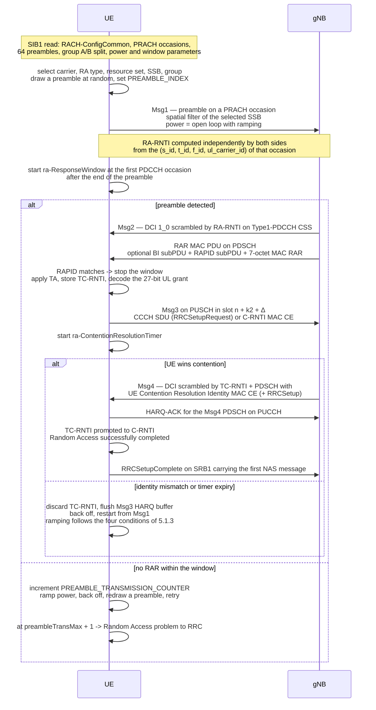

MAC then hands a single indication — *Random Access problem* — to RRC, which decides what it means using the
trigger from §2.

## 9. The procedure as the UE runs it

Sections 4 to 8 told the story message by message. The next two sections retell the same procedure from inside
one side at a time, because that is the shape the questions take in interviews and in log analysis: *"walk me
through what the UE does"* and *"what does the gNB actually know at each step"* have two different answers, and
neither of them is the message list.

### 9.1 What the UE tracks

Every variable below is per serving cell and per active BWP, and all of them are reset when the procedure is
initiated:

| Variable | Set at initiation | Incremented or changed when |
| --- | --- | --- |
| `PREAMBLE_TRANSMISSION_COUNTER` | 1 | Unsuccessful RAR reception, unsuccessful contention resolution, or an LBT failure with no `lbt-FailureRecoveryConfig` |
| `PREAMBLE_POWER_RAMPING_COUNTER` | 1 | Each retransmission, **only if** all four conditions of clause 5.1.3 hold (§4.4) |
| `PREAMBLE_POWER_RAMPING_STEP` | `powerRampingStep` | Overridden by `powerRampingStepHighPriority` for prioritised random access |
| `SCALING_FACTOR_BI` | 1 | Overridden by `scalingFactorBI` for prioritised random access |
| `PREAMBLE_BACKOFF` | 0 ms | Set from a Backoff Indicator in a received RAR |
| `PREAMBLE_RECEIVED_TARGET_POWER` | recomputed per attempt | Before every preamble transmission |
| `RA_TYPE` | 4-stepRA or 2-stepRA | Forced to 4-stepRA once `msgA-TransMax` MsgA attempts are spent |

The asymmetry is the point. The transmission counter counts **attempts** and is what eventually declares
failure; the ramping counter counts **retransmissions on an unchanged beam** and is what decides transmit
power. They move together most of the time and diverge exactly when the UE changes beam — which is why NR
needs two counters where LTE had one.

### 9.2 The UE's state machine

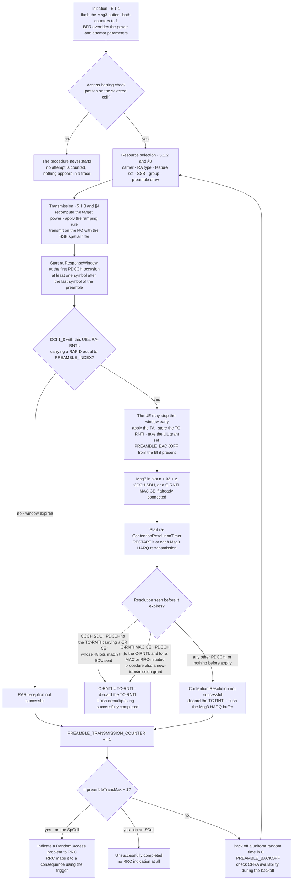

### 9.3 Step by step

**Before anything: barring, and the one-procedure rule.** Access barring is evaluated in the UE from broadcast
information, so a barred UE never starts and never increments a counter. There is no "failed RACH" to see —
UAC problems present as UEs that look idle, which is a common misdiagnosis. Then the one-procedure rule (§2):
if a second trigger arrives while one is running, whether to continue or restart is left to UE implementation,
with the spec's own example being an SI request.

**Initiation (5.1.1).** Flush the Msg3 buffer, set both counters to 1, set the ramping step and the BI scaling
factor. If the trigger was beam failure recovery and `beamFailureRecoveryConfig` is configured for the active
UL BWP, the UE additionally starts `beamFailureRecoveryTimer` and **replaces** `powerRampingStep`,
`preambleReceivedTargetPower` and `preambleTransMax` with the BFR versions. BFR is the one case where the
cell's ordinary RACH parameters are overridden wholesale by a second set.

**Resource selection (5.1.2, §3).** Carrier, RA type, feature set, SSB, group, then a uniform random draw of the
preamble. On an SCell this path is not available at all: the preamble index comes from a PDCCH order.

**Transmission (5.1.3, §4).** Recompute `PREAMBLE_RECEIVED_TARGET_POWER`, apply the four-condition ramping
rule, compute the RA-RNTI, transmit. If an LBT failure comes back and `lbt-FailureRecoveryConfig` is
configured, the UE reselects resources and tries again **without** counting an attempt; without that
configuration the attempt is counted. This is the only failure that can be absorbed for free.

**Waiting for Msg2 (5.1.4, §5).** The window starts at the first PDCCH occasion at least one symbol after the
last symbol of the preamble, and — a detail that bites in mixed-numerology deployments — its length in slots is
measured with the **SCS of the Type1-PDCCH CSS**, not the SCS of the BWP the RAR will be scheduled in. The UE
monitors PDCCH while the window runs **regardless of any measurement gap**. There is no HARQ for the RAR. On a
RAR carrying its own RAPID the UE may stop the window early; it does not have to wait it out.

**On a RAPID match.** Apply the TA, start or restart `timeAlignmentTimer`, store the TC-RNTI, set
`PREAMBLE_BACKOFF` from the BI if one is present, and take the UL grant. The spec itself flags one trap here:
if, within a single procedure, the grant given for the *same* preamble group differs in size from the first
grant allocated in that procedure, **UE behaviour is undefined**. That is a concrete reason for the gNB to keep
its Msg3 grant sizing deterministic — see §10.3.

**Msg3 (§6).** Transmit in slot n + k2 + Δ with the TA applied.

**Waiting for Msg4 (5.1.5, §7).** Start `ra-ContentionResolutionTimer`, and **restart it at each Msg3 HARQ
retransmission**, in the first symbol after the end of that transmission. Monitor PDCCH regardless of
measurement gaps. This restart has a consequence that is easy to miss: the effective Msg4 deadline is the timer
counted from the **last** Msg3 (re)transmission, not the first. A gNB that NACKs Msg3 and drives two
retransmissions therefore buys itself considerably more wall-clock time to produce Msg4 than a naive reading of
`ra-ContentionResolutionTimer` suggests.

**On failure.** Both kinds of failure — RAR and contention — land in the same place: increment the transmission
counter, and at `preambleTransMax + 1` indicate *Random Access problem* to RRC. On the SpCell this becomes an
RRC consequence; on an SCell the procedure is simply considered unsuccessfully completed, with no RRC
indication at all.

**Ending (5.1.6).** On success the C-RNTI is set to the TC-RNTI value and the TC-RNTI is discarded; dedicated
CFRA resources are released **except** the BFR ones, which are kept; and the Msg3 HARQ buffer is flushed.

### 9.4 What the UE does differently in 2-step

- The window is `msgB-ResponseWindow` (sl1 … sl320) and the RNTI is the MSGB-RNTI.
- On a `fallbackRAR`, the UE may stop `msgB-ResponseWindow` as soon as RAR reception is considered successful —
  it does not have to wait out the window before sending Msg3.
- A fallback is a Msg3 retransmission of the MsgA payload on the granted PUSCH, not a new preamble: no
  re-draw, no new occasion, and the attempt budget is already spent.
- Once `msgA-TransMax` MsgA attempts are used, `RA_TYPE` is set to 4-stepRA and the procedure continues as
  4-step with part of `preambleTransMax` already consumed. The two counters are separate but the budget is
  shared (§11).

## 10. The procedure as the gNB runs it

### 10.1 Four things the gNB must work out, in order

For each PRACH occasion the gNB resolves, in this order:

1. **Was a preamble transmitted at all** — a correlation decision against a vendor-internal threshold.
2. **Which preamble** — the RAPID, which is the only identity it obtains.
3. **How far away the transmitter is** — the TA, from the position of the correlation peak.
4. **How much uplink the transmitter will need** — inferred from the preamble group, never told.

Everything after that is provisional. The gNB addresses an *occasion*, not a device, and it will not learn
which device answered until Msg3 arrives.

### 10.2 The gNB's processing chain

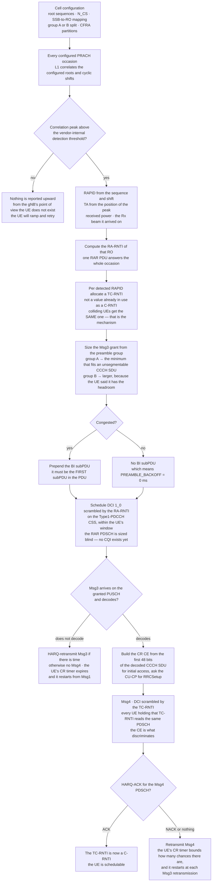

### 10.3 Step by step

**Detection (L1, in the DU).** The correlator searches the configured root sequences and cyclic shifts in every
configured RO. A peak above the detection threshold yields a RAPID, a TA from its position, a received power,
and — in a beamformed cell — the Rx beam the arrival was strongest on, which is the only uplink spatial
information the gNB has before Msg3. The threshold is vendor-internal and is the single most common cause of
"the network never heard us"; anything below it is not reported at all, so the distinction between "never
heard" and "heard but not answered" exists only inside the DU.

**RAR assembly (MAC, in the DU).** One RAR MAC PDU answers one RA-RNTI, that is, one occasion. It may carry
several MAC RARs — one per preamble the gNB detected in that occasion — plus RAPID-only subPDUs for on-demand
SI requests, where the RAPID *is* the acknowledgement. The BI subPDU, if included, must be the **first**
subPDU; RAPID subPDUs sit between it and the padding, and padding goes last. For each detected RAPID the gNB
allocates a TC-RNTI and sizes a Msg3 grant from the preamble group — group A gets the minimum that fits an
unsegmentable CCCH SDU, group B gets more. In a collision the gNB hands the colliding UEs the **same** TC-RNTI
and the **same** grant: that is not a bug, it is the mechanism by which only one Msg3 decodes and the
collision becomes resolvable.

**Scheduling the RAR.** DCI format 1_0 with CRC scrambled by the RA-RNTI, in the Type1-PDCCH CSS, within the
UE's `ra-ResponseWindow`. The RAR PDSCH is scheduled entirely blind — the gNB has no channel-quality
information for this UE whatsoever — and it carries no HARQ. The gNB's only evidence that the RAR landed is
that no preamble comes back and that a Msg3 arrives. This is also why the gNB is the only side that can
distinguish "RAR not sent because it was never scheduled" from "RAR sent but not received"; in a trace you
recover that only by comparing the DU's scheduling decisions against the UE's view.

**Msg3.** The gNB knows the TA from Msg1, so it can in principle decode. If Msg3 does not decode, the gNB can
HARQ-retransmit it, and each retransmission restarts the UE's `ra-ContentionResolutionTimer` (§9.3) — a
retransmission buys the gNB time and costs the UE nothing in its timer, which is the opposite of how HARQ
usually affects latency.

**Msg4.** On a decoded CCCH SDU the DU MAC builds the UE Contention Resolution Identity MAC CE from its **first
48 bits** and encapsulates whatever RRC message the CU-CP produced. The PDCCH is scrambled by the TC-RNTI,
which every UE that drew that preamble holds, so the PDSCH is read by all of them and the CE is what
discriminates. For initial access the CU-CP's contribution is `RRCSetup` — or `RRCReject` with `waitTime` —
and the `masterCellGroup` inside it is authored by the DU. The gNB then watches for the HARQ-ACK on the Msg4
PDSCH; a missing or negative ACK means Msg4 is retransmitted, with the UE's timer bounding how many chances
it gets.

**Across the F1 interface.** L1 and MAC sit in the DU; RRC sits in the CU-CP. The CCCH SDU travels up as an
INITIAL UL RRC MESSAGE TRANSFER and the answer comes down as a DL RRC MESSAGE TRANSFER. The consequence for
field work: a slow or broken F1-C path shows up as Msg4 arriving **after** `ra-ContentionResolutionTimer`
expired, which looks exactly like a collision at the air interface if you only have a UE-side trace.

### 10.4 What each side knows that the other does not

This table is the payoff of the two sections, and most RACH troubleshooting is an argument about which row you
are in.

| The gNB knows | The gNB does not |
| --- | --- |
| The RAPID, and the TA | Which UE sent it |
| The received preamble power | The UE's pathloss estimate, hence its real transmit power |
| The Rx beam the arrival was strongest on | Which downlink beam the UE selected |
| After Msg3, how many UEs collided | Before Msg3, that any collision happened |
| Whether the RAR was scheduled at all | Whether the RAR arrived, until Msg3 shows up |

| The UE knows | The UE does not |
| --- | --- |
| Its own identity and why it is transmitting | Who else drew the same preamble |
| The downlink pathloss | Whether the gNB detected it at all |
| Whether the RAR was addressed to it | The gNB's detection threshold |
| After Msg4, whether it won | Before Msg4, that it is about to lose |

The intersection is worth stating plainly: **nobody** knows, at the moment of Msg1, that a collision has
occurred. The gNB learns it when two UEs answer one grant; the UE learns it when its identity is not echoed.
Every RACH optimisation is therefore either a bet on the collision probability or a reaction to a collision
that has already happened — which is exactly the split between the parameter knobs in §15 and the closed-loop
xApp in [[01-3 AI-ML for RAN and O-RAN RIC]].

## 11. 2-step random access (Rel-16)

2-step exists to remove a round trip: the preamble and the Msg3-equivalent payload are sent together, before any
timing advance has been applied and before any grant has been received. It is selected when
**both** RA types are configured on the carrier **and** the RSRP of the downlink pathloss reference is above
`msgA-RSRP-Threshold`. A dedicated CFRA configuration overrides both.

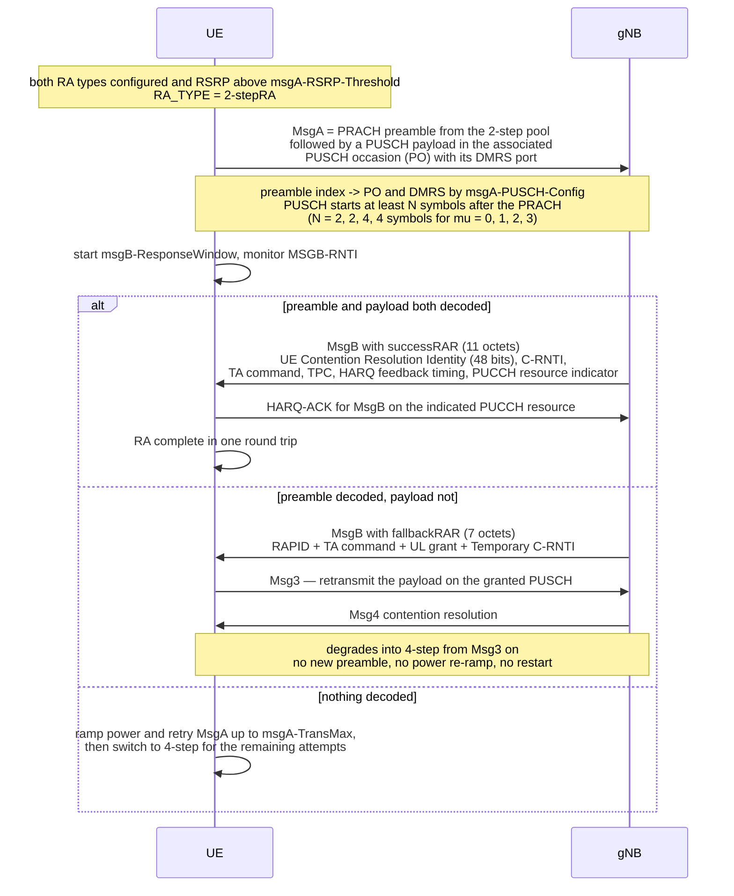

Field sizes are exactly as specified in TS 38.321 clause 6.2.3a:

| | Composition | Size |
| --- | --- | --- |
| `fallbackRAR` | R (1) + Timing Advance Command (12) + UL Grant (27) + Temporary C-RNTI (16) | 7 octets — byte-for-byte an ordinary MAC RAR |
| `successRAR` | UE Contention Resolution Identity (48) + R (1) + ChannelAccess-CPext (2) + TPC (2) + HARQ Feedback Timing Indicator (3) + PUCCH Resource Indicator (4) + Timing Advance Command (12) + C-RNTI (16) | 11 octets |

Practical points:

- **Fallback is not a failure.** A `fallbackRAR` means the preamble link was fine and the MsgA PUSCH was not. A
  high *fallback rate* with a low *failure rate* means `msgA-RSRP-Threshold` is set too permissively for the
  coverage — UEs are choosing 2-step where the payload cannot survive.
- **The counters are separate but the budget is shared.** `msgA-TransMax` (n1 … n64) counts MsgA attempts;
  `preambleTransMax` counts total preambles. A UE with `msgA-TransMax` = n4 and `preambleTransMax` = n10 gets
  four MsgA attempts and then up to six 4-step attempts, not fourteen.
- Because there is no timing advance yet, the MsgA PUSCH relies on a guard period and a robust MCS, and the
  cell's residual delay spread is what decides whether it works. This is the same reasoning that gates SDT on an
  RSRP threshold.
- 2-step is also what makes random access tolerable in **unlicensed spectrum**: every round trip is another
  listen-before-talk gamble.

## 12. Contention-free random access and the special-purpose variants

CFRA is not a different procedure — it is the same procedure with the ambiguity removed. Because the gNB knows
which UE owns preamble index *n*, detecting *n* is itself the identification, so the RAR can carry the real
C-RNTI and Msg3/Msg4 are skipped.

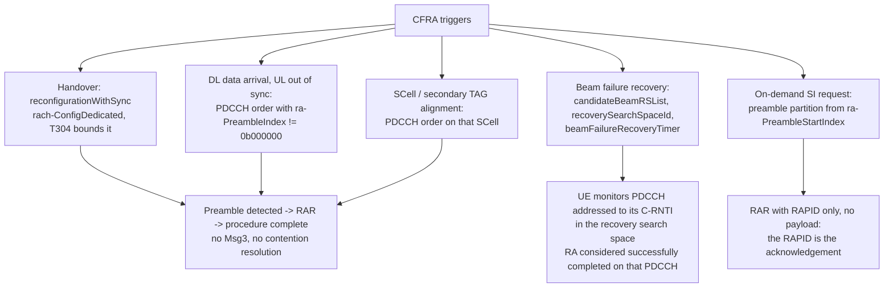

Details that matter:

- **PDCCH order**: the network commands the preamble index, the PRACH mask index and the UL carrier. If the
  index is `0b000000`, the UE falls back to contention-based selection.
- **Handover**: the target's `rach-ConfigDedicated` is delivered inside `reconfigurationWithSync`. If it is
  absent the UE performs CBRA at the target — visible in logs as contention resolution appearing where a
  handover should have none, and as a longer, less deterministic interruption.
- **Beam failure recovery**: the UE selects an SSB with SS-RSRP above `rsrp-ThresholdSSB` or a CSI-RS with
  CSI-RSRP above `rsrp-ThresholdCSI-RS` from `candidateBeamRSList`; if a CSI-RS is selected with no associated
  preamble, the preamble of the QCL'd SSB is used. The response is monitored on the C-RNTI in
  `recoverySearchSpaceId`, and the procedure is complete when a PDCCH addressed to the C-RNTI arrives — no MAC
  CE is involved.
- **SI request**: Msg1-based requests use a dedicated preamble partition (`ra-PreambleStartIndex`) and are
  acknowledged by a RAPID-only subPDU with no payload; Msg3-based requests carry `RRCSystemInfoRequest`.
- **CFRA preambles come out of the same 64-preamble space as CBRA.** `totalNumberOfRA-Preambles` bounds the
  contention-based portion and the remainder is what the scheduler can hand out for handovers and BFR.
  Over-provisioning CBRA in a cell with heavy inbound mobility starves CFRA and quietly pushes handovers onto
  contention-based access.

## 13. Variants that move the procedure

| Variant | What changes | Where |
| --- | --- | --- |
| **RA-SDT** (Rel-17) | User data is multiplexed with the resume request in Msg3 (4-step) or in the MsgA payload (2-step); the UE stays in RRC_INACTIVE throughout. **CFRA is not supported for RA-SDT.** Separate RA resources are configured (SDT is a `FeatureCombination`). | TS 38.331 `sdt-Config` in `suspendConfig`; TS 38.321 clause 5.27 |
| **CG-SDT** (Rel-17) | No random access at all: data goes on a pre-configured PUSCH. Requires a **valid timing advance** — if the TA is no longer valid the UE falls back to RA-SDT or to a normal resume. | same |
| **NTN** (Rel-17) | The UE **pre-compensates** TA and Doppler from its GNSS position plus broadcast ephemeris (`SIB19`); the network broadcasts a common TA (`ta-Common`, `taCommonDrift`, `taCommonDriftVariation`) covering the feeder link. `cellSpecificKoffset` (0–1023 ms at 15 kHz, plus a UE-specific differential `K_offset` MAC CE of 0–63 ms) shifts scheduling relations far enough into the future to stay causal. The RAR window and the contention-resolution timer start **after the UE's own round trip**, so the UE is not listening when no answer can physically arrive. GNSS capability is a condition of NTN access. | TS 38.331 `ntn-Config`; TS 38.300 clause 16; TR 38.821 |
| **RedCap / eRedCap** | Rel-17 partitions RA resources by feature so RedCap UEs do not contend with normal UEs; Msg3 repetition resources exist for coverage-limited UEs (`msg3-Repetitions`, gated by `rsrp-ThresholdMsg3`). | TS 38.321 clauses 5.1.1b–5.1.1d; [[01-4 Cellular IoT RedCap eRedCap and NTN]] |
| **IAB** | `prach-ConfigurationPeriodScaling-IAB`, `prach-ConfigurationFrameOffset-IAB`, `prach-ConfigurationSOffset-IAB` extend and shift the baseline RO pattern for IAB-MT access. | TS 38.321 clause 5.1.1 |
| **NR-U** | Consistent LBT failure on the SpCell itself triggers random access; 2-step is attractive because it halves the number of channel-access gambles. | TS 37.213 |
| **Rel-18 LTM** | L1/L2-triggered mobility may involve **no RACH at all**. Absence of RACH is no longer evidence that no mobility event happened. | TS 38.300 |

The NTN case is worth one diagram, because the shape of the timeline changes rather than the messages:

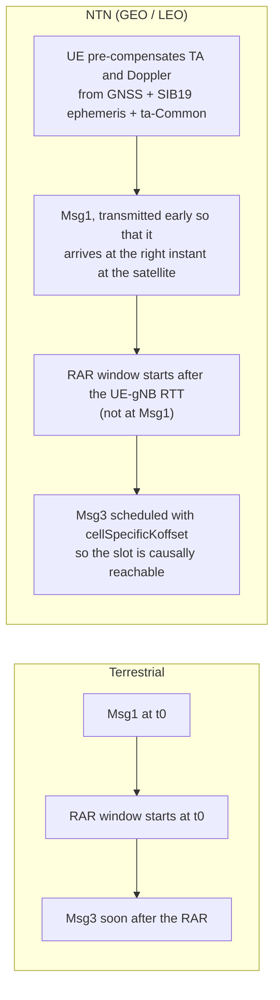

The most confusing field report in NTN: because differential delay is worst at **low elevation**, a marginal
PRACH configuration fails in a band around the horizon and works fine in the middle of the pass — the same UE in
the same place succeeds and fails on a cycle set by the orbit.

## 14. Latency budget and what dominates it

| Variant | Messages | Typical time to a usable UL grant |
| --- | --- | --- |
| 4-step CBRA | Msg1–Msg4 | ≈ 10–20 ms in good conditions; 50–200 ms in a congested cell |
| 2-step CBRA | MsgA + MsgB | ≈ 5–8 ms; saves roughly one round trip |
| CFRA | preamble + RAR | ≈ 4 ms; the whole point of dedicated preambles |

What actually dominates is **not** the transmission time: it is the response window, the backoff, and whether a
retry is needed at all. A cell with a high collision rate spends far more time in backoff and restart than in
preamble transmission. That is why most RACH optimisation work is about **collision probability and RAR
delivery**, not about shortening the messages.

## 15. Tuning knobs

| Parameter | Range | What it controls | Symptom when wrong |
| --- | --- | --- | --- |
| `prach-ConfigurationIndex` | 0–255 (three different tables) | Format and the RO pattern in time | ROs too sparse → long access delay; wrong table for the duplex mode → ROs in DL symbols |
| `msg1-FDM` | 1 / 2 / 4 / 8 | Frequency-multiplexed occasions | Too many → each occasion's power is diluted and per-beam preambles shrink |
| `zeroCorrelationZoneConfig` | 0–15 | `N_CS`, hence max radius vs preambles per root | Too large → fewer preambles per root, wider root footprint, neighbour collisions |
| `prach-RootSequenceIndex` | 0–837 / 0–137 | Logical root | Overlapping ranges between neighbours → phantom RARs |
| `totalNumberOfRA-Preambles` | 1–63 | CBRA share of the 64 | Too high → CFRA starved, handovers become contention-based |
| `ssb-perRACH-OccasionAndCB-PreamblesPerSSB` | oneEighth … sixteen; n4 … n64 | Beams per RO and preambles per beam | Collision rate rises as preambles per beam fall |
| `preambleReceivedTargetPower` | −202 … −60 dBm | Open-loop anchor | Too low → UEs under-transmit and never reach the detector; too high → uplink interference floor rises |
| `powerRampingStep` | dB0 / dB2 / dB4 / dB6 | Increment per attempt | dB0 → no progress in marginal coverage; dB6 → interference spikes |
| `preambleTransMax` | n3 … n200 | Attempts before declaring failure | Too low → premature failures at cell edge; too high → UEs hammer a cell they cannot reach |
| `ra-ResponseWindow` | sl1 … sl80 | RAR wait | Too short with a loaded scheduler → UEs retransmit although the RAR was coming |
| `ra-ContentionResolutionTimer` | sf8 … sf64 | Msg4 wait | Too short → Msg4 that arrives late is wasted |
| `msgA-RSRP-Threshold` | RSRP range | 2-step vs 4-step selection | Too low → high fallbackRAR rate; too high → 2-step never used |
| `msgA-TransMax` | n1 … n64 | MsgA attempts before switching to 4-step | Sizing it without reference to `preambleTransMax` makes access appear to give up early |
| `rsrp-ThresholdSSB` | RSRP range | Which SSBs are eligible | Too high → UEs pick weak beams by the "any SSB" fallback and fail |
| `cellSpecificKoffset` (NTN) | 0–1023 ms | Scheduling causality | Too small → Msg3 schedules that cannot be met |

## 16. Troubleshooting

### 14.1 A layered decision tree

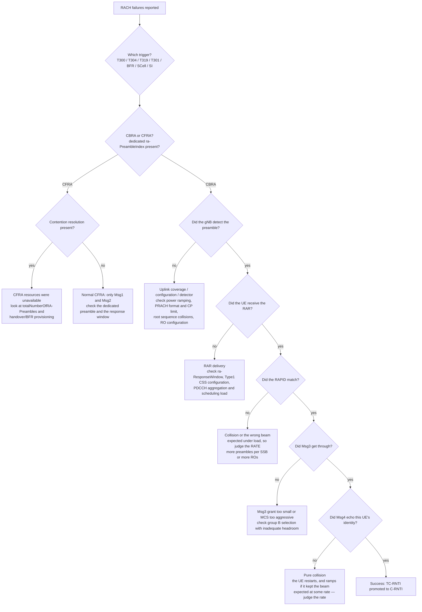

### 14.2 Reading a RACH trace

1. **Find the trigger first.** If the log does not state it, infer it from RRC: T300 running means initial
   access, T304 means handover, T319 means resume.
2. **Establish CBRA or CFRA.** A dedicated `ra-PreambleIndex` in a preceding `reconfigurationWithSync` or PDCCH
   order means CFRA, and contention resolution should be absent.
3. **Check the preamble index against the group boundary.** Below `numberOfRA-PreamblesGroupA` is group A; at or
   above it is group B and implies a large Msg3 with adequate headroom.
4. **Recompute the RA-RNTI** from the logged occasion. A mismatch against the RNTI the UE actually monitored is
   a configuration or frame-timing problem, and it is silent otherwise.
5. **Read the TA command as a distance** and sanity-check it against the cell you believe answered. A TA near
   zero on initial access means the UE is essentially at the antenna; a value that jumps by hundreds between
   consecutive procedures means the UE moved, changed to a differently-delayed beam, or — most often — was
   answered by a different cell than you assumed.
6. **Count attempts, then check the power on each.** Many attempts at constant power means `powerRampingStep` =
   dB0, or `P_CMAX` clipping, or repeated spatial filter changes suppressing the ramping counter. These three
   look identical in a naive read and have entirely different fixes.
7. **Distinguish the four no-progress cases**: no RAR, RAPID mismatch, no Msg4, Msg4 identity mismatch. They are
   four different problems and only the first two can be helped by more power.
8. **For 2-step, count fallbacks separately from failures.**

### 14.3 Symptom table

| Symptom | Likely cause | Where to look |
| --- | --- | --- |
| Preambles sent, no RAR, only from distant UEs | CP / format limit: the preamble arrives outside the detection window | `prach-ConfigurationIndex`, format, `zeroCorrelationZoneConfig`, observed TA values |
| No RAR everywhere, all UEs | RA-RNTI mismatch (wrong RO assumed), Type1 CSS misconfigured, or the RAR is scheduled but not sent | Recompute RA-RNTI; `ra-SearchSpace` / `ra-ControlResourceSet`; scheduler load |
| RAR received, RAPID never matches, high load | Preamble collisions | More preambles per SSB or more ROs; check `totalNumberOfRA-Preambles` |
| RAR and RAPID fine, Msg3 never decoded | Grant too small for the actual Msg3, or MCS too aggressive in marginal coverage | `ra-Msg3SizeGroupA`, group B headroom, Msg3 MCS |
| Msg4 arrives, identity mismatch | Contention lost — normal at some rate | Judge the rate, not the event |
| Ten attempts at the same power | Spatial filter changed between attempts, so the ramping counter is suppressed; or the PHY sent the power-ramping-suspension notification because `P_CMAX` was reached; or `powerRampingStep` = dB0; or LBT failures (NR-U) | SSB reselection in the trace; `preambleReceivedTargetPower` vs pathloss; `lbt-FailureRecoveryConfig` |
| Handover shows contention resolution | CFRA resources were unavailable at the target | `rach-ConfigDedicated` in `reconfigurationWithSync`; CFRA preamble budget |
| High fallbackRAR rate, low failure rate | `msgA-RSRP-Threshold` too permissive for the coverage | RSRP distribution of 2-step attempts vs the threshold |
| Access works mid-cell, fails at the edge | Cell dimensioned smaller than deployed; or NTN geometry at low elevation | PRACH format radius assumption; NTN `cellSpecificKoffset` and window offsets |
| Sudden failures after a neighbour reconfiguration | Root-sequence range overlap | `prach-RootSequenceIndex` and `zeroCorrelationZoneConfig` planning |
| Preamble transmitted but never detected (NTN) | Pre-compensation wrong or absent | GNSS fix validity, ephemeris freshness, `ta-Common`, `epochTime` |
| Msg3 stalls after the RAR (NTN) | `cellSpecificKoffset` too small for this cell | K_offset versus service-link RTT plus common TA |

## 17. Anchors

Facts below are checkable against the specifications named; anything I could not confirm is marked `VERIFY`.

- **TS 38.321 v17.3.0 (2023-01)** is the MAC specification quoted here. Clause 5.1 covers random access;
  clause 7.2 the Backoff Parameter values; clause 7.3 `DELTA_PREAMBLE`; clause 7.4 the PRACH Mask Index.
- **Backoff Parameter values** (Table 7.2-1): index 0 = **5 ms**, 1 = 10, 2 = 20, 3 = 30, 4 = 40, 5 = 60,
  6 = 80, 7 = 120, 8 = 160, 9 = 240, 10 = 320, 11 = 480, 12 = 960, 13 = 1920 ms; 14 and 15 reserved.
  (Several secondary sources list index 0 as 0 ms, which is the LTE table; the NR value is 5 ms.)
- **`DELTA_PREAMBLE`**: long formats 0/1/2/3 = 0/−3/−6/0 dB; short formats A1,B1 = 8+3µ; A2,B2 = 5+3µ;
  A3,B3 = 3+3µ; B4 = 3µ; C0 = 11+3µ; C2 = 5+3µ dB.
- **PRACH Mask Index** (Table 7.4-1): 0 = all occasions, 1–8 = occasion index, 9 = every even occasion,
  10 = every odd occasion, 11–15 reserved.
- **RA-RNTI** = 1 + s_id + 14·t_id + 14·80·f_id + 14·80·8·ul_carrier_id; **MSGB-RNTI** = RA-RNTI + 17 920.
  RA-RNTI space 1–17 920; MSGB-RNTI space 17 921–35 840; the RNTI space ends at 0xFFEF.
- **MAC RAR** = 56 bits (7 octets): R(1) + TA(12) + UL grant(27) + TC-RNTI(16). `fallbackRAR` is the same
  layout; `successRAR` is 88 bits (11 octets) including a 48-bit UE Contention Resolution Identity.
- **UL grant** = 27 bits: frequency hopping (1) + frequency RA (14) + time RA (4) + MCS (4) + TPC (3) +
  CSI request (1).
- **`PREAMBLE_POWER_RAMPING_COUNTER`** (clause 5.1.3) is incremented for each preamble transmission only when
  **all four** hold: `PREAMBLE_TRANSMISSION_COUNTER` > 1; the SSB or CSI-RS **has not** changed since the last
  attempt; the PHY **has not** sent the "suspend power ramping counter" notification; and no LBT failure was
  reported for the last attempt. **There is no carve-out for contention-resolution losses** — a UE that loses
  contention and keeps its beam ramps exactly like one that missed the RAR.
- **`ra-ContentionResolutionTimer`** (clause 5.1.5) is started once Msg3 is transmitted and **restarted at each
  Msg3 HARQ retransmission**, in the first symbol after the end of that transmission; the UE monitors PDCCH
  while it runs **regardless of any measurement gap**.
- **RAR MAC PDU ordering** (clause 6.1.5): the BI subPDU, if present, must be the **first** subPDU; RAPID
  subPDUs can be placed anywhere between it and the padding; padding, if present, goes **last**, and its
  presence and length are implicit from the TB size.
- **Msg3 grant sizing** (clause 5.1.4, NOTE): if within one Random Access procedure the UL grant given for the
  same group of contention-based preambles differs in size from the first grant allocated in that procedure,
  **UE behaviour is undefined**.
- **Timing advance**: N_TA = T_A · 16 · 64 / 2^µ in units of T_c, T_c = 1/(480 000 · 4096) s ≈ 0.509 ns;
  T_A range 0–3846. At 30 kHz, one step is 512 T_c ≈ 0.26 µs ≈ 39 m.
- **Msg3 timing**: slot n + k2 + Δ, with Δ = 2/3/4/6 slots for µ = 0/1/2/3 (TS 38.214 Table 6.1.2.1.1-5).
- **Parameter ranges** (TS 38.331): `prach-ConfigurationIndex` 0–255; `msg1-FDM` {1,2,4,8};
  `zeroCorrelationZoneConfig` 0–15; `prach-RootSequenceIndex` l839 0–837 / l139 0–137;
  `preambleReceivedTargetPower` −202 … −60 dBm; `powerRampingStep` {dB0,dB2,dB4,dB6};
  `preambleTransMax` {n3 … n200}; `ra-ResponseWindow` {sl1 … sl80}; `msgB-ResponseWindow` {sl1 … sl320};
  `ra-ContentionResolutionTimer` {sf8 … sf64}; `msgA-TransMax` {n1,n2,n4,n8,n16,n32,n64};
  `numberOfRA-PreamblesGroupA` 1–64; `totalNumberOfRA-Preambles` 1–63.
- **RRC timers**: T300 100–2000 ms; T304 50–10 000 ms; T319 100–2000 ms.
- **`RRCSetupRequest`**: 39-bit `ng-5G-S-TMSI-Part1` or `randomValue`, plus a 16-codepoint `EstablishmentCause`
  and one spare bit.
- **2-step RACH** was introduced in Rel-16 (work item RP-200085). Rel-17 added feature-based RA resource
  partitioning (RedCap, SDT, NSAG, Msg3 repetition) in TS 38.321 clauses 5.1.1b–5.1.1d.
- **NTN** (Rel-17): `cellSpecificKoffset` 0–1023 ms, UE-specific differential `K_offset` MAC CE 0–63 ms,
  GNSS-based TA and Doppler pre-compensation mandatory, `SIB19` carries ephemeris and common-TA parameters.
- **VERIFY**: the exact signalling carrier for the PDCCH order that triggers random access on an NR SCell in
  EN-DC (whether the order always comes from the MCG). The MAC behaviour once the order is received is not in
  doubt; the NSA-specific path should be checked against TS 37.340 before being quoted.

## Related

- [[01-2 5G NR RAN Layer 2 Protocol Stack]] — where this procedure lives: random access is one of the five
  responsibilities of MAC, and Msg3/Msg4 are the first MAC PDUs of a new connection
- [[01-1 5G-Advanced and 6G Radio Access]] — the release context: 2-step RACH in Rel-16, feature partitioning
  and SDT in Rel-17, LTM and the Rel-18/19 evolution of mobility that removes RACH from some handovers
- [[01-4 Cellular IoT RedCap eRedCap and NTN]] — the two extremes of this procedure: RedCap UEs with their own
  RA resource partition and Msg3 repetitions, and NTN where the UE must pre-compensate timing before Msg1
- [[01-3 AI-ML for RAN and O-RAN RIC]] — RACH optimisation is one of the canonical closed-loop use cases: the
  xApp observes preamble collisions, RAR success rate and fallback rate, and retunes the parameters in §15
- [[03-1 Wireless Sensor Networks and Low-Power MAC]] — the same problem one domain over: contention-based
- [[01-6 NR DU MAC Scheduler - Resource Allocation, HARQ and Real-Time Implementation]] — what the Msg2 and Msg4 grants arise from: the scheduler that has to size the Msg3 grant, reserve the PUCCH for the Msg4 acknowledgement, and absorb a new UE context into its per-slot candidate set
  shared-channel access with no prior timing or power knowledge, and a very different set of trade-offs

---

## References

1. 3GPP. *TS 38.321 — Medium Access Control (MAC) protocol specification*, v17.3.0 (ETSI TS 138 321 V17.3.0,
   2023-01). <https://www.etsi.org/deliver/etsi_TS/138300_138399/138321/17.03.00_60/ts_138321v170300p.pdf>
   — clauses 5.1 (random access), 6.2.3 and 6.2.3a (MAC RAR, fallbackRAR, successRAR), 7.2–7.4. The primary
   source for every field size, counter and table in this note. The counter and timer rules behind §9 and §10
   were re-checked against v17.14.0 (2025-10),
   <https://www.etsi.org/deliver/etsi_ts/138300_138399/138321/17.14.00_60/ts_138321v171400p.pdf> — clause 5.1.3
   (the four power-ramping conditions), 5.1.4 (RAR reception, including the NOTE that leaves UE behaviour
   undefined when the Msg3 grant size changes), 5.1.5 (contention resolution and the timer restart), 5.1.6
   (completion), 6.1.5 (RAR MAC PDU ordering).
2. 3GPP. *TS 38.300 — NR; Overall description; Stage 2*. <https://www.etsi.org/deliver/etsi_TS/138300_138399/138300/>
   — clause 9.2.6 lists the events that initiate random access; clause 16 covers NTN.
3. 3GPP. *TS 38.211 — Physical channels and modulation*. <https://www.etsi.org/deliver/etsi_TS/138200_138299/138211/>
   — clause 6.3.3: PRACH preamble formats (Tables 6.3.3.1-1 and 6.3.3.1-2) and PRACH time/frequency resources
   (Tables 6.3.3.2-2 to 6.3.3.2-4).
4. 3GPP. *TS 38.213 — Physical layer procedures for control*. <https://www.etsi.org/deliver/etsi_TS/138200_138299/138213/>
   — clause 4.2 timing advance; clause 8 the physical-layer random access procedure; clause 8.1 SSB-to-RO
   association.
5. 3GPP. *TS 38.214 — Physical layer procedures for data*. <https://www.etsi.org/deliver/etsi_TS/138200_138299/138214/>
   — Table 6.1.2.1.1-5 for the numerology-dependent Msg3 delay Δ and the default `k2` tables.
6. 3GPP. *TS 38.331 — Radio Resource Control (RRC) protocol specification*. <https://www.etsi.org/deliver/etsi_TS/138300_138399/138331/>
   — `RACH-ConfigCommon`, `RACH-ConfigGeneric`, `RACH-ConfigDedicated`, `BeamFailureRecoveryConfig`,
   `RRCSetupRequest`, `RRCResumeRequest(1)`, `UE-TimersAndConstants`.
7. i TecSpec. *TS 38.331 §RRCSetupRequest — ASN.1*. <https://itecspec.com/3gpp/38.331/s/rrcsetuprequest>
   — the exact `InitialUE-Identity` and `EstablishmentCause` enumerations quoted in §6.
8. i TecSpec. *TR 21.916 §19.1.2 — 2-step RACH for NR*. <https://itecspec.com/3gpp/21.916/s/19.1.2>
   — the Rel-16 feature description: MsgA/MsgB composition, shared versus separate PRACH occasions, and the
   fallback indication.
9. 3GPP. *RP-200085 — Revised WID on 2-step RACH for NR* (Rel-16 work item).
   <https://portal.3gpp.org/ngppapp/CreateTdoc.aspx?mode=view&contributionId=RP-200085>
10. CafeTele. *The 5G NR Random Access Procedure — PRACH, Msg1–Msg4, 2-Step RACH, Counters & Optimization*.
    <https://www.cafetele.com/articles/article-5g-nr-random-access-rach.html>
    — the two contention-resolution mechanisms, the backoff valve, and the MsgA/MsgB fallback story.
11. lte5ghub. *Random Access (4-step & 2-step) in 5G NR*. <https://lte5ghub.com/random-access>
    — trigger-to-RRC-consequence table, RA-RNTI worked example, the shared MsgA/preamble budget pitfall, the
    spatial-filter ramping rule, and the log-reading checklist adapted in §16. **Secondary source**: the
    ramping rules taken from here were re-checked against TS 38.321 clause 5.1.3, and one of them is corrected
    in §9.3 and in the Anchors.
12. lte5ghub. *TS 38.331: RRC Connection Procedures in 5G NR*. <https://lte5ghub.com/rrc-procedures>
    — `establishmentCause` semantics, T300/T302, `RRCReject` and `waitTime`.
13. lte5ghub. *TS 38.331: RRC States (Idle / Inactive / Connected) in 5G NR*. <https://lte5ghub.com/rrc-states>
    — the Rel-17 SDT variants and the fact that a completed RACH no longer implies a state transition.
14. 3GPP. *Small Data Transmission (SDT)* — technology page. <https://www.3gpp.org/technologies/sdt>
    — RA-SDT versus CG-SDT, the separation of SDT and non-SDT RA resources, and the data-volume condition.
15. Nokia, Nokia Shanghai Bell. *R2-2xxxxx — Introduction of SDT, Stage-2 running CR* (RAN2 #116-e, Rel-17).
    <https://www.3gpp.org/ftp/Email_Discussions/RAN2/%5BRAN2%23116-e%5D/>
    — the RAN2 agreements: 2-step and 4-step RA-SDT, CFRA not supported for RA-SDT, switching from SDT to
    non-SDT, and the events that terminate an SDT session.
16. Thales. *R2-220xxxx — NTN Stage 2 CR* (RAN2 #117-e).
    <https://www.3gpp.org/FTP/Email_Discussions/RAN2/%5BRAN2%23117-e%5D/>
    — the Rel-17 TA formula with common TA, UE self-estimated TA and K_offset, and the MAC CE timing
    relationship with K_mac during beam failure recovery.
17. ShareTechnote. *NTN — Random Access*. <https://www.sharetechnote.com/html/NTN/NTN_RACH.html>
    — which TR 38.821 candidate solutions survived into Rel-17, and the NTN RACH symptom table used in §16.3.
18. i TecSpec. *TR 38.822 §6.1.4 — NR_NTN_solutions (L1 feature list)*. <https://itecspec.com/3gpp/38.822/s/6.1.4>
    — `uplinkPreCompensation-r17` and the mandatory GNSS-based TA and frequency pre-compensation.
19. NTT DOCOMO Technical Journal, Vol. 24 No. 3. *Special Articles on 3GPP Release 17 Standardization
    Activities*. <https://dcm-dpweb51.tz.nttdocomo.co.jp/english/corporate/technology/rd/technical_journal/bn/vol24_3/005.html>
    — K_offset, HARQ enhancement, and the NTN mobility triggers, from an operator's perspective.
20. ShareTechnote. *5G/NR — Random Access Procedure (Msg1–Msg4)*. <https://sharetechnote.com/html/5G/5G_RACH_old1.html>
    — the Msg3 timing worked example (`k2 + Δ` from a real Amarisoft log) and the Msg4 HARQ-ACK behaviour.
21. NR Explained. *Random access: PUSCH scheduled by RAR UL grant (Msg3)*. <https://www.nrexplained.com/ra_msg3>
    — the 27-bit RAR UL grant field split, the default `k2` table, the Δ table, and the minimum RAR-to-Msg3
    processing time.
22. MathWorks. *5G NR PRACH Configuration* (nrPRACHConfig documentation).
    <https://uk.mathworks.com/help/releases/R2022a/5g/ug/5g-nr-prach-configuration.html>
    — which configuration table applies to which frequency range and duplex mode, and how a format maps to
    configuration indices; useful for reproducing the tables in §4.2 programmatically.
23. Howl Testuff Works. *5G NR: 2-Step Random Access Procedure (Release-16)*.
    <http://howltestuffworks.blogspot.com/2020/04/5g-nr-2-step-random-access-procedure.html>
    — the successRAR and fallbackRAR field lists, the MsgA PUSCH-to-PRACH symbol gap by numerology, and the
    2-step sequence diagrams. Secondary source; field sizes were cross-checked against TS 38.321.
24. 3GPP. *TS 38.101-1 / -2 / -3 — User Equipment radio transmission and reception*.
    <https://www.etsi.org/deliver/etsi_TS/138100_138199/13810101/>
    — `P_CMAX,f,c`, the ceiling in the open-loop PRACH power formula.

---

Copyright (c) 2026 Washington Ruan. All rights reserved.
