# NR HARQ — Retransmission Flow, Timelines and LTE Comparison

HARQ is the only mechanism in the RAN that is simultaneously a PHY problem, a MAC state machine, a memory
budget and a latency budget. Get one of the four wrong and the symptom appears in a completely different place:
a soft-buffer decision shows up as throughput, a timing decision shows up as a cell that quietly refuses to use
some of its slots, a feedback decision shows up as uplink data that is corrupted with no error reported by
either side.

[[01-6 NR DU MAC Scheduler - Resource Allocation, HARQ and Real-Time Implementation]] lists HARQ as one of
the four resources the scheduler allocates, and [[01-2 5G NR RAN Layer 2 Protocol Stack]] as a MAC function. This note is the mechanism itself: what is stored, what is signalled, when it happens, and why NR
and LTE answer the same four questions differently.

Say this sentence early in any interview about it: **NR HARQ is asynchronous in both directions and explicitly
signalled in both directions; LTE was asynchronous downlink but synchronous uplink, driven by a PHICH that NR
deleted — and that asymmetry is the reason LTE uplink HARQ could not survive dynamic TDD.**

## 0. How to read this note

Every HARQ design, LTE or NR, is four decisions stacked on top of each other. Read them in this order and the
rest of the note is detail:

| Layer | Question | LTE answer | NR answer |
| --- | --- | --- | --- |
| 1 · combining | what does the receiver keep after a failure | LLRs of the whole TB, turbo, chase or IR | LLRs per code block, LDPC, IR by default |
| 2 · process | how does the sender know which TB is being retried | DL: process ID in DCI · UL: derived from the subframe number | process ID in the DCI, both directions |
| 3 · feedback | how does the sender learn the verdict | DL: PUCCH/PUSCH HARQ-ACK · UL: PHICH | DL: PUCCH/PUSCH HARQ-ACK · UL: the next grant |
| 4 · timing | when is the retry allowed | UL: fixed 8 ms · DL: n+4 then free | k0/k1/k2 in slots, bounded by N1/N2 |

Two vocabulary items before anything else, because they are used loosely in the field and precisely in the specs:

- **HARQ process** — one outstanding transport block plus its soft buffer plus the state that says whether the
  next transmission on it is new or a retry. A process is the unit of stop-and-wait.
- **HARQ entity** — the set of processes belonging to one UE on one serving cell in one direction. One entity
  per serving cell per direction; the DL entity and the UL entity are independent.

And the invariant that never moves: **a HARQ process is a stop-and-wait channel.** Everything else — the number
of processes, the timing table, the codebook — exists only to keep many stop-and-wait channels busy at once.

## 1. What HARQ has to decide

### 1.1 Where HARQ sits, and why there are two retransmission loops

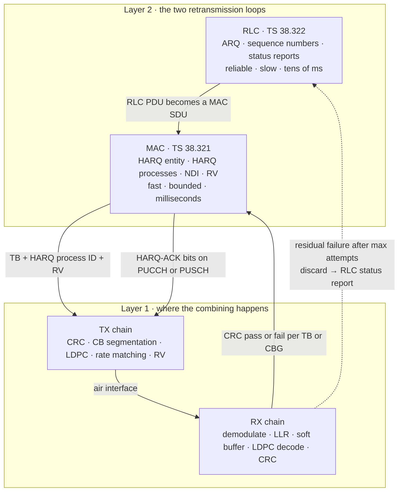

The division of labour is a latency argument, not a reliability one. HARQ absorbs the errors the channel makes
on a millisecond time scale and is allowed to fail; RLC absorbs the errors HARQ leaves behind and is not
allowed to fail. The practical consequence: HARQ targets a first-attempt BLER around **10 %**, deliberately —
a link that succeeds 90 % of the time on the first attempt uses the air interface more efficiently than one
that succeeds 99 % of the time, because the retransmissions of the unlucky 10 % cost less than the margin the
conservative link would have spent on every transmission. RLC then cleans up what is left.

### 1.2 The four design questions

Any HARQ scheme is a point in a four-dimensional space. LTE and NR picked different points, and every
difference in this note is a consequence of one of these four choices:

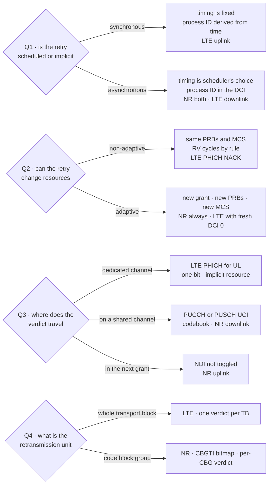

| Question | LTE | NR | Why NR moved |
| --- | --- | --- | --- |
| Synchronisation | DL async · UL sync | async both | dynamic TDD has no fixed UL/DL pattern, so a fixed retry offset cannot exist |
| Adaptivity | DL adaptive · UL non-adaptive by default | adaptive always | frequency-selective scheduling is the whole point of OFDMA; a retry pinned to the same PRBs may land on a faded resource |
| Feedback channel | PHICH for UL, PUCCH for DL | PUCCH/PUSCH for DL, grant for UL | PHICH costs control overhead and a whole channel for one bit, and cannot carry CBG granularity |
| Retransmission unit | TB | TB or CBG | NR transport blocks are far larger; a single bad code block should not cost a whole TB |

### 1.3 Chase combining versus incremental redundancy

The receiver does not store bits after a failed attempt, it stores **log-likelihood ratios** — how confident
the demodulator is about each coded bit. A retransmission is added into the same buffer at the offset the
redundancy version selects. Then the decoder runs over the whole accumulated buffer, not over the
retransmission. This is why a retransmission does not have to be independently decodable: it only has to add
information.

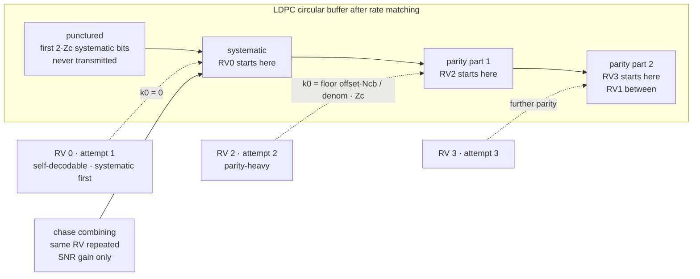

- **Chase combining** — send the same coded bits again; the receiver adds confidence. Gives an SNR gain, no
  code-rate gain. Cheap, and it is what happens when the gNB repeats an RV.
- **Incremental redundancy** — send a different part of the coded sequence; the receiver gets new parity and
  the effective code rate drops. Gives a coding gain. This is what NR does by default.
- NR computes the start index as `k0 = floor(offset(rv) · Ncb / denom) · Zc` with `denom = 66·Zc` for base
  graph 1 and `50·Zc` for base graph 2, and offsets of **0, 17, 33, 56** (BG1) and **0, 13, 25, 43** (BG2) for
  RV 0/1/2/3. LTE instead cycles a **{0, 2, 3, 1}** sequence over a turbo circular buffer of length `Kw = 3·Kπ`.

The engineering consequence that shows up in logs: if the first retransmission helps a lot and the third helps
almost nothing, either the RVs are not changing, or limited buffer rate matching (§8) has clipped the buffer so
that the "new" parity is not new.

## 2. The NR HARQ architecture

### 2.1 Entities, processes and where the memory goes

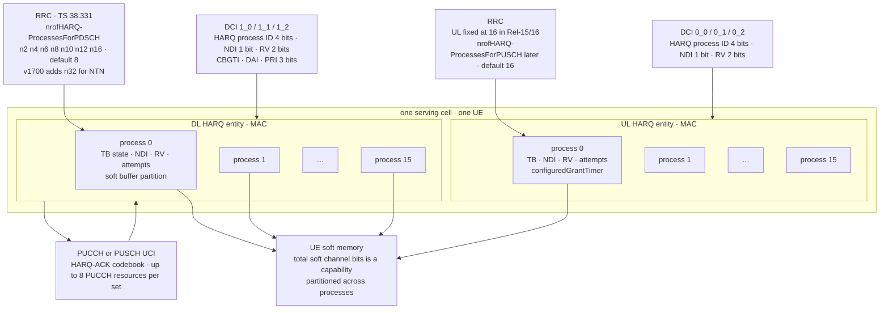

Four facts about this picture that interviewers probe:

1. **DL and UL are independent entities.** A DL NACK says nothing about UL and vice versa; the process numbers
   are separate number spaces.
2. **The number of DL processes is configured; the number of UL processes is not** (until later releases
   introduced `nrofHARQ-ProcessesForPUSCH`). DL default is **8** when `nrofHARQ-ProcessesForPDSCH` is absent,
   maximum **16**, and **32** only with the Rel-17 `v1700` extension — which is an NTN feature, not a general
   one. UL is **16** per cell.
3. **More processes is not automatically better.** Total UE soft-buffer memory is a capability. Configuring
   n16 on a cell that only ever needs six divides the same memory sixteen ways, so each retransmission gets
   less combining room. This is the single most common misconfiguration in this area.
4. **NR has no cross-cell retransmission.** If the initial transmission went on cell 1 and the active cell
   changes, cell 2 does not retransmit it: RLC does.

### 2.2 Downlink: the pipeline for one transport block

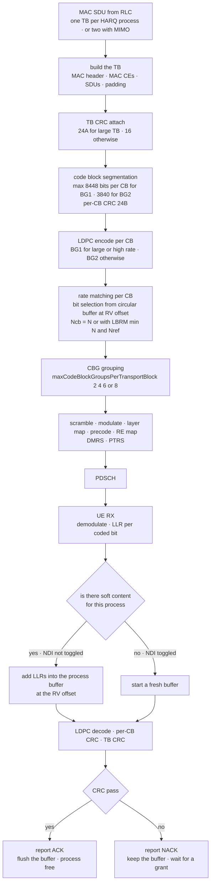

The one branch that decides everything is `SB2`, and it is driven by a single bit: **the NDI.** If the NDI in
the scheduling DCI differs from the value the process remembers, this is a new transport block — flush the
buffer, start again. If it is the same, this is another attempt at the same TB — combine, do not flush. The
RV field then says *where* in the coded sequence this attempt starts.

### 2.3 Uplink: the same pipeline with the feedback arrow missing

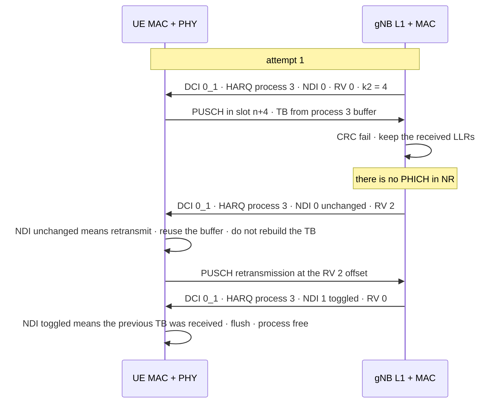

This is the asymmetry that catches people arriving from LTE. **The only uplink HARQ feedback in NR is the next
grant.** A NACK is a DCI that reschedules the same process with the NDI not toggled; an ACK is a DCI for that
process with the NDI toggled; and silence means the UE keeps the buffer and keeps waiting. There is no
channel, no codebook, no timing to configure, and — the debugging consequence — nothing in a UE-side log that
shows the network's verdict.

There is one more consequence: because the verdict arrives as a grant, the *UE's* uplink HARQ process cannot
be released by a timer alone in the dynamic-grant case. It is released when the gNB says so. Configured grants
are the exception, and §5.2 is about exactly that.

## 3. Timing: k0, k1, k2 and the real HARQ round trip

### 3.1 The three offsets

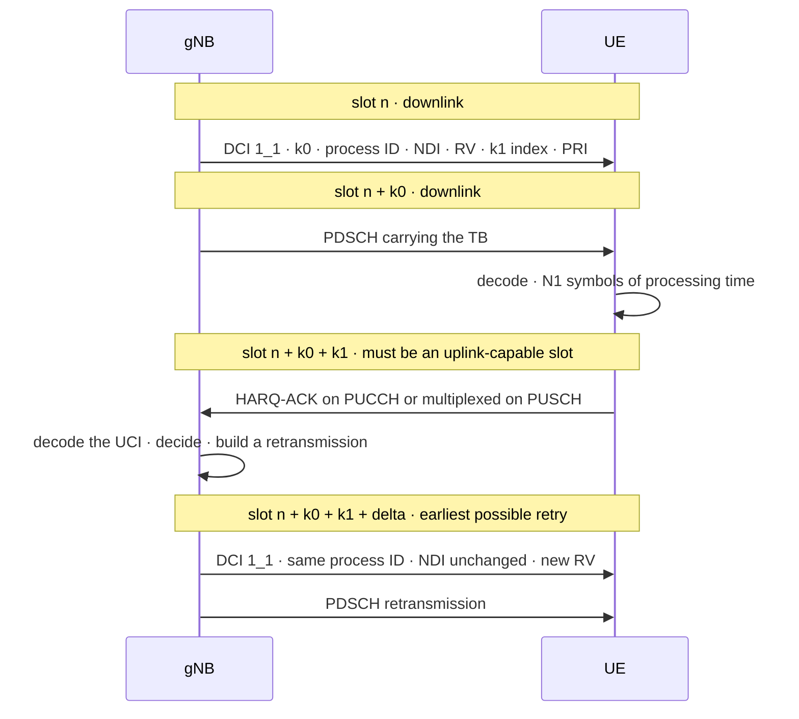

| Offset | From → to | Where the value comes from | Range | What constrains it |
| --- | --- | --- | --- | --- |
| **k0** | DCI → PDSCH | `k0` in the selected row of `pdsch-TimeDomainAllocationList` | 0 … 32 slots | k0 = 0 is same-slot scheduling: lowest latency, highest UE processing demand. Cross-slot lets the UE micro-sleep |
| **k1** | PDSCH → HARQ-ACK | index into `dl-DataToUL-ACK`, signalled by the PDSCH-to-HARQ_feedback timing indicator field | up to 8 configured entries, each 0 … 15 slots; DCI 1_0 uses a fixed table of 1 … 8 | must be at least the UE's PDSCH processing time N1, and must land on a slot with usable uplink symbols |
| **k2** | DCI → PUSCH | `k2` in the selected row of `pusch-TimeDomainAllocationList` | 0 … 32 slots | must be at least the UE's PUSCH preparation time N2 |

Note the asymmetry in the table: **there is no uplink k1.** With no uplink feedback channel there is no
feedback offset to configure, and the only bound on a UL retry is how fast the gNB can decode a PUSCH and
issue a grant.

### 3.2 The processing times that bound everything

UE processing capability 1, front-loaded DMRS only, from TS 38.214 Tables 5.3-1 and 6.4-1:

| µ | SCS | N1 · PDSCH decode in symbols | N2 · PUSCH prepare in symbols | N1 in slots | Practical floor |
| --- | --- | --- | --- | --- | --- |
| 0 | 15 kHz | 8 | 10 | 0.57 | k1 = 1 achievable |
| 1 | 30 kHz | 10 | 12 | 0.71 | k1 = 1 achievable |
| 2 | 60 kHz | 17 | 23 | 1.21 | k1 ≥ 2 in practice |
| 3 | 120 kHz | 20 | 36 | 1.43 | k1 ≥ 2 and k2 ≥ 3 in practice |

Capability 2 is roughly half of these, and it is what makes sub-slot URLLC scheduling possible. Note what does
**not** shrink: N1 and N2 are defined in symbols, so as the numerology rises they shrink in absolute time but
do not shrink in slots. A faster numerology buys a shorter millisecond RTT at the cost of a *larger* slot
count, which is why the slot budgets in [[01-6 NR DU MAC Scheduler - Resource Allocation, HARQ and Real-Time Implementation]] matter more at 60 kHz than at 15 kHz.

### 3.3 Worked round trip

Given: 30 kHz SCS, TDD pattern DDDSU with 2.5 ms periodicity, so slot `s` is uplink when `s mod 5 = 4`.
`dl-DataToUL-ACK = {1, 2, 3, 4, 6, 7, 8, 9}`. A PDSCH is sent in SFN 412, slot 7.

- slot 7: `7 mod 5 = 2` → downlink. Fine.
- candidate feedback slots: `7 + 1 = 8` (special, too few UL symbols), `7 + 2 = 9` (uplink, usable),
  `7 + 3 = 10` (downlink, unusable), `7 + 7 = 14` (`14 mod 5 = 4`, usable).
- the DCI signals the index of **k1 = 2**; the PUCCH goes in slot 9.
- N1 at µ = 1 is 10 symbols ≈ 0.71 slots, so two slots of headroom is comfortable.
- the gNB decodes the PUCCH in slot 9 and can schedule a retransmission in slot 11 or 12 → **HARQ RTT of
  4–5 slots = 2.0–2.5 ms**, against 8 ms for LTE FDD.

That is the whole latency argument for NR in one number. It is not that NR's HARQ is smarter; it is that the
scheduling relationship is expressed in slots at a numerology of the network's choosing, so the RTT scales
with the slot length instead of being pinned to a 1 ms subframe grid.

### 3.4 Two timing traps that cost real capacity

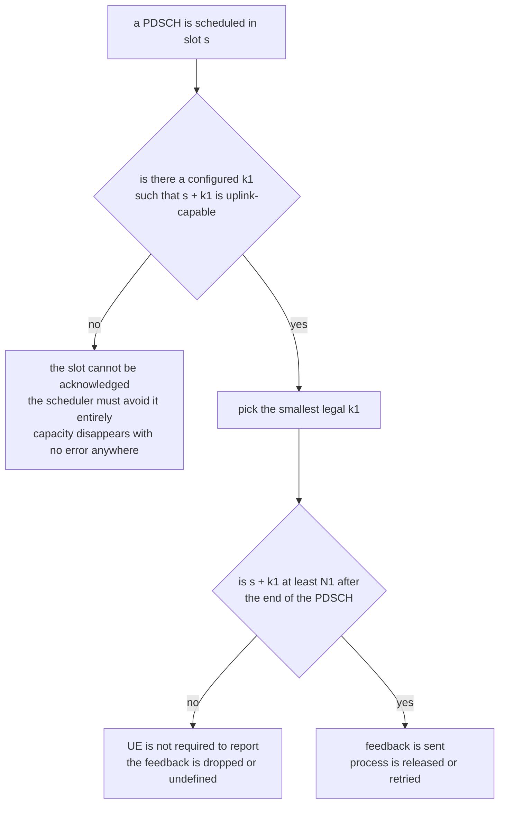

1. **In TDD, `dl-DataToUL-ACK` is not a latency knob, it is a reachability list.** A list of `{2, 4}` on a
   DDDSU pattern leaves slot 1 unable to reach any uplink slot, and the cell quietly loses a fifth of its
   downlink capacity with nothing in the counters to explain it.
2. **NR Rel-15 constrains HARQ-ACK ordering.** The UE is not expected to report feedback for a later-scheduled
   PDSCH before that of an earlier-scheduled one, and not expected to receive a second PDSCH on a process
   before the first one's feedback has been sent. The scheduler inherits an in-order obligation that LTE's
   fixed tables hid.

## 4. The return path: HARQ-ACK, codebooks and PUCCH

One PUCCH transmission usually acknowledges more than one PDSCH — several downlink slots' worth of transport
blocks, possibly across several carriers, all arriving at the same uplink slot through their k1 values. The
**HARQ-ACK codebook** is the agreement between the UE and the gNB about how many bits that PUCCH carries and
which transport block each bit refers to. If the two sides disagree about the size, every bit is misaligned
and the feedback is worse than useless: an ACK lands on a NACK's position and the gNB retransmits a TB the UE
already decoded while dropping one it did not.

### 4.1 The three codebook types

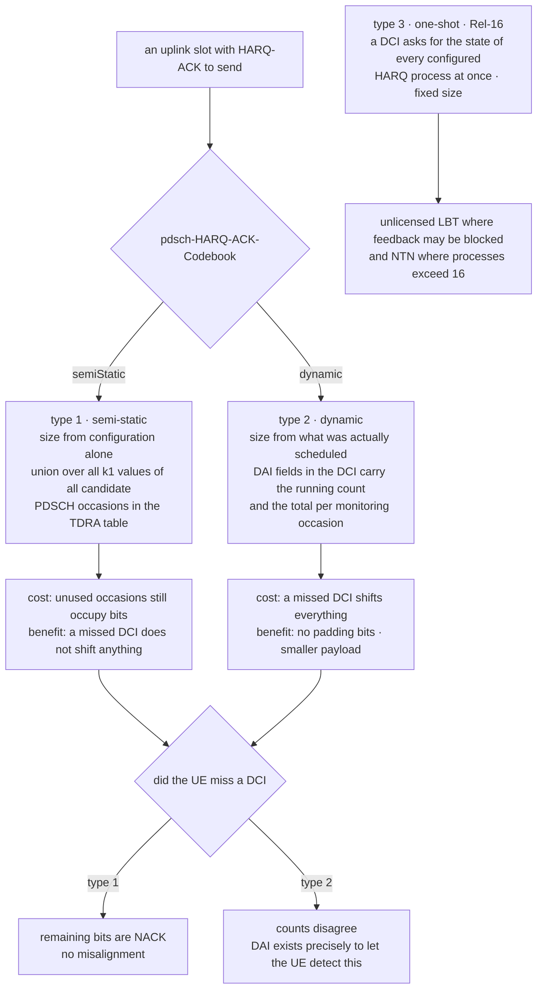

| Type | Size determined by | Robust to a missed DCI | Payload | Typical use |
| --- | --- | --- | --- | --- |
| **1 · semi-static** | configuration: every candidate PDSCH occasion over every configured k1, per cell | yes — a missing DCI simply leaves NACKs | largest, because sparse scheduling still costs bits | FDD and lightly-loaded cells; the safe default |
| **2 · dynamic** | what was scheduled, tracked by counter-DAI and total-DAI in the DCI | no — the DAI exists so a miss can be detected, and the UE replies NACK for the gaps | smallest | TDD and CA, where the semi-static size would be huge |
| **3 · one-shot** | fixed: one bit (or one CBG set) per configured HARQ process of every configured cell | n/a — it is a request, not a periodic report | one bitmap per request | NR-U, and NTN with feedback enabled on some processes |

The DAI mechanics are worth being able to state precisely: the **counter-DAI** counts the scheduling
assignments the UE has actually seen up to this PDCCH monitoring occasion, and the **total-DAI** gives the
total number of assignments in the occasion, letting the UE see that it missed one. DCI 1_0 carries a 2-bit
DAI; DCI 1_1 carries the counter and, where the codebook spans occasions, the total. If a UE detects a gap it
fills NACKs, and the gNB retransmits a TB that was never actually decoded — a wasted retransmission, which is
strictly better than a corrupted buffer.

### 4.2 Which physical channel carries the verdict

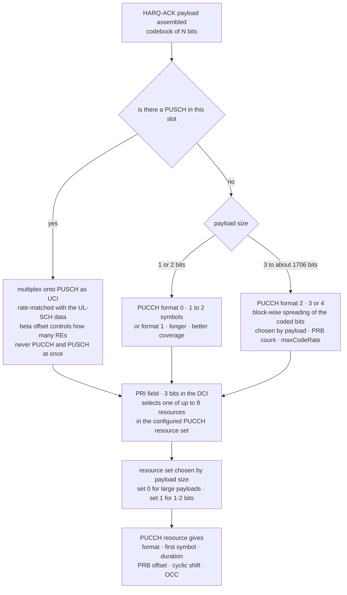

Two things here are genuinely different from LTE and worth saying out loud:

- **LTE derived the PUCCH resource implicitly** from the lowest CCE index of the scheduling PDCCH. NR selects
  it explicitly through a 3-bit PRI into a configured resource set. The LTE scheme was elegant and free, and
  it broke the moment control-channel aggregation or flexible resource design entered the picture — NR paid
  three bits to buy the scheduler the freedom to place the ACK where it wants.
- **PUCCH and PUSCH are never transmitted simultaneously** in NR, exactly as in LTE: the uplink control
  information is multiplexed onto the PUSCH instead. HARQ-ACK is punctured in next to the DMRS because it is
  small and catastrophic if wrong; CSI is rate-matched with the data because it is large and time-tolerant.

### 4.3 Code-block-group retransmission

CBG mode is the one place where NR's retransmission granularity is finer than LTE's, and it exists because NR
transport blocks are much larger. With `maxCodeBlockGroupsPerTransportBlock` of 8 and a TB split into 8 CBGs,
one corrupted code block costs an eighth of the TB instead of all of it.

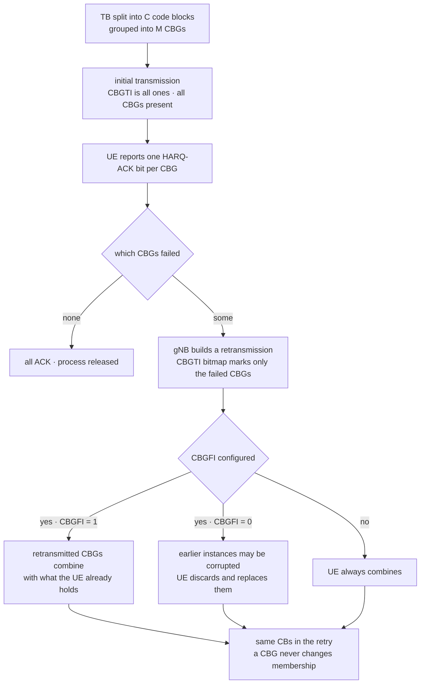

Details that matter: the CBGTI field is `N_TB · N` bits, `N` being the configured maximum number of CBGs per
TB, so configuring 8 CBGs on a two-codeword link puts a 16-bit field in every DCI 1_1 — control overhead that
must be earned back. CBGFI exists because a retransmitted CBG can itself be corrupted in a way that would
poison the combining, and the gNB may know it (for example it preempted the first transmission). And the
constraint that makes the whole thing implementable: **a CBG contains the same code blocks in every
attempt.** No re-segmentation, so the soft buffer layout never changes.

### 4.4 The special cases that appear in real configurations

| Case | What changes | Where it is configured |
| --- | --- | --- |
| **SPS downlink** | no DCI per transmission, so the process ID is derived from slot and periodicity, and HARQ-ACK may be deferred | `sps-Config`, `harq-ACK-Deferral` style parameters in the Rel-16 enhancements |
| **PUCCH repetition** | the same HARQ-ACK is sent on several PUCCH resources for reliability | configured per PUCCH resource; the URLLC answer to a weak control channel |
| **Sub-slot HARQ-ACK** | PUCCH on a 2-symbol or 7-symbol sub-slot so the feedback does not wait for a slot boundary | `subslotLengthForPUCCH` |
| **Spatial bundling** | one ACK bit for two codewords instead of two | `harq-ACK-SpatialBundlingPUCCH` |
| **Carrier aggregation** | one codebook spans cells; a UE with a low capability may be configured with a single PUCCH group | `pucch-Cell`, PUCCH secondary cell |
| **Rel-17 disabled feedback** | per-process bitmap turning HARQ-ACK off entirely | `downlinkHARQ-FeedbackDisabled-r17` — see §9.3 |

### 4.5 Worked type-2 codebook construction

The example that makes the DAI concrete. Configuration: one cell, one codeword, no spatial bundling, one
candidate PDSCH occasion per slot, `dl-DataToUL-ACK = {2, 3, 4}`, and the gNB schedules a PDSCH in each of
slots 1, 2 and 3, all acknowledged in slot 5. The UE misses the DCI in slot 2.

| Slot | What the gNB sent | DAI in that DCI | What the UE saw |
| --- | --- | --- | --- |
| 1 | PDSCH k1 = 4 | counter-DAI = 1, total-DAI = 1 | received |
| 2 | PDSCH k1 = 3 | counter-DAI = 2, total-DAI = 2 | **missed** |
| 3 | PDSCH k1 = 2 | counter-DAI = 3, total-DAI = 3 | received |

The UE builds a 3-bit codebook: it knows from total-DAI = 3 that three assignments existed, and it saw
counter-DAI values 1 and 3, so position 2 is a gap and is filled with NACK. The bits are ordered by
counter-DAI, not by slot order, which is precisely why the counter exists:

| Bit | Refers to | Value |
| --- | --- | --- |
| 1 | counter-DAI = 1 · slot 1 PDSCH | ACK or NACK from the decode |
| 2 | the assignment the UE never saw | **NACK** — forces a retransmission of something that may have been decoded |
| 3 | counter-DAI = 3 · slot 3 PDSCH | ACK or NACK from the decode |

With a type-1 semi-static codebook the same situation produces a 5-bit codebook: every candidate PDSCH
occasion over every configured k1 value gets a bit whether it was used or not, and the two unused positions
are NACK by construction. That costs two bits of PUCCH payload in this slot; in exchange, a missed DCI cannot
misalign anything, because the size never depended on what was scheduled.

The general rule to carry away: **type 1 pays in payload and never misaligns; type 2 saves payload and can
misalign, which is why the DAI exists.** Networks choose type 2 when the semi-static size would be large —
TDD with a rich `dl-DataToUL-ACK`, or carrier aggregation — and type 1 otherwise.

## 5. Uplink HARQ in NR

### 5.1 Dynamic grant: one bit decides

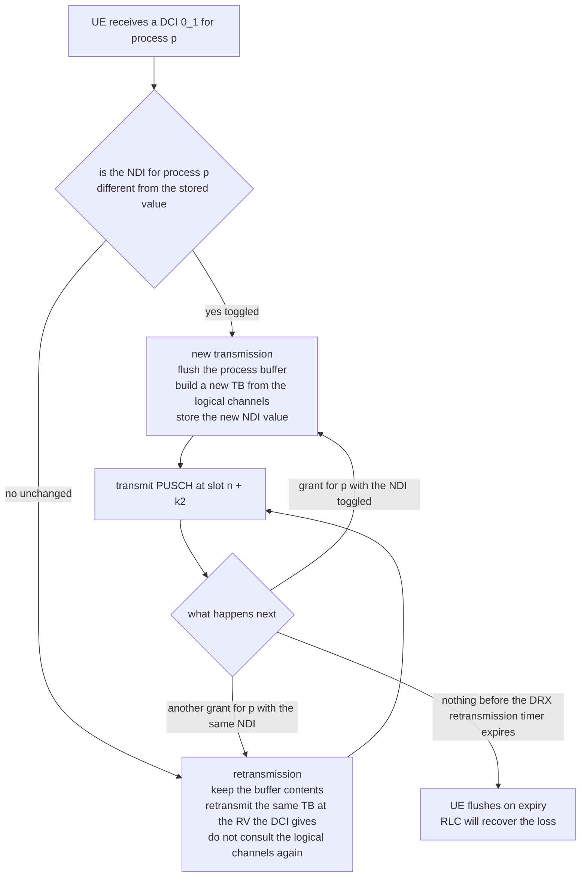

Two implementation consequences follow from this diagram:

- **The MAC PDU for a retransmission is not rebuilt.** Whatever the logical channels would produce now is
  irrelevant; the bytes in the process buffer are the bytes that go. That is why a retransmission cannot
  carry a fresher buffer status, and why uplink HARQ interacts badly with latency-critical traffic whose data
  has already gone stale.
- **The process is only released when the gNB says so.** There is no uplink timer equivalent to a NACK
  timeout in the dynamic-grant case, which is exactly why the DRX retransmission timer exists.

### 5.2 Configured grant: the one place the process ID is derived from time

A configured-grant transmission has no DCI, so there is no field to carry the process ID. NR therefore derives
it from the time of the transmission, which is the last surviving piece of LTE's synchronous idea:

```
HARQ Process ID = [ floor( CURRENT_symbol / periodicity ) ] modulo nrofHARQ-Processes
                  ( + harq-ProcID-Offset2, Rel-16, for the second configured grant )

CURRENT_symbol = SFN x numberOfSlotsPerFrame x numberOfSymbolsPerSlot
                 + slot number in the frame x numberOfSymbolsPerSlot
                 + symbol number in the slot
```

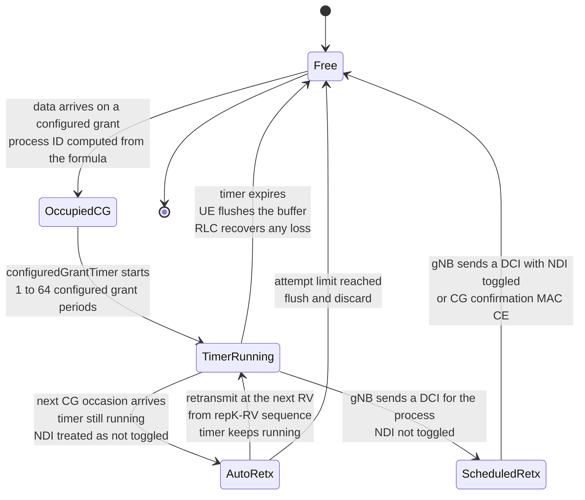

The state machine encodes a subtle rule. `configuredGrantTimer` **is** the uplink feedback timeout that §5.1
said does not exist: while it runs, the UE is allowed to retransmit autonomously on the next configured grant
occasion without waiting for any grant — this is what makes a configured grant useful for URLLC, because the
retry does not have to wait for a scheduling round trip. When it expires, the UE flushes, and reliability
falls back to RLC.

The pitfall that produces unexplainable corruption: a retransmission scheduled by the gNB carries an explicit
process ID, and that ID must match the one the formula produced for the original transmission. If the
periodicity or `nrofHARQ-Processes` disagree between the two sides by even one, the gNB schedules a retry into
a process that holds something else, and the UE happily transmits the wrong bytes. Neither side reports a HARQ
error. This is the single most unpleasant HARQ fault to diagnose.

### 5.3 Repetitions and the RV pattern

For configured grants NR can repeat the same TB across `repK` consecutive slots — `repK` ∈ {1, 2, 4, 8} —
with the redundancy version taken from a configured pattern. The two common patterns are **{0, 2, 3, 1}**,
which is incremental redundancy, and **{0, 3, 0, 3}**, which is closer to chase combining with a systematic
retry. The rule for where an initial transmission may start depends on the pattern: the first occasion for
{0, 2, 3, 1}, any occasion carrying RV 0 for {0, 3, 0, 3}. Repetitions are the other escape hatch for links
that cannot afford a HARQ round trip at all — see §9.2.

## 6. The state machines

### 6.1 UE downlink HARQ process

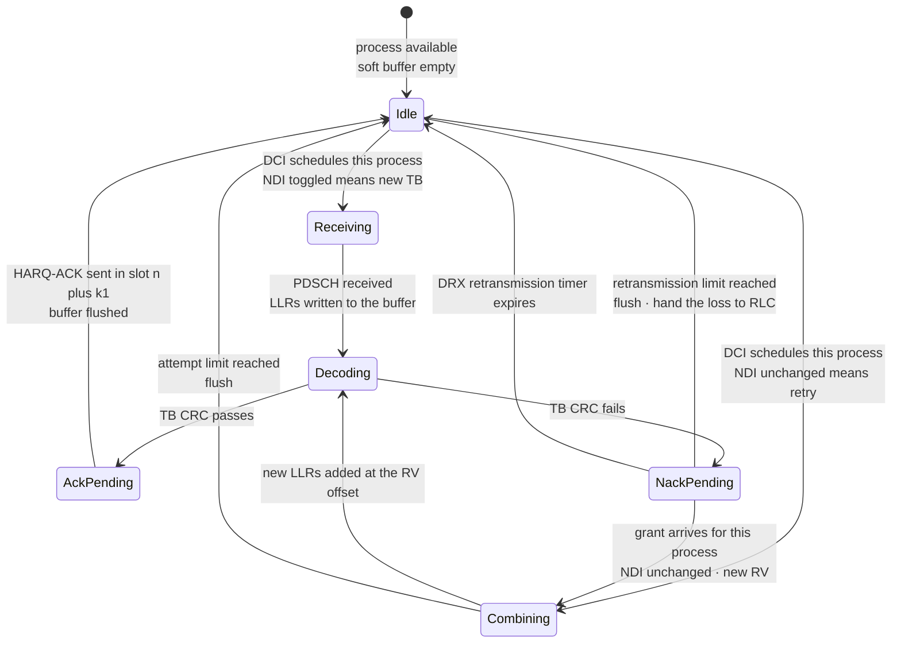

The state that does not exist is "waiting silently". A UE that decoded a TB to failure must say so at a known
time on a known resource; there is no deferred or lazy acknowledgement in the base mechanism. Everything
flexible — deferral, one-shot reporting, disabled feedback — is a later-release overlay on this machine.

### 6.2 UE uplink HARQ process

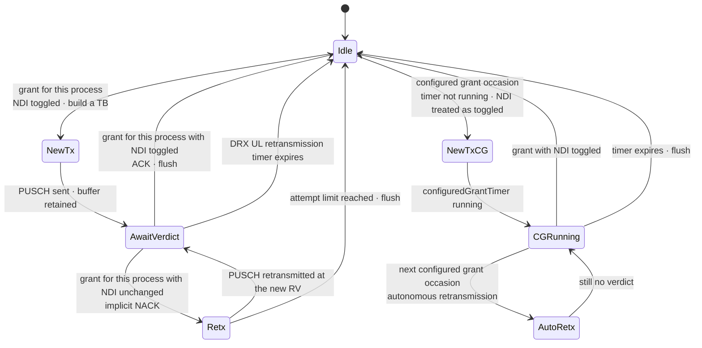

Compare the two machines and the asymmetry is one line: the downlink machine has an `AckPending` and a
`NackPending` state because the UE knows the verdict, while the uplink machine has only `AwaitVerdict`,
because nothing ever tells the UE what happened.

### 6.3 gNB side: the process is a resource, not just a state

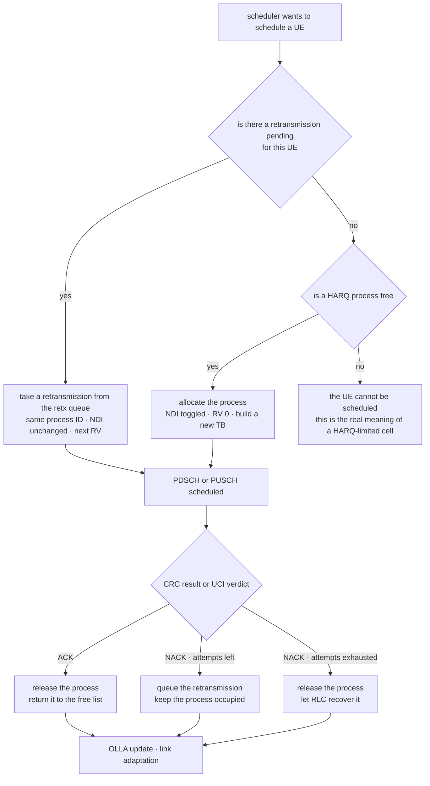

This is the view that connects HARQ to
[[01-6 NR DU MAC Scheduler - Resource Allocation, HARQ and Real-Time Implementation]]: a HARQ process is an
allocated resource with a free list, exactly like a CCE or a PRB, and
the binding constraint on a cell with a long round trip is often the **number of processes**, not the number of
PRBs. A cell at 15 kHz with an 8 ms-equivalent RTT and eight processes configured runs out of processes before
it runs out of spectrum.

### 6.4 Where DRX attaches

A UE in DRX is asleep most of the time, and a NACK it just sent creates an obligation to be awake later —
but not immediately, because no retransmission is physically possible until the gNB has decoded the feedback
and prepared one. Two per-process timers encode exactly that: `drx-RetransmissionTimerDL` starts after the
HARQ-ACK is sent, `drx-RetransmissionTimerUL` after the PUSCH, and while either runs the UE stays awake. If
one expires with no grant, the process is flushed and the loss moves up to RLC. The timers are configured in
slots, which means their wall-clock duration depends on the active BWP's numerology — a fact that surprises
people exactly once per project.

## 7. NR versus LTE, side by side

### 7.1 The headline table

| Dimension | LTE | NR | Consequence |
| --- | --- | --- | --- |
| Downlink synchronisation | asynchronous | asynchronous | unchanged in spirit; the process ID travels in the DCI |
| Uplink synchronisation | **synchronous** — retry at a fixed offset | **asynchronous** | NR can retry whenever a grant fits; LTE could not |
| Uplink feedback channel | **PHICH** — one bit, implicit resource | **none** — the next grant is the verdict | NR freed a whole channel and paid nothing |
| HARQ process ID | DL: 3 bits FDD, 4 bits TDD · UL: derived from the subframe | 4 bits both directions; 5 bits in DCI 0_2/1_2 for 32 processes | NR needs the field because the timing no longer implies it |
| Retransmission adaptivity | DL adaptive · UL non-adaptive by default | adaptive always | a retry can leave a faded resource |
| Retransmission unit | TB | TB or **CBG** | NR saves most of a large TB when one code block fails |
| DL processes | 8 FDD · 4/7/10/9/12/15/6 in TDD configs 0–6 | configure 2–16 · **default 8** · 32 with Rel-17 | NR's count is a configuration, LTE's was a consequence of the frame |
| UL processes | 8 FDD · 7/4/2/3/2/1/6 in TDD configs 0–6 | **16** per cell | NR does not penalise a DL-heavy TDD pattern |
| Feedback timing | fixed n+4 in FDD · tables in TDD | k1 from a configured list, chosen per grant | NR's is a reachability list, not a constant |
| Scheduling timing | fixed n+4 both directions | k0 and k2 in slots, 0–32 | NR supports same-slot and cross-slot scheduling |
| HARQ RTT | **8 ms** FDD, fixed | **2–4 slots** at 30 kHz; scales with numerology | the biggest single latency win of NR |
| Channel code | turbo, circular buffer `Kw = 3·Kπ` | LDPC, base graphs 1 and 2, lifting size Zc | NR's decoder is parallel and scales to huge TBs |
| RV signalling | RV cycles by rule, sequence {0, 2, 3, 1} | RV is a 2-bit field in every grant | NR can repeat or change RV per attempt |
| PUCCH resource | implicit, from the lowest CCE index of the PDCCH | explicit, 3-bit PRI into a configured resource set | NR pays 3 bits for scheduling freedom |
| Missed-DCI detection | TDD DAI, 2 bits | counter-DAI and total-DAI in DCI 1_1 | NR's dynamic codebook is the TDD DAI generalised |
| Attempt limit | `maxHARQ-Tx` signalled in `mac-MainConfig` | not standardised — DU implementation | NR leaves the policy to the scheduler |
| Cross-cell retry | not supported | not supported | unchanged; RLC recovers |
| HARQ and TDD | fixed UL/DL configurations 0–6 | dynamic TDD, semi-static pattern plus per-slot override | the reason the whole uplink design had to change |

### 7.2 LTE downlink HARQ: the part that survived

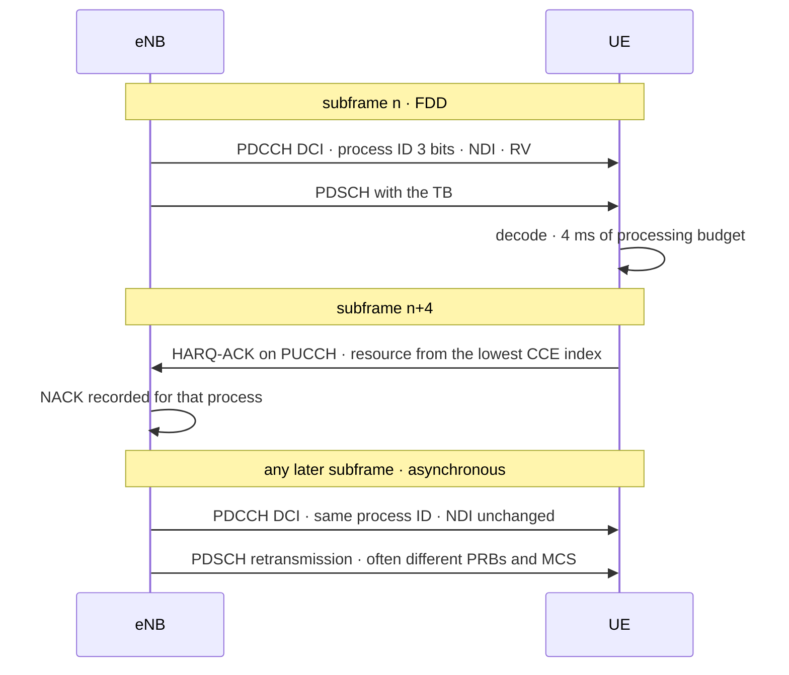

Downlink HARQ in LTE is already asynchronous and adaptive, so an LTE engineer's instincts transfer. The two
things that do not transfer: the PUCCH resource is derived from the lowest CCE index rather than signalled,
and the timing is a constant 4 ms rather than a configured offset.

### 7.3 LTE uplink HARQ: synchronous, PHICH-driven, and why it had to go

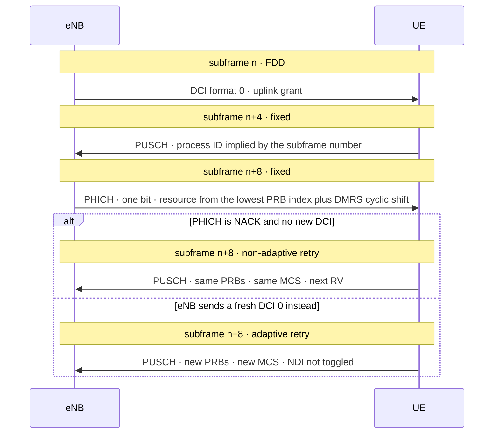

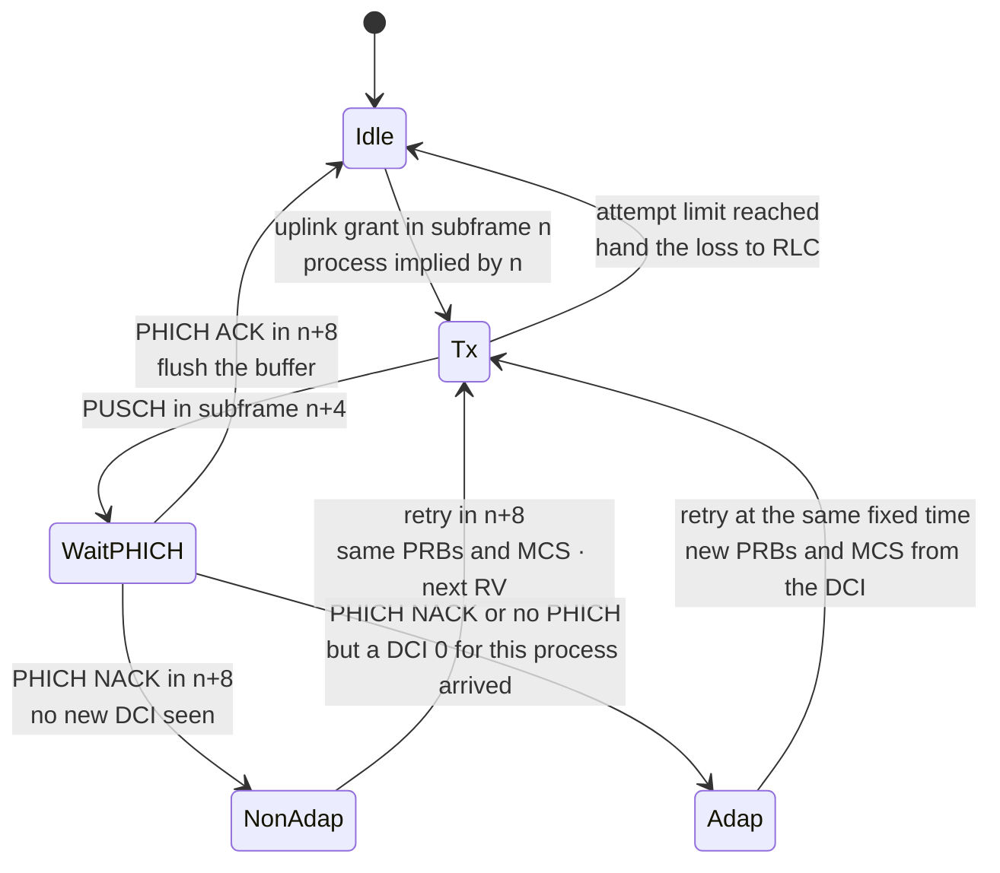

Read the timing clockwise and the whole design falls out: grant at n, PUSCH at n+4, PHICH at n+8, retry at
n+8 — an **8 ms round trip** divided into 1 ms subframes, which is exactly why there are **8 uplink HARQ
processes**. The process ID is never transmitted because it does not need to be: everyone can compute it from
the subframe number.

That elegance is also its death sentence. The design assumes a fixed relationship between downlink and uplink
time. Dynamic TDD — where a slot's direction is not known from a table and can be overridden per UE — destroys
the premise, because "8 subframes later" is no longer guaranteed to be an uplink subframe at all. Add the
desire for sub-1 ms latency, which a fixed 8 ms RTT cannot deliver even for a single retry, and the conclusion
is that the entire synchronous apparatus has to be replaced by explicit signalling.

### 7.4 Why NR changed each thing

| LTE design | NR design | The reason, stated as an engineer would |
| --- | --- | --- |
| Synchronous UL with a derived process ID | asynchronous UL with a 4-bit field | a derived ID requires a fixed UL/DL pattern; NR promised dynamic TDD |
| PHICH | nothing | a dedicated channel for one bit cannot carry CBG granularity, costs control region, and adds a channel to plan and to fail |
| Non-adaptive UL retry by default | adaptive always | the gNB has newer channel knowledge than it had four subframes ago; pinning the retry to the same PRBs wastes it |
| 8 ms RTT | 2–4 slots at 30 kHz | URLLC targets are unreachable with a fixed 8 ms floor |
| Fixed n+4 | k0/k1/k2 in slots | one timing relationship must serve 15 kHz to 120 kHz, FDD and TDD, eMBB and URLLC |
| TB-granular retransmission | CBG-granular option | NR TBs are large; one bad code block should not cost the whole block |
| Implicit PUCCH resource from CCE | explicit PRI | CORESET structure and multi-TRP make the implicit mapping insufficient |
| Category-based soft buffer table | capability derived from the rate expression | NR bandwidths and layers vary far more than LTE categories could tabulate |

### 7.5 TDD: the comparison that actually decides it

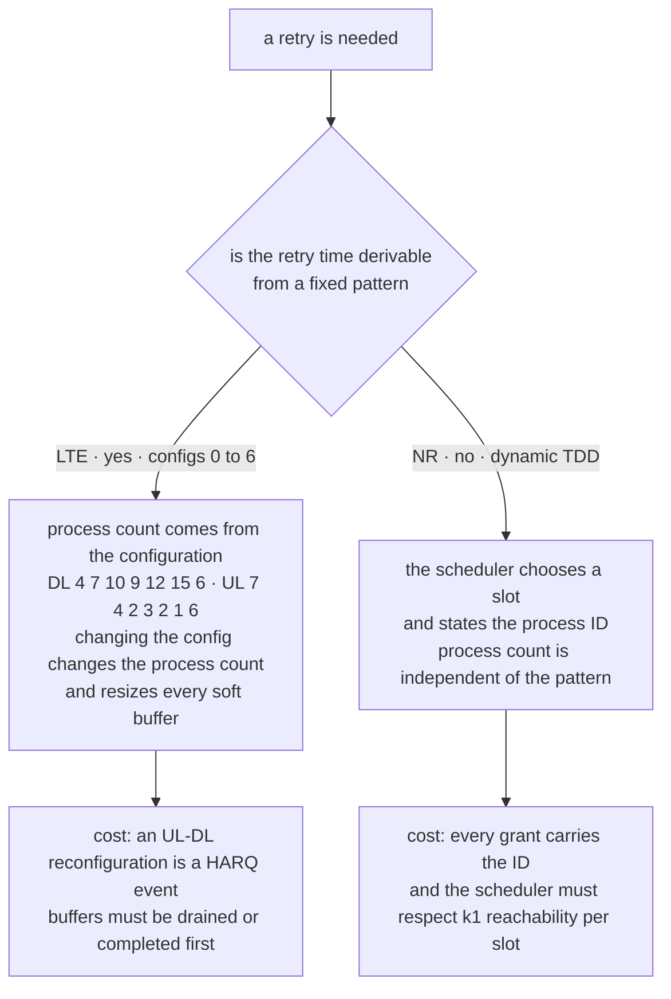

The LTE row hides a genuinely painful operational fact: because the number of HARQ processes is a function of
the UL/DL configuration, changing that configuration changes the process count, which resizes the soft-buffer
partition for every TB, which means the network has to drain or complete outstanding processes before the
change takes effect. NR removed a whole class of configuration-change procedure by decoupling the two.

### 7.6 What to unlearn when moving from LTE to NR

Eight corrections, in the order they tend to be needed:

1. **There is no PHICH.** Stop looking for the uplink verdict; it is the next DCI for that process, and its
   NDI is the whole message.
2. **Uplink HARQ is asynchronous.** The process ID is in the grant, not in the subframe number.
3. **The number of downlink HARQ processes is 8 by default, not 16.** 16 is the maximum, and configuring it
   is a decision about soft-buffer partitioning, not a free upgrade.
4. **The uplink process count does not depend on the TDD pattern.** LTE's per-configuration tables are gone;
   so is the soft-buffer resize that came with every UL/DL reconfiguration.
5. **PUCCH resources are signalled, not derived.** Three bits of PRI replace the lowest-CCE-index rule.
6. **Feedback timing is a list, not a constant.** `dl-DataToUL-ACK` is a reachability list in TDD, and a bad
   list silently disables slots rather than producing an error.
7. **A retransmission may be smaller than the original transport block.** With CBG mode, one failed code block
   group costs one group, not the whole TB.
8. **A UE may retransmit an uplink TB without being asked.** With a configured grant and
   `configuredGrantTimer` running, the retry happens at the next configured occasion with no grant at all.

## 8. Soft buffers and limited buffer rate matching

The soft buffer is where HARQ stops being a protocol and becomes a memory budget. A UE aggregating four
carriers with sixteen processes each and eight code blocks per transport block is holding 512 code blocks'
worth of soft values, at several bits per value.

```mermaid
flowchart TD
    A["UE declares a soft-buffer capability"] --> B{"which system"}
    B -->|"LTE"| C["N_soft from the UE category table<br/>TS 36.306 Table 4.1-1<br/>category 1 250368 · category 4 1827072 · category 5 3667200"]
    B -->|"NR"| D["derived from the per-carrier rate expression<br/>layers x modulation order x scaling factor<br/>x PRBs x 1 minus overhead<br/>times the number of processes"]
    C --> E["N_IR = floor N_soft / K_C x K_MIMO x min M_DL_HARQ and 8"]
    D --> F["partition across the configured processes<br/>Rel-17 applies a scaling factor above 16 processes"]
    E --> G["N_cb = min floor N_IR / C and K_w for DL-SCH<br/>N_cb = K_w for UL-SCH · no LBRM on the LTE uplink"]
    F --> H["LBRM · N_cb = min N and N_ref<br/>N_ref = floor TBS_LBRM / C x R_LBRM with R_LBRM = 2/3"]
    G --> I["rate matching is bounded by the buffer<br/>the highest-parity bits are never transmitted"]
    H --> I
```

Three things to be able to say about this:

1. **LTE's per-process size is a division, NR's is a configuration.** With `N_soft = 1,827,072` (category 4),
   no MIMO and 8 processes, `N_IR = 228,384` soft channel bits per transport block. Increasing the process
   count in LTE divides the same memory further, which is why TDD configurations with more than 8 DL processes
   are capped at 8 by the `min(M_DL_HARQ, 8)` term — the buffer is sized for eight, whatever the frame says.
2. **LBRM trades memory for coding gain.** When LBRM is on, `N_cb` is clipped to roughly two thirds of the
   full buffer, so the RV offsets all move toward the start of the buffer and the highest-parity region is
   never transmitted. Attempts beyond the first two then re-send bits the receiver already has: incremental
   redundancy quietly degrades toward chase combining as the attempt count rises.
3. **The consequence that shows up as a bug.** If a link shows good gain from the first retransmission and
   almost none from the third, suspect LBRM or a stuck RV before suspecting the channel.

## 9. HARQ in the wider system

### 9.1 HARQ and ARQ: who pays for what

```mermaid
flowchart TD
    A["a TB is lost"] --> B["HARQ retries it in milliseconds<br/>combining soft information each time"]
    B --> C{"does it succeed within the attempt budget"}
    C -->|"yes"| D["delivered · RLC never learns about it<br/>no sequence-number disturbance · no reordering delay"]
    C -->|"no"| E["MAC discards the process content"]
    E --> F["RLC ARQ sees a gap<br/>status report · selective repeat · tens of milliseconds"]
    F --> G["PDCP reorders and delivers in sequence"]
    G --> H["application sees a latency spike<br/>never a data error"]
    B --> I["residual error also comes from<br/>an ACK misread as a NACK or the reverse<br/>HARQ feedback is not error-free"]
    I --> F
```

The two mechanisms are complementary by design, and the interesting failures come from their interaction:
too much HARQ retransmission wastes PRBs on a link that is not going to recover and blocks other UEs; too
little pushes work onto RLC, where a retransmission costs a status-report round trip and a reordering delay
at the PDCP layer. The tuning knob is the attempt budget and the link-adaptation target, and the KPI to watch
is the **residual BLER after HARQ**, not the first-attempt BLER.

### 9.2 When HARQ is the wrong tool

URLLC traffic with a 1 ms budget cannot afford a round trip at all, so Rel-16 and Rel-17 added a family of
mechanisms whose common idea is to spend resources up front instead of after a failure:

| Mechanism | Idea | Cost |
| --- | --- | --- |
| `repK` repetitions | send the same TB up to 8 times without waiting | throughput, in exchange for latency |
| PUCCH repetition | repeat the ACK itself so feedback errors stop costing retries | uplink control overhead |
| Sub-slot PUCCH | do not wait for a slot boundary to send feedback | control-channel density |
| Configured grant plus `configuredGrantTimer` | no grant round trip at all, autonomous retry | reserved resources even when unused |
| HARQ-ACK deferral and one-shot reporting | recover from a feedback opportunity that could not be used | codebook complexity |
| Rel-17 disabled feedback | stop waiting entirely | reliability moves wholesale to RLC |

### 9.3 Very long round trips: NTN

Over a geostationary link the round trip is around 540 ms, which at 30 kHz is more than a thousand slots.
Sixteen processes would leave the link idle almost all the time, and 32 would not fix it. Rel-17 therefore
added three separate answers:

| Mechanism | Signalling | Effect |
| --- | --- | --- |
| More processes | `nrofHARQ-ProcessesForPDSCH-v1700` = n32, with a 5-bit process number field | doubles the TBs in flight — pure pipelining, helps LEO, does not solve GEO |
| Shifted timing | `cellSpecificKoffset-r17` and `k_mac` in `NTN-Config` | pushes k1, k2 and the random-access window far enough into the future that the propagation delay fits inside the scheduling relationship |
| **Disabled feedback** | `downlinkHARQ-FeedbackDisabled-r17`, a bitmap with one bit per HARQ process | for a disabled process the UE reports nothing and treats every reception as new data; RLC ARQ becomes the only retransmission |

The third row is the conceptually important one: it is an explicit admission that HARQ is a latency
optimisation, not a reliability mechanism. When the round trip exceeds the latency budget, the right move is
to turn HARQ off and let the slow, reliable layer do the work. Note also that with feedback disabled, the
first-attempt 10 % BLER target is no longer viable — link adaptation must aim far lower, because there is no
second chance at this layer.

## 10. Implementation view

### 10.1 What the DU holds per process

| Field | Purpose |
| --- | --- |
| process ID, direction, UE, cell | identity |
| NDI current value | the one bit that decides new versus retry |
| RV, attempt counter | where in the coded sequence the next attempt starts |
| TB descriptor: buffer pointer, size, MCS, PRBs, layers | what to retransmit without rebuilding it |
| HARQ-ACK expectation: slot, PUCCH resource, codebook position | where the verdict will appear |
| timers: DRX retransmission, configured grant, discard | when to give up |
| soft-buffer reference | where the LLRs live, and how much room is left |

### 10.2 Per-slot handling

```mermaid
flowchart TD
    S["slot n · L1 indications arrive"] --> A["consume CRC results for UL<br/>and UCI HARQ-ACK for DL"]
    A --> B["update every affected HARQ process<br/>release on ACK · queue on NACK<br/>check attempt limits and timers"]
    B --> C["release processes back to the free list"]
    C --> D["update link adaptation and OLLA<br/>a NACK is the freshest channel information available"]
    D --> E["rank UEs · retransmissions first"]
    E --> F{"is a process free for the top-ranked new transmission"}
    F -->|"yes"| G["allocate · NDI toggle · RV 0"]
    F -->|"no"| H["the UE is HARQ-limited this slot<br/>defer it and rank the next one"]
    G --> I["build the DCI · reserve the PUCCH resource<br/>set the k1 index and the PRI"]
    H --> I
    I --> J["hand the slot plan to L1"]
```

The ordering in step E is a policy decision with real consequences: **retransmissions first** is the default
in almost every implementation, because a retransmission is cheap (it combines) and because leaving it
outstanding holds a process and a soft buffer. The counter-argument is that for latency-critical new data,
deferring it behind a retransmission can break its budget, so URLLC-capable schedulers make the priority a
per-bearer decision rather than a global rule.

### 10.3 Symptom table

| Symptom | Likely cause | Where to look |
| --- | --- | --- |
| Throughput plateaus but the MCS keeps rising | attempt limit or LBRM making late retries worthless | attempt counter, `N_cb` versus `N` |
| A cell never uses certain downlink slots | `dl-DataToUL-ACK` has no entry reaching an uplink slot from those slots | §3.4 reachability |
| Uplink data corrupted with no HARQ errors anywhere | configured-grant process ID mismatch between the two sides | periodicity and `nrofHARQ-Processes` agreement |
| RLC retransmissions high while HARQ looks healthy | feedback errors, or a too-low attempt budget | residual BLER, PUCCH SINR and the DAI counters |
| Latency spikes with no loss | retransmissions crossing a DRX sleep, or reordering at PDCP | DRX retransmission timers |
| Cell capacity lower than the PRB budget predicts | process starvation, not spectrum starvation | process free list occupancy per slot |
| A UE stalls after a BWP switch | feedback resource belongs to the old BWP; NR does not retransmit across the change | PUCCH resource per BWP, cross-cell/BWP retry rules |

## 11. Anchors

- **DL HARQ process count:** TS 38.214 §5.1 — a maximum of 16 per cell, or 32 subject to UE capability; the
  number the UE may assume is configured per cell by `nrofHARQ-ProcessesForPDSCH` (or the `v1700` extension),
  and **when no configuration is provided the UE may assume a default of 8**.
- **UL HARQ process count:** TS 38.214 §6.1 — 16 HARQ processes per cell, or 32 subject to UE capability;
  later releases add `nrofHARQ-ProcessesForPUSCH` with a default of 16.
- **Timing ranges:** `dl-DataToUL-ACK` is a sequence of size 1…8 of integers 0…15; k0 and k2 are 0…32 slots;
  DCI 1_0 uses its own fixed k1 table of 1…8.
- **Processing times:** TS 38.214 Tables 5.3-1 and 6.4-1 give N1 = 8, 10, 17, 20 symbols and N2 = 10, 12, 23,
  36 symbols for µ = 0, 1, 2, 3 at processing capability 1.
- **Rate matching:** TS 38.212 §5.4.2.1 — `N_cb = min(N, N_ref)` with LBRM, `N_ref = floor(TBS_LBRM / (C ·
  R_LBRM))` and `R_LBRM = 2/3`; RV start index `k0 = floor(offset(rv) · N_cb / denom) · Zc` with denom 66·Zc
  for BG1 and 50·Zc for BG2.
- **LTE uplink round trip:** 8 ms on FDD — grant at n, PUSCH at n+4, PHICH at n+8, retry at n+8 — which is
  why there are exactly 8 uplink HARQ processes.
- **LTE process counts:** TS 36.213/36.321 — downlink maximum 4, 7, 10, 9, 12, 15, 6 for TDD configurations
  0–6 and 8 for FDD; uplink 7, 4, 2, 3, 2, 1, 6 for TDD and 8 for FDD.
- **LTE soft buffer:** TS 36.212 §5.1.4.1.2 — `N_IR = floor(N_soft / (K_C · K_MIMO · min(M_DL_HARQ, 8)))`;
  TS 36.306 Table 4.1-1 gives `N_soft` per UE category, e.g. 1,827,072 for category 4.
- **CBG:** TS 38.214 §5.1.7.2 — CBGTI is `N_TB · N` bits, `N` from `maxCodeBlockGroupsPerTransportBlock`
  ∈ {2, 4, 6, 8}; CBGFI = 0 means earlier instances may be corrupted, CBGFI = 1 means combinable.
- **Configured grant process ID:** TS 38.321 §5.4.1 — `floor(CURRENT_symbol / periodicity) mod
  nrofHARQ-Processes`, plus `harq-ProcID-Offset2` from Rel-16; `configuredGrantTimer` prevents autonomous
  retransmission once it expires.
- **Rel-17 long-RTT:** `nrofHARQ-ProcessesForPDSCH-v1700` = n32, `downlinkHARQ-FeedbackDisabled-r17` as a
  per-process bitmap, and `cellSpecificKoffset-r17` added to the timing relationships.
- **Rel-16 feedback overlays:** type-3 one-shot HARQ-ACK, HARQ-ACK deferral, PUCCH repetition, sub-slot PUCCH,
  configured-grant confirmation MAC CE.

Anything not listed here and not independently confirmed is marked `VERIFY` rather than asserted.

## 12. Related

- [[01-2 5G NR RAN Layer 2 Protocol Stack]] — the layer that owns HARQ, and where BSR, LCP and RLC ARQ meet it
- [[02-9 WLAN - Time-Sensitive Networking Across Wi-Fi Generations]] — the same question asked of a contended medium: what happens to a retransmission scheme when the retry budget is a deadline rather than a count, and why Wi-Fi has to schedule around the air instead of around a slot
- [[01-6 NR DU MAC Scheduler - Resource Allocation, HARQ and Real-Time Implementation]] — HARQ as one of the
  four resources the DU scheduler allocates, and the per-slot pipeline this note's state machines sit inside
- [[01-5 NR Random Access - UE RACH Procedure, Signalling and Tuning]] — the one place in NR where a
  retransmission is still driven by a timer rather than by a grant, and where Msg3 HARQ behaves specially
- [[01-1 5G-Advanced and 6G Radio Access]] — where the latency budget that HARQ is fighting for is set
- [[01-4 Cellular IoT RedCap eRedCap and NTN]] — the NTN round trip that forces HARQ feedback to be disabled
- [[01-3 AI-ML for RAN and O-RAN RIC]] — link adaptation and OLLA, the loop that consumes HARQ outcomes
- [[05-1 DPDK User Plane and 5G UPF]] — what the HARQ-induced jitter looks like once it reaches the user plane
- [[04-3 Embedded Software Architecture - Patterns, Layering and Wireless System Structure]] — the L1/L2
  boundary that HARQ straddles: where the soft buffer lives, which side owns the state machine, and the
  execution model that makes the slot budget in §3.2 achievable

## 13. References

1. 3GPP. *TS 38.321 — Medium Access Control (MAC) protocol specification*.
   <https://www.etsi.org/deliver/etsi_TS/138300_138399/138321/>
   — the HARQ entity and process behaviour: NDI handling, the DL and UL HARQ procedures, the configured-grant
   process ID formula and `configuredGrantTimer`, and the DRX retransmission timers.
2. 3GPP. *TS 38.214 — Physical layer procedures for data*.
   <https://www.etsi.org/deliver/etsi_TS/138200_138299/138214/>
   — §5.1 and §6.1 for the process counts and the 8-process default, §5.1.7.2 for CBG, Tables 5.3-1 and 6.4-1
   for N1 and N2.
3. 3GPP. *TS 38.212 — Multiplexing and channel coding*.
   <https://www.etsi.org/deliver/etsi_TS/138200_138299/138212/>
   — §5.4.2 rate matching, the circular buffer, the RV offsets and limited buffer rate matching.
4. 3GPP. *TS 38.213 — Physical layer procedures for control*.
   <https://www.etsi.org/deliver/etsi_TS/138200_138299/138213/>
   — §9.2.3 HARQ-ACK timing and the DCI 1_0 k1 table, the HARQ-ACK codebook procedure, PUCCH resource
   determination, and the deferral rules.
5. 3GPP. *TS 38.331 — Radio Resource Control (RRC) protocol specification*.
   <https://www.etsi.org/deliver/etsi_TS/138300_138399/138331/>
   — `nrofHARQ-ProcessesForPDSCH`, `dl-DataToUL-ACK`, `pdsch-TimeDomainAllocationList`,
   `pusch-TimeDomainAllocationList`, `ConfiguredGrantConfig` and the Rel-17 NTN fields.
6. 3GPP. *TS 38.306 — UE radio access capabilities*.
   <https://www.etsi.org/deliver/etsi_TS/138300_138399/138306/>
   — the data-rate expression the soft-buffer capability is derived from, and the 16- versus 32-process
   capability signalling.
7. 3GPP. *TS 36.321 — Evolved Universal Terrestrial Radio Access (E-UTRA); MAC protocol specification*.
   <https://www.etsi.org/deliver/etsi_TS/136300_136399/136321/>
   — the LTE HARQ entity, the synchronous uplink HARQ operation, and `maxHARQ-Tx`.
8. 3GPP. *TS 36.212 — E-UTRA; Multiplexing and channel coding*.
   <https://www.etsi.org/deliver/etsi_TS/136300_136399/136212/>
   — §5.1.4.1.2 bit collection, selection and transmission: the turbo circular buffer `Kw = 3·Kπ`, the
   `N_IR` expression and `N_cb = min(floor(N_IR / C), Kw)`.
9. 3GPP. *TS 36.213 — E-UTRA; Physical layer procedures*.
   <https://www.etsi.org/deliver/etsi_TS/136300_136399/136213/>
   — the TDD HARQ-ACK timing tables, the PHICH resource mapping, and the maximum number of HARQ processes per
   configuration.
10. 3GPP. *TS 36.306 — E-UTRA; UE radio access capabilities*.
    <https://www.etsi.org/deliver/etsi_TS/136300_136399/136306/>
    — Table 4.1-1: `N_soft` per UE category, including 250,368 for category 1 and 1,827,072 for category 4.
11. 3GPP. *TR 38.821 — Solutions for NR to support non-terrestrial networks (NTN)*.
    <https://www.etsi.org/deliver/etsi_tr/138800_138899/138821/>
    — the delay ladder that motivates 32 processes, `K_offset` and per-process HARQ feedback disabling.
12. ShareTechnote. *5G/NR — Channel Coding, code block group*.
    <https://www.sharetechnote.com/html/5G/5G_CBG.html>
    — the `PDSCH-CodeBlockGroupTransmission` structure, `maxCodeBlockGroupsPerTransportBlock` and the roles of
    CBGTI and CBGFI.
13. ShareTechnote. *5G NR LDPC Rate Matching, TS 38.212 §5.4.2*.
    <https://www.sharetechnote.com/html/WebProgramming/Websim_LdpcRatematch.html>
    — the circular buffer layout, the `k0` formula and the BG1/BG2 RV offset tables, with an interactive
    simulation.
14. lte5ghub. *HARQ — Downlink and Uplink in 5G NR*. <https://lte5ghub.com/harq>
    — the process-count discussion, the NDI pipeline, the k1 worked example in §3.3, the LBRM consequence and
    the Rel-17 long-round-trip mechanisms in §9.3.
15. lte5ghub. *PUSCH — Uplink Shared Channel in LTE*. <https://lte5ghub.com/lte-pusch>
    — the LTE uplink n+4 chain, the PHICH, non-adaptive versus adaptive retransmission, and UCI multiplexing
    onto PUSCH with the beta offsets.
16. lte5ghub. *Scheduling and HARQ timing (n+4) in LTE*. <https://lte5ghub.com/lte-td-allocation>
    — the 8 ms uplink RTT walked around the clock, and the explicit comparison of LTE's two HARQ styles with
    NR's single one.
17. lte5ghub. *TS 38.214: time-domain resource allocation and SLIV*. <https://lte5ghub.com/time-domain-allocation>
    — the N1/N2 table and the practical k1 and k2 floors per numerology.
18. CafeTele. *HARQ in 5G NR*. <https://www.cafetele.com/5g-harq>
    — a compact restatement of the 16-process model, NDI, RV, chase versus IR, and the codebook types.
19. iTecSpec. *TS 38.214 §5.1 and §6.1*. <https://itecspec.com/3gpp/38.214/>
    — clause-level text used to confirm the DL default of 8 processes and the UL figure of 16.
20. iTecSpec. *TS 38.214 §5.1.7.2 — UE procedure for receiving CBG-based transmissions*.
    <https://itecspec.com/3gpp/38.214/s/5.1.7.2>
    — the CBGTI bit mapping and the meaning of CBGFI.
21. ETSI. *TS 138 214 v18.9.0*. <https://www.etsi.org/deliver/etsi_ts/138200_138299/138214/>
    — the Rel-18 consolidated text of §5.1 quoted in §11, including the 32-process capability wording.
22. ETSI. *TS 136 306 v14.2.0*. <https://www.etsi.org/deliver/etsi_ts/136300_136399/136306/>
    — the LTE category table with total soft channel bits, read directly rather than through a secondary source.
23. ATIS. *3GPP TS 36.212 v10.7.0*. <https://atisorg.s3.amazonaws.com/archive/3gpp-documents/Rel99-14/>
    — the `N_IR` and `N_cb` expressions for LTE DL-SCH and UL-SCH, quoted verbatim in §8.
24. 3GPP. *R2-21xxxx — NR NTN solution status report*.
    <https://www.3gpp.org/ftp/Email_Discussions/RAN2/>
    — the agreements that a type-1 codebook reports NACK-only for feedback-disabled processes and that a
    type-3 codebook skips them.
25. 5G/6G Academy. *5G from orbit: NTN engineering and the direct-to-device race*.
    <https://www.5g6gacademy.com/whitepapers/pdf/wp08-ntn-direct-to-device.pdf>
    — the TR 38.821 delay ladder, from 12.89 ms for a regenerative LEO at 600 km to 541.46 ms for a
    transparent GEO, and what each rung breaks first.
26. EPO. *EP3603250B1 — Control of uplink radio transmissions on semi-persistently allocated resources*.
    <https://patents.google.com/patent/EP3603250B1/en>
    — a clear industrial summary of LTE's asynchronous downlink versus synchronous uplink, of PHICH-driven
    non-adaptive retransmission, and of the assumption a UE makes when it receives neither a NACK nor a grant.
27. USPTO. *US10911187 — User equipment provision of enhanced capability information for HARQ processing*.
    <https://uspto.report/patent/grant/10,911,187>
    — why the soft buffer is proportional to data rate times HARQ RTT, and why a higher peak rate forces a
    choice between fewer processes and a lower rate.
28. TREA. *HARQ process identification and soft buffer management for non-terrestrial networks*.
    <https://patents.justia.com/patent/11924846>
    — the `N_soft` derivation from the per-carrier rate expression and the scaling factor introduced when more
    than 16 processes must be stored.
29. 3GPP. *EP4250626 — Communication in the presence of uplink-downlink configuration change*.
    <https://data.epo.org/publication-server/>
    — the LTE per-configuration process-count tables for both directions, and the reason a UL/DL
    reconfiguration is a HARQ event that resizes every soft buffer.
30. Dahlman, E., Parkvall, S., Sköld, J. *5G NR: The Next Generation Wireless Access Technology*, 2nd ed.
    Academic Press, 2021. ISBN 978-0-12-822320-8.
    — chapters 6, 10 and 13 for the L2 structure, retransmission and scheduling, and the reasoning behind
    dropping the PHICH.
31. Dahlman, E., Parkvall, S., Sköld, J. *4G: LTE-Advanced Pro and The Road to 5G*, 3rd ed. Academic Press,
    2016. ISBN 978-0-12-804575-6.
    — the LTE side of the comparison, written by the same authors who specified it: the synchronous uplink
    design, the PHICH, and the 8 ms round trip.
32. Sesia, S., Toufik, I., Baker, M. *LTE — The UMTS Long Term Evolution: From Theory to Practice*, 2nd ed.
    Wiley, 2011. ISBN 978-0-470-69716-0.
    — the turbo rate matching, the HARQ process model and the TDD HARQ timing tables, in the detail this note
    only summarises.

---

Copyright (c) 2026 Washington Ruan. All rights reserved.
