# OpenAirInterface — Architecture of an Open-Source NR Stack

OpenAirInterface is the only place where you can read, in one repository, the whole of a 5G NR base station: the
LDPC rate matcher, the MAC scheduler that decides which UE gets which PRB, the F1AP encoder, the real-time
thread that has to finish before the slot ends, and the PTP configuration that keeps it in step with a radio
that is not in the same box. There is no abstraction left to blame.

That is the reason to study it even if you never deploy it. [[01-6 NR DU MAC Scheduler - Resource Allocation, HARQ and Real-Time Implementation]] describes what a DU scheduler must decide and what per-slot budget it must fit
inside; OAI is that scheduler as ~10 k lines of C, with the budget enforced by a POSIX thread and a FIFO rather
than by a specification. [[01-7 NR HARQ - Retransmission Flow, Timelines and LTE Comparison]] describes the
HARQ state machine; OAI keeps it in `NR_UE_info_t` with `NR_list_t` pools of available and retransmission
processes and cycles the redundancy versions in a table you can read in ten seconds.

Say this sentence early in any interview about it: **OAI is a research-grade, x86/SIMD, real-time softmodem that
implements 3GPP NR Release 15/16 on a general-purpose CPU, split-aware from the start (F1, E1, nFAPI, O-RAN
7.2), and it trades spec completeness for the ability to change anything — the L1 runs at about a gigabit, not
at the multi-gigabit a commercial DU reaches, and the gap is not a bug, it is the cost of running LDPC on a
general-purpose core.**

## 0. How to read this note

OAI is big enough that reading it in the wrong order wastes a week. Read it in this order and the rest is detail:

| Order | Question | Where |
| --- | --- | --- |
| 1 | what is the project, who owns it, what licence | §1–§3 |
| 2 | where does each protocol layer live on disk | §4 |
| 3 | what actually runs, and in which box | §5–§6 |
| 4 | how does one process become a real-time base station | §7–§8 |
| 5 | how do L1 and L2 talk | §9–§10 |
| 6 | what the NR MAC scheduler really does | §11 |
| 7 | what the PHY really implements | §12–§14 |
| 8 | the other half: the UE | §15 |
| 9 | the other box: the core, and the RIC | §16–§17 |
| 10 | how you test it without a roof antenna | §18 |
| 11 | why it misses real time, and what you do about it | §19 |
| 12 | what it can and cannot deliver | §20–§22 |

Two vocabulary items that are used loosely in the field and precisely here:

- **softmodem** — OAI's own word for the executable that *is* the node: `nr-softmodem` is a gNB,
  `nr-uesoftmodem` is a UE, `nr-cuup` is a CU user plane. One process, many threads, no microservice theatre.
- **split** — OAI uses the word for four *different* boundaries on the same stack: nFAPI (MAC/PHY), F1 (CU/DU),
  E1 (CU-CP/CU-UP) and O-RAN 7.2x (DU/RU). They are orthogonal; a given deployment picks at most one of the
  first two and any of the last two.

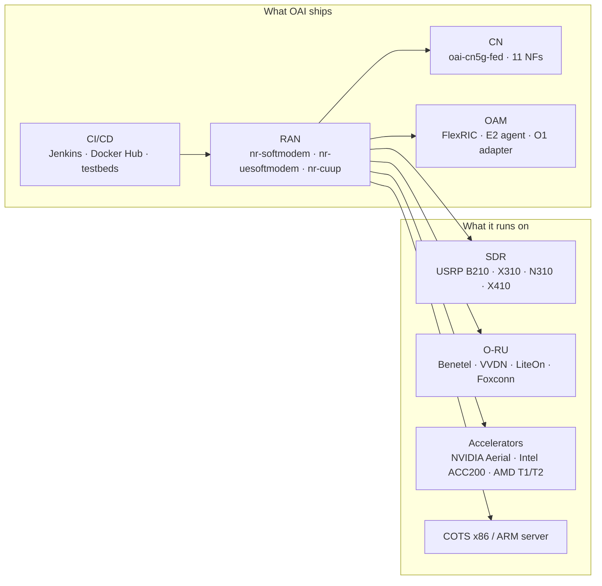

---

## 1. What OpenAirInterface is

OpenAirInterface (OAI) is an open-source implementation of the 3GPP cellular stack — 4G LTE and 5G NR, RAN and
core — written in C and C++, designed to run on general-purpose servers with software-defined radios or
O-RAN-compliant radio units attached. It began at **EURECOM** in the early 2000s as an SDR LTE RAN prototype;
around 2010 it demonstrated an LTE Release 8 softmodem interoperating with commercial smartphones and a
third-party EPC over USRP radios, which is the moment it became a project other people used.

The claims that matter, and the three that are routinely overstated:

| Claim | True? | The honest form |
| --- | --- | --- |
| "It is a 5G base station" | Partly | It is a gNB for research: NR Rel-15/16 core, static TDD and FDD, FR1 plus FR2 — not a carrier-grade product with full Rel-17/18 feature coverage |
| "It is 3GPP compliant" | Partly | The *air interface* is compliant enough that commercial phones and commercial cores attach; the *feature set* is a subset |
| "It runs in real time" | Partly | On a tuned x86 server with isolated cores, yes, at 100 MHz FR1 and 4-layer DL. On an untuned laptop with a B210, no |

What it is not: it is not a simulator (though it ships several), it is not a replacement for a commercial DU in
a live network, and it is not a specification — every "OAI does X" claim should be checked against the release
tag you actually built, because the feature set moves weekly.

## 2. Governance, licence, and the move to Duranta

**The OpenAirInterface Software Alliance (OSA)** was created by EURECOM in **2014** as a non-profit to govern
the growing codebase: a board with strategic members, a funded core engineering team, a published roadmap
refreshed roughly every six months with a one-year horizon, and a Jenkins-based CI/CD pipeline that runs on
every merge request to the EURECOM GitLab server before a Technical Committee member reviews the change.

The licence has moved three times, and the reason is the interesting part:

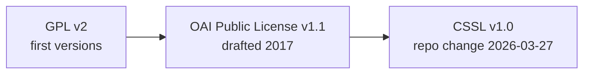

- **GPL v2** for the earliest releases.
- **OAI Public License v1.1 (2017)** — a modified Apache 2.0 with an added patent clause. The problem it solves
  is real and specific to cellular: 3GPP technology is standardised under FRAND, while OSI licences such as
  Apache 2.0, MIT and the GPL family require royalty-free redistribution. A company holding 3GPP standard
  essential patents could not contribute code under Apache 2.0 without giving away patent rights. OAI PL v1.1
  lets a contributor grant patent licences to third parties **on FRAND terms for commercial use**, which is what
  makes it possible for 3GPP members to contribute. Contributors sign an ICLA or a CCLA.
- **CSSL v1.0 (Collaborative Standards Software License)** — the same idea, generically worded, introduced with
  the launch of **Duranta**. The OAI RAN repository changed its licence on **2026-03-27**; the 5G core's
  release **v2.2.1 (March 2026)** records "change of license from OAI Public License v1.1 to CSSL v1.0", with
  documentation re-licensed CC-BY-4.0 and orchestration files re-licensed MIT.

**Duranta** is the governance change, announced by Linux Foundation Networking and the OSA on **2025-08-27**:
OAI seeded a new LFN incubation project with its cellular assets, keeping the research community and gaining
neutral governance, a governing board, LFN security processes, and integration with Nephio for cloud-native
deployment. The RAN source now lives at `github.com/duranta-project/openairinterface5g`; the EURECOM GitLab
server remains the development home and the place where merge requests are reviewed.

Practically, for an engineer: **the code is free for non-commercial and academic research; commercial use is
governed by FRAND patent terms rather than by an OSI-approved licence.** That is a deliberate, defensible
design decision, and it is worth being able to explain rather than just assert.

## 3. The four software assets

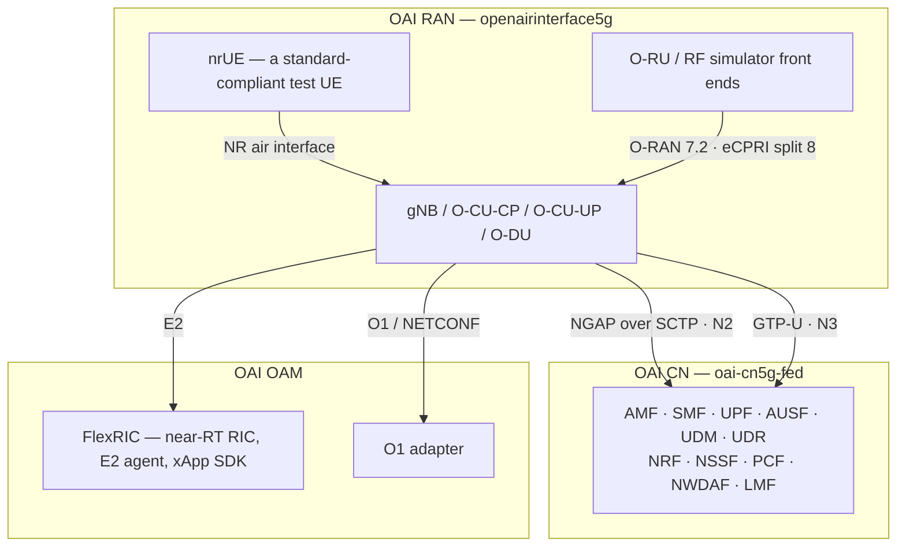

- **OAI RAN** — the subject of the rest of this note. Implements CU (CP and UP) and DU, or a monolithic gNB,
  plus the UE.
- **OAI 5G Core** — an SBA core with **11 network functions** at release 2.1.0: AMF, SMF, UPF, AUSF, UDM, UDR,
  NRF, NSSF, PCF, NWDAF and LMF. NEF and UDSF exist in the federation; SCP and AF are integrations in
  progress. Two UPF variants: a *simple-switch* UPF and an **eBPF/XDP** UPF aimed at high throughput.
- **OAI OAM** — **FlexRIC**, an open-source near-RT RIC plus E2 agent plus xApp SDK, and an O1 adapter for SMO
  integration (ONAP, OSM, Sylva, Nephio).
- **CI/CD** — a first-class asset rather than an afterthought: Jenkins pipelines on every merge request, Docker
  images on Docker Hub for x86-64 and ARM (Jetson) targets, and physical testbeds with licensed spectrum.

## 4. The repository map

The top-level layout has been stable for years and is the fastest way to orient yourself:

```mermaid
flowchart TB
    root["openairinterface5g"]
    root --> o1["openair1 — PHY and scheduling<br/>PHY/ · SCHED/ · SCHED_NR/ · SCHED_NR_UE/ · SIMULATION/"]
    root --> o2["openair2 — L2 and L3<br/>LAYER2/NR_MAC_gNB/ · LAYER2/NR_MAC_UE/ · RRC/<br/>NR_PHY_INTERFACE/ · F1AP/ · E1AP/ · GNB_APP/ · E2AP/"]
    root --> o3["openair3 — network interfaces<br/>NGAP/ · SCTP/ · GTPV1-U/ · NAS/ · SECU/ · XNAP/"]
    root --> ex["executables — the mains<br/>nr-softmodem.c · nr-uesoftmodem.c · nr-cuup.c<br/>nr-gnb.c · nr-ru.c · nr-ue.c"]
    root --> ra["radio — RF abstraction<br/>COMMON/common_lib.h · USRP · rfsimulator · fhi_72 · ethernet"]
    root --> nf["nfapi — the MAC/PHY split transport"]
    root --> fh["fronthaul — O-RAN 7.2 support"]
    root --> cm["common — ITTI, thread pool, config, T tracer"]
    root --> tg["targets/PROJECTS/.../CONF — the config files"]
    root --> ct["cmake_targets — build_oai and the build tree"]
    root --> dk["docker · openshift · charts — deployment"]
    root --> cs["ci-scripts — Jenkins pipelines and YAML test definitions"]
```

| Directory | What is really in it | Why you care |
| --- | --- | --- |
| `openair1/PHY` | `NR_TRANSPORT/`, `NR_ESTIMATION/`, `CODING/` (LDPC, Polar, Turbo), `TOOLS/` (FFT, SIMD) | the DSP; where `max_ldpc_iterations` and the AVX kernels live |
| `openair1/SCHED_NR` | `fapi_nr_l1.h`, the gNB FAPI message definitions | the contract between L1 and L2 |
| `openair2/LAYER2/NR_MAC_gNB` | `gNB_scheduler.c` and its siblings, `nr_mac_gNB.h`, `config.c` | the scheduler — §11 |
| `openair2/NR_PHY_INTERFACE` | `NR_IF_Module.c` — `nr_ul_indication()`, `nr_schedule_response()` | the L1/L2 boundary as code — §9 |
| `openair2/GNB_APP` | `gnb_app.c`, `gnb_config.h` — node-type dispatch, `NGAP_REGISTER_GNB_REQ` | where "am I a CU or a DU" is decided |
| `openair3/NGAP` | the N2 protocol to the AMF | attach and PDU session signalling |
| `radio/COMMON/common_lib.h` | `openair0_config_t`, `openair0_device_t` | the HAL every front end implements |
| `targets/PROJECTS/GENERIC-NR-5GC/CONF/` | the shipped configuration files | where you start when bringing up a cell |

The single most useful fact about this layout: **LTE and NR live side by side, not on branches.**
`lte-softmodem` and `nr-softmodem` share `openair1/PHY`, `openair2/COMMON` and the whole of `openair3`. That is
why the NR code carries LTE-era idioms (`subframe`, `tti`) alongside NR ones (`slot`, `numerology`).

## 5. The executables and the node types

| Executable | It is | Built by |
| --- | --- | --- |
| `nr-softmodem` | 5G gNB — monolithic, O-CU-CP, O-CU-UP or O-DU depending on configuration | `./build_oai --gNB` |
| `nr-uesoftmodem` | 5G NR UE — full stack from PHY to NAS | `./build_oai --nrUE` |
| `nr-cuup` | standalone CU user plane (SDAP/PDCP + GTP-U) | part of the RAN build |
| `lte-softmodem`, `lte-uesoftmodem` | the 4G pair, still maintained | `--eNB`, `--UE` |
| `nr-ulsim`, `nr-dlsim` | PHY-channel unitary simulators | `--phy_simulators` |

One binary, four personas. The node type comes from configuration, and `gnb_app_task()` creates the
corresponding ITTI tasks:

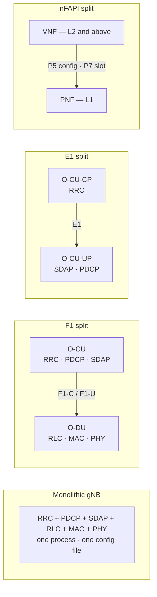

The ITTI tasks that make this up — these are the names you will see in logs and in `create_gNB_tasks()`:

| Task | Job | Created where |
| --- | --- | --- |
| `TASK_GNB_APP` | the gNB application: lifecycle, node-type dispatch, NGAP registration | `nr-softmodem.c` |
| `TASK_RRC_GNB` | NR RRC at the gNB | `nr-softmodem.c` |
| `TASK_NGAP` | N2 towards the AMF | `nr-softmodem.c` |
| `TASK_SCTP` | SCTP transport shared by NGAP and F1AP | `nr-softmodem.c` |
| `TASK_CU_F1` / `TASK_DU_F1` | F1-C, depending on node type | `gnb_app.c` |
| `TASK_CUCP_E1` / `TASK_CUUP_E1` | E1, when the CP and UP are separate | `gnb_app.c`, `nr-cuup.c` |
| `TASK_GTPV1_U` | user-plane tunnel in the CU-UP | `nr-cuup.c` |
| `TASK_RRC_NRUE`, `TASK_NAS_NRUE` | the UE-side pair | `nr-uesoftmodem.c` |

## 6. Configuration and the command-line surface

OAI reads a **libconfig** file passed with `-O`, and then *overrides* it with command-line parameters — the same
option names work on the command line and in the file, which is the single most useful thing to know about the
system:

```bash
# build
./build_oai -w USRP --ninja --gNB --nrUE
./build_oai --gNB --ninja -t oran_fhlib_5g --cmake-opt -Dxran_LOCATION=$HOME/phy/fhi_lib/lib

# run a 40 MHz cell on a B210 against an OAI or third-party core
sudo ./nr-softmodem -O ../../../targets/PROJECTS/GENERIC-NR-5GC/CONF/gnb.sa.band78.fr1.106PRB.usrpb210.conf --sa

# run a 100 MHz cell against a Benetel or LiteOn O-RU over O-RAN 7.2
sudo ./nr-softmodem -O gnb.sa.band78.273prb.fhi72.4x4-liteon.conf --sa --thread-pool 3,5,7,9,11,12,13,14

# software-only: gNB and UE on one machine, no RF at all
RFSIMULATOR=server sudo ./nr-softmodem -O <conf> --sa --rfsim
RFSIMULATOR=127.0.0.1 sudo ./nr-uesoftmodem -r 106 --numerology 1 --band 78 -C 3619200000 --rfsim --sa
```

The options that matter in practice:

| Option | Effect |
| --- | --- |
| `-O <file>` | load a libconfig configuration file |
| `--sa` / `--nsa` | standalone (to a 5GC) or non-standalone (anchored on LTE, X2 towards an eNB) |
| `--rfsim` | use the RF simulator instead of hardware; the peer is chosen by the `RFSIMULATOR` environment variable |
| `--nfapi MONOLITHIC\|PNF\|VNF\|AERIAL` | select the MAC/PHY split mode |
| `--thread-pool <cores>` | pin the baseband worker pool; default is **8 floating cores** |
| `--L1s.[0].L1_rx_thread_core`, `--L1s.[0].L1_tx_thread_core` | pin the two L1 pipeline threads |
| `--L1s.[0].L1_num_tx_sym_per_thread` | split PDSCH generation across the pool by symbol count |
| `--L1s.[0].max_ldpc_iterations` | LDPC decoder iterations; **default 8** |
| `--MACRLCs.[0].ul_max_mcs` | cap UL MCS — the standard workaround for UL real-time failures (e.g. 14) |
| `--phy-test` | fixed scheduling for L1/L2 benchmarking, no upper layers |
| `--telnetsrv` | enable the telnet server for run-time log and parameter control |
| `--usrp-tx-thread-config 1` | give the USRP its own TX processing thread |
| `-E` | three-quarter sampling rate mode, to fit wider bandwidths into a given clock |

Config file naming is self-documenting and worth reading as a catalogue of what is supported:
`gnb.sa.band78.fr1.106PRB.usrpb210.conf`, `gnb.sa.band78.273prb.fhi72.4x4-liteon.conf`,
`gnb.sa.band78.273prb.fhi72.4x4-benetel550.conf`, `gnb.sa.band78.273prb.fhi72.4x4-metanoia.conf`.

## 7. Process architecture: ITTI, threads, pools and actors

Two execution models coexist in one process, and knowing which one you are in is most of debugging OAI:

1. **ITTI (Inter-Task Interface)** — asynchronous message passing between protocol layers. Each layer is a task
   with its own queue; messages are allocated with `itti_alloc_new_message()` and sent with
   `itti_send_msg_to_task()`. RRC, NGAP, SCTP, F1AP, E1AP, GTP-U, NAS: all ITTI, all non-real-time.
2. **The real-time L1 path** — plain POSIX threads outside ITTI, synchronised by *notified FIFOs* rather than by
   messages. RU, L1 RX, L1 TX and the worker pool: no ITTI, no allocation in the hot path, and the only part of
   the process that must finish inside a slot.

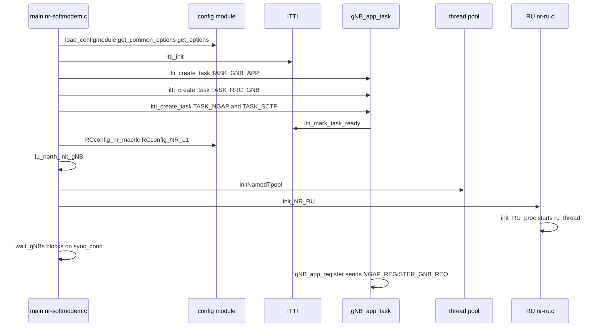

Three synchronisation primitives carry the whole thing:

- **`notifiedFIFO_t`** — a FIFO with a condition variable. The gNB has `L1_rx_out`, `L1_tx_out` and the RU's own
  queues. An element is allocated with `newNotifiedFIFO_elt()`, pushed with `pushNotifiedFIFO()` and pulled with
  `pullNotifiedFIFO()`; the `key` is the slot number, which is what preserves ordering across threads.
- **The thread pool (`tpool_t`)** — `initNamedTpool()` creates workers, `pushTpool()` dispatches a `task_t`
  (function pointer plus arguments). This is where LDPC decoding, symbol processing and PDSCH generation get
  parallelised. A `-1` in the core list means a floating core.
- **`sync_cond` / `sync_mutex` plus `sync_var`** — the startup barrier; `wait_gNBs()` blocks until every RU and
  L1 instance has signalled ready.

The UE side is different: `nr-uesoftmodem` uses an **actor framework** as well as a pool. `init_actor()` creates
a `sync_actor`, `num_dl_actors` DL actors and `num_ul_actors` UL actors, each with its own FIFO, and
`--actor-affinity` pins them to cores. The actors exist because the UE's RX work is bursty and symbol-aligned
in a way the gNB's is not.

## 8. The L1 real-time pipeline

This is the part that makes OAI a base station rather than a simulator. The RU thread is the clock: everything
else is triggered by it.

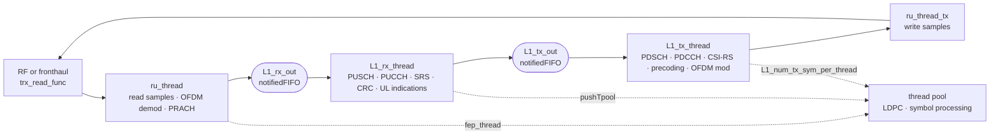

The threads you will meet in `nr-ru.c` and the L1 sources, with what each actually does:

| Thread | Role | Note |
| --- | --- | --- |
| `ru_thread` | the master loop: read from RF or fronthaul, run RX front-end processing, wake L1 | if the box is small, this thread also does the TX work |
| `ru_thread_tx` | TX half, split out when there are enough cores | triggered by `L1_tx_out` |
| `fep_thread` / `feptx_thread` | OFDM demodulation and modulation, farmed to the pool | |
| `ru_thread_prach` | PRACH detection in a remote RU | |
| `ru_thread_asynch` | asynchronous reception from the fronthaul | |
| `L1_rx_thread` | uplink channel processing for a slot | |
| `L1_tx_thread` | downlink channel processing for a slot | |
| `L1_thread_prach` | PRACH processing per CC | |

The key structural point, and the one interviewers probe: **the threads share an address space and pass *slot
numbers*, not sample buffers.** `ru_thread` pushes onto `L1_rx_out` an element whose payload is
`processingData_L1_t` — a `gNB` pointer plus `frame_rx`, `slot_rx` and a timestamp. The RX thread indexes into
the RU's shared frequency-domain buffers by frame and slot. That is why the design scales to a point and then
does not: it is fast because nothing is copied, and it is fragile because every thread can see everything.

A slot, laid out against the pipeline:

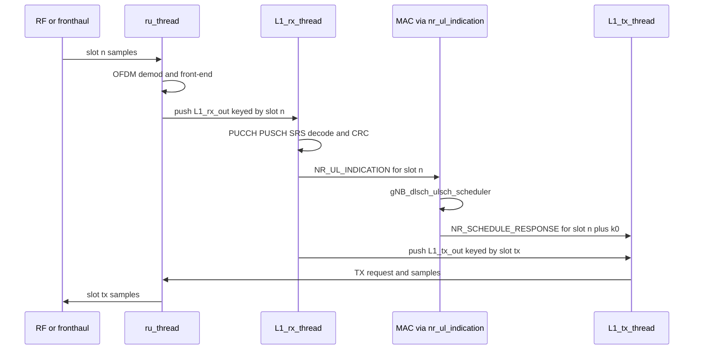

Note the ordering constraint that every 5G implementation has and that OAI makes visible: the **slot
indication is sent every slot whether or not anything was received**. It is the heartbeat. The MAC has no timer
of its own; if L1 stops indicating, the cell stops scheduling, and no upper layer will ever notice.

---

## 9. The L1/L2 interface: FAPI inside the process

OAI puts the Small Cell Forum **FAPI** boundary *inside* the executable. There is no socket in the default build
— the interface is a struct of function pointers installed at `l1_north_init_gNB()`, so the "north" side (MAC)
and the "south" side (PHY) are decoupled exactly as they would be across a wire.

Two procedures, borrowed directly from FAPI:

- **P5 — configuration.** Static, at startup. RRC derives MAC and PHY configuration from the config file and
  passes it down; the MAC forwards the PHY part as an `NR_PHY_Config_t` (subframe config, RF config, SCH config,
  RACH config, PUSCH config, PDSCH config, PUCCH config, PDCCH config, TDD UL/DL config, rate-matching
  patterns). In a split deployment this is what would travel over F1; inside one process it is a function call.
- **P7 — per-slot data.** Four messages in a fixed rhythm:

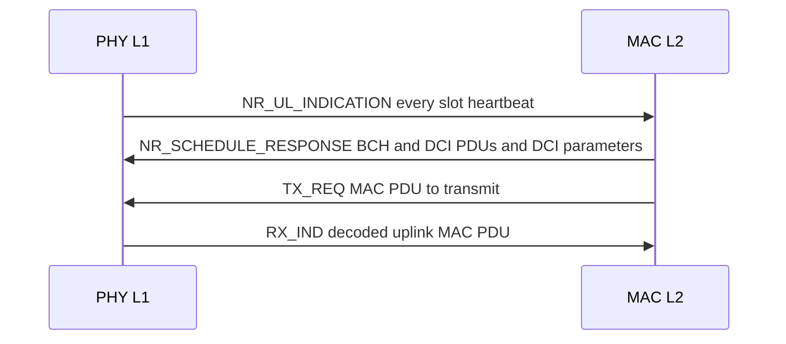

The uplink indication structure is the whole uplink control surface in one C struct — worth reading once, in
full, because it tells you exactly what L1 can tell L2:

| Field | Carries |
| --- | --- |
| `frame`, `slot`, `module_id`, `CC_id` | where and when |
| `rach_ind` | detected preambles: RA-RNTI, preamble index, timing advance |
| `rx_ind` | decoded uplink PDUs |
| `crc_ind` | per-transport-block CRC verdict |
| `harq_ind` | uplink HARQ feedback |
| `csi_ind` | channel state, including the RI/PMI/CQI the scheduler needs |
| `srs_ind` | SRS measurements, used for UL-TDoA positioning |
| `prach_pdu_indication_list` | PRACH PDUs |

`NR_IF_Module.c` is where these land. `handle_nr_rach()` is the canonical example: it checks
`rach_ind.rach_indication_body.number_of_pdus`, calls `initiate_ra_proc()` with the RA-RNTI, preamble index and
timing advance, and zeroes the counter. Read that function and you have read half of
[[01-5 NR Random Access - UE RACH Procedure, Signalling and Tuning]] as an implementation.

## 10. nFAPI: making the MAC/PHY split real

`--nfapi` turns the in-process FAPI boundary into a transport. The L2 process is the **VNF**, the L1 process is
the **PNF**, and the two exchange P5 and P7 messages over one of several transports:

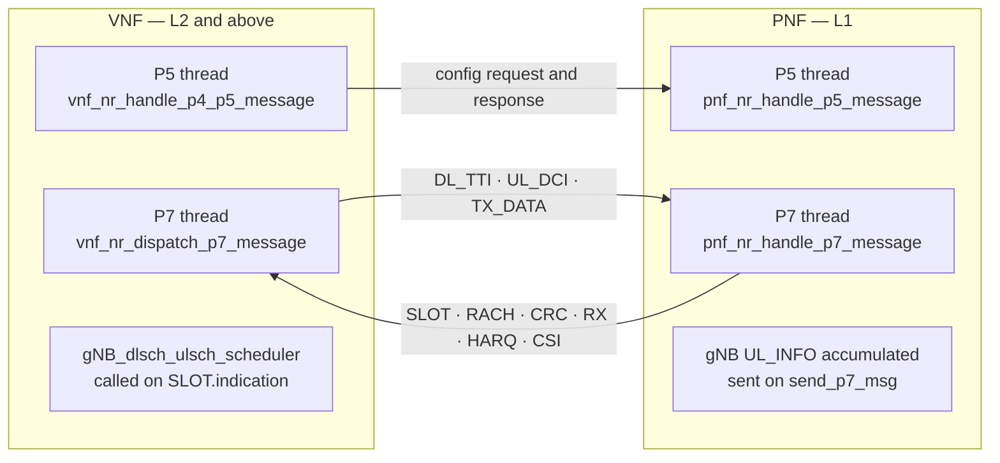

The detail that decides whether a split works:

- **Socket transport** uses *nFAPI* encoding, and the P7 receive loop starts only after the `PNF_START`
  exchange. **WLS** and **nvIPC** use plain *FAPI* encoding and run P5 and P7 in the same loop.
- On the PNF, decoding results accumulate into `gNB->UL_INFO` and are pushed by the configured
  `send_p7_msg` function pointer. On the VNF, `phy_nr_slot_indication()` handles `SLOT.indication` and calls
  `gNB_dlsch_ulsch_scheduler()`.
- `--nfapi AERIAL` is the third case: NVIDIA's L1 runs as the PNF equivalent, with L1 driving the slot
  indication and L2 replying per slot — the same choreography, with a GPU behind it.

## 11. The NR MAC scheduler in code

Everything in [[01-6 NR DU MAC Scheduler - Resource Allocation, HARQ and Real-Time Implementation]] has a home
here. The implementation lives in `openair2/LAYER2/NR_MAC_gNB/`:

| File | Responsibility |
| --- | --- |
| `gNB_scheduler.c` | entry point `gNB_dlsch_ulsch_scheduler()`; clears the VRB maps; the RV cycling table |
| `gNB_scheduler_dlsch.c` | downlink: MAC PDU assembly, MAC CEs, HARQ post-processing |
| `gNB_scheduler_ulsch.c` | uplink: TDA selection (`get_num_ul_tda()`, `get_best_ul_tda()`), BSR and PHR |
| `gNB_scheduler_uci.c` | PUCCH for SR, HARQ-ACK and CSI (`nr_fill_nfapi_pucch()`) |
| `gNB_scheduler_RA.c` | random access: SSB-to-RO mapping (`ssb_index_from_prach()`), Msg2/Msg4 |
| `gNB_scheduler_bch.c` | MIB, SSB and SIB scheduling |
| `gNB_scheduler_primitives.c` | MCS and TBS tables, precoding matrix indexing |
| `gNB_scheduler_srs.c` | SRS scheduling |
| `gNB_scheduler_phytest.c` | fixed scheduling for `--phy-test` |
| `nr_mac_gNB.h` | `NR_UE_info_t`, `NR_sched_pusch_t`, the HARQ `NR_list_t` pools |

The call chain, which is the thing to be able to recite:

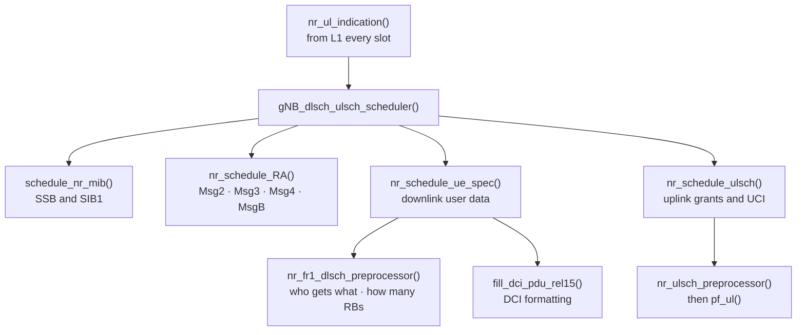

Three design decisions in this code are worth commenting on, because they are the ones an interviewer will
recognise as *real*:

1. **Preprocessor / postprocessor split.** The preprocessor decides *policy* — which UEs, how many PRBs, which
   rank. The postprocessor turns that decision into FAPI PDUs and DCI bits. This is why adding a scheduling
   policy is a contained change: write a new preprocessor, reuse the postprocessor.
2. **Two structures for uplink scheduling state.** `NR_sched_pusch_t` holds what changes every TTI (frequency
   allocation, for instance); `NR_sched_pusch_save_t` holds what changes slowly (DMRS fields while a time-domain
   allocation stays put). The split exists to keep the per-TTI work small.
3. **`pf_ul()` is a proportional-fair scheduler, and it is small.** Turning a BSR into a grant is a few dozen
   lines. That is the honest measure of what a DU scheduler is: not the algorithm, but fitting the algorithm,
   the PDCCH budget, the PUCCH budget and the HARQ bookkeeping into the slot.

HARQ appears here as resource pools rather than as a per-process state machine: `NR_list_t` of available
processes and of retransmission processes per UE, with redundancy versions cycled by a small table in
`gNB_scheduler.c`. See [[01-7 NR HARQ - Retransmission Flow, Timelines and LTE Comparison]] for the mechanism;
the point here is that the scheduler's view of HARQ is *a list of things to retry plus a list of free slots*,
which is exactly the right abstraction for a per-slot loop.

Random access, as a state machine, is where the MAC and the spec meet most visibly:

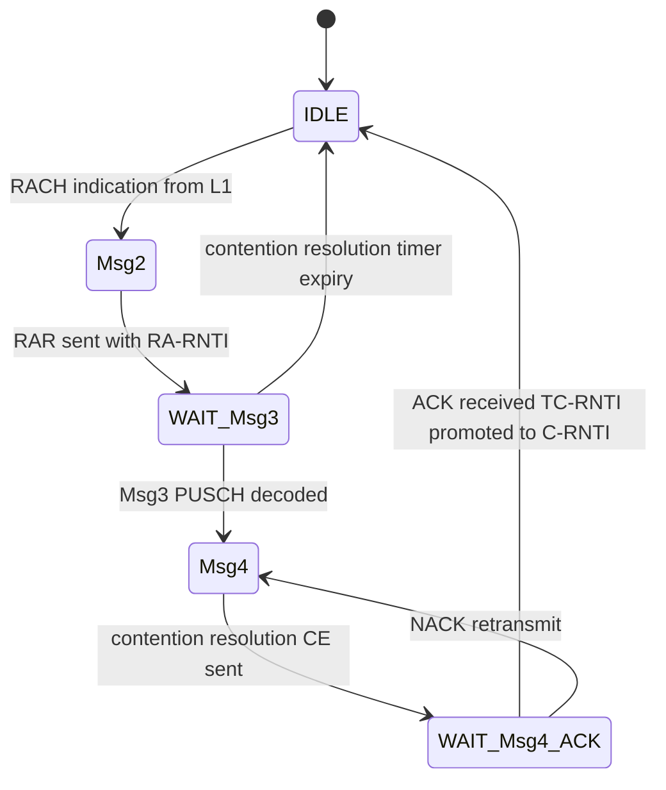

## 12. The NR PHY: what is actually implemented

| Capability | Supported value | Note |
| --- | --- | --- |
| Duplexing | static TDD and FDD | dynamic TDD is not there |
| Subcarrier spacing | 15 kHz, 30 kHz (FR1); 120 kHz (FR2) | |
| Bandwidth (FR1) | 10, 20, 40, 60, 80, 100 MHz | |
| Bandwidth (FR2) | 100–200 MHz | `FEATURE_SET.md` in the repository states up to 400 MHz in FR2 — **VERIFY** against the tag you build |
| MIMO | 4-layer DL, 2-layer UL SU-MIMO | no production MU-MIMO in the 2024 paper; a UL MU-MIMO simulator landed in July 2026 |
| Modulation | up to 256-QAM | |
| Channel coding | LDPC, Polar, Turbo (Turbo for LTE) | SIMD-optimised on x86 |
| Architectures | PHY on x86 with SIMD; L2 and above also on ARM | |

Two constraints that bite in practice and that are pure hardware, not software:

- **USRP X310** — master clock rate 184.32 Msps; the usable NR bandwidth is **80 MHz (217 PRB)**, and reaching
  even that requires three-quarter sampling.
- **USRP N310** — 122.88 Msps, so **100 MHz (273 PRB)** is reachable. In practice OAI can drive two channels at
  100 MHz reliably; four channels at 100 MHz is theoretically possible and in practice produces real-time
  faults.

The LDPC decoder is the single hottest function in the stack. It is SIMD-vectorised, its iteration count is a
first-class tunable (`--L1s.[0].max_ldpc_iterations`, default 8), and it is the first thing to be offloaded:

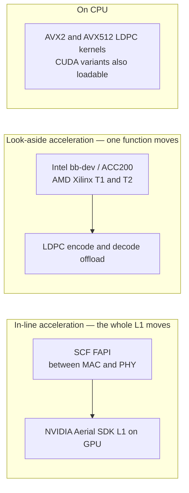

Both are real and both are integrated: in-line through the FAPI interface (currently NVIDIA Aerial SDK Layer 1,
with the DU-high and CU still OAI on general-purpose CPUs), look-aside through Intel **bb-dev** with AMD Xilinx
T1/T2 cards. The UE has a CUDA-backed LDPC library variant (`--loader.ldpc.shlibversion _cuda`), and the
project's `NOTICE` file records further LDPC offload options.

## 13. Above MAC: RLC, PDCP, SDAP, RRC and the network interfaces

The upper layers are ordinary C implementations of the specifications, and the useful thing to know is *where*
each sits relative to the split:

| Layer | Lives in | Moves with the split? |
| --- | --- | --- |
| SDAP, PDCP | `openair2/LAYER2/` | CU-UP — crosses E1 |
| RRC | `openair2/RRC/` | CU-CP — drives F1-C |
| RLC, MAC | `openair2/LAYER2/` | DU |
| NGAP (N2) | `openair3/NGAP/` | CU-CP, over SCTP to the AMF |
| GTP-U (N3) | `openair3/GTPV1-U/` | CU-UP |
| F1AP | `openair2/F1AP/` | CU and DU |
| E1AP | `openair2/E1AP/` | CU-CP and CU-UP |
| XnAP | `openair3/` | inter-gNB |
| NAS (UE) | `openair3/NAS/` | UE only |

The consequences OAI actually supports: **F1 handover between multiple DUs** under one CU-CP, triggered either
manually or from neighbour-cell measurements and events; a CU-CP and a CU-UP each handling multiple DUs; and
interworking with **Open5GS**, **free5GC** and OAI's own core, so the core is rarely the reason an experiment
fails.

An attach, as OAI runs it (SA, OAI CN5G, rfsim):

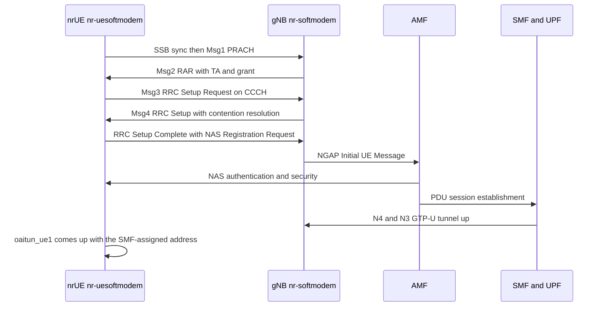

## 14. The fronthaul: split 8 and O-RAN 7.2x

The DU's southbound side is where OAI stops being a program and becomes a distributed system.

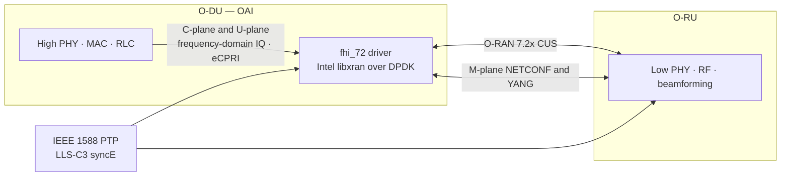

- **Split 8** — RF only in the remote unit; full baseband in the DU; IQ samples over eCPRI. Supported with
  AW2S radios, and the mode most SDR setups approximate.
- **Split 7.2x** — the O-RAN open fronthaul: FFT/IFFT and resource-element mapping below the split, so the
  payload is frequency-domain IQ with optional block-floating-point compression. The OAI implementation
  (`radio/fhi_72/`, plus the newer `fronthaul/` directory) uses **Intel libxran over DPDK** for the C-plane and
  U-plane, ships an **M-plane** based on NETCONF/YANG for O-RU configuration, and requires **IEEE 1588 PTP**
  (typically LLS-C3, sometimes LLS-C1 for particular NIC and O-RU pairs).
- **O-RUs validated by the project**: Benetel, VVDN, LiteOn and Foxconn, with Metanoia and others appearing in
  CI. A representative bring-up is:

```bash
./build_oai --gNB --ninja -t oran_fhlib_5g --cmake-opt -Dxran_LOCATION=$HOME/phy/fhi_lib/lib
sudo ./nr-softmodem -O gnb.sa.band78.273prb.fhi72.4x4-liteon.conf --sa --thread-pool 3,5,7,9,11,12,13,14
sudo ./ptp4l  -i ens2f0 -m -H -2 -s -f configs/c3.cfg
sudo ./phc2sys -w -m -s ens2f0 -R 8 -f configs/c3.cfg
```

The part that actually fails in a lab, and always in this order: **PTP lock, then M-plane, then C/U-plane.**
An O-RU that has not achieved PTP lock will not transmit; an O-RU that is misconfigured by the M-plane will
transmit at the wrong gain or on the wrong beam; only after both does the C/U-plane matter. This mirrors the
lesson in [[02-9 WLAN - Time-Sensitive Networking Across Wi-Fi Generations]] §11.1: in a split RAN the clock is
the first dependency, not a detail.

## 15. The OAI nrUE

The UE is a separate executable with a different thread shape, because the UE's work is driven by *when the
network transmits*, not by a fixed slot grid it owns.

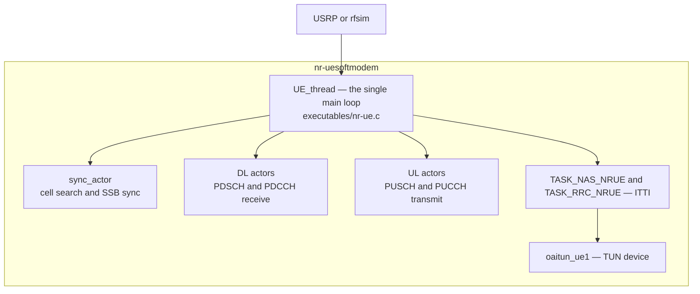

Things worth knowing that are specific to the UE:

- **`UE_thread` is one thread**, created at `OAI_PRIORITY_RT_MAX`, and it contains the initial-sync path
  inline: if `!is_synchronized`, it reads a frame and hands a `syncData_t` to `UE_synch`. Losing sync re-enters
  the same path, which is why a UE that has lost the cell looks like a UE that is still searching.
- **Actors** are configured with `--num-dl-actors` and `--num-ul-actors`, and pinned with `--actor-affinity`.
  DL actors parallelise receive processing; UL actors parallelise transmit preparation.
- **k1 and k2 are the UE's real-time budget.** Commercial gNBs are typically configured with 2 slots; the OAI
  UE on a B210 originally needed 4 slots, and after optimisation the minimum was reduced to **2 slots at 30 kHz
  SCS**. If a UE cannot decode and prepare a response within k1 slots, it cannot attach — this is a
  *processing-speed* failure that presents as a *protocol* failure.
- **LDPC can be moved to a GPU** in the UE (`--loader.ldpc.shlibversion _cuda`), which is a good illustration of
  where the compute actually goes.
- **Published soft-UE throughput**: the project's current page quotes up to **190 Mbps DL and 120 Mbps UL**
  (single layer); the 2024 OSA paper reports the best measured at the time as **70 Mbps DL and 25 Mbps UL** on
  the Colosseum testbed. Cite the date with the number.

## 16. The OAI 5G core

The core is a separate federation repository (`oai-cn5g-fed`), deployed as containers with
`docker-compose` or Helm, and it exists to get out of the way.

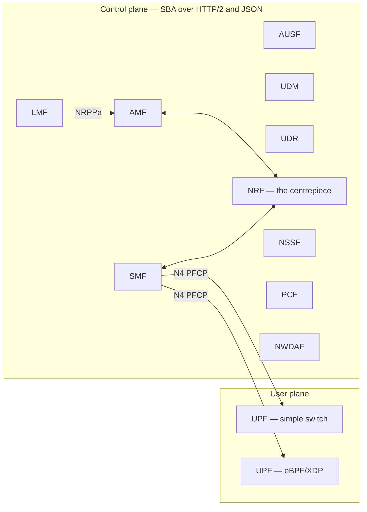

- **11 NFs** at release 2.1.0: AMF, SMF, UPF, AUSF, UDM, UDR, NRF, NSSF, PCF, NWDAF, LMF. NEF and UDSF are in
  the federation; SCP and AF are integrations in progress. The federation also lists a **VPP-based UPF
  (UPF-VPP)** distributed under Apache 2.0.
- **SBA**: HTTP/2 transport, JSON serialisation, NRF at the centre for registration and discovery.
- **UPF**: a simple-switch variant for easy deployment, and an **eBPF/XDP** variant for a high-performance data
  path — the project quotes *nearly 100 Gbps* for the latter, which is a different problem from the air
  interface and belongs to [[05-1 DPDK User Plane and 5G UPF]].
- **Features that matter for experiments**: multiple UEs with multiple concurrent PDU sessions, N2 handover,
  network slicing per UE and per PDU session (S-NSSAI), multiple UPFs in one data path with UL classifier,
  event exposure, and positioning via the LMF using NRPPa to the RAN and LPP to the UE (UL-TDoA from
  multiple gNBs).
- **Deployment**: `docker-compose/docker-compose-basic-nrf.yaml`, a MySQL database seeded from `oai_db2.sql`
  (add your SIM's IMSI and keys to `AuthenticationSubscription`), an external DN container for traffic tests,
  and — the usual gotcha — fixed IPv4 addresses for the AMF so the gNB's NGAP configuration does not have to
  change on every restart.

## 17. O-RAN control: E2, FlexRIC and O1

OAI implements both O-RAN control interfaces, and this is the part that connects this note to
[[01-3 AI-ML for RAN and O-RAN RIC]].

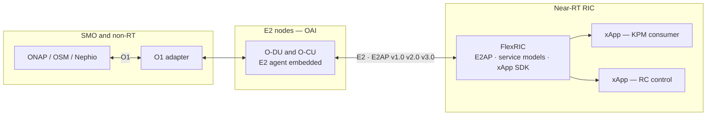

- **FlexRIC** is OAI's own near-RT RIC, E2 agent and xApp SDK. It supports **E2AP v1.0/v2.0/v3.0** and the
  O-RAN service models **KPM v2.01/v2.03/v3.0** and **RC v1.3**, plus its own *à la carte* service models for
  **MAC, RLC, PDCP and GTP**. xApps are written in C/C++ or Python 3 against an SDK that integrates SQLite.
  Most of the code is strict C11, so it runs on ARM and x86. The measured one-way RAN-to-xApp latency is
  **below 1 ms**, which is what makes it usable for anything faster than tens of milliseconds.
- **Interoperability** has been shown with the OSC RIC, Keysight RICTest and **srsRAN**, which is unusual and
  useful: it means an xApp written against FlexRIC is not trapped in one RAN.
- **O1** is implemented in both DU and CU for SMO integration (ONAP, OSM, Sylva, Nephio), and OAI ships an O1
  adapter in the OAM asset.

The architectural point that matters and that is easy to miss: **xApps operate on the order of tens of
milliseconds**, which is an order of magnitude slower than the slot loop. The RIC cannot schedule; it can only
set parameters the scheduler then honours. The recent **dApp** idea — deployed directly on the RAN node, able to
see data a RIC cannot, acting within shorter intervals — exists precisely because of that gap, and OAI has been
one of the places it is prototyped.

## 18. Simulation, emulation and CI

OAI's test ladder is worth copying as a methodology: never debug over the air what you can debug in software.

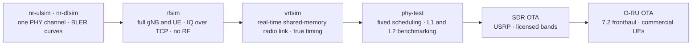

| Tool | What it replaces | What it still cannot tell you |
| --- | --- | --- |
| `nr-ulsim`, `nr-dlsim` | a whole stack; one channel, swept SNR | anything about scheduling, RRC or timing |
| `rfsim` | the radio; gNB and UE exchange IQ over TCP in one machine | real time, real channel, real clock behaviour |
| `vrtsim` | the radio, but in real time over shared memory | RF impairments and front-end noise |
| `--phy-test` | the upper layers; fixed scheduling, L1/L2 only | whether the scheduler would have chosen that |
| Keysight **RuSIM** / **CoreSIM** | the RU plus the channel, and the CN respectively | cost |
| **Colosseum** | everything, at scale: 128 SRNs, 128 USRP X310, 64 FPGAs of channel emulation | convenience |

CI is not decoration here: Jenkins runs on every merge request, tests 4G, 5G NSA and 5G SA against OAI and
third-party cores with attach, detach, ping and iPerf, and builds container images for x86-64 and ARM. The
project is explicit that these pipelines **are not designed to maximise throughput** — they test stability, not
peak performance. That single sentence saves a lot of misquoted numbers.

## 19. Real-time engineering

This is where most first deployments fail, and it is the part that connects OAI to
[[04-4 Linux Interrupts - Types, Handlers, Threaded IRQs and Deferred Work]] and
[[04-5 Linux Concurrency - Kernel and User Mode, Processes, Threads and IPC]]. The per-slot deadline is not
negotiable and the kernel is not your friend by default.

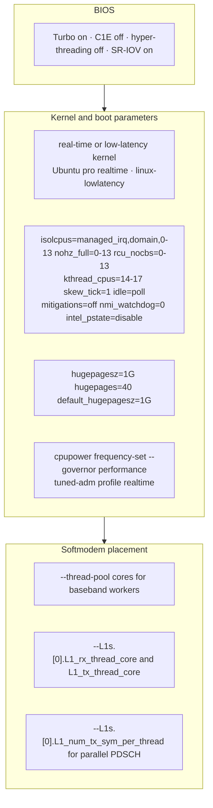

A real allocation from a working 18-core, single-NUMA-node setup with a Benetel O-RU:

| Consumer | Cores |
| --- | --- |
| XRAN / DPDK | 0, 2, 4 |
| OAI `ru_thread` | 6 |
| OAI `L1_rx_thread` | 8 |
| OAI `L1_tx_thread` | 10 |
| OAI `nr-softmodem` (rest, including the thread pool) | 3, 5, 7, 9, 11, 12, 13, 14 |
| Kernel | 14–17 |

The failure mode is always the same shape: **the radio does not wait.** If the L1 TX thread is late, the
fronthaul or the USRP buffer underruns, samples are stale, and the symptom appears at the UE as a CRC failure
or at the UE as a loss of sync — never as a log line saying "you were late". The graded response, in the order
the project recommends it:

1. Give the L1 RX and TX threads their own isolated cores.
2. Give the thread pool enough cores; remember the default is **8 floating cores**, which is a guess.
3. Spread PDSCH generation across the pool with `L1_num_tx_sym_per_thread`.
4. Only then, degrade: `--MACRLCs.[0].ul_max_mcs 14` to cut UL spectral efficiency, or
   `--L1s.[0].max_ldpc_iterations 4` to cut decoder time. Both cost throughput or error rate. Buying your way
   out with a look-aside accelerator is the better version of step 4.

Two hardware behaviours worth knowing before you blame the software: **AMD EPYC Zen processors are built from
multiple dies each holding core complexes with their own L3**, so a thread pool spanning dies pays a real
penalty; and **hugepages matter**, because the fronthaul path is DPDK.

## 20. What it actually delivers, and what it does not

Measured, with the configuration attached, because the number is meaningless without it:

| Configuration | Downlink | Uplink | Source |
| --- | --- | --- | --- |
| Keysight RuSIM + NVIDIA Aerial L1, 1 UE, emulated | 1.61 Gbps | 143 Mbps | OSA paper 2024 |
| OTA, VVDN O-RU + OAI L1, 100 MHz, 4 layers | 1.3 Gbps | 116 Mbps | OSA paper 2024 |
| OTA, Foxconn O-RU + NVIDIA ARC | 1.2 Gbps | 100 Mbps | OSA paper 2024 |
| USRP N310 SDR, two channels at 100 MHz | 650 Mbps | 123 Mbps | OSA paper 2024 |
| Project's current headline figure | up to 1.4 Gbps | up to 400 Mbps | OAI RAN page |
| OAI soft UE, best measured | 70 Mbps (2024) / up to 190 Mbps (current page) | 25 Mbps (2024) / up to 120 Mbps | both |

Scale: a stress test ramped UEs to **25 attached, each pushing ~64 Mbps, 1.6 Gbps aggregate**; other runs have
held **55 UEs attached** at once with ping. The UL figure is consistently an order of magnitude below the DL
figure, which is the honest signature of a CPU-based L1: uplink means LDPC decoding, and decoding is the
expensive direction.

The honest comparison, from an independent measurement rather than from either project's marketing —
Guemdani et al., HPSR 2025, 5G SA testbed, srsRAN versus OAI, monolithic and split:

| Observation | Result |
| --- | --- |
| E2E bitrate | srsRAN higher and more stable; OAI affected by recurring buffer-full errors |
| CPU usage | OAI generally lower than srsRAN; disaggregated DU lower than monolithic |
| Packet loss | OAI significantly higher, attributed to the buffer-full condition |
| Jitter | OAI significantly higher |
| Disk write | OAI substantially higher volume |

Read that as engineering information, not as a scorecard: OAI is the stack you pick when you need to *change*
the RAN — new scheduler, new split, new sensing mode, NTN timing, sidelink, an E2 service model nobody has
written yet. srsRAN is the stack you pick when you need a RAN that *works*. Commercial DU software is what you
pick when you need multi-gigabit with MU-MIMO and a support contract.

The gaps worth naming out loud, because they are the first things a serious evaluation finds:

- **No production MU-MIMO** and therefore no massive-MIMO story yet, though beam-weight computation from channel
  reciprocity and a UL MU-MIMO simulator are in progress.
- **Dynamic TDD is not implemented**; TDD patterns are static.
- **Feature coverage is a subset of the release.** "OAI supports Rel-17" means parts of Rel-17 (NTN, positioning
  pieces, sidelink in progress), not the release.
- **Real time is a property of your machine**, not of the code. The same tag that runs 100 MHz on a tuned EPYC
  will miss slots on an untuned laptop.
- **The licence is not OSI-approved.** CSSL v1.0 is Apache-2.0-derived with a FRAND patent clause; free for
  research, commercial terms negotiated.

## 21. Bring-up and fault localisation

Work down the stack, because every layer's failure looks like the layer above it is broken.

```mermaid
flowchart TD
    S["Symptom"] --> Q1{"Does rfsim work with the same config?"}
    Q1 -->|no| C1["Configuration or core<br/>PLMN · AMF IP · IMSI in the DB · DNN"]
    Q1 -->|yes| Q2{"Does the UE see the SSB?"}
    Q2 -->|no| C2["RF or fronthaul<br/>gain · clock · PTP lock · M-plane · band and SSB offset"]
    Q2 -->|yes| Q3{"Does Msg1 to Msg4 complete?"}
    Q3 -->|no| C3["RACH or timing<br/>PRACH config · k2 · TA · UE processing speed"]
    Q3 -->|yes| Q4{"Does NAS and PDU session succeed?"}
    Q4 -->|no| C4["Core<br/>AMF and SMF logs · subscription · slicing"]
    Q4 -->|yes| Q5{"Is throughput as expected?"}
    Q5 -->|no| C5["Real time or scheduling<br/>late slots · LDPC iterations · UL MCS cap · CQI"]
```

| Symptom | Most likely layer | First thing to check |
| --- | --- | --- |
| gNB starts, never registers with the AMF | transport / NGAP | SCTP reachability, the AMF's fixed IP, PLMN match |
| UE never finds the cell | RF or sync | band, DL frequency, `--ssb` subcarrier offset, RX gain |
| UE finds the cell, RACH never completes | RACH / real time | `rach_ind` in the MAC log; then whether k1/k2 are achievable on this hardware |
| Msg3 decoded, no Msg4 | MAC | contention resolution timer, `WAIT_Msg3` never leaving |
| Attached, no IP | core | PDU session, SMF DNN, `oaitun_ue1` |
| Attached, low DL throughput | real time / CQI | L1 TX thread placement, LDPC iterations, MCS distribution |
| UL much worse than DL | real time | UL is the decode direction: cap `ul_max_mcs` and see whether the symptom follows |
| O-RU silent | PTP and M-plane, in that order | `ptp4l` and `phc2sys` state, then the NETCONF configuration |
| Random real-time faults under load | scheduling | isolated cores, `tuned-adm profile realtime`, thread-pool size |

The instrument that makes all of this tractable is the **T tracer** plus the telnet server (`--telnetsrv`):
you can turn log components up or down at run time and watch one layer without drowning in another. The
softscope tools (`nrscope`, `doscope`, `imscope`) do the same thing for IQ data.

## 22. Ten short answers

1. **What is OAI?** An open-source 3GPP 4G/5G RAN plus core plus OAM, in C, governed by the OSA and now also by
   the Duranta project under Linux Foundation Networking.
2. **What licence?** CSSL v1.0 since 2026-03-27 — Apache 2.0 plus a FRAND patent clause. Previously OAI Public
   License v1.1 (2017), previously GPL v2. Free for research; commercial use on FRAND terms.
3. **How is one gNB process structured?** Two execution models: ITTI tasks for everything above the slot loop,
   and POSIX threads with notified FIFOs for RU, L1 RX, L1 TX and the worker pool.
4. **How do L1 and L2 talk?** In-process FAPI: `nr_ul_indication()` every slot carrying *all* uplink
   indications, `nr_schedule_response()` back, plus TX_REQ and RX_IND for data. The same boundary becomes a
   wire under `--nfapi`.
5. **Where is the scheduler?** `openair2/LAYER2/NR_MAC_gNB/`, entry `gNB_dlsch_ulsch_scheduler()`, with a
   preprocessor that decides policy and a postprocessor that emits DCI and FAPI PDUs.
6. **Which splits are supported?** F1, E1, nFAPI (MAC/PHY), O-RAN 7.2x and split 8. They are orthogonal; a
   deployment picks per boundary.
7. **What is the biggest performance constraint?** LDPC decoding on a general-purpose core, which is why UL is
   an order of magnitude below DL and why acceleration is either in-line (NVIDIA Aerial over FAPI) or
   look-aside (Intel bb-dev, AMD T1/T2).
8. **Why does it miss real time?** Almost always core contention or an untuned kernel, not algorithm cost. Isolate
   cores, pin the L1 threads, size the pool, and only then reduce MCS or LDPC iterations.
9. **How do you develop without hardware?** `rfsim` for functional work, `vrtsim` for timing, `nr-ulsim` /
   `nr-dlsim` for PHY, `--phy-test` for L1/L2 benchmarking.
10. **OAI or srsRAN?** OAI when you need to change the RAN; srsRAN when you need a RAN. Independent measurement
    (HPSR 2025) found srsRAN higher and more stable bitrate with lower jitter and loss, and OAI lower CPU.

## 23. Anchors

Dated, checkable facts. Anything not independently confirmed is marked `VERIFY`.

- **Founding and governance.** OAI began at **EURECOM** in the early 2000s; the **OpenAirInterface Software
  Alliance (OSA)** was created in **2014**; the first LTE Release 8 softmodem interoperating with commercial
  phones and a third-party EPC was demonstrated **around 2010**.
- **5G milestones.** First 5G RAN supporting **NSA in 2020**; 5G CN and 5G RAN supporting **SA in 2021**. The
  OSA newsletter records the **July 2021** launch of the 5G Stand-Alone OAI gNB stack (AMF/UPF/SMF in
  containers, gNB on bare metal with two USRP N310s, a Quectel module as the UE).
- **Licence.** GPL v2 → **OAI Public License v1.1, drafted 2017** → **CSSL v1.0**, changed in the RAN
  repository on **2026-03-27**; the 5G core recorded the same change in **v2.2.1, March 2026**, with docs to
  CC-BY-4.0 and orchestration files to MIT.
- **Duranta.** Announced by **LF Networking and the OSA on 2025-08-27** as an LFN incubation project seeded
  with OAI assets. Source at `github.com/duranta-project/openairinterface5g`; development remains on the
  EURECOM GitLab server. Weekly integration tags are named `YYYY.wNN`; **2026.w43** merged **2026-10-23**, and
  the repository's `CHANGELOG.md` carries **v3.0.0** release notes dated **2026-10-14**.
- **PHY parameters.** Static TDD plus FDD; SCS **15/30 kHz** (FR1) and **120 kHz** (FR2); FR1 bandwidths
  **10/20/40/60/80/100 MHz**; FR2 **100–200 MHz** per the project page and 200 MHz per the 2024 OSA paper,
  while the repository's `FEATURE_SET.md` says up to 400 MHz in FR2 — `VERIFY` against the tag you build.
  **4-layer DL / 2-layer UL**, up to **256-QAM**, LDPC/Polar/Turbo.
- **Hardware limits.** USRP **X310**: 184.32 Msps, **80 MHz (217 PRB)** usable with three-quarter sampling.
  USRP **N310**: 122.88 Msps, **100 MHz (273 PRB)**; two such channels run reliably, four produce real-time
  faults.
- **Scheduling and UE timing.** Commercial gNBs are typically configured with **k1 = k2 = 2 slots**; the OAI UE
  on a B210 originally needed **4 slots**, reduced by optimisation to **2 slots at 30 kHz SCS**.
- **LDPC.** Default **8 decoder iterations**, tunable by `--L1s.[0].max_ldpc_iterations`.
- **Throughput.** 1.61 Gbps DL / 143 Mbps UL (emulated, NVIDIA Aerial L1); 1.3/0.116 Gbps OTA with VVDN and
  OAI L1; 1.2/0.1 Gbps OTA with Foxconn and NVIDIA ARC; 650/123 Mbps on a USRP N310 at 2×100 MHz; **25 UEs at
  ~64 Mbps each = 1.6 Gbps aggregate**; up to **55 UEs attached**. Soft UE: 70/25 Mbps (2024, Colosseum);
  current project page quotes up to 190/120 Mbps single-layer.
- **Core.** **11 NFs** at `oai-cn5g-fed` **v2.1.0** (August 2024): AMF, SMF, UPF, AUSF, UDM, UDR, NRF, NSSF,
  PCF, NWDAF, LMF. eBPF/XDP UPF quoted at *nearly 100 Gbps*.
- **Fronthaul.** O-RAN **7.2x** C/U-plane via **Intel libxran over DPDK**, M-plane over **NETCONF/YANG**,
  **IEEE 1588 PTP** (LLS-C3 typical). O-RUs validated: **Benetel, VVDN, LiteOn, Foxconn**.
- **RIC.** FlexRIC supports **E2AP v1.0/v2.0/v3.0**, **KPM v2.01/v2.03/v3.0**, **RC v1.3**, plus custom
  MAC/RLC/PDCP/GTP service models; **one-way RAN-to-xApp latency below 1 ms**; interoperable with OSC RIC,
  Keysight RICTest and srsRAN.
- **Independent comparison.** HPSR 2025 (Guemdani, Gu, Phung, Secci): srsRAN higher and more stable E2E bitrate,
  lower packet loss and lower jitter; OAI lower CPU; disaggregation reduces DU CPU in both.
- **Spectrum used by the project's own lab.** Bands **28 (700 MHz), n38 (2.6 GHz TDD), n78 (3.5 GHz TDD),
  n77 (3.8 GHz TDD), n258 (25 GHz TDD)**.

## 24. Related

- [[01-6 NR DU MAC Scheduler - Resource Allocation, HARQ and Real-Time Implementation]] — the thing OAI implements: the four resources, the per-slot budget, the PDCCH and PUCCH accounting, and the execution model that §7 and §8 of this note are one concrete instance of
- [[01-7 NR HARQ - Retransmission Flow, Timelines and LTE Comparison]] — what the `NR_list_t` pools and the RV cycling table in `gNB_scheduler.c` are a view of: the soft buffer, NDI and RV, k0/k1/k2 and the N1/N2 floors
- [[01-5 NR Random Access - UE RACH Procedure, Signalling and Tuning]] — what `handle_nr_rach()` and `nr_schedule_RA()` are driving: Msg1 to Msg4, MsgA/MsgB, the RA-RNTI and the RAR, and the counters that decide whether a UE ramps or restarts
- [[01-2 5G NR RAN Layer 2 Protocol Stack]] — the layers OAI places across F1 and E1: SDAP and PDCP in the CU-UP, RRC in the CU-CP, RLC and MAC in the DU
- [[01-3 AI-ML for RAN and O-RAN RIC]] — the other side of the E2 interface: what FlexRIC's service models expose, and why an xApp runs at tens of milliseconds while the scheduler runs at a slot
- [[01-1 5G-Advanced and 6G Radio Access]] — where OAI's roadmap points: FR3 and sub-THz experiments, AI-native air interface work, and the 130 GHz demonstration
- [[01-4 Cellular IoT RedCap eRedCap and NTN]] — what OAI's Rel-17 NTN support actually contains: SIB19, `K_offset`, MAC HARQ changes and UE frequency-offset compensation, and why a GEO and a LEO need different scheduling arithmetic
- [[04-4 Linux Interrupts - Types, Handlers, Threaded IRQs and Deferred Work]] — the environment the L1 threads have to be isolated from: why a softmodem wants managed interrupts, `nohz_full` and `isolcpus` rather than a faster CPU
- [[04-5 Linux Concurrency - Kernel and User Mode, Processes, Threads and IPC]] — the execution model in full: POSIX threads at real-time priority, notified FIFOs instead of message queues in the hot path, and the shared-address-space trade-off §8 describes
- [[04-2 Linux Embedded Development - Drivers, Applications and Core Subsystems]] — the host work: real-time kernels, hugepages and DPDK binding, `cpupower` and `tuned`, and the NUMA and core-complex behaviours that decide thread placement
- [[05-1 DPDK User Plane and 5G UPF]] — the same DPDK discipline at the other end of the network: the O-RAN 7.2 C/U-plane on one side, the eBPF/XDP UPF on the other
- [[02-12 WLAN - openwifi - An Open-Source FPGA 802.11 Platform]] — the same idea one domain over: an open stack where the low MAC is yours to rewrite, and the same honest gap between research platform and product
- [[08-1 Programming Languages Toolchain and Performance Engineering]] — what makes the slot fit: SIMD kernels, data layout, and the measurement discipline behind every number in §20
- [[08-2 C and C++ Programming - Language Features, STL and Systems Practice]] — the language OAI is written in, and the idioms it uses: function-pointer structs as interfaces, `AssertFatal`, and C-struct-as-protocol
- [[05-2 Cloud-Edge-End Collaboration and Heterogeneous Computing]] — where a softmodem lands in a cloud-native deployment: Nephio, Sylva, Helm charts, and the in-line versus look-aside acceleration question as a general pattern
- [[07-1 RISC-V for Communication Infrastructure]] — the L1-accelerator-to-L2-core boundary that nFAPI and FAPI formalise, and what changes when the accelerator is on-die

## 25. References

1. Kaltenberger, F., Gosain, A., Ghauri, I., Knopp, R., et al. *Driving Innovation in 6G Wireless
   Technologies: The OpenAirInterface Approach*. arXiv:2412.13295 (published in *Computer Networks*).
   <https://arxiv.org/abs/2412.13295>
   — the authoritative current description: history and licence, the RAN/CN/OAM asset split, F1/E1/FAPI/
   7.2/E2/O1 support, the PHY parameter table, the O-RU vendor list, the performance tables quoted in §20,
   the 11-NF core, FlexRIC's service models and latency, and the 6G research directions.
2. OpenAirInterface Software Alliance. *OAI RAN — project page*. <https://openairinterface.org/?p=396/>
   — the current feature list: FR1 10–100 MHz, FR2 100–200 MHz, 4 DL / 2 UL layers, up to 1.4 Gbps DL and
   400 Mbps UL, the UE figures, NTN, sidelink modes 1 and 2, hardware acceleration, and the split summary.
3. OpenAirInterface Software Alliance. *OAI License Model*. <https://openairinterface.org/?page_id=101>
   — the four repositories and their licences, CSSL as a modified Apache 2.0 with a FRAND patent clause, and
   the ICLA/CCLA requirement.
4. OpenAirInterface Software Alliance. *CSSL — The OAI move to a generic license*, OAI Webinar Series chapter 16.
   <https://openairinterface.org/?p=1495/>
   — the rationale for moving from OAI PL v1.1 to CSSL alongside the Duranta launch.
5. Linux Foundation Networking and OpenAirInterface Software Alliance. *LF Networking and OSA collaborate to
   announce Duranta*. <https://lfnetworking.org/> — announcement dated **2025-08-27**.
6. Duranta project. *openairinterface5g* source. <https://github.com/duranta-project/openairinterface5g>
   — the repository: directory layout, `CHANGELOG.md` with v3.0.0 release notes, `ROADMAP.md`, the licence
   change commit of 2026-03-27, `fronthaul/`, `charts/`, `docker/`, `ci-scripts/`.
7. OpenAirInterface. *openairinterface5g tags*. <https://gitlab.eurecom.fr/oai/openairinterface5g/-/tags>
   — the weekly integration tags; `2026.w43` merged 2026-10-23, with per-week merge-request summaries that are
   the best available record of what actually changed (FHI72 K release, O-RU C-plane section extension 1,
   codebook-based digital beamforming in the O-RU, spectrum sensing on reserved UL slots, XNAP encode/decode,
   MU-MIMO simulator, vrtsim channel model 5).
8. OpenAirInterface. *oai-cn5g-fed*. <https://gitlab.eurecom.fr/oai/cn5g/oai-cn5g-fed>
   — the 5G core federation: the NF list, the two UPF variants, UPF-VPP under Apache 2.0, and the deployment
   tutorials.
9. OpenAirInterface. *O-RAN FHI 7.2 tutorial* (`doc/ORAN_FHI7.2_Tutorial.md`).
   <https://openairinterface.org/docs/>
   — the 7.2x split inside OAI: which functions sit in the O-DU and which in the O-RU, the Intel libxran and
   DPDK dependency, the M-plane, the PTP LLS-C configuration, and worked kernel command lines.
10. OpenAirInterface. *VNF/PNF split architecture* (`doc/NR_NFAPI_archi.md`).
    <https://openairinterface-docs-5b3d70.eurecom.io/projects/OpenAirInterface5G/architecture/NR_NFAPI_archi/>
    — the nFAPI split in detail: `configure_nr_nfapi_vnf()` and `configure_nr_nfapi_pnf()`, the P5 and P7 loops,
    socket versus WLS versus nvIPC encoding, and how `UL_INFO` is packed and shipped.
11. OpenAirInterface. *Feature set, build and run documentation* (`doc/FEATURE_SET.md`, `doc/BUILD.md`,
    `doc/RUNMODEM.md`, `doc/tuning_and_security.md`). <https://openairinterface.org/docs/>
    — the supported parameter table, `build_oai` invocation, the softmodem command-line surface, and the
    performance-tuning section that §19 is based on (L1 thread cores, thread pool,
    `L1_num_tx_sym_per_thread`, `max_ldpc_iterations`, `ul_max_mcs`, and the AMD EPYC core-complex caveat).
12. Kaltenberger, F. *OAI Layer 1/2 procedures*, OAI Fall 2019 Workshop, Beijing.
    <https://www.openairinterface.org/docs/workshop/8_Fall2019Workshop-Beijing/Training/2019-12-03-KALTENBERGER-2.pdf>
    — the thread inventory in §8 (`ru_thread`, `ru_thread_tx`, `fep_thread`, `feptx_thread`, `ru_thread_prach`,
    `ru_thread_asynch`, `L1_thread_rx`, `L1_thread_tx`, `L1_thread_prach`) with the timing diagrams.
13. Thomas, L. *Configuration files and Linux threading in the OAI RAN code*, OAI Webinar Series chapter one.
    <https://openairinterface.org/wp-content/uploads/2022/01/OAI-webinar-chapter-one.pdf>
    — the notifiedFIFO discipline, the permanent-thread inventory, and the "think of 10 microseconds of CPU"
    argument against allocation in the hot path.
14. Knopp, R., Kaltenberger, F., et al. *The OpenAirInterface 5G New Radio Implementation: Current Status and
    Roadmap*. EURECOM. <https://www.eurecom.fr/publication/5822/download/comsys-publi-5822.pdf>
    — the FAPI P5 and P7 figures reproduced in §9, and the USRP X310 (184.32 Msps, 80 MHz, 217 PRB) versus
    N310 (122.88 Msps, 100 MHz, 273 PRB) bandwidth analysis.
15. Kaltenberger, F., et al. *An Open, Programmable, Multi-vendor 5G O-RAN Testbed with NVIDIA ARC and
    OpenAirInterface*. arXiv:2310.17062. <https://arxiv.org/abs/2310.17062>
    — the FAPI split in a real deployment: L1 as master sending a slot indication every slot, L2 replying with
    a UL or DL request, O-RAN 7.2 with the S-plane on PTPv2 and sync architecture option 3.
16. Guemdani, M., Gu, P., Phung, C.-D., Secci, S. *Comparative E2E Performance Analysis of O-RAN Designs in a
    5G Standalone Testbed*. IEEE HPSR 2025.
    — the independent srsRAN versus OAI comparison in §20: bitrate, jitter, packet loss, CPU and disk write.
17. COSMOS testbed. *Duranta/OAI 5G SA soft-only: gNB + nrUE + OAI CN5G over RFsim*.
    <https://www.cosmos-lab.org/wiki/public/tutorials/cellular-4g5g-oran/duranta-soft-5g-single-host>
    — a worked single-host rfsim deployment with the core, including the image-to-tag mapping
    (`duranta-20260907c` built from tag `2026.w36`), the PLMN and UE pool, and the tutorial path onward to OTA.
18. OpenAirInterface. *5G NR SA tutorial with OAI nrUE and GPU offload* (`doc/NR_SA_Tutorial_OAI_nrUE_GPU_offload.md`).
    — the UE command-line surface in §15: `--num-dl-actors`, `--num-ul-actors`, `--thread-pool`,
    `--loader.ldpc.shlibversion`, `--ue-fo-compensation`, `--usrp-tx-thread-config`, and the DPDK and UHD
    build prerequisites.
19. OpenAirInterface Software Alliance. *OAI 5G RAN Project Group Charter*.
    <https://www.openairinterface.org/docs/OSA-5G-RAN-Project-Group-Charter.pdf>
    — the governance and funding model behind the two-year project group started 2020-11-15.
20. OpenAirInterface Software Alliance. *Winter Newsletter, January 2022*.
    <https://openairinterface.org/wp-content/uploads/2025/10/Winter_Newsletter.pdf>
    — the July 2021 launch of the 5G SA gNB stack, the containerised AMF/UPF/SMF, the N310 and Quectel
    configuration, and the description of the 5G RAN project group's sub-activities.
21. 3GPP. *TS 38.211 — Physical channels and modulation*.
    <https://www.etsi.org/deliver/etsi_TS/138200_138299/138211/>
    — the numerology, frame and slot structure, and the physical channels that `openair1/PHY/NR_TRANSPORT`
    implements.
22. 3GPP. *TS 38.212 — Multiplexing and channel coding*.
    <https://www.etsi.org/deliver/etsi_TS/138200_138299/138212/>
    — LDPC and Polar coding and rate matching, the reference for the decoder whose iteration count §19 tunes.
23. 3GPP. *TS 38.213 — Physical layer procedures for control*.
    <https://www.etsi.org/deliver/etsi_TS/138200_138299/138213/>
    — PDCCH candidates and CCE budgets, PUCCH resource determination, and HARQ-ACK timing.
24. 3GPP. *TS 38.321 — Medium Access Control (MAC) protocol specification*.
    <https://www.etsi.org/deliver/etsi_TS/138300_138399/138321/>
    — the normative source for everything `NR_MAC_gNB` implements: RACH, HARQ, BSR, LCP, DRX.
25. 3GPP. *TS 38.331 — Radio Resource Control (RRC) protocol specification*.
    <https://www.etsi.org/deliver/etsi_TS/138300_138399/138331/>
    — the configuration that P5 carries from RRC down to PHY, and the SIB19 NTN fields.
26. 3GPP. *TS 38.401 / TS 38.470 series — NG-RAN architecture and F1*.
    <https://www.etsi.org/deliver/etsi_TS/138400_138499/>
    — the CU/DU split, F1-C and F1-U, and the E1 interface that §5 and §13 place OAI's tasks on.
27. Small Cell Forum. *FAPI and nFAPI specifications*. <https://www.smallcellforum.org/>
    — the P5 and P7 procedures and message sets OAI adopts verbatim as its L1/L2 boundary.
28. O-RAN ALLIANCE. *Open Fronthaul Control, User and Synchronization Plane Specification (7.2x)*.
    <https://www.o-ran.org/specifications>
    — the C-, U- and S-plane definition that `radio/fhi_72` implements, including the section types and the
    compression options.
29. IEEE. *1588-2019 — Precision Time Protocol*.
    <https://standards.ieee.org/ieee/1588/6211/>
    — the clock that O-RAN 7.2 depends on; the reason §14 orders bring-up as PTP, M-plane, C/U-plane.
30. Intel. *DPDK and the bb-dev (ACC200) acceleration framework*. <https://www.dpdk.org/>
    — the two Intel dependencies in one: the fronthaul data path and the look-aside LDPC path.
31. NVIDIA. *Aerial SDK — GPU-accelerated 5G L1*. <https://developer.nvidia.com/aerial>
    — the in-line acceleration option: L1 wholly on GPU, L2 and above still OAI on CPU.
32. NgKore Foundation. *OAI NTN: inside the source code*. <https://docs.ngkorefoundation.org/ntn/oai/oai-ntn/>
    — a code-level walk of `apply_ntn_config()`, SIB19, `nr_mac_configure_sib19()`, `get_NTN_Koffset()` and the
    GEO versus LEO K2 values — the practical companion to [[01-4 Cellular IoT RedCap eRedCap and NTN]].
33. NgKore Foundation. *ORAN end-to-end commands cheatsheet*.
    — the exact build and run commands for B210, N310, X410, and for the `oran_fhlib_5g` target, plus the
    `ptp4l`/`phc2sys` invocations per O-RU and NIC pair and the kernel command line used in §19.
34. Northeastern University / Colosseum. *Colosseum massive channel emulator*.
    — the 128 SRN, 128 USRP X310 and 64 FPGA testbed where the soft-UE throughput figures were measured.
35. Keysight. *RuSIM and CoreSIM*. <https://www.keysight.com/>
    — RU, channel and UE emulation, and core emulation, used for the 1.61 Gbps figure and for stress testing.
36. Dahlman, E., Parkvall, S., Sköld, J. *5G NR: The Next Generation Wireless Access Technology*, 2nd ed.
    Academic Press, 2021. ISBN 978-0-12-822320-8.
    — the specification-side reference to read next to the code, chapter by chapter.

- [[09-1 Engineering Project Management - Methodology, Lifecycle, Tools and Best Practice]] — the discipline that decides what a stack like this promises: where the honest distance between a research platform and a product becomes a scope statement, a verification plan and a real-time budget
- [[10-1 Value-Driven Business Model - Methodology, Process, Tools and Best Practice]] — the licence as a business-model instrument in this very domain: GPL to OAI Public License v1.1 (2017) to CSSL v1.0 and why a FRAND patent clause exists, which is the sharpest local example of the appropriability argument in note 10-1 section 9
---

Copyright (c) 2026 Washington Ruan. All rights reserved.
