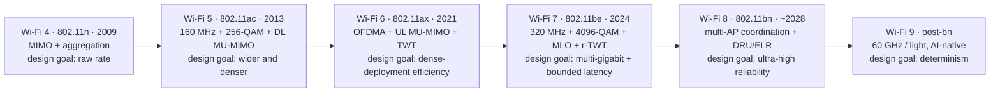
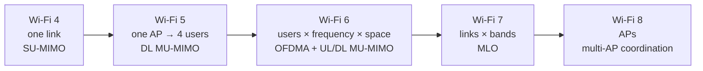

# WLAN — Wi-Fi Generations Evolution (Wi-Fi 4 → Wi-Fi 8 → Wi-Fi 9)

Full generational reference. Ecosystem, certification and mesh software live in [[02-3 WLAN Ecosystem - WFA, EasyMesh and prpl]].

## 0. Generation map

| Wi-Fi | IEEE std | Adopted | Bands | Max channel | Max modulation | Max streams | Max PHY rate | Design priority |
| --- | --- | --- | --- | --- | --- | --- | --- | --- |
| Wi-Fi 4 | 802.11n (HT) | 2009 | 2.4 / 5 GHz | 40 MHz | 64-QAM | 4 | **600 Mbps** | Raw rate: MIMO + aggregation |
| Wi-Fi 5 | 802.11ac (VHT) | 2013 | 5 GHz | 160 MHz | 256-QAM | 8 | **6.93 Gbps** | Wider channels, DL MU-MIMO |
| Wi-Fi 6 | 802.11ax (HE) | 2021 | 2.4 / 5 GHz | 160 MHz | 1024-QAM | 8 | **9.6 Gbps** | Efficiency in dense networks |
| Wi-Fi 6E | 802.11ax in 6 GHz | 2021 cert. | +6 GHz | 160 MHz | 1024-QAM | 8 | 9.6 Gbps | Clean spectrum |
| Wi-Fi 7 | 802.11be (EHT) | 2024 | 2.4 / 5 / 6 GHz | 320 MHz | 4096-QAM | 8 | **23 Gbps** | Multi-gigabit + bounded latency |
| Wi-Fi 8 | 802.11bn (UHR) | ~2028 | 2.4 / 5 / 6 GHz | 320 MHz | 4096-QAM | 8 | ~23 Gbps | **Ultra-high reliability** |
| Wi-Fi 9 | post-802.11bn | TBA | +60 GHz / light | TBA | TBA | TBA | not the point | **Determinism + AI-native** |

The strategic arc: **rate (Wi-Fi 4/5) → efficiency (Wi-Fi 6) → latency (Wi-Fi 7) → reliability (Wi-Fi 8) → determinism (Wi-Fi 9)**.

Note what stops growing after Wi-Fi 7: channel width, modulation order and stream count are all maxed out. Every Wi-Fi 8 gain therefore has to come from **scheduling and coordination**, not from the PHY headline numbers — which is exactly why Wi-Fi 8 is a reliability release.

---

## 1. Wi-Fi 4 — IEEE 802.11n (HT, High Throughput), 2009

Ratified September 2009. Development began 2002. Now Clause 20 of IEEE 802.11-2012. First dual-band standard and the **most important generation for understanding modern Wi-Fi MAC behaviour**.

### 1.1 PHY features — design detail

**MIMO and spatial multiplexing (SDM)**
- Uses multiple antennas at both transmitter and receiver to send independent data streams simultaneously in one spectral channel.
- Each spatial stream requires a **discrete antenna at both ends plus a separate RF chain and ADC/DAC** — this is why 3–4 stream client devices stayed rare and most 802.11n devices topped out at 2 streams.
- Supports 1×1 through 4×4 configurations; up to **4 spatial streams**.
- Alternative MIMO modes when spatial multiplexing is impractical: **transmit beamforming** and **STBC**.

**STBC (Space-Time Block Coding)** — Alamouti coding; transmits redundant copies across antennas to gain spatial *diversity* rather than multiplexing gain. Extends range/robustness without requiring a MIMO receiver.

**Channel bonding 20 → 40 MHz**
- Bonds two adjacent 20 MHz channels, roughly doubling bandwidth.
- Practical constraint: 2.4 GHz has only 3 non-overlapping 20 MHz channels (1/6/11 in the North American plan), so 40 MHz in 2.4 GHz is problematic in dense environments. In 5 GHz with 23+ channels it is practical.

**Modulation and MCS**
- Up to **64-QAM**; MCS indices **0–76** (77 combinations of modulation, coding rate, stream count and 20/40 MHz width), including unequal-modulation variants.
- Single stream, 20 MHz, short GI → **72 Mbps**; 4 streams at 40 MHz → **600 Mbps**.

**Short Guard Interval**
- 800 ns → **400 ns**, roughly **+11% throughput**.
- Only usable when delay spread is low; a classic field-tuning mistake is forcing short GI in reflective environments.

**Preamble formats**
- **HT-Mixed (HT-MF)**: legacy-compatible preamble so older devices can defer correctly.
- **HT-Greenfield (HT-GF)**: shorter, no legacy protection — faster but breaks coexistence, so rarely deployed.

### 1.2 MAC features — design detail

**Frame aggregation — the defining MAC change**
- At high PHY rates, the per-frame CSMA/CA overhead (backoff, preamble, IFS, ACK) dominates. Aggregation amortises it.
- **A-MSDU**: multiple MSDUs aggregated into one MAC header + FCS. Lowest overhead, but a single corrupt subframe can lose the whole aggregate.
- **A-MPDU**: multiple MPDUs each with its own MAC header and FCS, aggregated into a single PPDU. Max **64 KB** and up to **64 subframes**. More robust than A-MSDU — per-MPDU CRC allows selective retransmission.
- Practical guidance: A-MPDU is nearly always preferred; A-MSDU is used when the link is clean and the payloads are small.

**Block Acknowledgement**
- Replaces per-frame ACK with a single **BlockAck** carrying a compressed **64-bit bitmap** scoreboard.
- Removes the ACK-per-frame bottleneck that would otherwise negate aggregation.
- Requires a BlockAck session set up via ADDBA; session teardown and reorder buffer management are the implementation tricky parts.

**SMPS (Spatial Multiplexing Power Save)**
- Lets a station keep only one active receive chain while idle, waking additional chains when a frame addressed to it arrives. Static and dynamic variants. Directly trades latency for power.

**Other**: Reduced Interframe Spacing (RIFS) for back-to-back HT frames; HT protection modes (RTS/CTS, CTS-to-self, legacy PPDU duplication) for mixed-mode operation.

### 1.3 Why it still matters
Every efficiency mechanism in later generations (OFDMA, MU-MIMO, MLO) exists to solve the same problem 802.11n first hit: **the MAC overhead per bit, not the PHY rate, becomes the limit.**

---

## 2. Wi-Fi 5 — IEEE 802.11ac (VHT, Very High Throughput), 2013

Ratified 2013; **5 GHz only**. Pushes 802.11n's air-interface concepts to their practical limits.

### 2.1 PHY features — design detail

**Wider channel bonding**
- 20 / 40 / 80 MHz mandatory; **80+80 MHz (non-adjacent) and 160 MHz optional**.
- 80+80 exists because finding a contiguous 160 MHz block of clean 5 GHz spectrum is often impossible — this is a spectrum-availability compromise, not a performance feature.
- Consequence: channel-planning complexity rose sharply, and DFS requirements in 5 GHz made 160 MHz operation fragile in practice.

**256-QAM**
- MCS 8 and 9 at rate 3/4 and 5/6 → **8 bits/symbol** versus 6 bits/symbol for 64-QAM, a **33% raw rate gain**.
- Requires high SNR; only usable close to the AP.

**More spatial streams** — up to **8** (versus 4 in 802.11n). VHT MCS 0–9, NSS 1–8.

**Explicit transmit beamforming via NDP sounding**
- Sounding uses a **Null Data Packet (NDP)** announcement + NDP; the beamformee measures the channel and feeds back a compressed **V** matrix (beamforming feedback matrix).
- Standardised in 802.11ac (unlike 802.11n, where multiple competing proprietary schemes existed). This is why 802.11ac beamforming actually interoperates.
- Cost: sounding overhead consumes airtime, so beamforming is only worth it for clients with enough queued data.

**VHT-SIG-A / VHT-SIG-B**
- SIG-A carries common signalling for all users (bandwidth, group ID, NSTS/streams per user, GI, coding).
- SIG-B carries per-user signalling (per-user MCS, A-MPDU length) — the mechanism that makes per-user MCS in MU-MIMO possible.

### 2.2 MAC features — design detail

**DL MU-MIMO (downlink only)**
- **SDMA**: streams are not separated by frequency but resolved spatially. The AP transmits independent streams to up to **4 clients simultaneously** in the same time-frequency resource.
- Requires channel orthogonality between co-scheduled clients — grouping is a scheduler problem, and poor grouping yields no gain or a loss.
- Requires accurate CSI, obtained through the sounding procedure above.
- **No UL MU-MIMO** — added later in 802.11ax.

**A-MPDU mandatory and enlarged**
- A-MPDU is mandatory for all VHT transmissions; maximum length raised from 64 KB to **1 MB**.

**Dynamic bandwidth operation** — RTS/CTS bandwidth signalling and dynamic channel-width switching per frame, needed because 80/160 MHz operation must coexist with narrower neighbours.

### 2.3 Waves 1 and 2 (Wi-Fi Alliance certification phases)

| | Wave 1 (2013) | Wave 2 (2016) | IEEE 802.11ac |
| --- | --- | --- | --- |
| MIMO | SU-MIMO | MU-MIMO (DL) | MU-MIMO (DL) |
| Channel width | 20/40/80 MHz | + 80+80 / 160 MHz | + 80+80 / 160 MHz |
| Spatial streams | 3 | 4 | 8 |
| PHY rate | 1.3 Gbps | 3.47 Gbps | **6.93 Gbps** |

The WFA waves deliberately under-specify the IEEE standard because product cost/complexity constrains real silicon. **Quote figures with the wave attached** — "6.93 Gbps" is the IEEE ceiling with 8 streams, which almost no product shipped.

### 2.4 Why it matters
Wi-Fi 5 is where the industry learned the lesson that drove Wi-Fi 6: **more bandwidth and more streams stop paying** once you hit spectrum limits and client form factors.

---

## 3. Wi-Fi 6 / Wi-Fi 6E — IEEE 802.11ax (HE, High Efficiency), 2021

Ratified as IEEE 802.11ax-2021; first draft 2017; Wi-Fi 6 certification from 2019, **Wi-Fi 6E from January 2021**. Development started 2014. **Paradigm shift: nominal peak rate → real spectral efficiency and user-perceived performance in dense, congested environments.**

### 3.1 PHY features — design detail

**OFDMA**
- Channel subdivided into **Resource Units (RUs)** allocated to different users within one PPDU, in both DL and UL.
- RU sizes: **26, 52, 106, 242, 484, 996, 2×996 tones**. A 26-tone RU is ≈2 MHz — fine granularity that makes small IoT packets cheap to serve.
- **Subcarrier spacing reduced 4×: 312.5 kHz → 78.125 kHz**, with a **4× larger FFT** and **4× longer symbol (3.2 µs → 12.8 µs)**.
- Why this matters: the longer symbol makes delay spread a smaller fraction of symbol time, improving robustness outdoors and in industrial multipath. Guard intervals **0.8 / 1.6 / 3.2 µs** add further margin.
- The fixed per-PPDU overhead (preamble, contention) is now **shared across many users** — the core efficiency argument.
- **Design caveat**: a 26-tone RU carries only 24 data subcarriers ≈ 14.7 Mbps at MCS 11 on one stream, versus ~143 Mbps on a full 242-tone RU. **OFDMA does not improve single-client throughput** — it improves aggregate efficiency under many small-packet clients.

**1024-QAM** — MCS 10 and 11, **10 bits/symbol**, a **25% raw rate gain** over 256-QAM. Requires very high SNR.

**UL and DL MU-MIMO** — up to 8 spatial streams; **uplink MU-MIMO added for the first time** (802.11ac had DL only). OFDMA (frequency domain) and MU-MIMO (spatial domain) are **complementary and combinable**: a 106-tone RU can carry up to 4 spatial streams, so an AP can serve 4 clients on one RU by MU-MIMO and another 4 on a second RU simultaneously.

### 3.2 MAC features — design detail

**Trigger-based scheduled uplink**
- Introduces a **scheduled access mode layered on contention**: the AP sends a **Trigger Frame (TF)** allocating RUs, specifying MCS and target RSSI, and synchronising users. Stations respond SIFS later with HE TB PPDUs.
- The AP can first send a **BSRP (Buffer Status Report Poll)** to learn per-STA queue depth before allocating, so RUs are sized to actual demand instead of being padded.
- **UORA (Uplink OFDMA Random Access)** allows stations without explicit allocation to contend on designated random-access RUs with an OFDMA backoff — the escape hatch for unscheduled traffic.
- **Latency caveat**: a full UL-OFDMA round costs at minimum TF (BSRP) → TB PPDU (status) → TF (basic trigger) → TB PPDU (data) → Multi-STA BlockAck. Measured at roughly **500–800 µs per round at 2.4 GHz/40 MHz regardless of payload**. For sub-5 ms latency targets, that overhead must be budgeted explicitly.

**BSS Coloring (spatial reuse framework)**
- Each BSS is assigned a **6-bit Color** embedded in the **SIG-A field** of the PHY preamble.
- On receiving a frame, a STA compares the colour to its own: **intra-BSS → defer**; **inter-BSS (OBSS) → apply a relaxed CCA rule**.
- **Dual NAV**: two separate Network Allocation Vectors, one maintained from intra-BSS frames and one from OBSS frames, so a STA can still access the medium when only the OBSS NAV is set.
- **OBSS_PD (OBSS Packet Detect)**: an adjustable preamble-detection threshold, **−82 dBm (standard minimum) up to −62 dBm (maximum) for 20 MHz**. The allowed threshold is **coupled to intended transmit power** — reducing your TX power lets you raise the threshold, be less sensitive to distant OBSS traffic, and transmit concurrently.
- Net effect: a distant transmission no longer defers an entire neighbouring cell.

**TWT (Target Wake Time)**
- AP and STA negotiate scheduled wake periods; the STA sleeps in between. Individual TWT agreements and **broadcast TWT** (a common schedule delivered to a group) both exist.
- Two benefits at once: battery life for IoT, **and reduced contention** because fewer stations are awake competing.
- Inherited and extended from 802.11ah (Wi-Fi HaLow).

**Dynamic fragmentation** — dynamically sizes fragments to fill available RUs, improving on 802.11ac's static fragmentation.

**Wi-Fi 6E — 6 GHz**
- The **FCC voted in April 2020** to open 6 GHz for unlicensed use; **1200 MHz** of spectrum in the US (5925–7125 MHz), giving 59 additional channels. The WFA began 6E certification in January 2021.
- Non-6 GHz channel counts: 3 (2.4) + 23+ (5) + 59 (6) ≈ 85.
- Availability is **regulator-specific** — many regulators delicensed only the lower portion. Always confirm the local allocation and permitted power class before planning around seven 160 MHz channels.
- **WPA3 is required on 6 GHz** and PMF is mandatory — no legacy WPA2-only devices on the band, which is why 6E is effectively a greenfield.

---

## 4. Wi-Fi 7 — IEEE 802.11be (EHT, Extremely High Throughput), 2024

**IEEE Std 802.11be-2024 published 22 July 2025.** Target: multi-gigabit MAC throughput **plus deterministic latency** for VR/XR.

### 4.1 PHY features — design detail

**320 MHz channels** — doubling from 160 MHz, available in **6 GHz only** (2.4/5 GHz cannot accommodate it).

**4096-QAM** — MCS 12 and 13, **12 bits/symbol**, a 20% raw gain over 1024-QAM. Requires excellent SNR; usable only at very short range.

**8 spatial streams** — the 16-stream option from early drafts was **dropped before finalisation**, so the ceiling is **23 Gbps (23,059 Mbps)**, not the ~46 Gbps in older marketing.

**Multiple RUs (MRU) per station**
- 802.11ax restricted one STA to one RU. 802.11be lets **one STA be assigned multiple RUs** (e.g. 52+26, 106+26, 484+242, 996+484, 2×996+484, up to 4×996 for 320 MHz).
- Design purpose: fill spectrum that would otherwise be wasted when a single contiguous RU of the needed size is unavailable due to puncturing or fragmentation — directly improves spectral efficiency.

**Enhanced preamble puncturing**
- Extended beyond 802.11ax so a wide channel can be used even with an occupied sub-channel: the busy portion is punctured out of the transmission.
- Critical in 6 GHz where 320 MHz contiguous clean spectrum is rare. Without puncturing, one busy 20 MHz slice would collapse a 320 MHz transmission.

### 4.2 MAC features — design detail

**MLO (Multi-Link Operation) — the flagship feature**

Architecture: a **Multi-Link Device (MLD)** — one device, one IP, one MAC service access point — operating over several links (2.4/5/6 GHz). AP side is an **AP MLD**, client side a **non-AP MLD**.

**The MAC is split in two:**
- **Upper MAC (link-independent)**: association, re-association, security, encryption/decryption, sequence number assignment, per-TID Block Ack sessions, data merging, link selection.
- **Lower MAC (link-specific)**: channel access per link, beacons, probe, RTS/CTS and ACK control frames, per-link power management.

Consequences: **discovery and association happen once** across all links, with **one AID across all radios**; single authentication and key derivation for unicast; separate group key for broadcast/multicast; per-TID Block Ack sharing one sequence number space.

**MLO operating modes**

| Mode | Radios | Behaviour |
| --- | --- | --- |
| **MLSR** | 1 | One link active at a time; others in power save. Baseline, mandatory. |
| **EMLSR** | 1 | Single radio **listens on multiple links simultaneously** by splitting antennas (e.g. a 2×2 STA listens 1×1 on 5 GHz and 1×1 on 6 GHz). On receiving an initial control frame on one link, it switches **all antennas** to that link. Needs only one full 802.11be radio plus low-capability radios able to decode control-frame preambles. |
| **MLMR / STR** | ≥2 | **Simultaneous transmit and receive** on multiple links. Highest performance. Requires sufficient frequency separation (e.g. ≥160 MHz) and/or self-interference cancellation to avoid uplink-to-downlink intra-device interference. |
| **MLMR / NSTR** | ≥2 | Two radios but **no simultaneous Tx and Rx**. Requires **PPDU end-time alignment** so an incoming ACK on one link does not overlap an ongoing transmission on another. |
| **EMLMR** | ≥2 | MLMR plus **dynamic reconfiguration of spatial multiplexing** across links. High implementation complexity. |

**What MLO buys**
1. **Aggregation** — packets spread across links; higher throughput and lower peak latency.
2. **Steering** — dynamic per-link traffic steering for per-flow SLA (e.g. AR/VR onto 6 GHz).
3. **Redundancy** — duplicate data across links for applications that cannot tolerate loss.
4. **Latency** — transmit on whichever link wins contention first; avoids waiting for one channel. Also avoids switching overhead that can reach ~100 ms in legacy band-steering.
5. **Make-before-break roaming** — stay connected while scanning, enabling seamless handoff.
6. **Fast link switching** without re-association.
7. **Cross-link power saving** — a wake signal on a monitored link can indicate buffered units on another.

**TID-to-Link Mapping (TTLM)** — maps traffic identifiers to links (e.g. voice on 6 GHz, background updates on 2.4 GHz). Negotiated and renegotiable; the mapping can be changed without tearing the association down.

**SCS (Stream Classification Service)** — lets a STA declare QoS characteristics of a traffic stream so the AP can schedule it appropriately.

**Restricted TWT (R-TWT)** — a TWT service period during which contention by other STAs is restricted, giving latency-sensitive traffic a protected window.

### 4.3 Engineering pain points on gateways and embedded
- **MLO link selection and switching policy** — when to aggregate versus steer versus duplicate.
- **TTLM configuration** and its interaction with per-application QoS.
- **Multi-link security** — single PMK across links, per-link key derivation, and the association overhead of maintaining several links.
- **Power cost** of keeping multiple links active, which partly defeats the purpose on battery devices.
- **RF coexistence** — multiple radios in one enclosure; NSTR devices suffer from self-interference.
- **Planning** — MLO requires overlapping coverage across *all* bands, not just one.

---

## 5. Wi-Fi 8 — IEEE 802.11bn (UHR, Ultra High Reliability)

**Goal change: not faster, but steadier.** Wi-Fi 8 keeps Wi-Fi 7's bands, channel widths and top modulation, so the theoretical ceiling stays ≈23 Gbps.

### 5.1 Standard status (as of October 2026)

| Milestone | Status |
| --- | --- |
| Task group work begins | November 2023 |
| Draft 1.0 complete / letter ballot | July 2025 (LB291, >8000 comments) |
| Draft 2.0 WG initial ballot (LB296) | Closed **2 Sept 2026** — **76.5% approval, 8000+ comments** |
| Draft 3.0 ballot | Projected January 2027 |
| First IEEE SA ballot (Draft 4.0) | Projected May 2027 |
| Final IEEE approval | Projected **March–May 2028** |
| Wi-Fi Alliance certification | Expected **~January 2028** (test plan ~mid-2027) |

Comment-resolution history: ~740 comments resolved at the Victoria interim (Jan 2026, D1.3), ~60% by March 2026 (D1.4), ~75% at the Antwerp interim (May 2026), ~20% of D2.0 comments resolved in the September 2026 session. **Draft 2.0 was approved for sale by the working group.**

> **Interview distinction**: standard completion versus marketing cadence. Pre-standard "Wi-Fi 8 ready" silicon and routers exist and are being sold, but hardware built before the standard is finalised cannot be guaranteed to interoperate with certified products, and features may still be trimmed in later drafts.

### 5.2 UHR targets

Approximately **25% improvement in each of three dimensions**, targeted at the *bad moments* rather than the peak:
- throughput at a given (poor) signal quality
- **95th-percentile latency**
- packet loss, **including during roaming**

### 5.3 Multi-AP Coordination — the defining feature

Legacy Wi-Fi treats every BSS as an independent contender. UHR makes neighbouring APs cooperate. Schemes:

```mermaid
flowchart TD
    subgraph baseline["Baseline — independent contention"]
        A1["AP1"] -.->|"defers"| A2["AP2"]
    end
    subgraph cosr["Co-SR — coordinated spatial reuse"]
        B1["Sharing AP1"] -->|"transmit at a<br/>coordinated power"| S1["its STA"]
        B2["Shared AP2"] -->|"announces TXOP +<br/>acceptable interference"| S2["its STA"]
        B1 <-.->|"power budget"| B2
    end
    subgraph cobf["Co-BF — coordinated beamforming"]
        C1["AP1"] -->|"null steered toward<br/>AP2's STA"| T1["its STA"]
        C2["AP2"] -->|"null steered toward<br/>AP1's STA"| T2["its STA"]
        C1 <-.->|"CSI / steering intent"| C2
    end
    subgraph cotdma["Co-TDMA / Co-OFDMA — shared TXOP"]
        D1["AP1 wins contention<br/>and shares the TXOP"]
        D1 -->|"time or frequency slice"| D2["AP2"]
        D2 --> D3["AP2 STAs"]
        D1 --> D4["AP1 STAs"]
    end
    subgraph jt["Joint transmission"]
        E1["AP1 + AP2"] -->|"coherent transmission"| F1["one STA"]
    end
```

The four schemes are a ladder: each removes one more source of waste, and each demands one more thing from the APs — a power agreement, then CSI, then a shared TXOP scheduler, then phase synchronisation.

**Co-SR (Coordinated Spatial Reuse)**
- A sharing AP reuses resources of a shared AP's TXOP with **coordinated transmit power**.
- Design detail: the shared AP announces the TXOP and acceptable interference level; the sharing AP computes the power at which it can transmit without harming the shared AP's receivers, then schedules its own STAs at that power.
- Function: converts "wait for the neighbour to finish" into "transmit quietly alongside".

**Co-BF (Coordinated Beamforming)**
- APs coordinate steering matrices so that each AP **places nulls toward the STAs of neighbouring BSSs**.
- Design detail: requires sharing CSI or at least steering intent between APs, and joint sounding to avoid the sounding overhead consuming the gain.
- Function: removes inter-BSS interference at the antenna rather than avoiding it in time.

**Coordinated TDMA / Coordinated OFDMA**
- A shared TXOP is split in **time** (Co-TDMA) or **frequency** (Co-OFDMA) among cooperating APs.
- Design detail: one AP wins contention and **shares** the TXOP with coordination-set members; resources are allocated per AP rather than won independently.
- Function: removes contention and collision between cooperating BSSs entirely for the duration of the TXOP.

**Joint transmission** — multiple APs transmit coherently to one STA, turning inter-cell interference into useful signal. Highest gain, highest requirement on phase synchronisation and CSI sharing.

### 5.4 Coverage and power features

**DRU (Distributed Resource Units)**
- Design detail: a station's uplink is spread over **non-contiguous tones** distributed across a wider bandwidth.
- Function: regulators impose a **power spectral density (PSD)** cap, which limits the power a device can put into a narrow RU. Distributing the transmission lets the device deliver the **same total power while staying under the PSD ceiling** — a direct uplink range improvement.
- Beneficiary: exactly the class that suffers most — sensors, smart-home controllers, wearables.

**ELR (Enhanced Long Range)**
- Design detail: a new **PPDU format / MCS set** aimed at low-rate, long-range uplink.
- Function: extends reliable range for uplink and low-rate IoT traffic. Together with DRU, this is why vendors claim substantially wider IoT coverage rather than faster laptops.

**UEQM (Unequal Modulation)**
- Design detail: allows **different modulation and coding across spatial streams or across RUs**.
- Function: the link can be tuned to actual per-stream conditions instead of being pinned to a single uniform MCS, recovering capacity that unequal link quality would otherwise waste.

**Dynamic bandwidth / spectrum allocation**
- An AP can allocate frequency resources to a station operating **outside the AP's current operating bandwidth**, rather than collapsing everything to the lowest common denominator.

### 5.5 Silicon already announced
- **Broadcom**: BCM6718 (Oct 2025), BCM43840 / BCM43820 / BCM43109; at CES 2026 added BCM4918 (unified SoC: compute + networking + AI acceleration) and dual-band BCM6714 / BCM6719. Framed around a continuous telemetry engine; retail product suggested as early as summer 2026.
- **MediaTek**: Filogic 8000 family at CES 2026 (gateways, enterprise APs, clients); demonstrated coordinated beamforming, spatial reuse and multi-AP scheduling on live hardware.
- **Qualcomm**: Wi-Fi 8 portfolio at MWC Barcelona March 2026 — FastConnect 8800 (Wi-Fi 8 + Bluetooth 7 + UWB + Thread in one package) and Dragonwing networking platforms.

### 5.6 Adjacent 802.11 work
- **802.11bf-2025** (WLAN sensing) published 26 Sept 2025.
- **802.11bk-2025** published 5 Sept 2025; **802.11bh-2024** published 3 June 2025; **802.11be-2024** published 22 July 2025.
- **TGbi** — enhanced privacy protection (SA ballot recirculation at 94% approval).
- **TGbp** — Ambient Power Communications (D1.0 approved for WG initial ballot).
- **TGbt** — post-quantum cryptography (passed WG initial ballot at 89.3%).
- **TGbq** — **Integrated mmWave** (60 GHz) — explicitly targets substantially greater DL **and UL** data rate.
- **Wireless Intelligent Networking SG** — debating scope for the generation after 802.11bn; PAR and CSD expected **January 2027**.
- **AI Offload SG** — PAR and CSD approved by the working group; chartered to produce a PAR for **offloading compute-intensive AI inference to Wi-Fi APs and edge devices**.

---

## 6. Cross-generation feature comparison

### 6.1 Capability matrix

| Feature | Wi-Fi 4 | Wi-Fi 5 | Wi-Fi 6 | Wi-Fi 7 | Wi-Fi 8 |
| --- | --- | --- | --- | --- | --- |
| Max channel width | 40 MHz | 160 MHz | 160 MHz | **320 MHz** | 320 MHz |
| Max modulation | 64-QAM | 256-QAM | 1024-QAM | **4096-QAM** | 4096-QAM |
| Max spatial streams | 4 | 8 | 8 | 8 | 8 |
| Subcarrier spacing | 312.5 kHz | 312.5 kHz | **78.125 kHz** | 78.125 kHz | 78.125 kHz |
| Multi-user mechanism | none | DL MU-MIMO | OFDMA + UL/DL MU-MIMO | OFDMA + MU-MIMO + **MLO** | + **Multi-AP coordination** |
| Aggregation | A-MSDU / A-MPDU | A-MPDU 1 MB | A-MPDU | A-MPDU | A-MPDU |
| Spatial reuse | none | none | **BSS Color + OBSS_PD** | + puncturing | + Co-SR / Co-BF |
| Power saving | SMPS | — | **TWT** | **R-TWT** | cross-AP TWT |
| Latency tooling | none | none | trigger-based access | MLO, SCS, R-TWT | MAPC, ELR, DRU |
| Reliability tooling | none | none | — | MLO redundancy | **UHR / MAPC** |

### 6.2 The multi-user evolution chain
`SU-MIMO only (Wi-Fi 4) → DL MU-MIMO, 4 users (Wi-Fi 5) → OFDMA + UL/DL MU-MIMO, combinable (Wi-Fi 6) → MLO across bands (Wi-Fi 7) → multi-AP coordination between BSSs (Wi-Fi 8)`

Each step widens the scope of coordination: **one link → one AP to many users → many users across frequency and space → many links → many APs.**

Read the chain as an argument about *what the scheduler is allowed to know and control*: by Wi-Fi 8 it must know and control the airtime of neighbouring BSSs, which is why the feature depends on an inter-AP control channel and on the ecosystem software covered in [[02-3 WLAN Ecosystem - WFA, EasyMesh and prpl]].

### 6.3 The efficiency-mechanism chain
`Frame aggregation (Wi-Fi 4: amortise MAC overhead) → wider channels + higher QAM (Wi-Fi 5: more bits per Hz) → OFDMA + spatial reuse (Wi-Fi 6: share airtime, reduce deferral) → MRU + puncturing (Wi-Fi 7: stop wasting spectrum) → multi-AP coordination (Wi-Fi 8: stop wasting airtime between APs)`

### 6.4 The reliability chain
`Nothing explicit (Wi-Fi 4/5) → BSS Color / OBSS_PD reduces deferral (Wi-Fi 6) → MLO redundancy and fast link switch (Wi-Fi 7) → coordinated scheduling removes inter-BSS contention, DRU/ELR extend coverage (Wi-Fi 8)`

### 6.5 Design-theme summary per generation
- **Wi-Fi 4**: make the PHY fast; discover that MAC overhead is now the bottleneck.
- **Wi-Fi 5**: widen and densify; discover that spectrum and client form factors cap it.
- **Wi-Fi 6**: stop optimising peak rate; optimise airtime sharing and dense-deployment behaviour.
- **Wi-Fi 7**: add enough raw capability for VR/XR and add per-flow latency tools.
- **Wi-Fi 8**: accept that peak rate is sufficient; optimise the **worst case**.

---

## 7. Wi-Fi 9 and beyond (post-802.11bn)

### 7.1 Where the conversation is happening
The IEEE 802.11 **Wireless Next Generation Standing Committee (WNG SC)** gathered contributions from device manufacturers, network operators and research institutions in **early 2026**. A PAR/CSD for the post-802.11bn amendment is expected around **January 2027**. Commercial deployment is targeted for the **2030s**.

Key reference: *"Towards Wi-Fi 9: Vision, Requirements, and Candidate Technologies"*, **Problems of Information Transmission, vol. 61, pp. 383–406**, DOI **10.1134/S0032946025040040** — Karamyshev, Levitsky, Khorov.

### 7.2 Consensus: not nominal data rate
The emerging consensus is that Wi-Fi 9 will prioritise **deterministic performance, reliability and expanded application domains** rather than higher nominal rates. Wi-Fi is increasingly expected to behave like a **scheduled system rather than a contention-driven one** — bounded latency, controlled jitter, predictable scheduling as baseline requirements.

### 7.3 Market forces
- **AI workloads invert traffic asymmetry.** Edge AI, embodied intelligence and immersive media make **uplink** significant, breaking the downlink-dominant consumer traffic model on which Wi-Fi's scheduling assumptions were built.
- **Industrial robotics** demand **sub-millisecond latency** with bounded jitter.
- **Immersive entertainment** requires throughput, latency and reliability satisfied *simultaneously*.
- **Deployment diversity** — mobile APs, in-vehicle hotspots, personal tethering, dense peer-to-peer clusters — with tight power, thermal and coexistence constraints.
- **Capacity headroom still matters**: WLANs risk becoming the bottleneck relative to fibre/PON/cellular backhaul.

### 7.4 Candidate PHY technologies
- **AI-native PHY / neural receivers** — learned blocks replacing or augmenting DSP for channel estimation, equalisation and demodulation. Particularly effective at compensating **non-linearities**: power-amplifier compression and I/Q imbalance.
- **Pilotless reception** — omit training symbols and pilot tones to improve spectral efficiency, with the receiver extracting channel information via ML. Requires a **new preamble and frame structure**.
- **Channel prediction, interference detection, constellation shaping, spectral sculpting, optimised beam management.**
- Reported early 5G Open-RAN deployments of AI-native modems show **double-digit throughput improvements**.
- **mmWave (802.11bq / TGbq, 60 GHz)** for substantially greater DL and UL rate, and as a **greenfield** for new scheduling designs.
- **Light communication (802.11bb)** as a further greenfield option. *(Secondary sources also reference a further amendment number for LiFi in Wi-Fi 9 discussions — VERIFY the amendment identifier before citing.)*

### 7.5 Candidate MAC technologies
- **Deterministic MAC** — bounded worst-case latency, controlled jitter, predictable scheduling.
- **Enhanced uplink** — scheduling redesign for uplink-heavy AI traffic.
- **Age-of-Information (AoI) scheduling** — optimise freshness of state rather than bits delivered.
- **AI-driven parameter control**: MCS and channel bandwidth selection from predicted channel conditions, fragmentation/aggregation sizing, TID-to-link mapping and link management in MLO, dynamic EDCA tuning, TWT service-period scheduling.
- **Predictive roaming** — forecast the need to roam before link quality degrades.
- Common thread: **prediction replaces reaction** — allocate resources before conditions degrade.
- Note: many MAC-layer AI optimisations need **no standard change**, but benefit from new protocol parameters and interfaces.

### 7.6 Above MAC
Load balancing and client steering, anomaly detection and predictive maintenance, security threat identification via behavioural analysis, and **intent-driven configuration across multiple APs**.

### 7.7 AI system architecture for Wi-Fi
- Coordinating APs serve groups of stations; a **LAN controller orchestrates learning**.
- Controller collects measurements from APs: **RSSI, SNR, CSI, or raw I/Q samples**.
- Training happens **locally or on a dedicated server**, optionally augmented with **synthetic data from digital-twin simulations**.
- Trained models are **distributed to APs and clients** for inference. Initial training is expensive; subsequent updates are expected to be **incremental and infrequent**.
- Devices detecting model degradation report fresh measurements; devices with sufficient compute perform **on-device adaptation**.

### 7.8 What standardisation must add
1. **Data collection interfaces** — what measurements, how obtained (trigger-based or not), secure and privacy-preserving transfer.
2. **Model distribution protocol** — secure distribution and update of models between controller, APs and clients, including **compression, versioning and rollback**. Codebook-based approaches may simplify model exchange.
3. **Minimum computational capabilities** — baseline inference capability for interoperability while permitting vendor differentiation.
4. **Federated learning support** — collaborative training without centralising raw data; over-the-air computation for gradient aggregation has been studied.
5. **PHY modifications** — e.g. pilotless transmission needs a new preamble.
6. **Greenfield / legacy-decoupled modes** — backward compatibility is essential for market success but constrains innovation; several proposals explore legacy-decoupled operation to restore design freedom.

### 7.9 The gate every AI feature must pass
AI features must demonstrate benefits that justify their **computational complexity, power consumption and latency overhead**, and must remain compatible with legacy devices. Notably, an AI-native receiver may outperform a conventional receiver even when processing legacy Wi-Fi signals.

---

## Anchors — verified facts

**Wi-Fi 4 (802.11n, 2009)**: up to 4 spatial streams, 40 MHz, 64-QAM, MCS 0–76, short GI 400 ns (+~11%), A-MPDU max 64 KB / 64 subframes, compressed BlockAck 64-bit bitmap, STBC, SMPS, HT-MF vs HT-GF, **600 Mbps** ceiling; 72 Mbps single-stream 20 MHz short GI.
**Wi-Fi 5 (802.11ac, 2013)**: 5 GHz only, 80 MHz mandatory / 160 & 80+80 optional, 256-QAM (MCS 8/9), up to 8 streams, DL MU-MIMO up to 4 users, explicit beamforming via **NDP sounding**, VHT-SIG-A/B, A-MPDU mandatory and max 1 MB. Wave 1: 3 SS / 80 MHz / 1.3 Gbps. Wave 2: 4 SS / 160 MHz / DL MU-MIMO / 3.47 Gbps. **IEEE ceiling 6.93 Gbps** at 8 SS.
**Wi-Fi 6 (802.11ax, 2021)**: OFDMA RUs **26/52/106/242/484/996/2×996 tones**; subcarrier spacing **78.125 kHz** (4× narrower), symbol **12.8 µs**, GI **0.8/1.6/3.2 µs**; 1024-QAM (MCS 10/11, +25%); UL + DL MU-MIMO 8 SS; **BSS Color 6-bit in SIG-A**; dual NAV; **OBSS_PD −82 dBm to −62 dBm (20 MHz)**, coupled to TX power; trigger-frame scheduling with BSRP and UORA; TWT (individual + broadcast); **9.6 Gbps**. FCC opened 6 GHz **April 2020**; WFA 6E certification from **January 2021**; **1200 MHz** in the US; WPA3 required on 6 GHz.
**Wi-Fi 7 (802.11be)**: published **22 July 2025**; 320 MHz, 4096-QAM (MCS 12/13), 8 streams (**16 dropped**), **MRU**, enhanced preamble puncturing, **23 Gbps (23,059 Mbps)**; MLD with upper/lower MAC split; modes **MLSR, EMLSR, MLMR-STR, MLMR-NSTR, EMLMR**; TTLM, SCS, R-TWT.
**Wi-Fi 8 (802.11bn)**: D2.0 WG ballot closed **2 Sept 2026 at 76.5%** with 8000+ comments; D3.0 ~Jan 2027; IEEE approval **Mar–May 2028**; WFA cert **~Jan 2028**; targets **~25% / 25% / 25%** (throughput / P95 latency / packet loss); features **Co-SR, Co-BF, coordinated TDMA/OFDMA, joint transmission, DRU, ELR, UEQM**.
**Wi-Fi 9**: WNG SC contributions **early 2026**, PAR/CSD expected **Jan 2027**, commercial deployment targeted **2030s**. Reference paper *Problems of Information Transmission* **vol. 61, pp. 383–406, DOI 10.1134/S0032946025040040**. Priorities **determinism, reliability, expanded application domains**.
**UL-OFDMA round overhead**: ~**500–800 µs** at 2.4 GHz / 40 MHz regardless of payload size.
**RU capacity arithmetic**: 26-tone RU ≈ 14.7 Mbps at MCS 11 single stream; full 242-tone RU ≈ 143 Mbps — OFDMA trades per-client rate for aggregate efficiency.

## Related

- [[02-2 WLAN - Power Saving Mechanisms and Evolution]] — the same generations read through energy instead of rate: how each one attacked a different term of the power equation
- [[02-4 WLAN - Packet TX-RX Datapath and Offload Evolution]] — what each generation's features cost in the packet path: where A-MPDU, BA, MLO reordering and coordination land in the host/device split
- [[02-5 WLAN - STA-AP Discovery, Authentication and Association]] — which generation introduced which part of the join sequence: 11i, 11w, 11r/k/v, 11ai, 11ax 6 GHz discovery, 11be multi-link setup
- [[02-8 WLAN - Scheduling - Channel Access, EDCA, OFDMA Resource Allocation, Airtime and Implementation]] — what each generation's scheduling features actually do: RUs and MRU, the trigger frame, the EHT tone-plan revision, MLO's upper/lower MAC split, TID-to-link mapping, and r-TWT
- [[02-6 WLAN - Multi-AP Roaming, Healing and Steering]] — what those features are for once there are many APs: 11k/v/r as one transition system, 11be MLD-level BTM and link reconfiguration, 11bn SMD as the first standard answer to client-controlled roaming
- [[02-7 WLAN - Wi-Fi EasyMesh, Operation, Tuning and Troubleshooting]] — the management plane that has to keep up with each generation: releases v1.0→v6.0, and how Wi-Fi 7 MLO changes what a controller configures and steers
- [[02-3 WLAN Ecosystem - WFA, EasyMesh and prpl]]
- [[03-1 Wireless Sensor Networks and Low-Power MAC]]
- [[06-2 Agent Systems and Edge Orchestration]]
- [[01-3 AI-ML for RAN and O-RAN RIC]]

---

Copyright (c) 2026 Washington Ruan. All rights reserved.
