# WLAN — OpenWrt and the Software Architecture of a Wireless System

> Part of the [[00 MOC - Comms x Compute x AI Knowledge Graph|Comms × Compute × AI knowledge graph]] · group **02 · WLAN**

Every other note in this group describes a mechanism that somebody has to implement, configure and keep running.
[[02-5 WLAN - STA-AP Discovery, Authentication and Association]] says that a station scans, authenticates and
associates — but not who decides which of those parameters the AP offers.
[[02-6 WLAN - Multi-AP Roaming, Healing and Steering]] says that 802.11r, k and v exist — but not where the knobs live
that turn them on. [[02-7 WLAN - Wi-Fi EasyMesh, Operation, Tuning and Troubleshooting]] says that a controller
configures a Multi-AP network — but not what software on the AP receives that configuration.
[[02-10 WLAN - Baseband and Driver Architecture for Wi-Fi 6, 7 and 8 - Qualcomm as the Reference Design]] opens the
chip and stops at the driver's north edge.

This note is the software on the other side of that edge. It is about **how a wireless router is actually organised**:
which process owns the radio, how a text file in `/etc/config/wireless` becomes a hostapd BSS, why netifd is the
centre of the design and not the kernel, where the packet path is accelerated and where it is not, and how the
OpenWrt model compares with the alternatives that compete with it — vendor SDKs, TIP's OpenWiFi, OpenSync, prplOS and
RDK-B, and the hobbyist forks.

The one sentence to carry into an interview: **OpenWrt is not "a firmware for routers", it is a Linux distribution
with a configuration compiler in the middle of it — UCI is the source, ubus is the bus, netifd is the state machine,
hostapd is the wireless control plane, and the kernel is merely the last thing they all talk to.**

---

## 0. Vocabulary — say these precisely or the whole answer collapses

| Term | What it actually is | What it is not |
| --- | --- | --- |
| **OpenWrt** | A Linux distribution for network devices, plus a build system that produces it from source | A firmware blob, or a single router product |
| **UCI** (Unified Configuration Interface) | The declarative config store: `/etc/config/network`, `wireless`, `firewall`, `dhcp`, `system`. Read and written by `libuci`, by the `uci` CLI, and by LuCI over ubus | A daemon. It is files plus a library |
| **ubus** | A tiny IPC bus over a Unix socket (`/var/run/ubus/ubus.sock`) with a JSON/blob message format and an object-method model | dbus. It is far smaller, has no activation, no introspection beyond `ubus list -v` |
| **procd** | OpenWrt's PID 1: preinit, service supervision, respawn, and the trigger system that reacts to config changes | systemd. It is ~a few thousand lines, and it has no units |
| **rpcd** | The RPC daemon: it exposes system functions over ubus and hosts plugins (file, uci, iwinfo, session, …) | A web server |
| **ucode** | A small JavaScript-like scripting language and interpreter used for OpenWrt's newest config-generation code | Shell. It exists precisely so config generation stops being shell |
| **netifd** | The network interface daemon: the only process that owns the state of every interface and device, and the parent of the protocol handlers and of the wireless setup logic | A network manager like NetworkManager. It is declarative and event-driven, and it has no D-Bus |
| **wifi-scripts** | The package holding the wireless glue: `/sbin/wifi`, the netifd wireless handler and the hostapd/wpa_supplicant config generators | Part of netifd. It is a separate package since 24.10 |
| **wpad** | The OpenWrt build of hostapd plus wpa_supplicant, patched for ubus and ucode | Upstream hostapd. It is materially different |
| **DSA** | Distributed Switch Architecture — the kernel's model for an Ethernet switch as a set of front-panel ports plus a CPU port, configured with `bridge vlan` | `swconfig`, which it replaced |
| **VIF** | A virtual interface on a radio (`wlan0`, `wlan0-1`, …). One radio (phy) can host several | A radio |
| **phy / radio** | The physical device as seen by cfg80211 (`phy0`). In UCI a `wifi-device` | A network interface |

Two terms that trip people up in interviews:

- A **`wifi-device`** is a radio (a phy). A **`wifi-iface`** is a BSS or station on that radio. Every radio-level
  option — channel, bandwidth, transmit power, country — lives on the device because the radio can only be in one
  channel at a time.
- **OpenWrt is not a "distribution" the way Debian is**: there is no install media, no package repository on the
  device by default beyond what the build chose, and the filesystem is a read-only squashfs with an overlay. The
  software selection is made at build time, not install time.

---

## 1. What OpenWrt actually is — four artifacts, not one thing

Ask "what is OpenWrt" and the useful answer enumerates what you can download:

| Artifact | What it is | Who uses it | What it can do |
| --- | --- | --- | --- |
| **The source tree** (`openwrt/openwrt`) | The full cross-build system: `target/`, `package/`, feeds, toolchain | Developers, device maintainers | Build a complete image and all packages from source |
| **ImageBuilder** | A tarball with prebuilt packages plus a script that assembles an image | Anyone who wants a custom image without compiling | Choose packages, add files, produce a flashable image in minutes |
| **SDK** | A toolchain plus the staging headers for one target | Package authors | Build a single package or an out-of-tree kernel module |
| **The package repository** | Per-target, per-release package indexes (`apk` since 25.12, `opkg` before) | Running devices | Install software on the box |

The build system itself is worth one diagram, because the vocabulary of a build is the vocabulary of a bring-up:

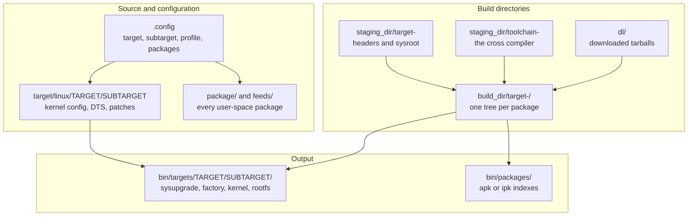

That is the whole mental model: **one target, one subtarget, one profile, a package list, and a reproducible
cross-compile.** Everything else — the `feeds` mechanism, the kernel patches under `target/linux/generic/`, the
device-tree fragments — is detail on top of it.

Why this matters for a wireless engineer: the radio driver is a package (`kmod-mt76-…`, `kmod-ath11k`, `kmod-ath12k`),
mac80211 comes from a backport package (`mac80211` with its own compat layer), hostapd is a package (`wpad-*`), and
the firmware and board-data files are packages (`ath11k-firmware`, `mt76-firmware`, `ipq-wifi`). None of these is
"the firmware"; each is independently versioned, and a wireless bug is very often a version-skew bug between them.

---

## 2. The five boundaries in a wireless system

A router is a stack of responsibilities that only line up if somebody owns each seam. OpenWrt's answer is five
boundaries, and each one has a name you should be able to say:

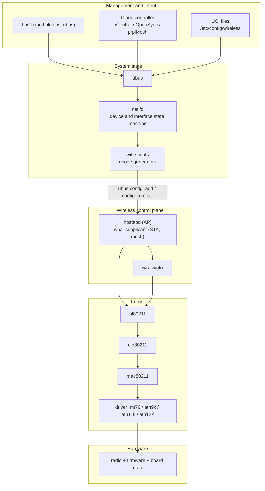

| Boundary | Interface | Which side owns what |
| --- | --- | --- |
| Intent → state | UCI files, rpcd, ubus | UCI says what is wanted; netifd decides what to change to get there |
| State → control plane | ubus objects `hostapd.<iface>`, `wpa_supplicant.<iface>`; config files as a fallback | netifd owns lifecycle; hostapd owns the 802.11 machinery |
| Control plane → kernel | nl80211 over generic netlink | hostapd owns the MLME; cfg80211 owns the regulatory and the wiphy model |
| Kernel → driver | `ieee80211_ops` for SoftMAC, `cfg80211_ops` for FullMAC | mac80211 owns the high MAC; the driver owns the low MAC, the rings and the firmware |
| Driver → hardware | Vendor bus protocol (WMI/HTT, mt76 MCU commands), PCIe/USB/AHB | The driver owns descriptors; the firmware owns timing |

The important structural fact: **hostapd is not a daemon that OpenWrt starts and forgets. It is a long-lived control
plane that netifd mutates through ubus.** That single decision (made in the 2019 development cycle) is what lets
`wifi reload` change one BSS without tearing down the others, and it is why OpenWrt's hostapd is a patched hostapd.

---

## 3. Runtime anatomy — the five daemons that are always there

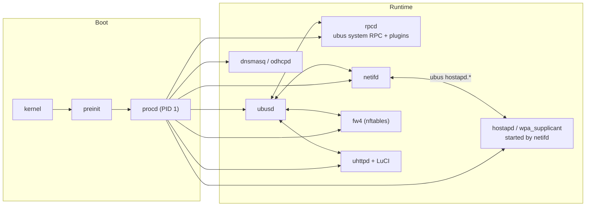

- **procd** is PID 1. It runs the init scripts, supervises services, respawns them, and — critically — is the
  *trigger* mechanism: a config change produces a config-change event, and procd runs the relevant `reload_config`
  or service `reload`. It is deliberately tiny; there is no dependency graph and no unit files.
- **ubusd** is the bus daemon. Every control relationship in the system crosses it: LuCI calls rpcd, rpcd reads and
  writes UCI, netifd subscribes to interface events, fw4 watches `network.interface.*`, hostapd exposes its own
  objects.
- **rpcd** is how a remote or unprivileged caller gets at the system. It has a plugin model — `file`, `uci`,
  `iwinfo`, `session`, `luci`, `rpcd-mod-*` — and an ACL file per service so that LuCI and the cloud agent can be
  given narrow permissions rather than root.
- **netifd** is the state machine. Section 7 is entirely about it.
- **fw4** compiles `/etc/config/firewall` into an nftables ruleset (`table inet fw4`). It does not discover topology;
  it is told about interfaces by netifd over ubus.
- **dnsmasq** (DNS and DHCPv4, plus DHCPv6 in some configurations) and **odhcpd** (DHCPv6, router advertisements, NDP
  relay) are also told about interfaces by netifd.

A worked sequence — what happens when you press *Save & Apply* on a wireless SSID change:

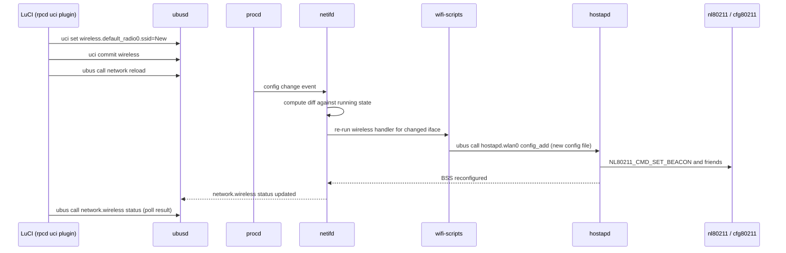

Note what *does not* appear in that diagram: a hostapd restart, a radio reset, or a kernel module reload. That is the
point of the design.

---

## 4. The wireless configuration pipeline — from a text file to a BSS

OpenWrt 25.12's headline here is that the pipeline is **ucode, not shell**. The relevant files, which you can name in
an interview:

| File | Role |
| --- | --- |
| `package/network/config/wifi-scripts/files/sbin/wifi` | The `wifi` command: `up`, `down`, `reload`, `reconf`, `config`, `status` |
| `…/files/lib/netifd/wireless.uc` | netifd's wireless handler: reads UCI, validates, calls the per-driver script |
| `…/files-ucode/lib/netifd/wireless/mac80211.sh` and `…/lib/wifi/mac80211.uc` | The mac80211 driver backend: hostmode, htmode, channel, per-BSS config |
| `…/files/usr/share/hostap/common.uc` and `wdev.uc` | Shared hostapd/wpa_supplicant config generation |
| `…/files/usr/share/hostap/wifi-detect.uc` | Radio detection used by `wifi config` |
| `package/network/services/hostapd/files/hostapd.uc` | The ucode module loaded *inside* hostapd |
| `package/network/services/hostapd/files/wpa_supplicant.uc` | The same for wpa_supplicant |
| `package/network/services/hostapd/files/wpad_acl.json` | The ubus ACL for hostapd's objects |
| `package/network/services/hostapd/patches/601-ucode_support.patch` | The patch that embeds the ucode interpreter into hostapd |

The split of responsibility is worth stating in one sentence each:

1. **UCI** holds intent, per radio and per interface.
2. **netifd** decides which intent changed, and calls the wireless handler for those radios only.
3. **wifi-scripts** turns UCI into a hostapd (or wpa_supplicant) configuration, including all the things a human
   writing `hostapd.conf` by hand gets wrong: the right `interface`/`bridge` pair, the right `ctrl_interface`, the
   right key management for the chosen encryption, the right 802.11r and 802.11v options.
4. **hostapd** consumes the configuration, holds the 802.11 state machines, and drives nl80211.
5. **mac80211 and the driver** do the rest, and are described in [[02-10 WLAN - Baseband and Driver Architecture for Wi-Fi 6, 7 and 8 - Qualcomm as the Reference Design]].

The "one hostapd per phy, running permanently" property comes from the 2019 rework: before it, every configuration
change restarted hostapd and every restart dropped every client on that radio. After it, hostapd is a server that
netifd adds and removes BSSes from:

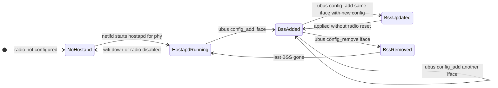

---

## 5. The wireless device model in UCI

Four section types, and knowing which one an option belongs to is half of wireless configuration:

| Section | Granularity | Typical options |
| --- | --- | --- |
| `wifi-device` | One per radio (phy) | `type`, `path`/`phy`, `band` (2g/5g/6g/60g), `channel` (number or `auto`), `htmode` (HT20/HT40/VHT80/VHT160/HE80/…), `txpower`, `country`, `cell_density`, `disabled` |
| `wifi-iface` | One per BSS, station, mesh point or monitor | `device`, `mode` (ap/sta/adhoc/monitor/mesh), `ssid`, `bssid`, `network`, `encryption`, `key`, `hidden`, `isolate`, `ieee80211r`, `ieee80211k`, `ieee80211v`, `ieee80211w`, `ocv`, `mesh_id`, `disabled` |
| `wifi-vlan` | One per VLAN on a BSS | `iface`, `vid`, `network`, `name` |
| `wifi-station` | One per client (match by PSK or MAC) | `iface`, `vid`, `mac`, `key` — PSK-per-client and VLAN assignment, WPA3 SAE supported since 24.10 |

A minimal but realistic two-radio access point:

```
config wifi-device 'radio0'
        option type 'mac80211'
        option path 'platform/ahb/18100000.wmac'
        option band '2g'
        option channel '6'
        option htmode 'HT20'
        option country 'DE'
        option cell_density '0'

config wifi-iface 'default_radio0'
        option device 'radio0'
        option network 'lan'
        option mode 'ap'
        option ssid 'LabNet'
        option encryption 'sae-mixed'
        option key 'a-long-passphrase'
        option ieee80211w '1'

config wifi-device 'radio1'
        option type 'mac80211'
        option path 'pci0000:00/0000:00:00.0'
        option band '5g'
        option channel '36'
        option htmode 'HE80'

config wifi-iface 'default_radio1'
        option device 'radio1'
        option network 'lan'
        option mode 'ap'
        option ssid 'LabNet'
        option encryption 'sae-mixed'
        option key 'a-long-passphrase'

config wifi-station 'guest_sta'
        option iface 'default_radio0'
        option vid '10'
        option mac '12:34:56:78:90:00'
        option key 'guest-specific-psk'

config wifi-vlan 'guest_vlan'
        option iface 'default_radio0'
        option name '10'
        option vid '10'
        option network 'guest'
```

Three things in that example are the source of most real bugs:

1. **`network` is the bridge, not an interface name in the usual sense.** A `wifi-iface` with `option network 'lan'`
   becomes a hostapd configuration with `bridge=br-lan`, and hostapd (not OpenWrt glue) adds the AP interface to that
   bridge. If the bridge does not exist or is not up, the BSS comes up on the air and passes no traffic.
2. **`country` is not cosmetic.** It selects the regulatory domain, which selects the legal channels and transmit
   power. Leaving it unset means the driver's default, which for many devices is a world-domain that disables 5 GHz
   DFS channels and 6 GHz entirely.
3. **A `wifi-station` entry with a per-client PSK silently changes the authentication model.** It is a hostapd
   feature (`wpa_psk_file`-like behaviour) expressed in UCI; if a client's PSK matches no entry and the main `key`
   does not apply, that is an authentication failure, not a configuration failure.

---

## 6. hostapd as the wireless control plane — the ubus surface

OpenWrt's hostapd is upstream hostapd plus an embedded ucode interpreter that publishes ubus objects. The methods
worth knowing, because they are how netifd, LuCI, usteer, DAWN and cloud agents actually manipulate the AP:

| ubus method | What it does | Who calls it |
| --- | --- | --- |
| `config_add` | Dynamically load a BSS configuration from a file, per interface | netifd's mac80211 handler |
| `config_remove` | Remove a BSS configuration | netifd |
| `get_status` | BSS status: SSID, channel, BSSID, … | LuCI, monitoring |
| `get_clients` | Per-station detail: `auth`, `assoc`, `authorized`, `aid`, `signal`, `airtime`, `rate`, `rrm`, `extended_capabilities`, per-client `bytes`/`packets` | LuCI, usteer, DAWN, telemetry |
| `del_client` | Kick a client with an 802.11 reason code, optionally deauthenticate and ban for N ms | steering daemons |
| `bss_mgmt_enable` | Enable 802.11k neighbour reports, beacon reports, link measurements, and 802.11v BSS transition | OpenWrt when `ieee80211k`/`ieee80211v` are set |
| `bss_transition_request` | Send an 802.11v BTM request: candidate list, disassociation imminent, validity period, MBO reason | usteer, DAWN, cloud steering |
| `get_features` | HT/VHT support of the radio | LuCI capability display |

Two consequences follow from that table and they are both interview-grade:

- **Steering in OpenWrt is not in the kernel.** [[02-6 WLAN - Multi-AP Roaming, Healing and Steering]] describes
  BTM and neighbour reports as protocol mechanisms; here is where they are invoked — a user-space daemon
  (`usteer`, or `DAWN` for a distributed variant) calls `bss_transition_request` on the hostapd object for the
  interface the client is currently on. The decision function, the hysteresis, and the ping-pong suppression all
  live in that daemon, not in mac80211.
- **The station table is observable without touching the driver.** `ubus call hostapd.wlan0 get_clients` returns
  airtime, signal and rates per station, which is exactly the input a steering or airtime-fairness policy needs.
  `iw dev wlan0 station dump` gives you the kernel's view; the hostapd object gives you the AP's view, including
  whether the client has actually completed authorization.

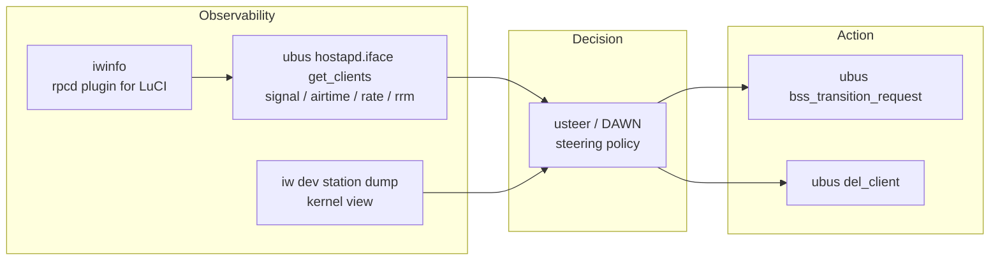

---

## 7. netifd — the state machine everything else trusts

netifd's own `DESIGN` document is short and worth reading once. Its model has exactly three kinds of object.

**Devices** are physical interfaces, virtual links, bridges and VLANs. They are refcounted: `claim_device()` brings
one up, `release_device()` lets it go, and the last release brings it down. Anything that cares about a device
registers a `device_user` and receives events:

| Device event | Meaning |
| --- | --- |
| `DEV_EVENT_ADD` | The device now exists |
| `DEV_EVENT_REMOVE` | It is gone; drop references now |
| `DEV_EVENT_SETUP` | It is about to be brought up — the moment to apply low-level settings |
| `DEV_EVENT_UP` | It is up |
| `DEV_EVENT_TEARDOWN` | It is about to be brought down |
| `DEV_EVENT_DOWN` | It is down |
| `DEV_EVENT_LINK_UP` / `LINK_DOWN` | Carrier appeared or disappeared |

**Interfaces** are the high-level configuration on top of one main device and one layer-3 device. An interface is
`active` when its main device is available, `autostart` when it should be brought up as soon as it becomes active,
and it has one of four states:

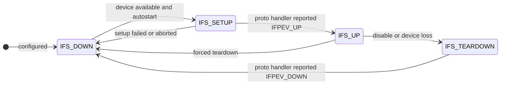

**Protocol handlers** are the modules that actually configure an interface: `static`, `dhcp` (udhcpc), `dhcpv6`
(odhcp6c), `pppoe` (pppd), plus the tunnel and VPN handlers. They must never block; they either complete instantly
and report `IFPEV_UP`, or they schedule work on `uloop` and report later, and they must be able to abandon an
in-flight setup when a teardown arrives with `force`.

Why all this matters for wireless specifically: a **`wifi-iface` is a device to netifd and a BSS to hostapd, and the
two views have to be reconciled**. The reconciliation is the wireless handler:

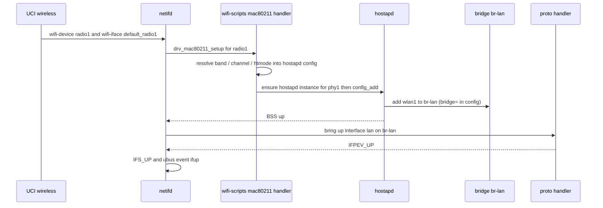

The failure modes of that sequence, in order of how often they happen in practice: the radio never appears (driver or
board data), hostapd rejects the generated config (unsupported option for that driver), the bridge is missing, the
proto handler never converges (no DHCP on the upstream), and the firewall never learned about the new interface.

---

## 8. The lifecycle of a wireless interface

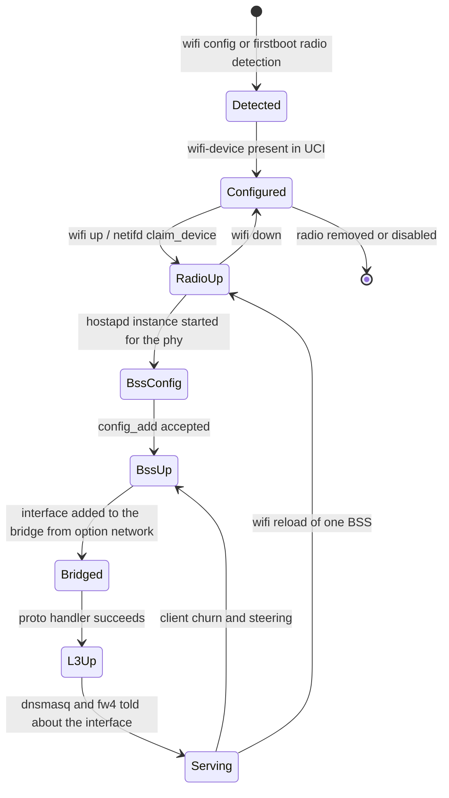

Three commands tell you where you are in that diagram, and an interviewer will expect you to know all three:

| Command | What it reports | Which layer's truth |
| --- | --- | --- |
| `ubus call network.wireless status` | The radio and BSS state netifd believes | netifd |
| `ubus call network.interface dump` | The interface state, addresses, routes, uptime | netifd |
| `iw dev` / `iw dev wlan0 station dump` | The interfaces and stations the kernel actually has | kernel |

The debugging rule that follows: **`ubus` is the source of truth for what the system thinks, `ip`/`iw`/`nft` are the
source of truth for what the kernel has.** When they disagree, the bug is in the glue between them, not in the radio.

---

## 9. Where a packet goes — the data plane of an OpenWrt box

Configuration software is only half of a wireless system; the other half is forwarding. On a typical OpenWrt home
router there are four paths a frame can take, and they have very different costs:

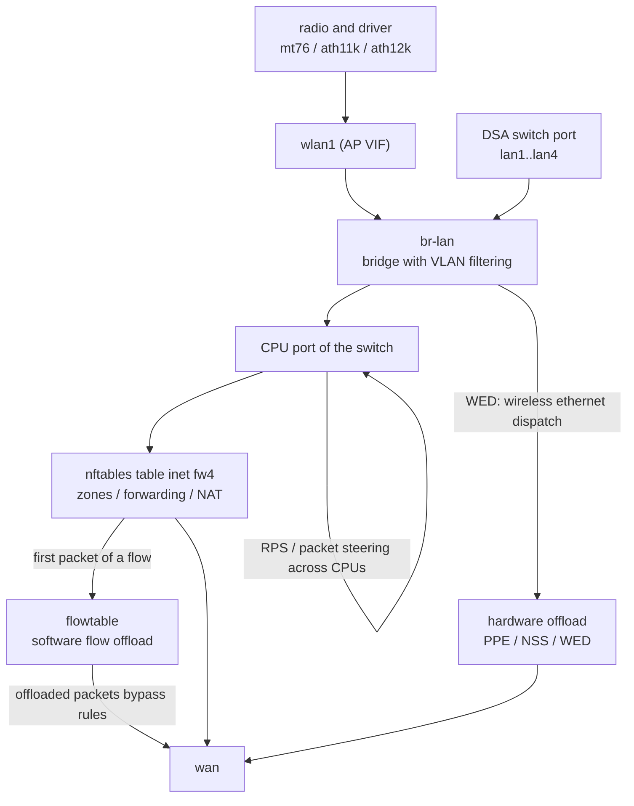

| Path | What it is | What it costs you |
| --- | --- | --- |
| Plain forwarding | Bridge → CPU → nftables → route → out | One CPU traversal per packet, plus the WiFi-to-bridge hand-off |
| **Software flow offload** | The kernel `flowtable`: once a flow's first packet has passed the firewall, subsequent packets are forwarded from an ingress hook directly | Much higher throughput at the same CPU; incompatible with most QoS and with anything that needs per-packet decisions |
| **Hardware flow offload** | The vendor accelerator — MediaTek PPE/WED, Qualcomm NSS/ECM/SFE — takes the flow entirely | Highest throughput; almost no observability, and it bypasses AQL, which changes Wi-Fi latency behaviour. See [[02-10 WLAN - Baseband and Driver Architecture for Wi-Fi 6, 7 and 8 - Qualcomm as the Reference Design]] section 14 |
| **WED** (Wireless Ethernet Dispatch) | The radio's DMA talks to the Ethernet accelerator directly, so wireless frames never traverse the CPU path | Big win on 5 GHz throughput on Filogic; bypasses AQL and therefore the latency fairness mac80211 is trying to enforce |

The knobs, and what they really do:

| Knob | Where | Effect |
| --- | --- | --- |
| `flow_offloading` | `/etc/config/firewall` | Software flowtable |
| `flow_offloading_hw` | `/etc/config/firewall` | Vendor accelerator, only where a driver supports it |
| `packet_steering` | `/etc/config/network` globals | RPS: spread the CPU-side processing of one queue across CPUs |
| `irqbalance` | Package | Move the radio's interrupt to another CPU |
| AQL (`airtime` limits inside mac80211) | Kernel, not UCI | Per-station airtime accounting; offload paths skip it |
| SQM / CAKE | Package | Shaping. Requires software offload at most — hardware offload defeats it |

That last row is the practical rule: **you cannot have hardware flow offload and QoS at the same time.** Which is
also, in a nutshell, why [[02-9 WLAN - Time-Sensitive Networking Across Wi-Fi Generations]] keeps finding that the
last hop of a latency budget is spent in a place the network stack cannot see.

---

## 10. Firmware, board data, MAC addresses and regulatory — the parts that are not source

A wireless device does not come up because a driver probed; it comes up because four non-source artifacts agreed:

| Artifact | What it contains | Where it comes from | What happens if it is wrong |
| --- | --- | --- | --- |
| **Firmware** | The radio's own code, executed by a processor inside the chip | A package: `ath11k-firmware`, `mt76-firmware`, `rtl88xx-firmware`, or a file in the vendor flash partition | The driver probes and then fails with a firmware-load or a QMI/MHI timeout |
| **Board data file** (BDF) | Per-product calibration: power tables per channel and rate, antenna configuration | Qualcomm `board-2.bin` (package `ath11k-firmware` plus `ipq-wifi` for the per-board variant), or a `factory`/EEPROM partition read by mt76 | The radio works but transmits at the wrong power, or fails regulatory, or fails to calibrate |
| **MAC addresses** | One per radio and per VIF | The `factory` partition, extracted at boot by the target's `02_network` script or by a device-specific hotplug script | Everything works but every device on the network has the same MAC |
| **Regulatory database** | Which channels and powers are legal | Kernel `regdb` plus the UCI `country` option, applied by cfg80211 | 5 GHz DFS channels unavailable, 6 GHz unavailable, or illegal transmission |

The pattern to recognise: **the only thing OpenWrt can get from source is the driver. Everything that describes a
specific product — calibration, MACs, and often the firmware itself — has to be extracted from the vendor flash.**
That is the single biggest structural difference between OpenWrt and a vendor SDK, and it explains most of the
"works on device A, not on device B" problems in the community.

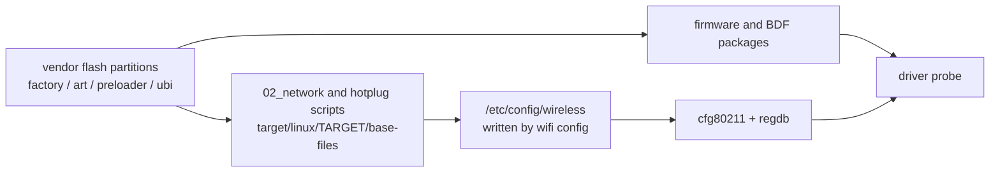

---

## 11. Multi-AP features: what OpenWrt gives you and what it does not

| Feature | Status in OpenWrt | Notes |
| --- | --- | --- |
| Multiple BSS per radio (MBSSID) | Yes — several `wifi-iface` on one `wifi-device` | Limited by the driver's supported interface combinations |
| 802.11r (FT), 802.11k (RRM), 802.11v (BTM) | Yes, per-`wifi-iface` options; 802.11v exposed through `bss_mgmt_enable` and `bss_transition_request` | Needs a daemon to decide *when* to act |
| Client steering | `usteer` (centralised) or `DAWN` (distributed, AP-side decisions shared between APs) | Not automatic; you deploy and tune it |
| 802.11s mesh | Yes (`mode 'mesh'`, `mesh_id`), with `mesh11sd` for managed auto-configuration | Layer-2 mesh; not the same as a Multi-AP backhaul |
| batman-adv | Yes, as a package; B.A.T.M.A.N. advanced is a layer-2 mesh routing protocol often run over 802.11s or over ad-hoc | Good for community mesh; not what an operator means by "mesh Wi-Fi" |
| WDS / 4-address | Yes | Classic repeater link |
| EasyMesh / Multi-AP controller | **Not in a default OpenWrt image.** prplMesh (the prpl reference) or a vendor/operator stack provides it | See [[02-3 WLAN Ecosystem - WFA, EasyMesh and prpl]] and [[02-7 WLAN - Wi-Fi EasyMesh, Operation, Tuning and Troubleshooting]] |
| Cloud management | Not built in; added by TIP OpenWiFi's uCentral agent, OpenSync, or a vendor agent | Section 14 |

The honest summary: **OpenWrt gives you all the per-AP mechanisms and none of the network-level policy.** That is
exactly the gap the neighbouring projects in section 14 exist to fill.

---

## 12. The build and update system in practice

| Tool | Use it when | Cost |
| --- | --- | --- |
| Full source build | You are adding a target, changing the kernel, or building every package | Hours, and a large tree |
| ImageBuilder | You want a custom image with a package set and a few files | Minutes |
| SDK | You are developing one package or one kernel module | Minutes once set up |
| **Attended Sysupgrade (ASU)** | You want to upgrade a running device while keeping its package set | An image built on demand by a server; default since 25.12 |
| Firmware selector | You want a stock image for a specific model | Nothing — it is a web front end over the same machinery |

Two changes in the 25.12 series are worth naming because they are structural, not cosmetic:

1. **apk replaced opkg** as the package manager. The index format, the command names and the way packages are
   installed on a running device all changed.
2. **Attended Sysupgrade is installed by default**, which changes the operational model: instead of flashing a
   generic image and reinstalling packages, a device requests an image built for exactly its package set.

Also structural, and less visible: **the wireless scripts were rewritten in ucode in 25.12**. Shell-string
generation of `hostapd.conf` was a long-standing source of quoting bugs and of injection risk; ucode generation with
a schema is a different failure mode — the config is validated against a schema under
`files-ucode/usr/share/schema/wireless` before anything is written.

---

## 13. The neighbours — how the alternatives are shaped

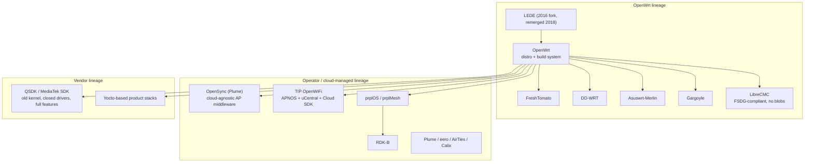

### 13.1 TIP OpenWiFi — the disaggregated operator stack

OpenWiFi is the clearest example of what you build *on top of* OpenWrt when the customer is an operator. Its
architecture is three independently replaceable layers:

| Layer | What it is | Notes |
| --- | --- | --- |
| **Hardware** | Any certified whitebox AP | The whole point: hardware is not the differentiator |
| **APNOS** | OpenWrt plus the **uCentral agent** | The agent keeps a persistent TLS WebSocket to the cloud, renders configuration locally from JSON schemas and ucode — no shell, which removes a whole class of injection bugs. Packages are modular: core (WebSocket, schemas), monitoring (stats, DHCP bindings, DNS activity), policy (QoS, airtime fairness), security (802.1X, RADIUS), RRM (steering, BSS transitions) |
| **Cloud SDK** | Provider-agnostic microservices: `OWGW` terminates the WebSockets, telemetry goes onto a Kafka bus, `OWANALYTICS` consumes it, storage is SQLite or PostgreSQL | Open northbound APIs so analytics, SASE and security services integrate once and work on any certified hardware |

Two details worth remembering because they show how far an operator stack has to go beyond a home router:

- **Device identity.** OpenWiFi moved to a PKI with two certificates: a **birth certificate** provisioned at
  manufacture with ten-year validity that anchors hardware identity, and an **operational certificate** obtained after
  deployment via **EST (Enrollment over Secure Transport, RFC 7030)** with five-year validity, renewing at two-thirds
  of its lifetime. EST was chosen over ACME deliberately: ACME's challenge requires an open inbound port, which is
  unacceptable on a field-deployed AP; EST is initiated outbound.
- **The move away from OpenSync.** Early OpenWiFi used OpenSync as its cloud interface; the project moved to
  uCentral, described at the time as lighter and cheaper to deploy on lower-cost hardware.

### 13.2 OpenSync

OpenSync is cloud-agnostic AP middleware that grew out of Plume: a manager layer on the AP exposing a northbound
data model, with plugin "managers" per function, designed so that one cloud can manage hardware from many vendors.
It is the *residential* counterpart to OpenWiFi's enterprise focus, and it is the reason the phrase "OpenWrt plus
OpenSync" exists: OpenSync supplies the cloud-facing data model that OpenWrt deliberately does not have.

### 13.3 prplOS, prplMesh and RDK-B

Covered in [[02-3 WLAN Ecosystem - WFA, EasyMesh and prpl]]: prpl's reference implementation of the Multi-AP
specification, and RDK-B as the cable operators' broadband stack. Position them as *the operator's answer to the same
question OpenWrt answers for the hobbyist*: who owns the device's configuration model.

### 13.4 The hobbyist forks

| Project | Shape | Where it differs |
| --- | --- | --- |
| **DD-WRT** | Historic Broadcom-rooted firmware, now broad device support | Closed-source userland components; a different configuration model; kernel often older than OpenWrt's |
| **FreshTomato** | Continuation of Tomato, focused on Broadcom and a few others | Tightly integrated UI, strong per-device tuning, narrow hardware support |
| **Asuswrt-Merlin** | Asus's stock firmware with an enhanced userland | Deliberately close to stock, so the vendor's closed wireless components keep working |
| **Gargoyle** | OpenWrt plus a different web interface and quota/bandwidth tooling | Same substrate, different intent |
| **LibreCMC** | A distribution committed to the Free System Distribution Guidelines | No non-free firmware blobs, which means **no mainstream Wi-Fi radio** — a useful illustration of what the blob dependency in section 10 actually costs |

### 13.5 Vendor SDKs

A vendor SDK (Qualcomm's QSDK, MediaTek's SDK) is the same kernel with different trade-offs: usually an older LTS
kernel, closed-source wireless components, and *complete* feature support including the things OpenWrt's mainline
drivers reach later or incompletely — MLO, 6 GHz AFC, vendor-specific offload, full calibration tooling. The
trade-off is exactly the one section 10 describes in reverse: the vendor SDK owns the calibration and the feature
set; OpenWrt owns the release cadence and the auditability.

| Dimension | OpenWrt | Vendor SDK | TIP OpenWiFi / APNOS | Cloud-managed (Plume, eero) |
| --- | --- | --- | --- | --- |
| Kernel | Recent mainline LTS with backports | Older LTS, vendor patches | OpenWrt's | Unknown to the operator |
| Radio feature completeness | Lags for the newest generation | Complete for that silicon | Depends on the OpenWrt driver underneath | Complete, and closed |
| Configuration model | UCI plus ubus, fully local | Vendor schema | uCentral schemas, cloud-rendered | Cloud only |
| Observability | Everything, locally | Vendor CLI | Full telemetry to the cloud | Vendor analytics |
| Multi-AP policy | None by default | Vendor controller | Cloud SDK plus RRM packages | Proprietary, and usually the product's actual value |
| Cost and lock-in | None | Licence plus NDA | None, but you operate the cloud | Subscription |

---

## 14. OpenWrt One — the reference hardware

The project's own router is the clearest statement of what the project considers a good target:

| Component | OpenWrt One |
| --- | --- |
| SoC | MediaTek MT7981BA (Filogic 820), dual Cortex-A53 at 1.3 GHz |
| Wireless | MediaTek MT7976CN, dual-band Wi-Fi 6, 3×3 on 5 GHz and 2×2 on 2.4 GHz |
| Memory | 1 GB DDR4 |
| Storage | 256 MiB NAND, plus 16 MiB NOR used for recovery |
| Ethernet | 1× 2.5 GbE (WAN, with 802.3af/at PoE in) and 1× 1 GbE (LAN) |
| Expansion | M.2 2242/2230 socket for NVMe (PCIe gen 2 ×1), USB 2.0, mikroBUS header, USB-C serial console, JTAG |
| Price and date | US$89, launched 29 November 2024 |

Three design decisions in that table are the argument:

- **Dual boot with a NOR recovery path.** The NAND/NOR switch and the recovery firmware make it effectively
  unbrickable, which is the property that makes a router safe to develop on.
- **An open driver.** It is an mt76 device, so the wireless stack is mainline: no closed wireless component, and
  features such as AX mode, WPA2/WPA3, 80/160 MHz on 5 GHz and TWT are ordinary kernel and hostapd features.
- **Offload is opt-in.** The documentation recommends packet steering (RPS 128 is typically enough), and offers
  hardware flow offload for the 2.5 GbE port and WED for 5 GHz — while warning that WED bypasses AQL. In other
  words: the project exposes the throughput-versus-latency trade rather than hiding it.

---

## 15. What OpenWrt does not do well

Six honest limitations, because an interviewer who has run a network will ask:

1. **The newest generation arrives last.** Wi-Fi 7 on OpenWrt exists — mt76's `mt7996`/`mt7992`/`mt7990` support EHT
   and MLO, and `ath12k` covers Qualcomm parts — but it is newer, less tested, and more dependent on matching
   firmware than Wi-Fi 6. Treat MLO and 6 GHz AP operation as moving targets; check the current release notes before
   promising them. **VERIFY: the exact MLO and 6 GHz status on the release you deploy.**
2. **No network-level wireless policy.** Steering, mesh healing, channel planning and client analytics are packages
   you deploy and tune, not built-in behaviour.
3. **Calibration and regulatory are inherited, not owned.** If the vendor's board data is poor, OpenWrt cannot fix it.
4. **Offload and observability are in tension.** Turn on hardware offload and the CPU stops seeing the packets;
   `tcpdump` on the wireless interface stops telling the truth about what was forwarded.
5. **No secure boot or measured boot on most targets.** The bootloader is usually an unlocked U-Boot, which is a
   feature for development and a liability for deployment.
6. **Release-branch skew between the four artifacts.** Kernel, `mac80211` backport, driver package and firmware
   package are versioned independently; a wireless regression is often a skew between them, not a bug in any one.

---

## 16. How to localise a fault in this stack

| Symptom | Where to look first | Command |
| --- | --- | --- |
| No wireless interface at all | Driver, firmware, board data | `logread` for firmware load errors, `iw phy`, `dmesg` |
| Interface exists but no SSID on the air | UCI and hostapd | `ubus call network.wireless status`, `logread` for hostapd, `cat /var/run/hostapd-phy1.conf` |
| SSID visible but association fails | hostapd, keys, PMF, PSK matching | `logread | grep hostapd`, check `wifi-station` entries |
| Associated but no DHCP | Bridge or dnsmasq | `bridge vlan show`, `ubus call network.interface dump`, `logread | grep dnsmasq` |
| DHCP works, no internet | Firewall zones or the upstream | `nft list ruleset`, `ubus call network.interface.wan status` |
| Slow but stable | Rate, airtime, interference | `iw dev wlan0 station dump`, `ubus call hostapd.wlan0 get_clients` (airtime and signal) |
| Fast but laggy | Offload versus AQL, bufferbloat | Turn off `flow_offloading_hw`, enable SQM, retest |
| Clients sticky to a bad AP | Steering not deployed or mis-tuned | `usteer` status, `ubus call hostapd.wlan0 bss_transition_request` by hand |
| Works after reboot, breaks after reload | The diff path in netifd or hostapd | `wifi down && wifi up` instead of `wifi reload`, then compare |
| One radio works, the other does not | Board data, MAC, or the `path` in UCI | Compare `wifi-device` `path` values against `/sys/class/ieee80211/*/device` |

The method behind that table is the same one used in [[02-7 WLAN - Wi-Fi EasyMesh, Operation, Tuning and Troubleshooting]]: **walk the boundaries in order, and at each boundary ask which of the two sides is telling you the truth.** Config → ubus → hostapd → nl80211 → driver → air.

---

## 17. Ten answers worth having on the tip of your tongue

1. **"What is OpenWrt?"** A Linux distribution for network devices plus a cross-build system that produces it. Not a
   firmware, and not a single product.
2. **"How does `/etc/config/wireless` become an SSID on the air?"** UCI → netifd's wireless handler → wifi-scripts
   generating a hostapd configuration → `hostapd.<iface> config_add` over ubus → hostapd → nl80211 → mac80211 →
   driver. No daemon restarts.
3. **"Who owns the wireless state?"** netifd owns lifecycle and configuration; hostapd owns the 802.11 state
   machines and the station table; mac80211 owns the high MAC; the driver and its firmware own the low MAC.
4. **"Why is OpenWrt's hostapd patched?"** So that it exposes ubus objects and embeds a ucode interpreter, which
   lets netifd add, remove and modify BSSes at runtime instead of restarting the daemon and dropping every client.
5. **"What are `wifi-device` and `wifi-iface`?"** Radio and BSS. Anything channel-related is per radio; anything
   SSID-, key- or mode-related is per interface.
6. **"Where does steering happen?"** In user space. A daemon reads `hostapd get_clients` and calls
   `bss_transition_request` or `del_client`. The kernel is not involved in the decision.
7. **"What is DSA and why did it matter?"** The kernel's switch model — front-panel ports plus a CPU port, VLANs
   configured with `bridge vlan`. It replaced per-target `swconfig` and made switch configuration the same on every
   target.
8. **"Why is my throughput low?"** Often because the CPU is doing per-packet work: enable packet steering, check
   whether software or hardware flow offload applies on your target, and remember that offload and QoS fight.
9. **"Why does Wi-Fi 7 behave oddly on OpenWrt?"** Because the newest generation's driver, firmware and hostapd
   support arrive on independent schedules, and MLO and 6 GHz are the least settled parts.
10. **"How is TIP OpenWiFi different from OpenWrt?"** It is OpenWrt plus a uCentral agent (APNOS) plus a cloud SDK,
    with a device PKI: hardware, AP software and management are three independently replaceable layers.

---

## Anchors — verified facts

- **OpenWrt releases**: the current stable series is **25.12**, first released **5–6 March 2026**, with **25.12.6**
  released **18 October 2026** on Linux kernel **6.12.112**. The old stable series **24.10** (first released
  **6 February 2025**) reached **24.10.8** on **26 July 2026** at kernel **6.6.144** and reaches end of life in
  **September 2026**. Stable series are branched from `main` roughly once a year; only the latest minor release of a
  series is supported.
- **25.12 highlights** stated by the project: **apk replaced opkg** as the package manager, **Attended Sysupgrade**
  is enabled by default, and **the Wi-Fi handling scripts were rewritten in ucode**.
- **24.10 highlights** stated by the project: improved Wi-Fi 6 (802.11ax) support and **initial Wi-Fi 7 (802.11be)
  support**, TLS 1.3 in default images, and the ipq806x target converted to DSA.
- **netifd's model** (from the project's own `DESIGN` file): devices are refcounted through `claim_device()` and
  `release_device()` and announce `DEV_EVENT_ADD`, `REMOVE`, `SETUP`, `UP`, `TEARDOWN`, `DOWN`, plus the optional
  `LINK_UP` and `LINK_DOWN`. Interfaces carry `active`, `autostart` and a state of `IFS_SETUP`, `IFS_UP`,
  `IFS_TEARDOWN` or `IFS_DOWN`. Protocol handlers must not block; they signal with `IFPEV_UP` and `IFPEV_DOWN` and
  must abort an in-flight setup when a forced teardown arrives.
- **hostapd ubus methods** documented by OpenWrt: `config_add`, `config_remove`, `get_status`, `get_clients`,
  `del_client`, `bss_mgmt_enable`, `bss_transition_request`, `get_features`. `get_clients` returns per-station
  `auth`, `assoc`, `authorized`, `aid`, `signal`, `airtime`, `rate`, `rrm` and `extended_capabilities`.
- **The 2019 wireless rework**: hostapd and wpa_supplicant run permanently and expose a ubus interface so that
  netifd and its scripts add, remove and modify wireless interfaces at runtime; `wifi reconf` applies changes
  without restarting hostapd or affecting unmodified networks.
- **UCI wireless sections**: `wifi-device` (radio), `wifi-iface` (BSS or station), `wifi-vlan` (`iface`, `vid`,
  `network`, `name`), and `wifi-station` (`iface`, `vid`, `mac`, `key`) with **WPA3 SAE support for `wifi-station`
  since 24.10**.
- **OpenWrt One**: MediaTek **MT7981BA** (Filogic 820), dual Cortex-A53 at 1.3 GHz; **MT7976CN** dual-band Wi-Fi 6
  at 3×3 on 5 GHz and 2×2 on 2.4 GHz; **1 GB DDR4**; **256 MiB NAND** plus **16 MiB NOR** for recovery; 1× 2.5 GbE
  WAN with 802.3af/at PoE and 1× 1 GbE LAN; M.2 2242/2230 NVMe on PCIe gen 2 ×1; USB-C serial console; JTAG;
  **US$89**, launched **29 November 2024**.
- **TIP OpenWiFi**: a three-layer disaggregated architecture — certified whitebox hardware, **APNOS** (OpenWrt plus
  the **uCentral** agent, with configuration rendered locally from JSON schemas and ucode), and the **Cloud SDK**
  (`OWGW` gateway, Kafka telemetry bus, `OWANALYTICS`, SQLite or PostgreSQL). Its PKI 2.0 uses a factory-installed
  **birth certificate with 10-year validity** and an **operational certificate with 5-year validity** obtained
  through **EST (RFC 7030)**, chosen over ACME because ACME's challenge needs an open inbound port. The project
  moved from **OpenSync** to **uCentral** for cloud interfacing.
- **OpenWrt's wireless packages are independent**: kernel, `mac80211` backport, driver (`kmod-mt76-*`,
  `kmod-ath11k`, `kmod-ath12k`), `hostapd`/`wpad`, and firmware plus board-data packages
  (`ath11k-firmware`, `ipq-wifi`, `mt76-firmware`) are versioned separately.
- **VERIFY**: the precise status of MLO, 6 GHz AP operation and EHT on the OpenWrt release and the driver you
  deploy — this is the fastest-moving part of the stack, and community reports of regressions on 6 GHz AP mode
  should be checked against current release notes before being relied on.

---

## Related

- [[02-3 WLAN Ecosystem - WFA, EasyMesh and prpl]] — the ecosystem half of this story: certification, the Multi-AP
  specification, prplMesh and prplOS as the operator's answer to the same configuration question
- [[02-7 WLAN - Wi-Fi EasyMesh, Operation, Tuning and Troubleshooting]] — the multi-AP control plane that OpenWrt
  does not provide by default, and what a controller can observe
- [[02-6 WLAN - Multi-AP Roaming, Healing and Steering]] — the protocol mechanisms that section 6's ubus methods
  (`bss_transition_request`, `bss_mgmt_enable`) actually invoke
- [[02-5 WLAN - STA-AP Discovery, Authentication and Association]] — the 802.11 state machines hostapd owns on
  OpenWrt's behalf
- [[02-10 WLAN - Baseband and Driver Architecture for Wi-Fi 6, 7 and 8 - Qualcomm as the Reference Design]] — the
  other side of the nl80211 boundary: what the driver and its firmware do with what hostapd asks for
- [[02-4 WLAN - Packet TX-RX Datapath and Offload Evolution]] — the packet path in full, including the offload planes
  that section 9 of this note can only switch on or off
- [[02-8 WLAN - Scheduling - Channel Access, EDCA, OFDMA Resource Allocation, Airtime and Implementation]] — why
  bypassing AQL with WED changes the fairness behaviour of the box
- [[02-9 WLAN - Time-Sensitive Networking Across Wi-Fi Generations]] — the requirement that makes the
  hardware-offload-versus-observability trade in section 9 a real engineering decision rather than a benchmark
- [[02-1 WLAN - Wi-Fi Generations Evolution]] — which generation introduced each feature whose support status in
  section 15 is uneven
- [[02-2 WLAN - Power Saving Mechanisms and Evolution]] — TWT on an OpenWrt AP, and what has to be configured for it
- [[04-2 Linux Embedded Development - Drivers, Applications and Core Subsystems]] — the embedded-Linux substrate:
  boot chain, flash partitions and the device tree that section 10's board data depends on
- [[04-3 Embedded Software Architecture - Patterns, Layering and Wireless System Structure]] — the layering argument
  this note instantiates: intent, state, control plane, kernel, hardware
- [[04-6 Linux Device Drivers - Model, Probe, Data Path, Power and Bring-Up]] — what the driver under mac80211 is
  doing, and how a probe with missing firmware fails
- [[04-5 Linux Concurrency - Kernel and User Mode, Processes, Threads and IPC]] — the IPC model behind ubus and
  netlink, and why an event loop that must not block is the right shape for netifd's protocol handlers
- [[02-12 WLAN - openwifi - An Open-Source FPGA 802.11 Platform]] — the other end of the openness spectrum: when
  even the low MAC is yours to rewrite
- [[08-1 Programming Languages Toolchain and Performance Engineering]] — profiling a forwarding path whose cost is
  per-packet on the CPU side and invisible on the offload side

- [[02-13 WLAN - Reliability, Low Latency and Determinism - What the Wi-Fi Stack Can Actually Do]] — the box the latency mechanisms are configured on: qdiscs, AQL, airtime fairness, the flow offload trade-off, and hostapd's steering surface

- [[10-1 Value-Driven Business Model - Methodology, Process, Tools and Best Practice]] — open source plus a commercial layer in practice: what is not source, and how a project's neighbours fund themselves
---

## References

1. OpenWrt Project. *Welcome to the OpenWrt Project* — wiki front page. <https://openwrt.org/> — Current stable series 25.12 with 25.12.6 of 18 October 2026 on kernel 6.12.112; old stable 24.10.8 of 26 July 2026 on kernel 6.6.144; the OpenWrt One announcement of 29 November 2024 and its specification.
2. OpenWrt Project. *OpenWrt version history*. <https://openwrt.org/about/history> — Per-series kernels and dates, and the 25.12 highlights: apk replacing opkg, attended sysupgrade by default, Wi-Fi scripts rewritten in ucode.
3. OpenWrt Project. *OpenWrt 25.12 release pages*. <https://openwrt.org/releases/25.12/start> — Release and service-release list for the current stable series.
4. OpenWrt Project. *Security — support status*. <https://openwrt.org/docs/guide-developer/security> — Supported, security-maintenance and end-of-life dates per series.
5. OpenWrt Project. *OpenWrt One*. <https://openwrt.org/toh/openwrt/one> — MT7981BA, MT7976CN, 1 GB DDR4, 256 MiB NAND plus 16 MiB NOR, 2.5 GbE with PoE and 1 GbE, M.2 NVMe, packet steering, hardware flow offload and WED guidance.
6. OpenWrt Project. *netifd DESIGN*. <https://git.openwrt.org/?p=project/netifd.git;a=blob;f=DESIGN;hb=HEAD> — Devices, `device_user`, the device event list, interfaces and their four states, and the protocol-handler contract including `IFPEV_UP`/`IFPEV_DOWN`.
7. Golle, D., Crispin, J., Wich, J.-P. *"How to trigger wifi reload from wifi.lua"* — openwrt-devel, October 2019. <https://lists.openwrt.org/pipermail/openwrt-devel/2019-October/025251.html> — The change that made hostapd and wpa_supplicant permanent ubus servers so netifd can add, remove and modify interfaces.
8. OpenWrt Project. *hostapd package README: UBUS methods*. <https://github.com/openwrt/openwrt/tree/master/package/network/services/hostapd> — `bss_mgmt_enable`, `bss_transition_request`, `config_add`, `config_remove`, `del_client`, `get_clients`, `get_features` and `get_status`, with argument tables and worked `ubus call` examples.
9. OpenWrt Project. *uci_wireless.txt*. <https://git.openwrt.org/?p=web.git;a=blob;f=docs/uci_wireless.txt;hb=HEAD> — The `wifi-device` and `wifi-iface` option reference.
10. OpenWrt Project. *Start/Stop wireless — basic Wi-Fi configuration*. <https://openwrt.org/docs/guide-user/network/wifi/basic> — `wifi` command semantics, the `wifi-station` section (PSK or MAC match, VLAN ID, SAE since 24.10) and the `wifi-vlan` section.
11. *OpenWrt wireless subsystem* — DeepWiki generated documentation of the source tree. <https://deepwiki.com/openwrt/openwrt/5.2-wireless-subsystem> — The file inventory behind section 4: `wifi-scripts`, `wireless.uc`, `mac80211.sh`, `hostapd.uc`, `wpa_supplicant.uc`, `wpad_acl.json`, `601-ucode_support.patch`, and the wireless schema.
12. *Wireless management: mac80211, hostapd and wifi-scripts* — DeepWiki generated documentation. <https://deepwiki.com/ansuel/openwrt/5.2-wireless-management:-mac80211-hostapd-and-wifi-scripts> — The ucode-based configuration pipeline and the mt76 driver package structure.
13. *Network configuration in OpenWrt* — community architecture write-up. <https://ducndc.github.io/blog/network-openwrt-configuration> — The config-to-kernel mental model and the who-does-what table used in sections 3 and 9.
14. PLVision. *"How OpenWiFi Works: Architecture, Trust Infrastructure, and the Wired Layer."* <https://plvision.eu/blog/networking/how-openwifi-works> — The three-layer disaggregation, APNOS and uCentral, the modular package split, the Cloud SDK with OWGW and Kafka, and the PKI 2.0 birth/operational certificate model with EST.
15. Light Reading. *"TIP, CableLabs advance on 'OpenWiFi'"*. <https://www.lightreading.com/broadband/tip-cablelabs-advance-on-openwifi> — OpenWiFi's OpenWrt origin, the move from OpenSync to uCentral, deployment scale, and CableLabs validation of the 2.9 release.
16. Wi-Fi NOW. *"Telecom Infra Project launches grand new vision for open-source Wi-Fi architecture"*. <https://staging.wifinowglobal.com/news-and-blog/tip-launches-grand-new-vision-for-open-source-wi-fi-architecture-everywhere> — The original full-stack disaggregation announcement with Plume's OpenSync as the AP-to-cloud middleware.
17. Tanaza. *Open WiFi System for Communication Service Providers*. <https://www.tanaza.com/blog/open-wi-fi-system/> — The OpenSync model: a cloud-agnostic data model on the AP so any controller can manage any whitebox AP.
18. *MT76 device architecture* — DeepWiki generated documentation. <https://deepwiki.com/openwrt/mt76/9.1-device-architecture> — MT7996/7992/7990 variants, band counts, MLD index masks, WTBL size and the per-band OMAC and VIF limits behind the Wi-Fi 7 discussion in section 15.
19. OpenWrt Forum. *"BPI-R4 WiFi 7 Manager — LuCI app for MT7996 / MT7988A"*. <https://forum.openwrt.org/t/bpi-r4-wifi-7-manager-luci-app-for-mt7996-mt7988a/250060/3> — Runtime evidence for MLO on mt76: `hostapd_cli` reporting `ieee80211be=1`, `num_links=3`, `ap_mld_type=STR`, and the beacon Multi-Link element with EMLSR supported and EMLMR not.
20. OpenWrt Project. *Attended Sysupgrade (ASU)*. <https://openwrt.org/docs/guide-user/installation/attended.sysupgrade> — The on-demand image build that keeps a device's package set across an upgrade, enabled by default in 25.12.
21. OpenWrt Project. *DSA — Distributed Switch Architecture*. <https://openwrt.org/docs/guide-user/network/dsa/start> — The switch model that replaced `swconfig`, and how VLAN filtering is configured on `br-lan`.
22. OpenWrt Project. *Firewall configuration*. <https://openwrt.org/docs/guide-user/firewall/firewall_configuration> — The UCI firewall options behind section 9, including `flow_offloading` and `flow_offloading_hw`, and why hardware offload and QoS cannot be used together.

---

Copyright (c) 2026 Washington Ruan. All rights reserved.
