# WLAN — openwifi: An Open-Source FPGA 802.11 Platform

> Part of the [[00 MOC - Comms x Compute x AI Knowledge Graph|Comms × Compute × AI knowledge graph]] · group **02 · WLAN**

There is a name collision to clear up before anything else, because it costs people credibility in interviews:

- **openwifi** (lower case, one word, `github.com/open-sdr/openwifi`) is an **open-source IEEE 802.11 SDR
  implementation**: an FPGA baseband and low MAC plus a Linux driver, running on a Xilinx Zynq SoC with an Analog
  Devices transceiver. It is the subject of this note.
- **OpenWiFi** (TIP) is a **cloud-managed AP software architecture** built on OpenWrt, described in
  [[02-11 WLAN - OpenWrt and the Software Architecture of a Wireless System]].

They are unrelated projects that happen to share a name. Say which one you mean.

Every note so far has treated the radio as something you configure. [[02-10 WLAN - Baseband and Driver Architecture for Wi-Fi 6, 7 and 8 - Qualcomm as the Reference Design]] opened the chip and showed that the low MAC is firmware you
cannot read; [[02-11 WLAN - OpenWrt and the Software Architecture of a Wireless System]] showed that above the driver
everything is software you can change. Between those two there is a wall: **you can rewrite hostapd, you can rewrite
the driver, but you cannot change what happens in the 10 microseconds between the end of a frame and the start of its
acknowledgement.** openwifi is a project built to knock that wall down.

The one sentence to carry into an interview: **openwifi is a full 802.11a/g/n stack in which the PHY and the timing-critical low MAC are Verilog you can edit, the high MAC is Linux mac80211, and the whole thing interoperates with commercial Wi-Fi devices over the air.**

---

## 0. Vocabulary — say these precisely or the whole answer collapses

| Term | What it actually is |
| --- | --- |
| **openwifi** | The complete design: FPGA bitstream (in `openwifi-hw`), Linux driver (in `openwifi/driver`), and user-space tools (`sdrctl`) |
| **openwifi-hw** | The repository with the FPGA design: IP cores, board projects and the Vivado scripts |
| **openwifi-hw-img** | Pre-built FPGA images per board: `.xsa`, `.bit`, optional ILA `.ltx` and initialisation files |
| **xpu** | The FPGA IP core that is the **low MAC**: CSMA/CA, CCA, backoff, TSF, filtering, queues and time slicing |
| **tx_intf / rx_intf** | The FPGA interfaces between the AXI DMA and the baseband, plus the DAC/ADC side |
| **openofdm_tx / openofdm_rx** | The OFDM modulator and demodulator. The receiver derives from the `openofdm` project (dot11zynq branch) |
| **side_ch** | The FPGA side channel that streams CSI, equalizer taps, frequency offset, RSSI and raw IQ to the host |
| **sdrctl** | The user-space tool that reads and writes openwifi-specific registers, implemented as an **nl80211 testmode** command |
| **sdr0** | The network interface the driver registers |
| **Low MAC** | The parts of 802.11 that must meet microsecond deadlines: CCA, backoff, SIFS, ACK, retransmission |
| **High MAC** | Everything else: scanning, authentication, association, aggregation, rate control, key management |
| **AD9361 / FMCOMMS2** | The Analog Devices RF transceiver and its evaluation module used by most openwifi boards |

---

## 1. Why openwifi exists — the four things you cannot do with a commercial chip

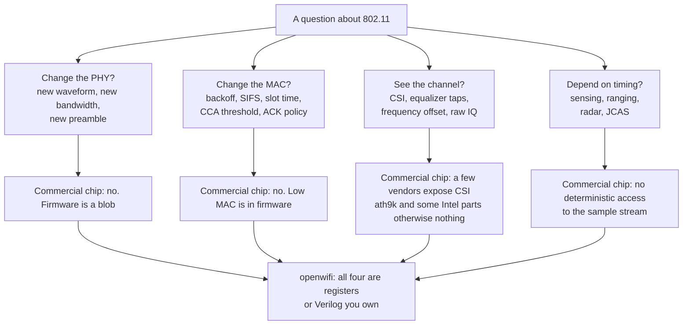

Put concretely, the four capabilities that a research platform has to provide and a Wi-Fi chip does not:

1. **Modify the PHY.** Change bandwidth (2 MHz for 802.11ah-class sub-GHz work, 10 MHz for 802.11p at 5.9 GHz),
   change the sample rate, insert your own signal processing into the transmit or receive chain.
2. **Modify the channel access rules.** Set the CCA threshold, the receiver sensitivity, the slot time, SIFS, DIFS,
   the contention window bounds, the RTS/CTS and CTS-to-self behaviour — all at run time, per packet or globally.
3. **Observe the channel.** Channel state information, the equalizer's taps, frequency offset and raw IQ samples,
   each tagged with the TSF timestamp of the frame it belongs to.
4. **Transmit arbitrary frames.** Packet injection and fuzzing, including malformed frames that a commercial MAC
   would refuse to emit.

And one constraint that makes openwifi a *system* rather than a demodulator: it must still **interoperate**. A
GNU Radio OFDM receiver that decodes frames is useful; an AP that a stock phone associates with, authenticates and
passes iperf traffic through is a different instrument.

---

## 2. The hardware platform

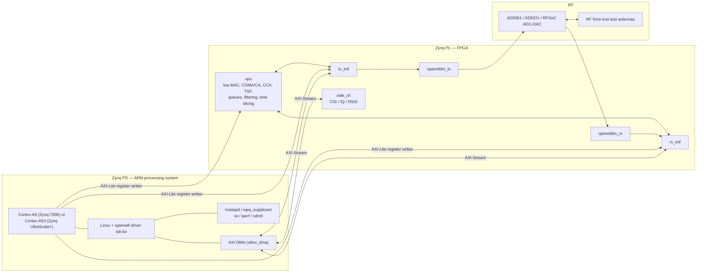

The design sits on top of the **Analog Devices HDL reference design** (openwifi documents 2021_r1 as its base) and
adds the openwifi IP hierarchy to it. That is why the porting guide reads the way it does: to move to a new board you
open the ADI reference design and the openwifi design side by side, look at the block diagram and the address editor,
and copy the addresses and interrupts into the board's device tree.

Boards, and the practical detail that decides which one you buy — whether a **Vivado licence** is required:

| `BOARD_NAME` | Platform | Vivado licence needed |
| --- | --- | --- |
| `zed_fmcs2` | ZedBoard + FMCOMMS2/3/4 | No |
| `zc702_fmcs2` | ZC702 + FMCOMMS2/3/4 | No |
| `zc706_fmcs2` | ZC706 + FMCOMMS2/3/4 | Yes |
| `adrv9364z7020` | ADRV9364-Z7020 + ADRV1CRR-BOB | No |
| `adrv9361z7035` | ADRV9361-Z7035 + ADRV1CRR-BOB/FMC | Yes |
| `zcu102_fmcs2` | ZCU102 (UltraScale+) + FMCOMMS2/3/4 | Yes |
| `rfsoc4x2` | RFSoC4x2 (RFSoC with integrated converters) | Yes |
| `antsdr`, `antsdr_e200`, `e310v2` | MicroPhase enhanced ADALM-PLUTO class boards | No |
| `sdrpi` | HexSDR SDR in Raspberry Pi form factor | No |
| `neptunesdr`, `LibreSDR` | Low-cost Zynq-7020 + AD9361 boards (unofficial ports) | No |

Frequency and bandwidth: **70 MHz to 6 GHz**, **20 MHz** channelisation by default, with the project documenting
2 MHz and 10 MHz variants for sub-GHz and vehicular work. Build environment: **Vivado 2022.2 with Vitis**, plus an
evaluation licence for the Xilinx Viterbi Decoder IP, on Ubuntu 18/20/22 LTS.

One baseband parameter that turns up constantly in porting: the **baseband clock**, set by `NUM_CLK_PER_US` at the
top of `openwifi.tcl`. The default is **100 MHz**; the options are 240 MHz or 100 MHz for ZCU102, 100 MHz or 200 MHz
for ZC706 and ADRV9361-Z7035, and 100 MHz elsewhere. Every timing field in the low-MAC registers is expressed in
units tied to that clock.

---

## 3. The three repositories and how a build goes together

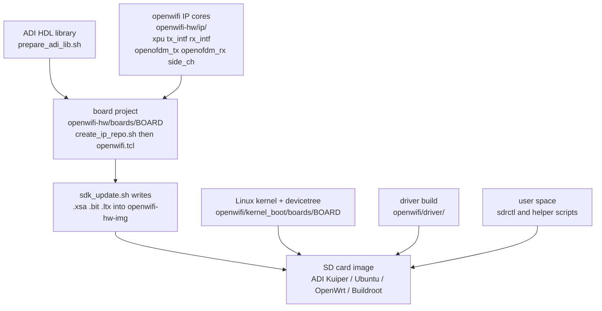

The four build steps worth being able to name, because they are where a port actually fails:

1. `./prepare_adi_lib.sh $XILINX_DIR` — bring in the Analog Devices HDL library (once).
2. `./prepare_adi_board_ip.sh $XILINX_DIR $BOARD_NAME` — build the board-specific ADI IP (once per board).
3. `./get_ip_openofdm_rx.sh` then `../create_ip_repo.sh $XILINX_DIR` in the board directory — generate the IP
   repository for the top-level project.
4. `source ../openwifi.tcl` in Vivado, generate the bitstream, export hardware including the bitstream, then
   `./sdk_update.sh $BOARD_NAME $OPENWIFI_HW_IMG_DIR`.

On the software side the project supports several images: an Analog Devices Kuiper (Ubuntu) image, a **Buildroot**
image (`buildroot-build.sh` and `buildroot-external`), and an **OpenWrt** image (the repository carries an `openwrt`
directory). The user brings up the interface with `./wgd.sh` — and `./wgd.sh 1` to enable the experimental A-MPDU
aggregation path.

---

## 4. What is in the FPGA

Six IP cores, each a separate Vivado project you can open, simulate and modify with
`../create_vivado_proj.sh $XILINX_DIR ip_name.tcl`:

| IP core | What it contains (source file names) | Role |
| --- | --- | --- |
| **xpu** | `csma_ca.v`, `cw_exp.v`, `cca.v`, `tsf_timer.v`, `tx_control.v`, `pkt_filter_ctl.v`, `time_slice_gen.v`, `phy_rx_parse.v`, `tx_on_detection.v`, `rssi.v`, `iq_abs_avg.v`, `iq_rssi_to_db.v`, `mv_avg.v`, `mv_avg_dual_ch.v`, `dc_rm.v`, `spi.v`, `fifo_sample_delay.v`, `n_sym_len14_pkt.v`, `xpu.v`, `xpu_s_axi.v` | The **low MAC**: carrier sense, random backoff with exponential contention window, the TSF timer, transmit control, receive filtering, RSSI estimation, RF control over SPI, and the time-slicing scheduler |
| **tx_intf** | `tx_intf.v`, `tx_bit_intf.v`, `tx_iq_intf.v`, `dac_intf.v`, `ht_sig_crc_calc.v`, `csi_fuzzer.v`, `tx_status_fifo.v`, `tx_interrupt_selection.v`, `tx_intf_s_axi.v`, `tx_intf_s_axis.v`, `div_int.v` | The transmit path: DMA ingress, per-packet configuration, PHY header generation with HT-SIG CRC, IQ to the DAC, optional CSI fuzzing, transmit status FIFO and interrupt selection |
| **rx_intf** | `rx_intf.v`, `rx_intf_pl_to_m_axis.v`, `rx_intf_m_axis.v`, `adc_intf.v`, `rx_iq_intf.v`, `byte_to_word_fcs_sn_insert.v`, `gpio_status_rf_to_bb.v`, `rx_intf_s_axi.v` | The receive path: ADC ingress, IQ capture, byte-to-word assembly with FCS and sequence-number insertion, and the AXI-Stream egress to the DMA |
| **openofdm_tx** | OFDM modulator (legacy and HT) | Builds the OFDM signal: scrambler, encoder, interleaver, mapper, pilots, IFFT, cyclic prefix |
| **openofdm_rx** | OFDM demodulator, derived from the `openofdm` project (`dot11zynq` branch) with the project's improvements | Synchronisation, FFT, channel estimation and equalisation, demapping, deinterleaving, Viterbi decoding, descrambling |
| **side_ch** | `side_ch.v`, `side_ch_control.v`, `side_ch_counter.v`, `side_ch_counter_event_cfg.v`, `dpram.v`, `side_ch_s_axi.v`, `side_ch_s_axis.v`, `side_ch_m_axis.v` | Streams CSI, equalizer taps, frequency offset, RSSI and IQ samples to the host with event-based triggering and a dual-port RAM buffer |

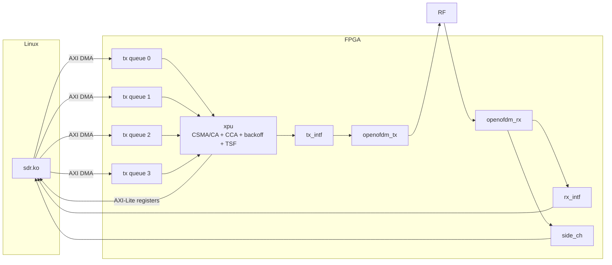

---

## 5. The low MAC: what `xpu` actually decides

This is the heart of the design, and it is worth describing as a decision loop rather than as a box:

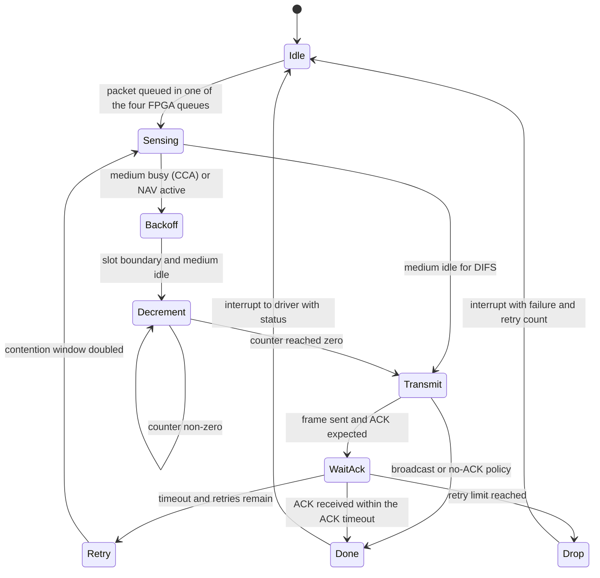

The registers that make this loop yours to tune, all in the `rx` (xpu) register space:

| Register | Field | Unit |
| --- | --- | --- |
| `slv_reg9` | Low MAC timing: PHY rx delay, **SIFS**, **slot time**, OFDM symbol time, preamble plus SIG time; auto or manual | µs |
| `slv_reg10` | Baseband-to-RF delay, RF end extension, delay from baseband TX start to RF on, and from baseband TX end to RF off | 0.1 µs |
| `slv_reg11` | Auto-ACK transmit and receive enable, and the **maximum number of retransmissions** (either decided by Linux or fixed here) | bits |
| `slv_reg12` | A-MPDU receive start and TID selection | bits |
| `slv_reg13` | SPI control of the RF front end: TX always on, or only during transmission | bits |
| `slv_reg16` / `slv_reg17` | Timeouts while waiting for an ACK: OFDM decode timeout after PHY header, PHY header detection timeout, and whether FCS validity is required — separately for 2.4 GHz and 5 GHz | 0.1 µs |
| `slv_reg18` | ACK sending delay, separately for 2.4 GHz and 5 GHz | 0.1 µs |

On the transmit side, the corresponding `tx` register space carries:

| Register | Field |
| --- | --- |
| `slv_reg4` | CTS-to-self configuration: enable, rate selection, duration field |
| `slv_reg6` | CTS-to-self sending delay (separate halves for 2.4 GHz and 5 GHz), unit 0.1 µs |
| `slv_reg8` | Per-packet transmit configuration, written by the driver in `openwifi_tx()` |
| `slv_reg11` | Threshold for the FPGA FIFO "almost full" flag |
| `slv_reg12` | Threshold that pauses `openofdm_tx` — a back-pressure mechanism on IQ generation |
| `slv_reg13` | Transmit IQ digital gain before the DAC |
| `slv_reg14` | Transmit interrupt enable or disable |
| `slv_reg15` | A-MPDU action configuration, set by `openwifi_ampdu_action()` |
| `slv_reg16` | Transmit antenna selection and simple CDD |
| `slv_reg17` | Per-packet PHY header configuration: aggregation, rate, guard interval, HT or non-HT |
| `slv_reg21` | Queue almost-full flags, one bit per queue |
| `slv_reg22`–`slv_reg25` | Per-packet transmit status: contention window, number of random slots, Linux priority, queue index, buffer-descriptor write index, retry count, BlockAck starting sequence number, packet count, and the BlockAck bitmap |
| `slv_reg26` | Runtime length of each of the four FPGA transmit queues |

Three observations an interviewer will find useful, because they are the actual engineering content:

- **The retry loop lives in the FPGA, not in Linux.** The driver tells the FPGA the maximum number of
  retransmissions; the FPGA counts them and reports the count back. If the retry loop were in the driver, every retry
  would cost a round trip through the ARM core and the SIFS deadline would be missed.
- **Two of the four queues exist so that airtime can be sliced.** `time_slice_gen.v` implements time-gated queues
  addressed by MAC address, which is how the "time slicing of the interface between two network slices" feature
  works: a station's traffic is admitted to its slice only during its window.
- **Filtering is a hardware decision.** `configure_filter` in the driver maps mac80211's filter flags onto
  `pkt_filter_ctl.v`, so promiscuous and monitor modes do not cost the CPU anything extra.

---

## 6. The Linux driver — a mac80211 driver whose hardware owns the timing

openwifi's driver (`sdr.c`) registers with **mac80211** and implements a subset of `ieee80211_ops`. Naming the ops is
the fastest way to show you understand where the boundary falls:

| `ieee80211_ops` member | What openwifi does with it |
| --- | --- |
| `tx` | The core: parse the frame, configure the FPGA registers, fire DMA into one of the four queues |
| `start` / `stop` | NIC up and down |
| `add_interface` / `remove_interface` | VIF creation and deletion |
| `config` | Channel or frequency change, including during a scan |
| `set_antenna` / `get_antenna` | Antenna selection (the AD9361 has two chains) |
| `bss_info_changed` | BSSID, transmit power, beacon interval and friends |
| `conf_tx` | AIFS, `CW_MIN`, `CW_MAX`, TXOP — mac80211's view of EDCA handed to the FPGA |
| `configure_filter` | Receive filtering rules in the FPGA |
| `prepare_multicast` | Present as a hook, currently empty |
| `rfkill_poll` | RF on or off state |
| `get_tsf` / `set_tsf` / `reset_tsf` | Read and write the 64-bit TSF timer implemented in the FPGA |
| `set_rts_threshold` | The packet length above which RTS is used |
| `ampdu_action` | A-MPDU operations |
| `testmode_cmd` | **The `sdrctl` channel**: everything openwifi-specific arrives here via nl80211 testmode |

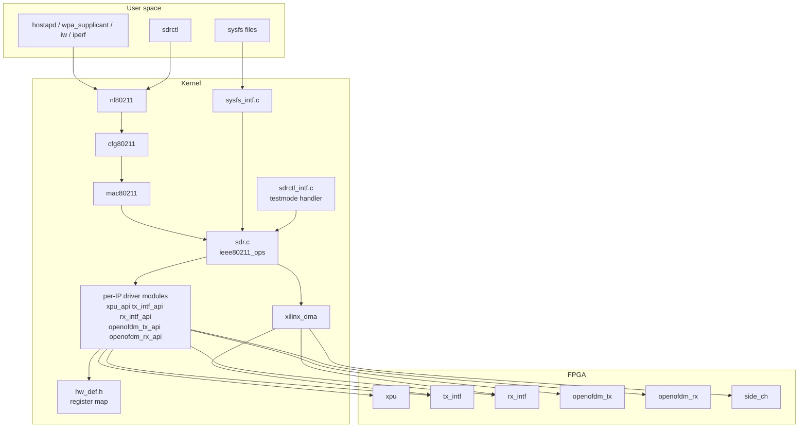

The driver is GPL v2 (`MODULE_LICENSE("GPL v2")`) while the project as a whole is AGPLv3-or-later, with some files
under GPL-2.0-or-later and BSD-3. A commercial licence is offered for the advanced feature set — the project's README
states that Wi-Fi 6, OFDMA, RFSoC support, JCAS/ISAC and other bandwidths are available by subscription — which is a
fact about the project's sustainability model and worth knowing before you plan a product on it.

---

## 7. The transmit path, step by step

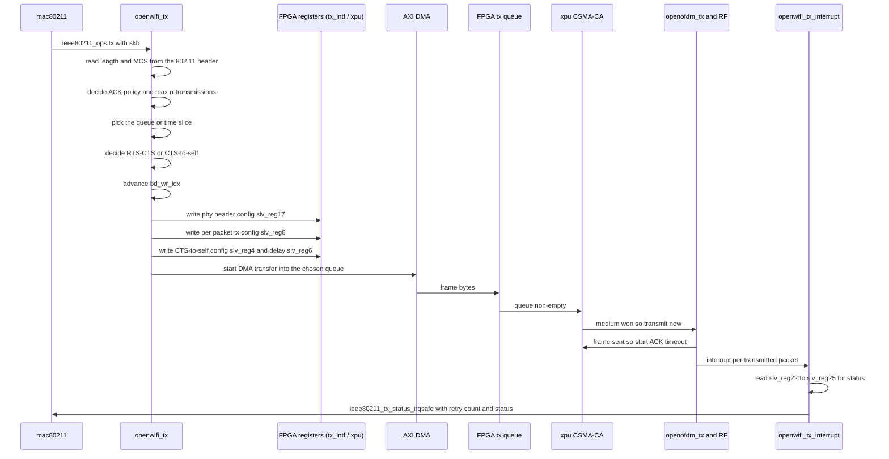

The nine decisions made inside `openwifi_tx()` are worth memorising because they are exactly the decisions a
commercial chip's firmware makes and you cannot see:

1. Packet length and MCS, read from the `struct ieee80211_hdr`.
2. Unicast or broadcast, and therefore whether an ACK is expected.
3. How many retransmissions the FPGA may attempt.
4. Which driver ring or FPGA queue — that is, which **time slice** — the packet belongs to.
5. Whether RTS/CTS is used.
6. Whether CTS-to-self is used (there is even a `force_use_cts_protect` knob).
7. Whether a sequence number is inserted at driver or chip level.
8. Maintenance of the sequence number `ring->bd_wr_idx` used to cross-check FPGA, `openwifi_tx` and
   `openwifi_tx_interrupt`.
9. Register writes so the FPGA can build the right PHY header.

Two failure modes that follow from this design, and that you can diagnose from the driver's own messages: the FPGA
queues report "almost full" through `slv_reg21` and the driver stops waking mac80211's queues; and if the sequence
number accounting between the three parties disagrees, the driver prints a warning with the queue index and the
read and write pointers.

---

## 8. The receive path, step by step

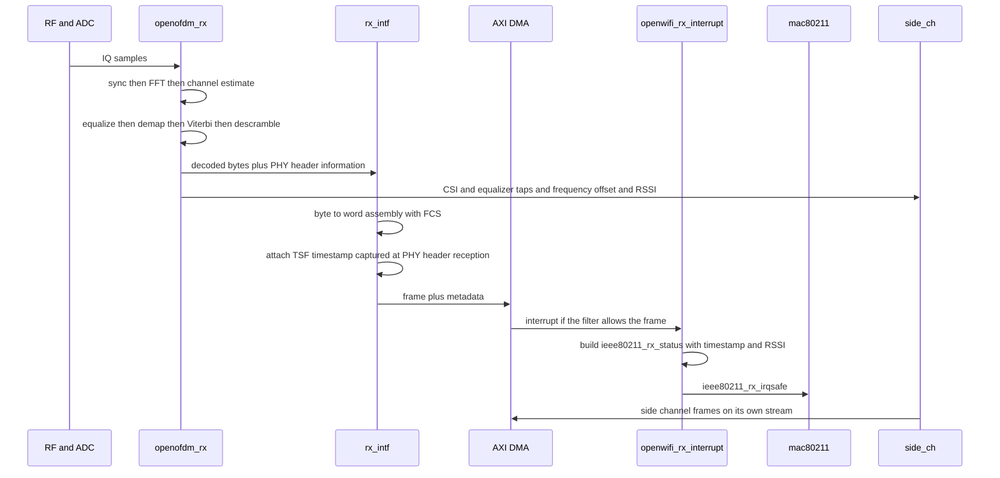

The **TSF timestamp** detail is worth a paragraph of its own, because it is what makes the platform useful for
measurement: the timestamp is not taken in the driver. The FPGA reads its own TSF timer at the moment the PHY header
is received and attaches the value to the DMA transfer, and the driver hands it to mac80211 unchanged. That is why
Wireshark on the `sdr0` interface shows a TSF that lines up with the CSI and IQ records captured on the side channel
— and why correlating them is a matter of matching timestamps rather than guessing.

---

## 9. Why the split is where it is

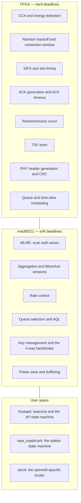

The rule that generates that picture: **anything with a deadline shorter than the worst-case interrupt latency of
Linux on an ARM core must be in the FPGA.** A SIFS is 10 µs in 2.4 GHz and the project states that its FPGA low MAC
achieves a 10 µs SIFS; no Linux driver can reliably produce an acknowledgement that fast, and no amount of
real-time patching changes that. Everything else — everything where a millisecond of jitter is invisible — can stay
in mac80211, which is where it is testable, observable and upgradable.

That is also why openwifi is described as **mac80211 compatible** rather than as a FullMAC chip: mac80211 still
believes it is driving a SoftMAC device. It calls `conf_tx` and the driver programs AIFS and CW into the FPGA; it
calls `tx` and the driver hands the frame to a queue that the FPGA will drain when the medium allows. The
difference from a normal SoftMAC chip is that the "firmware" is Verilog you can edit and register bits you can read.

---

## 10. The two control channels: `sdrctl` and sysfs

OpenWrt's equivalent problem is solved with ubus and UCI (see [[02-11 WLAN - OpenWrt and the Software Architecture of a Wireless System]]); openwifi solves it with two channels that both terminate in the driver:

| Channel | Mechanism | Used for |
| --- | --- | --- |
| **`sdrctl`** | An **nl80211 testmode** command, travelling nl80211 → cfg80211 → mac80211 → `openwifi_testmode_cmd()` in `sdrctl_intf.c` | openwifi-specific configuration: arbitrary Tx/Rx frequency, transmit attenuation, time slicing between network slices, CSI and IQ configuration, register reads and writes |
| **sysfs** | Driver variables mapped to virtual files by `sysfs_intf.c` | Quick inspection and tuning of driver state from scripts, and anything a test loop wants to poke per iteration |

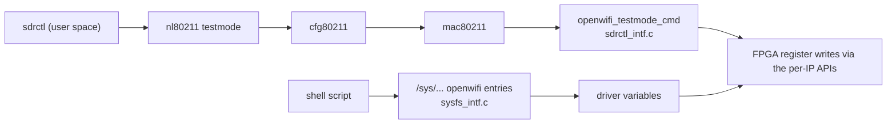

Because `sdrctl` rides nl80211, it composes with the rest of the Linux wireless tooling rather than replacing it:
`iw`, `iwconfig`, `iwlist`, `hostapd`, `wpa_supplicant` and `tcpdump` all work on `sdr0` exactly as they would on a
commercial adapter. That property — **standard tools for the standard things, one extra tool for the research
things** — is the design's most underrated feature.

---

## 11. Modes of operation and what each one needs

| Mode | How it is brought up | What it exercises |
| --- | --- | --- |
| **AP** | hostapd with an openwifi configuration file on `sdr0` | Beacon generation, the association state machine, and the full stack from a phone through to iperf |
| **Station** | `wpa_supplicant -i sdr0 -c wpa-connect.conf` then a DHCP client | Interoperation with a commercial AP, including the 4-way handshake |
| **Ad-hoc / IBSS** | `sdr-ad-hoc-up.sh` and `sdr-ad-hoc-join.sh` | Direct station-to-station operation without an AP |
| **Monitor** | `monitor_ch.sh` | Passive capture, and the input to the sensing applications |
| **Injection and fuzzing** | Frame injection through the interface | Security research: malformed or unexpected frames that a commercial MAC would never emit |

**The 802.11b caveat is the single most useful practical fact about running this platform.** openwifi implements OFDM
only, so it has no 802.11b rates. Beacons, connection establishment and robust communication therefore assume OFDM
peers:

- On the AP side, hostapd must be told to suppress 802.11b rates (`supported_rates` and `basic_rates`); the project
  ships an example `hostapd-openwifi.conf` for exactly this. The project also notes the general rule for FullMAC
  devices here: they must implement the `NL80211_TXRATE_LEGACY` handler in the driver.
- On the client side, a stock `wpa_supplicant` in 2.4 GHz will happily use 802.11b rates, so a commercial station
  needs a **patched `wpa_supplicant`** — the project ships `build_wpa_supplicant_wo11b.sh` to produce one.

If you have ever wondered why a Wi-Fi SDR "does not connect", that asymmetry is usually the answer.

---

## 12. Features that exist because the PHY is yours

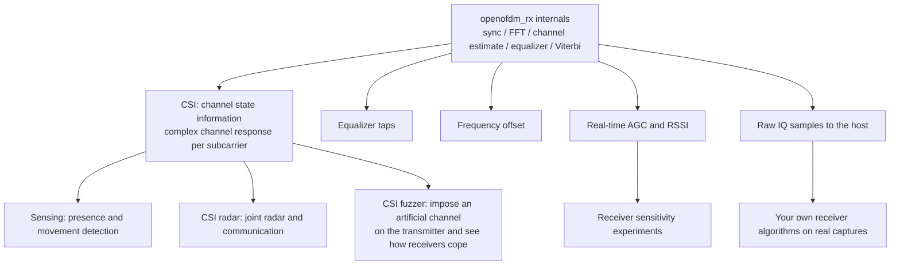

Plus the two features that are really about *access*, not about the PHY:

- **Configurable channel-access parameters.** CCA threshold, receiver sensitivity, RTS/CTS and CTS-to-self
  durations, SIFS, DIFS, xIFS, slot time and contention-window bounds — all writable. That turns "what happens if
  the contention window were smaller" from a simulation into a measurement.
- **Time slicing by MAC address.** `time_slice_gen.v` plus the four FPGA queues give you time-gated, scheduled
  queues: a form of airtime reservation implemented in hardware, which is the closest thing on this platform to the
  scheduled-access mechanisms discussed in [[02-9 WLAN - Time-Sensitive Networking Across Wi-Fi Generations]].

---

## 13. Performance, and what limits it

The numbers the project publishes, with their conditions:

| Metric | Value | Condition |
| --- | --- | --- |
| iperf TCP | **40–50 Mbps** | Best case, with aggregation on |
| iperf UDP | **50 Mbps** | Best case |
| EVM | **−38 dB** | FMCOMMS2, 2.4 GHz |
| MCS0 sensitivity | **−92 dBm** | Cable and over-the-air test |
| MCS7 sensitivity | **−73 dBm** | Cable and over-the-air test |
| Modes | 802.11a/g, 802.11n MCS 0–7, 20 MHz | 70 MHz to 6 GHz |

For context: 802.11n MCS 7 at 20 MHz with a short guard interval is 72.2 Mbps of PHY rate, so 40–50 Mbps of TCP
throughput is a respectable fraction of the air rate for a single-stream SDR — and it is roughly what a mid-range
2015-era 2×2 11n router delivers in practice. The platform is not a throughput platform. It is a **fidelity**
platform: what it offers is that every number in that table is reproducible and every block that produced it is
readable.

What limits it, in the order that matters:

1. **Single stream, 20 MHz.** No MIMO, no channel bonding in the open-source feature set.
2. **The AD9361 front end.** Its noise figure and linearity set the sensitivity and EVM floors; there is no
   vendor-grade RF calibration.
3. **Zynq-7000 PS performance and the DMA path.** Every frame crosses an AXI DMA between PL and PS.
4. **A-MPDU is experimental.** It is enabled with `./wgd.sh 1`, which tells you how much of the throughput is
   aggregation-dependent.
5. **Vivado timing closure on the baseband clock.** Raising `NUM_CLK_PER_US` is not free.

---

## 14. How openwifi compares with the alternatives

| Platform | What it is | What you can change | What you cannot |
| --- | --- | --- | --- |
| **openwifi** | Full 802.11a/g/n stack: FPGA PHY and low MAC, mac80211 high MAC, Linux driver | PHY, low MAC, channel access parameters, CSI and IQ capture, frame injection | Wi-Fi 5/6/7 features in the open-source edition — those are the subscription set |
| **Commercial chip plus mac80211** (mt76, ath9k, ath11k, ath12k) | What every product ships | Nothing below the driver | Everything in the firmware: [[02-10 WLAN - Baseband and Driver Architecture for Wi-Fi 6, 7 and 8 - Qualcomm as the Reference Design]] |
| **GNU Radio 802.11 transceivers (Wime lineage)** | Host-based OFDM physical layer, USRP-class radio | Everything, in host code, with full visibility | Real-time MAC deadlines — a host cannot meet SIFS, so these are transceivers and measurement tools, not interoperating APs with a standard MAC |
| **`mac80211_hwsim`** | A kernel virtual radio driver for testing the wireless stack | Nothing physical; ideal for testing hostapd, wpa_supplicant and mac80211 behaviour | There is no air interface, so no PHY and no timing |
| **ns-3 / simulators** | Simulation | Every model, and every assumption in it | Reality: no RF, no hardware non-idealities, no real firmware |
| **Sora-class PC software radio** | Software radio on a multi-core PC with a dedicated radio control board | PHY and MAC in software, with hardware assistance for timing-critical parts | Portability and cost; **VERIFY the current state of the project before citing it** |

Decision logic:

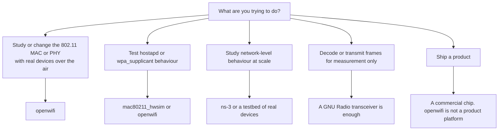

---

## 15. The project model — licences, funding and the subscription line

| Aspect | Fact |
| --- | --- |
| Authors | Xianjun Jiao, Michael Mehari, Wei Liu (paper adds Muhammad Aslam and Ingrid Moerman); the 2019 copyright header is Ghent University (UGent) |
| Open-source licence | **AGPL-3.0-or-later** for the bulk of the project, with some elements under GPL-2.0-or-later and BSD-3; the kernel driver is GPL v2 |
| Commercial licence | A dual-licence subscription via openwifi.tech for advanced features: Wi-Fi 6, OFDMA, RFSoC support, JCAS/ISAC, and other bandwidths |
| Funding | The **ORCA** project, funded by the EU's Horizon 2020 programme under grant agreement **732174**; and **NGI Zero Core**, a fund established by NLnet with support from the European Commission's Next Generation Internet programme, which funded the 802.11n feature, the 802.11a/g/n maturity work and the extended OpenWrt support |
| Publication | Jiao, X., Liu, W., Mehari, M., Aslam, M., Moerman, I. *"openwifi: a free and open-source IEEE802.11 SDR implementation on SoC."* IEEE 91st Vehicular Technology Conference (VTC2020-Spring), pp. 1–2, 2020 |
| Spectrum responsibility | The project states plainly that following local spectrum regulation — or using a cable — is the user's responsibility |

That last row is not boilerplate. A platform that lets you transmit at any frequency from 70 MHz to 6 GHz with
arbitrary power is a regulatory hazard as well as a research instrument, and the interviewer who has run an RF lab
will notice whether you internalised that.

---

## 16. What people actually use it for

| Use case | Which capability makes it possible |
| --- | --- |
| **MAC protocol research** | Writable CCA threshold, slot time, SIFS, DIFS, contention window, RTS/CTS and CTS-to-self; time-gated queues for slicing |
| **Wi-Fi sensing and JCAS** | CSI, equalizer taps and RSSI on the side channel, timestamped with the TSF of the frame that produced them |
| **CSI radar** | Artificial channel response (CSI fuzzer) plus CSI capture, for moving detection and joint radar-communication experiments |
| **Security research** | Frame injection and fuzzing with frames a commercial MAC would refuse to emit |
| **Sub-GHz and vehicular variants** | 2 MHz for 802.11ah-class work in sub-GHz and 10 MHz for 802.11p at 5.9 GHz |
| **Receiver algorithm development** | Raw IQ capture with real-time AGC, to develop and test synchronisation, estimation or decoding offline and then bring it back into the FPGA |
| **Teaching** | A full stack where every layer is readable: Verilog below, mac80211 and hostapd above |

The pattern across all of them: openwifi is chosen when the experiment needs **a real 802.11 peer on the other end**
and **a modifiable implementation on this end** at the same time.

---

## 17. How to localise a fault on this platform

| Symptom | Where to look |
| --- | --- |
| No `sdr0` at all | Device tree against the actual FPGA address and interrupt map; driver load; firmware or bitstream not loaded into the PL |
| Interface up but no frames on the air | Baseband clock and `NUM_CLK_PER_US` mismatch; `slv_reg9` timing set to manual with wrong values; RF SPI control `slv_reg13` leaving the transmitter off |
| Frames transmitted but no ACKs | ACK timing: `slv_reg16`/`slv_reg17` timeouts and `slv_reg18` ACK delay; whether auto-ACK is disabled in `slv_reg11` |
| Commercial clients will not associate | 802.11b rates: hostapd `supported_rates` and `basic_rates`, and a patched `wpa_supplicant` on the client side |
| Association succeeds and then stalls | Retransmission limit in `slv_reg11`; CCA threshold too high or too low; interference |
| Throughput far below 40–50 Mbps | A-MPDU not enabled (`./wgd.sh 1`); queue almost-full threshold `slv_reg11` on the tx side; CPU saturated by DMA and interrupt load |
| Poor sensitivity | AD9361 gain settings, `slv_reg13` digital gain, cable loss, and the absence of a calibrated front end |
| CSI and IQ records do not line up with frames | TSF correlation: match the side-channel records against the TSF attached at PHY header reception |
| Works after a rebuild but not after a reload | The FPGA and driver dynamic-reload path rather than a full power cycle — the project documents an app note for reloading both without rebooting |

---

## 18. Ten answers worth having on the tip of your tongue

1. **"What is openwifi?"** A Linux-mac80211-compatible full 802.11a/g/n stack on an SDR: OFDM PHY and low MAC in
   FPGA on a Zynq SoC, high MAC in mac80211, hostapd and wpa_supplicant in user space.
2. **"Why is the low MAC in the FPGA?"** Because SIFS is 10 µs and Linux on an ARM core cannot guarantee that
   deadline; carrier sense, backoff, ACK generation and retransmission counting therefore live in Verilog, while
   everything with millisecond-scale deadlines stays in mac80211.
3. **"Is it a FullMAC chip?"** No — it is a mac80211 driver whose hardware happens to own the timing. mac80211 calls
   `tx` and `conf_tx`; the driver turns those into register writes and a DMA push into one of four FPGA queues.
4. **"How do you configure the things `iw` cannot express?"** With `sdrctl`, which is an nl80211 testmode command
   handled by `openwifi_testmode_cmd()`, or through the driver's sysfs files.
5. **"What do the four FPGA transmit queues do?"** They carry per-queue scheduling and, with `time_slice_gen.v`,
   time-gated access addressed by MAC address — a hardware airtime reservation mechanism.
6. **"Where does a retransmission happen?"** In the FPGA. The driver sets the limit; the FPGA counts and reports the
   number back in the transmit status registers, which the driver passes to mac80211 with
   `ieee80211_tx_status_irqsafe()`.
7. **"How is CSI timestamped?"** The FPGA reads its TSF timer when the PHY header is received and attaches it to the
   DMA transfer; the driver hands it to mac80211 unchanged, so CSI and IQ records can be matched to frames.
8. **"What is the 802.11b problem?"** openwifi is OFDM only, so hostapd must suppress 802.11b rates and a commercial
   client needs a patched wpa_supplicant.
9. **"How fast is it?"** iperf TCP 40–50 Mbps and UDP 50 Mbps at best with aggregation, MCS 0–7 at 20 MHz, EVM
   −38 dB, MCS0 sensitivity −92 dBm and MCS7 −73 dBm.
10. **"How does it differ from a GNU Radio 802.11 transceiver?"** A host transceiver can decode and transmit but
    cannot meet MAC deadlines, so it is a measurement instrument; openwifi is an interoperating station and AP whose
    MAC you can rewrite.

---

## Anchors — verified facts

- **What it is**: the project's own description is *"Linux mac80211 compatible full-stack IEEE802.11/Wi-Fi design
  based on SDR"*. The driver (`sdr.c`) implements `ieee80211_ops`: `tx`, `start`, `stop`, `add_interface`,
  `remove_interface`, `config`, `set_antenna`, `get_antenna`, `bss_info_changed`, `conf_tx`, `prepare_multicast`,
  `configure_filter`, `rfkill_poll`, `get_tsf`, `set_tsf`, `reset_tsf`, `set_rts_threshold`, `ampdu_action` and
  `testmode_cmd`.
- **Capabilities stated by the project**: 802.11a/g/n; 20 MHz bandwidth; **70 MHz to 6 GHz**; modes tested are
  ad-hoc, station, AP and monitor; **DCF (CSMA/CA) low MAC in FPGA with a 10 µs SIFS achieved**; packet injection and
  fuzzing; CSI with frequency offset and equalizer output to the computer; a CSI fuzzer; CSI radar for moving
  detection and joint radar-communication; IQ capture with real-time AGC and RSSI; configurable channel-access
  parameters (CCA threshold, receiver sensitivity, RTS/CTS and CTS-to-self durations, SIFS/DIFS/xIFS/slot time/CW);
  time slicing based on MAC address; 2 MHz for sub-GHz 802.11ah-style work and 10 MHz for 802.11p at 5.9 GHz.
- **Published performance**: iperf TCP **40–50 Mbps** and UDP **50 Mbps** in the best case with aggregation;
  **EVM −38 dB**; **MCS0 sensitivity −92 dBm** and **MCS7 −73 dBm** on FMCOMMS2 at 2.4 GHz, cable and over-the-air.
- **Hardware**: Zynq-7000 and Zynq UltraScale+ boards plus RFSoC, with the AD9361 family via FMCOMMS2/3/4. Board
  identifiers include `zc706_fmcs2`, `zed_fmcs2`, `adrv9364z7020`, `adrv9361z7035`, `zc702_fmcs2`, `antsdr`,
  `e310v2`, `antsdr_e200`, `sdrpi`, `zcu102_fmcs2`, `rfsoc4x2`, `neptunesdr`, `LibreSDR`; a Vivado licence is
  required for `zc706_fmcs2`, `adrv9361z7035`, `zcu102_fmcs2` and `rfsoc4x2`, and not for the others listed.
- **Build**: Vivado **2022.2** with Vitis, an evaluation licence for the Xilinx Viterbi Decoder IP, Ubuntu 18/20/22
  LTS, and the scripts `prepare_adi_lib.sh`, `prepare_adi_board_ip.sh`, `get_ip_openofdm_rx.sh`,
  `create_ip_repo.sh`, `openwifi.tcl` and `sdk_update.sh`. The design is built on the Analog Devices HDL reference
  design, with 2021_r1 documented as the porting base. **Baseband clock** `NUM_CLK_PER_US` defaults to **100 MHz**
  with 240 MHz or 100 MHz available on ZCU102 and 100 MHz or 200 MHz on ZC706 and ADRV9361-Z7035.
- **FPGA IP cores**: `xpu`, `tx_intf`, `rx_intf`, `openofdm_tx`, `openofdm_rx` and `side_ch`, each openable as its
  own Vivado project and conditionally compiled through `ip_name_pre_def.v`. The 802.11 OFDM receiver is based on
  the `openofdm` project, with the improvements in the project's `dot11zynq` fork.
- **Registers**: xpu `slv_reg9` carries the low-MAC timings (PHY rx delay, SIFS, slot time, OFDM symbol time,
  preamble plus SIG time in µs); `slv_reg11` carries auto-ACK enable and the maximum number of retransmissions;
  `slv_reg16` and `slv_reg17` carry the ACK-wait timeouts for 2.4 GHz and 5 GHz in units of 0.1 µs; `slv_reg18`
  carries the ACK sending delay. On the transmit side `slv_reg8` is per-packet configuration, `slv_reg17` the
  per-packet PHY header configuration, `slv_reg21` the queue almost-full flags and `slv_reg22`–`slv_reg25` the
  per-packet transmit status including the retry count and the BlockAck bitmap.
- **Driver mechanics**: `openwifi_rx_interrupt()` delivers frames with `ieee80211_rx_irqsafe()`;
  `openwifi_tx_interrupt()` reports results with `ieee80211_tx_status_irqsafe()`. `sdrctl` is implemented as an
  **nl80211 testmode** command handled by `openwifi_testmode_cmd()` in `sdrctl_intf.c`; sysfs is the second
  user-space channel, provided by `sysfs_intf.c`.
- **802.11b**: openwifi is **OFDM only** and therefore not backward compatible with 802.11b; hostapd must suppress
  802.11b rates via `supported_rates` and `basic_rates` (see `hostapd-openwifi.conf`), and a client needs a patched
  wpa_supplicant, which the project builds with `build_wpa_supplicant_wo11b.sh`.
- **Licence and funding**: AGPL-3.0-or-later for the bulk, with some elements under GPL-2.0-or-later and BSD-3 and
  the kernel driver under GPL v2; a subscription licence covers Wi-Fi 6, OFDMA, RFSoC, JCAS/ISAC and other
  bandwidths. Funded by the EU Horizon 2020 **ORCA** project under grant agreement **732174** and by **NGI Zero
  Core** via NLnet. Publication: Jiao, Liu, Mehari, Aslam and Moerman, *"openwifi: a free and open-source IEEE802.11
  SDR implementation on SoC"*, IEEE VTC2020-Spring, pp. 1–2, 2020.
- **VERIFY**: the throughput, sensitivity and EVM figures are the project's own best-case measurements on FMCOMMS2
  at 2.4 GHz and should be quoted as such, not as a general specification. The current state of the Sora-class PC
  software radio line in section 14 is stated from background knowledge and should be checked before being cited.

---

## Related

- [[02-11 WLAN - OpenWrt and the Software Architecture of a Wireless System]] — the software stack above the driver,
  including the TIP OpenWiFi project whose name is easily confused with this one
- [[02-10 WLAN - Baseband and Driver Architecture for Wi-Fi 6, 7 and 8 - Qualcomm as the Reference Design]] — the
  commercial counterpart: the same low MAC, implemented as firmware you cannot read
- [[02-4 WLAN - Packet TX-RX Datapath and Offload Evolution]] — SoftMAC versus FullMAC and the five offload planes,
  which is the vocabulary you need to place openwifi's split
- [[02-8 WLAN - Scheduling - Channel Access, EDCA, OFDMA Resource Allocation, Airtime and Implementation]] — the
  channel-access rules that openwifi lets you rewrite: backoff, contention window, AIFS, TXOP
- [[02-5 WLAN - STA-AP Discovery, Authentication and Association]] — what hostapd and wpa_supplicant do on `sdr0`,
  and why suppressing 802.11b rates matters at association time
- [[02-9 WLAN - Time-Sensitive Networking Across Wi-Fi Generations]] — the requirement that makes openwifi's
  time-gated FPGA queues worth having
- [[02-1 WLAN - Wi-Fi Generations Evolution]] — where 802.11a/g/n sits in the generation ladder, and what each
  later generation added that the open-source feature set does not have
- [[02-2 WLAN - Power Saving Mechanisms and Evolution]] — the power-saving behaviours whose timing the low MAC also
  owns
- [[08-5 Verilog HDL - RTL Design, Verification and Synthesis Practice]] — the language and the verification flow the
  FPGA side is written in, including the testbench style openwifi uses
- [[04-6 Linux Device Drivers - Model, Probe, Data Path, Power and Bring-Up]] — the generic driver model `sdr.ko` is
  a guest in: probe, device tree, DMA and the interrupt path
- [[04-4 Linux Interrupts - Types, Handlers, Threaded IRQs and Deferred Work]] — why `ieee80211_rx_irqsafe()` and
  `ieee80211_tx_status_irqsafe()` are the right calls from an interrupt handler
- [[04-2 Linux Embedded Development - Drivers, Applications and Core Subsystems]] — the Zynq boot chain, the device
  tree and the SD card image that a port has to assemble
- [[07-1 RISC-V for Communication Infrastructure]] — the direction an open baseband could take next, and why an
  open ISA matters for a platform like this
- [[04-3 Embedded Software Architecture - Patterns, Layering and Wireless System Structure]] — the layering argument
  this platform makes concrete: hard deadlines below, soft deadlines above

- [[02-13 WLAN - Reliability, Low Latency and Determinism - What the Wi-Fi Stack Can Actually Do]] — a platform where the latency mechanisms are registers: contention window, SIFS, slot time, ACK timeouts and retry limits you can set, and a research vehicle for measuring them

---

## References

1. Jiao, X., Mehari, M., Liu, W. *openwifi* — repository README. <https://github.com/open-sdr/openwifi> — The project description, the feature list, supported boards, published performance figures, the 802.11b note, the porting guide and the licensing and funding statements.
2. Jiao, X. *openwifi-hw* — FPGA design repository README. <https://github.com/open-sdr/openwifi-hw> — The board table with Vivado licence requirements, the build flow and scripts, the baseband clock options, the IP-core modification and simulation workflow, conditional compilation with `ip_name_pre_def.v`, and the migration guidance for new Vivado and ADI releases.
3. Jiao, X. *openwifi document* — `doc/README.md`. <https://github.com/open-sdr/openwifi/blob/master/doc/README.md> — The list of `ieee80211_ops` the driver implements, the receive and transmit interrupt paths, the `sdrctl` mechanism as an nl80211 testmode command, the register tables for `tx` and `rx`, the nine decisions inside `openwifi_tx()`, and the TSF timestamp explanation.
4. Jiao, X., Liu, W., Mehari, M., Aslam, M., Moerman, I. *"openwifi: a free and open-source IEEE802.11 SDR implementation on SoC."* *2020 IEEE 91st Vehicular Technology Conference (VTC2020-Spring)*, pp. 1–2, 2020. — The project's conference paper; citation metadata in `doc/cite-openwifi-vtc-paper.md`.
5. *openwifi driver source* — `driver/sdr.c`, `driver/sdr.h`, `driver/hw_def.h`, `driver/sdrctl_intf.c`, `driver/sysfs_intf.c`. <https://github.com/open-sdr/openwifi/tree/master/driver> — `MODULE_LICENSE("GPL v2")`, the mac80211 ops, `openwifi_rx_interrupt()` with `ieee80211_rx_irqsafe()`, `openwifi_tx_interrupt()` with `ieee80211_tx_status_irqsafe()`, and the per-IP driver modules `xpu`, `tx_intf`, `rx_intf`, `openofdm_tx`, `openofdm_rx`, `side_ch`, `xilinx_dma`.
6. *openwifi-hw IP cores* — `ip/xpu/src`, `ip/tx_intf/src`, `ip/rx_intf/src`, `ip/side_ch/src`, `ip/openofdm_tx`, `ip/openofdm_rx`. <https://github.com/open-sdr/openwifi-hw/tree/master/ip> — The source file inventory behind section 4 and 5: `csma_ca.v`, `cw_exp.v`, `cca.v`, `tsf_timer.v`, `tx_control.v`, `pkt_filter_ctl.v`, `time_slice_gen.v`, `phy_rx_parse.v`, `rssi.v`, `spi.v`, `tx_bit_intf.v`, `tx_iq_intf.v`, `dac_intf.v`, `ht_sig_crc_calc.v`, `csi_fuzzer.v`, `tx_status_fifo.v`, `adc_intf.v`, `byte_to_word_fcs_sn_insert.v`, `side_ch_control.v` and their companions.
7. *openofdm* — the 802.11 OFDM receiver project openwifi's receiver derives from, and the `dot11zynq` fork that carries openwifi's improvements. <https://github.com/jhshi/openofdm>
8. Analog Devices. *HDL Reference Designs*. <https://github.com/analogdevicesinc/hdl> — The reference designs openwifi builds on, including the `fmcomms2` project used as the porting baseline.
9. Bloessl, B., Segata, M., Sommer, C., Dressler, F. *"An IEEE 802.11a/g/p OFDM Receiver for GNU Radio."* *Proceedings of the 2nd ACM SIGCOMM Workshop on Software Radio Implementation Forum (SRIF 2013)*, 2013. — The host-based open-source 802.11 receiver that defines the transceiver end of the comparison in section 14.
10. Bloessl, B., Segata, M., Sommer, C., Dressler, F. *"Performance Assessment of IEEE 802.11p with an Open Source SDR-Based Prototype."* *IEEE Transactions on Mobile Computing*, 2018. <https://www.computer.org/csdl/journal/tm/2018/05/08031977/13rRUxlgy4n> — The validated SDR-based 802.11p transceiver and its simulation-to-experiment methodology.
11. *Wime project*. <https://wime-project.net> — The open-source SDR-based experimentation framework behind the GNU Radio transceiver lineage.
12. ORCA project. *EU Horizon 2020 research and innovation programme, grant agreement no. 732174.* — The funding source acknowledged by openwifi.
13. NLnet / NGI Zero Core. *openwifi funding pages* — the 802.11n feature, the 802.11a/g/n maturity work and the extended OpenWrt support.
14. openwifi. *Subscription and advanced features*. <https://openwifi.tech> — The dual-licence model and the feature set (Wi-Fi 6, OFDMA, RFSoC, JCAS/ISAC, other bandwidths) that is not in the open-source edition.

---

Copyright (c) 2026 Washington Ruan. All rights reserved.
