# WLAN — Reliability, Low Latency and Determinism: What the Wi-Fi Stack Can Actually Do

> Part of the [[00 MOC - Comms x Compute x AI Knowledge Graph|Comms × Compute × AI knowledge graph]] · group **02 · WLAN**

Every note before this one has answered "how does Wi-Fi work". This one answers a harder question that gets asked in
architecture reviews: **if someone hands you a latency bound and a reliability target, which knobs do you turn, and
what will you actually get?**

The three properties in the title are not three variations of one thing. They are three different contracts, and the
mechanisms that buy you one of them usually spend the currency the other two need:

- **Reliability** — the frame gets there, eventually, possibly late. Bought with retries, redundancy and margin.
- **Low latency** — the frame gets there soon, usually. Bought with priority, small buffers and fewer retries.
- **Determinism** — the frame gets there within a bound, always, or it is declared lost. Bought with reservation,
  preemption and admission control — and it is the only one of the three that requires you to *refuse* traffic.

The single most useful sentence to carry into an interview: **Wi-Fi buys reliability with retransmission, and
retransmission is exactly what destroys latency and determinism** — so a design that needs both has to stop
retransmitting and start *reserving and duplicating*, which is precisely the direction 802.11be and 802.11bn took.

Where this note sits: [[02-8 WLAN - Scheduling - Channel Access, EDCA, OFDMA Resource Allocation, Airtime and Implementation]]
describes *how* Wi-Fi schedules; this note asks *what you can promise* with that scheduler and with the driver around
it. [[02-9 WLAN - Time-Sensitive Networking Across Wi-Fi Generations]] is the companion for the 802.1/TSN framing;
this note is the driver-and-protocol implementation view of the same problem.

---

## 0. Vocabulary — say these precisely or the discussion collapses

| Term | What it actually means | The trap |
| --- | --- | --- |
| **Reliability** | Probability that a frame arrives *within a deadline*, or at all. Two different metrics: **delivery ratio** (arrived, whenever) and **deadline delivery ratio** (arrived in time). | "99.999% reliable" is meaningless without the deadline attached. A frame that arrives 400 ms late is 100% reliable and 100% useless for motion control. |
| **PER (packet/frame error rate)** | Failed MPDUs ÷ attempts, measured at the MAC. The *input* to reliability, not the output. | PER of 10% with 7 retries gives ~10⁻⁷ undelivered — but with wildly variable delay. |
| **Latency** | Usually one-way delay of a frame from arrival at the sender's queue to delivery at the receiver's stack. | Most measurements are RTT and include the return path, the peer's stack and the app. State which. |
| **p50 / p95 / p99 / p99.9** | Percentiles of the latency distribution. | Averages hide the failure. The mean latency of a Wi-Fi link is almost never the problem; the 99th percentile is. |
| **Jitter / PDV** | Packet delay variation, usually the spread between two percentiles or the standard deviation of one-way delay. | A link with 3 ms mean and 30 ms p99 has excellent "latency" and unusable jitter. |
| **Tail latency** | The high percentiles — p99, p99.9, worst observed. | Needs 10⁴–10⁵ samples to be meaningful. "I pinged ten times" is not a tail measurement. |
| **Determinism / bounded latency** | A latency value L such that a frame is delivered within L or is known to be lost, with a stated probability. | Without admission control and a bounded channel-access mechanism, no bound exists. "Usually under 10 ms" is not a bound. |
| **Sojourn time** | Time a packet spends *in one queue*. CoDel's control variable. | Queue *depth* is not queue *delay* — the same 100 packets is 1 ms on a fast station and 60 ms on a slow one. This is why Wi-Fi uses airtime, not bytes. |
| **Airtime** | Time the medium is occupied, in µs. The real currency of a Wi-Fi channel. | Byte-based limits (BQL) fail here because rate varies 1000:1 across stations. |
| **Channel access latency** | Time from "frame is at the head of the queue" to "medium is granted". | This, not transmission time, is the dominant *worst-case* term — and raising the PHY rate does not reduce it. |
| **Deadline-miss ratio** | Fraction of frames that missed their deadline, including those dropped. The metric that actually correlates with application failure. | Almost nobody measures it, because it requires the app to tell the network the deadline. |

---

## 1. Why the three objectives fight each other

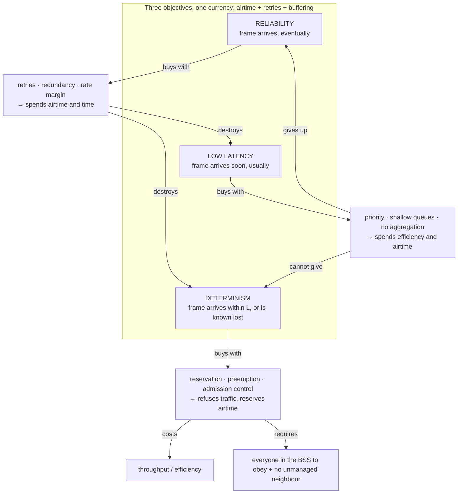

The tension is not philosophical; it is arithmetic. Three numbers make it concrete:

1. **Retransmission is the reliability mechanism.** A frame with a 10% chance of failing at the first attempt will,
   with `dot11ShortRetryLimit = 7`, essentially always arrive — but the seventh attempt happens after six failed
   channel-access-plus-transmission cycles, each with an exponentially grown contention window. The frame arrives.
   It arrives tens of milliseconds late, and with a jitter distribution whose tail is the *whole* latency budget of
   an industrial control loop.
2. **Aggregation is the efficiency mechanism and a latency tax.** A-MPDU amortises preamble, inter-frame spacing
   and ACK overhead over tens of frames. To build a large aggregate, the MAC must *wait* for frames to accumulate,
   and one bad subframe can force the retransmission of part of the aggregate. Every millisecond you allow for
   aggregation-building is a millisecond of added latency for the first frame in the aggregate.
3. **Reservation is the determinism mechanism and it is expensive.** A restricted-TWT service period or a
   scheduled OFDMA grant gives you a channel-access bound, but the airtime reserved is airtime you have taken away
   from best-effort traffic, and it only protects you from stations that *obey* — an AP in a neighbouring BSS that
   is not part of your schedule does not know about it.

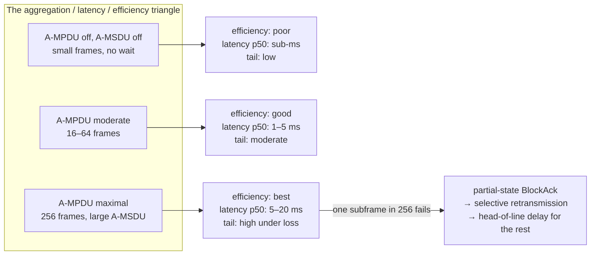

---

## 2. The latency budget — where the milliseconds actually go

The canonical decomposition (used in the 6 GHz Wi-Fi/NR-U comparison literature) is **four components**: queuing,
channel access, transmission, retransmission. In a real box you must add a fifth: **host, driver and firmware
processing**. A sixth appears in any mobile deployment: **roaming and off-channel events**.

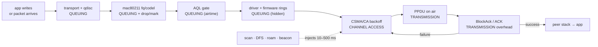

| Component | Uncontended, healthy link | Under load / weak link | Controllable by | Mechanism |
| --- | --- | --- | --- | --- |
| **Queuing** (host qdisc, mac80211, firmware rings) | 0–1 ms | **50 ms → seconds** (bufferbloat) | You, on the device you own | AQM (fq_codel/CAKE), AQL, shapers, TSQ |
| **Channel access** (DIFS/AIFS + backoff, or waiting for a grant) | tens of µs (mean backoff ≈ CWmin/2 slots) | **tens to hundreds of ms at p95** with full-buffer contenders | Partly (EDCA), fully (r-TWT, scheduling, MLO) | EDCA params, MU EDCA, trigger-based access, r-TWT, MLO, preemption |
| **Transmission** (airtime of the PPDU) | µs–ms, depends on PPDU size and rate | grows as rate falls | You (rate, aggregation, frame size) | MCS selection, aggregation size, bandwidth |
| **Retransmission** (each retry repeats access + transmission) | 0 | **dominant tail contributor** | You (retry limits, rate margin, redundancy) | retry limits, RTS/CTS, margin, MLO duplication, app FEC |
| **Host / driver / firmware** | tens–hundreds of µs | ms (interrupt moderation, NAPI latency, CPU contention) | You, on a Linux box | NAPI, interrupt moderation, IRQ affinity, PREEMPT_RT |
| **Roaming / scanning / DFS** | 0 | **20 ms (FT) to >1 s (full EAP), 100+ ms (DFS CAC)** | You (design + config) | 802.11k/v/r, OKC, channel plan |

The practical consequence, and the reason this table matters: **on a healthy link the latency is dominated by
channel access and transmission, and it is small. Under load it is dominated by queuing, and it is enormous.** Most
"Wi-Fi is slow" complaints are a queuing problem wearing a radio costume, which is why the first fix is usually an
AQM and not an antenna.

Why the worst case is *access* and not *transmission*: increasing the PHY rate shortens the transmission term but has
almost no effect on the time spent waiting for the medium. With full-buffer contenders, repeated collisions drive
contention windows up, and the 95th-percentile channel-access latency of a single-link device reaches **hundreds of
milliseconds**; giving the same device a second link to contend on produces an **order-of-magnitude** reduction,
because the frame is flushed as soon as *either* link goes idle. This asymmetry — throughput scales with rate,
worst-case latency scales with *opportunities to transmit* — explains why Wi-Fi 7 and 8 attack latency with MLO and
multi-AP coordination rather than with faster modulation.

---

## 3. The lever map — which layer owns which knob

This is the section to sketch on a whiteboard. Every mechanism in this note lands in exactly one row.

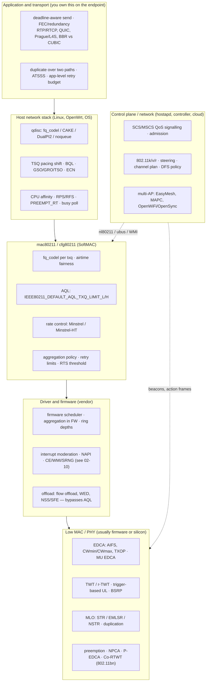

Two boundaries matter more than the rest:

- **The firmware boundary.** Below `mac80211` you are configuring, not implementing. On a FullMAC or
  firmware-scheduled chip (see [[02-10 WLAN - Baseband and Driver Architecture for Wi-Fi 6, 7 and 8 - Qualcomm as the Reference Design]])
  the MAC is a second computer with its own queues, and everything the host does to control latency is a *request*.
  That is exactly why AQL exists: to bound the queue you cannot see.
- **The air boundary.** No reservation you make is binding on a device outside your BSS. Every determinism
  mechanism in Wi-Fi is "deterministic among consenting adults", and the honest engineering answer to "what about
  the neighbour?" is a spectrum plan, not a scheduler.

---

## 4. Reliability — the protocol-layer mechanisms

### 4.1 The baseline: MAC retransmission and its limits

Wi-Fi has no HARQ (compare [[01-7 NR HARQ - Retransmission Flow, Timelines and LTE Comparison]]). It has ARQ at the
MAC: transmit, wait for ACK, retry with a larger contention window, give up after a limit, then drop — and let TCP
discover the loss seconds later.

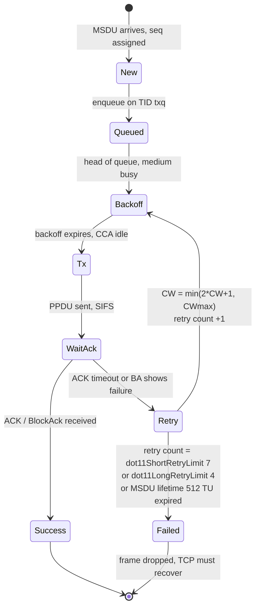

The numbers, from the 802.11 MIB as carried into CAPWAP (RFC 5416 §6.7):

| Parameter | Meaning | Default |
| --- | --- | --- |
| `dot11ShortRetryLimit` | Max transmission attempts for a frame ≤ RTS threshold | **7** |
| `dot11LongRetryLimit` | Max transmission attempts for a frame > RTS threshold | **4** |
| `dot11RTSThreshold` | Frame length above which RTS/CTS is used | **2347** octets |
| `dot11MaxTransmitMSDULifetime` | Time after which further attempts stop | **512 TU** (0.524288 s) |
| `dot11MaxReceiveLifetime` | Reassembly deadline | **512 TU** |

Two reading notes that separate a real answer from a plausible one:

- **7 and 4 are *attempts*, not retries** — the frame is sent once plus up to 6 or 3 retries.
- **512 TU ≈ 0.52 s is the real deadline.** A frame can be "reliably delivered" half a second after the application
  sent it. This is why delivery ratio alone is a dishonest reliability metric, and why latency-critical traffic must
  *lower the retry limit*, not raise it.

### 4.2 Rate adaptation: the reliability mechanism nobody configures

On Linux the default rate control for 802.11n and later is **Minstrel-HT**; the legacy algorithm is **Minstrel**.
Both are throughput-optimal, not reliability-optimal or latency-optimal, and understanding the loop is what lets you
reason about their side effects.

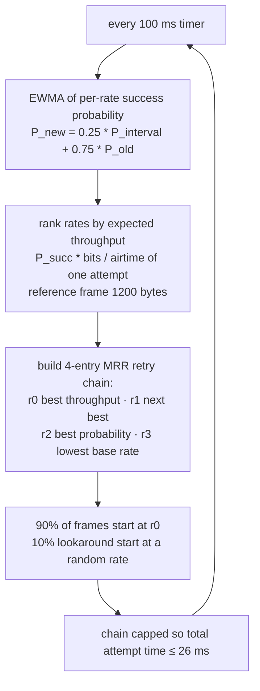

Consequences worth stating out loud:

- **The MRR chain is itself a latency mechanism.** Because the chain is capped at **26 ms** of total attempt time
  (a choice made because longer chains interacted badly with TCP congestion control), a station on a bad link cannot
  spend unbounded time on one frame. That cap is a *de facto* latency bound, and it is also why a station that picks
  too aggressive an MCS pays with retransmissions rather than with throughput.
- **10% of frames are experiments.** Lookaround frames are sent at rates the algorithm expects to be worse. On a
  latency-critical flow that is a 1-in-10 chance of a slower, longer transmission. If you need tight latency you
  often want a *fixed* rate (or a narrow MCS set) rather than an adaptive one.
- **Minstrel does not interpret loss correctly by design.** It is throughput-based, so a collision loss does not
  drive the rate down the way a loss-based algorithm would — this is a feature, but it also means Minstrel will
  happily sit at a rate with a 20% PER if that maximises throughput. For reliability you want margin: **pick the
  rate that delivers with the PER you can tolerate, not the rate that maximises throughput.**
- **The knob is the rate set.** `iw dev wlan0 set bitrates` (nl80211 `TX_BITRATE_MASK`) lets you pin or mask rates;
  on an AP, hostapd's `supported_rates` / `basic_rates` and vendor "disable low rates" settings do the same at the
  BSS level. Disabling 1/2/5.5/6 Mb/s legacy rates shrinks the beacon's overhead and the cell, and prevents a single
  far station from consuming enormous airtime — a throughput, latency *and* roaming improvement at once.

### 4.3 Structural reliability mechanisms (protocol)

| Mechanism | Layer | What it buys | Cost / caveat |
| --- | --- | --- | --- |
| **Rate / MCS margin** (fixed rate or narrow MCS set) | Rate control | PER from 10⁻¹ to 10⁻³ at a given SNR | Airtime: you give up the top MCS |
| **RTS/CTS** (`dot11RTSThreshold`, CTS-to-self) | MAC | Removes hidden-node collisions, which are the loss mode rate control cannot fix | Overhead per frame; raises latency; useless against interference |
| **ACK timeout / coverage class** (`iw phy phy0 set coverage`, `set distance`, dynamic ACK) | MAC | Stops "station out of range → ACK never arrives → 7 retries per frame" | Too long a timeout wastes airtime on retries |
| **BlockAck + partial state** | MAC | Efficient recovery of a partially failed aggregate without a whole-aggregate retry | Head-of-line delay inside the aggregate; BA window sizing matters |
| **Protection mechanisms** (ERP/HT/VHT protection, CTS-to-self) | MAC | Coexistence with legacy devices that cannot decode your preamble | Large airtime tax in mixed BSSes — a real latency problem in the field |
| **Antenna/MRC diversity, beamforming** | PHY | 3–6 dB of link margin, which is several MCS steps of margin | Needs sounding (airtime) for explicit BF |
| **ELR (802.11bn)** | PHY | Repetition + boosted preamble for edge stations; coverage without a new AP | 20 MHz, 1 SS, robust MCS only — low rate by construction |
| **MLO duplication** (802.11be) | MAC | Send the same MPDU on two links; first copy wins, duplicate dropped at LMAC. Loss rates quoted from 10⁻² to below 10⁻⁵ without waiting for a retransmission | Doubles airtime for that frame; needs two usable links |
| **802.1CB FRER-style replication** | Network | Duplicate over two APs or two paths, eliminate at the receiver | Two radios, two paths, sequence handling — see [[02-9 WLAN - Time-Sensitive Networking Across Wi-Fi Generations]] |
| **Application FEC / redundancy** | Transport/app | Recovers a loss *without* a retransmission round trip — the only reliability mechanism that does not cost latency | Bandwidth overhead; only works for the payload you control |
| **Multi-AP redundancy / make-before-break** | Network | Survives AP failure and roaming without a gap | Two associations, two radios, policy complexity |

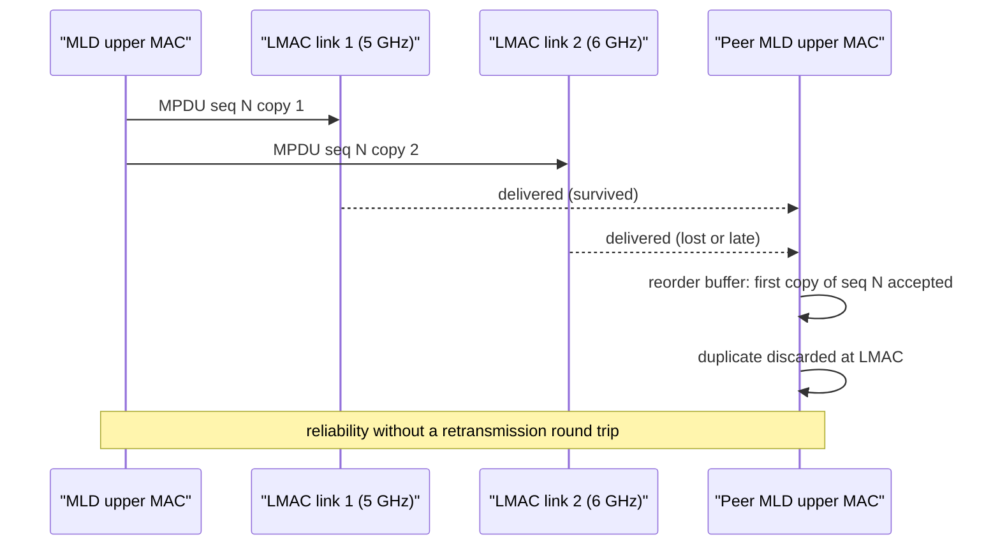

The critical insight for latency: **duplication is a reliability mechanism that does not spend latency**. A
retransmission costs one round trip plus a growing backoff; a duplicate costs airtime in parallel. That is the whole
argument for MLO duplication and for 802.1CB-style replication, and it is why 802.11bn's reliability target
(−25% MPDU loss) is pursued with MAPC and multi-link rather than with more retries.

### 4.4 Reliability across roaming

Roaming is where reliability fails in practice, because the failure is invisible to the radio: the link is fine, the
*identity* is being re-established.

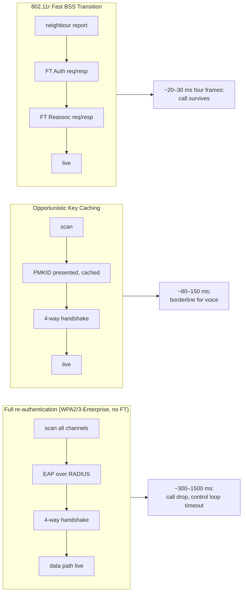

The latency is not only in the handshake. The roaming budget is **scan + authentication + reassociation**, and with
802.11k neighbour reports the scan term (200–400 ms across three bands) is cut substantially because the client
probes a handful of listed channels instead of all of them. 802.11v BSS Transition Management is what defeats the
*sticky client* — the device that will not roam at all, which is a reliability problem with no radio fix. Then:

- **OKC / PMKSA caching**: ~80–150 ms; works with clients that cannot do FT.
- **802.11r FT (over-the-air or over-the-DS)**: four frames, ~20–30 ms; the dominant enterprise answer.
- **802.11bn SMD (Seamless Roaming Domain)**: the standard's answer to the remaining gap — one entity spanning
  multiple AP MLDs so that a transition is an internal affair.

Design rule that beats every configuration knob: **engineer coverage overlap so that at the RSSI where a client
starts scanning (−65 to −70 dBm on most voice handsets), a candidate AP is already above the association
threshold.** No key-caching scheme rescues a client that has nothing to roam to.

---

## 5. Low latency — the protocol-layer mechanisms

Think of Wi-Fi's latency mechanisms as a four-rung ladder. Each rung refines the one below; none replaces it.

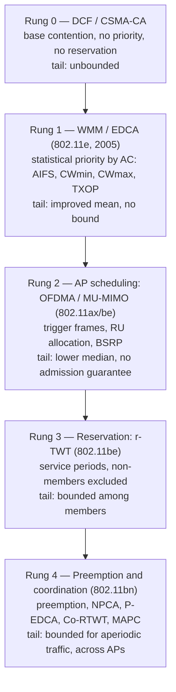

Rungs 1–3 are shippable today. Rung 4 is the 802.11bn programme. Note what is missing from rungs 1–3: **nothing
protects an aperiodic urgent frame that arrives while a long low-priority PPDU is already on the air.** That is the
specific hole preemption is meant to close, and it is why r-TWT is described as "ineffective for non-periodic low
latency traffic" — an emergency-stop packet does not wait for a service period.

| Mechanism | Generation | Latency effect | What it does not solve |
| --- | --- | --- | --- |
| **EDCA / WMM** (AC_VO, AC_VI, AC_BE, AC_BK) | 802.11e | Statistical: voice gets AIFS 2 and CWmin 3 vs BE's AIFS 3 / CWmin 15 | A single OBSS transmitter or legacy client still holds the channel |
| **MU EDCA** (802.11ax) | ax | Tightens EDCA during an AP-scheduled period so that AP-scheduled traffic is not out-competed by EDCA | Requires support on both sides; a `mu_edca_timer` that never expires locks in aggressive parameters |
| **TXOP limits** | 802.11e+ | Caps how long one AC may hold the medium after winning it | Too small a TXOP destroys aggregation efficiency |
| **Trigger-based uplink / BSRP** | ax/be | Removes the uplink contention entirely for scheduled STAs | Needs buffer status first (BSR), so it adds a signalling round trip unless piggybacked |
| **TWT** | ax | Reduces contention by time-spreading wakes | Power mechanism first, latency mechanism second — a long TWT interval *adds* latency |
| **r-TWT** | be | Reserve recurring service periods; non-members must finish before the SP and may not contend inside it | Periodic traffic only; no protection from outside the BSS |
| **SCS / MSCS** | be | The STA tells the AP the flow's QoS need (including latency-related characteristics), so classification and scheduling can be applied to the flow, not to a DSCP guess | Signalling only — it does not create capacity |
| **MLO (STR / EMLSR)** | be | Frame goes out on whichever link wins contention first: 95th-percentile latency reduced by roughly an order of magnitude with symmetric links | **Asymmetric occupancy can make it worse**; see below |
| **Preamble puncturing** | be | Keeps 320 MHz usable when 20 MHz is dirty, avoiding a channel change (which costs a CSA and possibly a CAC) | Does not help if *your* 20 MHz is the dirty one |
| **Preemption / NPCA / P-EDCA** | bn | Lets an urgent frame interrupt, or use a non-primary channel that is idle while the primary is busy | Draft-stage; hardware unknown |

### 5.1 Restricted TWT: how a bound is actually constructed

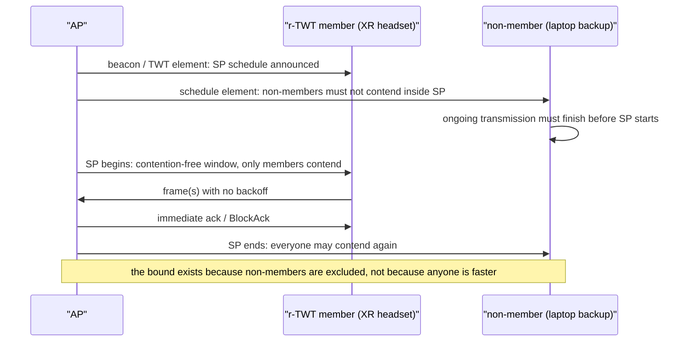

Measured/simulated results attached to this mechanism:

- **Bounded latency below 25 ms** is reported for 802.11be using r-TWT together with SCS-based QoS signalling — with
  the explicit caveat that this is still not sufficient for industrial applications needing sub-millisecond to
  few-millisecond bounds.
- Simulation studies of r-TWT report bounded worst-case latency for IoT and real-time traffic types, better energy
  efficiency and lower collision rate than PSM or plain DCF, and stable behaviour as the network grows.
- Vendor and industry material targets the XR case: motion-to-photon ~15–20 ms end to end, with the wireless leg
  held to a few milliseconds at high percentiles. **VERIFY**: those XR numbers are vendor/secondary material, not
  a standard's requirement — quote them as targets, not as guarantees.

### 5.2 MLO: the biggest single-link latency win, and its honest caveat

Multi-link operation is the most effective *shipping* latency mechanism, because it attacks channel access — the
worst-case term — rather than transmission.

Vendor measurements (95th-percentile latency, MediaTek Wi-Fi 7 MLO white paper):

| Network loading | Single link | NSTR | STR | EMLSR |
| --- | --- | --- | --- | --- |
| 10% | 30 ms | 8 ms | 2 ms | 6 ms |
| 40% | 70 ms | 10 ms | 8 ms | 12 ms |
| 70% | 150 ms | 22 ms | 18 ms | 18 ms |

That last row is the number to remember: **roughly 150 ms → 18 ms at the 95th percentile under 70% load**, i.e.
about an 85% reduction, and STR (independent radios, simultaneous TX/RX) beats NSTR (which suffers in-device
coexistence) and EMLSR (one radio at a time). A second vendor reports ~70% latency reduction from STR in dense
simulated and real environments. Independent academic work on multi-link access agrees in direction: an
order-of-magnitude 95th-percentile improvement with symmetrically occupied links, and latency as low as ~25% of
single-link.

The caveats are not optional — they are the difference between a design and a brochure:

1. **Symmetry decides the sign.** If the second link is much busier than the first, committing a packet to it can
   make worst-case latency *worse* than single-link, because the packet is stuck behind a frozen backoff. The
   proposed remedy is to defer the commit until a backoff actually expires.
2. **Single-radio MLO underdelivers on worst case.** An EMLSR device can only use the second link when the first is
   idle, so it gives negligible p95 improvement at medium-to-high load. Most shipping clients today are EMLSR.
3. **Diminishing returns past two links.** The finite-load models show most of the worst-case benefit comes from the
   first extra link.
4. **Fairness and the starvation anomaly.** Under contention, multi-radio MLO devices can starve neighbouring
   single-link BSSes; and at high load, adding links can raise delay. Channel assignment — one reserved channel plus
   one shared — beat more radios in the studies.
5. **Reordering.** Striping across links with different delivery delays creates cross-link skew and reorder-buffer
   stalls; the BlockAck window and the reorder buffer become tail-latency contributors.

---

## 6. Low latency — the driver and host-stack mechanisms

This is where you, as the owner of the box, have the most real control — and it is where a Linux AP is genuinely
better than a closed one.

### 6.1 AQL: bounding the queue you cannot see

The problem AQL solves is specific and worth being able to state precisely: mac80211 runs CoDel, but the sojourn
time it measures **excludes** the firmware/hardware queue. On 802.11ac-era chips that offload aggregation into
firmware, that queue is deep; packets pass through mac80211 transiently, so CoDel's measured sojourn time is almost
always below its target and CoDel does nothing — while the real latency is hundreds of milliseconds. Byte-based
queue limits (BQL) do not work because airtime per byte varies enormously between stations.

AQL's answer: cap each txq's *pending airtime*.

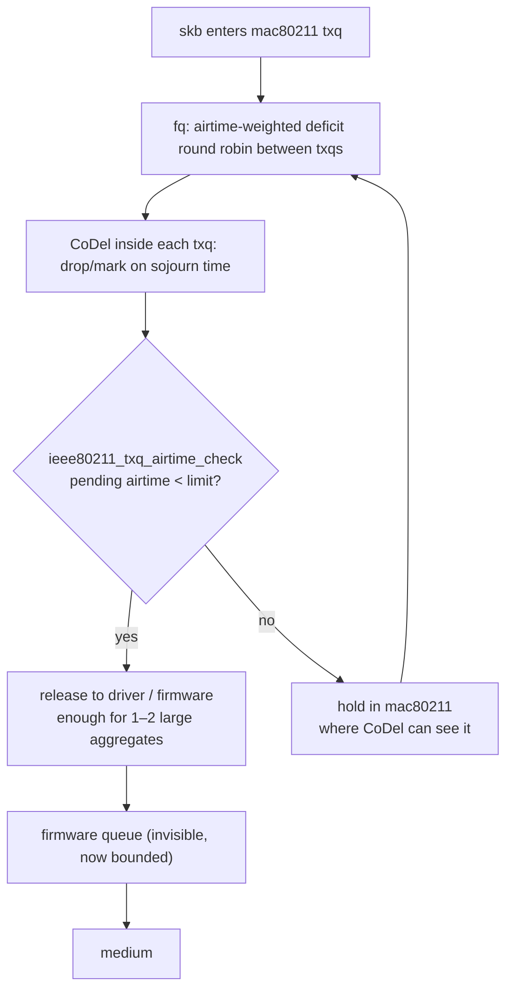

Anchors from the upstream commit that introduced it (Kan Yan, Toke Høiland-Jørgensen, merged via Johannes Berg):

| Constant | Value | Meaning |
| --- | --- | --- |
| `IEEE80211_DEFAULT_AQL_TXQ_LIMIT_L` | **5000** | Per-txq airtime limit, low (µs) |
| `IEEE80211_DEFAULT_AQL_TXQ_LIMIT_H` | **12000** | Per-txq airtime limit, high (µs) |
| `IEEE80211_AQL_THRESHOLD` | **24000** | Interface-wide pending airtime at which the per-station limit switches from high to low |
| `IEEE80211_DEFAULT_AIRTIME_WEIGHT` | **256** | Station airtime weight used to scale the limit |

The mechanism is **hysteresis**, and this is the state machine to be able to draw:

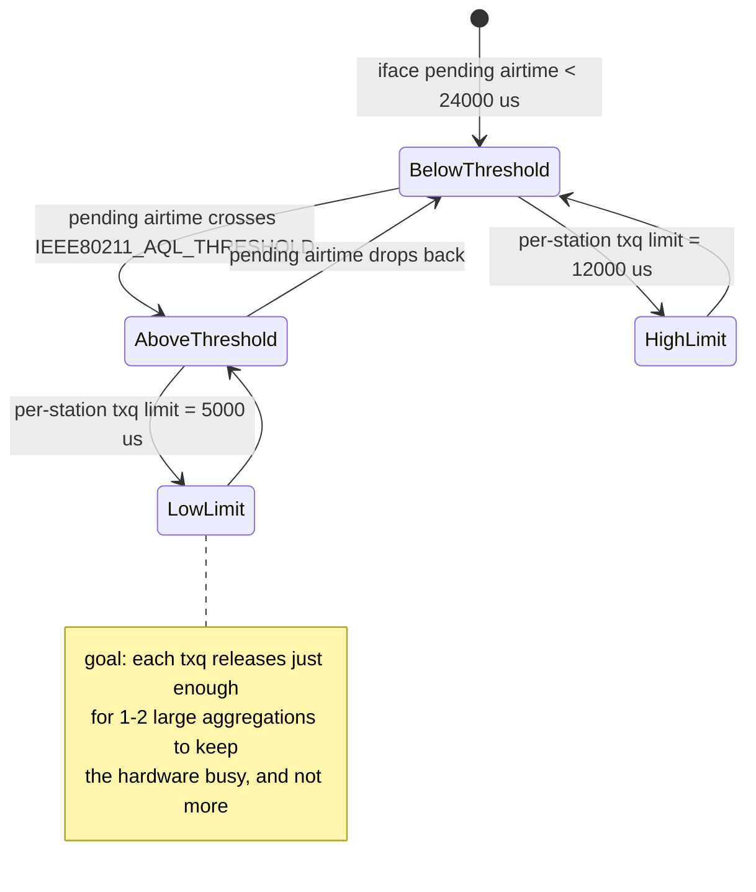

Two operational facts: AQL limits are **tunable at runtime** through mac80211's debugfs (`aql_txq_limit`, with
per-AC low/high rows), and **offload paths bypass them** — hardware flow offload, WED and vendor fast paths move
packets past mac80211, which is why turning them on often "fixes" throughput and silently destroys the latency work
you just did (see [[02-11 WLAN - OpenWrt and the Software Architecture of a Wireless System]] §9 and
[[02-10 WLAN - Baseband and Driver Architecture for Wi-Fi 6, 7 and 8 - Qualcomm as the Reference Design]] §11).

### 6.2 Fair queueing and airtime fairness: what the measurements actually show

The reference experiment (netdevconf 2.2, the mac80211 bufferbloat work) put three stations of different rates on
one AP and measured ICMP latency during a saturating TCP download:

| Queueing | Slow station (median) | Fast stations (median) |
| --- | --- | --- |
| FIFO (deep driver queue) | several hundred ms | several hundred ms |
| FQ-CoDel | > 200 ms | ~35 ms |
| FQ-MAC (per-station fair queueing) | same as the fast station under FQ-CoDel | another ~45% below FQ-CoDel |

Airtime share tells the same story: under FIFO the slow station took ~0.90 of the airtime and the two fast ones
~0.05 and ~0.10; with the airtime-fair scheduler the three were roughly equal. And — the counter-intuitive part —
**total network throughput went up**, because the fast stations could build proper aggregates instead of being
locked out of the driver queue by the slow station. Fairness here is a latency *and* a throughput fix.

### 6.3 TSQ: the latency/throughput trade that is already tuned for you

TCP Small Queues limits how much a flow may have in the host stack, which is good for latency and fatal for
aggregation: with only ~1 ms of data queued (`sk_pacing_shift` default 10), mac80211 cannot build a decent
A-MPDU. The fix that ships in the kernel is a compromise: mac80211 raises the pacing shift to **8** (~4 ms) for
locally originated TCP.

| `sk_pacing_shift` | ~queued data | ath9k 1-hop throughput |
| --- | --- | --- |
| 10 (default) | ~1 ms | 43.21 Mbps |
| 9 | ~2 ms | 78.17 Mbps |
| **8 (mac80211's choice)** | ~4 ms | **123.94 Mbps** |
| 7 | ~8 ms | 128.31 Mbps |

The commit message is explicit about the cost: **latency for competing flows rises from ~3 ms to ~10 ms** with the
change. So the default you are running is already a deliberate 3× throughput for ~7 ms latency trade. If you are
tuning a box for latency rather than throughput, this is one of the few places where you can move the other way —
and the research follow-up (Controlled TSQ) shows the trade can be softened by pacing to the flow's *rate* instead
of a fixed time: doubling of throughput on 802.11n and up to an order of magnitude on 802.11ac in their testbed,
with negligible latency increase.

### 6.4 The host-side checklist

| Knob | Effect on latency | Cost |
| --- | --- | --- |
| **qdisc: fq_codel / CAKE** on the egress that feeds the radio (and on the WAN side) | Removes bufferbloat: loaded latency from hundreds of ms to a few ms | A few percent of throughput; needs a shaper set below the real link rate to work |
| **CoDel parameters** (target 5 ms, interval 100 ms in the Linux qdisc; mac80211 exposes `txq_cparams` plus per-txq `TXQ_LIMIT` / `TXQ_MEMORY_LIMIT` / `TXQ_QUANTUM` over nl80211) | Sets the standing-queue delay you are willing to accept | Too small a target harms bursty throughput |
| **ECN / L4S** (RFC 9330/9331/9332, DualPI2, ECT(1) identification) | Congestion signalled by marking, not loss — no retransmission delay | Needs both endpoints and the AQM; RFC 9332's wired trials kept L4S queuing delay below 1 ms average and ≤2 ms at p99, while noting Wi-Fi trials were still in progress |
| **Interrupt moderation / coalescing** | Lower moderation = lower and less variable latency | Higher CPU load; can hurt throughput at high rates |
| **NAPI / threaded NAPI / busy polling** | Bounds RX latency under load | CPU; see [[04-4 Linux Interrupts - Types, Handlers, Threaded IRQs and Deferred Work]] |
| **IRQ affinity, RPS/XPS, CPU isolation, PREEMPT_RT, no frequency scaling** | Removes the multi-millisecond scheduling jitter that swamps a wireless latency budget on small platforms | Platform work; see [[04-2 Linux Embedded Development - Drivers, Applications and Core Subsystems]] |
| **Ring depths** | Shallower = less hidden queueing | Risk of drops under burst |
| **GSO/GRO/TSO** | Fewer, larger units → better aggregation | Adds batching delay; GRO in particular can add sub-ms to ms of reordering/batching |
| **Flow offload / WED / NSS / SFE** | Higher throughput, lower CPU | **Bypasses AQL and the qdisc** — latency and observability both get worse. Choose knowingly |
| **Congestion control choice** | A delay-based or scalable CC (BBR, Prague) avoids filling the buffer | Needs ECN/L4S in the network to realise the full benefit |

---

## 7. Determinism — what a bound actually requires

Determinism is not "low latency, reliably". It is a contractual statement: *a frame admitted to this class is
delivered within L, or is known to be lost*. To say that, four terms must each be bounded, and each has a different
mechanism:

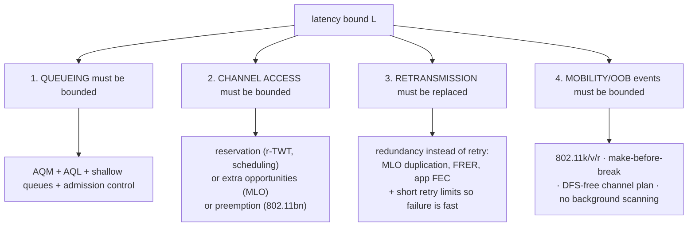

The uncomfortable corollary: **a determinism claim requires admission control**. If any amount of traffic may enter
the latency class, no bound survives. Wi-Fi's answer is SCS/MSCS — the station *declares* the flow's needs, and the
AP can accept or refuse. That is the qualitative difference between "WMM priority" and "a bound": WMM biases a
contention window; SCS is a request for a service the network may decline.

### 7.1 What is achievable — the honest table

| Goal | Achievable today | How | Honest limit |
| --- | --- | --- | --- |
| **p50 latency, unloaded** | 1–5 ms | Anything reasonably configured | PHY and access delay set a floor |
| **p99 latency, moderately loaded, one BSS** | tens of ms → single-digit ms | AQL + fq_codel + airtime fairness + WMM; ~18 ms at p95 with STR MLO at 70% load | The neighbour BSS is not in your schedule |
| **Tail latency, dense/loaded** | **tens to hundreds of ms without mitigation** | FIFO with deep firmware queues reaches hundreds of ms at p95 | This is the default state of most deployed Wi-Fi |
| **Bounded latency, periodic traffic** | **< ~25 ms** has been reported for 802.11be with r-TWT + SCS | r-TWT service periods, non-members excluded, SCS classification | Periodic only; simulation-backed; depends on all members obeying |
| **Bounded latency, aperiodic traffic** | Not standardised yet | Preemption / NPCA / P-EDCA in 802.11bn | Draft; no shipping hardware |
| **Sub-millisecond to few-ms bounds** | **Not achievable on Wi-Fi today** | — | Requires licensed-spectrum-style scheduling; 802.11bn may improve but the target is a *25% reduction*, not a millisecond |
| **Reliability without latency cost** | 10⁻² → <10⁻⁵ reported for MLO duplication | Duplicate on two links, drop the late copy | Costs airtime and needs two good links |
| **Roaming continuity** | ~20–30 ms with FT vs hundreds of ms to >1 s without | 802.11k neighbour reports + 802.11r FT + 802.11v steering | Client-dependent; sticky clients defeat all of it |

For context, the 802.11bn (Wi-Fi 8 / UHR) targets formalised in the PAR are: **at least 25% higher throughput at a
given SINR, 25% lower latency at the 95th percentile, and 25% fewer dropped MPDUs — especially across BSS
transitions** — plus better power save and P2P. Note what is *not* there: no absolute millisecond bound. The use-case
literature that motivates the work (industrial control, cooperative robots, e-health) asks for 0.1–100 ms latency at
99.9% to 99.9999999% reliability; the standard is aiming at a measured improvement over Wi-Fi 7, not at those
numbers wholesale.

### 7.2 A budget you can actually write down

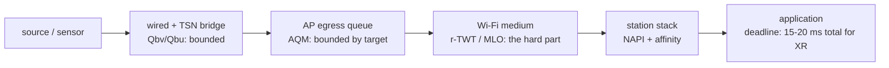

The pattern: put the bound where you can, and be explicit that the air is the weak term. A worked XR-style budget:
capture + encode + render + display maybe 10–15 ms; that leaves **a few milliseconds** for the wireless leg, which
is r-TWT/MLO territory and not "we enabled WMM" territory. If the application's real bound is 1 ms, the answer is
not a Wi-Fi configuration — it is a wire, a licensed band, or 5G URLLC with a scheduled grant.

---

## 8. Cross-technology comparison — where to draw the line

| Property | Wi-Fi (best configured today) | Wired TSN (802.1Qbv/Qbu/Qci) | 5G NR URLLC |
| --- | --- | --- | --- |
| **Medium access** | Contention, optionally scheduled by one AP | Scheduled, no contention | Scheduled by the gNB, grant-based |
| **Who controls the medium** | The AP, over its own BSS only | The whole bridged domain | The network, over licensed spectrum |
| **Typical latency** | single-digit ms unloaded; tens of ms loaded | sub-ms to a few ms | ~1 ms user-plane target class |
| **Determinism** | bounded only with reservation, and only inside the BSS | bounded by design | bounded by grant scheduling |
| **Reliability** | 99.9%-class with retries; better with duplication | 99.9999%-class with FRER | URLLC reliability classes (see [[01-4 Cellular IoT RedCap eRedCap and NTN]] and [[01-6 NR DU MAC Scheduler - Resource Allocation, HARQ and Real-Time Implementation]]) |
| **The failure mode** | A neighbour you do not manage | A misconfigured schedule | Coverage and handover |
| **Fast recovery** | Retransmission (costs latency) or duplication (costs airtime) | Redundancy on a second path | HARQ retransmission within a bounded timeline |

The honest engineering answer to "should this go over Wi-Fi?" is a decision tree, not a number:

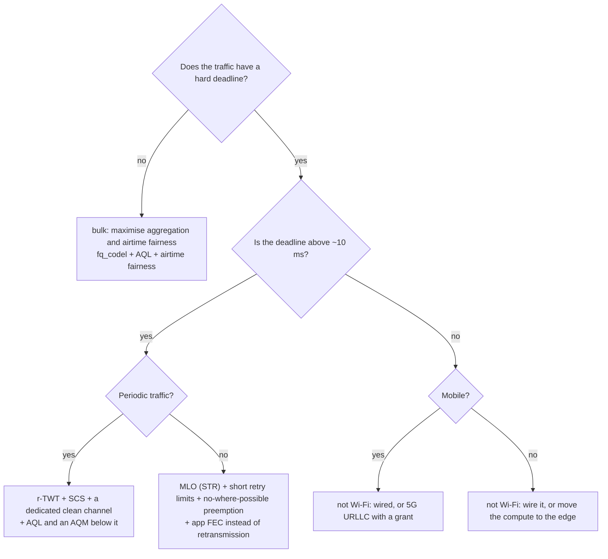

---

## 9. How to measure — and why most measurements are wrong

The most common failure is not a wrong setting; it is a wrong measurement that justifies a wrong setting.

| Mistake | Why it misleads | What to do instead |
| --- | --- | --- |
| Reporting the mean latency | The mean is dominated by the majority of good frames; failures hide in the tail | Report p50/p95/p99/p99.9 and the worst observed, with the sample count |
| Fewer than ~10⁴ samples for p99, ~10⁵ for p99.9 | The tail estimator has not converged | Run long enough; state N |
| Measuring RTT and calling it latency | Includes the return path, the peer stack and the app | Measure one-way with synchronised clocks, or say "RTT" explicitly |
| Measuring an idle link | Idle latency is a floor, not a performance figure | Always measure *under the load the deployment will carry* |
| Using TCP for a latency measurement | TCP's own congestion control, delayed ACKs and retransmissions dominate | Use UDP or ICMP with a known rate, plus a separate TCP test for throughput |
| Testing only over Wi-Fi | Mixes radio problems with upstream queue problems | Get a wired baseline first; the difference localises the fault |
| Trusting `iw station dump` retries without context | Retries are also caused by collisions, not only by weak signal | Read retries *and* failed *and* signal *and* the channel busy time from `iw survey` |
| Turning on offload and then measuring latency | Offload bypasses AQL and the qdisc, so your AQM is no longer in the path | Measure with and without; know which path your packets take |

Practical instrumentation on a Linux AP:

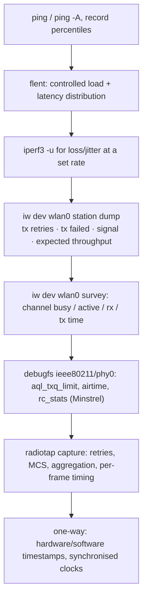

Minstrel's `rc_stats` in debugfs deserves a special mention: it gives per-rate throughput, EWMA probability and
success/attempt counts, with the chain entries marked — which is how you prove that a "reliability problem" is
actually a rate-selection problem sitting one MCS above what the SNR supports.

---

## 10. Five deployment recipes

### 10.1 Voice and video conferencing in an enterprise

Goal: sub-50 ms RTT under load, no drop on roam.
Do: WMM AC_VO/VI with correct DSCP→UP mapping; fq_codel or CAKE on the egress feeding the radio and on the WAN
side with a shaper set below the real rate; AQL on (default); airtime fairness on; **802.11k neighbour reports +
802.11r FT + 802.11v BTM**; steer with `bss_transition_request` (see [[02-11 WLAN - OpenWrt and the Software Architecture of a Wireless System]] §6);
disable 1/2/5.5/6 Mb/s legacy rates; design for −65 dBm overlap.
Expect: p99 RTT in the tens of ms under load; roam handovers ~20–30 ms.
Do not: expect a bound. You have improved the distribution; you have not made a promise.

### 10.2 Cloud gaming and XR

Goal: motion-to-photon 15–20 ms end to end; the wireless leg is a few ms.
Do: 6 GHz or a clean 5 GHz channel; **STR MLO** if the client supports it; r-TWT service periods aligned to the
frame rate if the AP and client support them; SCS/MSCS to classify the flow; **short retry limits** so a lost frame
is abandoned rather than chased; application FEC instead of retransmission; latency-aware queueing below it.
Expect: p95 in the 2–18 ms range depending on loading and mode (vendor data), with the usual symmetry caveat.
Do not: enable hardware flow offload and then wonder why your AQM stopped working.

### 10.3 Industrial control / AGV / AMR

Goal: tens of ms with very high delivery ratio, or an explicit "not Wi-Fi" decision.
Do: dedicated radio or SSID; r-TWT for periodic control traffic; fixed robust MCS with margin rather than adaptive
max-throughput rate; redundancy (MLO duplication or FRER-style replication) instead of retries; a channel plan with
no DFS channels if you cannot tolerate a CAC; wired backhaul.
Expect: bounded latency in the reported sub-25 ms class for periodic traffic — and an honest "no" if the real
requirement is sub-millisecond.
Do not: claim determinism from WMM priority.

### 10.4 Warehouses and handheld scanners (roaming-dominated)

Goal: no scan gaps, no sticky clients.
Do: 802.11k (kills most of the 200–400 ms scan), 802.11r or OKC, 802.11v BTM with a disassociation-imminent bit for
sticky clients, minimum-RSSI deauthentication thresholds, disable low rates, dense-but-controlled cell sizes with
15–20 dB SNR overlap.
Expect: ~20–30 ms FT transitions; the remaining failures will be client-side roaming algorithms, not your config.

### 10.5 Mixed bulk + interactive on one AP

Goal: bulk does not wreck interactive.
Do: per-flow fairness (fq_codel) so bulk traffic cannot occupy the queue; airtime fairness so a slow station cannot
occupy the medium; AQL so the firmware queue stays shallow; a shaper on the WAN side.
Expect: the FIFO case (hundreds of ms, and the slow station taking ~90% of airtime) to become tens of ms with fair
shares — and total throughput to *rise*, because fast stations finally get to aggregate.

---

## 11. Fault localisation

| Symptom | Most likely layer | Evidence to collect | Fix |
| --- | --- | --- | --- |
| Latency fine idle, hundreds of ms under a download | Queuing (bufferbloat) | Compare idle vs loaded ping; wired baseline | AQM (fq_codel/CAKE) + shaper; check AQL is active on the Wi-Fi side |
| Latency improved by AQM but still bad for one station | Airtime unfairness / low rate station | `iw station dump` rate and airtime vs others; airtime shares | Airtime fairness; disable lowest rates; move the station |
| p99 terrible, p50 fine | Tail from retries, aggregation or reordering | `iw station dump` retries/failed; radiotap retry counts; MLO link stats | Rate margin; shorter aggregates; retry limits; check MLO link symmetry |
| Latency spikes every few seconds | Background scanning, DFS, beacon/TWT interactions | Timestamps of spikes vs scan; DFS events in the log | Disable background scan; avoid DFS channels; check TWT interval |
| Loss high but signal strong | Collisions / hidden node, not SNR | Retries with good RSSI; RTS/CTS trial | RTS/CTS threshold; reduce OBSS; antenna/RF plan |
| AQM configured but latency unchanged | Offload bypassing the qdisc/AQL | Check flow offload / WED / vendor fast path state | Disable offload for the latency path, or accept the trade knowingly |
| Throughput collapses on locally generated TCP | TSQ starving aggregation | Compare local vs forwarded throughput; `sk_pacing_shift` | Leave mac80211's default (shift 8) unless latency is the priority |
| Roaming drops calls | No FT/OKC, or sticky client | Capture the reassociation time; check k/v/r support | 802.11k + 802.11r; 802.11v BTM; coverage overlap |
| Everything is fine in the lab and bad in production | The neighbour | Channel busy time from `iw survey`; OBSS count | Spectrum/channel plan, 6 GHz, multi-AP coordination |
| Latency bound never holds | No admission control / no reservation | Check whether SCS/r-TWT is actually negotiated | Add admission control, or restate the requirement |

---

## 12. Ten answers worth having on the tip of your tongue

1. **"Is Wi-Fi deterministic?"** Not by default. EDCA is statistical; a bound requires reservation (r-TWT),
   admission control (SCS) and, for aperiodic traffic, preemption — which is 802.11bn work in progress.
2. **"Where does Wi-Fi latency come from?"** Queuing, channel access, transmission, retransmission, plus host and
   driver processing. Idle: access and transmission. Loaded: **queuing dominates**, which is why the first fix is an
   AQM.
3. **"Why not just raise the data rate?"** Because worst-case latency is dominated by *channel access*, and a higher
   PHY rate does not shorten the wait for the medium.
4. **"Why does AQL exist?"** Because mac80211's CoDel cannot see the firmware queue; AQL caps each txq's pending
   airtime (5000/12000 µs low/high, 24000 µs interface threshold) so that CoDel's sojourn-time measurement is
   meaningful again.
5. **"What is the single biggest latency win available today?"** Fair queueing plus airtime fairness — hundreds of
   ms down to tens of ms in the reference measurements — and MLO, which attacks channel access: ~150 ms to ~18 ms
   at p95 under 70% load in vendor data.
6. **"How do you get reliability without latency?"** Stop retransmitting; duplicate. MLO duplication and
   FRER-style replication spend airtime in parallel, not round trips in series.
7. **"What is the roaming budget?"** Scan + authentication + reassociation. 802.11k shrinks the scan, 802.11r makes
   the authentication four frames (~20–30 ms) instead of a full EAP exchange (hundreds of ms to over a second).
8. **"Does aggregation hurt latency?"** Yes — you wait to build it, and a partial failure delays the rest. It is the
   classic throughput-for-latency trade, tuned by A-MPDU size and A-MSDU on/off.
9. **"Which offload should I enable?"** Any that gives throughput and CPU back — and every one of them bypasses your
   AQM and AQL, so enable offload on paths where you have no latency promise to keep.
10. **"When should the answer be 'not Wi-Fi'?"** When the requirement is a hard bound below a few milliseconds.
   802.11bn's target is a 25% improvement over Wi-Fi 7, not a millisecond guarantee.

---

## Anchors — verified facts

- **MAC retry limits (802.11 MIB, carried in CAPWAP RFC 5416 §6.7)**: `dot11ShortRetryLimit` default **7**,
  `dot11LongRetryLimit` default **4**, `dot11RTSThreshold` default **2347** octets,
  `dot11MaxTransmitMSDULifetime` default **512 TU** (0.524288 s), `dot11MaxReceiveLifetime` default **512 TU**.
  These are *attempts*, not retries after the first.
- **Retry limits are configurable over nl80211**: `NL80211_ATTR_WIPHY_RETRY_SHORT` (61) and
  `NL80211_ATTR_WIPHY_RETRY_LONG` (62), range 1–255, surfaced by `iw phy <phy> set retry short N long N`. Whether
  the value is honoured depends on the driver and rate control — on firmware-scheduled chips the limit lives in
  firmware.
- **Minstrel / Minstrel-HT**: statistics interval **100 ms**; EWMA with smoothing factor **75%** on the previous
  estimate; throughput estimate = success probability × bits ÷ airtime of one attempt, with a **1200-byte**
  reference frame; **10%** of frames are lookaround probes; a **four-entry MRR** chain (best throughput, next best
  throughput, best probability, lowest base rate); the chain is capped so total attempt time stays **≤ 26 ms**.
- **AQL** (mac80211, commit `3ace10f`): `IEEE80211_DEFAULT_AQL_TXQ_LIMIT_L` **5000**,
  `IEEE80211_DEFAULT_AQL_TXQ_LIMIT_H` **12000**, `IEEE80211_AQL_THRESHOLD` **24000**,
  `IEEE80211_DEFAULT_AIRTIME_WEIGHT` **256**; the intent is to release just enough per txq for **1–2 large
  aggregations** and keep the rest where CoDel can see it; limits are readable and writable through mac80211
  debugfs (`aql_txq_limit`, per-AC low/high).
- **Latency decomposition**: queuing, channel access, transmission and retransmission are the four constituent
  delays; with full-buffer contenders the **95th-percentile** channel-access latency of a single-link device is of
  the order of **hundreds of milliseconds**, and multi-link access gives an **order-of-magnitude** reduction
  (latency as low as ~25% of single-link).
- **MLO latency (MediaTek Wi-Fi 7 MLO white paper, 95th-percentile latency)**: at 10% loading single-link 30 ms,
  NSTR 8 ms, STR 2 ms, EMLSR 6 ms; at 40% loading 70 / 10 / 8 / 12 ms; at 70% loading **150 / 22 / 18 / 18 ms** —
  described as an improvement from 145 ms to 18 ms (>85%) over a Wi-Fi 6 single-link STA. A second vendor reports a
  **~70%** latency reduction from STR in dense environments.
- **MLO caveats (academic)**: the latency win depends on **symmetry of link occupancy** — with a much busier
  secondary link, STR can increase worst-case latency versus single-link; single-radio MLO (EMLSR) gives negligible
  p95 improvement at medium-to-high load; most of the worst-case benefit comes from the **first** additional link;
  multi-radio MLO can starve neighbouring single-link BSSs at high load.
- **r-TWT + SCS**: 802.11be using both is reported to achieve **bounded latency below 25 ms**, with the explicit
  caveat that this does not satisfy industrial applications needing sub-ms to few-ms latency, and that r-TWT does
  not protect **aperiodic** urgent traffic.
- **802.11bn (UHR / Wi-Fi 8) PAR targets**: at least **25% higher throughput** at a given SINR versus Wi-Fi 7,
  **25% lower latency at the 95th percentile**, and **25% fewer dropped MPDUs** especially for BSS transitions;
  plus improved AP power save and P2P operation. Standardisation began November 2023; draft 1.0 was finalised
  mid-2025 with publication targeted for **2028** (sources differ between March and May 2028 — **VERIFY** before
  quoting a month).
- **802.11bn feature set discussed in this note**: ELR, multi-AP coordination (Co-RTWT, Co-SR, Co-BF, Co-TDMA,
  Co-CR), seamless roaming domain (SMD), preemption, NPCA, P-EDCA — see
  [[02-9 WLAN - Time-Sensitive Networking Across Wi-Fi Generations]] for the TSN framing.
- **TSQ / pacing shift**: the mac80211 patch (commit `36148c2bbfbe`) sets `sk_pacing_shift` to **8** (~4 ms) for
  locally originated TCP instead of the default 10 (~1 ms); measured ath9k 1-hop throughput **43.21 → 78.17 →
  123.94 → 128.31 Mbps** for shifts 10/9/8/7, with the commit stating that latency for competing flows rises from
  **~3 ms to ~10 ms**. Controlled TSQ reports doubling of throughput on 802.11n and up to an order of magnitude on
  802.11ac with negligible latency increase.
- **Queueing measurements (netdevconf 2.2, mac80211 bufferbloat work)**: with a saturating TCP download, FIFO gives
  several hundred ms of ICMP latency; FQ-CoDel leaves the slow station above **200 ms** median and fast stations
  around **35 ms**; FQ-MAC brings the slow station to the fast station's FQ-CoDel median and cuts the fast stations
  by a further **~45%**. Airtime shares under FIFO were ~0.90 slow / ~0.05 and ~0.10 fast, becoming roughly equal
  with the airtime scheduler, with a **net increase in total throughput**.
- **CoDel / fq_codel defaults**: CoDel target **5 ms**, interval **100 ms**; the Linux `fq_codel` qdisc defaults
  include quantum 1514, 1024 flows, limit 10240 packets, 32 MB memory limit, ECN enabled, drop_batch 64. mac80211
  carries its own CoDel parameters (`txq_cparams` with target and interval) and exposes per-txq
  `NL80211_ATTR_TXQ_LIMIT`, `TXQ_MEMORY_LIMIT` and `TXQ_QUANTUM`.
- **L4S**: RFC 9330 (architecture), RFC 9331 (ECN protocol, ECT(1) as the L4S identifier), RFC 9332 (DualQ Coupled
  AQM). RFC 9332's wired experiments kept L4S queuing delay below **1 ms** average and ≤ **2 ms** at the 99th
  percentile with no AQM-induced loss, and states that trials of an L4S DualQ Coupled AQM on the outgoing Wi-Fi
  interface were in progress at the time of writing. 3GPP adopted L4S in 5G-Advanced Release 18 for XR; Nokia
  demonstrated L4S on Wi-Fi access points in 2019.
- **Roaming**: full re-authentication in WPA2/3-Enterprise is on the order of **hundreds of ms to >1 s**; OKC gives
  roughly **80–150 ms**; 802.11r FT reduces it to **four frames, ~20–30 ms** (or generally "below 50 ms"); without
  802.11k, channel scanning alone can cost **200–400 ms**. ITU-T G.114's one-way recommendation for voice is
  **150 ms**.
- **VERIFY**: the XR motion-to-photon figures (15–20 ms end to end, wireless leg ≤5 ms at p99.99) are vendor and
  industry-secondary material, not a standard's requirement. The 802.11bn publication month differs between
  sources. The "10⁻² to below 10⁻⁵" MLO duplication improvement figure is secondary material and should be quoted
  as a reported result, not a specification.

---

## Related

- [[02-8 WLAN - Scheduling - Channel Access, EDCA, OFDMA Resource Allocation, Airtime and Implementation]] — the
  scheduler these mechanisms act on: EDCA parameters, OFDMA allocation, airtime accounting and AQL from the
  scheduling side
- [[02-9 WLAN - Time-Sensitive Networking Across Wi-Fi Generations]] — the same problem framed as 802.1 TSN over
  Wi-Fi: the toolbox, the generation ladder, 802.1CB/FRER and the 802.11bn mechanisms
- [[02-10 WLAN - Baseband and Driver Architecture for Wi-Fi 6, 7 and 8 - Qualcomm as the Reference Design]] — where
  the firmware queue that AQL has to bound actually lives, and what the offload planes cost you
- [[02-11 WLAN - OpenWrt and the Software Architecture of a Wireless System]] — the box you configure all of this
  on: netifd, hostapd's ubus surface for steering, and the flow-offload/WED trade-off
- [[02-12 WLAN - openwifi - An Open-Source FPGA 802.11 Platform]] — the research counterpart: SIFS, slot time,
  contention window, CCA and retry limits as writable registers, which is how you measure what the mechanisms here
  actually do
- [[02-4 WLAN - Packet TX-RX Datapath and Offload Evolution]] — SoftMAC versus FullMAC and the five offload planes,
  which decide whether a host-side latency mechanism is even in the path
- [[02-6 WLAN - Multi-AP Roaming, Healing and Steering]] — where 802.11k/v/r are actually invoked, and the sticky
  client problem
- [[04-4 Linux Interrupts - Types, Handlers, Threaded IRQs and Deferred Work]] — NAPI, threaded IRQs and interrupt
  moderation as latency mechanisms
- [[04-6 Linux Device Drivers - Model, Probe, Data Path, Power and Bring-Up]] — the DMA and interrupt design that
  sets the floor on host-side latency
- [[01-7 NR HARQ - Retransmission Flow, Timelines and LTE Comparison]] — the cellular contrast: Wi-Fi retries after
  a failure, NR combines soft information and retransmits on a bounded timeline
- [[01-6 NR DU MAC Scheduler - Resource Allocation, HARQ and Real-Time Implementation]] — what "scheduled by the
  network" looks like when the medium is licensed

---

## References

1. IEEE Std 802.11-2020 (Revision of IEEE Std 802.11-2016). *IEEE Standard for Information Technology —
   Telecommunications and Information Exchange between Systems — Local and Metropolitan Area Networks — Specific
   Requirements — Part 11: Wireless LAN Medium Access Control (MAC) and Physical Layer (PHY) Specifications*.
   — Retransmission limits, RTS threshold, MSDU lifetime, EDCA, TWT, BlockAck.
2. Calhoun, P., Montemurro, M., and Stanley, D. (eds.). *CAPWAP Protocol Binding for IEEE 802.11*, RFC 5416,
   March 2009. <https://www.rfc-editor.org/rfc/rfc5416.html> — §6.7 carries the dot11 MIB defaults: short retry 7,
   long retry 4, RTS threshold 2347, Tx MSDU lifetime 512 TU.
3. IEEE Std 802.11e-2005, 802.11r-2008, 802.11k-2008, 802.11v-2011, 802.11ax-2021, 802.11be-2024 (EHT), and the
   802.11bn UHR draft — EDCA, FT, RRM, WNM, TWT/OFDMA, MLO/r-TWT/SCS, UHR.
4. Linux wireless. *Minstrel rate control — theory of operation*.
   <https://www.linuxwireless.sipsolutions.net/en/developers/Documentation/mac80211/RateControl/minstrel> —
   EWMA, 100 ms interval, 10% lookaround, the MRR chain and the 26 ms chain cap.
5. Yin, W., Hu, P., Indrupalli, G., and others. *MAC-Layer Rate Control for 802.11 Networks: Lesson Learned and
   Looking Forward*. arXiv:1807.02827. <https://arxiv.org/abs/1807.02827> — the survey with the Minstrel equations,
   the 75% EWMA factor and the retry-preference tables.
6. Yan, K., and Høiland-Jørgensen, T. *mac80211: Implement Airtime-based Queue Limit (AQL)*. Linux commit
   `3ace10f`, November 2019. <https://lore.kernel.org/r/20191119060610.76681-4-kyan@google.com> — the rationale and
   the constants 5000 / 12000 / 24000.
7. Høiland-Jørgensen, T., Kazior, M., Täht, D., Hurtig, P., and Brunstrom, A. *Bufferbloat mitigation in the WiFi
   stack — status and next steps*. Netdev 2.2.
   <https://www.netdevconf.info/2.2/papers/jorgensen-wifistack-talk.pdf> — FIFO versus FQ-CoDel versus FQ-MAC
   latency, airtime shares and the total-throughput result.
8. Høiland-Jørgensen, T. *[PATCH] mac80211: Adjust TSQ pacing shift*. Linux commit `36148c2bbfbe`, February 2018.
   <https://lore.kernel.org/linux-wireless/20180202151105.30043-1-toke@toke.dk/t/> — the throughput table and the
   ~3 ms to ~10 ms latency cost.
9. Grazia, C. A., Patriciello, N., Høiland-Jørgensen, T., Klapez, M., Casoni, M., and Mangues-Bafalluy, J.
   *Adapting TCP Small Queues for IEEE 802.11 Networks*. IEEE PIMRC 2018, pp. 1–6.
   <https://doi.org/10.1109/PIMRC.2018.8581048> — Controlled TSQ and its throughput/latency result.
10. Corbet, J. *TCP small queues and WiFi aggregation — a war story*. LWN.net, 2018.
    <https://lwn.net/Articles/757643> — the engineering narrative behind the pacing-shift change.
11. Nichols, K., and Jacobson, V. *Controlling Queue Delay*. Communications of the ACM 55(7), 2012 — CoDel: target
    5 ms, interval 100 ms, minimum sojourn time as the control variable.
12. Hoeiland-Jorgensen, T., McKenney, P. E., Täht, D., Gettys, J., and Dumazet, E. *Controlled Delay Active Queue
    Management*, RFC 8289; *The Flow Queue CoDel Packet Scheduler*, RFC 8290. IETF, 2018.
13. Briscoe, B., Schepper, K. D., Bagnulo, M., and White, G. *Low Latency, Low Loss, and Scalable Throughput (L4S)
    Internet Service: Architecture*, RFC 9330; Schepper, K. D. and Briscoe, B., *The ECN Protocol for L4S*,
    RFC 9331; Schepper, K. D., Briscoe, B., and White, G., *DualQ Coupled AQM for L4S*, RFC 9332. IETF, January
    2023. <https://www.rfc-editor.org/rfc/rfc9332.html> — the L4S queue measurements and the Wi-Fi trial note.
14. MediaTek. *Wi-Fi 7 MLO (Multi-Link Operation) White Paper*, WF7MLOWP0622.
    <https://www.mediatek.com/hubfs/Wi-Fi-7-MLO-White-Paper-WF7MLOWP0622.pdf> — the 95th-percentile latency table
    for single-link, NSTR, STR and EMLSR at 10/40/70% load.
15. Kedar, E. *Single-Chip MLO Coordination Enables Path to Lowest Latency*. MaxLinear white paper, 2025.
    <https://www.maxlinear.com/news/white-papers/2025/single-chip-mlo-coordination-enables-path-to-lowest-latency>
    — ~70% latency reduction from STR as interference rises.
16. López-Raventós, A., Wilhelmi, F., Barrachina-Muñoz, S., and Bellalta, B. *Multi-link Operation in IEEE 802.11be
    — related analyses*: arXiv:2111.09281 (latency over real occupancy traces), arXiv:2210.07695 (the starvation
    anomaly), arXiv:2212.12420 (finite-load delay model), arXiv:2205.15065 (coexistence with legacy single-link),
    arXiv:2305.02052 (latency and throughput together).
17. Ofinno. *Wi-Fi 8: Ultra High Reliability in the Unlicensed Bands*.
    <https://ofinno.com/wp-content/uploads/2023/01/Wi-Fi-8-Ultra-High-Reliability-in-the-Unlicensed-Bands_Digital-Copy.pdf>
    — the statement that 802.11be with r-TWT and SCS achieves bounded latency below 25 ms, and why that is still
    not enough for sub-ms industrial use.
18. Mozaffariahrar, E., Wilhelmi, F., Galati-Giordano, L., Imputato, P., Menth, M., and Avallone, S. *R-TWT in
    Wi-Fi 7 and Beyond: Enabling Bounded Latency, Energy Efficiency, and Reliability*. Universitat Pompeu Fabra /
    University of Tuebingen / Nokia Bell Labs / University of Naples.
    <https://www.upf.edu/documents/d/fwilhelmi/r-twt_in_wi-fi_7_and_beyond_enabling_bounded_latency_energy_efficiency_and_reliability-pdf>
    — ns-3 evaluation of r-TWT: worst-case latency, energy, collisions, scalability.
19. Ha, T., Shafin, R., and Manasi. *IEEE 802.11bn (Ultra-High Reliability, Wi-Fi 8)*. Samsung Research, 2025.
    <https://research.samsung.com/blog/IEEE-802-11bn-Ultra-High-Reliability-UHR-Wi-Fi-8> — the PAR targets quoted
    verbatim: +25% throughput at a given SINR, −25% latency at the 95th percentile, −25% dropped packets.
20. Deng, C., Fang, X., Han, X., Wang, X., Zhong, L., and others. *What Will Wi-Fi 8 Be? A Primer on IEEE 802.11bn
    Ultra High Reliability*. arXiv:2303.10442. <https://arxiv.org/html/2303.10442v2> — the use-case table with
    reliability 99.9%–99.9999999% and latency 0.1–100 ms.
21. Sahoo, A., and others. *Next Generation Wi-Fi and 5G NR-U in the 6 GHz Bands: Opportunities & Challenges*.
    IEEE (ieeexplore document 9165719).
    <https://ieeexplore.ieee.org/ielaam/6287639/8948470/9165719-aam.pdf> — the four latency components and the
    multi-link results: hundreds of ms at p95 for single link, order-of-magnitude reduction with MLA, as low as 25%
    of single-link latency.
22. ITU-T Recommendation G.114. *One-way transmission time* — the 150 ms one-way recommendation used as the voice
    roaming budget.
23. Høiland-Jørgensen, T., and Täht, D. *FLENT: The FLExible Network Tester* — the tool used for controlled
    load-plus-latency measurement. <https://flent.org>
24. Gettys, J., and Nichols, K. *Bufferbloat: Dark Buffers in the Internet*. ACM Queue 9(11), 2011 — the problem
    that AQM and AQL exist to solve.
25. Mozaffariahrar, E., and others, and the IEEE 802.11bn UHR topic interest group contributions — P-EDCA, NPCA,
    preemption and multi-AP coordination as the aperiodic-traffic answer (see also reference 20 for the framing).
26. 3GPP TS 22.261 and TR 22.804 — the URLLC service requirements used in the cross-technology comparison, and
    3GPP TS 23.501 for ATSSS (Access Traffic Steering, Switching and Splitting) as the multi-access reliability
    counterpart.
27. Linux `iw` source, `phy.c` — `iw phy <phy> set retry short N long N`, `set rts`, `set frag`, `set coverage`,
    `set distance`, `set txq`, all carried over `NL80211_CMD_SET_WIPHY`.
28. Linux kernel, `net/mac80211/` — `airtime.c` (AQL accounting and limits), `tx.c` (fq/codel integration,
    `struct codel_params {target, interval}`, `txq_limit`), `rate.c` (retry counts from `wiphy->retry_short/long`),
    `debugfs.c` (`aql_txq_limit` per AC).

---

Copyright (c) 2026 Washington Ruan. All rights reserved.
