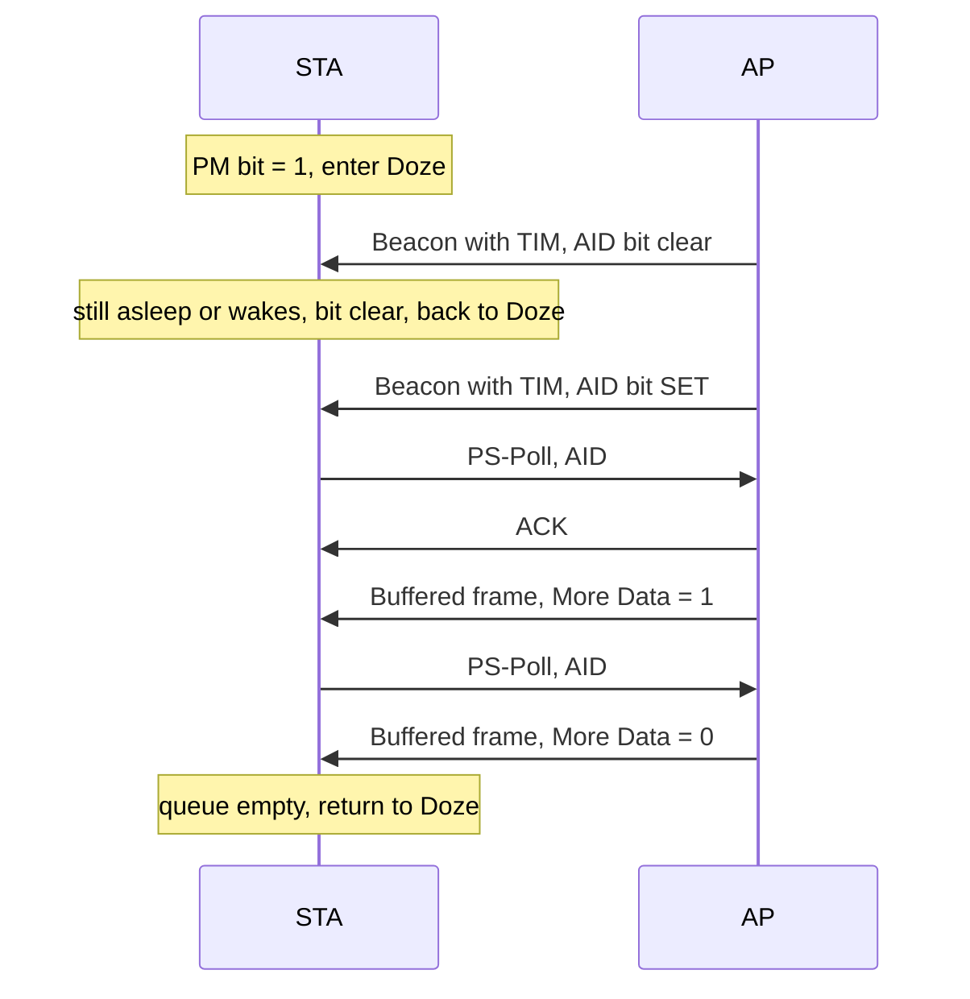
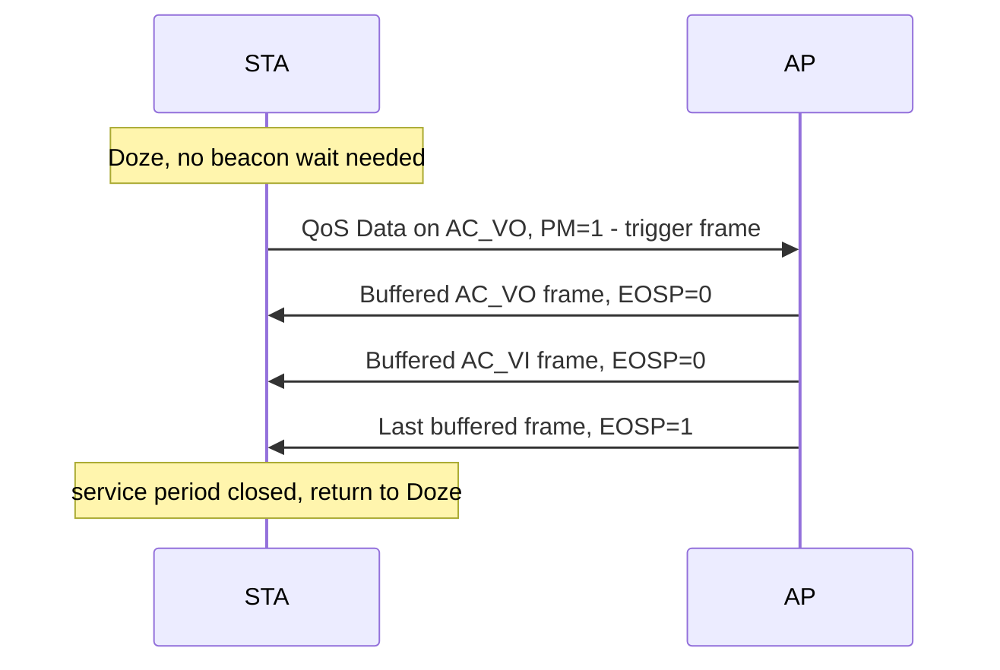
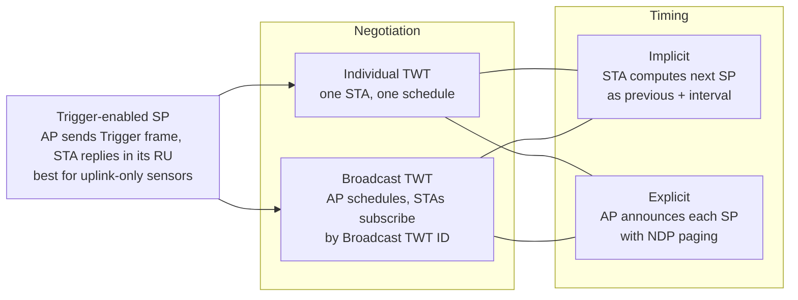
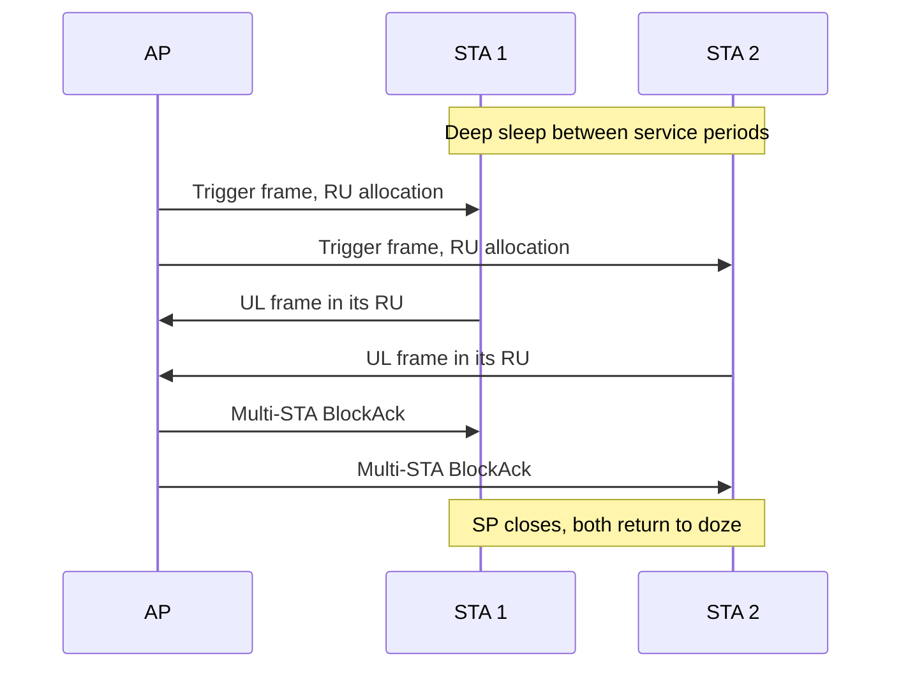
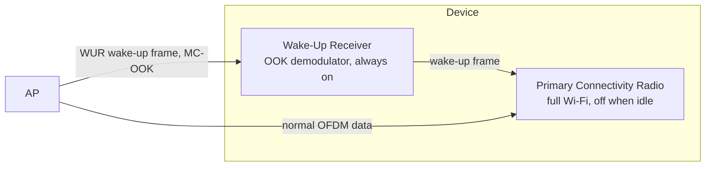
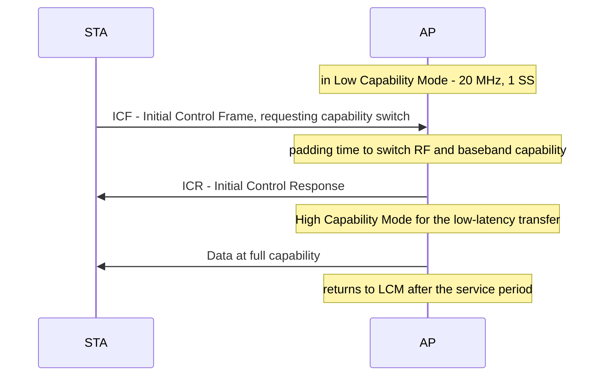

# WLAN — Power Saving Mechanisms and Evolution

Companion to [[02-1 WLAN - Wi-Fi Generations Evolution]]. That note asks *how fast and how reliably*; this one asks **at what energy cost**, and treats power saving as its own evolutionary line rather than a footnote under each generation.

The through-line: every generation has attacked a *different* term of the same energy equation, and the ones that failed failed because they optimised the wrong term.

## 0. The energy equation

A battery-powered STA burns energy in four places. Everything in this note is an attack on one of them:

| Term | Meaning | Dominant when |
| --- | --- | --- |
| `E_rx` | Receiver on, decoding | Idle listening — **usually the largest term for IoT** |
| `E_tx` | Transmitter on | Uplink-heavy sensors, high TX power at range |
| `E_sleep` | Sleep-clock + leakage | Very long sleeps; grows with sleep time |
| `E_sync` | Wake margin, clock re-acquisition, scan/association | Every wake cycle — a fixed tax per wake |

The practical form:

```
E_total ≈ P_rx · T_rx  +  P_tx · T_tx  +  P_sleep · T_sleep  +  N_wakes · E_sync
```

Three consequences that structure the whole field:

1. **Idle listening dominates.** Park and Adnan (2016) showed that for low-to-moderate traffic IoT, energy spent monitoring the channel with nothing to receive exceeds energy spent transmitting. Any mechanism that shrinks `T_rx` without adding `N_wakes` wins.
2. **There is a floor per wake.** Re-acquiring timing, PLL lock and AGC costs roughly the same whether you receive 1 byte or 10 KB. That is why *fewer, longer, scheduled* wake-ups beat *frequent, short* ones — and why aggregation is a power feature, not just a throughput feature.
3. **Capability costs power even when idle.** A receiver listening at 320 MHz with 8 spatial streams burns far more than one listening at 20 MHz with 1 stream, even with no traffic. Lowering capability during listen is a distinct lever from sleeping longer.

Energy per bit is the metric, not power. Pefkianakis, Li and Lu (ICNP 2011) demonstrated this sharply for 802.11n: keeping one receive chain active can *lower* instantaneous power but *raise* total energy, because the rate collapse prolongs the transfer.

## 1. Taxonomy: four families of mechanism

```mermaid
graph TD
    A["Wi-Fi power saving"] --> B["Family 1: shorten listening duty<br/>sleep more, wake less often"]
    A --> C["Family 2: cut per-delivery overhead<br/>fewer frames per byte delivered"]
    A --> D["Family 3: lower capability while awake<br/>narrow BW, fewer chains when idle"]
    A --> E["Family 4: remove useless awake time<br/>less contention, fewer retries, no overhearing"]

    B --> B1["TIM / DTIM + listen interval<br/>802.11-1997"]
    B --> B2["TWT scheduled service periods<br/>802.11ah / 802.11ax"]
    B --> B3["Wake-up radio paging<br/>802.11ba-2021"]
    B --> B4["Scheduled AP power save<br/>802.11bn"]

    C --> C1["PS-Poll one frame per poll"]
    C --> C2["U-APSD service period burst<br/>802.11e"]
    C --> C3["Trigger-based UL OFDMA<br/>802.11ax"]
    C --> C4["A-MPDU / BlockAck aggregation"]

    D --> D1["SMPS static and dynamic<br/>802.11n"]
    D --> D2["20 MHz-only STA<br/>802.11ax"]
    D --> D3["Operating Mode control<br/>802.11ac"]
    D --> D4["Dynamic Power Save LCM / HCM<br/>802.11bn"]

    E --> E1["RAW / TIM segmentation<br/>802.11ah"]
    E --> E2["BSS Color + spatial reuse<br/>802.11ax"]
    E --> E3["Restricted TWT r-TWT<br/>802.11be"]
    E --> E4["VHT TXOP power save<br/>802.11ac"]
```



Read the evolution as: **family 2 was solved first (1997–2005), family 3 next (2009–2013), family 1 properly only in 2016–2021, and family 4 is what Wi-Fi 8 is doing.** The ordering is not chronological perfection — it is the order in which the remaining term became the biggest one.

## 2. STA power states

```mermaid
stateDiagram-v2
    [*] --> Off
    Off --> DeepSleep: RTC only, context in retention RAM
    DeepSleep --> Doze: sleep clock running, RF off
    Doze --> Rx: scheduled wake - beacon, TWT SP, or WuR page
    Rx --> Tx: frame to send
    Tx --> Rx: await ACK or response
    Rx --> Doze: EOSP=1 or More Data=0
    Doze --> Active: host wake - WoWLAN, app trigger
    Active --> Doze: inactivity timer
    DeepSleep --> [*]
    note right of Doze
        Lowest state that still honours
        the TWT or DTIM schedule.
        Clock drift sets the wake margin.
    end note
    note right of Rx
        Receive power depends on capability:
        BW, number of active chains, MCS.
    end note
```



The 1997 base standard already defined the transceiver states — Transmit, Awake, Doze — plus management modes (Continuous Active, Temporary Active, Power-Save Polling, Power-Save Non-Polling). The *states* have barely changed in 30 years; what changed is how precisely a device can predict when to leave Doze.

## 3. Generation by generation

### 3.1 802.11-1997 / 1999 — Legacy Power Save (PS-Poll)

**Mechanism.** The STA sets the Power Management bit in the Frame Control field; the AP starts buffering. Every beacon carries a TIM information element whose partial virtual bitmap has one bit per AID. A sleeping STA wakes at its listen interval, decodes the TIM, and if its bit is set sends a **PS-Poll** control frame. The AP releases **one** buffered frame, with More Data set if more remain. Multicast and broadcast are buffered until a **DTIM** beacon (every `DTIM Period` beacons), and all sleeping STAs must wake for it.



**Why it is expensive.** Three costs, all structural:

- **Beacon-synchronised.** The STA cannot learn that traffic arrived until the next scheduled TIM. At a 100 ms beacon interval, a frame arriving just after a beacon waits ~100 ms to even be *announced*.
- **One PS-Poll per frame.** A burst of 20 frames costs 20 round trips. Each is a full channel access with backoff.
- **Wake for every TIM.** The STA pays `E_sync` every listen interval whether or not anything arrived.

**Design levers.** `Listen Interval` (how many beacons to skip — expressed in beacon intervals and rounded to a multiple of the DTIM period) and `DTIM Period`. Both trade latency against battery; DTIM period also governs multicast latency, which is why mDNS/ARP-heavy environments keep it at 1–3.

**Status.** Still present, still the fallback when nothing better is negotiated. Useful default for simple datagram devices; unusable for voice.

### 3.2 802.11e-2005 — WMM Power Save and U-APSD

802.11e introduced **APSD** (Automatic Power Save Delivery) in two forms:

- **S-APSD** (scheduled): the AP commits to delivery windows at negotiated intervals. Requires tight scheduling; essentially never implemented.
- **U-APSD** (unscheduled): the *client* triggers the service period. This is the one that matters.

**Mechanism.** At association the STA declares, per Access Category, whether that AC is **trigger-enabled** and/or **delivery-enabled** (QoS Info field). Any QoS Data or QoS Null frame sent on a trigger-enabled AC opens a service period; the AP bursts all buffered frames for the delivery-enabled ACs, setting **EOSP = 1** on the last one. `Max SP Length` caps frames per SP: 0 = unlimited, 1 = 2, 2 = 4, 3 = 6.



**What it buys.** The latency floor drops from *beacon interval* (tens of ms) to *radio turnaround* (a few ms). A VoIP handset knows exactly when it has uplink audio to send, so the uplink frame doubles as the trigger and the downlink arrives in the same SP — no dedicated poll, no beacon wait.

**WMM-PS** is the Wi-Fi Alliance certification on top (WMM Power Save specification): it tests trigger generation, EOSP recognition, Max SP negotiation and AC-boundary behaviour. Interop failures between specific client/AP pairs are common, and a client whose trigger frame the AP does not recognise silently falls back to PS-Poll with a 10–30 ms per-packet penalty.

### 3.3 802.11n-2009 — SMPS and PSMP

**SMPS (Spatial Multiplexing Power Save).** MIMO circuitry power grows with active RF chains; an 802.11n receiver in high-rate MIMO configuration was measured drawing ~2.5 W. SMPS lets a STA keep one receive chain active:

- **Static SMPS:** one chain, permanently. The AP must transmit single-stream until told otherwise. Simple, but the rate collapse can lengthen transmissions and *increase* total energy.
- **Dynamic SMPS:** one chain normally; the AP sends **RTS** first, the STA wakes the other chains and replies **CTS**, then receives multi-stream.

`VERIFY` — the direction of travel is confirmed; Pefkianakis et al. measured up to 1.15 W instantaneous saving but showed SMPS can be worse in **per-bit energy**, and their MRES algorithm beat SMPS by up to 37%. The lesson generalises: *power* and *energy* are different metrics, and a rate reduction is an energy tax.

**PSMP (Power Save Multi-Poll).** AP-scheduled downlink/uplink bursts in a contention-free period, extended from 802.11e APSD. `VERIFY` — it was specified in 802.11n but never achieved deployment; I have not confirmed its status in later maintenance revisions, so do not assert either "still in" or "removed".

**Indirect 11n wins.** A-MPDU and compressed BlockAck are power features: fewer channel accesses and fewer ACKs for the same bytes means less `T_rx` and fewer `E_sync` events.

### 3.4 802.11ac-2013 — VHT TXOP Power Save and OM Control

**VHT TXOP PS.** The idea: identify as early as possible that the current frame is *not* for you, and doze for the remainder of that TXOP. Conditions to enter doze include: not a member of the `GROUP_ID` in the RXVECTOR; `PARTIAL_AID` mismatch; `NUM_STS = 0` while a group member; or receiving your own frame with More Data = 0. The AP signals permission per TXOP via `TXOP_PS_NOT_ALLOWED` in the TXVECTOR, and must open such TXOPs with an RTS/CTS (or CTS-to-self) so STAs learn the TXOP duration. Capability is the `VHT TXOP PS` bit in VHT Capabilities.

**OM Control (Operating Mode).** A control field letting a STA change its operating **channel width** and **number of spatial streams** (and SMPS mode) without re-associating — the ancestor of Wi-Fi 8's capability switching, but at frame granularity rather than as a power state.

**Honest assessment.** These are *fine-grained* savings — a fraction of one TXOP. They matter for dense MU-MIMO cells where a STA overhears most of the airtime; they are not what makes a sensor last a year.

### 3.5 802.11ah-2016 — Wi-Fi HaLow: the first purpose-built low-power design

Sub-1 GHz, up to ~8191 AIDs per AP, and the amendment where **TWT first appeared**.

| Mechanism | Mechanism detail | Function |
| --- | --- | --- |
| **TIM segmentation / page slicing** | Split the partial virtual bitmap across pages and across TIM beacons | A STA decodes only its own page/group instead of a beacon sized for 8000 STAs |
| **Non-TIM STA + TWT** | STA negotiates wake instants at association and never reads a TIM beacon | Removes beacon reception entirely; deep sleep for minutes to hours |
| **RAW (Restricted Access Window)** | AP schedules windows in which only an AID group may contend (RPS element) | Collapses collision probability in dense cells; fewer retries = less `T_rx` |
| **BDT (Bidirectional TXOP)** | UL and DL frames exchanged inside one reserved TXOP | A request/response exchange completes in one wake instead of three contentions |
| **Relay AP** | Entity that is both AP and STA, max two hops | Edge STA uses a high MCS on both short hops instead of a slow single long hop |
| **Extended max idle** | Scaling factor on the max idle period | Sleep measured in hours, not beacon intervals |

**NDP paging** is the elegant part: during a TWT service period the AP sends a Null Data Packet carrying a compact bitmap, so the STA checks pending traffic without decoding a full beacon.

**Status.** Real, shipping, sub-1 GHz only. Its TWT was successful enough to be carried into 802.11ax for mainstream Wi-Fi.

### 3.6 802.11ax-2021 — Wi-Fi 6: TWT goes mainstream

TWT element (EID 216), negotiated by TWT Setup / Teardown action frames:

| Field | Size | Meaning |
| --- | --- | --- |
| Request Type | 15 bits | NDP paging, request type, implicit/explicit, announced/unannounced, trigger-enabled, wake duration unit |
| Target Wake Time | 64 bits | TSF time of first service period, µs |
| TWT Wake Interval Mantissa | 16 bits | with exponent |
| TWT Wake Interval Exponent | 5 bits | `interval = mantissa × 2^exponent` µs |
| Nominal Minimum Wake Duration | 8 bits | SP length, units of 256 µs |
| Channel | 8 bits | broadcast TWT only |

Two orthogonal axes give four variants:



**Why trigger-enabled TWT is the important one:**



Fifty sensors are served in one triggered round; each is on air for a fraction of the SP. The Trigger frame also lets the STA start transmitting without waiting for a NAV-setting frame, which shortens its awake window.

**Opportunistic Power Save (OPS).** The AP splits the beacon interval into broadcast TWT SPs and, at the start of each, announces which STAs it will serve; unaddressed STAs doze until the next SP. TWT combined with the legacy TIM element.

**Other 11ax power items:** 20 MHz-only STA (a declared IoT device class — the STA never has to receive wide bandwidths), and **BSS Max Idle Period**, which raises the inactivity timeout so a STA need not wake merely to keep its association alive. `VERIFY`: the Wi-Fi Alliance's Release 2 material states "up to 80 hours", while the field itself is 16 bits in units of 1000 TU (≈18.6 h at the maximum encoding) — I have not reconciled these two numbers, so quote the WFA figure only as WFA's.

**Wi-Fi CERTIFIED 6 Release 2** (announced 5 January 2022) made three of these certifiable: **broadcast TWT**, **extended sleep time**, and **dynamic multi-user SMPS** (rapidly turning receiver chains on and off; the sequence starts with a single spatial stream plus RTS/CTS, after which the addressed STA goes to maximum capability and unaddressed STAs sleep). Release 2 also added uplink MU-MIMO. This is the practical answer to "when did Wi-Fi 6 power saving become a buying criterion": 2022, at certification level.

### 3.7 802.11ba-2021 — Wake-Up Radio: a second, tiny radio

The most radical idea in Wi-Fi power saving, and the one to compare against 3GPP LP-WUS (see [[01-4 Cellular IoT RedCap eRedCap and NTN]]).



| Property | Value |
| --- | --- |
| Published | IEEE Std 802.11ba-2021, **8 October 2021** (D8.0 approved March 2021 at 98%) |
| Modulation | MC-OOK (multi-carrier on-off keying) on **13 centre subcarriers** of a 20 MHz channel |
| Rates | LDR **62.5 kb/s**, HDR **250 kb/s** |
| Active receiver power | target **< 1 mW** (PAR wording: an energy-efficient data reception mode consuming less than 1 mW without increasing latency) |
| Frame types | WUR Beacon, WUR Wake-up, WUR Short Wake-up, WUR Discovery, WUR Vendor Specific |
| MAC | WUR mode setup, **WUR duty cycle** operation, WUR power management |
| Security | optional protection with BIP-CMAC-128 and WIGTK/WTK keys |

The structural change: **the always-on function moves to a radio that costs almost nothing.** Every previous mechanism still required the main receiver to wake periodically to *find out* whether anything was waiting; WUR removes that poll from the expensive radio entirely.

Why it has not taken over: it adds a second RF path, cost, and board area; the WuR may have a different range than the PCR it guards; and the OOK waveform needs coexistence study with legacy OFDM. Proposals to integrate WuR into 802.11bn exist for exactly this reason.

### 3.8 802.11be-2024 — Wi-Fi 7: r-TWT

802.11be was published **22 July 2025**. Its power contribution is **Restricted TWT**, and its motivation is subtly different from TWT's: r-TWT is a *latency* feature that happens to save energy.

**Mechanism.** The AP broadcasts an r-TWT schedule for the BSS; STAs negotiate membership. Inside an r-TWT SP, member STAs get **exclusive, contention-free** access: r-TWT-capable STAs must stop transmitting before the SP, and legacy STAs are quieted during it. It can run in trigger mode, with the AP triggering members. Schedule alignment with **802.1Qbv** gate-open times is the explicit design intent, per the 802.11–802.1 TSN liaison.

| | TWT (11ax) | r-TWT (11be) |
| --- | --- | --- |
| Goal | Save STA energy | Bounded latency *and* energy |
| Medium access | Normal EDCA, or triggered | Restricted to members; others quieted |
| Interference | Possible | Minimised by exclusive access |
| Alignment | None | Designed to align with 802.1Qbv schedules |
| Optionality | Widely implemented | Optional in 11be; **not required for Wi-Fi CERTIFIED 7** |

Simulation work (Mozaffari Ahrar, Wilhelmi, Galati-Giordano, Imputato, Menth, Avallone; ns-3) finds r-TWT achieves bounded worst-case latency for IoT and real-time traffic and beats legacy PSM and DCF on energy efficiency and collision rate, scaling stably with network size. Work on **multi-link r-TWT** (Ergenç, Zakrzewski, Dressler, TU Berlin) shows scheduling r-TWT SPs across MLO links yields predictable latency plus significant energy reduction versus unscheduled operation.

`VERIFY` — market status. A 2026 CWNP literature review states that r-TWT is **not** required for Wi-Fi CERTIFIED 7 and that, at time of writing, common client devices and APs do not advertise support. Treat "Wi-Fi 7 devices use r-TWT" as unproven.

**MLO caveat worth stating in interviews:** multi-link raises throughput and reliability but multiplies active radios. Wi-Fi 7 manages power state largely per link; Wi-Fi 8 fixes that (§3.9).

### 3.9 802.11bn — Wi-Fi 8: AP power save and capability-aware listening

The 802.11bn PAR explicitly includes "a mechanism to reduce power consumption for Access Points (including mobile APs)". This is new: **three decades of Wi-Fi power saving optimised the client and ignored the AP.**

Three mechanisms:

**1. Dynamic Power Save (DPS) — capability as a power state.** A STA or AP alternates between a **Low Capability Mode** and a **High Capability Mode**. Default idle listening is 20 MHz / 1 spatial stream at low rates (6/12/24 Mb/s); on detecting traffic needing more, it returns to full capability (e.g. 320 MHz, 8 SS). The saving is in the ADCs and baseband, not just the RF. `VERIFY` — the 20 MHz/1SS/6-12-24 Mb/s figures come from secondary industry summaries; the mechanism itself is in the TGbn discussion.



**2. Cross-Link Power Save (also described as Multi-Link Power Management).** In MLO, one link acts as a paging channel: signalling sent on the cheap 2.4 GHz link controls the power state of affiliated radios on 5 GHz and 6 GHz. The power-hungry 6 GHz radio stays in deep sleep and is woken just in time. This directly answers the MLO power penalty.

**3. Scheduled AP Power Save.** Built on **PUO** (periodic unavailability operation) — one of the two unavailability modes 802.11bn adds, the other being DUO for aperiodic patterns. The AP announces planned idle periods and sleeps during them while still accommodating legacy STAs. Unavailability reporting also lets STAs tell peers when in-device coexistence makes them unavailable, so peers can avoid transmitting or power down themselves.

Also under discussion: **WuR integration** into 802.11bn, and **STA offloading** — with multi-AP coordination, an under-utilised AP can hand its STAs to a neighbour and enter deep doze, which was impossible before there was any inter-AP coordination framework.

**Quantified:** Sanchez-Vital, Belogaev, Gomez, Famaey and Garcia-Villegas, *A Primer on AP Power Save in Wi-Fi 8* — IEEE Wireless Communications (2025), DOI 10.1109/MCOM.004.2400486, preprint arXiv:2411.17424 — using a dataset from **470 real APs** on a university campus, find AP power consumption can drop **up to ~28% on average**. Open challenges they name: integration with legacy devices and optimal policy selection.

### 3.10 Beyond Wi-Fi 8 — battery-free and ambient power

**IEEE P802.11bp — Ambient Power Communication (AMP).** TGbp is developing an amendment for **battery-free** STAs powered by energy harvesting: operation in sub-1 GHz and 2.4 GHz (2.4 GHz with the AMP access category set to `AC_BK`), at least one mode of wireless power transfer in sub-1 GHz for RF energy harvesting, and coexistence mechanisms with deployed 802.11-2020 STAs. Timeline: PAR approved **March 2024**, D1.0 initial WG ballot **October–November 2026** (LB298, open 2026-10-15), final 802.11 WG approval **January 2028**, SASB **May 2028**. TGbp has adopted motion-based mechanisms for **AMP STA status reporting** — an energy-harvesting capability indication, an Operation Status field reporting how long the STA can sustain transmission, and an Operation Mode Factor relating that to sustainable idle time.

This is the logical end of the ladder: from "sleep for a few beacon intervals" (1997) to "no battery at all" (2028).

**Wi-Fi 9 themes relevant here:** Age-of-Information-aware scheduling (a metric that prices staleness rather than latency, which changes the optimal sleep policy), AI-driven power management in the AP, and green/eco-design pressure on always-on infrastructure.

## 4. Cross-generation comparison

### 4.1 Master table

| Generation | New power mechanism | Layer | Term attacked | Latency cost | Status |
| --- | --- | --- | --- | --- | --- |
| **802.11-1997** | PM bit, TIM, DTIM, PS-Poll, listen interval | MAC | `T_rx` (coarse) | Up to one beacon interval + one RTT per frame | Baseline, still the fallback |
| **802.11e-2005** | U-APSD, Max SP, EOSP, per-AC trigger/delivery | MAC | `N_wakes`, per-frame overhead | Radio turnaround, not beacon interval | WMM-PS certified; interop-sensitive |
| **802.11n-2009** | Static/dynamic SMPS; PSMP; A-MPDU/BlockAck | MAC+PHY | `P_rx` via chains; overhead | RTS/CTS handshake (dynamic) | SMPS real; PSMP undeployed |
| **802.11ac-2013** | VHT TXOP PS, OM control, MU group early-termination | MAC+PHY | `T_rx` inside one TXOP | None if implemented correctly | Niche |
| **802.11ah-2016** | TWT origin, TIM segmentation, non-TIM STA, RAW, BDT, NDP paging | MAC | `T_rx` + `N_wakes`, radically | Bounded by TWT interval — can be hours | Shipping, sub-1 GHz |
| **802.11ax-2021** | Individual/broadcast TWT, trigger-enabled SP, OPS, 20 MHz STA, BSS max idle | MAC+PHY | all four terms | Negotiated, controllable | Certified in Wi-Fi CERTIFIED 6 R2 (2022) |
| **802.11ba-2021** | Wake-up radio, MC-OOK, < 1 mW companion receiver | PHY+MAC | `T_rx` on the *main* radio → ~0 | WuR page + main-radio turnaround | Published; little deployment |
| **802.11be-2024** | r-TWT, contention-free SP, 802.1Qbv alignment | MAC | `T_rx` and tail latency together | Bounded by design | Optional; not in Wi-Fi CERTIFIED 7 (`VERIFY`) |
| **802.11bn** | DPS LCM/HCM, cross-link PS, scheduled AP PS on PUO, unavailability reporting | MAC+PHY | `P_rx` (capability) **and AP energy** | Capability switch padding | Draft; WFA cert ~2028 |
| **P802.11bp** | Ambient power, RF energy harvesting, battery-free STA | PHY+MAC | `E_total` → harvested | Set by harvested energy | WG ballot 2026, SASB 2028 |

### 4.2 Who decides when the STA wakes

| Mechanism | Decision owner | STA must receive | Worst-case downlink latency |
| --- | --- | --- | --- |
| Legacy PS | STA, via listen interval | Every TIM (or DTIM) | Listen interval + PS-Poll RTT |
| U-APSD | STA, via trigger frame | Nothing periodically | STA's own uplink cadence |
| TWT (individual) | Negotiated, then implicit | Only its SP | One TWT interval |
| TWT (broadcast) | AP, subscribed by STAs | Beacon + its SP | One TWT interval |
| WUR (11ba) | AP, by paging | Nothing on main radio | WuR page + PCR turnaround |
| r-TWT (11be) | AP, restricted membership | Its SP, contention-free | Bounded, aligned to TSN schedule |
| DPS (11bn) | Traffic-driven capability switch | At reduced capability | Capability-switch padding |

The trend is unambiguous: **the wake decision migrates from the STA polling on a timer, to a negotiated schedule, to the AP paging a nearly-free receiver.**

### 4.3 The nap-depth ladder


## 5. Implementation view — where the cost is actually paid

### 5.1 Split of responsibility

| Layer | Owns |
| --- | --- |
| Host (Linux/RTOS) | Policy: should TWT be enabled, what interval; WoWLAN patterns; application wake scheduling |
| Supplicant / driver | TWT setup and teardown, U-APSD AC configuration, `nl80211` commands |
| Wi-Fi firmware | TSF and sleep clock, TIM/DTIM decoding, beacon skipping, PS-Poll and trigger handling, most of the doze/awake state machine |
| PHY/RF | Capability switching (chains, bandwidth), PLL/AGC lock time — the `E_sync` tax |

The practical consequence: **TWT and DTIM processing must live in firmware** or the host has to wake for every TIM, which destroys the benefit. That is why low-power Wi-Fi parts advertise "DTIM offload" and why the host is woken by an out-of-band host-wake interrupt (GPIO/SDIO) rather than by the network stack.

### 5.2 The clock is the hidden constraint

Every scheduled wake needs a **wake margin** covering sleep-clock drift. A 20 ppm crystal sleeping for 300 s drifts up to 6 ms, and the STA must wake early by at least that much plus turnaround. Cheaper crystals → longer forced awake time → less benefit from long sleeps. This is why deep-sleep parts specify sleep-clock accuracy in ppm as a battery-life parameter, and why TWT interval choice is coupled to crystal choice.

### 5.3 Getting it wrong — the usual failure modes

| Symptom | Cause |
| --- | --- |
| Battery drains while "idle" | EOSP never arrives (U-APSD SP never closes); host woken for every TIM because DTIM offload is absent; application keep-alives defeating TWT |
| Multicast discovery breaks | DTIM period too long for mDNS/ARP |
| AP buffer overflow, packet loss | Listen interval or TWT interval too long for the downlink rate |
| TWT gives no saving | SP duration mis-sized — too short forces renegotiation, too long keeps the STA awake after its transaction |
| Saving power but not energy | Aggressive static SMPS collapses rate; transfer takes longer |
| Association dropped | STA slept past the BSS Max Idle Period, or drifted past the beacon |
| WuR deployable in theory only | WuR range shorter than the PCR it guards |

### 5.4 Measurement

- **Electrical:** shunt resistor or precision current probe on the rail, integrate over a full traffic cycle. Report **energy per bit** and **average current**, never instantaneous power alone.
- **Protocol:** `tshark` / Wireshark filters — `wlan.fc.pwrmgt == 1` (PM bit set), `wlan.fc.type_subtype == 0x1a` (PS-Poll), `wlan.qos.eosp == 1` (end of service period), `wlan_mgt.tim.dtim_period`. TWT Setup is an Action frame; the TWT element is decodable in beacons and setup frames.
- **Linux:** `iw dev <dev> set twt ...` on mac80211 with HE support; `he_twt_required=1` in `hostapd.conf` to require TWT-capable clients.
- **Report the metric that matters:** battery hours for a stated traffic model, not "power saving enabled".

## 6. Interview anchors

1. **Legacy PS-Poll costs one PS-Poll per frame and up to a beacon interval of announcement delay.** Say both, and name the fix (U-APSD).
2. **U-APSD turns the STA's own uplink frame into the trigger**, removing the beacon wait; Max SP Length bounds the burst; EOSP closes the SP.
3. **TWT came from 802.11ah, not 802.11ax.** ax mainstreamed it. Getting this backwards is a common error.
4. **Trigger-enabled TWT + UL OFDMA is the efficient configuration for uplink-only sensors**, because one triggered round serves many STAs and shortens each one's awake window.
5. **SMPS can save power and lose energy.** Quote Pefkianakis (ICNP 2011): per-bit energy, not instantaneous power.
6. **802.11ba WUR moves the always-on function to a < 1 mW OOK receiver.** Compare with 3GPP LP-WUS and eRedCap ([[01-4 Cellular IoT RedCap eRedCap and NTN]]).
7. **r-TWT is a latency mechanism that also saves energy** — restricted membership, legacy quieting, 802.1Qbv alignment. It is optional and not required for Wi-Fi CERTIFIED 7.
8. **Wi-Fi 8 is the first generation to optimise AP power**, not just STA power: DPS (capability modes), cross-link PS (one link pages the others), scheduled AP PS on PUO. ~28% AP energy reduction on a 470-AP campus dataset.
9. **The four energy terms, and which generation attacked which** — structure any "compare power saving across Wi-Fi generations" answer around §0 and §4.1.
10. **Implementation reality:** firmware must own TIM/DTIM and TWT, sleep-clock ppm sets the wake margin, and the host must stay asleep (WoWLAN + out-of-band wake) or none of it works.

## Anchors — verified facts

- **802.11ba-2021** published **8 October 2021**; D8.0 approved March 2021 at 98% approval. MC-OOK on 13 centre subcarriers of a 20 MHz channel; **LDR 62.5 kb/s, HDR 250 kb/s**; target active receiver power **< 1 mW**; frame types WUR Beacon / Wake-up / Short Wake-up / Discovery / Vendor Specific; optional protection via BIP-CMAC-128 with WIGTK/WTK.
- **802.11be-2024** published **22 July 2025**; **802.11-2024** published 28 April 2025; 802.11bh-2024 published 3 June 2025; 802.11bk-2025 published 5 September 2025; 802.11bf-2025 published 26 September 2025.
- **802.11bn (Wi-Fi 8)**: passed WG initial ballot on **D2.0** in September 2026 with **8000+ comments** (~20% resolved at the September interim); D3.0 projected ~January 2027; IEEE approval March–May 2028; WFA certification ~January 2028. UHR targets ≈25% improvement each in throughput, P95 latency and MPDU loss. The 802.11bn PAR explicitly includes **reducing AP power consumption, including mobile APs**.
- **Wi-Fi CERTIFIED 6 Release 2** announced **5 January 2022**: uplink MU-MIMO plus three power features — **broadcast TWT, extended sleep time, dynamic multi-user SMPS**.
- **AP Power Save quantification**: Sanchez-Vital, Belogaev, Gomez, Famaey, Garcia-Villegas, *A Primer on AP Power Save in Wi-Fi 8: Overview, Analysis, and Open Challenges*, IEEE Wireless Communications (2025), DOI **10.1109/MCOM.004.2400486**, preprint **arXiv:2411.17424** — up to **~28%** average AP power reduction over a dataset from **470 real APs**.
- **r-TWT evaluation**: Mozaffari Ahrar, Wilhelmi, Galati-Giordano, Imputato, Menth, Avallone — ns-3 evaluation of R-TWT across service types and network sizes; bounded worst-case latency for IoT and real-time traffic, better energy efficiency and lower collision rate than PSM and DCF.
- **Multi-link r-TWT**: Ergenç, Zakrzewski, Dressler (TU Berlin) — open-source OMNeT++ multi-link R-TWT framework; coordinated SP scheduling across links gives predictable latency and clear energy reduction versus unscheduled operation.
- **SMPS energy critique**: Pefkianakis, Li, Lu, *What is Wrong/Right with IEEE 802.11n Spatial Multiplexing Power Save Feature?*, ICNP 2011 — ~2.5 W for a high-rate 11n receiver; up to 1.15 W instantaneous SMPS saving; **up to 78.6% per-bit energy difference** from choosing the optimal chain configuration; MRES beats SMPS by up to 37%.
- **Idle listening dominance**: Park and Adnan (2016) — idle listening exceeds transmission energy for low-to-moderate traffic IoT; proposed downclocking plus aggregation.
- **P802.11bp (AMP)**: PAR approved **March 2024**; D1.0 initial WG ballot **15 Oct – 30 Nov 2026** (LB298); final 802.11 WG approval **January 2028**; SASB **May 2028**. Sub-1 GHz plus 2.4 GHz (`AC_BK`), RF energy harvesting, battery-free STAs.
- **802.11ah**: TIM segmentation and page slicing, non-TIM STA with TWT, RAW via RPS, bidirectional TXOP, relay (limited to two hops), up to ~8191 AIDs.
- **Correction worth remembering**: **802.11bi is Enhanced Privacy Protection**, not a wake-up-radio amendment — approved for publication **25 September 2026**. Do not repeat the confusion.
- `VERIFY` items: PSMP's status in later maintenance revisions; the 80-hour BSS Max Idle figure versus the 1000-TU field encoding; the 20 MHz/1SS/6-12-24 Mb/s DPS numbers (secondary sources); r-TWT market support.

## Related

- [[02-10 WLAN - Baseband and Driver Architecture for Wi-Fi 6, 7 and 8 - Qualcomm as the Reference Design]] — where the sleep mechanisms this note describes are implemented: firmware-managed power states on a Q6 processor, WoW and packet filters, and the firmware lifecycle a suspend has to survive
- [[02-1 WLAN - Wi-Fi Generations Evolution]] — the throughput/reliability line; this note is the energy line through the same generations
- [[02-3 WLAN Ecosystem - WFA, EasyMesh and prpl]] — what WFA actually certifies (WMM-PS, Wi-Fi CERTIFIED 6 Release 2 power features)
- [[02-4 WLAN - Packet TX-RX Datapath and Offload Evolution]] — where the datapath stops: AP per-STA buffering, TIM/PS-Poll/U-APSD trigger, and why an offload engine that bypasses the per-STA queue cannot honour power save
- [[02-9 WLAN - Time-Sensitive Networking Across Wi-Fi Generations]] — where the service period this note invented went next: TWT's wake windows repurposed as r-TWT's protected windows, and the same agreement read as a latency tool instead of a sleep tool
- [[02-8 WLAN - Scheduling - Channel Access, EDCA, OFDMA Resource Allocation, Airtime and Implementation]] — the consumer of everything this note negotiates: TWT as schedulable state, the r-TWT access rules, why a dozing station is not schedulable, and the service period as a scheduled TXOP
- [[02-5 WLAN - STA-AP Discovery, Authentication and Association]] — what association commits the AP to: the listen interval, the AID that indexes the TIM bitmap, and TWT agreements negotiated only after the station is associated
- [[02-6 WLAN - Multi-AP Roaming, Healing and Steering]] — why a power-save client roams badly: it is asleep through the frames that would have triggered the decision, and a TWT agreement on the old AP does not travel with it
- [[02-7 WLAN - Wi-Fi EasyMesh, Operation, Tuning and Troubleshooting]] — the other side of the same problem: a controller steering on measurements of a client that is asleep, and TWT service periods published as anticipated channel usage
- [[03-1 Wireless Sensor Networks and Low-Power MAC]] — the non-Wi-Fi low-power MAC tradition: TSCH, duty cycling, AoI
- [[01-4 Cellular IoT RedCap eRedCap and NTN]] — LP-WUS and eRedCap: the cellular answer to the same battery problem
- [[04-1 Embedded Systems RTOS and Hardware Interfaces]] — sleep-clock accuracy, RTC domains, wake sources, DMA offload
- [[04-3 Embedded Software Architecture - Patterns, Layering and Wireless System Structure]] — how a power policy is layered: host policy vs firmware state machine vs RF capability

---

Copyright (c) 2026 Washington Ruan. All rights reserved.
