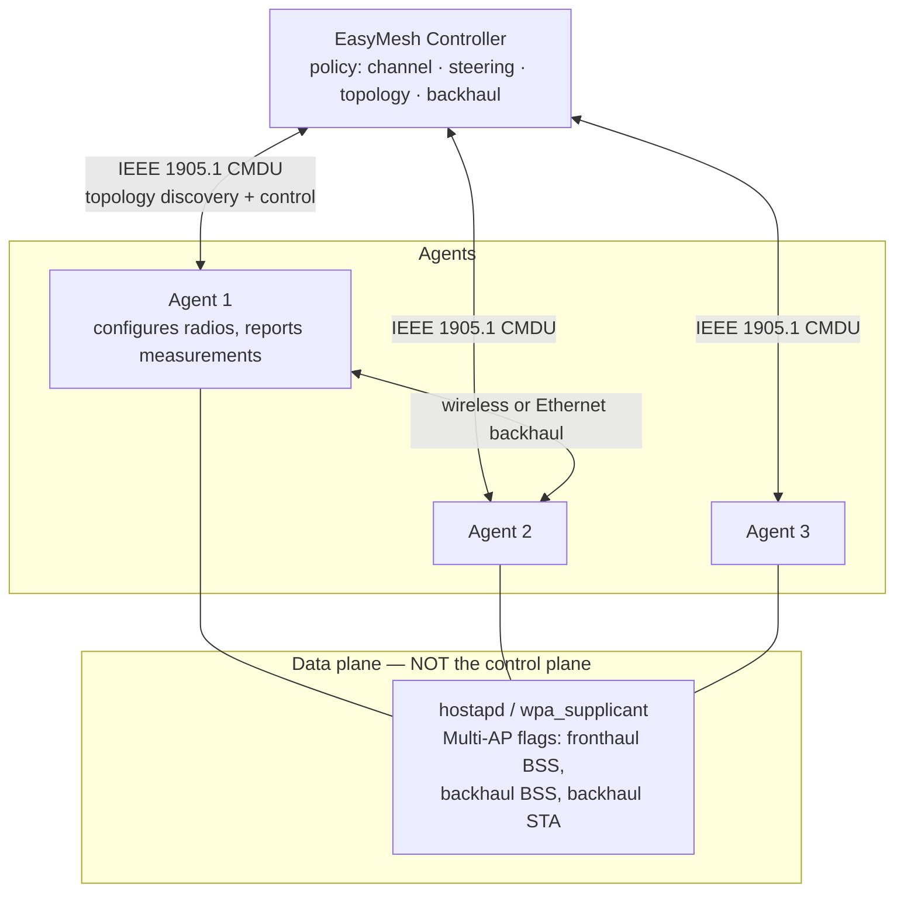
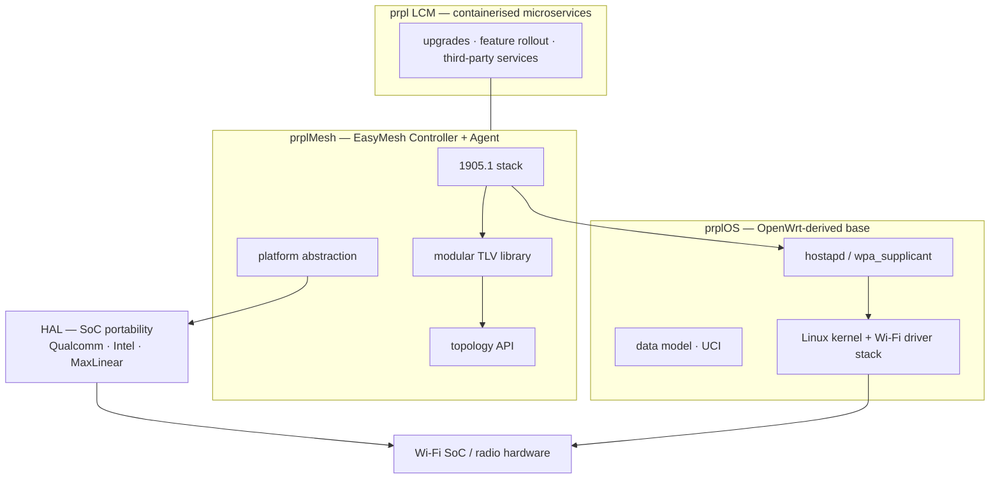
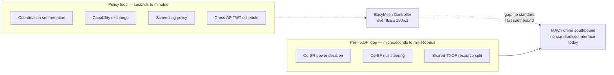

# WLAN Ecosystem — WFA Certification, EasyMesh and the prpl Stack

Certification, multi-AP control and gateway software. For the PHY/MAC generation-by-generation technology, see [[02-1 WLAN - Wi-Fi Generations Evolution]].

## 1. Wi-Fi Alliance and the certification layers

- The WFA does **not** write the standard — IEEE 802.11 does. The WFA writes **certification test plans** and owns the generation naming (Wi-Fi 4/5/6/6E/7/8).
- Consequence that matters commercially: **certification, not IEEE ratification, is what gates product claims**, and the two are frequently out of step by years. Wi-Fi 8 silicon is shipping while the standard is still a draft.
- Notable certification requirements:
  - **WPA3 is required on 6 GHz**; PMF (Protected Management Frames) mandatory on Wi-Fi 6+.
  - Wi-Fi 6E certification began **January 2021**, after the FCC opened 6 GHz in **April 2020**.
  - Wi-Fi 8 certification expected **~January 2028**, with the test plan finalised around mid-2027.

## 2. EasyMesh (WFA Multi-AP)

### 2.1 Architecture

- **Controller + Agent**. The Controller owns policy — channel selection, client/band steering, backhaul optimisation, topology. Agents configure radios, report measurements and execute steering.
- The control plane rides **IEEE 1905.1**, using **CMDU** messages for topology discovery and control. 1905.1 sits *above* Wi-Fi and Ethernet, so it works across heterogeneous links.
- Data plane: **hostapd / wpa_supplicant** carry Multi-AP flags (fronthaul BSS, backhaul BSS, backhaul STA). **The control plane is not provided by hostapd alone** — this is a common misconception.

### 2.2 What EasyMesh provides
- **Automatic onboarding** — new devices provisioned with SSID, passphrase and radio settings via WPS or a wired connection; no per-device manual configuration.
- **Credential synchronisation** — changing SSID or passphrase on the Controller propagates to all Agents.
- **Channel selection** — per-AP channel chosen from policy and radio capabilities.
- **Client and band steering** — moving clients to the best AP and band as they move or load shifts.
- **Backhaul optimisation** — wired backhaul prioritised over wireless; multi-hop topologies tracked.
- **Traffic separation** — separate SSIDs (guest, IoT, main) coexist with isolated forwarding paths.

### 2.3 Release maturity
EasyMesh releases **R1 through R5**, with **R6 in development** in prplMesh; the Wi-Fi 7-era generation aligns with R6.

### 2.4 Do not conflate these
| Technology | What it is | Layer |
| --- | --- | --- |
| **802.11k** | Radio resource measurement | Roaming assistance between independent APs |
| **802.11v** | BSS transition management / network management | Roaming assistance |
| **802.11r** | Fast BSS transition | Fast reauthentication on roam |
| **802.11s** | Mesh point standard with **HWMP** L2 path selection | Actual L2 mesh forwarding |
| **EasyMesh** | Controller/agent coordinated multi-AP system over **IEEE 1905.1** | Coordinated management and control |

- `usteer` / `dawn` on OpenWrt implement 802.11k/v/r-style roaming assistance between *independent* APs sharing an SSID. That is **not** EasyMesh.
- 802.11s L2 forwarding combined with a bridge can create loops if an Ethernet path also exists — plan STP or run a routing protocol (batman-adv, babeld) instead of relying on HWMP.

## 3. prpl Foundation stack

Two properties matter: prplMesh **does not supply** the driver stack, hostapd or the data model — it consumes them — and the HAL is what makes one mesh codebase portable across SoC vendors.

- **prplOS** — an OpenWrt-derived, operator/manufacturer-grade platform. Backed by operators (Orange, Vodafone, Verizon, AT&T) and vendors (Huawei, Nokia, TP-Link, ZTE, Qualcomm). Not generally downloadable for home routers; tied to ISP projects.
- **prplMesh** — open-source, carrier-grade EasyMesh implementation:
  - Implements **both Controller and Agent**; buildable as either or both.
  - Targets **prplOS / OpenWrt and RDK-B**; supports multiple SoCs (Qualcomm, Intel, MaxLinear among them) via a **HAL (hardware abstraction layer)**.
  - **IEEE 1905.1 stack** for process interaction, a **modular TLV library** (add TLVs without writing source), and a high-level API exposing network topology for external control.
  - Depends on platform components it does not provide: a Wi-Fi driver stack (e.g. pWHM), hostapd/wpa_supplicant, and the underlying data model.
  - Continuously validated against the WFA EasyMesh test suite in CI; test framework supports emulated or real devices.
  - Originated from a **full mesh solution contributed by Intel**; part of a prpl Foundation + Broadband Forum collaboration.
- **prpl LCM** — containerised microservice approach, decoupling Wi-Fi gateway functions (upgrades, feature rollout, third-party services) from the base OS image.

### 3.1 OpenWrt-side practical notes
- UCI syntax for mesh/multi-AP is **not standardised** and varies by release, package and vendor SDK. Many EasyMesh implementations on OpenWrt today are vendor SDKs (MediaTek, Qualcomm) or prplMesh.
- An ordinary 802.11 STA in 3-address mode **cannot** bridge multiple MACs behind it — the upstream AP only knows the STA's MAC. Transparent L2 bridging over a Wi-Fi STA requires **WDS / 4-address mode** (`option wds '1'`, needs support on both ends), or hiding the MACs behind relayd / NAT / proxy ARP.
- Backhaul choice is the first architectural decision: Ethernet (most stable) vs dedicated Wi-Fi radio (costs a radio) vs shared Wi-Fi radio (splits airtime).

## 4. Where Wi-Fi 8 multi-AP coordination stresses this stack

The design questions this ecosystem must answer. The first one is a **time-scale** question, and drawing it makes the gap obvious:

Everything on the left can be expressed in today's data model; everything on the right needs an interface into the MAC that the ecosystem does not yet standardise. That gap is the most defensible thing to say about Wi-Fi 8 in a system-architecture interview.

- **Where does coordination signalling live?** Coordination that is *policy* (coordination set formation, capability exchange, scheduling policy) belongs in the EasyMesh Controller over 1905.1. Coordination that must meet **per-TXOP deadlines** — Co-SR power decisions, Co-BF null steering — cannot ride a control plane with 1905.1 latency. It needs a faster southbound path into the MAC, which today has no standardised form.
- **How does MAPC coexist with MLO TID-to-link mapping?** TTLM is **intra-STA** (which of a device's links carries which traffic); multi-AP coordination is **inter-BSS** (which AP transmits when). They compose, and the conflict is **airtime budgeting across the two mechanisms**.
- **What must prpl extend on the management plane?** Cross-BSS topology and capability exchange; telemetry sufficient for Co-SR/Co-BF decisions (RSSI, CSI-derived steering intent, per-STA interference); and coordination state — coordination sets and shared TXOP schedules — represented in the data model.
- **Cross-AP TWT.** Scheduled stations on neighbouring BSSs must not collide, so TWT service periods need to be coordinated across APs, not just within one.

## 5. Related IEEE 802.11adjacent work

- **802.11bf-2025** (WLAN sensing) published 26 Sept 2025 — enables sensing without cameras; relevant to smart home, healthcare monitoring and industrial presence detection.
- **TGbi** — enhanced privacy protection (SA ballot recirculation at 94% approval).
- **TGbp** — Ambient Power Communications.
- **TGbt** — post-quantum cryptography (WG initial ballot passed at 89.3%).
- **TGbq** — Integrated mmWave (60 GHz).
- **AI Offload SG** — chartered to produce a PAR for offloading compute-intensive AI inference to Wi-Fi APs and edge devices.

## Anchors — verified facts

- EasyMesh: **Controller + Agent**, control plane over **IEEE 1905.1 (CMDU)**, data-plane Multi-AP flags in hostapd/wpa_supplicant; releases **R1–R5, R6 in development**.
- prplMesh: **Controller + Agent**, targets **prplOS/OpenWrt and RDK-B**, **HAL** for SoC portability, **TLV library**, IEEE 1905.1 stack, CI validation against the WFA EasyMesh test suite; based on an **Intel-contributed** full mesh solution; prpl Foundation + Broadband Forum collaboration.
- **WPA3 required on 6 GHz**; PMF mandatory on Wi-Fi 6+.
- **802.11s** uses HWMP for L2 path selection; combining it with a bridge risks loops unless STP or a routing protocol is used.
- **802.11bf-2025 published 26 Sept 2025**.

## Related

- [[04-3 Embedded Software Architecture - Patterns, Layering and Wireless System Structure]] — gateway layering, control/data plane separation, A/B update architecture
- [[02-1 WLAN - Wi-Fi Generations Evolution]]
- [[02-2 WLAN - Power Saving Mechanisms and Evolution]] — what WFA actually certifies on power: WMM-PS, and broadcast TWT / extended sleep / dynamic SMPS in Wi-Fi CERTIFIED 6 Release 2
- [[02-4 WLAN - Packet TX-RX Datapath and Offload Evolution]] — what the mesh control plane sits on top of: forwarding fast paths, PPE/WED offload, and why a bridged AP needs flow tracking
- [[04-1 Embedded Systems RTOS and Hardware Interfaces]]
- [[06-2 Agent Systems and Edge Orchestration]]

---

Copyright (c) 2026 Washington Ruan. All rights reserved.
