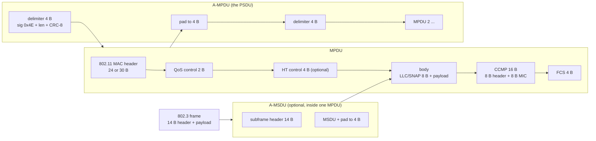
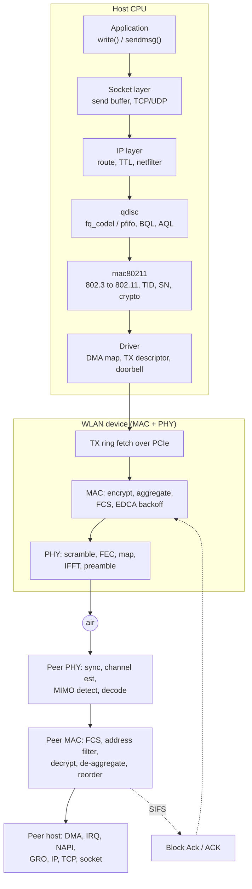
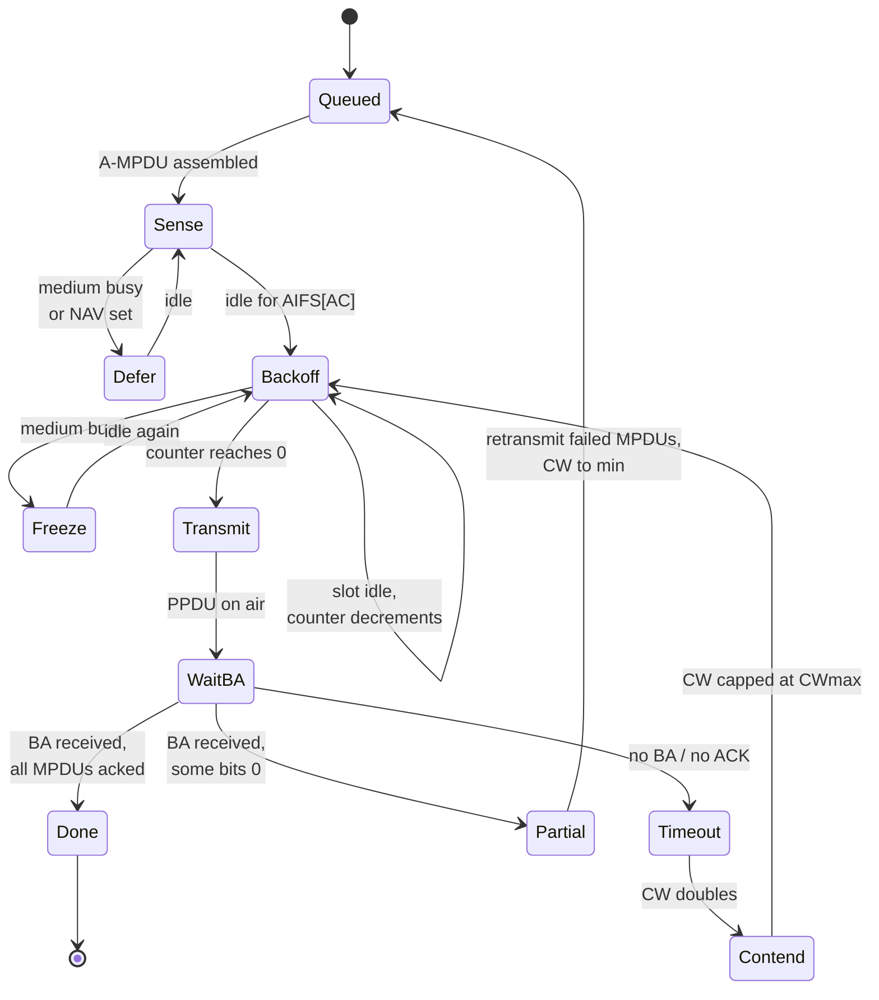
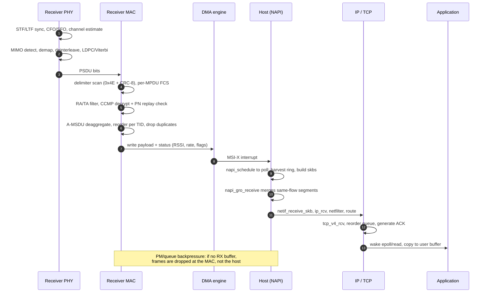
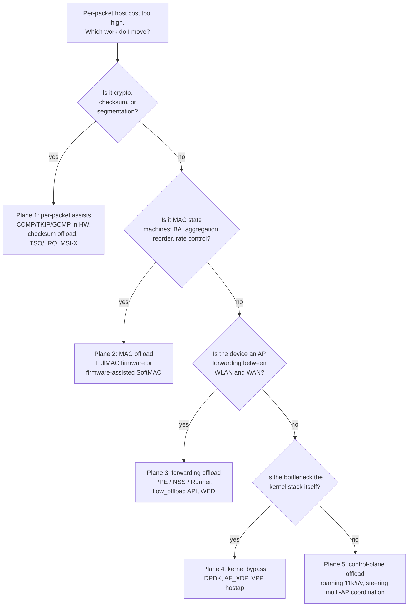
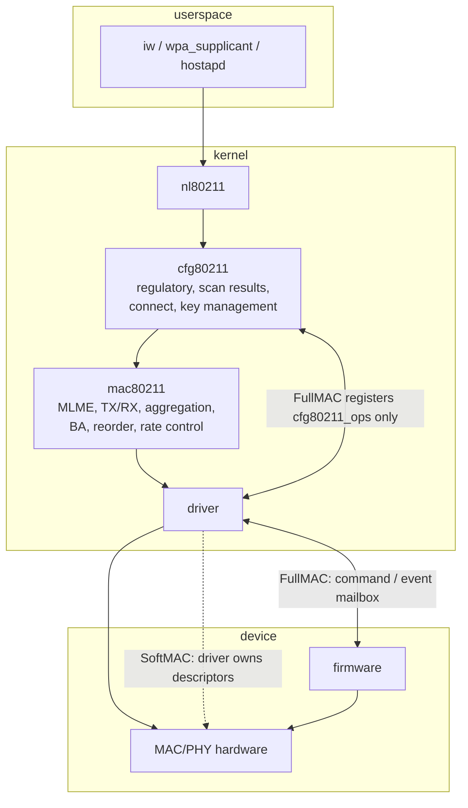
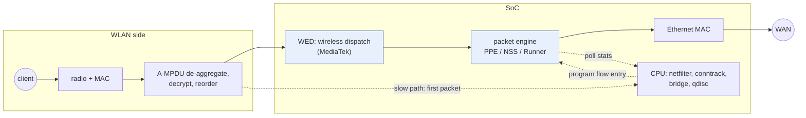

# WLAN — Packet TX/RX Datapath and Offload Evolution

How one packet actually gets from an application to the air and back, in full, and how that path
has been progressively shortened by moving work into hardware and firmware. The organising idea:
**every generation of Wi-Fi has not made the packet path shorter — it has made the per-packet work
in the host smaller and the per-aggregate work in the device larger.**

Related: [[02-1 WLAN - Wi-Fi Generations Evolution]] for what each generation added;
[[02-2 WLAN - Power Saving Mechanisms and Evolution]] for why the path sometimes stops;
[[04-2 Linux Embedded Development - Drivers, Applications and Core Subsystems]] for the Linux
networking substrate (NAPI, DMA rings, `ndo_start_xmit`);
[[05-1 DPDK User Plane and 5G UPF]] for the kernel-bypass counterpart on the wired side.

## 0. Vocabulary — say these precisely or the whole answer collapses

A "packet" is four different things at four layers. Interviewers listen for this.

| Term | Layer | What it is | Size anchor |
| --- | --- | --- | --- |
| **MSDU** | MAC service data unit | An 802.3 frame handed to the MAC (or an 802.11 frame body) | ≤ 2304 B payload; A-MSDU max 11,454 B (11ac/ax/be) |
| **MPDU** | MAC protocol data unit | One 802.11 frame: MAC header + body + FCS | 7,935 B max (11n), 11,454 B (11ac/ax/be) |
| **A-MPDU** | Aggregate | Several MPDUs each preceded by a 4 B delimiter, sent as one PSDU | 65,535 B (11n) → 1,048,575 B (11ac) → 4,194,303 B (11ax/be) |
| **A-MSDU** | Aggregate | Several MSDUs inside **one** MPDU, each with a 14 B subframe header | 11,454 B |
| **PSDU / PPDU** | PHY | The PSDU is the A-MPDU as bits; the PPDU adds preamble and is what occupies the channel | PPDU duration ≤ 5,484 µs (L-SIG limit) |

Two-level aggregation nests them: **A-MSDU inside MPDU inside A-MPDU inside PSDU**. The nesting
matters because it determines the retransmission granularity — an A-MSDU is all-or-nothing, an
A-MPDU retransmits only the failed MPDUs thanks to the Block Ack scoreboard.

Three byte-count facts worth memorising, because they explain most of the efficiency argument:

- 802.11 MAC header is **24 B** (3-address) or **30 B** (4-address / WDS), versus **14 B** for
  Ethernet. Wi-Fi therefore *loses* 10–16 B per frame on header alone, before any aggregation.
- LLC/SNAP adds **8 B** (`AA AA 03` + 3 B OUI + 2 B EtherType) to carry an EtherType inside 802.11.
- CCMP adds **16 B** (8 B header with the packet number, 8 B MIC); TKIP added 20 B; GCMP-256
  adds 24 B. Encryption is per-MPDU, so it is per-aggregate-member cost, not per-aggregate.

## 1. The whole path on one page

The two directions are not symmetric. TX is **push and forget with a scoreboard** (the host has
already freed or parked the buffer before the BA arrives); RX is **pull and reorder** (nothing can
be delivered upward until the sequence-number gap closes). Nearly every offload decision is about
which side of the bus that scoreboard and that reorder buffer live on.

## 2. Legacy path, part 1 — host-built TX (SoftMAC, pre-offload)

This is the reference implementation: `ath9k`, `mt76`, `rt2x00`, and the mental model every other
design is a deviation from. "Legacy" here does not mean obsolete — it means **the host owns the
802.11 MAC state machine**.

### 2.1 Application to qdisc

1. `write()` copies into the socket send buffer; TCP segments to MSS (or hands a large
   super-packet down when TSO is available and the device advertises `NETIF_F_TSO`).
2. IP output: route lookup, TTL decrement, source address selection, netfilter `OUTPUT` and
   `POSTROUTING` hooks, then neighbour resolution to fill the 14 B Ethernet header.
3. `dev_queue_xmit()` enqueues into the device qdisc. On Wi-Fi this is where the interesting
   queueing happens: a Wi-Fi device's *real* bottleneck is **airtime**, not bytes, so
   byte-based queue limits are the wrong control variable. Linux therefore runs `fq_codel`
   (per-flow queues plus CoDel) and, on drivers that support it, **AQL — Airtime Queue Limits**,
   which caps the bytes queued per station/AC by the airtime they represent. Without AQL the
   device queue fills with hundreds of milliseconds of frames and latency collapses under load —
   the Wi-Fi bufferbloat problem.
4. `ndo_start_xmit()` is called by the qdisc with the queue lock held. From here down, the packet
   is the driver's problem.

### 2.2 mac80211 — the 802.3 → 802.11 translation

`ieee80211_subif_start_xmit()` does, in order:

- **TID selection.** `skb->priority` → 802.1D user priority → access category (VO/VI/BE/BK) →
  TID. TID is the identifier that owns a Block Ack agreement, a reorder buffer, and a queue, so
  this single decision routes the packet for its whole life.
- **Header construction.** `ieee80211_build_hdr()` decides 3-address vs 4-address from the
  ToDS/FromDS bits (STA→AP is ToDS=1, AP→STA is FromDS=1, WDS/mesh is 4-address), fills the three
  MAC addresses, QoS control (TID, A-MSDU-present bit, ACK policy), and optionally HT control.
- **Fast-xmit.** Because building a header per packet is expensive, mac80211 caches a per-station
  template (`ieee80211_fast_tx`) holding the 802.11 header plus the crypto header. The fast path
  does one `skb_cow_head()` and a `memmove` to open headroom, instead of re-deriving the header.
  This is the host-side optimisation that buys time before any hardware offload exists.
- **A-MSDU aggregation.** If the station negotiated it, mac80211 coalesces same-TID, same-RA
  frames into one MPDU up to 11,454 B (`ieee80211_amsdu_aggregate()`), inserting 14 B subframe
  headers and padding each to a 4 B boundary. Consequence to state explicitly: **one bit error
  loses the whole A-MSDU**, which is why A-MSDU is used for bulk download and A-MPDU dominates
  in lossy conditions.
- **Sequence number.** A per-TID counter (`IEEE80211_SN_INC`) stamps the 12-bit MPDU sequence
  number. This number is the index into the peer's reorder buffer and into the BA bitmap — it is
  the single most important field in the datapath.
- **Encryption.** CCMP/GCMP with an incrementing packet number (PN) per PTKSA/TID, either in
  software here or, if the hardware advertises it, left to the device with the key installed in
  a key slot and the PN carried in the descriptor.

### 2.3 Driver to device

- `dma_map_single()` (or a pre-mapped page pool) turns the `skb` into a bus address; the driver
  writes a TX descriptor: buffer address, length, AC, retry limit, rate/rate-flags, crypto
  slot, aggregation flags.
- The driver writes the ring's tail index — the **doorbell** — normally one MMIO write per
  batch, not per packet.
- The device DMA-reads descriptor and payload across PCIe. This is a *host read per packet*, and
  it is the reason per-packet cost has a hard floor: descriptor fetch, one or two payload reads,
  and the completion writeback all consume PCIe transactions and host cache lines.

### 2.4 On-device MAC and channel access

Channel access is CSMA/CA with two independent "busy" signals: **physical CCA** (energy/preamble
detection) and the **virtual NAV** (duration field of frames heard from other stations). EDCA
gives four queues different contention aggressiveness — this table is checkable and gets asked:

| AC | Typical traffic | AIFS | CWmin | CWmax | TXOP limit |
| --- | --- | --- | --- | --- | --- |
| VO (voice) | VoIP, RTP | 2 | 3 | 7 | 1.504 ms |
| VI (video) | streaming | 2 | 7 | 15 | 3.008 ms |
| BE (best effort) | TCP data | 3 | 15 | 1023 | 0 (one frame / A-MPDU) |
| BK (background) | bulk, backup | 7 | 15 | 1023 | 0 |

(Default EDCA parameter set for the OFDM PHY. AIFS is counted in slots; a 5 GHz slot is 9 µs and
SIFS is 16 µs, so DIFS ≈ 34 µs for the legacy case.)

Only after winning contention does the PPDU go out. The PHY then applies: scrambling, FEC
(BCC or LDPC), interleaving, QAM mapping with pilots, IFFT, guard interval, and preamble. On
802.11ax/be the preamble is longer and richer (HE-SIG-A/B, EHT-SIG) but the host never sees it.

### 2.5 Completion, Block Ack, and rate feedback

Roughly one SIFS after the PPDU, the receiver returns a **Block Ack** with a bitmap covering the
sequence-number window. Three details that separate a real answer from a textbook one:

- **Bitmap width changed with the standard.** Basic BA (Type 0) is a 128 B bitmap covering 64
  MPDUs; Compressed BA (Type 2, mandatory since 11n) is 8 B / 64 MPDUs; **Extended Compressed BA
  (Type 5), added in 802.11ax, is 32 B / 256 MPDUs** — which is what makes a 256-MPDU A-MPDU
  window meaningful. On a link where the peer does not support extended BA, the effective window
  stays 64 regardless of the A-MPDU size.
- **The scoreboard lives in the device** in most modern designs; the driver learns per-MPDU
  status through a TX status descriptor (acked / not acked, retry count, airtime, final rate).
  `ieee80211_tx_status()` then feeds rate control.
- **Rate adaptation is a control loop fed by that status.** `minstrel_ht` keeps per-rate
  throughput estimates with EWMA probabilities and samples alternatives; a firmware-based design
  runs its own version internally and only reports the chosen rate. This is the concrete reason
  "rate control" appears in every offload comparison: it is a host-side control loop that has to
  be re-implemented or forfeited when the MAC moves into firmware.

### 2.6 The cost model — why this architecture stopped scaling

Per packet, the host does: qdisc enqueue/dequeue, TID+header build (or fast-xmit memmove), SN
assignment, crypto (if not offloaded), DMA map/unmap, descriptor write, doorbell amortised,
interrupt on completion, TX status handling, rate-control update, `skb` free. That is a few
thousand cycles at best.

Take an explicitly stated assumption — 2 µs of host CPU per packet on a 1 GHz embedded core — and
count the frame plus its 20 B of preamble/inter-frame gap on the wire:

| Rate | Frame size | Packets/s | Host CPU at 2 µs/packet |
| --- | --- | --- | --- |
| 1 Gbps | 1500 B | ~82,000 | ~16 % of one core |
| 1 Gbps | 64 B | ~1,488,000 | ~300 % — three cores |
| 2.5 Gbps | 1500 B | ~205,000 | ~41 % of one core |
| 5 Gbps | 1500 B | ~411,000 | ~82 % of one core |

The small-packet column is the whole argument. It is also why aggregation, not clock speed, is the
lever: aggregation converts *N packets of host work* into *N packets of host work plus one device
assembly step* — it reduces airtime overhead per packet but **not** per-packet host work. Only
offload reduces per-packet host work. Keep those two effects separate; conflating them is the most
common mistake in this topic.

Aggregation does, however, buy an enormous amount of airtime, and airtime is the scarce resource:

| Transmission | Preamble | Payload airtime | Efficiency |
| --- | --- | --- | --- |
| Single 1500 B MPDU, MCS 11, 160 MHz, 2 SS (~2.4 Gbps) | ~56 µs | ~5.2 µs | ~8 % |
| 64-MPDU A-MPDU (96 kB), same rate | ~56 µs | ~333 µs | ~86 % |

The arithmetic: 1500 B = 12,000 bits of payload plus ~54 B of MAC/LLC/FCS/CCMP overhead ≈ 12,432
bits; at 2.4 Gbps that is ~5.2 µs. A 64-member aggregate is 64 × 5.2 µs of payload behind one
preamble. This is why A-MPDU, not MCS, is the dominant throughput feature of 802.11n onward, and
why 802.11ac makes A-MPDU mandatory (even a single frame is wrapped in one).

## 3. Legacy path, part 2 — host-processed RX

### 3.1 PHY to MPDU boundaries

The receiver does not get frames; it gets a sampled waveform and has to find structure in it:
packet detection on the short training field, frequency/time offset estimation, channel estimation
on the long training field, MIMO equalisation (MMSE or better), soft demapping, deinterleaving,
LDPC iterative decoding or Viterbi, descrambling. Only then does a PSDU exist.

Then the MAC **scans for delimiters**: it looks for the 1-byte signature `0x4E` at a 4 B boundary,
reads the 12-bit length field, and validates the delimiter's CRC-8. This is why a corrupted
delimiter does not destroy the rest of the aggregate — the receiver resynchronises by searching for
the next `0x4E`, and only that one MPDU is lost.

Note the 12-bit field: it caps the *delimiter-encoded* length at 4,095 B. 802.11n works around it
by putting an A-MSDU inside the MPDU; 802.11ac/ax/be carry the real maximum in the capabilities
element and use an escape encoding.

### 3.2 The MAC's four gates

1. **FCS** — a bad FCS means the MPDU is marked failed and skipped; no retransmission is
   requested for an individual MPDU in an A-MPDU, the BA bitmap simply reports 0 for it.
2. **Address filtering** — RA must match the interface MAC, a group address, or the interface must
   be in promiscuous/monitor mode. This gate is why monitor mode is cheap and promiscuous mode is
   not: monitor bypasses decryption and reordering entirely.
3. **Decryption and replay** — CCMP verifies the MIC and checks the PN against a per-TID replay
   counter. A replayed or reordered-beyond-window PN is dropped silently. In 802.11be this replay
   state is per-MLD, not per-link, which is precisely what prevents an attacker replaying a frame
   received on one link onto another.
4. **De-aggregation** — A-MSDU subframe headers are parsed and the padding stripped, yielding
   individual 802.3-ish frames.

### 3.3 The reorder buffer — the part people skip

A-MPDU delivery is out of order by construction: MPDU 7 may fail while 8 and 9 succeed. Delivering
8 and 9 upward would break TCP's assumptions and the 802.11 MAC's own duplicate detection, so the
receiver keeps a **per-TID reorder buffer** indexed by sequence number:

- MPDUs are held until the gap closes; release is strictly in SN order.
- A **timeout** (a few hundred milliseconds in mac80211, `HT_RX_REORDER_TIMEOUT`) forces release of
  what is held, otherwise one permanently lost MPDU stalls the TID forever.
- **Duplicate detection** uses the same window: anything below the window start is a duplicate and
  is dropped.
- On timeout the receiver sends a **BAR (Block Ack Request)** to make the sender retransmit the
  missing range rather than waiting for its own timer.

This buffer is a real memory and a real latency source: it is where "Wi-Fi feels laggy under loss"
comes from, and it is the first thing to check when throughput collapses but RSSI is fine.

### 3.4 Up the stack

The device DMAs payload plus a status block (RSSI per chain, chosen rate, A-MPDU flags) into host
memory and raises an interrupt. Modern drivers use **MSI-X with one vector per queue**, then
immediately disable the interrupt and schedule **NAPI**, so a burst is harvested in one poll
rather than N interrupts. `napi_gro_receive()` merges consecutive same-flow TCP segments into one
large `skb` (GRO), which is what keeps the stack from seeing 1.4 M packets/s.

Then: `netif_receive_skb` → `ip_rcv` → netfilter `PREROUTING` → routing decision → either local
delivery (`ip_local_deliver` → `tcp_v4_rcv`, TCP reorder queue, ACK generation, socket wake,
`epoll` return, copy to user) or forwarding (`ip_forward` → `dev_queue_xmit` on another interface,
which is the AP's bridge/router role and the subject of §6).

**Backpressure is inverted here.** On TX the host throttles the device (qdisc, AQL). On RX the
*device* throttles the host: if there is no free RX buffer, frames are dropped in the MAC and the
host never learns about them. RX ring sizing is therefore a correctness parameter, not a tuning
knob — too small a ring turns a CPU hiccup into packet loss that looks like RF loss.

## 4. What "offload" actually means — five distinct planes

The word is used for five different things. Naming the plane is the answer.

| Plane | Work moved | Where it lands | What the host keeps | Characteristic failure |
| --- | --- | --- | --- | --- |
| 1. Assists | crypto, checksum, segmentation, interrupt coalescing | MAC/PHY hardware | header build, BA handling, stack | offload flags mis-negotiated → silent corruption or fallback |
| 2. MAC offload | aggregation, BA scoreboard, reorder, retry, sometimes rate control | device firmware | MLME/config, sometimes rate control | loses observability and airtime fairness; firmware is a black box |
| 3. Forwarding | 5-tuple lookup, NAT rewrite, VLAN, egress port | SoC packet engine | first packet of each flow, conntrack, stats | QoS/SQM and netfilter stop applying to offloaded flows |
| 4. Bypass | entire kernel stack traversal | userspace | everything, including 802.11 state | enormous complexity for a modest win; Wi-Fi state has no upstream DPDK model |
| 5. Control plane | roaming decisions, band steering, multi-AP scheduling | controller / cloud / RAN-like scheduler | the datapath | coordination decisions arrive too slowly to act on |

## 5. Plane 1 — per-packet assists (still host-MAC, but cheaper)

These are the oldest offloads and they are still where most of the measured gain sits.

- **Hardware crypto.** The key is installed in a device key slot; the descriptor says "encrypt with
  slot N". Host saves the AES-CCM work — roughly an order of magnitude cheaper with AES-NI or a
  crypto engine than in software, and it removes a per-packet key lookup and PN bookkeeping from
  the hot path.
- **Checksum offload.** `NETIF_F_HW_CSUM` on TX (device computes IP/TCP/UDP checksum),
  `CHECKSUM_UNNECESSARY` or `CHECKSUM_COMPLETE` on RX. Note the Wi-Fi twist: the checksum covers
  the inner IP header, which sits behind an 802.11 header and possibly an A-MSDU subframe, so the
  device must parse through encapsulation — this is why checksum offload on Wi-Fi is often disabled
  when A-MSDU is in use.
- **TSO / LRO.** Less useful than on Ethernet because the device must still fragment into
  ≤ 11,454 B MPDUs and each MPDU needs its own crypto header and FCS; and LRO is dangerous in
  aggregation because it merges frames that arrived with different MPDUs and destroys the
  per-MPDU status the rate/airtime accounting needs. GRO (in the host) is the accepted compromise.
- **MSI-X, multi-queue, and interrupt moderation.** One vector per AC or per queue lets TX
  completion for VO preempt BE housekeeping. `napi_defer_hard_irqs` and `gro_flush_timeout` trade
  latency for interrupt rate — and on Wi-Fi that trade is visible as jitter, so the value must be
  chosen against the latency KPI, not the throughput one.

After plane 1, the host still builds headers, runs the BA state machine, and does the reordering.
The per-packet cost drops maybe by half; it does not change asymptotically. That is why plane 2
exists.

## 6. Plane 2 — where does the MAC live? FullMAC vs SoftMAC vs hybrid

The test is mechanical, not marketing: **does the driver allocate an `ieee80211_hw` and implement
`ieee80211_ops` (SoftMAC), or does it register `cfg80211_ops` and talk to firmware through a
command/event mailbox (FullMAC)?**

| | SoftMAC | FullMAC | Hybrid (firmware-assisted) |
| --- | --- | --- | --- |
| MAC state machine | host, in mac80211 | device firmware | split: real-time MAC in firmware, policy in host |
| Examples | `ath9k`, `mt76`, `rt2x00` | `brcmfmac`, `rtl8xxxu`, many USB/SDIO parts | `iwlwifi`, `ath10k`, `ath11k` |
| Per-packet host work | full header build, aggregation, BA, reorder, rate control | minimal: queue a frame, read a status | header build + rate choice; device does aggregation/BA |
| Observability | excellent: ftrace, kprobe, per-TID debugfs, AQL | poor: firmware counters and vendor debug hooks | medium: `ethtool -S`, debugfs, firmware logs |
| Airtime fairness / AQL | supported | usually impossible | driver-dependent |
| Feature velocity | limited by kernel release | limited by firmware release | both, which is why it wins in laptops |
| Debuggability of a bug in the field | patch and ship | wait for the vendor | mixed |

The practical consequence, and the sentence worth saying in an interview: **FullMAC moves the
hard cases into a binary you cannot instrument.** Aggregation, BA, retry, and power-save
interaction all interact — a retry storm, a mis-sized BA window, and a doze decision can produce
the same symptom (throughput collapse at good RSSI). With SoftMAC you can watch which one it is;
with FullMAC you bisect by firmware version. That is the real trade: not CPU cycles, but the
ability to attribute a fault to a layer.

The genuinely hybrid case deserves detail because it is what most shipping hardware does:

- `iwlwifi`: mac80211 drives the MLME and BA session setup, but the firmware owns the real-time
  frame exchange, its own TX queue scheduler, aggregation build, and power management. The driver
  still chooses the rate. Symptom of this split: throughput anomalies often show up as a firmware
  queue-scheduling artefact, not as a mac80211 counter.
- `ath10k`/`ath11k`: mac80211 above, a large firmware below that implements most of 11ac/11ax,
  including aggregation. Where reordering happens depends on the firmware generation — which is
  why "does the driver or mac80211 own the reorder buffer here?" is a legitimate question to ask
  of a datasheet, and a legitimate answer is "check `ethtool -S` and the per-TID debugfs counters
  and see which one moves".

## 7. Plane 3 — the AP data plane: the biggest offload win in Wi-Fi

An AP is not a station. Its datapath is **WLAN ↔ bridge/router ↔ WAN**, and every forwarded packet
would otherwise traverse netfilter, conntrack, routing, and two qdiscs on the CPU. At 2.5 Gbps
with mixed traffic that is the dominant cost — far more than the 802.11 MAC work.

### 7.1 Software fast path first

Before any hardware exists, Linux itself shortens the path: **flow offload** (netfilter flowtable
or `tc` flower with `skip_sw`) installs a flow entry after the first packet; subsequent packets
skip the rule-by-rule traversal and go straight to forwarding. `ndo_flow_offload` is the hook that
lets a device take over the entry, with `FLOW_OFFLOAD_ADD` and `FLOW_OFFLOAD_PATH_DEL`
programming and removing hardware table entries. This matters architecturally: **the hardware
offload API is an extension of the software fast path, not a separate mechanism** — which is why a
driver that supports software flow offload usually gets hardware offload almost for free.

### 7.2 Hardware forwarding engines

The mechanism, in the order it happens:

1. First packet of a flow takes the **slow path**: netfilter rules, conntrack creates the entry,
   NAT rewrite is decided, egress interface resolved.
2. The stack marks the flow offloadable and the driver programs the engine's table with the
   5-tuple, the NAT rewrite, VLAN handling, and the egress port. Typical tables hold thousands to
   tens of thousands of entries (MediaTek PPE: ~4 K entries on MT7621/MT7622, ~16 K on
   MT7981/MT7986/MT7988 per published community documentation; `VERIFY` exact per-SoC figures
   against the vendor datasheet before quoting).
3. Subsequent packets are matched **in the engine**, rewritten, and emitted — the CPU never sees
   them. Per-flow byte/packet counters are **polled back** into conntrack periodically so
   accounting and `iptables -L -v` stay roughly right.
4. Entry removal: timeout, TCP teardown, or an invalidation event (route change, MAC move).

**WED is the Wi-Fi-specific extension**: the engine takes frames *directly from the WLAN MAC*,
so the Wi-Fi-to-Ethernet path skips the CPU entirely rather than only the Ethernet-to-Ethernet
path. This is the single largest datapath change in consumer AP silicon of the last decade — and
it comes with a specific, quotable cost: **it bypasses AQL and airtime fairness**, because the
frames never reach the qdisc that implements them.

### 7.3 What offload silently breaks

This list is the difference between knowing the feature and having debugged it:

- **QoS and SQM stop applying.** A `tc` shaping or cake/codel policy on the WAN sees nothing once
  flows are in hardware. Bufferbloat returns exactly when you most need the fix.
- **Netfilter semantics diverge.** A new `iptables` rule does not affect already-offloaded flows;
  the table must be flushed. Same for connection marking.
- **Airtime fairness and AQL are bypassed** on the Wi-Fi leg (WED), which is why latency-sensitive
  setups often deliberately disable it.
- **Encapsulation may be un-offloadable** — PPPoE, IPsec, GRE, and some VLAN/QinQ combinations
  either fall back or need engine-specific support.
- **Bridged APs need help.** A pure bridge has no conntrack tuple to learn from, which is why
  bridged APs use an extra BPF-based tracker (`bridger`) to feed the engine.
- **Statistics are approximate** and lag by the polling interval, which breaks any monitoring that
  assumes exact per-flow counters.

The engineering rule: **offload is a fast path with a slow path that must remain authoritative.**
Every design question is about keeping the two consistent — which is the same problem a 5G UPF
has with its own fast path, see [[05-1 DPDK User Plane and 5G UPF]].

## 8. Plane 4 — kernel bypass, and why Wi-Fi resists it

Ethernet made kernel bypass routine: DPDK's poll-mode drivers, AF_XDP's zero-copy sockets, and
`io_uring`-based stacks all work because an Ethernet frame is stateless — read the descriptor, get
bytes, hand them up.

Wi-Fi is not stateless, and that is the whole story:

- **A-MPDU assembly needs a per-TID queue with a BA agreement**, a sequence-number allocator, and
  a retry policy. A userspace stack cannot just "send a frame"; it must own the scoreboard.
- **Airframe scheduling is a shared-medium arbitration problem.** Polling a queue in userspace
  competes with a MAC that is already arbitrating; you cannot poll your way past CSMA/CA.
- **Reordering and PN replay state are per-TID security state**, not per-socket.
- There is **no upstream DPDK 802.11 device class**. Practical kernel-bypass deployments in Wi-Fi
  products bypass the *wired* side (the WAN/LAN legs of an AP) and leave the 802.11 MAC where it
  is. Saying this out loud is worth more than reciting DPDK feature names.

Where bypass is real in a Wi-Fi box:

- **AF_XDP after the driver.** The driver still runs the MAC and reorder, but received frames are
  delivered to a userspace ring instead of the stack. The win is stack traversal only — a few tens
  of percent, not an order of magnitude, and only if the driver supports zero-copy.
- **VPP with the hostap plugin.** A userspace 802.11 data plane reusing hostap's driver wrapper.
  Attractive for a software AP with heavy service chaining; the 802.11 state still comes from the
  kernel driver.
- **DPDK on the Ethernet ports of an x86 AP** with the Wi-Fi chipset driven normally — this is how
  high-end open-source routers get multi-gigabit forwarding while keeping a vendor Wi-Fi driver.

## 9. Wi-Fi 7 and Wi-Fi 8 — what changes in the packet path

**802.11be (Wi-Fi 7, published 22 July 2025)** adds MLO, which breaks the one-queue-one-link
assumption the legacy path is built on:

- One TID can now be transmitted on **multiple links**, each with its **own Block Ack agreement and
  scoreboard**, so the MLD needs a **reordering function above the link layer**. The reorder buffer
  moves from per-link to per-MLD-per-TID.
- The **security context is per-MLD, not per-link** — one PTKSA and one PN space across links —
  which is what makes cross-link replay detectable and why the PN check cannot be done
  independently per link.
- Offload engines must become MLO-aware: a flow entry keyed only on the 5-tuple cannot express
  "this flow may egress on link 1 or link 2, and reorder on arrival". This is the main reason
  Wi-Fi 7 AP silicon needed a new generation of packet engines rather than a firmware update.

**802.11bn (Wi-Fi 8, UHR)** is the interesting inversion. Its headline features — coordinated
spatial reuse, joint transmission, multi-AP scheduling — do not shorten the per-packet path at
all; they add a **coordinator** that decides *which AP transmits when*. In datapath terms it is a
plane-5 (control-plane) offload with a much tighter latency budget than roaming ever had: a
coordination decision that takes 100 ms is useless when a TXOP is 5 ms. Expect the interesting
engineering to be in the scheduler's interface to the MAC, not in the DMA path. See
[[02-1 WLAN - Wi-Fi Generations Evolution]] for the feature set and [[02-3 WLAN Ecosystem - WFA, EasyMesh and prpl]]
for how coordination gets standardised and certified.

*One terminology trap:* in 3GPP documents, **"Wi-Fi offload" means something completely
different** — moving cellular traffic onto Wi-Fi (ANDSF, ePDG, LWA/LWIP, ATSSS). If an interviewer
says "offload" in a cellular context, clarify which of the two is meant before answering. Getting
this wrong is a credibility loss out of proportion to its difficulty; see
[[01-1 5G-Advanced and 6G Radio Access]].

## 10. Where power save interrupts the path

The datapath is not always on, and the AP's TX path has to handle a station that is asleep. In
short (the full treatment is in [[02-2 WLAN - Power Saving Mechanisms and Evolution]]):

- The AP **buffers** frames per station and advertises them in the **TIM** bitmap in the beacon.
- A dozing station wakes, reads the TIM, and either sends **PS-Poll** (one frame per poll) or, with
  **U-APSD**, sends a QoS trigger frame that releases all buffered frames of that AC.
- Buffered frames carry the **More Data** bit until the buffer drains, which is how the station
  knows whether to go back to sleep.
- **TWT** replaces polling with a schedule: the AP transmits only in the agreed service period, so
  the buffering delay becomes a designed parameter rather than a race.

Offload interacts badly here in one specific way: an engine that forwards frames without touching
the host also bypasses the per-station queue that implements buffering. Either the engine
implements per-STA buffering and TIM state, or power save and offload must be mutually exclusive
for that station — a real constraint in AP firmware design.

## 11. Measurement — how to localise a fault in this path

| Symptom | First place to look | Evidence |
| --- | --- | --- |
| Throughput low, RSSI good | aggregation and BA state | `iw dev wlan0 station dump` (expected/actual A-MPDU), per-TID counters |
| Throughput low, retries high | channel access / interference | retry counters in `ethtool -S`, `iw ... survey`, airtime busy |
| Latency spikes under load | queueing | `tc -s qdisc`, AQL limits in debugfs, bufferbloat test |
| Loss with no retries | RX ring / reorder | RX drop counters, ring size, reorder timeout |
| Handshake works, data does not | crypto offload path | `dmesg`, PN/MIC errors, key install failures |
| Forwarding slow but Wi-Fi fine | forwarding plane | `cat /sys/kernel/debug/ppe0/bind` (MediaTek), CPU softirq share |
| Offload enabled, some flows slow | offload fallback | flow table occupancy, packets not in the engine |
| Throughput collapses at good RSSI, FullMAC | firmware scheduler | firmware version bisect; host counters unchanged |

The general method: **find the layer where the packet count diverges.** Count packets at the
socket, at the qdisc, at the driver TX ring, at the device counters, at the peer, and up the peer's
stack. Whichever boundary loses or delays them is the layer. Everything else is guessing.

## 12. The summary to carry into an interview

1. **One packet, four names.** MSDU → MPDU → A-MPDU → PPDU. Say which one you mean.
2. **TX is a scoreboard, RX is a reorder buffer.** Both are state, and state is what determines
   where a design can cut the path.
3. **Legacy host-MAC cost is per packet; aggregation reduces airtime, not host work.** Only offload
   reduces host work. Do not conflate the two.
4. **FullMAC vs SoftMAC is a trade of instrumentability, not cycles.** The bug you cannot see is
   worse than the CPU you save.
5. **The AP's biggest offload is forwarding, not 802.11.** PPE/NSS/Runner and WED matter more than
   any MAC assist, and they break QoS, netfilter, and AQL — which is the sentence that proves you
   have operated one.
6. **Wi-Fi resists kernel bypass** because the MAC is stateful and the medium is arbitrated. The
   bypass lives on the wired side.
7. **Wi-Fi 7 moves reordering up to the MLD; Wi-Fi 8 moves intelligence into a coordinator.** The
   per-packet pipeline has stopped being the interesting part — the scheduler is.

## Anchors

- **IEEE 802.11-2024** published **28 April 2025**; **802.11be-2024** published **22 July 2025**.
- **Sizes**: max MPDU **7,935 B** (11n), **11,454 B** (11ac/ax/be); max A-MPDU **65,535 B** (11n),
  **1,048,575 B** (11ac), **4,194,303 B** (11ax/be, i.e. 4 MB); max A-MSDU 11,454 B (11ac+);
  PPDU duration limit **5,484 µs** set by the L-SIG length field.
- **A-MPDU subframe**: 4 B delimiter = 4 reserved bits + **12-bit MPDU length** + CRC-8 +
  signature **0x4E**. The 12-bit length is why 11n needed A-MSDU nesting and 11ac added a
  Max MPDU Length capability field.
- **A-MSDU subframe header is 14 B**; each subframe padded to a 4 B boundary.
- **Block Ack bitmap widths**: Basic (Type 0) 128 B / 64 MPDUs; Compressed (Type 2) 8 B / 64
  MPDUs, mandatory from 11n; Multi-TID (Type 3); **Extended Compressed (Type 5) 32 B / 256
  MPDUs, added in 802.11ax**.
- **MAC header**: 24 B (3-address) / 30 B (4-address), +2 B QoS control, +4 B HT control.
  Ethernet header 14 B; LLC/SNAP 8 B; CCMP 16 B (8 + 8 MIC); TKIP 20 B; GCMP-256 24 B.
- **Default EDCA (OFDM PHY)**: VO AIFS 2 / CW 3–7 / TXOP 1.504 ms; VI AIFS 2 / CW 7–15 /
  TXOP 3.008 ms; BE AIFS 3 / CW 15–1023 / TXOP 0; BK AIFS 7 / CW 15–1023 / TXOP 0.
  SIFS 16 µs, slot 9 µs at 5 GHz.
- **Linux plumbing**: `ndo_start_xmit`, `ndo_flow_offload`, `FLOW_OFFLOAD_ADD`,
  `FLOW_OFFLOAD_PATH_DEL`, `include/net/flow_offload.h`; `napi_schedule` / `napi_gro_receive`;
  mac80211 entry points `ieee80211_subif_start_xmit`, `ieee80211_build_hdr`, `ieee80211_fast_tx`,
  `ieee80211_amsdu_aggregate`, `ieee80211_start_tx_ba_session`, `ieee80211_tx_status`,
  `ieee80211_rx_napi`, `ieee80211_rx_reorder_ampdu`, `struct tid_ampdu_rx`, `HT_RX_REORDER_TIMEOUT`.
- **FullMAC drivers** register `cfg80211_ops` and hold no `ieee80211_hw` (`brcmfmac`);
  **SoftMAC** drivers allocate `ieee80211_hw` and implement `ieee80211_ops` (`ath9k`, `mt76`).
- **MediaTek WED** (Wireless Ethernet Dispatch) exists on MT7622 / MT7981 / MT7986 / MT7988 and
  lets the PPE take Wi-Fi frames directly, **bypassing AQL**; enabled via
  `options mt7915e wed_enable=Y`, verified through `/sys/module/mt7915e/parameters/wed_enable`
  and `/sys/kernel/debug/ppe0/bind`.
- **Packet-engine names** worth recognising: MediaTek **PPE/HWNAT** (+WED), Qualcomm **NSS** and
  newer **PPE** with **ECM** connection manager, Broadcom **Runner / Flow Accelerator**.
  `VERIFY` the marketing names and flow-table sizes against a specific datasheet before quoting
  numbers.
- **AQL / airtime queue limits** are the Wi-Fi-specific queue control that prevents bufferbloat;
  they exist because byte-based queue limits do not describe an airtime-limited medium.
- `VERIFY` before asserting: exact per-SoC flow-table entry counts; whether a given 11ax
  implementation negotiates the full 4 MB A-MPDU or stays at 1 MB in practice; the precise
  per-link vs per-MLD MPDU sequence-number rule in 802.11be (the PN space and replay state are
  per-MLD, the BA scoreboard is per-link).

## Related

- [[02-10 WLAN - Baseband and Driver Architecture for Wi-Fi 6, 7 and 8 - Qualcomm as the Reference Design]] — the silicon and firmware underneath the offload planes this note catalogues: WMI and HTT, copy engines and SRNG rings, who owns reordering and rate control, and a second SoC-side accelerator that makes packets disappear from the host
- [[02-1 WLAN - Wi-Fi Generations Evolution]] — the features this datapath exists to carry
- [[02-9 WLAN - Time-Sensitive Networking Across Wi-Fi Generations]] — where a deadline is actually spent: hardware timestamping, queueing and the offload boundaries that decide whether a bound is observable at all, and the deadline-aware retry policy this datapath has to honour
- [[02-8 WLAN - Scheduling - Channel Access, EDCA, OFDMA Resource Allocation, Airtime and Implementation]] — what sits at the bottom of the TX path this note traces: EDCA queueing, FQ-CoDel and AQL inside `mac80211`, the three places a Wi-Fi queue hides, and why the per-TXOP decision lands in firmware
- [[02-2 WLAN - Power Saving Mechanisms and Evolution]] — where the datapath stops, and how the AP buffers
- [[02-3 WLAN Ecosystem - WFA, EasyMesh and prpl]] — certification of aggregation/QoS features, mesh forwarding, open AP software stacks
- [[02-5 WLAN - STA-AP Discovery, Authentication and Association]] — what happens before the first packet: the join sequence, and where the 4-way handshake sits when it is offloaded to firmware
- [[02-6 WLAN - Multi-AP Roaming, Healing and Steering]] — why the datapath restarts on every roam: a new PN space, new Block Ack agreements, an FDB entry that has to move, and flow-offload state that has to be reprogrammed at the target AP
- [[02-7 WLAN - Wi-Fi EasyMesh, Operation, Tuning and Troubleshooting]] — the management plane that never touches this datapath, and the one place they meet: the four-address wireless backhaul and the per-bSTA VLAN it implies
- [[04-2 Linux Embedded Development - Drivers, Applications and Core Subsystems]] — NAPI, DMA rings, device model, the kernel RX path in isolation
- [[04-4 Linux Interrupts - Types, Handlers, Threaded IRQs and Deferred Work]] — the generic form of this note's interrupt path: NAPI as the coalesce-then-poll pattern, MSI-X per-queue affinity for RSS, and the coalescing versus latency trade that decides what the Wi-Fi interrupt costs
- [[04-3 Embedded Software Architecture - Patterns, Layering and Wireless System Structure]] — MAC/PHY split, FAPI, why the datapath is layered the way it is
- [[05-1 DPDK User Plane and 5G UPF]] — the same fast-path/slow-path problem in a 5G UPF
- [[05-2 Cloud-Edge-End Collaboration and Heterogeneous Computing]] — heterogeneous compute placement of data-plane work
- [[01-1 5G-Advanced and 6G Radio Access]] — the cellular equivalent of every layer here, and the "offload" terminology collision

## References

1. IEEE. *IEEE Standard for Information Technology — Telecommunications and Information Exchange between Systems — Local and Metropolitan Area Networks — Specific Requirements — Part 11: Wireless LAN MAC and PHY Specifications*, IEEE Std 802.11-2024, published 28 April 2025.
2. IEEE. *IEEE Standard for Information Technology — Part 11: Wireless LAN MAC and PHY Specifications — Amendment 2: Enhancements for Extremely High Throughput (EHT)*, IEEE Std 802.11be-2024, published 22 July 2025.
3. IEEE. *IEEE Standard for Information Technology — Part 11: Wireless LAN MAC and PHY Specifications — Amendment 1: Enhancements for High Efficiency WLAN*, IEEE Std 802.11ax-2021.
4. Gast, M. S. *802.11 Wireless Networks: The Definitive Guide*, 2nd ed. O'Reilly, 2005. ISBN 978-0-596-10052-0. — Still the clearest account of MAC frame formats and DCF/EDCA contention.
5. Perahia, E., and Stacey, R. *Next Generation Wireless LANs: 802.11n and 802.11ac*, 2nd ed. Cambridge University Press, 2013. ISBN 978-1-107-01676-7. — Aggregation, Block Ack, and the reasoning behind the sizes.
6. Bianchi, G. "Performance Analysis of the IEEE 802.11 Distributed Coordination Function." *IEEE Journal on Selected Areas in Communications* 18(3), 2000, pp. 535–547. DOI 10.1109/49.840210. — The analytical model behind every backoff/window argument.
7. Høiland-Jørgensen, T., Kazior, M., Täht, D., Hurtig, P., and Brunström, A. "Ending the Anomaly: Achieving Low Latency and Airtime Fairness in WiFi." *USENIX Annual Technical Conference (ATC)*, 2017. — Airtime queue limits, `fq_codel` on Wi-Fi, and why byte-based queueing fails on a shared medium.
8. Høiland-Jørgensen, T., Möller, J. D., Do, V.-H., Pradel, B., and Németh, F. "The eXpress Data Path: Fast Programmable Packet Processing in the Operating System Kernel." *ACM CoNEXT*, 2018. — AF_XDP, and the boundary conditions where bypass is worth it.
9. Linux kernel source, `net/mac80211/tx.c`, `net/mac80211/rx.c`, `net/mac80211/agg-tx.c`, `net/mac80211/agg-rx.c`, `include/net/flow_offload.h`, `Documentation/networking/`. — The authoritative description of every function named in this note.
10. Corbet, J., Rubini, A., and Kroah-Hartman, G. *Linux Device Drivers*, 3rd ed. O'Reilly, 2005, and the kernel's `Documentation/driver-api/`. — DMA mapping, interrupt handling, and the `ndo_start_xmit` contract.
11. MediaTek / OpenWrt. "Wireless Ethernet Dispatch (WED)." OpenWrt documentation. <https://openwrt.org/docs/guide-user/network/wifi/wed> — Configuration, scope (5/6 GHz only), and the documented loss of AQL when WED is enabled.
12. natflow project documentation, "Hardware Offloading" — PPE flow-table programming through `ndo_flow_offload`, statistics synchronisation back into conntrack, and per-SoC table sizes. <https://deepwiki.com/ptpt52/natflow/2.2-hardware-offloading>
13. DPDK. *Programmer's Guide* — poll-mode drivers, mbuf model, and the absence of an 802.11 device class. <https://doc.dpdk.org/guides/programmers_guide/>
14. FD.io. *VPP hostap plugin* documentation — userspace 802.11 data plane over hostap's driver wrapper. <https://wiki.fd.io/view/VPP>
15. "MAC Level Throughput Comparison: 802.11ax vs. 802.11ac." arXiv:1803.10189 — the analytical treatment of A-MPDU size, BA window, and why the 256-MPDU window needs extended BA.

- [[02-11 WLAN - OpenWrt and the Software Architecture of a Wireless System]] — the offload planes as switches you can throw on a real box, and what each one costs you in observability
- [[02-12 WLAN - openwifi - An Open-Source FPGA 802.11 Platform]] — a data path visible end to end including the DMA and interrupt boundaries this note stops at, because the low MAC is Verilog

---

Copyright (c) 2026 Washington Ruan. All rights reserved.
