# WLAN — STA/AP Discovery, Authentication and Association

A station joining an AP is usually described as "it connects", which hides the fact that **five
independent negotiations happen in sequence, and any one of them can fail in a different place
with a different symptom**. Discovery decides *which* AP; link-layer authentication decides
*whether the AP will talk to you*; association decides *what the AP promises you*; the RSN
handshake decides *what key you get*; and 802.1X, when present, decides *whether the port opens*.
Only after all five does a DHCP packet leave the station.

This note walks each phase at frame level, then reads the same sequence from the AP's side, and
finishes with the failure taxonomy that makes the knowledge usable when a device will not join.

The single most useful framing: **802.11 authentication is not security.** Open System
authentication authenticates nothing at all; the security comes from the 4-way handshake binding
both sides' RSN capabilities into a key. Confusing those two is the most common way an otherwise
good answer goes wrong.

## 0. Vocabulary — the words that get mixed up

| Term | Precise meaning | What people wrongly say |
| --- | --- | --- |
| **SSID / BSSID** | Network name (0–32 B) / the MAC of one specific AP radio | "the AP's IP" |
| **BSS / ESS** | One AP's cell / a set of BSSes sharing an SSID and security policy | "the network" |
| **Authentication** | Link-layer identity exchange that moves the STA to MLME state 2 | "logging in" |
| **Association** | The AP accepting the STA, assigning an AID, and committing to buffer and schedule for it | "connecting" |
| **Authorization** | The 802.1X controlled port opening; separate from association | "association" |
| **RSNA** | Robust Security Network Association — the key hierarchy established by the 4-way handshake | "the encryption" |
| **PMK** | Pairwise Master Key — the long-lived secret both sides already share before the handshake | "the password" |
| **PTK** | Pairwise Transient Key — per-session, derived from PMK plus both nonces and both MACs | "the key" |
| **SME** | Station Management Entity — the logic that drives auth/assoc; in the host or in firmware | rarely named, always relevant |
| **Supplicant / Authenticator** | The 802.1X client (wpa_supplicant) / the AP-side enforcer (hostapd) | "client and server" |
| **AP MLD / link** | A multi-link AP device / one of its radios, each with its own link address | "the AP" |

The important structural point: **PMK exists before the 4-way handshake starts.** In WPA2-Personal
it is derived from the passphrase; in WPA3-Personal it comes out of SAE; in Enterprise it is handed
over by the RADIUS server. The 4-way handshake does not authenticate the user — it proves both
sides hold the same PMK and derives fresh per-session keys from it.

## 1. The whole sequence on one page

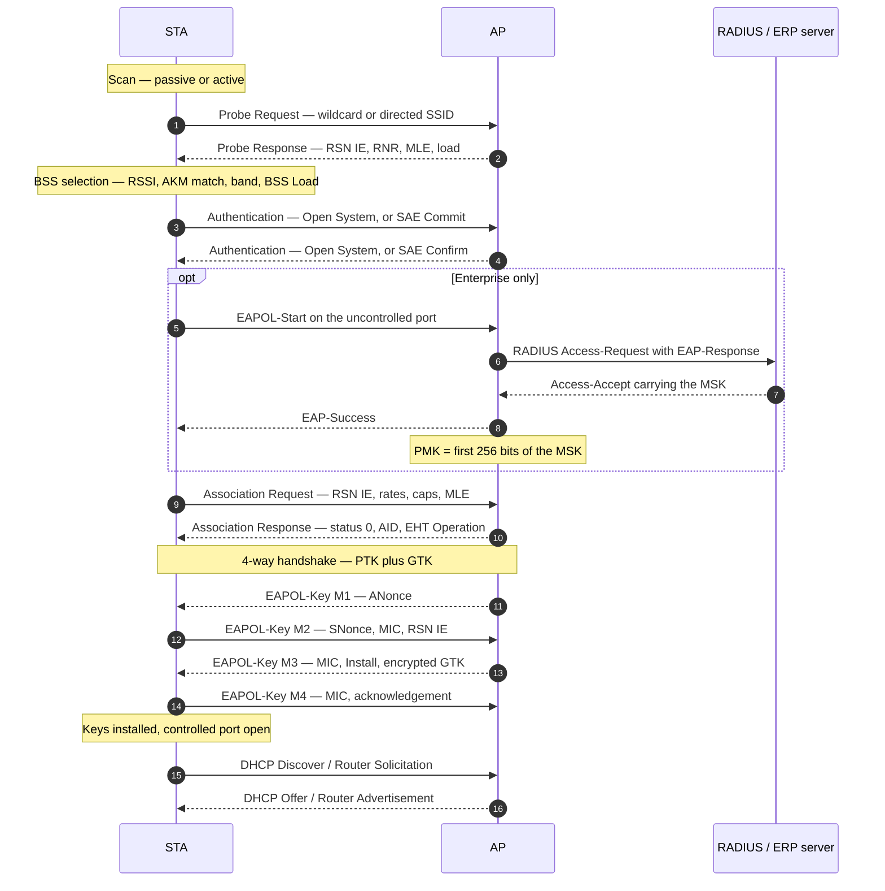

| Phase | Frames on the air | What is actually decided | Typical duration |
| --- | --- | --- | --- |
| Discovery | Beacons, Probe Req/Resp, FILS Discovery, RNR | Which BSS, which band, which security | 40 ms cached … 6 s full passive scan |
| Link authentication | 2 frames (Open), 2–6 frames (SAE), 2 (FT) | Liking the AP enough to ask for association | 1–3 ms (Open), 5–30 ms (SAE) |
| 802.1X | 4–12 EAPOL + RADIUS round trips | Whether the user or device is entitled | 50 ms … 1 s |
| Association | 2 frames | AID, capabilities, buffering, QoS, links | 1–5 ms |
| 4-way | 4 EAPOL-Key frames | PTK, GTK, cipher and PMF binding | 5–30 ms |
| Address configuration | DHCP or RS/RA | IP reachability | 10–100 ms |

The column that matters for debugging is the second one: **a failure at each phase looks
completely different on the air**, which is why the same "cannot connect" complaint has a dozen
distinct causes.

## 2. Phase 1 — Discovery

### 2.1 Passive scanning and what a beacon actually carries

A beacon is a management frame transmitted at the target beacon transmission time (TBTT), by
default every **100 TU = 102.4 ms**, at the lowest mandatory rate of the band so that legacy
devices can decode it. Its information elements are the AP's entire advertisement:

| Element | Why it exists | What it decides later |
| --- | --- | --- |
| Timestamp, Beacon Interval, Capability | BSS timing and basic capabilities | TSF synchronisation, whether ESS/IBSS, privacy bit |
| SSID | Network name, may be zero-length (hidden) | Which profile matches |
| Supported Rates / Ext Supported Rates | Mandatory and supported PHY rates | Basic-rate set for the BSS |
| DS Parameter Set / HT / VHT Operation | Channel and channel width | Primary channel, bonding |
| **RSN IE** | Cipher suites, AKM suites, PMF bits, PMKIDs, group management cipher | **Which security the STA may negotiate** |
| HE / EHT Capabilities and Operation | 11ax/11be features, 6 GHz info, puncturing | OFDMA, MCS, 320 MHz, MLO |
| **RNR** | Reduced Neighbour Report — co-located BSSes on *other* channels and bands | How a 6 GHz radio is found from 2.4/5 GHz |
| **Basic Multi-Link Element** | AP MLD address, link ID, EML and MLD capabilities | Whether multi-link setup is possible |
| BSS Load, QoS Capability, EDCA Parameter Set | Occupancy, WMM support, contention parameters | Roaming decisions, AC parameters |

The cost is arithmetic: at 102.4 ms per channel, a full passive scan of the **59 twenty-MHz
channels** in the US 6 GHz band takes about **6 seconds** — during which the radio is not
receiving its serving AP. That number is the entire motivation for the 6 GHz discovery design in
§2.3.

### 2.2 Active scanning — buying speed with airtime

An active scan transmits a Probe Request and waits for Probe Responses. Two forms:

- **Wildcard** — SSID length 0, "anyone there?". Every AP in range answers, which in a dense
  deployment means dozens of responses and a measurable airtime spike. This is why enterprises
  see probe-request storms in a site survey.
- **Directed** — a specific SSID. Only APs with that ESS answer, so it is cheap and is the form
  used for roaming.

The driver dwells on each channel between a minimum and maximum channel time: long enough to catch
a Probe Response, short enough not to waste a scan slot. A Probe Response carries the same
capability and RSN elements as a beacon, so a station that has probed does not need to wait for a
beacon at all.

Two subtleties worth stating:

1. **Probe Response is a unicast frame** addressed to the requesting STA, which is why it can be
   sent at a high rate — unlike the beacon, which must be decodable by every legacy client.
2. **Scanning is a scheduler decision, not a free action.** Off-channel time steals from the
   serving link; that is why 802.11k neighbour reports and 802.11v steering exist: to replace
   scanning with information the infrastructure already has.

### 2.3 6 GHz — discovery becomes a designed procedure

Three constraints change everything in 6 GHz:

- **Wildcard probe requests are not permitted.** A 6 GHz STA may send a *directed* probe request
  for a specific SSID, but it may not broadcast "anyone there?" across 59 channels.
- **A standard-power AP does not rely on its beacon being found.** With AFC-controlled power and
  low-power-indoor rules, a client that passively scanned the band would take seconds.
- **Only Hash-to-Element SAE is allowed** for WPA3-Personal in 6 GHz, so the authentication path
  is narrower than in 2.4/5 GHz.

The mechanisms that replace brute-force scanning:

| Mechanism | How it works | Cost |
| --- | --- | --- |
| **RNR (out-of-band)** | The 2.4/5 GHz beacon or probe response lists the AP's 6 GHz BSS: channel, BSSID, short SSID, PSD | Nearly free, and the primary method for tri-band APs |
| **PSC (in-band)** | Preferred Scanning Channels are every fourth 20 MHz channel — 5, 21, 37 … 229, **15 channels** | Quarter of the channels, so a 6 GHz-only AP should put its primary channel on one |
| **FILS Discovery frame** | A compressed advertisement carrying short SSID, BSSID and TBTT, sent roughly every **20 TU** between beacons | Tens of bytes versus a few hundred for a beacon; ~0.4 % airtime in the TGax analysis |
| **Unsolicited Probe Response** | A full probe response broadcast on the same fast cadence | More complete but heavier than FILS Discovery; mutually exclusive with it |

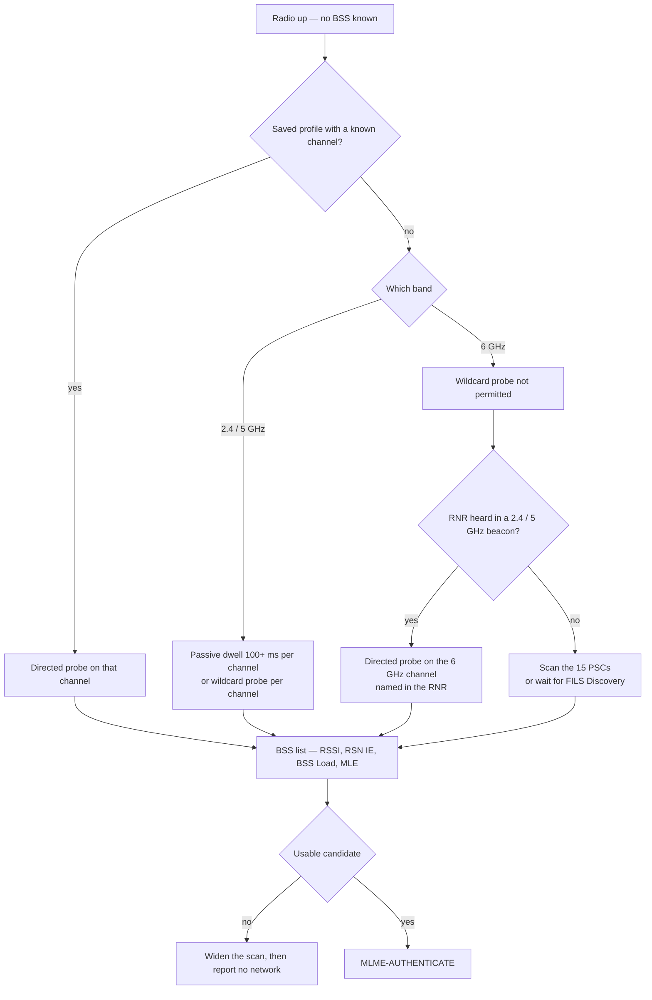

### 2.4 Choosing a BSS — where the vendor logic lives

After the scan the station holds a BSS table, and the selection is a weighted decision, not "the
strongest signal":

1. **Security match** — the profile's AKM and cipher must appear in the RSN IE. A WPA3-only profile
   cannot join a WPA2-only BSS, and a WPA2-only client cannot join a WPA3-only BSS.
2. **Band and channel preference** — 5/6 GHz preferred for throughput, 2.4 GHz for range; 6 GHz
   preferred when the RNR says the AP is reachable at adequate power.
3. **Load and airtime** — BSS Load element (station count, channel utilisation, admission capacity),
   plus the station's own history of that BSS.
4. **Hints from the infrastructure** — 802.11k Neighbor Report (candidate list with PHY and channel),
   802.11v BSS Transition Management Request (an explicit "move to this BSSID" with a disassociation
   timer), and 802.11r capability if fast transition is required.
5. **Stickiness** — the cost of leaving a working link, which is why clients stay on a weak AP far
   too long and why 11v exists at all.

In Linux the split is explicit: `cfg80211` owns the scan request and the BSS list; the driver does
the dwell and reports results; `wpa_supplicant` reads the BSS table over `nl80211` and applies the
selection policy from `wpa_supplicant.conf` (`bgscan`, `scan_freq`, `freq_list`, `bssid`, priority
and `autoscan` settings).

## 3. The state machine that governs everything

802.11 defines three MLME states, and every frame class is legal only in some of them. This is the
part of the standard that explains the reason codes you see in a capture.

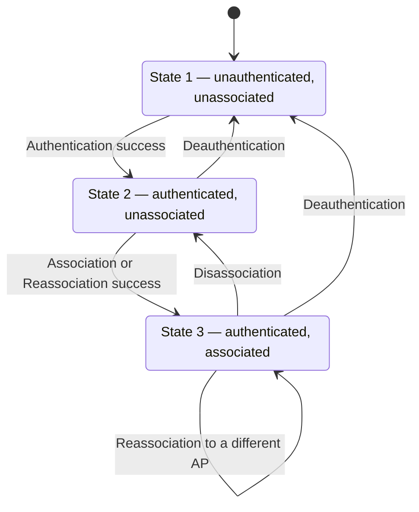

- **Class 1 frames** (beacons, probe requests and responses, authentication, deauthentication,
  control frames) are allowed in all three states.
- **Class 2 frames** (association and reassociation requests and responses) require state 2 or 3.
  An association request from state 1 is answered with **reason code 6**, "Class 2 frame received
  from nonauthenticated STA".
- **Class 3 frames** (data, Block Ack, QoS action) require state 3. Data from a station that has
  not associated is answered with **reason code 7**, "Class 3 frame received from nonassociated STA".

The reason codes worth memorising, because they point straight at the failing phase:

| Code | Meaning | What it usually indicates |
| --- | --- | --- |
| 1 | Unspecified reason | Vendor-specific rejection; read the AP log |
| 2 | Previous authentication no longer valid | AP restarted or expired the STA entry |
| 3 | Sending STA is leaving | Normal shutdown |
| 4 | Disassociated due to inactivity | STA slept past its listen interval |
| 6 / 7 | Class 2 / Class 3 frame from a STA in the wrong state | State machine broken, often by a half-open connection |
| 15 | 4-way handshake timeout | **Wrong passphrase, PMK mismatch, or EAPOL blocked** |
| 23 | 802.1X authentication failed | RADIUS rejected the credentials |

Note the asymmetry: a STA can send a deauthentication from any state, but an AP that receives a
disassociation from an unassociated STA treats it as a protocol error. And deauthentication is
**not** protected unless PMF is in use — which is why forged deauth frames were the basis of a
decade of denial-of-service attacks and why 802.11w exists (§7).

## 4. Phase 2 — Link-layer authentication

### 4.1 Open System — the null authentication that everything depends on

Two frames, authentication algorithm number **0**, transaction sequence 1 then 2, and a status code
of 0 for success:

```text
STA → AP : Authentication  alg 0, seq 1, status 0
AP  → STA: Authentication  alg 0, seq 2, status 0
```

It exchanges no credential and proves nothing. Its only function is to move the STA from state 1 to
state 2 so that an association request will be accepted. Keep this in mind when someone says
"the client authenticated successfully" — on an open or WPA2-Personal network, that sentence
describes a frame that carries no security at all.

### 4.2 Shared Key — the branch that had to die

WEP's "shared key authentication" was a four-frame challenge-response: the AP sends 128 bytes of
challenge text in the clear, the STA returns it WEP-encrypted, and the AP decrypts to check. That
design hands an attacker a plaintext/ciphertext pair for every association, which is exactly the
material needed to recover the keystream and then the key. It also authenticates the *station to
the AP* while doing nothing to authenticate the *AP to the station*. It is deprecated and disabled
everywhere; the historical lesson is why modern designs never authenticate by "encrypt this
challenge".

### 4.3 SAE — WPA3-Personal

SAE (Simultaneous Authentication of Equals) is a password-authenticated key exchange based on the
Dragonfly protocol. It replaces the PSK's fatal property — that the PMK is a pure function of the
passphrase, so one captured handshake allows an unlimited offline dictionary attack.

The exchange has two rounds, and either side may initiate:

1. **Commit.** Each side sends a group ID, a secret scalar and an element derived from the password
   element (PWE) and that scalar. Neither can compute the shared secret alone.
2. **Confirm.** Each side sends a hash of the shared secret and the transcript, proving that both
   computed the same value. Only then is the PMK derived.

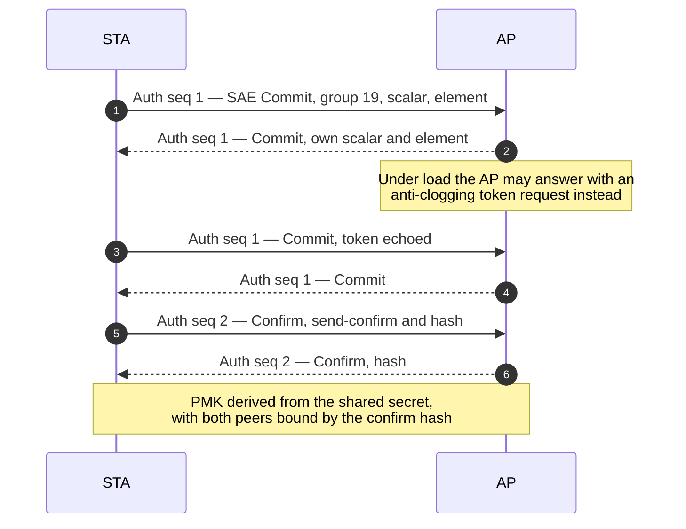

The properties that matter in an interview:

- **Forward secrecy.** The PMK comes from an ephemeral Diffie-Hellman exchange, not from the
  password. Recording the handshake and learning the password years later does not recover the
  session keys.
- **No offline dictionary attack from a passive capture.** Each password guess requires an active
  exchange with the AP. That does not make weak passwords safe — an attacker who can run an active
  attack still gets one guess per exchange — it removes the "capture once, crack forever" property.
- **Mutual authentication by construction.** Both sides prove knowledge of the password, so there is
  no "server" role to spoof.
- **Groups.** Group 19 (256-bit elliptic curve, P-256) is the interoperability floor; group 20
  (384-bit, P-384) is stronger and slower. In a real Wi-Fi 7 capture a client opens with group 20,
  the AP rejects it, and the client retries with group 19 — the "Rejected Groups" element exists
  precisely so a station does not have to guess.

**H2E versus hunting-and-pecking.** The original PWE derivation iterated a hash over the password
until the result landed on the curve — variable time, and the source of the Dragonblood side
channels. **Hash-to-Element** splits the work: a secret intermediary `PT` is derived from the
password offline, once per supported group; the PWE is then derived from `PT`, the negotiated group
and both MAC addresses in constant time during the exchange. H2E is mandatory for WPA3 and is the
**only** permitted PWE method in 6 GHz.

Dragonblood also found a group-downgrade attack (force a weaker group) and a cache-based timing
leak. The fixes — constant-time PWE, forbidding group downgrade below the configured minimum, and
SAE-PK as an optional asymmetric variant — are worth naming, because they show the protocol is
still being hardened rather than finished.

### 4.4 OWE — encryption without identity

Opportunistic Wireless Encryption (RFC 8110) gives open networks encryption without a credential.
The station puts an ephemeral Diffie-Hellman element in the **association request**, the AP answers
with its own in the **association response**, both compute the same shared secret, and that becomes
the PMK for a normal 4-way handshake.

- AKM suite **00-0F-AC:18**; PMF is mandatory; the group cipher is CCMP-128.
- It protects against passive eavesdropping, not against an active attacker who owns the AP — an
  evil twin can still run OWE with you. That distinction is the honest answer to "is OWE secure?".
- Transition mode runs two BSSes on one radio: an open BSS for legacy clients and a hidden OWE BSS,
  each pointing at the other through a vendor element, so a client that understands OWE picks the
  encrypted one.

### 4.5 802.1X and EAP — where enterprise authentication actually happens

In Enterprise mode the link-layer authentication is still Open System. The real authentication is
802.1X, and it runs **after association**, over EAPOL, on a port that is logically closed:

- **Supplicant** — the station's 802.1X client (wpa_supplicant, Windows Native WiFi, iOS).
- **Authenticator** — the AP (hostapd), which enforces port state but does not validate credentials.
- **Authentication server** — RADIUS (FreeRADIUS, ISE, NPS), which runs the actual EAP method.

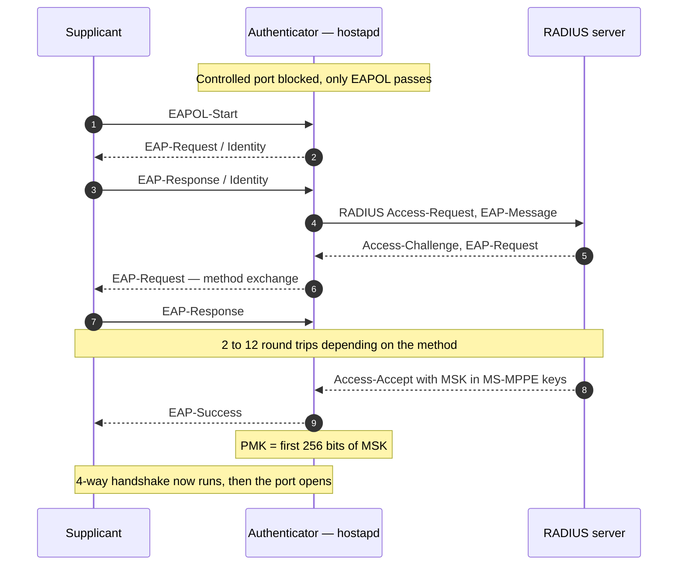

| EAP method | Credential | Server certificate | Notes |
| --- | --- | --- | --- |
| EAP-TLS | Client certificate | Required | Strongest; the only method allowed in the WPA3-Enterprise 192-bit profile |
| EAP-TTLS | Any inner method | Required | Tunnel establishes, inner method carries the credential |
| PEAPv0 / MSCHAPv2 | Username + password | Required | The common corporate deployment; inner method is weak on its own |
| EAP-SIM / AKA / AKA' | SIM or USIM | Optional | Carrier Wi-Fi offload; credentials never leave the card |

Two facts that are easy to get wrong:

- **The AP never sees the credential.** It relays EAP and, on success, receives the MSK. That is why
  a compromised AP cannot harvest passwords from a correctly configured Enterprise network.
- **The MSK is not the PMK.** The PMK is the first 256 bits of the MSK; the rest is reserved. For the
  192-bit profile the PMK is 384 bits, the derivation is SHA-384 based, and the ciphers are GCMP-256
  with BIP-GMAC-256.

### 4.6 Fast BSS Transition — authentication as a two-frame operation

802.11r replaces the "authenticate on the new AP, then reassociate" sequence with a single
authentication round trip against the target AP, using a key hierarchy prepared in advance (§8).
Authentication algorithm number **2** identifies FT. The result is that the station can authenticate
while still associated to the old AP — over the air on the target channel, or over the distribution
system through the current AP — and then reassociate with keys already derived.

## 5. Phase 3 — Association

### 5.1 The association request, element by element

Association is the station saying "here is what I am, here is what I want" and the AP answering with
a status and a set of commitments.

| Element | Content | Why the AP needs it |
| --- | --- | --- |
| Capability Information | ESS, privacy, short slot, radio measurement, spectrum management | Basic mode agreement |
| Listen Interval | In beacon intervals | How long the AP must buffer frames while the STA sleeps |
| SSID | The network being joined | Must match the BSS |
| Supported Rates / Ext Supported Rates | Rates the STA can receive | The AP must not send at a rate the STA lacks |
| **RSN IE** | Chosen group cipher, pairwise cipher, AKM, PMF bits, PMKID if caching | **The AP checks the selection is in its own RSN IE** |
| HT / VHT / HE / EHT Capabilities | MCS sets, channel widths, LDPC, STBC, MU-MIMO, 320 MHz | Rate and feature negotiation |
| Power Capability, Supported Channels | Minimum/maximum transmit power, channel list | Regulatory and power-save decisions in 2.4/5 GHz |
| RM Enabled Capabilities | 802.11k measurement abilities | Neighbour reports and radio measurement |
| QoS Capability / WMM | WMM admission control | Whether EDCA applies |
| TWT elements | Requested wake schedule | 11ax power save |
| **Basic Multi-Link Element** | MLD address, link IDs, per-STA profiles for the other links | **Wi-Fi 7 multi-link setup** |

### 5.2 The response, the AID, and what the AP just promised

A successful response carries status 0, an **association ID (AID) in the range 1–2007**, the
negotiated rates, the EDCA parameter set, and the operation elements for the current PHY
generation. The AID is not a formality: the **TIM bitmap in every beacon is indexed by AID**, so the
assignment is what makes power-save paging possible at all.

At this point the AP has committed to:

- buffer unicast frames while the station is dozing, and set the TIM bit or deliver an 802.11ax
  basic-trigger-based indication;
- schedule the station in OFDMA and MU-MIMO groups according to its capabilities;
- honour the admitted QoS policy, if WMM admission control was used;
- hold a `sta_info` entry with the negotiated capabilities — but **not yet** a key.

Association also creates the state that a later reassociation must preserve. That is why
reassociation carries the **current AP address**: the new AP needs to know which BSS to fetch
buffered frames from over the DS.

### 5.3 Reassociation is not a new association

A reassociation request reuses the association request plus one field: the address of the AP the
station is leaving. Semantically it moves the association, so:

- the station keeps its AID if the new AP is in the same ESS and coordination allows it;
- buffered frames can be forwarded from the old AP over the DS;
- the security association may be reused (PMKSA caching, OKC, or FT) instead of rebuilt.

This is why roaming looks like a two-frame operation in a good capture and like a full join in a bad
one: the difference is whether the key hierarchy was prepared in advance.

### 5.4 Failure modes you will actually see

| Symptom | Status or reason | Root cause |
| --- | --- | --- |
| Association rejected immediately | Status 17, AP unable to handle currently associated STAs | AID exhaustion or admission control; the AP may also reply with a comeback time instead of rejecting |
| Association rejected, security mismatch | Status 43, invalid AKMP | The station proposed an AKM the AP does not advertise — a WPA3-only AP and a WPA2-only client, or a stale profile |
| Association succeeds, then dies at M1/M2 | Reason 15, 4-way timeout | Wrong passphrase, mismatched PMK, EAPOL blocked by a bridge or a firewall |
| Association rejected, PMF | Status indicating MFP policy | AP requires PMF, client does not support it, or the reverse |
| Association succeeds, no DHCP | No 802.11 error at all | VLAN or tunnel assignment, 802.1X port never authorised, or DHCP blocked upstream |
| Repeats every few seconds | Reason 2 or 4 | AP expired the entry, or the station slept past its listen interval |

## 6. Phase 4 — The key hierarchy and the 4-way handshake

### 6.1 Three ways to obtain a PMK

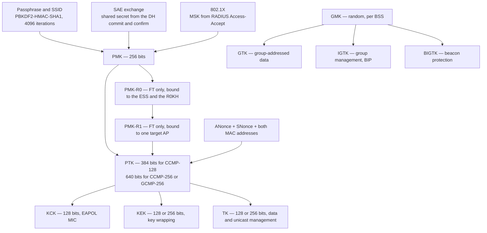

| Key | Size | Derived from | Scope | Lifetime |
| --- | --- | --- | --- | --- |
| PMK | 256 bits (384 in the 192-bit profile) | Passphrase, SAE, or MSK | One PMKSA between a STA and an AP | Until the PMKSA is deleted |
| PMK-R0 / PMK-R1 | 256-bit names, 384-bit key material | PMK plus ESS and AP identifiers | FT: the ESS, then one AP | Bounded by the key holder's cache |
| PTK | 384 or 640 bits | PMK, both nonces, both MACs | One association | Replaced on every 4-way handshake |
| GTK | 128 or 256 bits | GMK | All associated STAs | Rekeyed on a timer or on membership change |
| IGTK | 128 or 256 bits | GMK | Group robust management frames | With the GTK |
| BIGTK | 128 or 256 bits | GMK | Beacon protection | With the GTK |

Two derived identifiers show up in captures: the **PMKID**, `HMAC-SHA1-128(PMK, "PMK Name" || AA ||
SPA)`, which lets an AP recognise a cached PMKSA without holding the PMK, and the **PMKR1Name**,
which names the FT key so both APs can prove they derived the same one.

### 6.2 The 4-way handshake, frame by frame

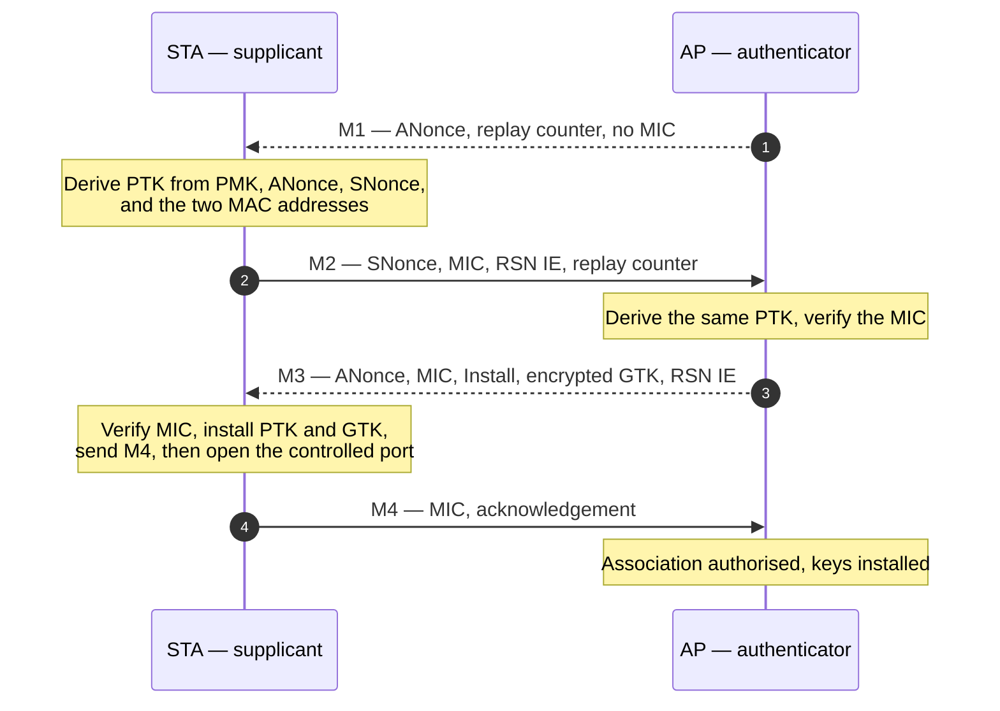

What each message actually accomplishes:

- **M1** carries the AP's nonce and no MIC — it is unauthenticated by design, because the STA has
  nothing to verify yet. Its replay counter is what prevents an old M1 from being replayed.
- **M2** carries the STA's nonce and a MIC over the message plus the STA's RSN IE. The AP now knows
  the STA holds the PMK **and** which security policy the STA believes it negotiated.
- **M3** carries the AP's MIC over the message plus the AP's RSN IE, the `Install` flag, and the GTK
  encrypted under the KEK. If the two RSN IEs disagree, the MIC check fails — that is the
  downgrade protection.
- **M4** is a bare acknowledgement with a MIC. Receiving it is how the AP knows the STA installed the
  keys, which is why the AP authorises the station on M4 and not on M3.

The derivation itself:

```text
PTK = PRF-X(PMK, "Pairwise key expansion",
            Min(AA, SPA) || Max(AA, SPA) || Min(ANonce, SNonce) || Max(ANonce, SNonce))
```

`AA` and `SPA` are the authenticator and supplicant addresses, sorted so both sides compute the same
input. The nonces make every association produce a different PTK even with an unchanged PMK — that
is the replay and precomputation defence.

### 6.3 The group key handshake

The 4-way handshake installs the pairwise key and, in M3, the current GTK. Later group rekeys use a
separate two-message exchange: the AP sends the new GTK encrypted under the KEK with a MIC, the STA
acknowledges with a MIC. Triggers are a rekey timer, a station leaving (so the departed station
cannot read future broadcast traffic), and a GTK compromise.

### 6.4 KRACK and what changed

The 2017 key reinstallation attacks exploited the fact that a retransmitted M3 would cause a station
to reinstall an already-installed PTK, resetting the packet number and the nonce. The fixes are
worth knowing because they changed how implementations are written, not just patched a bug:

- install a key **once**, and ignore a retransmitted M3 that would reinstall it;
- track the replay counter per message, not per handshake;
- never reset the transmit packet number on reinstall;
- for the group key handshake, do not reinstall the GTK on a retransmitted message.

A related consequence: **the station must not send data before installing keys**, and the AP must not
authorise the port before M4. A capture where data appears before M4 is either a broken
implementation or a handshake offload path that hid the frames.

## 7. Protected Management Frames — 802.11w

Management frames were originally unauthenticated, so anyone could forge a deauthentication and
disconnect a client. PMF fixes this with two mechanisms:

1. **Robust management frames are protected.** Unicast robust management frames (deauth,
   disassociation, action, SA Query) are protected with the pairwise cipher; group-addressed ones use
   **BIP** with the IGTK.
2. **Security Association Query.** When a station receives an unprotected frame that would tear down
   its association, it does not obey. It sends an SA Query Request to the AP and waits; if no valid
   protected response arrives within the SA Query timeout — on the order of hundreds of
   milliseconds, 200 ms in one common implementation — it disconnects.

PMF is negotiated through the **MFPC** (capable) and **MFPR** (required) bits in RSN Capabilities.
Four combinations matter:

| AP MFPC / MFPR | STA MFPC / MFPR | Result |
| --- | --- | --- |
| 0 / 0 | any | No PMF; vulnerable to forged deauth |
| 1 / 0 | 1 / any | PMF used if the STA supports it — the WPA2 transition case |
| 1 / 1 | 1 / 0 | PMF used, since the STA is capable |
| 1 / 1 | 0 / 0 | **Association rejected** — the most common enterprise join failure |

PMF is mandatory for WPA3, for 6 GHz, and for Wi-Fi CERTIFIED 7. Beacon protection with the BIGTK
extends the same idea to beacons, closing the "forge the beacon and change the client's view of the
network" attack.

## 8. Fast transition — how roaming avoids the full sequence

A full join costs a scan, an authentication, an association and a 4-way handshake, which is 100 ms
or more on a good day and seconds when a scan is involved. 802.11r attacks the key part of that by
preparing keys before the move.

The FT key hierarchy is a chain of derivations:

```text
PMK-R0 = KDF-384(PMK, "FT-R0", SSID length || SSID || MDID || R0KH-ID || SPA)
PMK-R1 = KDF-384(PMK-R0, "FT-R1", BSSID || SPA)
PTK    = PRF-X(PMK-R1, ANonce, SNonce, AP address, STA address)
```

- **R0KH** is the key holder that owns the PMK-R0 — typically the controller, or the AP that did the
  original authentication.
- **R1KH** is the target AP, which derives PMK-R1 from PMK-R0. The R1KH-ID and R0KH-ID travel in the
  FTIE so both sides can prove which key they used.
- The **mobility domain** identifier and the PMK-R0 name are what let a station move between APs
  without redoing 802.1X.
- The **4-way handshake is skipped as well**: the Reassociation Response carries the GTK inside the
  FTE, encrypted with the KEK derived from PMK-R1. That is why FT is two frames rather than six —
  and why a full 4-way handshake after a successful FT authentication is a symptom of fallback, not
  normal operation.

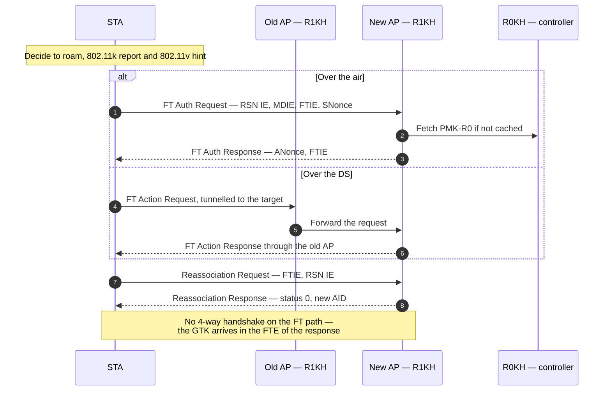

The three amendments are usually deployed together and should be described together:

| Amendment | What it contributes | Failure mode if absent |
| --- | --- | --- |
| **802.11k** | Neighbor Report: candidate BSSIDs with channel, PHY and reachability | The station must scan to find candidates, so roaming is slow |
| **802.11v** | BSS Transition Management: an explicit steer with a disassociation timer, plus BSS Termination | Clients stay on a dying AP until the signal is unusable |
| **802.11r** | FT key hierarchy and the two-frame transition | Every roam repeats the full 802.1X and 4-way sequence |

Two practical notes. **OKC** (opportunistic key caching) is a vendor technique that caches the PMK
across APs without 802.11r; it is common in older Cisco deployments and is not the same thing as FT.
And FT only helps if the APs share a mobility domain **and** the same R0KH; a misconfigured mobility
domain produces an FT authentication that fails and falls back to a full join, which looks like "FT
is on but roaming is still slow".

### 8.1 FILS — cutting the sequence to four frames

FILS (802.11ai) compresses the whole join for a station that already has a PMKSA, or that can
re-authenticate with ERP (RFC 6696):

1. The station sends an Authentication frame carrying the FILS elements, including an ERP
   re-authentication request.
2. The AP forwards it to the ERP server and returns the result in the Authentication Response.
3. Association Request carries an IP address assignment element, with DHCP encapsulated.
4. Association Response carries the DHCP offer.

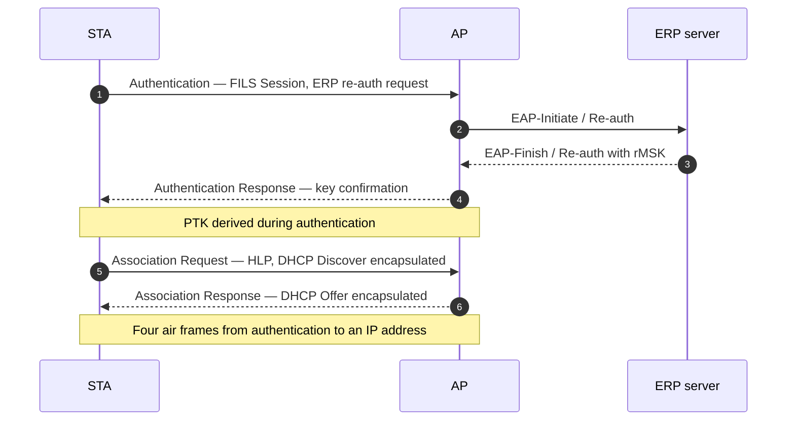

The PTK is derived during authentication and the GTK arrives with the association response, so the
4-way handshake is **not** on the fast path. Measured FILS roams land in the 10–30 ms range, and the
DHCP round trip disappears because it is carried in the association exchange.

## 9. Wi-Fi 7 — associating a multi-link device

An AP MLD is one device with several affiliated APs, each on its own link with its own link address,
all sharing one **MLD address**. Association happens **once, on one link**, and covers all of them.
That is the design decision to remember: multi-link setup is a single-link procedure that negotiates
the rest.

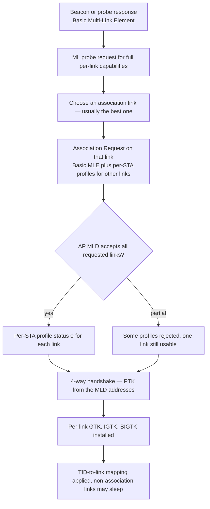

The mechanics:

- **Discovery.** Beacons carry a Basic MLE with the AP MLD address, link ID, EML capabilities and MLD
  capabilities, but **no per-STA profiles** — otherwise every beacon would grow by hundreds of bytes.
  Full per-link detail is fetched with a **multi-link probe** request/response, or read from the RNR.
- **Setup.** The association request carries a Basic MLE plus a **per-STA profile** for each additional
  link the station wants, containing that link's capabilities and operating parameters. The AP may
  accept a subset; each profile in the response carries its own status code.
- **Keys.** The PTK is derived from the **MLD addresses**, so one pairwise key serves every link; the
  GTK, IGTK and BIGTK are **per link**, because each link has its own group traffic. This is also why
  a pairwise packet number must not be reused across links — one PN space per PTKSA, or the reorder
  and replay logic breaks.
- **Links are not symmetric.** A non-AP MLD may be **STR** (simultaneous transmit and receive on
  several links) or **NSTR** (it cannot, typically because two radios share one front end or are close
  in frequency). The NSTR indication bitmap tells the AP, which must then avoid scheduling the station
  for simultaneous transactions on the constrained pair.
- **EMLSR.** Enhanced Multi-Link Single Radio lets a station with one radio monitor one link at a time
  but switch quickly when the AP signals traffic on another. The operating mode is negotiated — in the
  association exchange or later by action frame — and it changes what the AP may assume about the
  station's presence on each link.

The failure that catches people: **a station may be associated with only one AP MLD at a time**, and
the per-link status codes mean a "successful" association can still leave you with one usable link.
Reading the response's per-STA profiles, not just the top-level status, is the difference between
diagnosing a link problem and guessing.

## 10. Who does what — the software architecture of a join

The frame sequence is only half the story; the other half is which process sends what. In Linux the
control plane is split along a clean line:

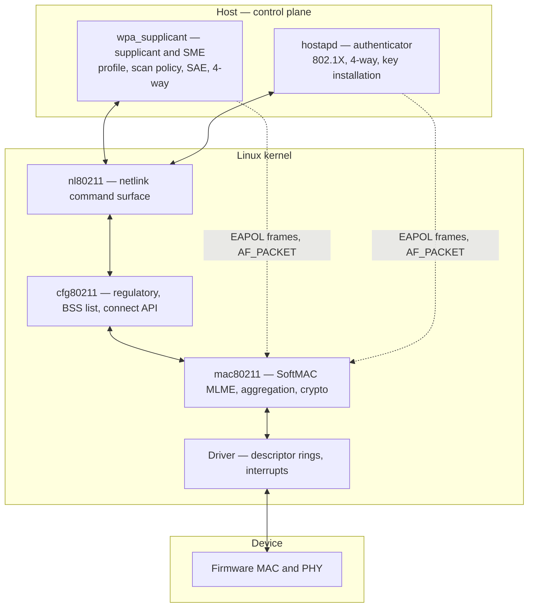

- **`wpa_supplicant`** owns the station's SME: it issues `NL80211_CMD_TRIGGER_SCAN`, reads
  `NL80211_CMD_NEW_SCAN_RESULTS`, then `NL80211_CMD_AUTHENTICATE` and `NL80211_CMD_ASSOCIATE`, and
  runs SAE, OWE and the 4-way handshake in userspace. This is why `wpa_supplicant -dd` is the single
  most useful debugging tool for a station that will not join.
- **`hostapd`** owns the AP's authenticator: it creates a station entry on authentication, runs
  802.1X and the 4-way handshake, installs keys with `NL80211_CMD_NEW_KEY`, and marks the station
  authorised with `NL80211_STA_FLAG_AUTHORIZED`. It is also where VLAN or tunnel assignment from
  RADIUS attributes happens.
- **`mac80211`** is the SoftMAC MLME: it builds and parses the management frames, tracks the state
  machine, and does the crypto that is not offloaded.
- **FullMAC** moves the SME into firmware: the driver exposes `cfg80211_ops->connect` and the
  auth/assoc frames never reach the host. Some devices also implement the 4-way handshake in
  firmware. The trade is the same one as in the datapath: fewer host cycles, far less visibility —
  and when the handshake is offloaded, `wpa_supplicant` sees only the result, not the frames.

The AP side is worth being able to narrate because it explains the asymmetry in behaviour: the AP
decides to create state on **authentication**, decides to authorise on **M4** (or on EAP-Success),
and decides to install group keys on the **group key handshake**. Between those points the station
exists but cannot pass traffic, which is exactly the window where "associated but no DHCP" lives.

## 11. The timing budget, and where the seconds go

Numbers are typical, not guaranteed; the point is the relative weight.

| Step | Open / WPA2-Personal | WPA3-Personal | WPA2-Enterprise | WPA3-Enterprise 192-bit | FT roam | FILS roam |
| --- | --- | --- | --- | --- | --- | --- |
| Scan | 0.5–6 s cold, 40 ms cached | same | same | same | 20–80 ms with 11k | 20–80 ms |
| Link auth | 1–2 ms | 5–30 ms (SAE) | 1–2 ms | 1–2 ms | 5–15 ms | included |
| 802.1X | — | — | 50–500 ms | 150–800 ms | — | — |
| Association | 1–3 ms | 1–3 ms | 1–3 ms | 1–3 ms | 3–10 ms | 3–10 ms |
| 4-way | 5–20 ms | 5–20 ms | 5–20 ms | 10–30 ms | 5–20 ms | skipped |
| DHCP | 10–100 ms | 10–100 ms | 10–100 ms | 10–100 ms | 10–100 ms | encapsulated |

Two conclusions follow. First, **the scan dominates a cold join**, which is why every roaming
optimisation is really a way to avoid scanning. Second, **Enterprise joins are dominated by 802.1X**,
so tuning the 4-way handshake is pointless there — the RADIUS round trips and the EAP method are
where the time is.

## 12. Localising a failure — the table to carry into an interview

| Observation | Phase that failed | Where to look |
| --- | --- | --- |
| No probe response at all | Discovery | Channel mismatch, 6 GHz power mode, hidden SSID and a wildcard probe, AP down |
| Probe response present, no authentication | Link auth | RSN IE mismatch, SAE group mismatch, PMF policy |
| Authentication succeeds, association rejected | Association | Status code — 17 is capacity, 43 is AKM, PMF policy is its own status |
| Association succeeds, M1 never arrives | 4-way | AP cannot derive a PTK from the PMK, or EAPOL is dropped between hostapd and the driver |
| M2 MIC fails at the AP | 4-way | Wrong passphrase, mismatched PMK from a stale PMKSA, or an RSN IE mismatch |
| M3 never arrives | 4-way | EAPOL blocked by a bridge, a firewall rule, or a full key buffer |
| Reason 15 after a pause | 4-way timeout | The same causes as above, observed from the station side |
| Keys installed, no DHCP | Authorization or L2 forwarding | 802.1X port state, VLAN or tunnel assignment, DHCP relay |
| Works, then drops every few minutes | Power save or key lifetime | Listen interval, GTK rekey failure, SA Query timeout |
| Roams but slow | FT not actually used | Mobility domain mismatch, R0KH unreachable, client falling back to full join |

A habit that pays off: **read the status and reason codes before reading the signal strength.** Almost
every "weak signal" report in a ticket is actually a code 15 or a status 43.

## Anchors

- **IEEE 802.11-2024** published **28 April 2025**; **802.11be-2024** published **22 July 2025**;
  **802.11ax-2021** is the HE amendment. SAE, OWE, FILS and PMF are all in the base standard now, not
  separate amendments.
- **Beacon interval** default **100 TU = 102.4 ms**; a full passive scan of the **59 twenty-MHz
  channels** in the US 6 GHz band therefore takes about **6 s**.
- **6 GHz**: 1,200 MHz of spectrum in the US; **15 PSCs** (every fourth 20 MHz channel: 5, 21, 37 …
  229); wildcard probe requests not permitted; standard-power APs advertise through the **RNR** in
  their 2.4/5 GHz beacons; FILS Discovery frames are sent roughly every **20 TU**.
- **AID range 1–2007**; the TIM bitmap is indexed by AID.
- **Cipher suite selectors** (OUI 00-0F-AC): 1 WEP-40, 2 TKIP, 4 **CCMP-128**, 5 WEP-104,
  6 **BIP-CMAC-128**, 8 GCMP-128, 9 GCMP-256, 10 CCMP-256, 11 BIP-GMAC-128, 12 BIP-GMAC-256,
  13 BIP-CMAC-256.
- **AKM suite selectors**: 1 802.1X, 2 PSK, 3 FT-802.1X, 4 FT-PSK, 5 802.1X-SHA256, 6 PSK-SHA256,
  7 TDLS, **8 SAE**, **9 FT-SAE**, 11 802.1X Suite B 128, **12 802.1X Suite B 192**, 13 FT-802.1X
  SHA-384, 14 FILS SHA-256, 15 FILS SHA-384, **18 OWE**.
- **PSK derivation**: `PBKDF2-HMAC-SHA1(passphrase, SSID, 4096, 256)`; **PMKID** =
  `HMAC-SHA1-128(PMK, "PMK Name" || AA || SPA)`.
- **PTK sizes**: 384 bits for CCMP-128 (KCK 128 + KEK 128 + TK 128); 640 bits for CCMP-256 and
  GCMP-256 (KCK 128 + KEK 256 + TK 256). PMK 256 bits; 384 bits in the 192-bit profile.
- **4-way handshake**: M1 carries no MIC; M2 and M3 each carry the sender's RSN IE inside the MIC
  computation, which is the downgrade defence; M3 carries `Install` and the KEK-wrapped GTK; the AP
  authorises on M4.
- **SAE**: minimum group 19 (P-256); group 20 (P-384) optional. **H2E is mandatory for WPA3 and is
  the only PWE method in 6 GHz.** Group-downgrade protection and the `Rejected Groups` element exist
  because of the Dragonblood findings.
- **PMF**: MFPC/MFPR bits in RSN Capabilities; SA Query timeout on the order of hundreds of
  milliseconds (200 ms in one common implementation); BIP-CMAC-128 is the default group management
  cipher; PMF is mandatory for WPA3, 6 GHz and Wi-Fi CERTIFIED 7.
- **FT key chain**: PMK → PMK-R0 (ESS and R0KH bound) → PMK-R1 (BSSID bound) → PTK;
  authentication algorithm number **2**.
- **MLO**: association is a **single-link** procedure carrying the Basic Multi-Link Element plus
  per-STA profiles; the PTK is derived from the **MLD addresses**, while GTK/IGTK/BIGTK are per link;
  a non-AP MLD associates with one AP MLD at a time.
- **Reason codes**: 6 class-2 frame from a nonauthenticated STA, 7 class-3 from a nonassociated STA,
  15 4-way handshake timeout, 23 802.1X authentication failure.

## Related

- [[02-10 WLAN - Baseband and Driver Architecture for Wi-Fi 6, 7 and 8 - Qualcomm as the Reference Design]] — the machinery behind the frames this note traces: vdev and peer objects created by WMI, keys installed into a hardware crypto engine, and the state that has to survive a firmware restart
- [[02-1 WLAN - Wi-Fi Generations Evolution]] — which generation introduced which part of this
- [[02-9 WLAN - Time-Sensitive Networking Across Wi-Fi Generations]] — what has to be negotiated after association before a stream can be scheduled at all: SCS agreements with QoS Characteristics, r-TWT membership, and the capability exchange that decides whether any of it applies
- [[02-8 WLAN - Scheduling - Channel Access, EDCA, OFDMA Resource Allocation, Airtime and Implementation]] — what association makes possible: the AID and Block Ack session a scheduler needs before a station is a candidate, and the EML capabilities it must respect
  sequence: 11i for RSNA, 11w for PMF, 11r/k/v for transition, 11ai for FILS, 11ax for 6 GHz
  discovery and TWT, 11be for multi-link setup
- [[02-2 WLAN - Power Saving Mechanisms and Evolution]] — what association promises about buffering:
  the listen interval, the AID-indexed TIM, and why a TWT agreement is negotiated only after the
  station is associated
- [[02-3 WLAN Ecosystem - WFA, EasyMesh and prpl]] — how certification constrains this sequence:
  WPA3 and PMF requirements, and how a mesh controller steers a station between agents
- [[02-4 WLAN - Packet TX-RX Datapath and Offload Evolution]] — what happens to the first data frame
  after the controlled port opens, and where the 4-way handshake sits when it is offloaded to firmware
- [[02-7 WLAN - Wi-Fi EasyMesh, Operation, Tuning and Troubleshooting]] — the management view of
  this join sequence: onboarding delivers the credentials, AP-autoconfiguration creates the BSSs,
  and the policy that decides whether a client gets steered into re-running it
- [[02-6 WLAN - Multi-AP Roaming, Healing and Steering]] — FT at ESS scale: where R0KH sits, the
  over-the-DS encapsulation the station never sees, the five ways FT fails, and the steering and
  healing mechanisms this join sequence enables
- [[04-3 Embedded Software Architecture - Patterns, Layering and Wireless System Structure]] — the
  same state machine as an architectural pattern: explicit states, deferred events, and a protocol
  layer that must not block
- [[01-2 5G NR RAN Layer 2 Protocol Stack]] — the cellular contrast: security is terminated in the
  PDCP layer with a base-station-driven key hierarchy, and there is no equivalent of a user-driven
  association handshake

## References

1. IEEE. *IEEE Standard for Information Technology — Telecommunications and Information Exchange
   between Systems — Local and Metropolitan Area Networks — Specific Requirements — Part 11: Wireless
   LAN MAC and PHY Specifications*, IEEE Std 802.11-2024, published 28 April 2025. — Clauses 4
   (abbreviations), 6 (MAC frame formats), 11 (MLME), 12 (security) and Annexes on the RSN IE are the
   normative basis for this note.
2. IEEE. *Part 11: Wireless LAN MAC and PHY Specifications — Amendment 2: Enhancements for Extremely
   High Throughput (EHT)*, IEEE Std 802.11be-2024, published 22 July 2025. — Multi-link discovery,
   the Basic Multi-Link Element, multi-link setup and per-link keys.
3. IEEE. *Part 11: Wireless LAN MAC and PHY Specifications — Amendment 1: Enhancements for High
   Efficiency WLAN*, IEEE Std 802.11ax-2021. — 6 GHz operation, RNR in the base amendment, TWT
   negotiation in the association exchange.
4. IEEE. *Part 11: Wireless LAN MAC and PHY Specifications*, IEEE Std 802.11-2020. — The consolidated
   revision that carries 802.11ai (FILS) and 802.11ah in the base text, with SAE, OWE and PMF already
   present; useful for tracing which amendment introduced which element rather than which revision
   repeated it.
5. IEEE 802.11 TGax. "Considerations on 6 GHz Discovery," document 11-18-1922-00-00ax, November 2018.
   <https://mentor.ieee.org/802.11/dcn/18/11-18-1922-00-00ax-considerations-on-6-ghz-discovery.pptx>
   — FILS Discovery cadence, Multiple BSSID behaviour, and the airtime arithmetic behind the 20 TU
   recommendation.
6. Cisco. "Something New: AP Discovery Methods for 6 GHz Wi-Fi." *Cisco Blogs*.
   <https://blogs.cisco.com/networking/something-new-ap-discovery-methods-for-6ghz-wi-fi-part-2> —
   The RNR, PSC, FILS Discovery and unsolicited probe response comparison, with the 59-channel and
   102.4 ms arithmetic.
7. Gast, M. S. *802.11 Wireless Networks: The Definitive Guide*, 2nd ed. O'Reilly, 2005.
   ISBN 978-0-596-10052-0. — Still the clearest account of scanning, the MLME state machine, and the
   frame formats.
8. Edney, J., and Arbaugh, W. A. *Real 802.11 Security: Wi-Fi Protected Access and 802.11i*.
   Addison-Wesley, 2003. ISBN 978-0-321-13620-6. — The 802.1X port model, the RSN key hierarchy, and
   the reasoning behind the 4-way handshake.
9. Harkins, D. "Simultaneous Authentication of Equals: A Secure, Password-Based Key Exchange for Mesh
   Networks." *Second International Conference on Sensor Technologies and Applications (SENSET)*,
   2008. — The Dragonfly protocol that SAE is built on.
10. Vanhoef, M., and Ronen, E. "Dragonblood: Analyzing the Dragonfly Handshake of WPA3 and EAP-pwd."
    *IEEE Symposium on Security and Privacy*, 2020. DOI 10.1109/SP40000.2020.00031. — Timing and
    cache side channels in hunting-and-pecking, the group-downgrade attack, and the H2E fix.
11. Vanhoef, M., and Piessens, F. "Key Reinstallation Attacks: Forcing Nonce Reuse in WPA2." *ACM
    CCS*, 2017. DOI 10.1145/3133956.3134027. — Why a retransmitted M3 breaks the nonce, and what a
    correct implementation must track.
12. Harkins, D., and Kumari, W. *Opportunistic Wireless Encryption*, RFC 8110, April 2017.
    <https://www.rfc-editor.org/rfc/rfc8110> — The OWE exchange in the association frames, and its
    explicit non-goals.
13. Aboba, B., Blunk, L., Vollbrecht, J., Carlson, J., and Levkowetz, H. *Extensible Authentication
    Protocol (EAP)*, RFC 3748, June 2004. <https://www.rfc-editor.org/rfc/rfc3748> — The EAP
    request/response model and the method negotiation that 802.1X carries.
14. Aboba, B., Simon, D., and Eronen, P. *Extensible Authentication Protocol (EAP) Key Management
    Framework*, RFC 5247, August 2008. <https://www.rfc-editor.org/rfc/rfc5247> — The MSK and EMSK
    derivation, and the rule that the PMK is the first 256 bits of the MSK.
15. Zhou, H., et al. *EAP Re-authentication Protocol (ERP)*, RFC 6696, July 2012. — The rRK, rIK and
    rMSK chain that FILS uses to re-authenticate in one round trip.
16. Wi-Fi Alliance. *WPA3 Specification* (current version) and *Wi-Fi CERTIFIED 7* program
    requirements. <https://www.wi-fi.org/discover-wi-fi/security> — Which features are mandatory for
    certification: WPA3 and PMF for Wi-Fi 7, SAE with H2E for WPA3-Personal, and the 192-bit profile
    as an optional enterprise mode.
17. IEEE. *Part 11: Amendment 4: Protected Management Frames*, IEEE Std 802.11w-2009, and its
    incorporation into later revisions. — BIP, the IGTK, and the SA Query procedure.
18. "Multi-Link Operation in IEEE 802.11be Extremely High Throughput: A Survey." IEEE Xplore document
    10474403. — Multi-link setup, per-STA profiles, TID-to-link mapping, and the discovery cost of an
    MLD.
19. Linux kernel and hostap. `net/mac80211/mlme.c`, `net/mac80211/key.c`, `include/net/cfg80211.h`,
    `include/uapi/linux/nl80211.h`; `wpa_supplicant/` and `hostapd/` source. — The authoritative
    description of `NL80211_CMD_AUTHENTICATE`, `NL80211_CMD_ASSOCIATE`, `NL80211_CMD_NEW_KEY` and the
    state machine that drives them.

---

Copyright (c) 2026 Washington Ruan. All rights reserved.
