# WLAN — Multi-AP Roaming, Healing and Steering

Three words that get used as synonyms and are not. **Roaming** is the station's transition from one
BSS to another. **Steering** is the network trying to influence *when and where* that transition
happens. **Healing** is the network repairing itself after a radio, a node or a backhaul link fails.
They get conflated because they share one physical fact: **in 802.11 the transition decision belongs
to the station, and nothing in the standard can overrule it.**

That single fact explains most of what follows. A controller can measure, recommend, block, and
eventually disconnect — but it cannot move a client. Every steering mechanism is therefore a way of
changing what the client's own algorithm will decide, and every healing mechanism that involves a
client is really a steering mechanism with a different trigger.

[[02-5 WLAN - STA-AP Discovery, Authentication and Association]] covers the join sequence and the FT
key hierarchy in isolation. This note is about what happens when there are *many* APs: what the
station sees, what the network knows, who decides, what the decision costs, and what breaks when a
node dies at the wrong moment.

## 0. Vocabulary — the words that get mixed up

| Term | Precise meaning | What people wrongly say |
| --- | --- | --- |
| **Roaming** | A non-AP STA leaving one BSS and joining another in the same ESS; formally a **BSS transition** | "handover", "switch" |
| **Handover** | Cellular term. Wi-Fi has no handover: no network-controlled transfer, no anchor, no make-before-break by default | "the AP hands the client over" |
| **ESS transition** | Moving to a *different* ESS — new SSID, possibly new IP subnet. FT does not apply | "roaming between floors" |
| **Steering** | Network-initiated influence on association choice: BTM, assoc control, probe suppression, deauth | "the controller roams the client" |
| **Band steering** | Steering between bands of the *same* AP or ESS. Not an IEEE mechanism; a vendor behaviour built from the primitives in §4 | "802.11 band steering" |
| **Load balancing** | Steering for airtime reasons rather than RF reasons. Same actuators, different objective function | "steering" |
| **Healing** | Automatic recovery of the multi-AP network after a failure: backhaul reselection, channel change, re-homing clients | "self-healing Wi-Fi" (marketing) |
| **Backhaul / fronthaul** | The AP-to-AP (or AP-to-gateway) link / the AP-to-client link | "the mesh" |
| **Controller / Agent** | EasyMesh roles: the policy owner / the executor on an AP | "master / slave" (legacy) |
| **Mobility domain** | An ESS sub-group sharing an MDID and an R0KH, inside which FT works | "the roaming group" |
| **Sticky client** | A station that stays associated well past the point where another BSS would serve it better | "bad client" |

Two more traps worth naming explicitly:

- **"Multi-AP" means three different things.** (a) Several BSSes in one ESS — the 802.11k/v/r world.
  (b) EasyMesh: a controller/agent management architecture over IEEE 1905.1. (c) 802.11bn MAPC:
  PHY/MAC-level coordination between APs (Co-SR, Co-BF, Co-TDMA). They stack, and an interview
  answer that blurs them is the fastest way to look like a reader rather than an engineer.
- **"Roaming" in a mesh is usually two roams.** When a client moves, the *client* may reassociate;
  independently the mesh may re-home its own *backhaul* STA. The second one is invisible to the
  client and is where most "the mesh dropped me" complaints actually originate.

## 1. One control loop, three timescales

Everything in this note instantiates the same loop as the rest of the vault: measure, decide,
actuate, verify. What differs is the timescale and who owns the decision.

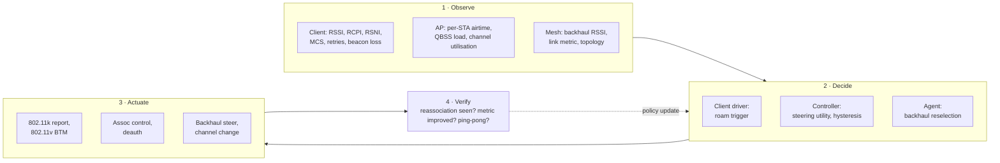

| Mechanism | Timescale | Decision owner | Can it force a move? |
| --- | --- | --- | --- |
| Client roam trigger | 100 ms – 10 s | Station driver | Yes, by leaving |
| 802.11k Neighbor Report | 10 ms – 1 s per request | AP answers, station uses | No |
| 802.11v BTM | 1 s – 10 s | AP recommends, station decides | **No** — recommendation |
| Assoc control (EasyMesh) | seconds to minutes | Controller blocks a BSS | Yes, indirectly |
| Deauth / disassoc | immediate | AP | Yes, destructively |
| Backhaul reselection | 100 ms – 30 s | Agent, or controller | Yes, no client involvement |
| Channel change (CSA) | 1 s – 10 s | Controller / agent | Yes, all clients move |
| Wi-Fi 8 SMD | draft | AP MLD set | Changes the model entirely |

The interview-useful column is the fourth one. Almost every design argument in this space reduces to
"which row are we in, and are we allowed to force it".

## 2. Why the client decides — and why that is the whole problem

### 2.1 The standard puts the trigger in the station

IEEE 802.11 defines *how* to transition (reassociation, FT, key derivation) and deliberately says
nothing about *when*. The roam decision is a driver policy. Three consequences follow, and they are
the reason the entire steering industry exists:

1. Two devices on the same AP, at the same position, will roam at different points. There is no
   reference behaviour to test against.
2. A vendor that ships an aggressive threshold gets complaints about ping-pong; a vendor that ships
   a conservative threshold gets complaints about "sticky". Both are "compliant".
3. The network has better information than the client — it knows every AP's load, backhaul capacity
   and channel utilisation — and almost no authority to act on it.

### 2.2 What a client actually uses as a trigger

| Trigger | Where it lives | Notes |
| --- | --- | --- |
| RSSI below threshold | driver / supplicant | The classical one; thresholds are vendor-tuned, typically -70 to -80 dBm for 5 GHz |
| Background scan result better by margin | supplicant (`bgscan`) | In wpa_supplicant: `bgscan="simple:30:-70:3600"` — scan every 30 s, scan faster below -70 dBm, back off to 3600 s |
| Beacon loss / missed beacons | mac80211 `beacon_loss` | Fires after a run of missed beacons; the STA may keep the association and just stop transmitting |
| Data-path stall | driver | Retry exhaustion or excessive latency is often a stronger trigger than RSSI |
| BTM Request received | supplicant WNM code | The station evaluates the candidate list; it may accept, reject, or ignore |
| MLO link loss | driver | One link of an MLD dies: the device recovers per link before considering a full move |
| TWT / power-save mismatch | driver | Rare but real: a TWT agreement that no longer fits the traffic pattern pushes a device to a different AP |

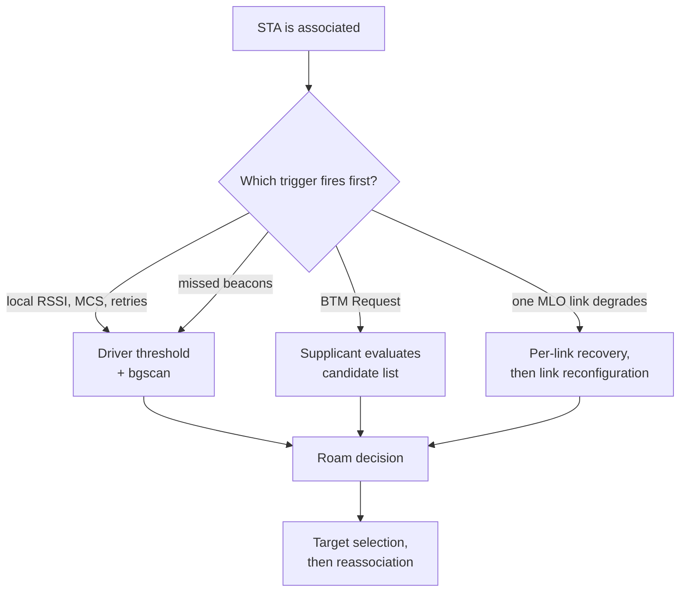

### 2.3 Why "roam below -70 dBm" is a bad policy

- **RSSI is not SNR.** In an office at -65 dBm with a neighbouring BSS at -63 dBm, the co-channel
  interference sets the achievable rate, not the signal level. RSSI cannot see it. RCPI and RSNI are
  the standardised measures (RCPI is encoded so that dBm = RCPI/2 − 110); most drivers still expose a
  vendor-defined "RSSI" that is not comparable across vendors.
- **3 dB is roughly one MCS step.** Required SNR per MCS step at a given bandwidth is of that order,
  which is why hysteresis windows are usually 3–6 dB: below 3 dB you ping-pong, above 6 dB you stay
  too long.
- **The two directions are not symmetric.** AP transmit power is often 2–6 dB above the client's, so
  a client can hear the AP perfectly and still be barely audible to it. A roam trigger based on
  downlink RSSI will be late for uplink-limited traffic — which is exactly what video calls are.
- **2.4 GHz and 5/6 GHz are not comparable.** 2.4 GHz reaches further, so a raw RSSI comparison always
  prefers 2.4 GHz. Any band-steering policy has to add a band offset, not compare raw numbers.

## 3. Roaming — the state machine, end to end

### 3.1 Four variants, four costs

| Variant | What is skipped | Frames on the air | Typical interruption |
| --- | --- | --- | --- |
| **Full join** | nothing | scan + auth + assoc + 802.1X/EAP + 4-way | 100–500 ms; seconds with a full scan or a slow EAP method |
| **PMKSA caching / OKC** | 802.1X (the AP already has the PMK) | scan + auth + assoc + 4-way | 50–150 ms |
| **FT (802.11r)** | 802.1X **and** the 4-way | FT auth + reassoc | tens of ms |
| **FILS (802.11ai)** | scan, 802.1X, 4-way, **and** the DHCP round trip | auth + assoc with encapsulated DHCP | 10–30 ms |

The ordering matters: **PMKSA caching and FT solve different problems.** Caching removes the trip to
the RADIUS server but keeps the 4-way handshake; FT pre-derives the PTK so the 4-way disappears. A
network with caching but no FT still shows a visible gap in a voice call.

### 3.2 Discovery before the move — 802.11k in a multi-AP network

A station that has to scan before every roam spends 30–120 ms per channel. 802.11k replaces the scan
with a **Neighbor Report**: a list of candidate BSSes the AP already knows are reachable, each entry
carrying BSSID, BSSID Information (reachability, security, key scope, spectrum management, QoS, AP
capability, mobility domain, FT capability), operating class, channel number and PHY type.

Two practical points that separate people who have run this from people who have read about it:

- **The Neighbor Report is only as good as the AP's neighbour table.** It is populated from scan
  results, from a static configuration (`hostapd`'s `neighbor_db`, set with `set_neighbor` in
  `hostapd_cli`), or from the controller. A controller that never sends neighbours produces a
  Neighbor Report that lists nothing useful, and the client scans anyway.
- **802.11k also lets the AP make the client measure.** A Radio Measurement Request (action frame
  category 5) can ask the station for a **Beacon Report** on specified channels, returning RCPI, RSNI,
  BSSID and frame information. That is how a controller builds an RF map *from the client's
  perspective* — the only perspective that matters for the decision the client is about to make.
  EasyMesh packages this as "Beacon Metrics Query/Response".

6 GHz changes the arithmetic: 59 overlapping 20 MHz channels, no wildcard probe requests, and
scanning is steered to the **15 preferred scanning channels (PSCs)**. A 6 GHz-capable client that
does not know about PSCs scans 59 channels and roams badly. See
[[02-5 WLAN - STA-AP Discovery, Authentication and Association]] §2.3.

### 3.3 The transition — one sequence that names every frame

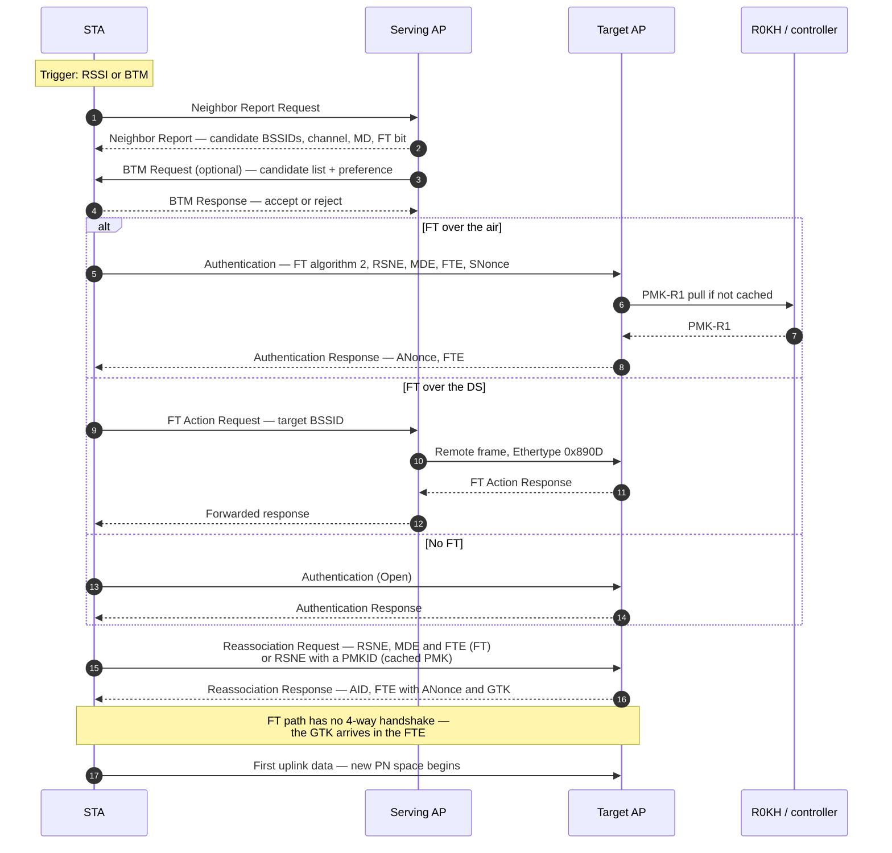

The last line is the part usually left out of diagrams. **The transition ends on the air, but the
user-visible outage ends when the first packet is delivered on the new link** — which includes the
target AP's own work: installing the key, allocating a queue, and (if the client asked for it)
buffering frames. An FT roam that is 20 ms on the air can be 80 ms in the application.

### 3.4 FT at multi-AP scale — where R0KH lives

FT is a key hierarchy with three levels, and the deployment question is where the top level sits:

```text
PMK     -> PMK-R0  bound to (SSID, MDID, R0KH-ID, SPA)   held by R0KH
PMK-R0  -> PMK-R1  bound to (BSSID, SPA)                 held by each R1KH
PMK-R1  -> PTK     bound to (ANonce, SNonce, addresses)  per transition
```

| Placement | How it works | Strength | Failure mode |
| --- | --- | --- | --- |
| **Controller as R0KH** | Every AP is an R1KH; the controller derives PMK-R1 on demand or pushes it | One point of truth; scales to hundreds of APs | Controller latency becomes roam latency; controller down means FT degrades to full join |
| **First AP as R0KH** | The AP that did the original authentication keeps PMK-R0 and answers pulls | No controller dependency | That AP becoming unreachable strands the PMK-R0 |
| **Distributed with push** | Every AP is R0KH-capable and PMK-R1 is pushed to neighbours proactively | Fastest reassociation | Key material spread widely; harder to audit |

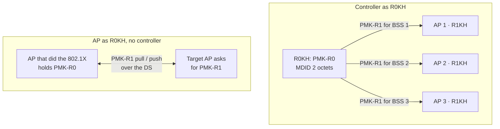

The tell-tale symptom of a broken R0KH placement is an **FT authentication that succeeds and a
reassociation that fails**, or an authentication that is simply rejected and silently falls back to a
full join. Both look like "802.11r is enabled but roaming is slow".

### 3.5 FT over the DS — the frame you never see in a Wi-Fi capture

Over-the-air FT is a normal management frame between the station and the target AP. Over-the-DS FT
is tunneled, and the tunnel is not Wi-Fi at all:

| Field | Value / meaning |
| --- | --- |
| Ethertype | **0x890D** — the FT protocol frame |
| Remote Frame Type | **1** (other values are ignored) |
| FT Packet Type | 0 = remote request, 1 = remote response |
| FT Action Length | length of the encapsulated FT Action frame |
| AP Address | address of the AP that sent the remote frame |
| FT Action Frame | the encapsulated management frame, unchanged |

The serving AP receives an FT Action frame addressed to another AP, wraps it in a 0x890D Ethernet
frame, and forwards it. That is why over-the-DS FT shows up in a wired capture but not in a wireless
one — a genuinely useful thing to know when someone says "the roam is not happening and I see
nothing".

Over-the-DS is chosen when the station cannot reach the target AP directly (too far, wrong band) or
when the infrastructure prefers to keep the exchange on the wired side. Cisco's own guidance for
FlexConnect deployments is the opposite — over-the-air — because the DS path may cross a WAN link
whose latency defeats the purpose.

### 3.6 Five ways FT fails in the field

| Symptom | Cause | Where to look |
| --- | --- | --- |
| Authentication rejected, full join follows | **MDE mismatch** — the mobility domain element does not match what the beacon advertises (status `STATUS_INVALID_MDE`) | `mobility_domain` in `hostapd.conf`, MDE in the beacon |
| Authentication rejected, status for AKM | RSNE does not negotiate an FT AKM — e.g. FT-SAE `00-0F-AC:9` missing while the AP requires FT | RSNE in the association, AKM list per BSS |
| Reassociation fails after successful FT auth | **R0KH-ID mismatch** between request and response, or PMK-R1 name mismatch | R0KH-ID derivation, controller identity |
| Client cannot associate at all once FT is on | Legacy supplicant cannot parse an RSNE with the additional AKM suites, so it never sends an association | Client driver version; the classic workaround is a second SSID without FT |
| Roam succeeds but the first packets are lost | GTK not delivered, or the target AP's forwarding entry is not installed yet | FTE in the reassociation response, bridge/FDB state, key install ordering |

A sixth, less obvious one: some controllers rate-limit concurrent FT handshakes as a denial-of-service
defence (Cisco documents a limit of three per controller in some releases). In a dense venue with a
wave of clients moving at once — a lecture hall emptying — that limit is a roaming cliff, and it is
invisible until it is not.

### 3.7 What the data plane does during the transition

- **PN and sequence numbers restart.** The PTK is new, so the packet number space is new. Anything the
  old AP buffered and did not deliver is gone — 802.11 has no cross-AP retransmission.
- **Block Ack agreements do not survive.** The target AP establishes new BA sessions; the old ones are
  torn down. That is one reason the first burst after a roam looks slow: aggregation restarts.
- **The bridge does not move by itself.** A reassociation updates the AP's station table, but a
  bridged AP still has to learn the client's MAC on the new port and age it out on the old one.
  Multicast/broadcast forwarding entries and any flow-offload state (see
  [[02-4 WLAN - Packet TX-RX Datapath and Offload Evolution]]) must be reprogrammed at the target.
- **The IP layer sees nothing.** Same subnet means the same IP, same ARP cache, same TCP connection.
  This is the entire value of an ESS: L2 mobility with L3 transparency. It also means a roam that is
  200 ms on the air shows up as a TCP retransmit and a jitter spike, not as a disconnect.

### 3.8 Roaming across an ESS boundary

When the target is a different ESS, FT does not apply (no shared mobility domain), the IP subnet may
differ, and the client re-runs DHCP. That is an **ESS transition**, and it is a mobility failure from
the application's point of view: new address, broken connections. Fixes are outside 802.11 —
anchoring the session at a gateway, tunnelling the old prefix, or using an L3 mobility protocol. The
reason this matters in a WLAN interview is that "seamless roaming across the campus" often means
"one ESS with a large L2 domain", which is why campus designs still flatten their VLANs.

## 4. Steering — the network's attempt to influence the decision

### 4.1 Four actuators and what each can force

| Actuator | Standardised? | Can the client ignore it? | Airtime cost | Side effect |
| --- | --- | --- | --- | --- |
| **Probe / assoc suppression** | No | Yes (it can still try) | Low | Breaks legacy clients; invisible to diagnostics; makes the network look broken |
| **802.11v BTM** | Yes | **Yes** — a recommendation | One action frame + response | None if the client cooperates; nothing happens if it does not |
| **Assoc control** (block a BSS) | EasyMesh | Only by failing to associate | Medium | A visible association failure, and a client that may blacklist the SSID |
| **Deauth / disassoc** | Yes | No | Low | Destructive: kills the connection, resets keys, may trigger a scan of everything |

The engineering judgement to state out loud: **BTM is the only actuator that degrades gracefully.**
Suppression and deauth are what you use when the client is old enough not to implement BTM, and both
cost more in user experience than they save in airtime.

### 4.2 802.11v BTM, frame by frame

BSS Transition Management lives in the Wireless Network Management category — **action frame
category 10**, with action codes **6 = BTM Query, 7 = BTM Request, 8 = BTM Response**.

| Field in the BTM Request | Why it exists |
| --- | --- |
| Dialog Token | Matches request to response when several are outstanding |
| Request Mode | `Preferred Candidate List Included`, `Abridged`, and the preference semantics |
| Disassociation Imminent + Timer | "I will disconnect you in N TBTTs" — the only part with teeth |
| Validity Interval | How long the recommendation stays valid; a client that ignores it and then complains is not a bug |
| BSS Termination Duration | The AP is going away (channel change, firmware update) |
| Candidate List | Per candidate: BSSID, operating class, channel, **preference 0–255** — and **0 means excluded**, not "least preferred" |

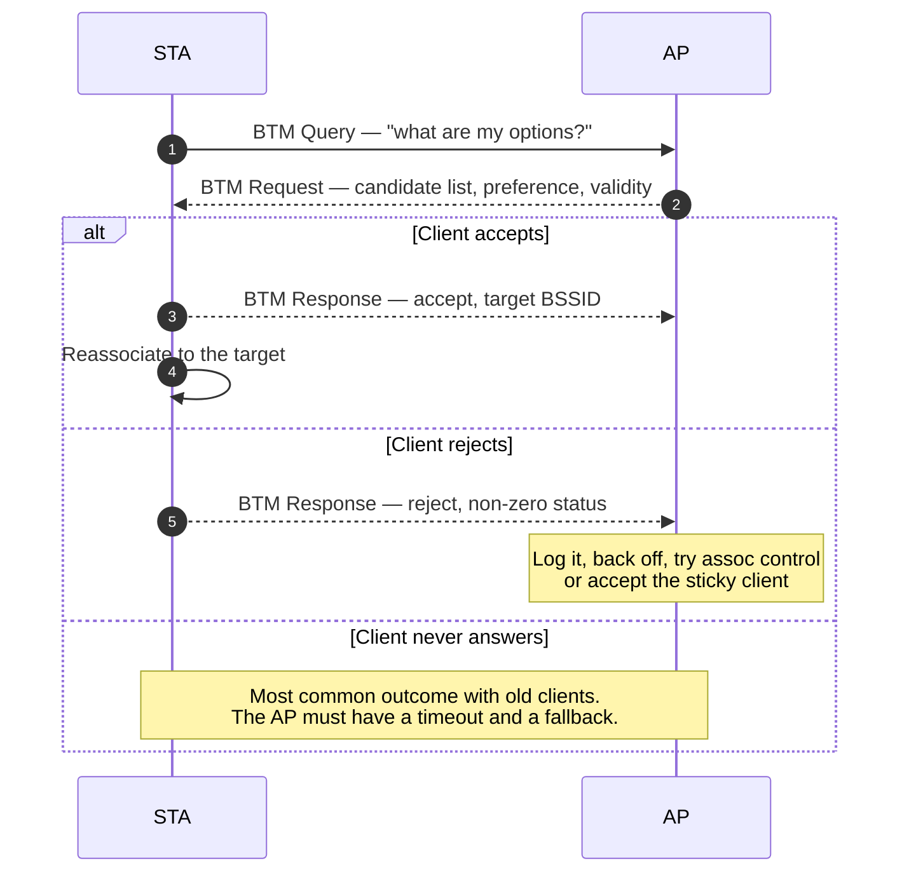

Two details that interviewers probe:

- **`Abridged`** lets the AP send a short list and rely on the client's own Neighbor Report data for
  the rest. It saves airtime but depends on 802.11k actually being populated.
- **Reject is information, not failure.** A client that rejects because "no candidate is better than
  what I have" is telling you its own measurement disagrees with yours — usually because your load
  metric is invisible to it. The right response is to fix the candidate list, not to escalate to
  deauth.

### 4.3 MBO — the Wi-Fi Alliance additions that make BTM usable

BTM alone is a recommendation with no vocabulary for "this band is bad for you". Wi-Fi CERTIFIED
**Agile Multiband** (part of Wi-Fi CERTIFIED Vantage, and a requirement for Wi-Fi CERTIFIED 6) adds
the missing vocabulary on top of 802.11k/v/r/u:

- **MBO-OCE information element** — element ID `0xDD`, OUI `50-6F-9A`, OUI type `0x16`, carried in
  beacons, probes and (re)association frames so both sides know the other supports the programme.
- **Non-preferred channel report** — the client states channels it will not or prefers not to use
  (regulatory, hardware, interference); the AP must not steer it there. Updatable after association
  through a WNM Notification Request.
- **Cellular data preference** — lets a client say "I would rather use cellular right now", which is
  the correct answer to a congested hotspot and the wrong answer if you are selling Wi-Fi calling.
- **Reason codes and throttling timeouts** — WFA-defined enhancements so a steering attempt carries a
  machine-readable reason and a rate limit. Without these, "steering" is a deauth with no explanation.

Agile Multiband also requires **PMF (802.11w)**, because an unprotected BTM Request is a trivial
denial-of-service: anyone who can forge one can herd every client in the cell. In a CableLabs field
trial cited by the Wi-Fi Alliance, certified devices showed an 84% improvement in reconnection time
versus a non-certified environment — the number to quote when asked whether any of this matters.

### 4.4 EasyMesh client steering, message by message

The EasyMesh Controller does not steer directly. It collects measurements, computes a decision, and
sends a **Client Steering Request** to the agent that currently holds the client.

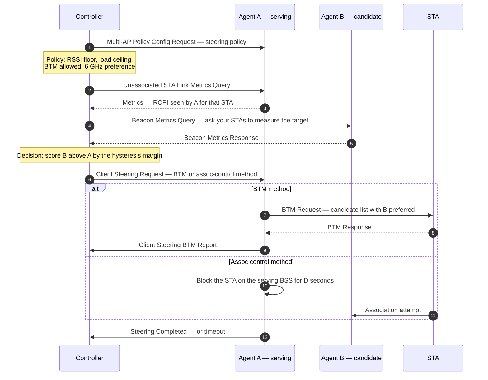

The message names are worth memorising because they map one-to-one onto the design:
`Unassociated STA Link Metrics Query/Response`, `Beacon Metrics Query/Response`,
`AP Metrics Query/Response`, `Client Steering Request`, `Client Steering BTM Report`,
`Client Association Control Request`, `Steering Completed`, `Client Disassociation Stats`,
`Backhaul Steering Request`. They ride IEEE 1905.1 CMDUs in the Multi-AP message-type range (the
policy message is `0x8003`, backhaul steering `0x8019`, client disassociation stats `0x8022`), which
is exactly the boundary between [[02-3 WLAN Ecosystem - WFA, EasyMesh and prpl]] and this note: 1905.1
carries the policy, 802.11 carries the action.

### 4.5 Assoc control — the actuator of last resort

Assoc control tells an agent to **refuse association** from a given station on a given BSS for a
given duration. It works on clients that ignore BTM, and it is the only mechanism that works on a
client with no 802.11v support at all.

It also breaks things:

- The client sees an association failure, and many clients respond by blacklisting the SSID for
  minutes — the opposite of steering.
- It is not a nudge, it is a wall, and it is applied to *all* traffic including the emergency call.
- It requires the controller to know when to stop. A block that outlives the condition turns a
  transient load spike into a persistent coverage hole.

Implementation-wise there is nothing exotic: a time-limited MAC deny list enforced in the AP's
association path is the same mechanism as a static ACL (`deny_acl` in `hostapd`), just with a timer
and a controller behind it.

### 4.6 The decision function

Every controller has one, and almost none of them publish it. The shape is always the same:

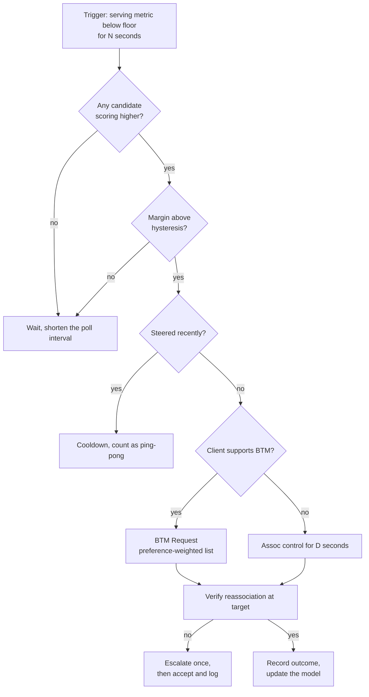

The score is a weighted sum, and the weights are the interesting part:

| Input | Direction | Why it is there | Typical pitfall |
| --- | --- | --- | --- |
| RCPI / RSSI at the candidate | higher better | The only signal the client also has | Over-weighted; ignores interference |
| Estimated PHY rate | higher better | Converts RF into what the user feels | Requires per-client rate history |
| AP airtime utilisation | lower better | Load balancing | Invisible to the client, so BTM looks arbitrary |
| Associated STA count | lower better | Cheap proxy for load | Wrong when one STA is a 4K stream |
| Backhaul capacity | higher better | In a mesh this dominates | Ignored in most simple implementations |
| Band preference | 6 > 5 > 2.4 | Spectrum and channel width | Causes band ping-pong without a margin |
| Client capability match | binary | 6 GHz, 11ax, MLO | Stale capability data |

### 4.7 Ping-pong, and why hysteresis alone does not fix it

Hysteresis stops a client oscillating between two equally good APs. It does not stop the harder
case: **two APs whose scores cross each other repeatedly because the load term moves.** Client A
moves to B, B's load rises, the score flips, A moves back. The fix is not a bigger margin; it is a
**penalty term with memory** — a per-client, per-BSS "recently rejected" cost that decays over tens of
seconds, plus a global steering rate limit. This is why production controllers keep a per-client
steering history, and why "how do you detect ping-pong" is a better interview question than "what is
hysteresis".

The metric to instrument is **steering success rate** (reassociations at the intended target divided
by steering attempts) together with **time-to-steer**. A controller optimising BTM accept rate while
ignoring time-to-steer will look excellent and feel terrible.

### 4.8 Steering in MLO — different granularity, same problem

Wi-Fi 7 splits the old question in two:

- **Intra-device: link selection.** A non-AP MLD with links on 2.4, 5 and 6 GHz chooses which link
  carries which TID. **TID-to-link mapping** does this by policy; **link recommendation** through BTM
  lets the AP suggest a subset of links. No reassociation, no keys, no outage.
- **Inter-device: MLD-level transition.** Moving to a different AP MLD is an ML (re)setup. 802.11be
  extends BTM for it: the Neighbor Report element can carry a **Basic Multi-Link element**, so a
  candidate can be an AP MLD or a specific subset of its affiliated APs, and a preference of 0
  excludes an AP MLD outright. The same structure appears in the
  `REJECTED_WITH_SUGGESTED_BSS_TRANSITION` status code — a status code defined back in 802.11v and
  finally used for its intended purpose.
- **Link reconfiguration** (EHT Protected Action frames) adds and removes links within an AP MLD with
  a dialog token, a per-link status list, group key data and the operating-channel information for
  the new link. This is the mechanism behind "the AP is taking a radio down for DFS" without
  disconnecting anyone.
- **Critical updates propagate through BPCC.** The BSS Parameters Change Count lets a client track
  parameter changes on all links by watching one, which is what makes per-link maintenance survivable.

The interview consequence: **"roaming" in an MLO network must be stated at MLD granularity or it is
ambiguous.** A client that keeps its 6 GHz link while adding a 5 GHz link has not roamed; a client
that moves both links to a different AP MLD has.

### 4.9 6 GHz and the end of "band steering"

Band steering existed because 2.4 GHz was where clients landed by default and never left. 6 GHz
changes the problem:

- 6 GHz has no legacy devices, so there is nothing to protect and no probe-suppression hack needed.
- Scanning is confined to the PSCs, which makes the discovery cost affordable.
- Standard-power 6 GHz APs must be discovered through the RNR in the 2.4/5 GHz beacons, so the
  "steer to 6 GHz" decision is made *before* the client ever transmits on 6 GHz.

The result is a cleaner policy: prefer 6 GHz for capability and proximity, 5 GHz for range, and treat
2.4 GHz as the IoT and legacy band rather than as a load-balancing target. What has not changed is
that the decision still has to be communicated to the client through the mechanisms in §4.2–4.4.

## 5. Healing — what happens when a node dies

### 5.1 Three failure classes

| Class | Example | What must recover | Who can see it |
| --- | --- | --- | --- |
| **Radio / link** | DFS radar on the backhaul channel, interferer, antenna fault | Channel, or the link itself | Agent, then controller |
| **Node** | AP loses power, firmware crash, watchdog reboot | Topology, and the clients that were on it | Neighbours, controller |
| **Topology** | Ethernet backhaul cut, upstream switch reboot, loop introduced | The path to the gateway | Agent, controller, STP |

### 5.2 Detection: what each layer can actually see

| Signal | Detector | Time to detect | False-positive mode |
| --- | --- | --- | --- |
| Missed beacons | Client and backhaul STA | 3–10 beacon intervals (0.3–1 s) | Interference burst looks like an AP death |
| Null-data keepalive loss | Agent | seconds | Power-save client that is fine looks dead |
| 1905.1 Topology Notification absent | Controller | tens of seconds | Silent — the controller simply has stale topology |
| Backhaul link metric below floor | Agent | 1–10 s | A busy link looks like a bad link |
| Ethernet carrier loss | Kernel (`netif_carrier_off`) | milliseconds | Cable flap storms |
| Association count dropping to zero on a radio | Controller | one poll interval | All clients genuinely left |

The design rule: **every detector needs a hysteresis and a second opinion.** A single missed-beacon
event must not trigger a backhaul re-home, because re-homing a backhaul costs more airtime than most
outages.

### 5.3 The backhaul state machine

This is where mesh healing actually lives. Every EasyMesh agent runs something equivalent, whether or
not it calls it a state machine.

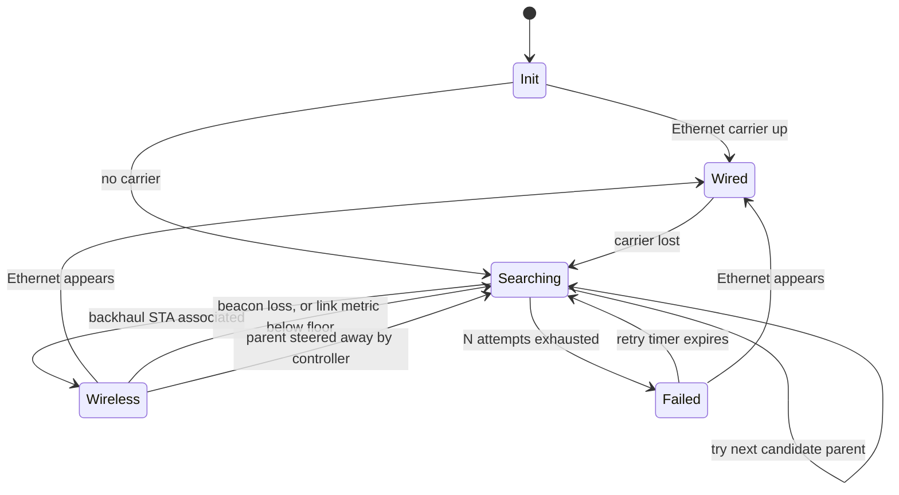

Two properties of that machine matter more than the states:

- **Wired always wins.** An agent that has both must deactivate the wireless backhaul, or it will
  create a loop the moment the wired path is also bridged. prplMesh's backhaul manager encodes
  exactly this preference, and "why did my mesh loop when I plugged in the Ethernet" is the same bug
  in every implementation.
- **Re-homing is a rate-limited operation.** A parent that flaps causes every child to re-home on
  every flap. The fix is a hold-down timer on the old parent, and a per-agent limit on how often it
  may change parent.

### 5.4 Topology repair — optimal path, link metric, loop hazard

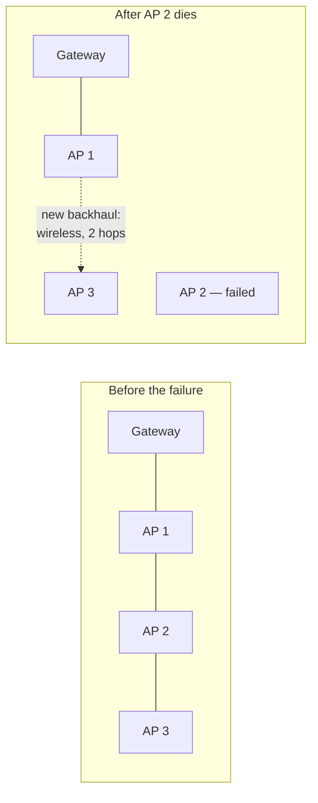

Three things have to happen, in this order, and each can fail on its own:

1. **Detect** — AP 2 stops answering, its children notice beacon loss.
2. **Re-select** — AP 3 evaluates candidates: AP 1 over the air, or a wired path if one exists. The
   metric is a link metric (1905.1 defines a transmit link metric; EasyMesh adds backhaul link
   metrics with RSSI and throughput estimates), not raw RSSI.
3. **Re-establish** — AP 3's backhaul STA associates to AP 1, and every downstream client of AP 3
   keeps its association. This is the part that makes healing *invisible*: the clients never move.

The hazard is step 2 combined with any bridged Ethernet: the new wireless path plus the old wired
path is a loop. Loop-free topology is therefore not an optimisation, it is a precondition — either
STP (slow, blocks for tens of seconds) or a controller that knows the whole graph and can prune it.

### 5.5 Fronthaul healing — the channel change

When the problem is interference rather than failure, the repair is a channel change, and a channel
change is a **CSA (Channel Switch Announcement)** with a countdown. Everyone on the BSS is displaced
at the same instant, which is the most disruptive scheduled event in Wi-Fi.

What good implementations do: run **background CAC** on the candidate channel before committing (so a
DFS channel is known-clear), pick a channel whose clients all support the width, and coordinate the
change across radios so that the 2.4 and 5 GHz radios do not end up co-channel in a new way. What bad
implementations do: change channel on a timer regardless of whether anything improved, which trains
users to blame the mesh for a drop every few hours.

### 5.6 Re-homing clients when an AP dies

| Situation | Correct actuator | Why |
| --- | --- | --- |
| Planned maintenance, AP will reboot | BTM with **BSS Termination Duration**, sent before the event | Clients move on their own terms, with keys ready |
| Unexpected AP death | Nothing — clients detect beacon loss and roam | Any controller action is too late |
| AP alive but radio unusable | **BTM with Disassociation Imminent**, then disassoc | A dying BSS must not hold clients |
| One link of an AP MLD fails | Link reconfiguration / link removal, keep the MLD | Avoids a full ML reassociation |
| Backhaul permanently degraded | Backhaul Steering Request to the agent, move the agent's uplink | The clients do not move at all |

The distinction between rows 1 and 2 is the one people get wrong: **you cannot heal a dead AP, you
can only make its death cheap.** Everything that helps must have been set up while it was alive —
neighbour tables populated, keys pushed, candidate lists fresh.

### 5.7 Why EasyMesh did not use 802.11s

| Property | 802.11s (2011) | EasyMesh (2018–) |
| --- | --- | --- |
| Forwarding | L2 mesh, HWMP path selection | Bridging; the topology is a tree rooted at the gateway |
| Path selection | Proactive tree (RANN) + on-demand PREQ/PREP | Controller computes an "optimal path"; agent executes |
| Backhaul | Wi-Fi only, mesh STAs | Ethernet, Wi-Fi, or hybrid, with explicit preference |
| Control plane | In-band, distributed | Out-of-band, IEEE 1905.1, centralised |
| Multi-vendor policy | None | Controller/agent split with certification |
| Failure mode that killed it | Loops when bridged with Ethernet; no operator control point | — |

The industry chose a controller over a routing protocol for the same reason cellular chose a
scheduler over CSMA: **centralised decisions are cheaper than distributed convergence when the
topology is small and the policy is commercial.**

## 6. Who decides what — the control-plane architecture

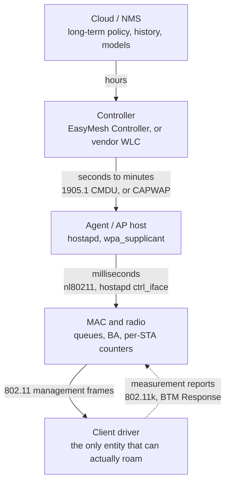

The architectural rule that follows from this diagram: **policy lives high, mechanism lives low, and
anything on the critical path of a roam must live at the bottom.** A steering decision that needs a
round trip to a controller adds that round trip to every roam. That is why Fast Transition is a
two-frame exchange between the station and the target AP, and why every controller-based optimisation
is advisory rather than mandatory.

Practical evidence in the open-source stack: `hostapd` implements the AP side (`wnm_ap.c` for BTM,
`rrm.c` for beacon requests, `neighbor_db.c` for the neighbour table), `wpa_supplicant` implements the
client side (`wnm_sta.c`), and the two are driven from a controller through `ctrl_iface` commands such
as `bss_tm_req` and `set_neighbor`. Reading those three files is the fastest way to stop guessing.

## 7. Wi-Fi 8 — the first standard answer to "roaming is the client's decision"

Everything above exists because the decision belongs to the station. 802.11bn (UHR, Wi-Fi 8) attacks
that directly with the **Seamless Mobility Domain (SMD)**: a single logical entity spanning multiple
AP MLDs, which need not be co-located. Three properties make it different in kind:

- **Context moves, not just the client.** Handshake state, sequence numbers, security keys and
  capabilities can be transferred between AP MLDs, so a transition does not have to rebuild them.
- **Per-link, step by step.** A client MLD can move one link at a time between AP MLDs, which is
  make-before-break at the granularity of a radio rather than a device.
- **The association is with the domain.** Where FT kept the ESS as the unit of trust, SMD makes the
  unit of association a set of AP MLDs.

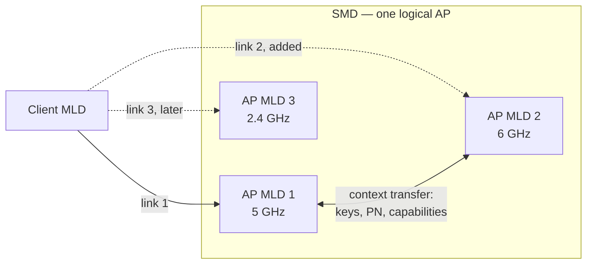

Status, stated honestly: 802.11bn's first complete draft (D1.0) landed in July 2025 with more than
8,000 comments; D1.3 was approved in January 2026 and roughly 60% of comments were resolved by March
2026. Publication is projected around 2028, with Wi-Fi Alliance certification expected to start
earlier. The UHR targets are the useful part of the story even before the text is stable — **25%
higher throughput at a given SINR, 25% lower 95th-percentile latency, and 25% fewer MPDUs lost, with
BSS transitions called out explicitly.**

Multi-AP coordination (MAPC) is the other half, and it composes with mobility rather than replacing
it: Co-SR, Co-BF, Co-TDMA and Co-RTWT change *which AP transmits when*, while SMD changes *which AP
the client thinks it is associated with*. The open question — and a good thing to say in an
architecture interview — is where the coordination state lives, because per-TXOP decisions cannot
ride an IEEE 1905.1 control plane.

## 8. Numbers to carry into an interview

| Quantity | Value | Note |
| --- | --- | --- |
| Beacon interval | 100 TU = 102.4 ms | Default; missed-beacon detection is a multiple of this |
| BTM action codes | Category 10, actions 6 / 7 / 8 | Query / Request / Response |
| BTM preference | 0–255, **0 means excluded** | Not "least preferred" |
| BTM disassociation timer | In TBTTs | The only enforceable part of a BTM |
| FT authentication algorithm | 2 | Carried in the Authentication frame |
| FT-SAE AKM | `00-0F-AC:9` | FT-802.1X is `00-0F-AC:3`, FT-PSK `4` |
| Mobility domain ID | 2 octets | Mismatch gives `STATUS_INVALID_MDE` |
| FT over the DS Ethertype | `0x890D` | Remote Frame Type 1; FT Packet Type 0/1 |
| MBO-OCE IE | ID `0xDD`, OUI `50-6F-9A`, type `0x16` | Presence = supports Agile Multiband |
| EasyMesh message types | `0x8003` policy, `0x8019` backhaul steering, `0x8022` client disassociation stats | Multi-AP range above 1905.1 base types |
| RCPI encoding | dBm = RCPI/2 − 110 | Standardised; vendor "RSSI" is not |
| Hysteresis window | 3–6 dB | Roughly one MCS step per 3 dB |
| Agile Multiband field trial | 84% faster reconnection | CableLabs 2019, cited by WFA |
| 6 GHz PSCs | 15 | Every fourth 20 MHz channel |

## 9. Symptom → cause

| Symptom | First hypothesis | Then check |
| --- | --- | --- |
| Voice call gaps while walking | Client roams late, or no FT | `bgscan` settings, FT enabled and MD matched, roam time in the client log |
| Roam works but the first second is dead | Data path not ready at the target: key, FDB, BA, offload state | FTE/GTK in the reassociation, bridge entry age, flow-offload programming |
| 802.11r enabled, roaming still slow | FT rejected and silently fell back to full join | FT auth status codes, R0KH reachability, AKM list in RSNE |
| Clients cluster on one AP | Steering not attempted, or BTM rejected by clients | BTM accept rate, assoc-control use, whether 802.11k is actually populated |
| Clients bounce between two APs | Hysteresis too small, or load term oscillating | Steering history, cooldown, ping-pong count per client |
| Mesh drops every few hours | Channel change on a timer, or backhaul flap | CSA events, backhaul parent changes, hold-down timer |
| Everything works until Ethernet is plugged in | Backhaul preference plus a bridge = loop | Spanning tree state, backhaul manager state, 1905.1 topology |
| One room is always slow on 2.4 GHz only | Band steering absent, or 6 GHz discovery failing | RNR in the beacon, PSC scan, client capability report |

## Anchors

- **802.11k** (radio resource measurement: Neighbor Report, Beacon Report) and **802.11v** (WNM,
  BSS Transition Management) and **802.11r** (Fast BSS Transition) are separate amendments; all three
  are folded into the base standard (802.11-2020 / 802.11-2024) and are certified together by
  **Wi-Fi CERTIFIED Agile Multiband**, which is part of **Wi-Fi CERTIFIED Vantage** and a
  **requirement for Wi-Fi CERTIFIED 6**.
- **Agile Multiband requires PMF (802.11w)** and defines the **MBO-OCE IE** (element ID `0xDD`, OUI
  `50-6F-9A`, OUI type `0x16`), the **non-preferred channel report**, and WFA reason codes plus
  throttling timeouts for WNM actions.
- **BTM frame identity**: action category **10** (WNM), actions **6** Query, **7** Request,
  **8** Response. Candidate preference is **0–255**; **0 means excluded**.
- **FT key chain**: PMK → PMK-R0 (SSID, MDID, R0KH-ID, SPA) → PMK-R1 (BSSID, SPA) → PTK;
  authentication algorithm **2**; **MDID is 2 octets**.
- **FT over the DS** uses a remote frame with **Ethertype `0x890D`**, Remote Frame Type 1, FT Packet
  Type 0 (request) / 1 (response).
- **FT failure statuses** documented by Cisco: `STATUS_INVALID_MDE` when the MDE does not match the
  beacon, and an AKM status when the RSNE does not carry an FT AKM (FT-SAE is `00-0F-AC:9`). Cisco
  also documents a **limit of three concurrent FT handshakes per controller** in some releases as a
  denial-of-service defence, and that the **FT Resource Request protocol is optional and unsupported
  by clients**.
- **FT skips the 4-way handshake**: the GTK is delivered in the FTE of the Reassociation Response.
  A full 4-way handshake after an FT authentication means the transition fell back.
- **REJECTED_WITH_SUGGESTED_BSS_TRANSITION** is a status code defined since 802.11v; 802.11be extends
  its use to MLDs by allowing the Neighbor Report element to carry a **Basic Multi-Link element**, and
  802.11be clause **35.3.23** is "BSS transition management for MLDs" with preference 0 excluding an
  AP MLD.
- **EasyMesh specification v6.0** was announced in **August 2024** and became mandatory for newly
  tested mesh devices from **31 December 2024**; it is the Wi-Fi 7-era release (MLD configuration,
  MLO topology/link metrics). prplMesh **6.0.1** corresponds to R6; **5.x** covered R5.
- **EasyMesh control plane**: IEEE 1905.1 CMDUs; the Multi-AP message-type range includes `0x8003`
  (Multi-AP Policy Config Request), `0x8019` (Backhaul Steering Request), `0x8022` (Client
  Disassociation Stats). Steering messages: Client Steering Request, Client Steering BTM Report,
  Client Association Control Request, Steering Completed.
- **CableLabs 2019 field trial** (cited by the Wi-Fi Alliance): Wi-Fi CERTIFIED devices showed an
  **84% improvement in reconnection times** versus a non-certified environment.
- **RCPI encoding**: dBm = RCPI/2 − 110; RSNI uses the same encoding.
- **IEEE 802.11bn (UHR, Wi-Fi 8)**: TG formed **May 2021**, work began **November 2023**, **D1.0 in
  July 2025** with **more than 8,000 comments**, **D1.3 approved January 2026**, ~60% of comments
  resolved by **March 2026**; publication projected **2028**; certification expected from **early
  2028**. UHR targets versus Wi-Fi 7: **+25% throughput at a given SINR, −25% 95th-percentile
  latency, −25% MPDU loss including during BSS transitions**.
- **SMD (Seamless Mobility Domain)** is the 802.11bn feature that spans multiple AP MLDs as one
  entity with context transfer and per-link transition; some secondary sources render the name as
  "Seamless Roaming Domain" — the mechanism described is the same. `VERIFY` the final name against
  the published amendment.
- **MAPC schemes in 802.11bn**: Co-RTWT, Co-SR, Co-BF, Co-TDMA, Co-CR; MAPC was studied in 802.11be
  and deferred.
- **`bgscan` in wpa_supplicant** takes signal/short/long thresholds in the form
  `simple:30:-70:3600` (scan interval 30 s, faster below -70 dBm, back off to 3600 s) — one concrete
  example of a client-side roam trigger that the network cannot see.

## Related

- [[02-5 WLAN - STA-AP Discovery, Authentication and Association]] — the join sequence this note
- [[02-8 WLAN - Scheduling - Channel Access, EDCA, OFDMA Resource Allocation, Airtime and Implementation]] — what steering is trying to influence: the per-station airtime accounting and the fact that the roam decision still belongs to the client's own access process
  assumes: the MLME states, the PMK→PMK-R0→PMK-R1→PTK chain, and the FT exchange described in
  isolation rather than at ESS scale
- [[02-1 WLAN - Wi-Fi Generations Evolution]] — which generation contributed which mechanism:
  11k/v/r for transition, 11ai for FILS, 11ax for 6 GHz discovery, 11be for MLD-level BTM and link
  reconfiguration, 11bn for SMD and MAPC
- [[02-7 WLAN - Wi-Fi EasyMesh, Operation, Tuning and Troubleshooting]] — the control plane that
  carries these steering messages: 1905.1 CMDUs, the Client Steering Request/BTM Report/Association
  Control exchange with its real field semantics, plus the tuning knobs and the debugging method
- [[02-3 WLAN Ecosystem - WFA, EasyMesh and prpl]] — the controller/agent architecture the steering
  messages ride on, and what certification actually requires
- [[02-4 WLAN - Packet TX-RX Datapath and Offload Evolution]] — what has to be reprogrammed at the
  target AP before the first packet after a roam can be delivered: keys, BA sessions, FDB entries,
  flow-offload state
- [[02-2 WLAN - Power Saving Mechanisms and Evolution]] — why a power-save client misses the frames
  that would have triggered its roam, and how TWT agreements constrain the target AP's scheduling
- [[04-3 Embedded Software Architecture - Patterns, Layering and Wireless System Structure]] — the
  same controller/agent split as an architectural pattern: policy at the top, mechanism at the
  bottom, and why the critical path must not cross a control-plane boundary
- [[04-2 Linux Embedded Development - Drivers, Applications and Core Subsystems]] — mac80211's
  roaming and beacon-loss handling, `nl80211`, and how hostapd/wpa_supplicant are driven
- [[01-2 5G NR RAN Layer 2 Protocol Stack]] — the cellular contrast: handover is network-controlled
  with an explicit preparation phase, and the UE has no vote
- [[05-1 DPDK User Plane and 5G UPF]] — the same "who owns the decision" question in a user plane:
  fast path and slow path, and what happens when the control plane is late

## References

1. IEEE. *Part 11: Wireless LAN Medium Access Control (MAC) and Physical Layer (PHY)
   Specifications*, IEEE Std 802.11-2024, and *Amendment: Enhancements for Extremely High
   Throughput*, IEEE Std 802.11be-2024. — The consolidated clauses for WNM (BSS transition
   management, including 35.3.23 for MLDs), radio measurement, FT, and link reconfiguration.
2. IEEE. *Part 11: Amendment 1: Radio Resource Measurement of Wireless LANs*, IEEE Std 802.11k-2008.
   — Neighbor Report and Beacon Report, the two measurements every steering decision depends on.
3. IEEE. *Part 11: Amendment 8: IEEE 802.11 Wireless Network Management*, IEEE Std 802.11v-2011. —
   BSS Transition Management, the WNM action frames, and the reason codes that make "steering" a
   describable act rather than a deauth.
4. IEEE. *Part 11: Amendment 2: Fast Basic Service Set (BSS) Transition*, IEEE Std 802.11r-2008. —
   The PMK-R0/R1 hierarchy, the FT authentication algorithm, over-the-air and over-the-DS, PMK-R1
   pull and push, and the remote frame.
5. IEEE. *Part 11: Amendment 9: Interworking with External Networks*, IEEE Std 802.11u-2011. — ANQP
   and GAS, the pre-association query mechanism that MBO and Passpoint build on.
6. IEEE. *Part 11: Amendment 1: Fast Initial Link Setup*, IEEE Std 802.11ai-2016. — FILS, the
   four-frame join that makes a roam an order of magnitude cheaper for a client with a PMKSA.
7. IEEE. *Standard for Information Technology — Telecommunications and Information Exchange between
   Systems — Part 11: Mesh Networking*, IEEE Std 802.11s-2011. — HWMP, RANN and the airtime link
   metric; the design EasyMesh chose not to follow.
8. IEEE. *Standard for a Convergent Digital Home Network for Heterogeneous Technologies*, IEEE Std
   1905.1-2013, and *Amendment 1*, 1905.1a-2014. — The CMDU and TLV framing that carries the entire
   Multi-AP control plane.
9. Wi-Fi Alliance. *Wi-Fi EasyMesh Specification v6.0* and *Test Plan v6.0*, announced August 2024,
   effective for newly tested devices 31 December 2024. — Controller/agent roles, the client
   steering, association control and backhaul steering messages, and the R6 MLO additions.
10. Wi-Fi Alliance. *Wi-Fi CERTIFIED Agile Multiband Technology Overview*, April 2021.
    <https://www.wi-fi.org/system/files/Wi-Fi_CERTIFIED_Agile_Multiband_Technology_Overview_202104.pdf>
    — The MBO-OCE information element, the non-preferred channel report, the WNM reason codes and
    throttling timeouts, and the requirement for PMF.
11. Wi-Fi Alliance. "Wi-Fi CERTIFIED Agile Multiband balances network resources with intelligent
    guidance." *Wi-Fi Alliance Beacon*.
    <https://www.wi-fi.org/beacon/m-consuelo-ortiz/wi-fi-certified-agile-multiband-balances-network-resources-with-intelligent>
    — Agile Multiband as a requirement for Wi-Fi CERTIFIED 6, and the CableLabs 2019 field trial
    showing an 84% improvement in reconnection time.
12. Cisco. "What is 802.11r? Why is this Important?" *Cisco Blogs*.
    <https://blogs.cisco.com/networking/what-is-802-11r-why-is-this-important> — The clearest short
    account of over-the-air versus over-the-DS, and of FT as make-before-break rather than
    break-before-make.
13. Cisco. *Cisco Catalyst 9800 Series Wireless Controller Configuration Guide*, Fast Transition
    chapter (17.x).
    <https://www.cisco.com/c/en/us/td/docs/wireless/controller/9800/17-17/config-guide/b_wl_17_17_cg/m_fast_transition_ewlc.pdf>
    — FT-SAE `00-0F-AC:9`, `STATUS_INVALID_MDE`, the RSNE/AKM rejection case, the three-concurrent-FT
    limit, and the note that the FT resource request protocol is optional and unsupported by clients.
14. IEEE 802.11 TGbe. "SB1 CR for CIDs 22000 and 22001," document 11-24-0699r1, 2024.
    <https://mentor.ieee.org/802.11/dcn/24/11-24-0699-01-00be-sb1-cr-for-cids-22000-and-22001.docx> —
    The Basic Multi-Link element inside the Neighbor Report for
    `REJECTED_WITH_SUGGESTED_BSS_TRANSITION`, and the per-link association-limit case that motivates
    MLD-level recommendations.
15. Karamyshev, A., Levitsky, I., Bankov, D., and Khorov, E. "A Tutorial on Wi-Fi 8: The Journey to
    Ultra High Reliability." *Problems of Information Transmission*, 61(2), 2025.
    DOI 10.1134/S003294602502005X. — SMD as the roaming answer, the MAPC scheme family, and the UHR
    quantitative targets.
16. HPE Aruba Networking. *Wi-Fi generations — design and deployment*.
    <https://www.arubanetworks.com/techdocs/aos/wifi-design-deploy/generations/_print> — The U-MAC /
    L-MAC split, MLD versus link MAC addresses, BPCC for critical updates, link recommendation
    through BTM, and multi-link reconfiguration versus TID-to-link mapping.
17. prpl Foundation. "Appendix: EasyMesh Standards Compliance," prplMesh wiki.
    <https://gitlab.com/prpl-foundation/prplmesh/prplMesh/-/wikis/Appendix-EasyMesh-Standards-Compliance>
    — Which prplMesh release implements which EasyMesh release (1.x→R1 … 6.0.1→R6), and the R6 MLO
    work that landed early in 5.1–5.2.
18. prplMesh. Controller tasks (`optimal_path_task`, `network_health_check_task`,
    `client_locating_task`) and agent `backhaul_manager` state machine;
    `controller/src/beerocks/master/tasks/`, `agent/src/beerocks/slave/backhaul_manager/`. — A
    readable reference implementation of §5.3 and §5.4.
19. hostap. `hostapd/src/ap/wnm_ap.c`, `hostapd/src/ap/rrm.c`, `hostapd/src/ap/neighbor_db.c`,
    `wpa_supplicant/wnm_sta.c`, and the `bss_tm_req` / `set_neighbor` control-interface commands. —
    The AP side and client side of BTM as actually implemented, including the timeout behaviour when
    a client never answers.
20. Gast, M. S. *802.11 Wireless Networks: The Definitive Guide*, 2nd ed. O'Reilly, 2005.
    ISBN 978-0-596-10052-0. — Still the best account of reassociation as a service, and of why the
    standard has no opinion on when to roam.
21. Edney, J., and Arbaugh, W. A. *Real 802.11 Security: Wi-Fi Protected Access and 802.11i*.
    Addison-Wesley, 2003. ISBN 978-0-321-13620-6. — The key hierarchy that PMKSA caching, OKC and FT
    each cut into at a different depth.

---

Copyright (c) 2026 Washington Ruan. All rights reserved.
