# WLAN — Wi-Fi EasyMesh: Architecture, Operation, Tuning and Troubleshooting

**EasyMesh is a control plane, not a radio technology.** It standardises how multiple APs from
different vendors discover each other, are configured, measure the network, and are told what to do.
It does not touch the air interface, and it does not carry user traffic.

[[02-3 WLAN Ecosystem - WFA, EasyMesh and prpl]] places EasyMesh in the certification landscape;
[[02-6 WLAN - Multi-AP Roaming, Healing and Steering]] covers what happens when a station actually
moves. This note is the middle layer: the protocol itself, how it is deployed, which knobs exist, and
how to debug a network that is misbehaving.

Spec quotations below are taken from the **Wi-Fi EasyMesh Specification v5.0 (2022-12-08)**; v6.0 is
the Wi-Fi 7-era release. Where a statement is specific to v6.0/R6 or to an implementation, it is
marked as such.

---

## 1. What EasyMesh standardises — and what it deliberately does not

### 1.1 Scope

| In scope | Out of scope |
| --- | --- |
| Discovery of a Controller and of neighbour Multi-AP devices | The roam decision — that belongs to the station |
| Onboarding and credential distribution (WPS/PBC, DPP) | The air interface: PHY rates, MCS, aggregation, MLO |
| Configuration of fronthaul and backhaul BSSs per radio | L2 forwarding and loop prevention (1905.1 leaves this to 802.1D bridging) |
| Policy distribution: steering, metrics reporting, channel scan, traffic separation | Coordinated scheduling / joint transmission (Wi-Fi 8 territory) |
| Measurement: backhaul, per-BSS, per-STA, channel scan, anticipated channel usage | Carrying user data — the control plane never touches it |
| Steering of clients, of backhaul STAs, and of channels | The Controller's decision algorithms |

That last row is a direct consequence of the spec's own wording policy. The specification writes
requirements as **"If triggered, a Multi-AP Controller shall …"**, and states in a footnote:

> This specification only partially defines the algorithms that govern the operation of a Multi-AP
> Controller. These Multi-AP Controller algorithms' actions are alluded to by the wording "If
> triggered, a Multi-AP Controller …".

So EasyMesh standardises the **vocabulary and the actuators**, not the brain. Two EasyMesh-certified
networks can behave very differently at identical RF conditions, because the policy engine is
vendor-specific. That single fact explains most "but it's certified, why is it bad?" complaints.

### 1.2 Frequent misconceptions to kill early

- **"EasyMesh is 802.11s."** No. 802.11s is an L2 mesh forwarding standard with HWMP path selection.
  EasyMesh is a management plane over IEEE 1905.1. An EasyMesh agent with a wireless backhaul
  forwards frames as an ordinary bridge with a 4-address link — no HWMP involved.
- **"EasyMesh makes roaming seamless."** No. It can *ask*. The station decides. EasyMesh gives the
  agent the measurements and the actuator (BTM request, association control); whether the client
  moves is the client's business. See [[02-6 WLAN - Multi-AP Roaming, Healing and Steering]].
- **"EasyMesh means Wi-Fi 7."** No. EasyMesh is a release-numbered management framework; Wi-Fi 7 is a
  PHY/MAC generation. R6 is the release that *understands* Wi-Fi 7 (MLO, 320 MHz, AFC, puncturing).
- **"hostapd implements EasyMesh."** No. hostapd/wpa_supplicant implement exactly two pieces — the WPS
  onboarding extension and the backhaul link plumbing. The 1905.1 stack and the policy engine are a
  separate daemon (prplMesh, or a vendor equivalent).

### 1.3 Version history and releases

| Spec version | Date | Marker |
| --- | --- | --- |
| v1.0 | 2018-06-18 | Initial release (Profile-1) |
| v2.0 | 2019-12-18 | **Profile-2** features (traffic separation, channel scan, data elements, tunneled messages) |
| v3.0 | 2020-12-07 | **Profile-3** features (DPP onboarding, 1905-layer security) |
| v4.0 | 2021-11-16 | Fourth release |
| v5.0 | 2022-12-08 | Fifth release |
| v6.0 | announced Aug 2024 | Wi-Fi 7-era; mandatory for newly tested mesh devices from **2024-12-31** |

Two points that interviewers like:

- **Profiles stop at 3.** R4/R5/R6 do not introduce "Profile-4". They add features on top of a
  Profile-3 baseline, and interop is negotiated down to the lowest common profile.
- **prplMesh tracks releases by major version**: 1.x → R1, 2.x → R2, 3.x → R3, 4.x → R4, 5.x → R5,
  6.x → R6 (6.0.1 = R6 hardening: bSTA/AP MLD configuration, BSS Advanced Configuration TLV, MSCS/SCS).

---

## 2. Roles and the IEEE 1905.1 substrate

### 2.1 Roles

- **Multi-AP device** — a physical entity containing a Controller, an Agent, or both.
- **Multi-AP Controller** — the single logical entity that owns policy: channel selection, steering,
  backhaul optimisation, topology. It is **co-located with the 1905.1 Registrar** in the same
  physical device.
- **Multi-AP Agent** — executes configuration, reports measurements, performs steering on request.
- **Backhaul STA (bSTA)** — the station side of a wireless backhaul link, run by an Agent.
- **Proxy Agent** — an Agent that translates between 1905 CMDUs and 802.11 frames for an Enrollee
  Agent during DPP onboarding.

**There shall be exactly one Controller per Multi-AP network.** The spec handles the awkward case
where two Controller-capable devices meet: if a device that implements both roles onboards onto an
existing network over Wi-Fi, it *may* disable its own Controller function and store that in
non-volatile memory. This is why some consumer units ask "new network or existing network?" during
setup. When two controllers survive, the network splits — a classic field fault (§9).

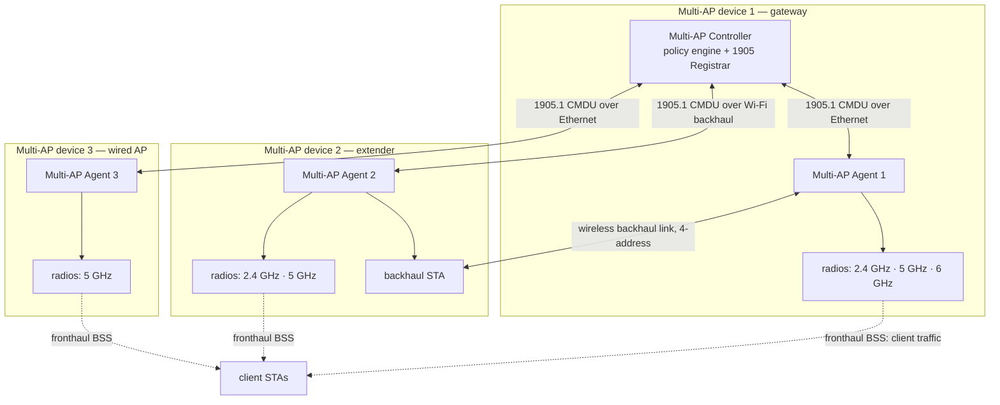

### 2.2 1905.1 in one page

IEEE 1905.1 is an abstraction layer **between** L2 technologies: it lets a device speak one control
protocol across Ethernet, Wi-Fi, MoCA and PLC, identified by a single **AL MAC** regardless of how
many interfaces it has. Key constants:

| Property | Value |
| --- | --- |
| EtherType | `0x893A` |
| Multicast group address (discovery / notification) | `01:80:C2:00:00:13` |
| LLDP nearest-bridge address (used to detect a **non-1905** bridge in between) | `01:80:C2:00:00:0E` |
| CMDU header | 8 octets: messageVersion(1) · reserved(1) · messageType(2) · messageID(2) · fragmentID(1) · flags(1) |
| Flags | bit 7 = Last Fragment Indicator, bit 6 = Relay Indicator |
| TLV | type(1) · length(2) · value(variable) |
| Vendor-specific CMDU | message type `0x0004` |
| Vendor-specific TLV | TLV type `0x0B` |
| Fragmentation | TLVs normally bounded by 1492 octets; for DPP-capable peers sent by unicast, fragmentation may occur at an **octet** boundary |

Transmission modes matter when debugging:

- **Neighbor multicast** — relay indicator 0; received and processed, **not** retransmitted.
- **Relayed multicast** — relay indicator 1; processed and retransmitted on all other interfaces.
- **Reliable multicast** (Multi-AP addition) — the device sends the CMDU as relayed multicast *and*
  also sends the same CMDU (same MID) as **unicast to each discovered device**; receivers dedupe by
  MID. This exists because relayed multicast has no acknowledgement.
- **Unicast** — used for request/response pairs; reliability comes from the paired transaction or a
  generic 1905 Ack carrying the same MID.

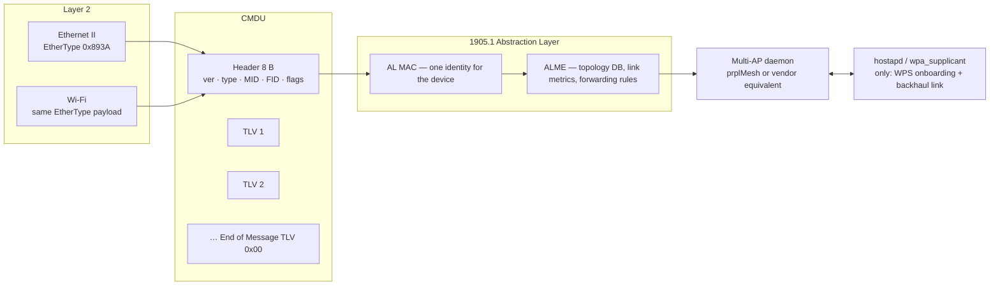

### 2.3 Message types you must recognise

Base 1905.1 (relevant subset):

| Type | Message | Transmission |
| --- | --- | --- |
| `0x0000` | Topology Discovery | neighbor multicast |
| `0x0001` | Topology Notification | relayed multicast |
| `0x0002` / `0x0003` | Topology Query / Response | unicast |
| `0x0005` / `0x0006` | Link Metric Query / Response | unicast |
| `0x0007` | AP-Autoconfiguration Search | neighbor multicast |
| `0x0008` | AP-Autoconfiguration Response | unicast |
| `0x0009` | AP-Autoconfiguration WSC | unicast |
| `0x000A` | AP-Autoconfiguration Renew | relayed multicast |

Multi-AP extension range (`0x8000`+). Values below are the ones an implementation header defines;
later releases add further types on the same numbering plan:

| Type | Message | Type | Message |
| --- | --- | --- | --- |
| `0x8000` | 1905 Ack | `0x8014` | Client Steering Request |
| `0x8001` / `0x8002` | AP Capability Query / Report | `0x8015` | Client Steering BTM Report |
| `0x8003` | Multi-AP Policy Config Request | `0x8016` | Client Association Control Request |
| `0x8004` / `0x8005` | Channel Preference Query / Report | `0x8017` | Steering Completed |
| `0x8006` / `0x8007` | Channel Selection Request / Response | `0x8018` | Higher Layer Data |
| `0x8008` | Operating Channel Report | `0x8019` / `0x801A` | Backhaul Steer Request / Response |
| `0x8009` / `0x800A` | Client Capability Query / Report | `0x801B` / `0x801C` | Channel Scan Request / Report |
| `0x800B` / `0x800C` | AP Metrics Query / Response | `0x8020` / `0x8021` | CAC Request / CAC Termination |
| `0x800D` / `0x800E` | Associated STA Link Metrics Query / Response | `0x8022` | Client Disassociation Stats |
| `0x800F` / `0x8010` | Unassociated STA Link Metrics Query / Response | `0x8024` | Error Response |
| `0x8011` / `0x8012` | Beacon Metrics Query / Response | `0x8025` | Association Status Notification |
| `0x8013` | Combined Infrastructure Metrics | `0x8026` | Tunneled |
| — | — | `0x8027` / `0x8028` | Backhaul STA Capability Query / Report |
| — | — | `0x8033` | Failed Connection |

Important TLV types (same caveat — R2-era header values, later releases extend):

| TLV | Meaning | TLV | Meaning |
| --- | --- | --- | --- |
| `0x00` | End of Message | `0x8D` | Transmit Power Limit |
| `0x01` | AL MAC Address | `0x8E` | Channel Selection Response |
| `0x03` | Device Information | `0x8F` | Operating Channel Report |
| `0x80` / `0x81` | Supported / Searched Service | `0x92` | Client Association Event |
| `0x82` | AP Radio Identifier | `0x93` / `0x94` | AP Metric Query / AP Metrics |
| `0x83` | AP Operational BSS | `0x95` | STA MAC Address |
| `0x84` | Associated Clients | `0x96` | Associated STA Link Metrics |
| `0x85` | AP Radio Basic Capabilities | `0x9B` | Steering Request |
| `0x89` | Steering Policy | `0x9C` | Steering BTM Report |
| `0x8A` | Metric Reporting Policy | `0x9D` | Client Association Control Request |
| `0x8B` | Channel Preference | `0xA1` | AP Capability |
| `0x8C` | Radio Operation Restriction | `0xD7` | Anticipated Channel Usage |

---

## 3. Onboarding — how a device becomes part of the network

Onboarding answers three questions in order: **how do I get L2 connectivity** (backhaul STA
credentials), **who is the Controller**, and **what BSSs should I run**.

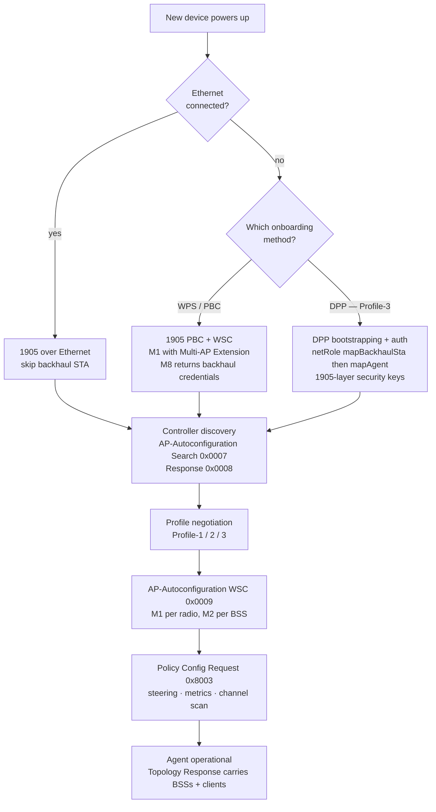

### 3.1 The Multi-AP IE and the Multi-AP Extension subelement

Everything about "is this a mesh device, and which role" is negotiated in one vendor IE:

| Field | Value |
| --- | --- |
| Element ID | `0xDD` (vendor specific) |
| OUI | `50-6F-9A` (Wi-Fi Alliance) |
| OUI Type | `0x1B` (Multi-AP IE) |

Inside it, the **Multi-AP Extension subelement** (subelement ID `0x06`) carries the role bits:

| Bit | Meaning |
| --- | --- |
| 7 | **Backhaul STA** — set by a bSTA in its (Re)Association Request |
| 6 | **Backhaul BSS** — set by the AP in the (Re)Association Response |
| 5 | **Fronthaul BSS** — set by the AP in the (Re)Association Response |
| 4 | **Tear Down** — tear down all BSSs on the radio |
| 3 | Profile-1 Backhaul STA association disallowed |
| 2 | Profile-2 Backhaul STA association disallowed |
| 1–0 | Reserved |

The **Multi-AP Profile subelement** (ID `0x07`, Table 15) carries `0x01` Profile-1, `0x02` Profile-2,
`0x03` Profile-3. A device sends its highest fully-supported profile; the Controller echoes the same
value back. **If one device in the network is Profile-1, the negotiated profile is Profile-1** and the
whole network loses Profile-2/3 features. That is the most underrated interop failure mode.

### 3.2 PBC / WPS onboarding (the R1 path, still universally supported)

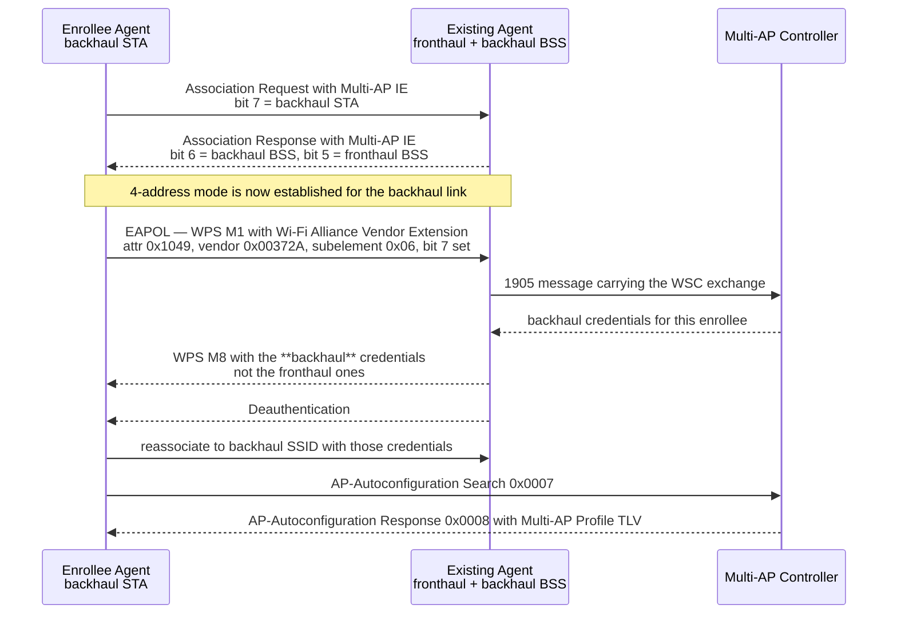

Details that matter:

- The enrollee gets **backhaul** credentials from M8, not fronthaul ones. hostapd implements this with
  `multi_ap_backhaul_ssid` plus `multi_ap_backhaul_wpa_psk` or `multi_ap_backhaul_wpa_passphrase`.
- **WPS must not be advertised on a backhaul-only BSS.** A BSS configured for the Backhaul BSS role
  but not Fronthaul BSS shall not advertise WPS support. If it does, ordinary clients try to onboard
  into a BSS that will reject them.
- If the bSTA supports SAE and the AP advertises an SAE AKM for the backhaul SSID, the agent **shall**
  attempt SAE using the configured passphrase rather than WPA2-Personal.
- Practical bring-up on a Linux target (NXP's flow): start the agent service, then
  `wpa_cli wps_pbc multi_ap=1` on the enrollee and `hostapd_cli -i <ap-iface> wps_pbc` on the
  existing agent; expect link-up in roughly 10–15 s.

### 3.3 DPP onboarding (Profile-3)

DPP (Wi-Fi Easy Connect) replaces shared-credential WPS with public-key bootstrapping, and is the only
route to **1905-layer security**. Net roles are explicit:

| netRole | Used for |
| --- | --- |
| `mapBackhaulSta` | configuring the agent's backhaul STA |
| `mapAgent` | configuring 1905-layer connectivity for the agent |
| `configurator` | the Controller's co-located DPP Configurator |

Mechanics worth knowing:

- DPP public-action frames are **encapsulated** in 1905 messages: `Direct Encap DPP` (agent ↔
  controller directly) and `Proxied Encap DPP` (via a Proxy Agent that re-emits the frames over the
  air), with a `1905 Encap DPP TLV` carrying a frame-type field (14 = Reconfiguration Announcement,
  15 = Reconfiguration Authentication Request).
- **Chirp Notification** messages coordinate presence; a Chirp Value TLV with Hash Validity 0 and Hash
  Length 0 plus the Enrollee MAC Address present bit is the "stop, this one is done" signal.
- If **any** agent uses a Wi-Fi backhaul, the Controller shall enable **CCE advertisements on all
  agents**, so an out-of-range enrollee can still be reached through a proxy.
- Reconfiguration: an agent that needs fresh 1905 keys sends a DPP Reconfiguration Announcement with
  the Controller's C-sign-key hash; the Controller answers with a Reconfiguration Authentication
  Request through a proxy; the agent ends with a DPP Configuration Request carrying
  `netRole=mapBackhaulSta` or `netRole=mapAgent`.
- **PBC-onboarded agents cannot do 1905-layer MIC or encryption** unless they also complete DPP
  onboarding. Other Profile-3 features still work. This is why mixed networks show inconsistent
  security behaviour.

### 3.4 The backhaul data plane: 4-address mode

Once a bSTA is associated, frames crossing the wireless backhaul use the **four-address** MAC header
(To DS = 1, From DS = 1):

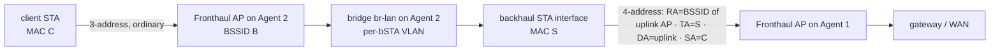

Rules from the spec (clause 14):

- If SA ≠ the bSTA's own MAC, the bSTA **shall** use four-address (To DS = From DS = 1). If SA = its
  own MAC, it may use either three-address or four-address.
- RA ("Address 1") is the AP's MAC or a group address; TA ("Address 2") is the bSTA's MAC.
- A Fronthaul AP **shall** accept four-address frames from a bSTA and must handle the SA ≠ TA case.
- Wired backhaul is just Ethernet — no special framing.

In hostapd/wpa_supplicant terms:

| Setting | Meaning |
| --- | --- |
| `multi_ap=1` | backhaul BSS — **any STA without the Multi-AP IE is rejected** |
| `multi_ap=2` | fronthaul BSS — **any STA with the Multi-AP IE is rejected** |
| `multi_ap=3` | simultaneous backhaul and fronthaul |
| `multi_ap=0` | the IE is ignored |
| `multi_ap_backhaul_sta=1` | wpa_supplicant side: include the Multi-AP IE, require it in the response, set 4-address |
| `bridge` / `wds_bridge` | each bSTA gets its own VLAN, auto-added to the bridge (same machinery as WDS) |

**Consequence to remember:** multiple bSTAs on one backhaul BSS means multiple RAs, so hostapd creates
one VLAN per bSTA. If the driver or the bridge is not set up for it, the second extender associates but
carries no traffic.

---

## 4. Discovery, configuration and policy

### 4.1 Controller discovery

The agent sends an **AP-Autoconfiguration Search** (`0x0007`) containing:

- `SearchedRole` = Registrar, `SearchedService` = **Multi-AP Controller**, `SupportedService` =
  **Multi-AP Agent**;
- one **Multi-AP Profile TLV** set to its highest fully-met profile;
- if it does not meet all Profile-2/3 requirements, a **Profile-2 AP Capability TLV** with only the
  feature bits it supports set.

The Controller answers with an **AP-Autoconfiguration Response** (`0x0008`) carrying
`SupportedRole` = Registrar, `SupportedService` = Multi-AP Controller, a Multi-AP Profile TLV, and a
**Controller Capability TLV** with the KiBMiB Counter bit set to 1.

Service discovery (what can this device do?) rides on the **Topology Query/Response** pair, with the
same Multi-AP Profile TLV and, if any client is associated, an **Associated Clients TLV**. Client
join/leave is published quickly via a **Topology Notification** carrying a **Client Association Event
TLV**; disassociation additionally triggers a **Client Disassociation Stats** message with the reason
code and the final traffic stats.

### 4.2 AP configuration — WSC M1/M2 per radio

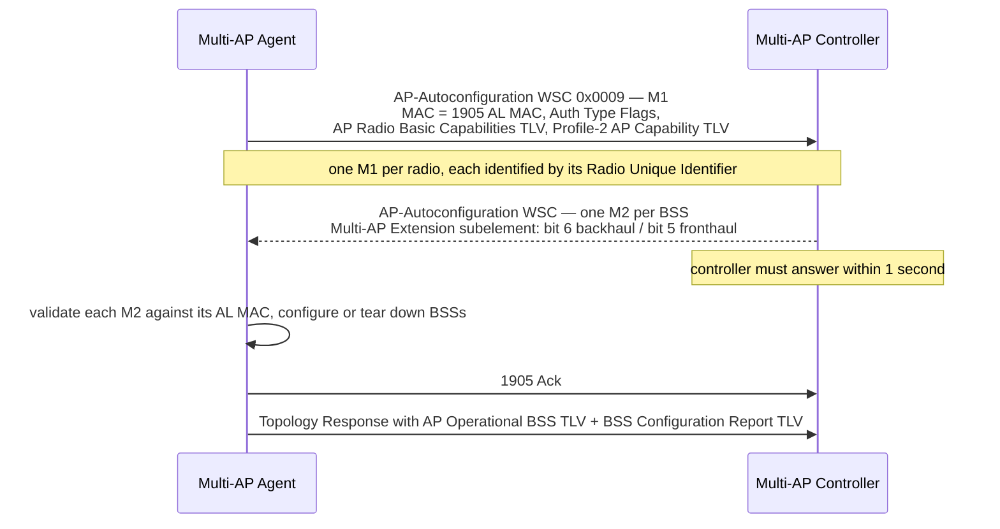

Rules that bite in practice:

- The Controller answers **within one second**, either with one M2 per BSS or with a single M2 whose
  Multi-AP Extension **bit 4 (Tear Down)** is set — meaning "run zero BSSs on this radio".
- Each M2's N2 nonce must be unique; the number of M2s is capped by the **Maximum number of BSSs**
  value in the agent's AP Radio Basic Capabilities TLV.
- If an agent is already running a BSS whose parameters do not **completely** match any received M2,
  it **tears that BSS down**. Small credential or AKM mismatches therefore show up as BSS flapping.
- Authentication types: the spec adds **`0x0040` = SAE** to the WSC table. A fronthaul BSS must **not**
  be configured SAE-only (`0x0040`); WPA3 Transition `0x0060` (PSK+SAE) is allowed when the agent
  declared SAE support in M1.
- The agent stores nothing about channels in volatile state only: channel preference information from
  the Controller **shall** be kept in non-volatile storage (see §8.3).

### 4.3 Policy configuration

The **Multi-AP Policy Config Request** (`0x8003`) is how the Controller programmes the agent's
autonomous behaviour. The agent answers with a 1905 Ack within one second.

| Policy carrier | Controls |
| --- | --- |
| **Steering Policy TLV** (`0x89`) | Local Steering Disallowed STA list · BTM Steering Disallowed STA list · per-radio Steering Policy (`0x00` disallowed, `0x01` RCPI-based mandated, `0x02` RCPI-based allowed) · Channel Utilization Threshold · RCPI Steering Threshold |
| **Metric Reporting Policy TLV** (`0x8A`) | AP Metrics Reporting Interval · STA Metrics Reporting RCPI Threshold · RCPI Hysteresis Margin Override · AP Metrics Channel Utilization Reporting Threshold · inclusion policies for STA traffic stats / link metrics / Wi-Fi 6 status |
| **Channel Scan Reporting Policy TLV** | whether independent (self-initiated) scans must be reported |
| **Unsuccessful Association Policy TLV** | whether failed associations are reported, and the maximum reporting rate per minute |
| **Backhaul BSS Configuration TLV** | bits 7/6: Profile-1 / Profile-2 bSTA association disallowed — settable at any time, not just at onboarding |
| **Traffic Separation Policy TLV** | number of SSIDs and their VLANs (Profile-2) |

Two semantic traps:

- **Local Steering Disallowed** does *not* mean "never steer". It means "only steer on a Controller
  **Steering Mandate**". Those STAs are still steerable, just not autonomously.
- **BTM Steering Disallowed** means "use **association control** for this STA instead of BTM" — i.e.
  block it everywhere except the target, then disassociate. That is a much more aggressive actuator.

### 4.4 Traffic separation (Profile-2)

Each fronthaul SSID is mapped to a VLAN. The **Primary VLAN** carries the user's main network;
**Secondary VLANs** carry guest/IoT SSIDs. On the backhaul, the Primary VLAN ID is distributed via the
**Multi-AP Default 802.1Q Setting subelement** in the Multi-AP IE of the (Re)Association Response: a
newly associated agent adopts the Primary VLAN ID it was told, or considers it unconfigured if the
subelement is absent. A "Multi-AP Profile-2 Network Segment" is the set of agents implementing traffic
separation, connected by links that do **not** pass through an agent that discards 802.1Q tags.

This is why plugging a cheap unmanaged switch — or an agent without traffic separation — into the
middle of a mesh breaks guest-network isolation in a way that looks like "VLANs randomly work".

---

## 5. Measurement — what the Controller can actually see

EasyMesh is a measurement plane as much as a control plane. Four families of measurement exist.

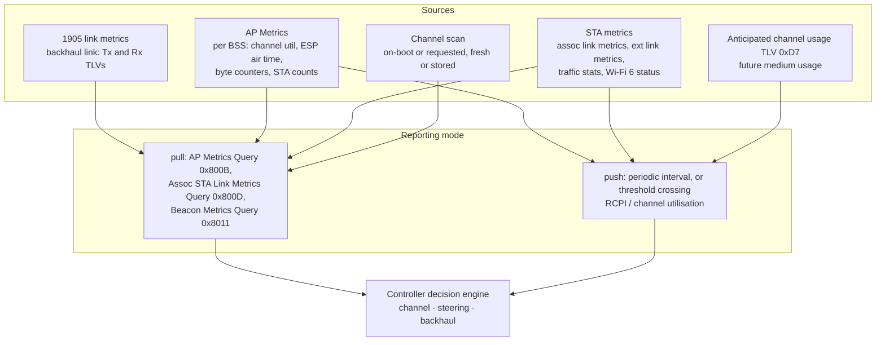

### 5.1 Backhaul link metrics

Carried in the 1905.1 transmitter/receiver link metric TLVs, with Multi-AP clarifications:

- **macThroughputCapacity** — estimated MAC data rate in Mb/s for the backhaul link: downlink when
  reported by the agent operating the AP side, uplink when reported by the agent operating the bSTA
  side, assuming 100% of channel air time and operating bandwidth were available.
- **linkAvailability** — the predicted percentage of air time the backhaul link would consume given
  current channel conditions, assuming enough BE traffic to fill it.
- **RSSI** — from RCPI of received PPDUs (AP side) or beacon RSSI (bSTA side).

### 5.2 Per-BSS and per-STA metrics

- **AP Metrics TLV** (`0x94`) per BSS, plus **AP Extended Metrics** and **Radio Metrics** TLVs per
  radio. The **Estimated Air Time Fraction** subfield of the Estimated Service Parameters Information
  field is the predicted percentage of air time a *newly joining* STA would be allocated for downlink
  data PPDUs of a given AC — the standard's way of exposing "how full is this BSS, really".
- **Associated STA Link Metrics** (`0x96`) plus **Extended Link Metrics**: uplink/downlink RCPI,
  estimated MAC data rate. The spec gives a reference formula
  `Estimated MAC Data Rate = MPDUpPPDU × A_MSDU_B × 8 / PDur` (Annex R.7 of 802.11), with the
  algorithm itself implementation-specific.
- Threshold-based STA reporting: when the uplink RCPI crosses the configured threshold **in either
  direction**, the agent sends a report. The agent must use a **non-zero** hysteresis and **shall not
  use a hysteresis greater than 5 dB**, unless the Controller overrides it via the RCPI Hysteresis
  Margin Override field.
- **Unassociated STA Link Metrics**: uplink RCPI measured for STAs that are *not* associated — this is
  how the network measures a candidate target before steering. Only if the agent declared support.
- **Beacon Metrics**: measurement requested from the *client* (802.11k Beacon Report) and relayed.
- **Combined Infrastructure Metrics**: backhaul + fronthaul view in one message.

Freshness and cost rules that matter when tuning:

- STA traffic stats reported must be **no older than 10 s**, and an agent may omit STA traffic stats
  if it sent them within the previous 10 s.
- Counters are encoded per the **Byte Counter Units** field of the last Profile-2 AP Capability TLV
  (bytes by default) — parse them accordingly or your graphs will be wrong by 1024.

### 5.3 Channel scan

Two modes, and the distinction explains most "the controller doesn't know about neighbours"
complaints:

- **On-boot scan** — agent declares `On boot only` in its Channel Scan Capabilities TLV and scans at
  boot; results are stored and returned when asked with `Perform Fresh Scan = 0`.
- **Requested fresh scan** — `Perform Fresh Scan = 1`; the agent shall abort any in-progress scan, run
  the new one, and report **when finished or within 5 minutes, whichever comes first**.
- Status codes: `0x00` success, `0x01` requested class/channel not in declared capabilities, and a
  value indicating the request arrived sooner than the declared **Minimum Scan Interval**.
- **Independent scans** performed by the agent on its own are only reported if the Channel Scan
  Reporting Policy bit is set. If no policy TLV has been received, they are **not** reported at all.
- A scan report that would not fit in one CMDU is split across multiple Channel Scan Result TLVs, with
  `NumberOfNeighbors` set per TLV.

### 5.4 Anticipated channel usage

Agents can publish *future* medium usage (e.g. TWT service periods) via the **Anticipated Channel
Usage TLV** (`0xD7`), each entry being an envelope of expected transmissions referenced to the TSF of a
reference BSSID. Peers use it for interference-aware scheduling. Reports **supersede** previous ones;
if the AP stops expecting a usage entry with non-zero repetitions, it must send an update removing it.
The spec warns agents not to let these reports become excessive backhaul overhead.

---

## 6. The three decisions: channel, steering, backhaul

### 6.1 Channel selection — a four-message dance

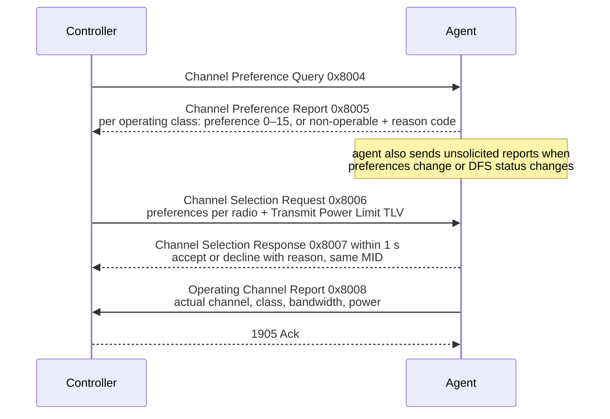

Semantics worth internalising:

- Preference score **15 = highest**. If a report omits a channel in a supported operating class, the
  receiver **infers preference 15** for it. Zero Channel Preference TLVs ⇒ everything is 15.
- A channel is **Non-operable** if radar was detected or operation would be unsuccessful (e.g. strong
  interference). Permanently impossible channels are not reported here — they are already in the AP
  Radio Basic Capabilities TLV.
- The Controller **shall** specify an operable preference for at least one non-DFS channel per radio,
  **shall not** propose a set that violates the agent's radio operation restrictions, and **should**
  respect the agent's stated preferences except for load balancing.
- The agent **shall not** operate on a channel the stored Controller preference marks non-operable, and
  **shall** attempt one of the highest-preference channels.
- **6 GHz / AFC**: if the agent supports 6 GHz, its preference report must reflect out-of-band AFC
  results; disallowed channels get preference `0000` and reason code `1100`.
- **DFS**: the Controller can request **CAC** (Channel Availability Check), and the agent shall start
  it **within 15 s** unless it declines; a new CAC request for a different method/bandwidth/channel
  terminates the running one; CAC Termination requires a 1905 Ack within 1 s and restores the radio's
  previous configuration. A Controller may also push a "DFS channel clear" indication.
- **Spatial reuse / BSS color**: agents that set the Spatial Reuse bit in AP Wi-Fi 6 Capabilities must
  handle the spatial reuse configuration exchange around channel selection.

### 6.2 Client steering — mandate, opportunity, autonomy

Three distinct mechanisms, frequently confused:

| Mechanism | Initiator | Agent behaviour | Typical use |
| --- | --- | --- | --- |
| **Steering Mandate** — Request Mode = 1 | Controller | **shall** attempt steering to the specified target (wildcard ⇒ best target it knows) | load balancing, targeted fix |
| **Steering Opportunity** — Request Mode = 0 | Controller | **may** steer, within the Steering Opportunity Window, unless the STA is in the Local Steering Disallowed list | normal operation |
| **Agent-initiated RCPI steering** | Agent | allowed only per the Steering Policy field: `0x00` no, `0x01` mandated (if declared), `0x02` allowed | sticky-client handling at the edge |

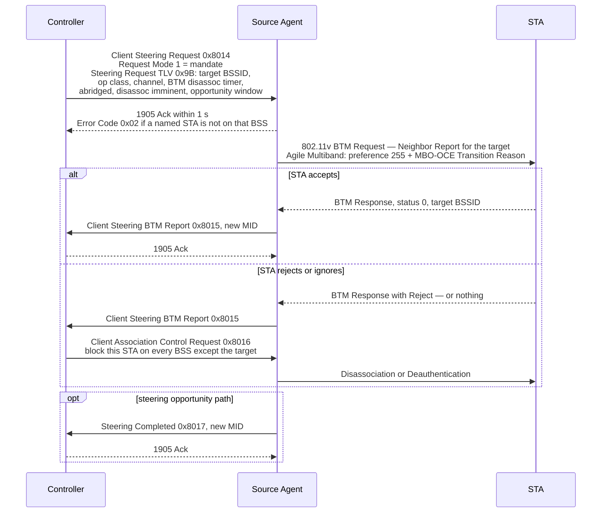

Rules that show up in bug reports:

- On a **mandate**, the BTM Request carries **no additional** Neighbor Report elements, and the
  **Abridged**, **Disassociation Imminent** and **Disassociation Timer** bits/values are copied from
  the Controller's request. On an **opportunity**, those fields are ignored.
- For a **Wi-Fi Agile Multiband** STA, the agent shall set candidate **preference 255** and include an
  **MBO-OCE IE with a Transition Reason Code**.
- If the STA does not support BTM, or is in the BTM Steering Disallowed list, the agent **shall**
  disassociate/deauthenticate it and **may** block it elsewhere via association control.
- **Association control** semantics: `0x00` block (reject first association attempt, stop answering
  probes, for the Validity Period), `0x01` unblock, `0x02` timed block (also disassociate now),
  `0x03` indefinite block. Rejections **shall not** use a status code that looks like a capability
  mismatch; **33** (insufficient bandwidth) or **34** (poor channel conditions) are recommended.
- A BSS that has published **Association Allowance status `0x00`** (via Association Status
  Notification, plus the MBO-OCE Association Disallowed attribute in beacons) **shall not** be
  considered a suitable steering target.
- **Tunneled messages** let an agent forward a client-originated **BTM Query**, **WNM Notification**,
  or **ANQP Neighbor Report request** to the Controller — so a client asking "where should I go?" is
  answered by network-wide policy, not local guesswork.

### 6.3 Backhaul optimisation

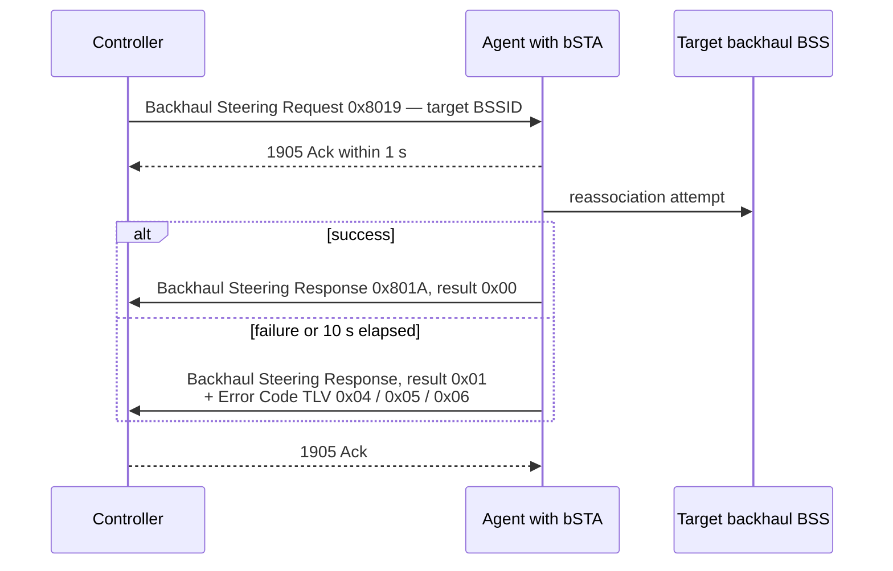

The spec explicitly warns: if the agent's fronthaul BSS is on the **same channel** as its bSTA and the
steer moves the bSTA to a different channel, clients on that fronthaul BSS lose connectivity during the
switch. The Controller should steer those clients away first.

Backhaul BSSs can also **refuse** bSTAs by profile: a bSTA that would create a link that is not part
of a Profile-2 Network Segment can be rejected (bit 3), and vice versa (bit 2). On rejection with an
alternative available, the AP uses status **82** (`rejected_with_suggested_bss_transition`) plus at
least one Neighbor Report; with no alternative, status **12**.

### 6.4 1905-layer messaging security

- Devices that support DPP onboarding protect 1905 messaging: **MIC** for neighbor multicast, relayed
  multicast and reliable multicast; **TLV encryption** for unicast. Unicast retransmissions that are
  part of the reliable-multicast procedure are MIC-protected but **not** encrypted.
- Capability is advertised in the **1905 Layer Security Capability TLV** (onboarding protocol `0x00`,
  MIC algorithm `0x00`, encryption algorithm `0x00`).
- Receivers independently compute the MIC and **silently discard** mismatches — a useful thing to know
  when a mixed PBC/DPP fleet shows agents that "randomly" ignore commands.

---

## 7. Applying EasyMesh — deployment decisions

### 7.1 Topology is the first and most consequential decision

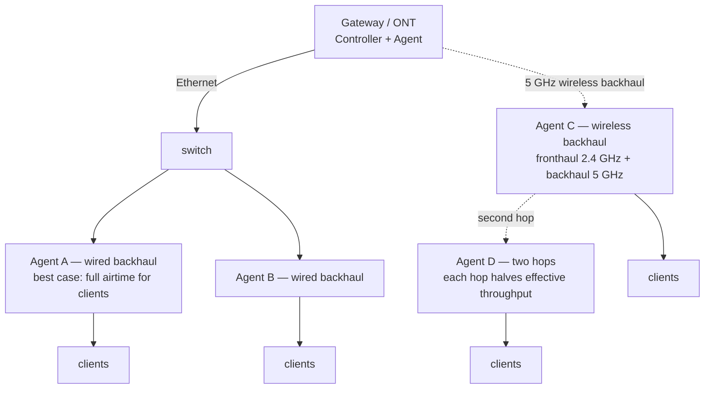

| Decision | Guidance |
| --- | --- |
| Backhaul medium | Ethernet ≫ dedicated Wi-Fi radio ≫ shared Wi-Fi radio. A shared radio splits airtime between serving clients and feeding the backhaul. |
| Hop count | Every wireless hop re-transmits the same bytes over the same medium. Two hops is usually the practical ceiling for performance-sensitive use. |
| Dedicated backhaul radio | Worth it when the extender is the only path; costs a radio and therefore a client-facing band. |
| Controller placement | Put it on the device that also terminates the WAN (co-located with the 1905 Registrar). One controller only. |
| Mixing vendors | Legal and intended — but the negotiated profile drops to the weakest device. Verify the profile, not just "it connected". |
| Non-EasyMesh APs | Invisible to the control plane. They still cause interference that EasyMesh can only see through channel scans and channel utilisation. |
| Ethernet + wireless paths simultaneously | EasyMesh does not do loop prevention; your bridge/STP does. Plan for it. |

### 7.2 What to configure beyond the defaults

1. **802.11k/v/r or equivalent on the fronthaul.** EasyMesh gives you the *decision*; fast roaming
   gives you the *cheap transition*. Without FT or PMK caching every network-initiated move is a full
   reauthentication. See [[02-6 WLAN - Multi-AP Roaming, Healing and Steering]].
2. **PMF (802.11w).** Required by Agile Multiband; also the reason a stale-association race can lock a
   client out (§9).
3. **WPA3 transition, not SAE-only.** The spec forbids SAE-only fronthaul BSSs; use `0x0060`.
4. **Traffic separation VLANs** for guest/IoT — and verify every in-path agent implements it.
5. **Channel plan for 6 GHz**: AFC restrictions arrive as channel preferences with reason code `1100`;
   do not assume all 6 GHz channels are selectable.
6. **Wi-Fi 7 / R6**: if AP and bSTA MLD configuration is used, remember MLO makes the *link set* the
   unit of steering and measurement — the R6 messages carry per-link metrics, and the controller
   steers an MLD, not a single BSS.

---

## 8. Tuning — the knobs that actually move the needle

All knobs below are real protocol fields (§4.3). The recommended ranges are engineering practice, not
spec text, and are labelled as such.

### 8.1 Steering

| Knob | Effect | Practice / risk |
| --- | --- | --- |
| **RCPI Steering Threshold** (per radio) | Below it, an agent may/shall try to move the STA | RCPI = (dBm + 110) × 2, so −70 dBm = **80**, −75 dBm = **70**, −80 dBm = **60**. Set it near the point where the MCS ladder starts to cost you, not at the coverage edge — too aggressive and you steer clients into worse BSSs. |
| **Channel Utilization Threshold** (per radio) | Triggers steering/assessment when the radio is busy | Set it to the utilisation at which your target latency breaks. Too low ⇒ constant churn. |
| **Steering Policy field** (`0x00` / `0x01` / `0x02`) | Whether the agent may steer on its own | `0x02` ("allowed") is the sane default. `0x01` ("mandated") removes the agent's judgement and can fight the Controller. |
| **Local Steering Disallowed list** | STA is steerable only on a Controller mandate | Use for devices with known-buggy BTM handling; keeps autonomous agents from touching them. |
| **BTM Steering Disallowed list** | Use association control instead of BTM | Powerful and user-visible: the STA gets blocked and disassociated. Only for STAs that ignore BTM *and* matter. |
| **Steering Opportunity Window** | How long an agent may attempt a steer | Short windows reduce duplicate attempts; long windows mean the agent keeps trying after conditions changed. |
| **Hysteresis / dwell** | Prevents ping-pong | Not one spec field — it is your Controller's policy. Require a minimum dwell time and penalise recently-moved STAs, otherwise two agents at equal RCPI trade a client forever. |

### 8.2 Metrics reporting

| Knob | Effect | Practice / risk |
| --- | --- | --- |
| **AP Metrics Reporting Interval** | Periodic push from every agent | Cost scales with agent count × radios × BSSs and is paid on the **backhaul**. 0 disables periodic reporting; use threshold-based reporting for large networks. |
| **STA Metrics Reporting RCPI Threshold** | Event-driven per-STA reports | Start around the steering threshold so the Controller learns about candidates before it needs them. |
| **RCPI Hysteresis Margin Override** | Controls report storm risk | The spec caps hysteresis at **5 dB**. Leaving it at 0 on a noisy band generates floods. |
| **AP Metrics Channel Utilization Reporting Threshold** | Event-driven per-radio reports | Pair with smoothing; raw instantaneous utilisation crosses thresholds constantly. |
| **Inclusion policies** (traffic stats, link metrics, Wi-Fi 6 status) | Adds per-STA detail to every AP Metrics Response | Each one multiplies message size; enable the ones your decision logic actually reads. |

### 8.3 Channel selection

| Knob | Effect | Practice / risk |
| --- | --- | --- |
| **Preference scores 0–15** | How strongly to steer a radio to a channel | Remember: an omitted channel means 15. Explicitly score the channels you do not want. |
| **Non-operable marking** | Forbid a channel | Use for radar-affected or known-bad channels; the agent must obey. |
| **Transmit Power Limit TLV** | Caps nominal transmit power | Lowering power is a legitimate way to shrink cells and reduce overlap — but it also creates coverage holes and can strand sticky clients. |
| **CAC requests** | Coordinated DFS clearance | Each CAC takes the radio off-service for its duration; do not let the Controller request CACs faster than the agent can complete them (start within 15 s, one at a time per radio). |
| **Change damping** | How often the Controller re-plans | Not a spec field. Without damping, DFS events and neighbour churn cause channel flapping that clients experience as outages. |

### 8.4 Backhaul

| Knob | Effect | Practice / risk |
| --- | --- | --- |
| **Prefer wired** | Removes the wireless hop entirely | The biggest single win available; also removes same-channel fronthaul/backhaul contention. |
| **bSTA band choice** | Which band feeds the extender | 5 GHz/6 GHz for capacity; 2.4 GHz only for reach, and never if the fronthaul is on the same channel. |
| **Same-channel fronthaul + backhaul** | Splits one radio's airtime twice | Causes the interruption the spec warns about during backhaul steering. Avoid where possible. |
| **bSTA association control bits** | Refuse bSTAs that would break the Profile-2 segment | Keeps a non-traffic-separation agent from punching a hole in guest VLAN isolation. |

### 8.5 Things not to tune blindly

- **Disassociation Imminent + short timers.** It works, and users notice. Reserve for genuine overload.
- **Association control with long validity periods.** A stuck block is a client that can never come
  back. Always pair with an unblock path.
- **Aggressive steering thresholds on 2.4 GHz.** Fewer, poorer targets; steering there mostly moves
  pain around.

---

## 9. Troubleshooting — a method, then a table

### 9.1 Method: walk the layers bottom-up

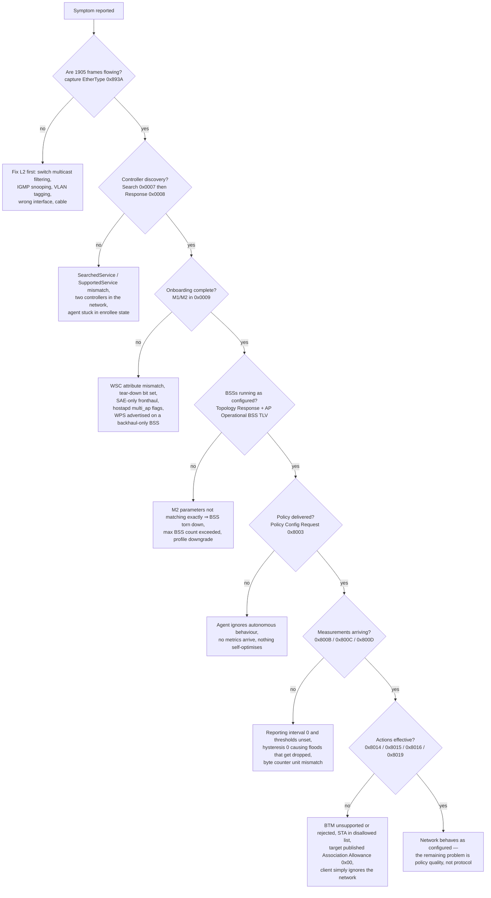

### 9.2 Capture and inspection

**Where to capture.** On the **wired** side wherever possible. 1905 control traffic is ordinary
Ethernet with EtherType `0x893A`, so a LAN port or a bridge interface sees the Controller↔Agent
conversation for wired agents. Capturing the over-the-air control plane is harder and usually
unnecessary.

**Capture:**

```bash
# all 1905 control traffic on the LAN bridge
tcpdump -i br-lan -w easymesh.pcap ether proto 0x893a
# narrow to one device pair
tcpdump -i br-lan -nn -e ether proto 0x893a and ether host <AL-MAC-of-agent>
```

**Wireshark display filters** (the `ieee1905` dissector):

| Purpose | Filter |
| --- | --- |
| All 1905 frames | `eth.type == 0x893a` |
| Controller discovery | `ieee1905.cmdu.type == 0x0007` |
| Topology discovery | `ieee1905.cmdu.type == 0x0000` |
| Multi-AP extension range | `ieee1905.cmdu.type >= 0x8000` |
| A specific TLV, e.g. steering policy | `ieee1905.tlv.type == 0x89` |
| A specific message, e.g. client steering request | `ieee1905.cmdu.type == 0x8014` |

Watch for: the group address `01:80:C2:00:00:13` being filtered by a managed switch (IGMP snooping and
multicast suppression are frequent culprits); CMDUs arriving fragmented; duplicate MIDs from reliable
multicast; and a `0x8024` **Error Response** or an Error Code TLV riding inside a 1905 Ack.

**prplMesh-side inspection:**

| Tool | Use |
| --- | --- |
| `prplmesh_cli -c status -o json` | machine-readable status |
| `prplmesh_cli -c conn_map` | connection map: devices, radios, channels, backhaul link type |
| `prplmesh_cli -c show_ap` | AP inventory |
| `beerocks_cli -c bml_conn_map` / `bml_nw_map_query` | legacy BML view of the topology |
| `beerocks_cli -c bml_wps_onboarding wlan0` | trigger WPS onboarding on an interface |
| logs | `/tmp/beerocks/logs/beerocks_controller.log`, `beerocks_agent.log`, `beerocks_backhaul.log`, `beerocks_ap_manager_wlan0.log`, `beerocks_monitor_wlan0.log`, plus `/tmp/mapf/` |
| readiness | agent is operational when `beerocks_agent.log` shows `FSM: CONNECTED --> OPERATIONAL` |
| `prplmesh_utils.sh status \| restart -m Multi-AP-Controller-and-Agent \| -m Multi-AP-Agent \| roll_logs` | management mode and log rotation (RDK-B / native builds) |
| topologyViewer | read-only live topology graph from the Controller's NBAPI |
| prplOS Web UI / `ba-cli` | TR-181 data model: radios, APs, `MultiAPType`, client metrics |

**hostapd / wpa_supplicant checks:**

- Confirm `multi_ap` is 1/2/3 as intended on each BSS and `multi_ap_backhaul_sta=1` on the bSTA
  interface. A wrong value here produces either "extender associates but carries no traffic" (missing
  4-address) or "backhaul BSS rejects its own bSTA".
- Confirm the bridge is set up for per-bSTA VLANs (`bridge` / `wds_bridge`) — the second bSTA silently
  failing is the classic symptom.
- Confirm WPS is **not** enabled on a backhaul-only BSS.
- Bring-up: `hostapd_cli -i <ap-iface> wps_pbc` on the existing agent and
  `wpa_cli -i <sta-iface> wps_pbc multi_ap=1` on the enrollee; check `iw dev <sta-iface> link`
  afterwards.

### 9.3 Symptom → likely cause → what to check

| Symptom | Likely cause | Check |
| --- | --- | --- |
| Agent never appears at all | 1905 frames not reaching the Controller | `tcpdump ether proto 0x893a` on both sides; switch multicast filtering; wrong VLAN on the management interface |
| Two devices both claim Controller | Role resolution failed | Count `SupportedService = Multi-AP Controller` in Topology Responses; disable the Controller on one (e.g. `prplmesh_utils.sh restart -m Multi-AP-Agent`) |
| Onboarding succeeds but no BSS comes up | M2 absent, or tear-down bit 4 set | AP-Autoconfiguration WSC `0x0009` contents; whether the Controller responded within 1 s |
| BSS repeatedly torn down | Running BSS does not exactly match an M2 | Compare AP Operational BSS TLV against the M2s; check AKM and credential equality |
| Everything downgraded to basic features | Profile negotiated down | Multi-AP Profile TLV value in Search/Response — one Profile-1 device caps the network |
| Fronthaul BSS rejected by the agent | SAE-only configuration attempted | Authentication Type attribute in M2: `0x0040` forbidden for fronthaul, `0x0060` allowed |
| Client never steers | Steering Policy `0x00`, no target, or STA in a disallowed list | Policy Config Request `0x8003` contents; Client Steering Request `0x8014`; Association Allowance status |
| BTM sent, client stays | Client rejects or ignores BTM | Client Steering BTM Report `0x8015` status code; whether the client advertises 802.11v; MBO-OCE preference handling |
| Client ping-pongs between two agents | No dwell/penalty policy, thresholds too tight | Time between successive roams; RCPI of both candidates; hysteresis and opportunity window |
| Client cannot reconnect after a roam | PMF stale-association protection | The spec's own warning: a STA that roams without disassociating leaves state at the old AP, which then rejects the reassociation for a timeout. Synchronise association state across BSSs using Topology Notifications, and do not rely on the STA to send a disassociation |
| Client blocked and never released | Association control with no unblock | Client Association Control Request `0x8016` and its Association Control field (`0x00`/`0x01`/`0x02`/`0x03`) and Validity Period |
| Extender associates, no traffic through it | 4-address/VLAN plumbing missing | `multi_ap_backhaul_sta=1`, `multi_ap` on the BSS, per-bSTA VLAN in the bridge, `wds_bridge` |
| Backhaul keeps moving | Backhaul steering churn | Backhaul Steering Request `0x8019` / Response `0x801A` result codes and Error Codes `0x04`/`0x05`/`0x06` |
| Channels change constantly | No damping; DFS churn | Frequency of Operating Channel Report `0x8008`; Channel Preference Reports carrying DFS reason codes |
| 6 GHz never selected | AFC-derived restrictions | Channel Preference Report: disallowed channels appear with preference `0000` and reason code `1100` |
| Control traffic saturating the backhaul | Metrics reporting too aggressive | AP Metrics Reporting Interval, inclusion policies, hysteresis ≤ 5 dB, anticipated channel usage reports |
| Association failures invisible to the Controller | Unsuccessful Association Policy not enabled | Enable the report bit and set a maximum reporting rate; look for Failed Connection `0x8033` |
| Agents more than one hop away miss messages | Relay/reliable multicast not working | Relay Indicator bit; reliable-multicast unicast retransmissions with the same MID; fragmentation when a TLV exceeds 1492 octets |
| Commands silently ignored by one agent | 1905-layer MIC mismatch | Mixed PBC/DPP onboarding: a PBC-only agent cannot do MIC/encryption. Look for discarded messages with no response |
| Guest VLAN isolation works on some paths only | A non-traffic-separation agent or tag-discarding device in the path | Profile-2 Network Segment membership; bSTA disallowed bits; switch VLAN trunking |

---

## 10. Interview numbers worth having on the tip of your tongue

| Item | Value |
| --- | --- |
| 1905.1 EtherType / group address | `0x893A` / `01:80:C2:00:00:13` |
| Multi-AP IE | element `0xDD`, OUI `50-6F-9A`, OUI type `0x1B` |
| Multi-AP Extension subelement | ID `0x06`; bits 7 bSTA, 6 backhaul BSS, 5 fronthaul BSS, 4 tear down, 3/2 bSTA disallowed |
| Multi-AP Profile subelement | ID `0x07`; `0x01`/`0x02`/`0x03` |
| WSC vendor extension for Multi-AP | attribute `0x1049`, vendor ID `0x00372A`, subelement `0x06` |
| WSC auth type | SAE `0x0040`; WPA3 transition `0x0060`; SAE-only forbidden on fronthaul |
| Standard response deadline | **1 second** for most request/response and notification/Ack pairs |
| CAC start deadline | **15 seconds** after a CAC Request |
| Backhaul steering response | after association, or **10 seconds** after the request |
| Channel scan report | when finished, or **5 minutes**, whichever comes first |
| RCPI hysteresis | must be non-zero and **≤ 5 dB** |
| STA traffic stats freshness | **≤ 10 s**, may be omitted if sent within the previous 10 s |
| Channel preference scale | 0–15, **15 = highest**; omitted ⇒ 15 |
| 6 GHz AFC-disallowed channel | preference `0000`, reason code `1100` |
| Rejection status codes | 82 `rejected_with_suggested_bss_transition`, 12 denied other reasons, 33 insufficient bandwidth, 34 poor channel conditions |
| hostapd `multi_ap` | 1 backhaul, 2 fronthaul, 3 both, 0 ignore |
| Spec versions | v1.0 2018-06-18 · v2.0 2019-12-18 Profile-2 · v3.0 2020-12-07 Profile-3 · v4.0 2021-11-16 · v5.0 2022-12-08 · v6.0 Aug 2024, mandatory from 2024-12-31 |

---

## Anchors — verified facts

- **Wi-Fi EasyMesh Specification** version history (from the document's own revision table): v1.0
  2018-06-18 initial; v2.0 2019-12-18 "Updated with Profile-2 features"; v3.0 2020-12-07 "Updated with
  Profile-3 features"; v4.0 2021-11-16; v5.0 2022-12-08. **Profiles stop at 3** — later releases build
  on Profile-3 rather than introducing Profile-4.
- **Wi-Fi EasyMesh Specification v6.0 and Test Plan v6.0** were announced in **August 2024** and
  became mandatory for newly tested mesh devices from **31 December 2024** (WFA announcement, reported
  by test labs). prplMesh maps releases by major version: 1.x R1 … 5.x R5, 6.x R6 (6.0.1 adds bSTA/AP
  MLD configuration, BSS Advanced Configuration TLV, MSCS/SCS).
- **IEEE 1905.1**: EtherType `0x893A`; CMDU header 8 octets (version, reserved, message type, message
  ID, fragment ID, flags incl. Last Fragment and Relay Indicator); TLV type(1)/length(2)/value;
  vendor-specific CMDU `0x0004`; vendor-specific TLV type 11; group address `01:80:C2:00:00:13`;
  LLDP nearest-bridge `01:80:C2:00:00:0E`; link metric query/response `0x0005`/`0x0006`. 1905.1 defines
  **no loop prevention or forwarding protocol** and is compatible with 802.1D bridging.
- **Multi-AP message types** (implementation header, R2-era numbering): `0x8000` Ack, `0x8001`/`0x8002`
  AP Capability Query/Report, `0x8003` Policy Config Request, `0x8004`/`0x8005` Channel Preference
  Query/Report, `0x8006`/`0x8007` Channel Selection Request/Response, `0x8008` Operating Channel
  Report, `0x8014` Client Steering Request, `0x8015` Client Steering BTM Report, `0x8016` Client
  Association Control Request, `0x8017` Steering Completed, `0x8019`/`0x801A` Backhaul Steer
  Request/Response, `0x801B`/`0x801C` Channel Scan Request/Report, `0x8020`/`0x8021` CAC
  Request/Termination, `0x8022` Client Disassociation Stats, `0x8024` Error Response, `0x8025`
  Association Status Notification, `0x8026` Tunneled, `0x8033` Failed Connection.
- **Multi-AP IE** (spec Table 3): element ID `0xDD`, OUI `50-6F-9A`, OUI type `0x1B`, carrying the
  Multi-AP Extension subelement (`0x06`), the Multi-AP Profile subelement (`0x07`) and the Multi-AP
  Default 802.1Q Setting subelement.
- **hostapd / wpa_supplicant scope** (upstream `README-MULTI-AP`): only **WPS onboarding** and
  **backhaul link configuration** are in scope; "The rest of the protocol must be implemented by a
  separate daemon, e.g., prplMesh". `multi_ap` = 1 backhaul BSS / 2 fronthaul BSS / 3 both;
  `multi_ap_backhaul_sta=1`; a VLAN per backhaul STA added to the bridge, as for WDS; WPS must not be
  enabled on a backhaul-only BSS; M1 with the Multi-AP subelement ⇒ M8 returns **backhaul**
  credentials.
- **Controller uniqueness**: "A Multi-AP network shall be configured with a single Controller"; a
  combined device may disable its Controller when its Agent onboards over Wi-Fi and store that in
  non-volatile memory.
- **Controller algorithms are out of scope**: the spec states it "only partially defines the
  algorithms that govern the operation of a Multi-AP Controller", hence the recurring wording "If
  triggered, a Multi-AP Controller shall …".
- **Steering policy values**: `0x00` agent-initiated steering disallowed, `0x01` agent-initiated
  RCPI-based steering mandated (only if the agent declared support), `0x02` allowed.
- **1905-layer security** applies to devices that indicate DPP onboarding: MIC on neighbor/relayed/
  reliable multicast, TLV encryption on unicast; mismatch means the receiver ignores and discards.
- **prplMesh operational facts**: logs under `/tmp/beerocks/logs/` (controller, agent, backhaul,
  ap_manager, monitor) and `/tmp/mapf/`; agent readiness signalled by `FSM: CONNECTED -->
  OPERATIONAL`; `prplmesh_cli` (status/show_ap/conn_map/set_ssid/set_security) and legacy
  `beerocks_cli` (BML); `prplmesh_utils.sh` management modes include `Multi-AP-Controller-and-Agent`,
  `Multi-AP-Agent` and `Multi-AP-Controller`.
- **DPP net roles** in EasyMesh: `mapBackhaulSta`, `mapAgent`, `configurator`; a Controller supporting
  Profile-3 shall support DPP onboarding; if any agent uses Wi-Fi backhaul the Controller shall enable
  CCE advertisements on all agents.

## Related

- [[02-10 WLAN - Baseband and Driver Architecture for Wi-Fi 6, 7 and 8 - Qualcomm as the Reference Design]] — what the controller cannot see: queues inside the chip, statistics that arrive only as firmware events, and an SoC forwarding plane that hides traffic from the host entirely
- [[02-3 WLAN Ecosystem - WFA, EasyMesh and prpl]] — where EasyMesh sits among WFA certifications, the
- [[02-9 WLAN - Time-Sensitive Networking Across Wi-Fi Generations]] — the layer above it: what a controller has to configure when service periods are aligned across APs and to a wired gate control list, and why multi-AP coordination is the only mechanism that makes a bound survive a neighbour
- [[02-8 WLAN - Scheduling - Channel Access, EDCA, OFDMA Resource Allocation, Airtime and Implementation]] — the layer below channel selection and steering: airtime fairness per BSS, and the observation that no cross-AP scheduling exists before Wi-Fi 8 coordination
  prpl stack (prplOS / prplMesh / prpl LCM), and the "do not conflate" table against 802.11k/v/r/s
- [[02-6 WLAN - Multi-AP Roaming, Healing and Steering]] — what EasyMesh can only *request*: the roam
  decision belongs to the station, BTM is one actuator, and association control is the blunt one
- [[02-5 WLAN - STA-AP Discovery, Authentication and Association]] — what a steered client actually
  executes at the new BSS, including Fast BSS Transition, which is not an EasyMesh feature
- [[02-1 WLAN - Wi-Fi Generations Evolution]] — which generation each coordination feature belongs to,
  and why Wi-Fi 8 multi-AP coordination is a different problem from EasyMesh management
- [[02-4 WLAN - Packet TX-RX Datapath and Offload Evolution]] — the data path that EasyMesh never
  touches, and what the 4-address backhaul looks like in a driver with hardware offload
- [[02-2 WLAN - Power Saving Mechanisms and Evolution]] — why a sleeping client misses the measurement
  requests the network depends on, and how TWT interacts with anticipated channel usage reporting
- [[04-3 Embedded Software Architecture - Patterns, Layering and Wireless System Structure]] — the
  controller/agent split as an architecture, and why the policy engine is deliberately outside the spec
- [[04-2 Linux Embedded Development - Drivers, Applications and Core Subsystems]] — mac80211, nl80211,
  bridging and VLAN plumbing, and where hostapd sits in the stack
- [[08-3 Python Programming - Language, Object Model and Engineering Practice]] — for writing the
  pcap-dissecting and metrics-post-processing tooling that makes this kind of debugging practical

## References

1. Wi-Fi Alliance. *Wi-Fi EasyMesh® Specification v5.0*. 2022-12-08. https://www.wi-fi.org/discover-wi-fi/wi-fi-easymesh
2. Wi-Fi Alliance. *Wi-Fi EasyMesh® Specification v5.0* (PDF copy consulted for this note). https://gitlab.com/-/project/7898047/uploads/b00be4fd0b8ecb54963fc9c823ca0049/Wi-Fi_EasyMesh_Specification_v5.0.pdf
3. IEEE Std 1905.1-2013. *IEEE Standard for a Convergent Digital Home Network for Heterogeneous Technologies*. https://standards.ieee.org/ieee/1905.1/
4. IEEE Std 1905.1a-2014. *Amendment: Support of New MAC/PHYs and Enhancements*. https://standards.ieee.org/ieee/1905.1a/
5. IEEE Std 802.11-2020. *Part 11: Wireless LAN Medium Access Control (MAC) and Physical Layer (PHY) Specifications*. https://standards.ieee.org/ieee/802.11/
6. Wi-Fi Alliance. *Wi-Fi CERTIFIED EasyMesh® Technical Overview* (2022). https://wi-fi.org/zh-hant/file/wi-fi-certified-easymesh-jishugaishu-2022
7. Allion Labs. *2024 New Spec Update — August: Wi-Fi EasyMesh Specification v6.0 and Test Plan v6.0 effective 2024-12-31*. https://www.allion.com/news-center/new_spec_202408
8. J. Malinen et al. *hostapd / wpa_supplicant — README-MULTI-AP* (upstream hostap source). https://android.googlesource.com/platform/external/wpa_supplicant_8/+/refs/heads/main/hostapd/README-MULTI-AP
9. prpl Foundation. *prplMesh — Interface Tools wiki* (prplmesh_cli, beerocks_cli, prplmesh_utils.sh, logs, topologyViewer). https://gitlab.com/prpl-foundation/prplmesh/prplMesh/-/wikis/Management-Interfaces-and-Tools/Interface-Tools
10. prpl Foundation. *prplMesh — Appendix: EasyMesh Standards Compliance* (major version ↔ release mapping). https://gitlab.com/prpl-foundation/prplmesh/prplMesh/-/wikis/Appendix-EasyMesh-Standards-Compliance
11. prpl Foundation. *prplMesh source repository*. https://gitlab.com/prpl-foundation/prplmesh/prplMesh
12. iopsys / Genexis. *map2.h — Multi-AP message type and TLV definitions* (EasyMesh R2 header). https://dev.iopsys.eu/multi-ap/ieee1905/-/commit/c3bc7a76836f13f0c257907a036adad7c6497961
13. NXP Semiconductors. *AN14996 — PBC method for Agent 2 and beyond onboarding over Wi-Fi* (wpa_cli wps_pbc multi_ap=1, hostapd_cli wps_pbc). https://docs.nxp.com/bundle/AN14996/page/topics/pbc_method_for_agent_2_and_beyond_onboarding_over_.html
14. Wi-Fi Alliance. *Wi-Fi Agile Multiband™ Specification* (MBO-OCE IE, candidate preference, transition reason codes). https://www.wi-fi.org/discover-wi-fi/wi-fi-agile-multiband
15. Wi-Fi Alliance. *Wi-Fi Easy Connect™ (DPP) Specification* (netRole, CCE, reconfiguration). https://www.wi-fi.org/discover-wi-fi/wi-fi-easy-connect
16. Wi-Fi Alliance. *Wi-Fi Optimized Connectivity™ Specification* (Association Disallowed attribute, RSSI-based association rejection). https://www.wi-fi.org/discover-wi-fi/wi-fi-optimized-connectivity
17. Wireshark. *IEEE 1905.1 protocol dissector* (`ieee1905.cmdu.type`, `ieee1905.tlv.type` display filters). https://www.wireshark.org/docs/dfref/i/ieee1905.html
18. Broadband Forum. *TR-069 CPE WAN Management Protocol* and *TR-181 Device Data Model* — the remote management path for 1905 topology data. https://www.broadband-forum.org/technical/download
19. Rajamanickam, A. et al. *5G and Wi-Fi 7 Network Convergence with End-to-End Network Slicing* — NCTA Technical Papers 2024; describes EasyMesh R6 Multi-AP with Wi-Fi 7 MLO, 20–320 MHz configuration and puncturing. https://www.nctatechnicalpapers.com/Paper/2024/WLESS03_Rajamanickam_6573_paper/download
20. Comnect. *EasyMesh Is Not Just Mesh: Understanding the Evolution of Multi-AP Wi-Fi* — release-by-release feature evolution R1–R6. https://comnect.com/service/pro_news_info.html?id=195
21. SGS Taiwan. *Wi-Fi CERTIFIED EasyMesh® R6 — certification scope and test services*. https://www.sgs.com.tw/en/news-media-resources-content/page?id=1503
22. Huawei. *How Do I Complete EasyMesh Networking on Routers?* — consumer-side onboarding methods (WPS button, wireless relay, Ethernet). https://consumer.huawei.com/en/support/content/en-us16057841/
23. TP-Link Community. *Knowledge Base: EasyMesh* — deployment and troubleshooting cases, including Ethernet backhaul behind a switch. https://community.tp-link.com/en/home/forum/topic/660384

- [[02-11 WLAN - OpenWrt and the Software Architecture of a Wireless System]] — what an EasyMesh deployment lands on: an OpenWrt box with no controller, and the uCentral or prpl agent that supplies one

---

Copyright (c) 2026 Washington Ruan. All rights reserved.
