# WLAN — Wi-Fi Scheduling: Channel Access, EDCA, OFDMA Resource Allocation, Airtime and Implementation

> Part of the [[00 MOC - Comms x Compute x AI Knowledge Graph|Comms × Compute × AI knowledge graph]] · group **02 · WLAN**

Every previous note in this group has needed the word *scheduler* and none of them had room to define it.
[[02-1 WLAN - Wi-Fi Generations Evolution]] says "OFDMA RUs" and "trigger frames" without deriving where
they come from. [[02-2 WLAN - Power Saving Mechanisms and Evolution]] says TWT without saying what the AP *does*
with the service period. [[02-4 WLAN - Packet TX-RX Datapath and Offload Evolution]] takes the packet path down
to the firmware and stops at the point where somebody has to decide which station gets the next transmission.
[[02-7 WLAN - Wi-Fi EasyMesh, Operation, Tuning and Troubleshooting]] tunes channel and steering on the
assumption that somebody downstream is arbitrating airtime.

This note is that somebody. It walks from the protocol — interframe spaces, contention windows, the resource-unit
grid, the trigger frame — to a concrete implementation: the per-TXOP decision pipeline, rate control, the
`schedule()` equivalent inside `mac80211`, and the three places a Wi-Fi queue can hide.

---

## 0. Vocabulary — say these precisely or the whole answer collapses

| Term | What it means | What it is not |
| --- | --- | --- |
| **Medium access** | Winning the right to transmit at all | Not scheduling. In Wi-Fi access and scheduling are two different problems |
| **TXOP** | Transmission Opportunity — a bounded interval in which one STA holds the medium | Not a frame, not a slot, not necessarily one MPDU |
| **IFS** | Interframe Space — the mandatory idle gap before a transmission | Not a backoff. IFS is deterministic; backoff is random |
| **AIFS** | Arbitration IFS — the per-AC version of DIFS | Larger AIFSN is *lower* priority |
| **CW** | Contention Window — the range from which the random backoff is drawn | `[0, CW]` inclusive; a CW of 15 means 16 possible slot counts |
| **Slot (backoff slot)** | One decrement of the backoff counter, equal to `aSlotTime` | Not the same as the contention *window* |
| **RU** | Resource Unit — a contiguous group of OFDMA subcarriers | The *frequency* dimension only; a TXOP also has a time dimension |
| **MRU** | Multiple RUs assigned to one STA (802.11be) | Any arbitrary set is illegal — see §4.4 |
| **Trigger frame** | The frame with which an AP solicits an uplink transmission | Not an allocation for the whole BSS; it allocates one PPDU |
| **Airtime fairness** | Equal channel *time* per participant | Not equal throughput, not equal bytes, not proportional fairness |
| **AQL** | Airtime Queue Limit — `mac80211`'s per-TXQ credit cap in microseconds | Not a byte limit and not a packet limit |

The one sentence that separates people who have implemented this from people who have read about it:

> **In NR the scheduler owns the medium, so scheduling is the problem. In Wi-Fi the scheduler must first
> *win* the medium, so there are two problems and the second one is distributed.**

[[01-6 NR DU MAC Scheduler - Resource Allocation, HARQ and Real-Time Implementation]] describes a scheduler that
is handed a slot and must fill it. The Wi-Fi scheduler has no slots handed to it — every frame exchange begins
with a random draw made independently by every device that can hear the channel, including devices in the
neighbour's network. Almost every structural difference in this note follows from that one fact.

---

## 1. What the Wi-Fi scheduler actually decides

### 1.1 Three resources, not one

A cellular scheduler hands out resource blocks. A Wi-Fi scheduler hands out three things at once:

| Resource | Unit | Granted by | Wasted when |
| --- | --- | --- | --- |
| **Time** | The TXOP, bounded by `dot11EDCATableTXOPLimit` (EDCA) or the trigger's UL Length (scheduled) | CSMA/CA | A short TXOP for a long A-MPDU, or a long TXOP won by a STA with one frame |
| **Frequency** | RUs of 26…4×996 tones | HE-SIG-B (DL) or the User Info field of a trigger frame (UL) | RUs left unused because nobody had data, or one RU too small for the buffered frame |
| **Space** | MU-MIMO spatial streams within a RU | The same signalling, plus a valid beamforming report | A group formed without current CSI, or a group whose members have too-similar channels |

An installation that treats Wi-Fi capacity as "PRBs, but on unlicensed spectrum" will mis-size every knob in the
box, because in Wi-Fi the **time** dimension is shared with non-cooperating third parties and cannot be planned.

### 1.2 The eight decisions, in order

Every transmission from an AP involves eight choices, and they are not independent:

1. **Win the medium** — CCA, NAV, then EDCA backoff on one of four ACs (§2, §3).
2. **Choose downlink or scheduled uplink** — hold the TXOP and transmit, or spend it buying a triggered uplink round (§5).
3. **Choose the participants** — which STAs are awake, have data, have valid security state, and have a non-empty Block Ack window (§9).
4. **Choose the RU layout** — including whether to puncture, and how many RUs the tone plan permits (§4).
5. **Choose the MCS and the number of streams** — scheduled access fixes these for uplink; the rate-control loop decides them for downlink (§10).
6. **Choose the transmit opportunity length** — enough for the aggregate, short enough to stay inside the limit and inside anyone's latency budget (§9).
7. **Choose the acknowledgement form** — ACK, BlockAck, Multi-STA BlockAck, or NDP BA (§5).
8. **Account the airtime** — so the next decision, and the fairness scheme that depends on it, are correct (§8, §12).

### 1.3 The four asymmetries worth carrying into an interview

1. **The AP is a contender, not a master.** It runs the same four access categories with the same default
   parameters as every client (802.11-2016 Table 9-137 supplies one column labelled "AP and STA"). There is no
   AP priority in EDCA. The control that cellular draws from *ownership* Wi-Fi must reconstruct through *scheduling*:
   the trigger frame is how the AP buys determinism out of a contention-based MAC.
2. **Access is per-link, but the network is not.** Each link in an MLD contends independently (§7). Two links is
   not "twice the throughput", it is "two independent dice rolls, and you take whichever comes up first".
3. **Every minimum transaction costs three intervals.** Even a perfect single-frame exchange spends a backoff,
   a preamble, a SIFS, an ACK, and a DIFS/AIFS before the next attempt begins. The overhead is not a percentage
   of the payload; it is a fixed tax per transaction, which is why aggregation dominates every Wi-Fi throughput story.
4. **The medium's price changes faster than any control loop.** A neighbouring BSS appearing changes the price
   of everyone's airtime within milliseconds. A scheduler acting on averages older than a few tens of milliseconds
   is arbitraging against a market that has already moved.

---

## 2. Medium access — the machinery every higher layer is built on

### 2.1 The interframe space family

IFS values are built from two primitives published per-PHY: `aSIFSTime` and `aSlotTime`. Everything else is
derived from them:

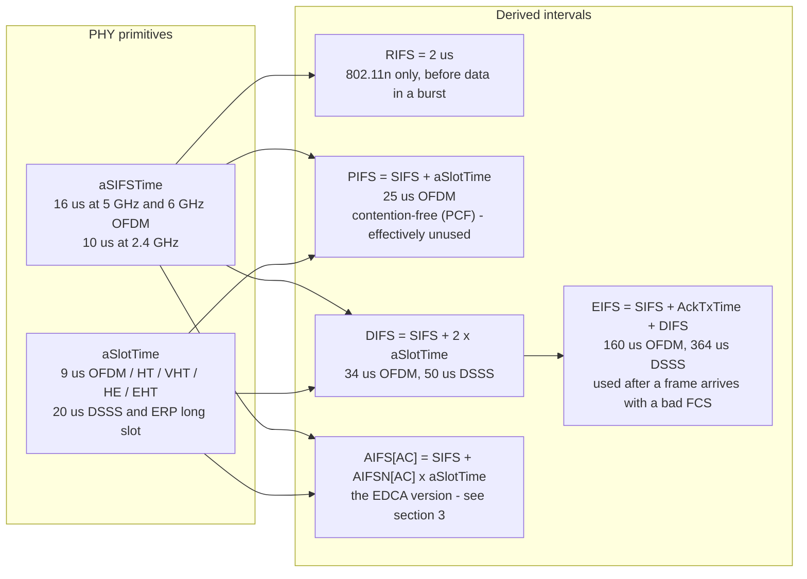

The ordering is the priority: the shorter the wait, the earlier you get to speak. Three consequences:

- **SIFS protects the in-flight exchange.** ACK, CTS, BlockAck and the second frame of a fragment burst all follow
  SIFS, so once a frame exchange starts nothing else can win the medium until it finishes. This is why an
  aggregation burst is nearly atomic against contenders.
- **EIFS is the price of a bad frame.** Any station that receives a frame with a failing FCS waits EIFS rather
  than DIFS, buying time for the intended receiver's ACK to be seen. It is also why a persistent interferer that
  produces un-decodable preambles silently halves everyone's access rate.
- **AIFS with AIFSN = 2 equals DIFS.** This trips people up: with the default table, **AC_VI and AC_VO have the
  same AIFS as legacy DCF.** Their priority comes from the contention window, not from waiting less. Only AIFSN
  values ≥ 3 (AC_BE is 3, AC_BK is 7) make access actually faster than the rules from 1997.

### 2.2 CCA, NAV, and why virtual carrier sense is not enough

Two mechanisms decide "busy", and a station backs off if *either* says busy:

- **Physical CCA** — the PHY reports the medium in use. Energy is required to be detected above a threshold,
  but the interesting variant is that Wi-Fi also *decodes* preambles and sets the NAV.
- **Virtual carrier sense via the NAV** — the Duration/ID field of any heard frame reserves the medium for the
  exchange it announces. This solves the hidden node problem partially: a station that can hear the CTS but not
  the RTS still learns how long to stay quiet.

802.11ax added **two NAVs and a BSS colour**. The intra-BSS NAV is set only by frames carrying the BSS's own
6-bit colour from HE-SIG-A; frames with a different colour, decoded below a threshold compared against
`OBSS_PD` (−82 dBm to −62 dBm at 20 MHz, coupled to transmit power), set only the **other-BSS** NAV and can be
ignored for the purposes of deferring. Spatial reuse is therefore a scheduling input, not just an interference
feature: it changes which neighbours the scheduler is deferring to.

### 2.3 The DCF backoff state machine

This is the state machine to be able to draw on a whiteboard, because every later section is an elaboration of it.

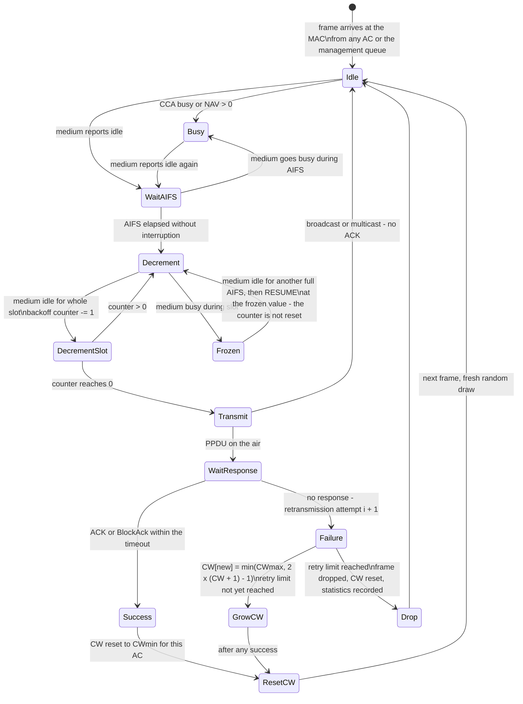

Five details that interviewers probe, all of which follow from the diagram:

1. **The counter freezes but does not reset.** A station that has counted down to 1 does not start over when the
   medium goes busy; it resumes at 1 after the next AIFS. This gives an ageing station an increasing chance of
   winning, which is what makes CSMA/CA approximately fair — and it is also why fairness is only approximate.
2. **CW growth is exponential in the retry count, saturating at CWmax.** Draw with the global network: a CW of
   1023 means a mean wait of ~4.6 ms at a 9 µs slot before the transmission even begins.
3. **The initial draw is uniform over `[0, CW]`, inclusive.** With CWmin = 15 there are 16 possible values, not 15.
4. **Retransmission restarts the same process with a bigger window and a longer backoff**, up to a retry limit
   (7 for short frames at the MAC in the reference model, though implementations vary and represent their own policy).
5. **Broadcast and multicast never get an ACK**, so they settle at the lowest mandatory rate with no rate
   adaptation and no retransmission at all — which is why a single multicast stream can occupy a disproportionate
   share of everyone's airtime.

### 2.4 What CSMA/CA costs, quantitatively

A 1500-byte MSDU is a useful yardstick:

| PHY rate | Approximate airtime for one 1500-byte frame | Approximate relative cost |
| --- | --- | --- |
| 1 Mbps (DSSS) | ~12 ms | 1× |
| 6 Mbps (OFDM lowest) | ~2 ms | ~6× cheaper |
| 54 Mbps | ~0.25 ms | ~48× cheaper |
| MCS 11, 1 SS, 80 MHz | ~0.1 ms or less | ~120× cheaper |

That table *is* the rate anomaly. Because the access cost per frame is roughly constant regardless of rate, a
device at 6 Mbps consumes roughly **twenty times** the channel time of a device at MCS 11 for the same bytes.
Every fairness and latency argument in Wi-Fi is downstream of this row.

---

## 3. EDCA — four contention entities in one device

### 3.1 The four access categories

802.11e wrapped its QoS mechanism into the base standard as EDCA. A QoS station implements **four independent
backoff entities**, one per access category, each with its own AIFSN, CWmin, CWmax and TXOP limit, all running
against the same medium.

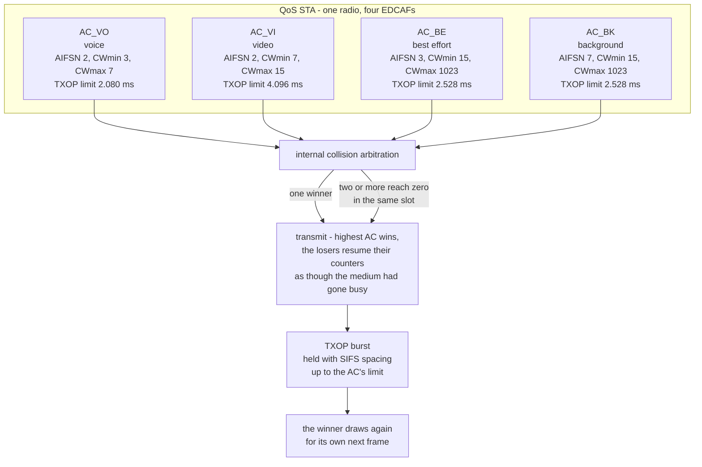

### 3.2 The default table, and one number that surprises everybody

802.11-2016 Table 9-137 — the Default EDCA Parameter Set element, one column serving both AP and STA:

| AC | CWmin | CWmax | AIFSN | TXOP limit (OFDM) | Derived AIFS at 5 GHz |
| --- | --- | --- | --- | --- | --- |
| `AC_BK` | 15 (`aCWmin`) | 1023 (`aCWmax`) | 7 | 2.528 ms | 79 µs |
| `AC_BE` | 15 (`aCWmin`) | 1023 (`aCWmax`) | 3 | 2.528 ms | 43 µs |
| `AC_VI` | 7 (`(aCWmin+1)/2 − 1`) | 15 (`aCWmin`) | 2 | 4.096 ms | 34 µs |
| `AC_VO` | 3 (`(aCWmin+1)/4 − 1`) | 7 (`(aCWmin+1)/2 − 1`) | 2 | **2.080 ms** | 34 µs |

Two things here are worth memorising:

- **AC_VO's TXOP limit is smaller than AC_VI's.** Voice packets are small; a voice TXOP is sized for a few
  20 ms voice frames plus their ACKs, while video gets a longer burst because it moves a larger A-MPDU. People
  who assume "higher priority ⇒ longer TXOP" get this backwards.
- **The values changed between releases.** In 802.11-2012 the same table gave AC_BK and AC_BE a TXOP limit of
  **0** (single MPDU per access) and gave AC_VI/VO 3.008 ms and 1.504 ms. The 2016 revision granted BK and BE
  bursts too, and lengthened the others. Since most real-world clients still advertise the older element, and
  the AP pushes its own parameters in the beacon and **may update them at any time by incrementing the QoS Info
  field's EDCA parameter set update count**, a proportion of field "QoS doesn't work" tickets are simply two
  devices disagreeing about which release's table is in force.

The same table also carries a **DSSS/CCK column** — 3.264 ms for AC_BK, AC_BE and AC_VO, 6.016 ms for AC_VI —
and that column is where the change actually bites. Under 2012 rules a CCK station had TXOP limit 0, meaning
"one MPDU per access, however long it takes"; a 1500-byte frame at 1 Mbps occupies ~12 ms of airtime, so a
single legacy client could hold the medium for twelve milliseconds while everyone else waited. Under 2016 rules
the same station is capped at 3.264 ms and must re-contend. **The BE/BK change from 0 to 2.528 ms is therefore
not a gift to background traffic — it is a cap on slow stations**, and it only helps because 2.528 ms is less
than what one slow frame needs. This is the rate anomaly from §2.4 being fixed in the one place the standard
could fix it.

### 3.3 Internal collision

When two of the four backoff counters in the **same device** reach zero in the same slot, there is no collision
on the medium — there is a **virtual collision** resolved inside the MAC. The rule:

- The **highest-priority** AC transmits.
- The other winners behave **exactly as if they had suffered a real collision**: they grow their CW by the same
  exponential rule and redraw.

This matters because it means adding traffic to AC_BK can cost throughput even if no background frame ever
collides on the air. A saturated AC_BK simply loses internal collisions repeatedly, doubling its window each
time, and it stays quiet. Conversely, two heavily loaded low ACs in one AP do degrade higher ACs, because the
internal arbitration happens every slot the device wins and forces one entity to back off.

### 3.4 The TXOP burst

Winning the medium is the expensive part, so having won it you should send more than one frame. Within a TXOP:

- frames are separated by **SIFS**, not by a new backoff, so no other device can interleave;
- the burst continues until either the TXOP limit would be exceeded by the *next* frame (check before sending,
  never truncate) or the queue empties;
- a single frame that does not fit must be fragmented, or deferred to the next TXOP.

The practical failure: a station with one small frame still pays the full access cost and then releases the
medium. This is why A-MPDU is not an optimisation but a requirement, and why a network carrying many small
low-latency flows can idle at very modest throughput while the airtime is 100% busy.

### 3.5 Admission control — the part nobody implements

EDCA includes an **Admission Control Mandatory** bit per AC, negotiated with ADDTS request/response frames. A
station declares a TSPEC (mean data rate, nominal MSDU size, delay bound, surplus bandwidth allowance); the AP
decides accept/reject. In practice almost no deployed client sends TSPECs, so admission control is essentially
absent from real networks, and "QoS" means only the four-category priority mechanism.

That absence is why every vendor reinvents admission control somewhere else — usually as a per-BSS airtime cap,
or as WMM Admission Control bolted onto a vendor QoS policy engine. And it is why the airtime accounting of §8
is the closest thing Wi-Fi really has to resource admission.

---

## 4. The OFDMA resource grid

### 4.1 Resource units and the 20 MHz tone plan

802.11ax reduced the subcarrier spacing from 312.5 kHz to **78.125 kHz** (a 4× narrowing, giving a 4× longer
12.8 µs symbol) and repackaged the channel into **resource units**, the smallest unit of frequency that can be
assigned to a station.

For a 20 MHz PPDU: 256-point FFT, 234 data subcarriers, 16 pilots, 6 DC. The available partitions:

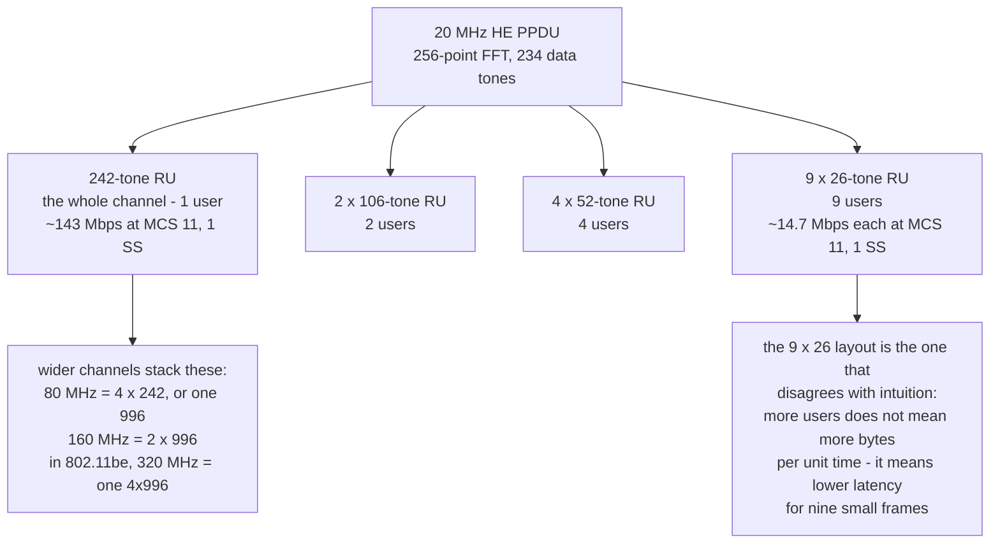

Note the arithmetic that every capacity plan needs: a 26-tone RU at MCS 11 single stream is roughly **14.7 Mbps**,
while the whole 242-tone RU is roughly **143 Mbps**. OFDMA does not create capacity — it divides existing
capacity so that nine small frames can go out together instead of sequentially. Its benefit is **latency and
efficiency for small frames**, and it costs efficiency when there is one large transfer. An AP that keeps a
single bulk download on a 26-tone RU is throwing away roughly a factor of ten in rate to save latency it does
not need. This single trade is the most valuable sentence in OFDMA.

### 4.2 Downlink signalling versus uplink signalling

The asymmetry that shapes §5:

- **DL OFDMA** needs no control exchange. The HE-SIG-B field of the HE MU PPDU tells each receiver its RU
  allocation and, for a non-MU-MIMO allocation, need not carry a per-user field at all for some layouts. Thus
  DL OFDMA is simply "win contention once, serve N stations".
- **UL OFDMA** cannot work that way — nobody knows who has how many bytes. It requires the **trigger frame**.

### 4.3 The 802.11be corrections

802.11be did three things to this grid, each with a scheduling consequence:

1. **MRU — multiple resource units per station.** 802.11ax restricted one STA to one RU, so a 60 MHz
   requirement in an 80 MHz channel had no legal expression. 802.11be permits specified combinations.
2. **A corrected 80 MHz tone plan.** HE's plan maximised usable subcarriers: it defined a middle 26-tone RU
   straddling DC and used no null carrier between adjacent 242-tone RUs, so 242-tone RUs do not align with
   20 MHz boundaries. When puncturing entered, puncturing one 20 MHz subchannel damaged the tones of an
   adjacent RU. EHT removed the middle 26-tone RU and aligned 242-tone RUs to 20 MHz boundaries, losing a
   handful of tones and gaining clean puncturing.
3. **Enhanced puncturing.** With 320 MHz contiguous clean spectrum rare in 6 GHz, puncturing is what makes wide
   channels usable at all; without it one busy 20 MHz slice collapses the whole width.

### 4.4 MRU rules — the illegal combinations

The allowed MRUs are deliberately restricted, because signalling every possible subset would cost more than the
bandwidth it could schedule:

| Class | Members | Rule |
| --- | --- | --- |
| **Small MRU** | `52+26`, `106+26` | Both small RUs, contiguous, within one 20 MHz boundary |
| **Large MRU** | `484+242`, `996+484`, `996+484+242`, `2×996+484`, `3×996`, `3×996+484` | Both large RUs; need not be contiguous; locations chosen to match the defined puncture patterns |

The exclusions matter as much as the inclusions:

- **Small and large RUs never mix** in one MRU.
- **`26+26`, `52+52` and `106+106` are forbidden** — a scheduler wanting those should assign `52`, `106` or `242` respectively.
- **`996+484+242` is restricted to non-OFDMA STAs.**
- **`4×996` is a single RU, not an MRU** — it is the whole 320 MHz channel.

A scheduler that generates RU layouts freely will produce combinations that no client can decode. The legal set
is small enough to enumerate, and serious implementations enumerate it.

---

## 5. Scheduled uplink — the trigger frame

### 5.1 The eight trigger types

The trigger frame carries a 4-bit Trigger Type subfield in its Common Info field:

| Value | Variant | What it makes happen |
| --- | --- | --- |
| 0 | **Basic** | The scheduled-access data solicitation — HE TB PPDUs carrying QoS Data |
| 1 | **BFRP** (Beamforming Report Poll) | Solicit compressed beamforming feedback for MU-MIMO group formation |
| 2 | **MU-BAR** | Solicit BlockAck for earlier frames in this or a previous TXOP |
| 3 | **MU-RTS** | Solicit CTS from a set of STAs to establish protection for the TXOP |
| 4 | **BSRP** (Buffer Status Report Poll) | Ask STAs how much data they hold — the uplink control input |
| 5 | **GCR MU-BAR** | Group Addressed Cast Retransmission variant of MU-BAR |
| 6 | **BQRP** (Bandwidth Query Report Poll) | Ask STAs which channel widths they can currently receive |
| 7 | **NFRP** (NDP Feedback Report Poll) | Solicit NDP feedback — efficient polling of link-quality and resource requests, addressed by AID range rather than per-STA |
| 8–14 | Reserved | A **Vendor Specific** variant using value 15 has been proposed in 802.11me |

The frame has two structural parts:

- **Common Info** — trigger type, UL Length (how long the solicited HE TB PPDU is expected to be), number of
  HE-LTF symbols and GI/LTF type, UL bandwidth, spatial-stream/HE-LTF allocation, and **AP Tx Power** together
  with **UL Target RSSI** used for uplink open-loop power control.
- **Per User Info** — repeated per participant: AID12, RU allocation (size and position), MCS, coding, DCM, SS
  allocation, and the UL target receive power for that station.

The rule every station must obey about that last part: each respondent adjusts its transmit power so the AP
receives it at the target RSSI. Without it, a near station would swamp a far station's RU at the AP receiver,
because synchronous UL OFDMA reception relies on comparable per-user SNR. This makes **power control part of
scheduling**, not a separate loop.

### 5.2 One UL OFDMA round

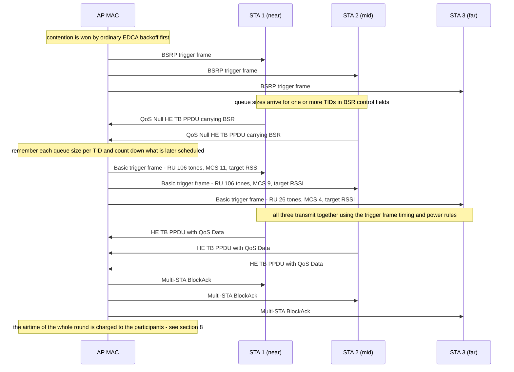

The round is **~500–800 µs at 2.4 GHz / 40 MHz regardless of payload size**. That is the number that decides
whether triggered access is worth using at all: if each station has one small frame, paying ~600 µs of framing
to move a few hundred bytes is a loss. The trick that makes it pay:

- **BSR is a control input that ages.** A BSR tells the AP the queue size at that instant. The AP then either
  schedules immediately or remembers it and counts down as it schedules subsequent allocations. Stale
  estimates produce either wasted RUs or unnecessary additional BSRP rounds.
- **Cascading** avoids re-winning the medium: one TXOP can carry downlink data followed by a Basic trigger
  followed by the Multi-STA BlockAck, all separated by SIFS. The whole trigger round happens inside a single
  TXOP won once.
- **MU-BAR lets acknowledgement wait.** Instead of acknowledging each HE TB PPDU immediately, the AP can
  solicit BlockAck-to-BlockAck within the same TXOP.

### 5.3 The acknowledgements

| Ack form | Used for | Cost |
| --- | --- | --- |
| ACK / BlockAck | SU transmission, or the whole PPDU in non-OFDMA form | One frame per exchange |
| **Multi-STA BlockAck** | UL OFDMA and UL MU-MIMO | **One frame acknowledges every participant** — its Ack Type / TID Info / Starting Sequence fields are per-AID, packed into one frame |
| NDP BlockAck | Optional bandwidth-efficient form | Very short, no MAC payload |

Multi-STA BlockAck is the reason a 9-user UL OFDMA round is affordable at all: without it the acknowledgement
overhead would scale linearly with the number of scheduled users, and with nine 26-tone RUs the ACKs would cost
more than the data.

### 5.4 UORA — random access inside a scheduled system

Perfect knowledge of buffer occupancy is impossible, so if the AP has eligible RUs it cannot profitably assign,
it marks them **random-access RUs** and lets stations contend for them:

- The trigger's User Info field carries **AID12 = 0** for a RA-RU open to *associated* stations and **AID12 = 2045**
  for one open to *unassociated* stations. The latter is how an uplink before association — Probe Request,
  Authentication — can ride inside scheduled access.
- A station contending maintains two variables: **OCW** (OFDMA contention window) and **OBO** (OFDMA backoff counter).
- **Defaults: OCWmin = 7 and OCWmax = 31** for a station that has never received the UORA Parameter Set element.
  The element carries two 3-bit exponents, EOCWmin and EOCWmax, giving `OCWmin = 2^EOCWmin − 1` and
  `OCWmax = 2^EOCWmax − 1`.

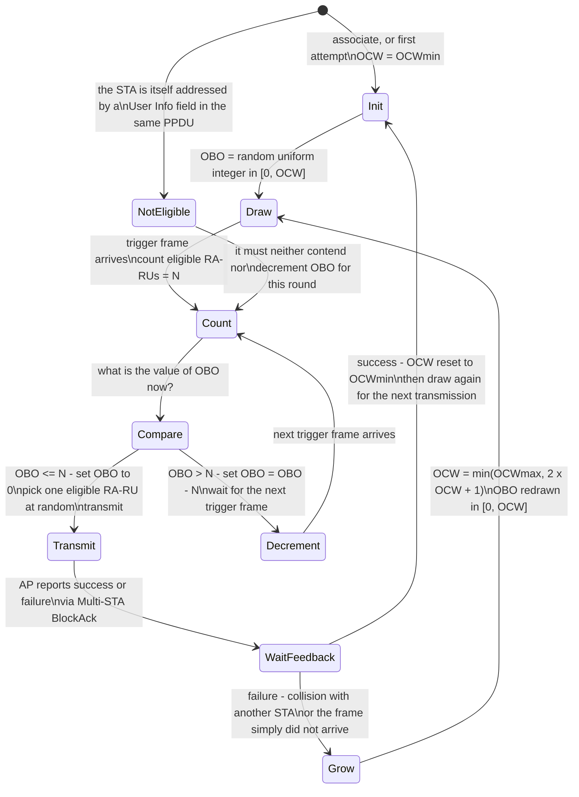

Three properties make this different from ordinary backoff, and all three are interview-worthy:

1. **It is a two-dimensional backoff.** DCF/EDCA back off in *time* to decide *when* to transmit. UORA backs off
   to decide *which RU* to use, and the two questions collapse into one counter decremented by the number of
   available RUs.
2. **Adding RUs does not efficiently reduce collisions.** It makes the OBO counters fall faster, so more stations
   become eligible simultaneously — increasing the chance that two pick the same RU. The equilibrium always has
   both **colliding RUs** and **empty RUs** in the same round. Minimising the sum is the actual UORA design
   problem, and it is why the AP tuning EOCWmin/EOCWmax is the correct lever, not the number of RUs.
3. **It is a fallback, not a primary path.** Any station with enough buffered traffic to deserve a deterministic
   allocation should be scheduled with a Basic trigger. UORA exists for the first frame after a burst arrives,
   when the AP has not yet learned that there is anything to send.

---

## 6. MU-MIMO — the spatial dimension and what it costs to know

OFDMA divides frequency. MU-MIMO divides space, and the two compose: a RU can itself be carrying several
spatial streams to different users (`00011yyy` in the RU Allocation subfield signals a mixed layout, with `yyy`
carrying the number of MU-MIMO users attached to a given RU).

The difference that governs everything: **OFDMA ru layouts can be chosen from a knowledge-free position — any
station can be put on any RU. MU-MIMO cannot.** Forming a group whose members' channels are too similar wastes
streams, and forming one without current channel state actively harms everyone in it.

### 6.1 The sounding sequence

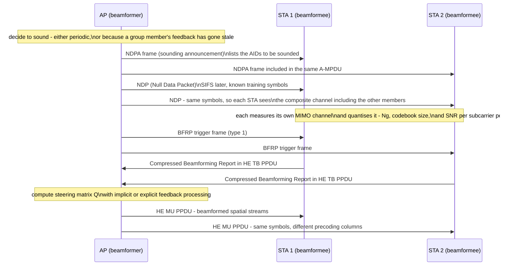

The costs that make this a scheduling problem rather than a PHY feature:

- **The report is large.** A full compressed report for 8 streams over the relevant subcarriers is tens of
  kilobytes; a group of four sounded together produces a lot of uplink traffic that competes with user data.
- **It is per-request.** One report serves one or a few transmissions. Sounding periodicity is therefore a
  direct trade: too often and the overhead eats the gain, too rarely and the precoder is steering into a stale
  channel, which is worse than SU transmission.
- **Channel coherence bounds it.** In a mobile environment, feedback older than a coherence interval is noise.
  Static sensor deployments are the ideal MU-MIMO case; walking clients with phones are the worst.
- **Group members must be simultaneously ready.** A member in power save, or currently transmitting elsewhere,
  simply cannot be sounded, which means group membership is itself a state that has to be maintained.

### 6.2 The decision to go MU

The practical rule: OFDMA for small frames and many users, MU-MIMO for large frames and few spatially
separable users, SU for everything else. Forming a 2-user MU-MIMO group to move two small frames costs a
sounding round and gains less than putting both frames in one aggregation.

---

## 7. Wi-Fi 7 — scheduling across links

### 7.1 The two-layer MAC

802.11be clause 35.3 formalises what every MLO implementation needs: each affiliated STA on a link comprises a
PHY and a **Lower MAC** performing its own channel access, while a single **Upper MAC** sits above all of them,
providing one MAC service access point and owning the MLD MAC address. This is the sentence to hand over:

> **The Upper MAC decides which link. The Lower MAC decides when, and it decides that by contending.**

Because every link runs its own independent CSMA/CA, an MLD is really running several access processes and
choosing among them. This is why MLO's latency benefit is structural: with two links you take the **minimum**
of two random access delays, and the minimum of two random variables is much better behaved under load than
either one alone.

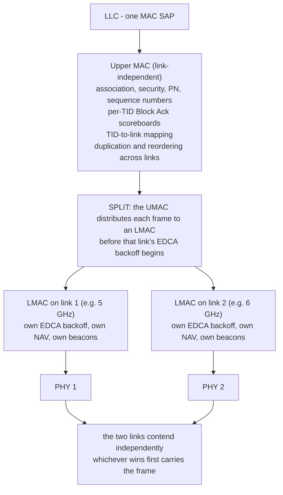

The UMAC/LMAC split is also why [[02-5 WLAN - STA-AP Discovery, Authentication and Association]] can say that
association happens once across all links with one AID: the upper half of the MAC genuinely is single.

### 7.2 The modes, and what each costs the scheduler

| Mode | Radios | Scheduler's problem |
| --- | --- | --- |
| **MLSR** | 1 | One link at a time. Trivial, and no gain over legacy except avoiding re-association. |
| **EMLSR** | 1 + (n−1) low-capability | The STA listens on several links at **reduced spatial streams** (commonly 1 SS per link) and collapses all antennas to whichever link receives an Initial Control Frame. The scheduler must therefore send an ICF first, then wait. |
| **MLMR / NSTR** | ≥ 2 | Two links but no simultaneous TX and RX. The constraint is **end-time alignment**: PPDUs transmitted on different links must end near-simultaneously so that an ACK arriving on one link does not overlap an ongoing transmission on the other. |
| **MLMR / STR** | ≥ 2 | Full simultaneous transmit and receive. Requires very large isolation: typical in-device coexistence between co-located 5 GHz and 6 GHz radios achieves roughly 40–60 dB, while STR wants closer to 80 dB, plus sufficient frequency separation (for example ≥160 MHz) or self-interference cancellation. |

### 7.3 The three timers that EMLSR scheduling must respect

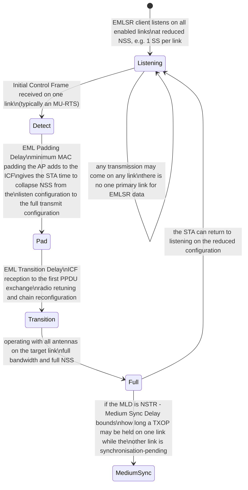

EML Padding Delay and EML Transition Delay are negotiated during association in the EML Capabilities subfield.
Ignoring them is a real and common bug: the AP computes a perfect MU-RTS → pad → MU PPDU sequence, sends it
before the client has finished collapsing its streams, and gets nothing.

### 7.4 TID-to-link mapping

Traffic identifiers map to links, and 802.11be allows that mapping to be **negotiated then changed without
tearing the association down**. This is the single most important scheduling control surface in Wi-Fi 7:

- Latency-sensitive flows onto the cleanest link; bulk onto whichever link is less contended.
- During a burst of interference, remapping is available without a re-association — which is what roaming costs.
- **SCS (Stream Classification Service)** is the complementary input: the client declares the QoS characteristics
  of a stream, so the AP can choose a link and a periodicity informed by something better than a DSCP guess.

### 7.5 What MLO buys, restated as scheduling outcomes

1. **Aggregation** — higher throughput by spreading flows.
2. **Steering** — placing a flow on a link appropriate to its SLA.
3. **Redundancy** — duplicating frames across links for flows that cannot tolerate reordering cost or loss.
4. **Latency** — taking the minimum of several access delays.
5. **Make-before-break** — staying connected on one link while another is being evaluated.

A caveat that belongs in every honest answer: MLO requires **overlapping coverage on every band used**, and a
device incapable of STR pays most of the power cost with only part of the benefit. Reported gains are
AP-specific. The Wireless Broadband Alliance **Phase 2 enterprise field trial** (with AT&T, Ruckus and Intel,
Ruckus APs against Intel BE200 clients, live office environment, March 2026) measured EMLSR against non-MLO:

| Condition | Downlink throughput | Uplink throughput | Latency |
| --- | --- | --- | --- |
| Co-channel interference, 40/40 MHz | +75.9% (317 → 558 Mbps) | +116.0% (245 → 529 Mbps) | −44% DL, −66% UL |
| Clean spectrum, 40/40 MHz | +42.2% (475 → 676 Mbps) | +139.9% (266 → 638 Mbps) | — |
| Clean spectrum, 40/160 MHz | +2.9% | +19.1% | — |

Read that table by column, not by headline: **the gain is largest where the channel is narrow and contended, and
near zero at 160 MHz**, because a single wide clean link already saturates what one client will draw. MLO is a
contention-avoidance feature, not a peak-rate feature. Treat all of it as one generation of commercial hardware
measured by an industry association — real, and not physics.

---

## 8. Airtime fairness

### 8.1 The problem

Consider one AP with two clients: one at −45 dBm running MCS 11, one at −80 dBm running MCS 1. Give them equal
*packets* and the slow client takes perhaps twenty times as long per packet. Its transmission is not twenty
times more valuable; it just costs twenty times more. The whole BSS throughput collapses toward the slowest
client's capability, and this is not a bug in the slow client — it is a bug in counting the wrong thing.

The rate anomaly has three standard answers, and only one survives contact with reality:

| Fairness criterion | Definition | Verdict |
| --- | --- | --- |
| **Throughput fairness** | Equal bytes or packets delivered | Exactly the anomaly. Abandoned. |
| **Proportional fairness** | Maximise the sum of log rates — the criterion from Kelly, Maulloo and Tan's network rate-control work | Sound in general networks, awkward in Wi-Fi because the resource to be shared is *time*, not rate, and it still lets a far client consume unbounded airtime if its rate is low. |
| **Airtime fairness** | Equal *duration* of medium occupancy over a defined window | The right unit. Also called temporal fairness. |

Airtime fairness is not "fair": it deliberately gives the far client less throughput so that everyone's expected
channel time is comparable. It is the correct trade because channel time — unlike rate — is the conserved quantity.

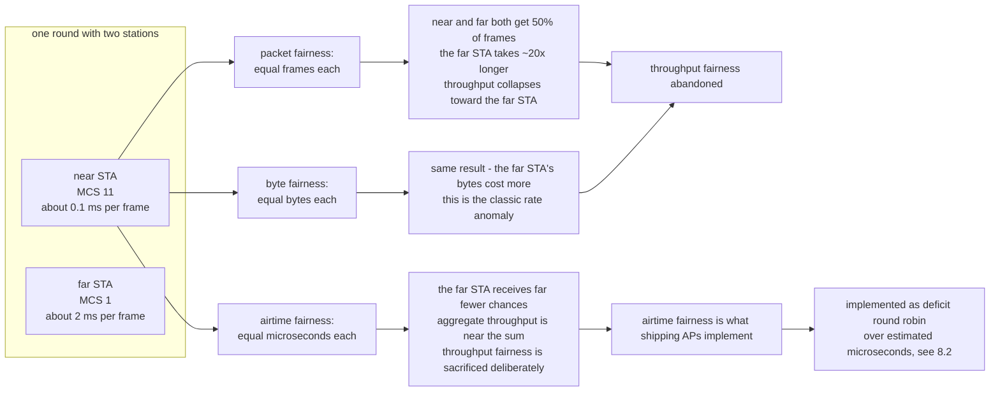

### 8.2 The deficit round-robin form

The implementation almost everyone uses is a **deficit-based round robin over airtime**, not a per-frame
allocation:

```
for each active TXQ belonging to a station:
    deficit += quantum          # quantum is expressed in microseconds of airtime
    while deficit >= cost of the next frame:
        transmit that frame
        deficit -= estimated airtime of the transmission (including ACK and overhead)
    if the queue is empty: deficit = 0        # no credit accumulates while idle
```

Three properties follow, and each has a failure mode:

- **Credit never accumulates while idle**, so a bursty flow cannot bank the quiet time and then monopolise.
- **The cost estimate must include everything**, not just the frame duration: preamble, acknowledgements, retry
  allowance, interframe spacing, and — crucially — the per-frame probability of retransmission.
- **The estimate depends on a rate**, so a broken estimate makes fairness actively harmful. This is exactly the
  failure addressed in §12.4: if a driver cannot report HE rates, the estimate falls back to 6 Mbps, which is
  twenty times too pessimistic, and the scheduler stops the queue long before it should.

### 8.3 What to charge for

The unit is airtime, so every component of an exchange must be charged to whoever caused it:

| Component | Charged to | Note |
| --- | --- | --- |
| PPDU duration | The recipient of the data | Includes preamble, which at low MCS can exceed the payload |
| ACK / BlockAck | Same | An unacknowledged multicast still costs its duration |
| Retransmissions | The destination that failed | This is why far clients should reasonably get *more* airtime per delivered byte |
| Trigger frames and Multi-STA BlockAck in a UL round | Shared across participants | Otherwise UL OFDMA looks artificially expensive and an AP will never choose it |
| Management frames — beacons, probe responses | Usually counted against overhead, not any STA | Beacons scale with the option set; see §14 |

---

## 9. The per-TXOP decision pipeline

This is the section that turns everything above into an executable loop. It runs every time the medium becomes
available to the AP.

### 9.1 Two stages, not one

The single most common misconception is that the scheduler picks "a station". It picks **a station, then a
frequency layout**, and the two are separable:

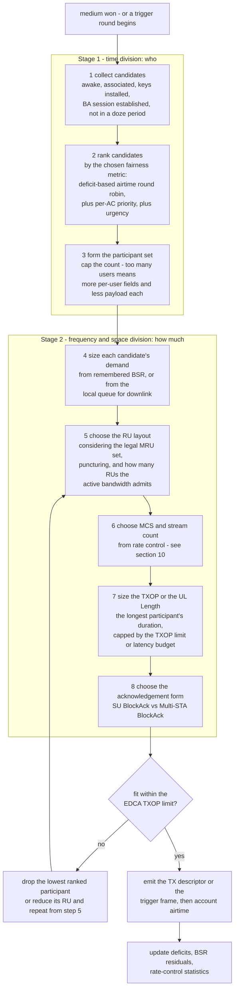

Note the loop back from step 7 to step 5: **TXOP sizing changes the participant set.** Adding a ninth station
may force every existing one down to a smaller RU, which lengthens each transmission, which breaches the TXOP
limit. A scheduler that sizes allocation first and checks the limit last will emit frames that overrun.

### 9.2 Step-by-step walk of one iteration

1. **Candidate collection.** Reject any station whose CAM bit says dozing, whose Block Ack session is not yet
   established (frames without a BA window cost a separate ack each), and any station whose key has not yet been
   installed. This set changes every beacon interval because of power save.
2. **Ranking.** Take the highest AC that has traffic. Within the AC, order by the airtime-deficit round robin.
   Urgency overrides exist: a voice flow with a deadline, or a station whose STA timer will expire.
3. **Participant set sizing.** There is a diminishing return: going from 4 to 9 users multiplies the per-user
   signalling (each User Info field is several octets, and each additional participant needs at least one
   Multi-STA BlockAck entry) while each gains one ninth of the bandwidth.
4. **Demand estimation.** Downlink is known exactly. Uplink is known only from the last BSR, decayed by what has
   been scheduled since — this is why uplink allocation is approximate in a way downlink is not.
5. **RU layout.** Start from the demand: large for bulk, small for latency. Then apply the legal-MRU constraints
   of §4.4 and the puncturing pattern currently in force.
6. **MCS.** §10.
7. **TXOP / UL Length.** The common choice is `max(participant durations, Ack coverage)`, capped. Note that the
   UL Length field in a basic trigger must cover **every** solicited PPDU, which means one slow far participant
   stretches the round for everyone.
8. **Acknowledgement.** Multi-STA BlockAck for anything multi-user; single BA otherwise.

### 9.3 What goes wrong at each step

| Step | Failure | Symptom |
| --- | --- | --- |
| 1 | Dozing stations included | Frames queued to a sleeping station; retransmissions until wake; latency spikes at DTIM boundaries |
| 2 | Throughput fairness instead of airtime | One far client drags the whole BSS — classic rate anomaly |
| 3 | Too many participants | Aggregate throughput falls even though more users are served per TXOP |
| 4 | Stale BSR used verbatim | Empty RUs after the burst drained, then a second unnecessary BSRP round |
| 5 | Illegal MRU generated | Stations silently ignore the allocation; the round carries almost nothing |
| 6 | Fixed MCS | Long-term mismatch either way; see §10 |
| 7 | Limit checked last | Over-long PPDUs, loss of medium for contenders, EIFS storms |
| 8 | Per-STA acknowledgements | Acknowledgement overhead scales linearly; the multi-user benefit disappears |

---

## 10. Rate control is part of the scheduler

In cellular, link adaptation is inside the scheduler because the scheduler owns the granted resources. The same
is true in Wi-Fi for a subtler reason: **the price of a transmission is its airtime, and its airtime is decided
by its rate.** A fairness scheme that measures in microseconds is only as good as the rate estimate it uses.

### 10.1 The requirement

A rate-control loop must:

- pick a rate for each transmission, per destination;
- incorporate acknowledgement success/failure rapidly — the feedback is one lot cheaper than a CSI report;
- explore: without deliberate sampling, a link whose conditions improve stays at the old rate forever;
- degrade gracefully during transients, and not oscillate.

### 10.2 Minstrel and Minstrel_HT

The default in `mac80211`, `rc80211_minstrel`, `rc80211_minstrel_ht.c`, is the archetypal **statistics-driven**
rate controller, and it is worth being able to explain its shape:

- Maintain a per-destination table of success probabilities for every rate — an EWMA of acknowledgement outcomes,
  updated after each frame or each aggregation burst.
- Compute an expected throughput for each rate: probability of success × rate, allowing comparison across rates
  that trade off.
- Serve most traffic from the best-throughput rate.
- Spend a **sampling fraction** — on the order of 10% — deliberately transmitting at other rates, including rates
  better than the current best, so improvements can be discovered. This is the "look-around" that makes it a
  search rather than a gradient.
- Maintain a small set of the statistically-fastest rates, because the input is noisy and the top few are within
  measurement error of each other.
- Use a **retry chain**: the remaining attempts of a frame step down through a few progressively more robust
  rates rather than retrying at the same one. Typically four logical retry attempts with progressively robust rates.

### 10.3 The loop

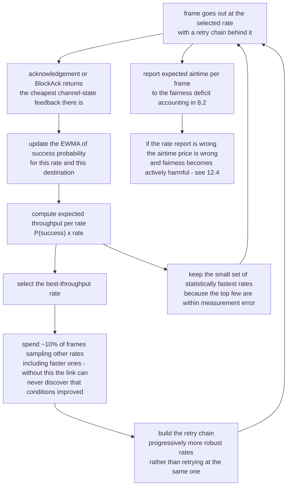

### 10.4 What this means for the scheduler

- The rate controller and the fairness scheme share the **same unit**: expected airtime per frame. They must be
  fed from the same estimator, or the deficit accounting over-charges high-rate and under-charges low-rate stations.
- Aggregation changes the unit of feedback: a 64-frame A-MPDU gives one aggregated result, so statistical rate
  control converges more slowly and benefits more from per-frame context.
- **Retries are not free and they are not the sender's alone.** Every retry occupies shared medium, so on a
  congested channel, a more robust rate is often cheaper per delivered byte than a fast rate with retries. This
  inverts the obvious answer and is a good interview distinction.
- Anything that breaks the rate reporting path breaks fairness — see §12.4 for exactly that bug in `iwlwifi`.

---

## 11. Scheduling around sleep

A dozing station is not schedulable. This makes power save a scheduling constraint, not just a battery feature,
and [[02-2 WLAN - Power Saving Mechanisms and Evolution]]'s mechanisms are best read with that in mind.

### 11.1 Legacy PS and U-APSD

- **Legacy PS.** The station sets the Power Management bit and sleeps; the AP buffers; the beacon's TIM (and the
  DTIM, every `dot11DTIMPeriod` beacons) announces buffered traffic; the station sends PS-Poll or wakes for the
  delivery. The AP's constraint: **do not transmit to a station whose PM bit says doze**, and honour the More Data
  bit and EOSP (End of Service Period) correctly.
- **U-APSD.** Instead of polling per frame, the station triggers a service period with an uplink QoS Data or QoS
  Null frame; the AP then delivers a burst of downlink frames. The delivery burst length is bounded by
  `maxSPLength`. From a scheduling standpoint this converts pull-based delivery into a push window, which is
  worth planning around: the U-APSD service period is effectively a small scheduled TXOP granted by the client.

### 11.2 TWT — scheduled wake as a scheduling primitive

Target Wake Time converts sleep into a *negotiated schedule*, which means it becomes schedulable state:

| Axis | Variants | Meaning |
| --- | --- | --- |
| Scope | **Individual** vs **broadcast** | Per-station unicast agreement, versus a shared schedule announced in the beacon that many stations subscribe to |
| Notification | **Implicit** vs **Explicit** | The STA computes the next SP as `T + N × interval` with no announcement, versus the AP announcing each SP |
| Uplink form | **Trigger-enabled** vs **non-trigger** | The AP drives uplink with a Basic trigger inside the SP and the station may not transmit outside it using anything but an HE TB PPDU, versus normal EDCA contention within the SP window |

Timing is encoded as a mantissa and exponent: **wake interval = mantissa × 2^exponent µs**, and the nominal
minimum wake duration is in units of 256 µs. That encoding is why a sensor can ask for a five-minute interval
without anyone allowing ten decimal digits to encode it.

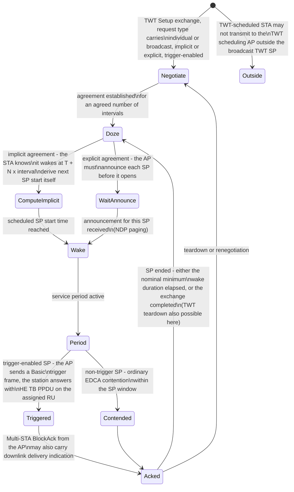

The AP-side scheduling consequence: the whole reason the AP wants stations on individual TWT is that the AP can
then arrange SPs so they do not overlap, converting contention into something close to planning.

### 11.3 Restricted TWT

802.11be added **r-TWT** specifically because TWT gives power predictability but not latency determinism — anything
else may still win the medium inside someone else's SP. r-TWT adds two channel-access rules:

1. An EHT non-AP station that obtains a TXOP outside the r-TWT SP **must terminate it before the SP starts**.
2. The AP schedules a **Quiet Interval overlapping the SP** to quiet legacy stations, though a Quiet Interval is
   not effective against non-AP EHT stations, which is precisely why the first rule exists.

r-TWT can operate in trigger mode, and SPs can be aligned with **IEEE 802.1Qbv gate-open times**, which is what
the IEEE 802.11 liaison to 802.1 describes when it places r-TWT, SCS and TID-to-link mapping alongside each other
as latency tools. This is the beginning of Wi-Fi talking to TSN on TSN's terms — and the eventual destination of
the Wi-Fi 8 work described in [[02-1 WLAN - Wi-Fi Generations Evolution]] §5.

---

## 12. The scheduler in Linux: `mac80211`

### 12.1 Where it sits

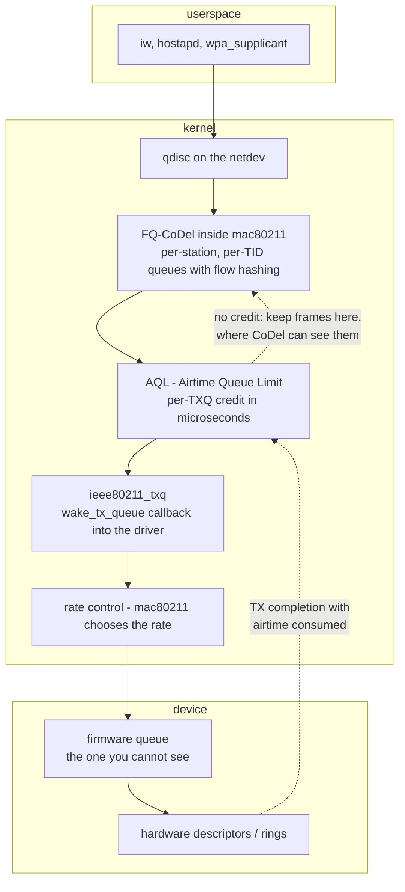

The two canonical entry points drivers implement are:

- **`wake_tx_queue(hw, txq)`** — the driver asks for frames. In this model the *driver* decides when to pull,
  which is the correct shape for firmware that owns the real-time MAC.
- **`ieee80211_txq_airtime_check(hw, txq)`** — whether this TXQ still has AQL credit to push more frames down.

Everything above those calls is `mac80211` policy. Everything below is somebody else's.

### 12.2 Intermediate queues and FQ-CoDel

One of the important corrections in modern Wi-Fi: at 802.11ac-class rates the amount of data that can be in
flight is small compared with the amount that Linux will happily queue. Ten stations' worth of bulk traffic in
a deep `txq` means seconds of latency, entirely invisible to anything above it in the stack.

`mac80211` therefore runs a **fair queueing plus CoDel** structure per station and per TID: 1024 flow buckets,
deficit round robin across them, CoDel dropping or marking when a flow's sojourn time exceeds target.
The point is subtle and worth saying precisely: **CoDel needs honest sojourn time**, and sojourn time measured in
`mac80211` excludes everything queued in the firmware below it. That discrepancy is the whole motivation for AQL.

### 12.3 AQL

AQL caps how much *airtime* each TXQ may have outstanding:

| Constant | Value | Meaning |
| --- | --- | --- |
| `IEEE80211_DEFAULT_AQL_TXQ_LIMIT_L` | **5000 µs** | Per-TXQ credit when the interface's total airtime is above the threshold — 5 ms of channel time outstanding per queue |
| `IEEE80211_DEFAULT_AQL_TXQ_LIMIT_H` | **12000 µs** | Per-TXQ credit otherwise |
| `IEEE80211_AQL_THRESHOLD` | **24000 µs** | Total airtime across the interface at which the limits switch from high to low |
| `IEEE80211_DEFAULT_AQL_TXQ_LIMIT_BC` | **50000 µs** | Broadcast/multicast credit — added by Felix Fietkau in February 2024 because excessive broadcast floods hardware queues and breaks fair queueing for broadcast data |
| `IEEE80211_DEFAULT_AIRTIME_WEIGHT` | **256** | The weight used in airtime accounting |

The broadcast row is the one to remember when multicast is on the network: multicast settles at the lowest
mandatory rate (§2.3) *and* it was outside AQL accounting until 2024, so a chatty multicast source could fill
the hardware queue with the most expensive frames in the BSS and nothing in `mac80211` could see it.

The rationale, stated by its authors, is exactly what §8 says in different words: bytes are not a valid queue
depth for wireless because the data rate varies from a few Mbps to over a Gbps among stations in one network.
AQL lets each TXQ release **just enough packets to form one or two large aggregations** — keeping the hardware
busy — while retaining the rest where CoDel can see them and apply its latency control.

It is tunable per AC at runtime through debugfs (`aql_txq_limit`), which is one of the few places you can
actually watch the effect of a fairness knob from userspace.

### 12.4 The three facts about AQL that matter in practice

1. **It is an opt-in feature.** It became a proper `NL80211_EXT_FEATURE` shortly after it was introduced, which
   flipped the default so drivers must request it. Many drivers do not.
2. **Enabling it requires an accurate rate report.** The commit that made AQL opt-in also disabled it for
   `iwlwifi`, with two documented reasons: TSO causing underflows and warnings in AQL, and — the telling one —
   **HE rates not being reported properly, so at HE rates AQL could never have a valid estimate and would fall
   back to 6 Mbps instead of up to 2400**. A rate estimate twenty to four-hundred times wrong makes airtime
   fairness worse than no fairness at all. This is §10's point from the other end: the scheduler and the rate
   controller are one system.
3. **Hardware acceleration can bypass it.** MediaTek's Wireless Ethernet Dispatch offloads the AP forwarding
   path, and enabling WED is documented as **losing AQL** — again described in
   [[02-4 WLAN - Packet TX-RX Datapath and Offload Evolution]] §7. Choosing throughput offload silently trades
   away the queueing control that protects latency.

### 12.5 The three places a Wi-Fi queue hides

The reason "bufferbloat on Wi-Fi" resists the obvious fix is that there are three queues in series and typically
only the first is visible:

| Queue | Visible from | Controllable by |
| --- | --- | --- |
| `mac80211` FQ-CoDel queue | Full — per-station and per-TID debugfs, ftrace, kprobes | Yes: FQ-CoDel configuration and AQL limits |
| Firmware queue | Vendor debug hooks and `ethtool -S` counters, at best | Vendor only |
| Hardware descriptor ring | Typically nothing | Filling it faster than it drains, which is the definition of the problem |

The practical consequence matches 02-4's paragraph about attributing faults to a layer: with SoftMAC you can see
which queue is misbehaving; with FullMAC you bisect by firmware version.

---

## 13. Where the AP's scheduling decision actually lives

The protocol says "the AP decides". It does not say which CPU does.

| Split | Representative drivers | Who decides the RU layout and participant set | Observable? |
| --- | --- | --- | --- |
| **SoftMAC** — `ieee80211_ops`, host owns the descriptors | `ath9k`, `mt76`, `rt2x00` | Host `mac80211`, with vendor extensions layered on top | Excellent: every policy decision is host code you can read and instrument |
| **FullMAC** — `cfg80211_ops`, command/event mailbox | `brcmfmac`, many USB/SDIO parts | Firmware, entirely | Poor: vendor debug hooks and counters only |
| **Hybrid** — bridge MAC in mac80211, real-time MAC in firmware | `iwlwifi`, `ath10k`, `ath11k` | **Split**: helpers like BA session setup policy in the host, the per-TXOP real-time decision in firmware | Medium: `ethtool -S`, debugfs, firmware logs |

The essential fact about shipping AP hardware: **the RU allocation and participant-set decision almost always
lives in firmware**, because it has to happen inside one SIFS interval of the medium becoming available. The
host can express policy — per-BSS airtime caps, per-client weights, minimum and maximum rates — but it cannot
express per-TXOP decisions. That is why "configure the airtime fairness policy" is a host feature and "fix the
RU allocation bug" is a firmware release.

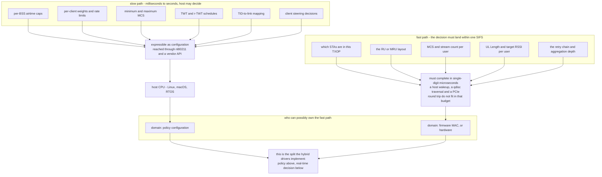

Contrast with [[01-6 NR DU MAC Scheduler - Resource Allocation, HARQ and Real-Time Implementation]]: the cellular
scheduler lives in the DU and is wholly software because its deadline is a slot. Wi-Fi's deadline is microsecond-scale
and its medium is contended, so the real-time decision ends up below any OS — the nearest thing Wi-Fi has to FAPI
is vendor-internal, and there is no equivalent of the 7-2x interface pushing this work out into a visible place.

For multi-AP scheduling there is one more layer: [[02-3 WLAN Ecosystem - WFA, EasyMesh and prpl]] and
[[02-7 WLAN - Wi-Fi EasyMesh, Operation, Tuning and Troubleshooting]] describe how a *network* coordinates channel
and steering. Coordinated resource allocation between APs — the sort of thing Wi-Fi 8's Co-SR, Co-BF and
coordinated TDMA/OFDMA aim to standardise — is what happens when this per-TXOP loop gets a peer-to-peer
extension. Today, the closest thing to cross-AP scheduling is static channel planning plus steering.

---

## 14. KPIs — what to actually measure

| Layer | Metric | Healthy reading | What an unhealthy reading localises to |
| --- | --- | --- | --- |
| Medium | **Channel utilisation** (busy fraction) | Below ~60–70% sustained | Above it, latency rises non-linearly — access, not forwarding, is the bottleneck |
| Medium | **Non-Wi-Fi utilisation** | Near zero | Microwave, radar, or a non-802.11 interferer; nothing in the MAC can fix it |
| Access | **Retries / retransmission rate** | Below ~10% | Higher is either rate control too aggressive or RF impairment |
| Access | **Per-AC backoff slots consumed** | Roughly proportional to offered load | A spike in one AC means the internal arbitration is starving it |
| OFDMA | **RU utilisation** — scheduled RUs that carried data | High | Low means stale BSRs, or scheduled participants with no data |
| OFDMA | **UORA collision and idle RU rates** | Both low | Both high means EOCW is wrong; idle only means too many RUs; collisions only means too few |
| Uplink | **BSR accuracy** — predictions versus arrivals | Queue estimates converge | Persistent surplus means the scheduler is over-granting |
| Sounding | **Sounding overhead fraction** | Low relative to MU gain | High with little MU-MIMO benefit means sounding is too frequent for the mobility |
| Fairness | **Per-station airtime share** | Comparable per station | One station dominates — check it is not sleeping rarely while others doze often |
| Queuing | **Sojourn time / queue depth visible in mac80211** | Milliseconds | Large totals despite low sojourn time means the invisible firmware queue |
| Queuing | **AQL credit headroom** | Not persistently exhausted | Exhausted means frames are staying above the limit where they should be |
| Latency | **P99 delay per AC** | Within the application bound | Distinguish access delay from queueing delay — see §15 |

Beacon overhead is worth a line: beacons carry the whole option set, and an AP with many enabled features and a
long vendor IE list transmits a substantially larger beacon at the mandatory rate at every TBTT. The airtime consumed
scales with the option count, not with the traffic.

---

## 15. Troubleshooting

### 15.1 First localise: is it access, allocation, or accounting?

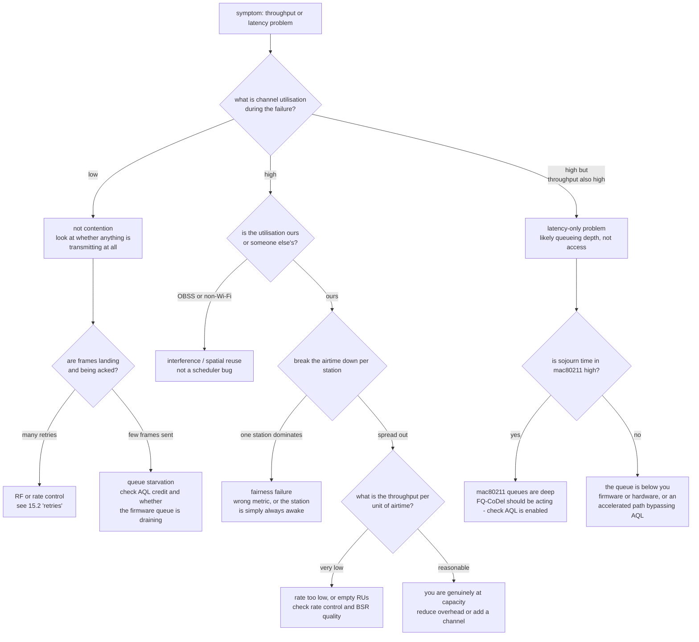

### 15.2 Symptom table

| Symptom | Most probable cause | How to confirm |
| --- | --- | --- |
| Whole-BSS throughput collapses when one far client joins | Throughput fairness instead of airtime fairness; rate anomaly | Compare per-station airtime shares; check whether a fairness feature is implemented at all |
| Throughput good, latency terrible | Deep firmware queue invisible to CoDel; AQL disabled or bypassed | Compare `mac80211` sojourn time against end-to-end latency; if the former is small and the latter large, the queue is below you |
| Latency terrible only for one station | It is dozing and missing SPs; or it has a long TWT interval | Check its power-save state and TWT agreement against arrival times |
| UL OFDMA achieves less than expected | Stale BSRs → empty RUs; or UORA parameters wrong | Count scheduled RUs that carried data; check the EOCW exponent the AP advertises |
| UORA: many collisions and many empty RUs simultaneously | RU count versus contender-count mismatch — more RUs speeds the countdown without reducing the collision probability | Adjust EOCWmin/EOCWmax rather than the RU count |
| MU-MIMO performs worse than SU | Stale or too-similar channel state; group members whose channels are correlated | Compare MU against SU throughput for the same group; check sounding interval versus mobility |
| An EMLSR client misses every initial frame | EML Padding Delay or Transition Delay shorter than the client negotiated | Compare the negotiated EML Capabilities against the AP's configured delays |
| Second link of an MLD carries no traffic | TID-to-link mapping sends nothing there; or NSTR end-alignment constraint never satisfied | Inspect the negotiated TID-to-link mapping element |
| Excellent throughput at low load, collapse at high load | Access overhead dominates; the number of transactions, not bytes, is the limit | Calculate throughput per TXOP, and check aggregation depth |
| Throughput falls after enabling hardware acceleration | Accelerate path bypasses AQL; firmware queue no longer bounded | Check whether AQL is reported as still active; compare before and after latency under load |
| Multi-AP: neighbouring APs on the same channel thrash | No cross-AP coordination exists below Wi-Fi 8; spatial reuse parameters too conservative or too aggressive | Review OBSS_PD and BSS colour configuration against real RSSI distributions |
| Nothing fixes throughput at good RSSI | FullMAC: you cannot see which layer owns the fault | Bisect by firmware version; see 02-4 §6 for why this is the real cost of FullMAC |

---

## Anchors — verified facts

- **IFS relationships**: `RIFS = 2 µs` (802.11n only); `SIFS = aSIFSTime` = 16 µs (OFDM, 5/6 GHz) or 10 µs (2.4 GHz);
  `PIFS = SIFS + aSlotTime`; `DIFS = SIFS + 2 × aSlotTime` = 34 µs OFDM, 50 µs DSSS/ERP-long;
  `EIFS = SIFS + AckTxTime + DIFS` = 160 µs OFDM, 364 µs DSSS; `AIFS[AC] = SIFS + AIFSN[AC] × aSlotTime`.
  `aSlotTime` is 9 µs for OFDM/HT/VHT/HE/EHT and 20 µs for DSSS and ERP long slot.
- **EDCA defaults** (802.11-2016 Table 9-137, one table for both AP and STA): `AC_BK` CWmin 15 CWmax 1023 AIFSN 7
  TXOP 2.528 ms; `AC_BE` CWmin 15 CWmax 1023 AIFSN 3 TXOP 2.528 ms; `AC_VI` CWmin 7 CWmax 15 AIFSN 2 TXOP 4.096 ms;
  `AC_VO` CWmin 3 CWmax 7 AIFSN 2 TXOP 2.080 ms. In 802.11-2012 (Table 8-105) `AC_BK`/`AC_BE` had TXOP limit **0**
  and `AC_VI`/`AC_VO` 3.008 ms / 1.504 ms. Note `AC_VO`'s limit is **smaller** than `AC_VI`'s.
- **The same EDCA table has a DSSS/CCK column**: `AC_BK` 3.264 ms, `AC_BE` 3.264 ms, `AC_VI` 6.016 ms, `AC_VO`
  3.264 ms. The 2012 → 2016 change of `AC_BK`/`AC_BE` from **0 to 2.528 ms** is therefore a *cap* on slow
  stations, not a concession to background traffic: at 1 Mbps a 1500-byte frame needs ~12 ms, so under 2012 rules
  one CCK client could hold the medium indefinitely long while under 2016 rules it must re-contend.
- **Derived AIFS at 5 GHz**: `AC_VO` and `AC_VI` 34 µs (equal to DIFS, since AIFSN = 2), `AC_BE` 43 µs, `AC_BK` 79 µs.
- **Contention window sizes follow from `aCWmin = 15`, `aCWmax = 1023`**: `AC_VI` CWmin `(aCWmin+1)/2 − 1 = 7`, CWmax
  `aCWmin = 15`; `AC_VO` CWmin `(aCWmin+1)/4 − 1 = 3`, CWmax `(aCWmin+1)/2 − 1 = 7`.
- **RU sizes**: 26, 52, 106, 242, 484, 996, 2×996 tones in 802.11ax; 802.11be adds 4×996 and MRU. A 20 MHz HE PPDU
  is a 256-point FFT with 234 data subcarriers, 16 pilots and 6 DC, partitioning as 9×26, 4×52, 2×106 or 1×242.
- **MRU legal combinations**: small MRUs `52+26` and `106+26` (both small, contiguous, within 20 MHz); large MRUs
  `484+242`, `996+484`, `996+484+242` (non-OFDMA STAs only), `2×996+484`, `3×996`, `3×996+484`. Small and large never
  mix; `26+26`, `52+52`, `106+106` are disallowed. `4×996` is a single RU covering 320 MHz, not an MRU.
- **EHT 80 MHz tone plan revision**: HE aligned maximum data tones and defined a middle 26-tone RU straddling DC, so
  242-tone RUs did not align with 20 MHz boundaries and puncturing one subchannel damaged an adjacent RU. EHT removed
  the middle 26-tone RU and aligned the 242-tone RU to 20 MHz boundaries.
- **Trigger frame types** (Trigger Type subfield): 0 Basic, 1 BFRP, 2 MU-BAR, 3 MU-RTS, 4 BSRP, 5 GCR MU-BAR,
  6 BQRP, 7 NFRP, 8–15 Reserved. A Vendor Specific variant using value 15 has been proposed in 802.11me.
- **UORA defaults**: `OCWmin = 7`, `OCWmax = 31` when no UORA Parameter Set element has been received; the element's
  two 3-bit fields give `OCWmin = 2^EOCWmin − 1`, `OCWmax = 2^EOCWmax − 1`. On failure `OCW = min(OCWmax, 2×OCW + 1)`.
  RA-RUs use AID12 = 0 for associated stations and AID12 = 2045 for unassociated.
- **`mac80211` AQL constants**: `IEEE80211_DEFAULT_AQL_TXQ_LIMIT_L 5000` µs, `IEEE80211_DEFAULT_AQL_TXQ_LIMIT_H 12000` µs,
  `IEEE80211_AQL_THRESHOLD 24000` µs, `IEEE80211_DEFAULT_AIRTIME_WEIGHT 256`, and — added by Felix Fietkau in
  February 2024 for broadcast/multicast — `IEEE80211_DEFAULT_AQL_TXQ_LIMIT_BC 50000` µs. Implemented by Kan Yan and
  Toke Høiland-Jørgensen, authored 2019-11-18, committed 2019-11-22; made an opt-in `NL80211_EXT_FEATURE` in
  December 2019, which disabled it for `iwlwifi` because TSO caused AQL underflows **and HE rates were not reported,
  so AQL could never have a valid estimate at HE rates — it used 6 Mbps instead of up to 2400 Mbps**.
- **MLO modes**: MLSR (one link active); EMLSR (one full 802.11be radio plus low-capability radios able to decode
  control-frame preambles, listening on several links at reduced NSS, collapsing all antennas to the link that
  receives an Initial Control Frame); MLMR subdivided into NSTR — which requires near-alignment of the **end
  times** of simultaneous PPDUs so an ACK on one link does not overlap a transmission on another — and STR, which
  needs frequency separation (for example ≥160 MHz) and/or self-interference cancellation; EMLMR adds dynamic
  reconfiguration of spatial multiplexing across links.
- **MLO MAC structure**: 802.11be clause 35.3 defines each affiliated STA as a PHY plus a Lower MAC doing its own
  channel access, with a single Upper MAC above them owning the MLD MAC address and performing TID-to-link mapping
  **before** any per-link EDCA backoff begins.
- **EMLSR timers**: EML Padding Delay (minimum MAC padding the AP adds to the Initial Control Frame so the STA can
  collapse its spatial streams from the listen configuration to the transmit configuration) and EML Transition
  Delay (ICF reception to first PPDU exchange, covering retuning and chain reconfiguration), both negotiated in the
  EML Capabilities subfield. Medium Sync Delay is the NSTR timer bounding how long a TXOP may be held on one link
  while another is synchronisation-pending.
- **TWT encoding**: the element carries a 15-bit Request Type, a 64-bit Target Wake Time, a 16-bit Wake Interval
  Mantissa and a 5-bit Wake Interval Exponent giving `interval = mantissa × 2^exponent` µs, and a nominal minimum
  wake duration in units of 256 µs. Four variants along two axes — individual versus broadcast, implicit versus
  explicit — plus trigger-enabled versus non-trigger.
- **r-TWT access rules** (802.11be): an EHT non-AP station obtaining a TXOP outside an r-TWT service period must
  **terminate it before the SP starts**; the AP schedules a **Quiet Interval overlapping the SP** to quiet legacy
  stations, though a Quiet Interval does not constrain non-AP EHT stations — which is why the first rule is needed.
- **Airtime cost of one frame**, the number behind every fairness argument: a 1500-byte frame takes roughly
  12 ms at 1 Mbps, ~2 ms at 6 Mbps, ~0.25 ms at 54 Mbps, and ~0.1 ms or less at MCS 11 on a wide channel.
- **A UL OFDMA round costs ~500–800 µs at 2.4 GHz / 40 MHz regardless of payload size** — the figure that decides
  whether triggered access is profitable for a given burst size.
- **RU capacity**: a 26-tone RU at MCS 11 single stream is ≈14.7 Mbps; a full 242-tone RU ≈143 Mbps. OFDMA divides
  capacity; it does not create it.
- **Measured EMLSR benefit** (WBA Phase 2 enterprise field trial, with AT&T, Ruckus and Intel; Ruckus APs against
  Intel BE200 clients; live office, not a chamber; report dated March 2026): under co-channel interference at
  40/40 MHz, downlink 317 → 558 Mbps (**+75.9%**) and uplink 245 → 529 Mbps (**+116.0%**), with latency reduced
  **44% downlink** and **66% uplink**; in clean spectrum at 40/40 MHz, +42.2% downlink and +139.9% uplink; at
  40/160 MHz, only **+2.9% downlink** and +19.1% uplink. The gain is largest where the channel is narrow and
  contended and near zero at 160 MHz — MLO is contention avoidance, not peak rate.

## Related

- [[02-9 WLAN - Time-Sensitive Networking Across Wi-Fi Generations]] — what all of this is for: the ladder from EDCA through trigger-based access, TWT, r-TWT and preemption to a latency bound, plus the 802.1 toolbox it has to interoperate with and the AP-as-bridge model that puts it in a wired TSN domain
- [[02-1 WLAN - Wi-Fi Generations Evolution]] — where every feature whose scheduler this note describes came from: RUs and MRU, the EHT tone-plan revision, MLO's upper/lower MAC split, TTLM, SCS and R-TWT, and the Wi-Fi 8 coordination work that extends this loop across APs
- [[02-2 WLAN - Power Saving Mechanisms and Evolution]] — the other half of this problem: every dozing station is one a scheduler cannot put in a participant set, and TWT turns uncontrollable sleep into negotiable schedule
- [[02-4 WLAN - Packet TX-RX Datapath and Offload Evolution]] — the packet path this scheduler feeds, and the SoftMAC / FullMAC / hybrid split that decides whether any of it is observable
- [[02-5 WLAN - STA-AP Discovery, Authentication and Association]] — what has to have happened before a station is schedulable at all: association, keys, and the Block Ack session without which every frame needs its own ACK
- [[02-6 WLAN - Multi-AP Roaming, Healing and Steering]] — steering as the network's attempt to influence a decision this note shows belongs partly to the client's own access process
- [[02-7 WLAN - Wi-Fi EasyMesh, Operation, Tuning and Troubleshooting]] — channel selection and steering as the layer above scheduling, and what the Controller can actually observe
- [[02-3 WLAN Ecosystem - WFA, EasyMesh and prpl]] — where WMM certification constrains the EDCA parameters this note treats as defaults
- [[01-6 NR DU MAC Scheduler - Resource Allocation, HARQ and Real-Time Implementation]] — the cellular counterpart, and the sharpest way to see what is distinctive here: a scheduler handed a slot versus one that must first win a contended medium
- [[04-3 Embedded Software Architecture - Patterns, Layering and Wireless System Structure]] — why the real-time decision ends up in firmware and the policy in the host
- [[04-4 Linux Interrupts - Types, Handlers, Threaded IRQs and Deferred Work]] — the execution context the host side of this pipeline runs in
- [[08-1 Programming Languages Toolchain and Performance Engineering]] — profiling worst-case rather than mean behaviour in a path whose deadline is measured in microseconds

## References

1. IEEE. *IEEE Standard for Information Technology — Telecommunications and Information Exchange between Systems — Local and Metropolitan Area Networks — Specific Requirements — Part 11: Wireless LAN MAC and PHY Specifications*, IEEE Std 802.11-2024, published 28 April 2025.
   — The base standard. Clause 10 (DCF, EDCA, HCF), 9.3.1.22 (trigger frame formats), 9.4.2.x (TWT, EDCA Parameter Set, UORA Parameter Set elements), 26 (HE), 35 (EHT multi-link operation). Everything asserted here ultimately cites one of these clauses.
2. IEEE. *IEEE Std 802.11-2016*, clause 9.4.2.29 and Table 9-137 "Default EDCA Parameter Set element".
   — The source of §3.2's table. Comparing it against 802.11-2012's Table 8-105, where `AC_BK`/`AC_BE` TXOP limits were 0 and `AC_VI`/`AC_VO` were 3.008 ms / 1.504 ms, explains a category of real-world QoS misbehaviour.
3. IEEE. *IEEE Std 802.11ax-2021 — Amendment 1: Enhancements for High Efficiency WLAN*, clause 27 (HE), 26.5 (trigger-based UL), 27.5.5 (UORA).
   — OFDMA RUs, the HE 80 MHz tone plan this note criticises, the trigger frame, and the normative UORA text.
4. IEEE. *IEEE Std 802.11be-2024 — Amendment 2: Enhancements for Extremely High Throughput (EHT)*, published 22 July 2025; clause 35 (MLO), clause 36 (EHT PHY).
   — MRU, the corrected 80 MHz tone plan, enhanced puncturing, EMLSR/EMLMR, TID-to-link mapping, SCS and r-TWT.
5. Bianchi, G. "Performance Analysis of the IEEE 802.11 Distributed Coordination Function." *IEEE Journal on Selected Areas in Communications*, vol. 18, no. 3, March 2000, pp. 535–547. DOI 10.1109/49.840210.
   — The analytical model behind every backoff and window argument in §2. Its saturation-throughput result is still the reference point for "how much overhead does contention cost".
6. Høiland-Jørgensen, T., Kazior, M., Täht, D., Hurtig, P., and Brunström, A. "Ending the Anomaly: Achieving Low Latency and Airtime Fairness in WiFi." *USENIX Annual Technical Conference (ATC)*, 2017.
   — The paper that made airtime fairness and queueing latency a mainstream engineering agenda, and the direct ancestor of §8 and §12. Read it before arguing about any Wi-Fi queue-size knob.
7. Kelly, F. P., Maulloo, A. K., and Tan, D. K. H. "Rate control for communication networks: shadow prices, proportional fairness and stability." *Journal of the Operational Research Society*, vol. 49, no. 3, March 1998, pp. 237–252. DOI 10.1057/palgrave.jors.2600523.
   — The origin of proportional fairness, cited in §8 as the criterion Wi-Fi deliberately does *not* use. Its shadow-price framing is the cleanest way to see why time, not rate, is the conserved quantity.
8. Gast, M. S. *802.11 Wireless Networks: The Definitive Guide*, 2nd ed. O'Reilly, 2005. ISBN 978-0-596-10052-0.
   — Still the clearest prose account of MAC frame formats and DCF/EDCA contention, including the internal-collision rule the specifications express only procedurally.
9. Perahia, E., and Stacey, R. *Next Generation Wireless LANs: 802.11n and 802.11ac*, 2nd ed. Cambridge University Press, 2013. ISBN 978-1-107-01676-7.
   — Aggregation, Block Ack, and the reasoning behind their sizes — the background for why a TXOP should never carry one frame.
10. IEEE 802.11 WG. *Liaison communication to IEEE 802.1 regarding TSN support*, 20 December 2022. <https://grouper.ieee.org/groups/802/11/Liaisons/>
    — The authoritative short statement of why r-TWT exists: r-TWT service periods can be aligned with 802.1Qbv gate-open times, and 802.11be STAs must stop transmitting before an SP while legacy STAs are quieted during it.
11. IEEE P802.11. *Default UORA parameters*, document 11-19/0006r3. <https://mentor.ieee.org/802.11/dcn/19/11-19-0006-03-00ax-cr-default-uora-parameters.docx>
    — Normative text for the defaults this note quotes: `OCWmin = 7`, `OCWmax = 31`, the `EOCWmin`/`EOCWmax` exponent fields, the AID 0 / AID 2045 distinction, and the rule that a station addressed by a User Info field in the same PPDU neither contends nor decrements.
12. IEEE 802.11 Task Group M reflector: "Vendor specific Trigger frames", CID 1056 proposing value 15. <https://ieee802.org/11/email/stds-802-11-tgm/msg02846.html>
    — The current state of the trigger-type table after NFRP, supplied for completeness in §5.1.
13. "OFDMA Backoff Control Scheme for Improving Channel Efficiency in the Dynamic Network Environment of IEEE 802.11ax WLANs." *Sensors*, vol. 21, no. 15, 2021, article 5111. DOI 10.3390/s21155111.
    — The clearest published statement of UORA as a two-dimensional backoff, and of why adding RUs does not efficiently reduce collisions — the basis of §5.4 point 2.
14. "An Efficient Backoff Procedure for IEEE 802.11ax Uplink OFDMA-Based Random Access." *IEEE Xplore* document 9669929.
    — The standard UORA procedure stated as an algorithm, including the `OCW = 2 × OCW + 1` growth rule.
15. EURECOM. *Analysis of uplink OFDMA in 802.11ax networks*. <http://www.eurecom.fr/fr/publication/6316/download/comsys-publi-6316.pdf>
    — The UL OFDMA round drawn out with its SIFS spacing and Multi-STA BlockAck, plus the observation that a scheduled station does not contend for random-access RUs.
16. Linux kernel, commit `3ace10f5b5ad` — Kan Yan, Toke Høiland-Jørgensen, "mac80211: Implement Airtime-based Queue Limit (AQL)", authored 18 November 2019, committed 22 November 2019. <https://git.kernel.org/torvalds/c/3ace10f5b5ad>
    — The constants in §12.3 verbatim, and the commit message that states why bytes are the wrong unit for a wireless queue.
17. Linux kernel, commit `911bde0fe5cc` — Toke Høiland-Jørgensen, "mac80211: Turn AQL into an NL80211_EXT_FEATURE", December 2019. <https://git.kernel.org/torvalds/c/911bde0fe5cc>
    — Why AQL is opt-in, and the specific reason `iwlwifi` had to be excluded: TSO underflows, and HE rates not reported so AQL would assume 6 Mbps instead of up to 2400 Mbps. The single most instructive queueing bug in Wi-Fi.
18. Linux kernel source, `net/mac80211/tx.c`, `net/mac80211/airtime.c`, `net/mac80211/sta_info.c`, `net/mac80211/rc80211_minstrel_ht.c`, `include/net/cfg80211.h`, `include/net/mac80211.h`.
    — The authoritative description of every function named here: `wake_tx_queue`, `ieee80211_txq_airtime_check`, the airtime accounting, and the Minstrel_HT rate controller.
19. OpenWrt. *Wireless Ethernet Dispatch (WED)*. <https://openwrt.org/docs/guide-user/network/wifi/wed>
    — The documented scope of the hardware acceleration path, and the documented loss of AQL when it is enabled — the concrete form of §12.4 point 3.
20. DeepWiki. *Rust `wl-nl80211`: rate information and channel specifications — HE/EHT resource unit allocations*. <https://deepwiki.com/rust-netlink/wl-nl80211/5.3-rate-information-and-channel-specifications>
    — The `NL80211_RATE_INFO_HE_RU_ALLOC_*` and `NL80211_HE_RU_ALLOC_*` enumerations, which are how the resource-unit choices in §4 surface to userspace. Useful because it is the machine-readable form of the legal-set discussion.
21. "IEEE 802.11be Wi-Fi 7: Feature Summary and Performance Evaluation." arXiv:2309.15951.
    — The MRU taxonomy and tone-plan changes from §4.3–4.4 stated precisely, including which combinations exist and why the EHT 80 MHz plan differs from HE.
22. "Understanding Multi-link Operation in Wi-Fi 7: Performance, Anomalies, and Solutions." arXiv:2210.07695.
    — The clearest academic treatment of the EMLSR / EMLMR / NSTR / STR taxonomy in §7.2, including the non-enhanced MLSR and MLMR baselines, and — valuably — the finding that STR EMLMR can *increase* delay under high load and contention.
23. Rohde & Schwarz / Everything RF. *Wi-Fi 7 and Beyond: From High Throughput Connectivity to Ultra-Reliable Wi-Fi 8*. <https://cdn.everythingrf.com/>
    — The HE-versus-EHT 80 MHz tone plan comparison and the MRU restriction rules, with figures; the practical reference for why puncturing and MRU must be designed together.
24. Ruijie. *WiFi 6 (802.11ax) Technology White Paper*.
    — The trigger-frame Common Info / Per User Info breakdown and the trigger-type table in their most quotable form, and the cascade-mode description behind §5.2.
25. Wireless Broadband Alliance, NextGen Work Group. *Wi-Fi 7 MLO Enterprise Field Trials Report (Phase 2)*, with AT&T, Ruckus Networks and Intel, v1.0.0, March 2026. <https://wballiance.com/wi-fi-7-mlo-trial-att-ruckus-intel-enterprise/>
    — The source of every number in §7.5's table: Ruckus APs against Intel BE200 clients in a live office, with co-channel interference on 6 GHz. Under CCI at 40/40 MHz, DL 317.2 → 558.0 Mbps and UL 244.8 → 528.8 Mbps; clean spectrum at 40/40 MHz, DL 475.3 → 675.8 Mbps and UL 265.7 → 637.5 Mbps; clean at 40/160 MHz, DL +2.87% and UL +19.08%. Latency −44% DL, −66% UL. Read the width column: the gain vanishes at 160 MHz, which is the useful part.
26. EP 4 583 610 A1 — *Method and apparatus for transmission*, EPO publication-server document.
    — A clean statement of the two r-TWT channel-access rules and of the open problem r-TWT does not solve: protecting low-latency traffic from OBSS interference, which is what Wi-Fi 8 multi-AP coordination addresses.
27. Shankarwifi. *Multi-Link Operation (MLO) Modes — 802.11 Protocol Library*. <https://shankarwifi.com/mlo-visualizer>
    — Practitioner-level detail on EML Padding Delay, EML Transition Delay and Medium Sync Delay, including the useful engineering datum that in-device coexistence typically yields 40–60 dB of isolation where STR wants closer to 80 dB.
28. SageAxe. *Target Wake Time in 802.11ax: How IoT Devices Sleep Without Missing Traffic*. <https://sageaxe.com/blog/twt-target-wake-time-80211ax>
    — The four TWT variants and the mantissa/exponent interval encoding worked through with an example, which is what §11.2's encoding note rests on.
29. Wait, but Wi-Fi? *Interframe Space Basics*. <https://waitbutwifi.com/interframe-space-basics/>
    — Where the `DIFS = SIFS + 2 × slot`, `PIFS = SIFS + slot` and `EIFS = SIFS + AckTxTime + DIFS` relations in §2.1 are most accessibly derived, along with the per-PHY table.
30. York University EECS course notes. *IEEE 802.11 Medium Access Control*. <https://www.eecs.yorku.ca/course_archive/2017-18/W/3214/Notes/c7b_CSMA.pdf>
    — The per-PHY SIFS / slot / PIFS / DIFS table across HR-DSSS, ERP long and short slot, and OFDM, in one place.
31. Ryan, D. *Cisco WLC: EDCA timers* — comparing IEEE 802.11-2016 Table 9-137 against IEEE 802.11-2012 Table 8-105. <https://netgab.net/web/2017/12/05/cisco-wlc-edca-timers/>
    — The side-by-side that makes the TXOP-limit change legible, and the observation behind §3.2's DSSS paragraph: the 2016 change from 0 to 2.528 ms *caps* a slow station, because at 1 Mbps one 1500-byte frame wants ~12 ms of airtime and no longer gets it.

---

Copyright (c) 2026 Washington Ruan. All rights reserved.