# WLAN — Time-Sensitive Networking over Wi-Fi: Research and Practice Across Generations

> Part of the [[00 MOC - Comms x Compute x AI Knowledge Graph|Comms × Compute × AI knowledge graph]] · group **02 · WLAN**

Every note in this group has quietly assumed that a frame eventually gets through.
[[02-8 WLAN - Scheduling - Channel Access, EDCA, OFDMA Resource Allocation, Airtime and Implementation]] ends with
the admission that EDCA gives you *priorities*, not *guarantees*: the medium is contended, the contention is
statistical, and the tail of the delay distribution belongs to whoever else is on the channel.
[[02-2 WLAN - Power Saving Mechanisms and Evolution]] introduced TWT as a way to make a station sleep, and left
the AP's side of the service period unexplored. [[02-6 WLAN - Multi-AP Roaming, Healing and Steering]] shows a
transition that can cost hundreds of milliseconds — an eternity next to a 1 ms control cycle.

This note is about the other half of the requirement: not "how fast" but "by when, every time". It walks the
problem from the numbers industrial and immersive applications actually demand, through the six structural reasons
Wi-Fi cannot offer them, to every mechanism the IEEE has built to close the gap, generation by generation:
802.11e → 802.11v → 802.11aa → 802.11mc → 802.11ak → 802.11ax → 802.11be → 802.11bn. It ends with what has
actually been measured, how to deploy it, and how to know when it is not working.

The single sentence to carry into an interview: **wired TSN bought determinism by owning the wire; Wi-Fi has to buy
it by owning the schedule, and every generation has bought a slightly larger piece of it.**

---

## 0. Vocabulary — say these precisely or the whole answer collapses

| Term | What it means here | What it is commonly confused with |
| --- | --- | --- |
| **TSN** | The IEEE 802.1 toolbox: time synchronisation, bounded latency, reliability, resource management. Not one standard. | "Low latency" — TSN is about the *bound*, not the mean |
| **Deterministic** | A bound that can be computed in advance and holds under a stated load and failure model | "Fast" / "prioritised" |
| **Bounded latency** | `P(latency > L) < ε` for a stated `L` and `ε`, under a stated traffic and interference model | Mean or median latency |
| **Jitter / PDV** | Variation of the one-way delay across packets of a stream | Latency itself |
| **Talker / Listener** | 802.1 terms for the producer and consumer of a stream | Client / server |
| **Stream** | An identified, unidirectional flow with a declared traffic specification | A TCP connection |
| **CNC / CUC** | Centralised Network Configuration (the network's scheduler of schedules) and Centralised User Configuration (the collector of talker/listener demands) | A Wi-Fi controller, an SDN controller |
| **Bridge delay** | The per-port-pair, per-traffic-class residence time a bridge reports so the CNC can compute the end-to-end bound | Queueing delay |
| **Gate / GCL** | 802.1Qbv's per-queue transmission gate and the Gate Control List that opens and closes it on a cycle | A Wi-Fi TXOP |
| **802.1AS** | gPTP — the Layer 2 profile of IEEE 1588 that distributes the shared clock every other mechanism depends on | NTP, the 802.11 TSF |
| **Syntonisation** | Frequency alignment, as opposed to *synchronisation*, which is time-of-day alignment | The same thing |
| **UP / TID / AC / TSID** | 802.1Q User Priority (0–7) → 802.11 Traffic Identifier (0–7) → Access Category (BK/BE/VI/VO) → Traffic Stream Identifier (8–15 in later work) | Each other |
| **Service period** | A scheduled interval in which a station (TWT) or a queue (Qbv) is allowed to use the medium | A TXOP (which is won, not granted) |
| **MSDU Delivery Ratio** | The fraction of MSDUs a stream needs delivered within its delay bound | Packet error rate |

Two clarifications that prevent most arguments:

1. **TSN is a Layer 2 toolbox, not a wireless one.** Most of it is media-agnostic in principle and wired in
   practice. Bringing it to Wi-Fi is not a port; it is a negotiation between a schedule that assumes a wire and a
   medium that assumes contention.
2. **A bound is a statement about a system, not a device.** "This AP supports r-TWT" says nothing about the bound
   unless the BSS is managed, every participant honours the schedule, and the neighbouring BSSs are accounted for.

---

## 1. What "time-sensitive" actually demands

The requirement does not arrive as "low latency". It arrives as four numbers, and they pull in different
directions.

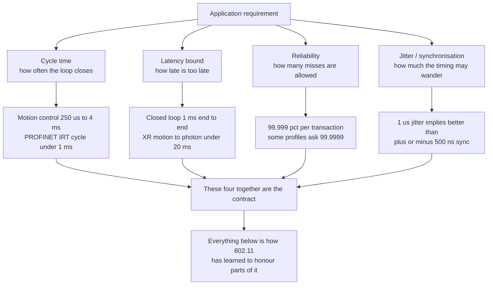

The canonical industrial numbers, quoted consistently across the TSN literature: a closed-loop control transaction
must complete **within a 1 ms cycle time** with **99.999 %** reliability, and the delivery jitter of responses is
constrained to **1 µs**, which in turn requires synchronisation accuracy better than **±500 ns** among devices.
PROFINET isochronous real-time (IRT) states the same thing from the application side: **clock rate under 1 ms and
jitter under 1 µs**, achieved with hardware support in the device. IEC/IEEE 60802, the TSN profile for industrial
automation, allows a **synchronisation error of 0.1–1 µs from the grandmaster**.

Those are wired numbers. The whole question of this note is how much of them survives a shared, contended,
unlicensed medium.

### 1.1 The budget you have to fit inside

A time-sensitive packet's one-way delay decomposes the same way on every hop, and the decomposition is what turns
"we need 1 ms" into an engineering task.

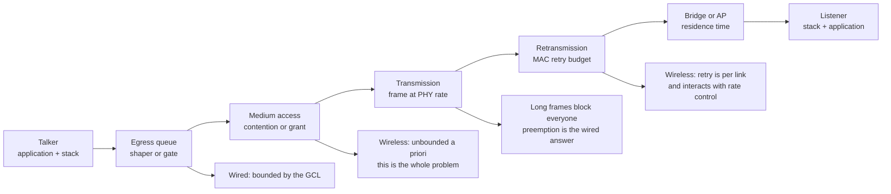

In a wired TSN network the middle terms are bounded by construction: the gate opens at a known instant, the frame
is the only thing on the wire, preemption caps the wait behind a long best-effort frame at roughly a microsecond
instead of roughly 12 µs at 1 Gbit/s. In Wi-Fi, every one of those four terms is a random variable at the start of
this story, and each generation of the standard has been an attempt to convert one of them into a constant.

---

## 2. Why Wi-Fi resists determinism — six structural reasons

Before listing mechanisms, it is worth writing down what they are fighting. Almost every Wi-Fi TSN feature maps
onto one of these six.

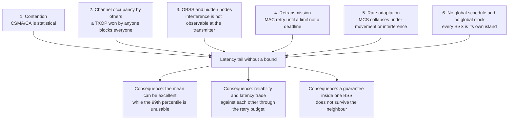

| # | Structural property | What it costs | Which generation first attacked it |
| --- | --- | --- | --- |
| 1 | Contention is probabilistic | No bound at all, only a distribution | 802.11e (priorities), 802.11ax (granted access) |
| 2 | Anyone's TXOP blocks the channel | One long frame adds its full duration to your wait | 802.11e (TXOP limits), 802.11be (r-TWT), 802.11bn (preemption) |
| 3 | Interference arrives from unobservable places | Retries, rate collapse, unpredictable loss | 802.11ax (BSS colour, spatial reuse), 802.11bn (MAPC) |
| 4 | Retransmission is counted, not timed | A burst of retries can consume the whole cycle | 802.11aa (drop eligibility), 802.11be (delay-bound-aware scheduling) |
| 5 | Rate adaptation is reactive | The same frame takes 10× the airtime after a fade | 802.11be (link selection via TID-to-link), 802.11bn (MAPC, ELR) |
| 6 | No shared clock, no shared schedule | Nothing can be aligned across BSSs | 802.11v (TM), 802.11mc (FTM), 802.11be (r-TWT + 802.1AS) |

Reason 6 is the one that makes this a *systems* problem rather than a MAC problem: without a common clock there is
no "at time T", and without "at time T" there is no schedule, and without a schedule there is no bound. It is also
the reason the story starts, counter-intuitively, with synchronisation rather than with channel access.

---

## 3. The 802.1 toolbox, and what each tool becomes over Wi-Fi

TSN is not one standard. It is a toolbox maintained by the IEEE 802.1 Time-Sensitive Networking Task Group, which
grew out of the Audio Video Bridging Task Group and was renamed in **November 2012** when industrial and automotive
users arrived. Most amendments have since been rolled into the base bridging standard, so a datasheet may cite
either the amendment or plain 802.1Q.

| Tool | Year | What it does | The Wi-Fi counterpart, and its status |
| --- | --- | --- | --- |
| **802.1AS** (gPTP) | 2011, rev 2020, rev 2025 | Distributes one clock to sub-microsecond accuracy | Runs over 802.11 using **TM** (802.11v) and, in 802.1AS-2020, **FTM** (802.11mc). Works, but accuracy depends on timestamping in hardware |
| **802.1Qav** (CBS) | 2009 | Credit-based shaper; smooths a traffic class | No direct counterpart. EDCA is a strict-priority contention system, not a shaper |
| **802.1Qat** (SRP) | 2010 | Stream reservation | 802.11aa declared support for it; never widely used in Wi-Fi |
| **802.1Qbv** (TAS) | 2015 | Time-aware shaper: gates per queue on a repeating schedule | Approximated by **trigger-based access** and, in 802.11be, by **r-TWT service periods aligned to gate-open times** |
| **802.1Qbu** + **802.3br** | 2016 | Frame preemption: an express frame interrupts a long one | No Wi-Fi equivalent until **802.11bn preemption**. This is the single biggest structural gap |
| **802.1Qci** (PSFP) | 2017 | Per-stream filtering and policing at ingress | Partially covered by admission control (802.11e, extended by 802.11aa); no per-stream policing in the 802.11 MAC |
| **802.1CB** (FRER) | 2017 | Frame replication and elimination over disjoint paths | Emulated over **MLO**: duplicate across links, eliminate at the upper MAC. Weaker than disjoint paths |
| **802.1Qch** (CQF) | 2017 | Cyclic queueing and forwarding | Not mapped; the cyclic nature is closest to a periodic r-TWT SP |
| **802.1Qcc** | 2018 | Centralised configuration models, CNC/CUC interfaces | The model for Wi-Fi TSN: the AP as a bridge managed by a CNC |
| **802.1Qcr** (ATS) | 2020 | Asynchronous traffic shaping, no network-wide sync needed | Interesting for Wi-Fi precisely because it relaxes the clock requirement; not standardised over 802.11 |
| **802.1CS** (LRP) | 2020 | Link-local registration protocol | Not used in 802.11 |
| **802.1CM** | 2018, amended 2020 | TSN for fronthaul | The cellular analogue: a profile, not a mechanism |

Profiles exist because the toolbox is too big to specify directly — two vendors can both claim "TSN" and share
almost no features. The ones that matter here: **IEC/IEEE 60802** (industrial automation, published **29 June
2026**), **IEEE 802.1DG-2025** (automotive in-vehicle, published **6 June 2025**), **IEEE 802.1DP-2025 / SAE
AS6675** (aerospace), and **IEEE 802.1BA-2021** (the AVB systems profile, revised).

### 3.1 The integration architecture everyone draws

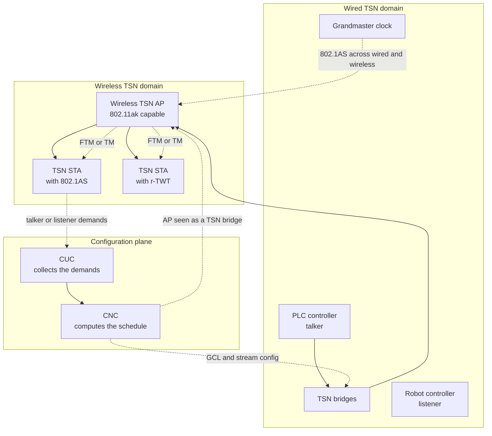

The architectural claim behind that picture is the important one: **the AP is presented to the wired network as a
TSN bridge**, with ports, a bridge delay, and a schedule. What happens between the AP and its stations is an
implementation detail the wired side never sees — provided the AP can state a bound for it and hold it.

---

## 4. Generation by generation — the Wi-Fi TSN ladder

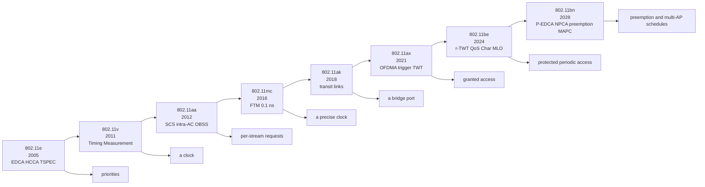

### 4.1 802.11e-2005 — priorities, and the first honest attempt at reservation

802.11e gave Wi-Fi its four access categories and EDCA, which the Wi-Fi Alliance certified as **WMM** from 2004.
It also gave it two things that failed in the market and one that failed in the specification:

- **TSPEC** — a station describes its traffic to the AP and the AP admits or rejects. It failed because it asked
  applications for a large set of parameters they could not supply; 802.11be would later succeed by asking for
  four.
- **HCCA** — a centralised, polling-based scheduler in the AP. It failed partly on complexity and partly because
  nothing in the ecosystem needed it badly enough. 802.11aa tried again with coordinated CAPs between APs; it
  still did not ship.
- **Admission control** — survived, and is still the only mechanism in Wi-Fi that bounds *load*.

What 802.11e could not do, and it is worth being blunt about it: EDCA orders the queue, it does not bound the wait.
Under load, four access categories contend for a medium that any bystander can take.

### 4.2 802.11v-2011 — the first clock

Timing Measurement (TM) let a station and an AP exchange time-stamped action frames and compute an offset, with
**10 ns** timestamp resolution. This is what made 802.1AS operation over 802.11 possible at all: IEEE Std
802.11-2012 introduced support for TSN time synchronisation based on 802.1AS over the 802.11 TM protocol.

### 4.3 802.11aa-2012 — per-stream thinking arrives

"MAC Enhancements for Robust Audio Video Streaming" is the amendment where Wi-Fi first treated a *stream* as a
first-class object rather than a priority level:

- **SCS (Stream Classification Service)** — a station sends an SCS Request to the AP with a classifier and a
  requested treatment; the AP accepts or rejects. Unlike TSPEC, SCS attaches rules to a TID or 802.1Q User
  Priority, which made it far more usable.
- **Intra-AC prioritisation** — each of the voice and video queues splits into a *primary* and an *alternate*
  queue, so two video streams can be served differently.
- **Drop Eligibility Indicator (DEI)** — frames marked DEI get a shorter retry budget, so a stream degrades
  gracefully instead of consuming the channel.
- **OBSS management** — APs exchange load metrics, including medium occupancy and admitted stream counts, so
  admission control can consider neighbours.
- **GCR (GroupCast with Retries)** — reliable group-addressed delivery, which matters for industrial multicast.
- Support for **IEEE 802.1Qat** (SRP) was declared.

802.11aa is the amendment most often skipped in Wi-Fi histories and the one most worth knowing for this topic: it
is where the *vocabulary* of wireless TSN was established, eight years before r-TWT.

### 4.4 802.11mc / 802.11-2016 — a clock precise enough to schedule with

Fine Timing Measurement (FTM) refined the timestamp resolution from 10 ns to **0.1 ns** and was folded into IEEE
Std 802.11-2016. **IEEE 802.1AS-2020 specifies the use of FTM for TSN integration over 802.11.** This amendment
also carried the **Mirrored SCS (MSCS)** work: instead of the station declaring its downlink requirements
explicitly as in SCS, the AP observes the station's uplink flows and mirrors their QoS onto the downlink. That is
the answer to the real-world problem that downlink flows arriving from the public internet often have no usable
DSCP marking. The Wi-Fi Alliance states MSCS is defined in IEEE 802.11 REVmd, and it became mandatory for
**Wi-Fi CERTIFIED QoS Management**, launched **23 February 2021**.

### 4.5 802.11ak-2018 — Wi-Fi as a bridge port

IEEE Std 802.11ak-2018, "Enhancements for Transit Links Within Bridged Networks", amended 802.11 so that a wireless
link can be an *internal* connection inside an IEEE 802.1Q bridged network rather than an edge access link. It was
developed alongside **IEEE Std 802.1Qbz-2016** and **802.1AC-REV**, and was rolled into IEEE Std 802.11-2020.

This is the least glamorous and most load-bearing amendment in the whole story. Without it, a Wi-Fi link is a
network *edge*; with it, a Wi-Fi link is a *transit* link that a TSN bridge can schedule across. If someone asks
"how does 802.1Qbv reach a wireless segment", the first word of the answer is 802.11ak.

### 4.6 802.11ax-2021 — granted access

IEEE Std 802.11ax-2021 (published **19 May 2021**) changed what the AP can do with the medium:

- **OFDMA and MU-MIMO** — many stations in one transmission, so the AP's scheduling decision covers several
  streams at once.
- **Trigger-based uplink access** — the AP polls; the stations do not contend. This is the first time a Wi-Fi
  transmission is *granted* rather than *won* at scale, and it is the direct ancestor of everything deterministic
  that follows.
- **TWT** (individual and broadcast) — scheduled wake windows. Designed for power saving, but it is the first
  periodic, negotiated service period in the standard.
- **BSS colour and spatial reuse** — less time spent deferring to neighbours.

What 802.11ax did not do: protect the service period. A station that won a TXOP immediately before a TWT SP simply
overlaps it — the AP's schedule is a request, not a reservation.

### 4.7 802.11be-2024 — the TSN generation

IEEE Std 802.11be-2024 is the amendment where wireless TSN stops being research. Its PAR approved **21 March
2019**, the board approved it **26 September 2024**, and it was published **22 July 2025** (DOI
10.1109/IEEESTD.2024.11090080). Note what the PAR says: at least one mode capable of **30 Gbit/s** at the MAC SAP,
*and* "at least one mode of operation capable of improved worst case latency and jitter" — the first time latency
appeared in a Wi-Fi PAR, though unquantified.

The three mechanisms that matter, in the order the liaison to 802.1 listed them:

1. **QoS signalling — SCS with the QoS Characteristics element.** A station declares four mandatory parameters
   (Minimum Service Interval, Maximum Service Interval, Minimum Data Rate, Delay Bound), plus up to eight optional
   ones (Maximum MSDU Size, Service Start Time, MSDU Delivery Ratio and others), with a Control Info field carrying
   the **direction** (uplink, downlink, or direct link), TID and User Priority. Four parameters where TSPEC
   demanded a set applications could not populate — that change is why this one might ship.
2. **Restricted TWT (r-TWT)** for bounded latency.
3. **TID-to-link mapping** and **MLO** for reliability and for steering critical traffic to the best link.

The 802.11 working group's own summary, sent as a liaison to 802.1 in December 2022, reduces the mapping to a
three-row table: time synchronisation → 802.1AS over TM/FTM; bounded latency → 802.11ax scheduling plus SCS, r-TWT
and TID-to-link mapping; reliability → 802.1CB over multi-radio devices using MLO.

### 4.8 802.11bn (Wi-Fi 8) — quantified, at last

The 802.11bn PAR, approved **21 September 2023**, is the first Wi-Fi PAR to state latency as a number:

- at least **25 % higher throughput** at the MAC SAP at at least one SINR level (rate-vs-range),
- at least **25 % lower latency at the 95th percentile** of the latency distribution,
- at least **25 % lower MPDU loss**, especially for transitions between BSSs,
- reduced AP power consumption and improved peer-to-peer operation.

Schedule: first TG meeting November 2023, D1.0 July 2025, D2.0 WG letter ballot July 2026, final 802.11 WG
approval projected **March 2028**, RevCom **May 2028**. The Wi-Fi Alliance has planned certification for late 2027.

The significance is not the percentages. It is that Wi-Fi finally has a target that is *defined on the tail* — the
95th percentile, not the mean — which is exactly where Wi-Fi has always failed.

---

## 5. Time synchronisation over Wi-Fi — the foundation everything else stands on

Every scheduled mechanism needs a shared clock. Wi-Fi has always had one (the TSF), but the TSF is a beacon-timed
counter with microsecond-scale agreement across a BSS and no relationship to a grandmaster anywhere else. TSN
needs a clock that is traceable across wired and wireless domains.

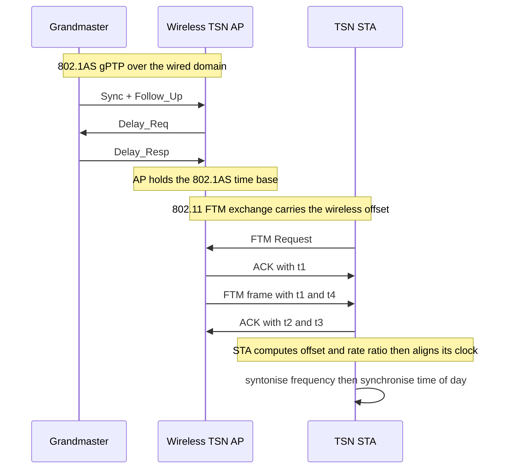

Two procedures, with very different resolutions:

| Procedure | Introduced by | Timestamp resolution | Status |
| --- | --- | --- | --- |
| **TM** (Timing Measurement) | 802.11v, in 802.11-2012 | **10 ns** | The original 802.1AS-over-802.11 method |
| **FTM** (Fine Timing Measurement) | 802.11mc, in 802.11-2016 | **0.1 ns** | What **802.1AS-2020** specifies for 802.11 |

Resolution is not accuracy, and this is where most deployments fail. Published comparisons put **hardware
timestamping at 10–40 ns** against **software timestamping at around 1 µs** — and software timestamping is what
commodity Wi-Fi NICs and modems do. IEC/IEEE 60802 tolerates 0.1–1 µs of error from the grandmaster, so a
software-timestamped Wi-Fi segment can consume the entire synchronisation budget before a single frame is
scheduled.

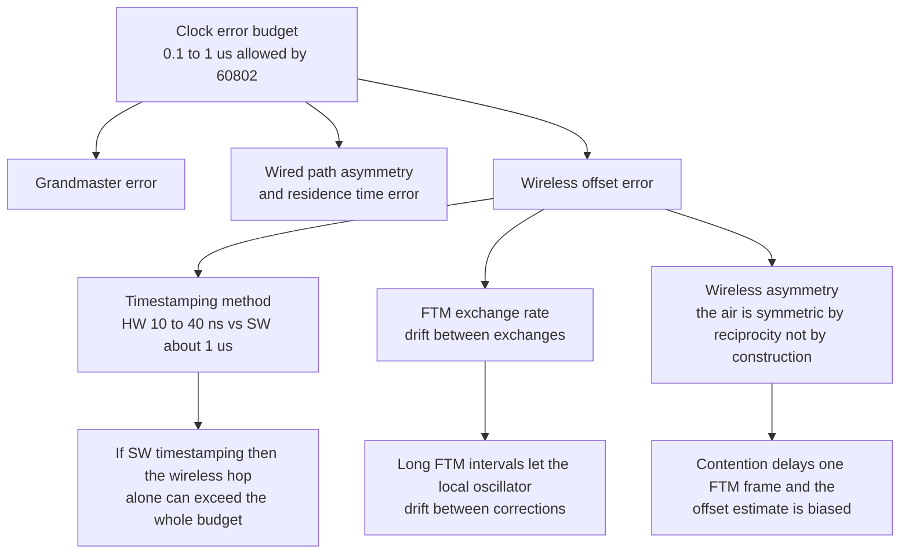

The practical rule: **you cannot schedule what you cannot timestamp in hardware.** An industrial wireless TSN
deployment that buys r-TWT-capable APs and software-timestamped clients has bought the mechanism and not the
guarantee.

---

## 6. Deterministic channel access — the ladder from "win the medium" to "be given the medium"

This is the heart of the subject. Five rungs, each closing one of the gaps in §2.

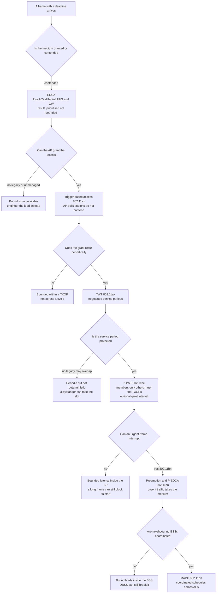

### 6.1 Rung 4 in detail — how r-TWT actually works

r-TWT is a **broadcast** TWT agreement with a marker: inside the TWT element, a Broadcast TWT Parameter Set whose
**Broadcast TWT Recommendation subfield is set to 4** identifies an r-TWT schedule. It is not a separate element,
which is why legacy stations cannot parse it and why sniffer decoders must look inside the TWT element rather than
filter for an r-TWT element ID.

The schedule is announced in **beacon and probe response frames**, so every station in the BSS knows when the
restricted windows occur. Two fields do the work:

- **Restricted TWT Traffic Info** — a TID bitmap per direction. Bit `p` set to 1 means TID `p` is treated as
  latency-sensitive in the uplink or downlink for this schedule. Frames of other TIDs from member stations still
  use ordinary EDCA.
- **Restricted TWT Schedule Info** — the current state of the schedule.

Three rules create the protected window:

1. **r-TWT-enabled stations must end their TXOPs before the SP start time.** This is the rule that produces an
   idle channel at the instant the window opens.
2. **The AP may announce a quiet interval aligned with the SP start** to quieten stations that are not members.
   Published evaluations model this at **1024 µs**.
3. **Inside the SP the AP triggers the members**, so the exchange is contention-free by construction.

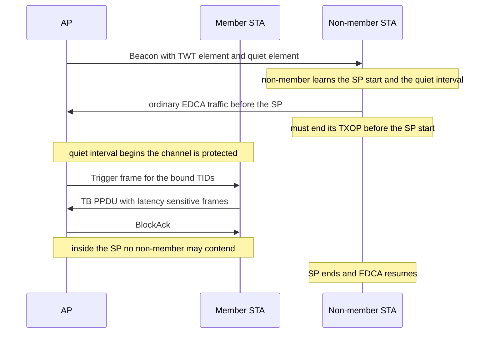

The state machine a station runs is small, and every bug in an r-TWT implementation lives on one of its edges:

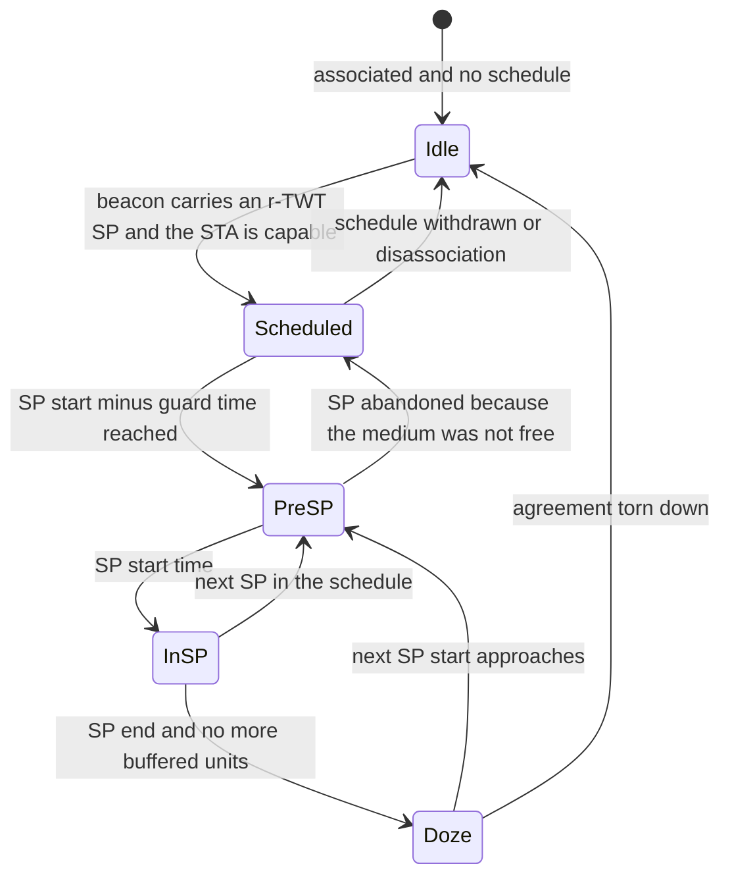

Two properties of this machine are worth stating explicitly, because they are what separates r-TWT from TWT:

| Property | TWT (802.11ax) | r-TWT (802.11be) |
| --- | --- | --- |
| Purpose | Energy saving | Bounded latency for declared traffic |
| Who may transmit in the SP | Anyone who contends successfully | Members, on the bound TIDs, when triggered |
| Protection of the SP start | None | TXOPs must end before it; optional quiet interval |
| Legacy stations | N/A | Not obliged to honour anything — they may interfere |
| Traffic binding | Per agreement | Per agreement **and** per TID bitmap |
| Status | Individual TWT is mandatory for certification | Optional, and intended for managed networks |

The last row is the practical caveat that dominates everything: **r-TWT is optional in 802.11be, and a single
legacy or non-participating station in the BSS can break the window.** The IEEE's own liaison said it plainly —
r-TWT "is expected to be used in managed networks where policies and tools are in place to ensure minimal
capabilities are required in alignment with the performance expectations". A café with one Wi-Fi 5 laptop does not
have a bound.

### 6.2 What the AP actually decides, per service period

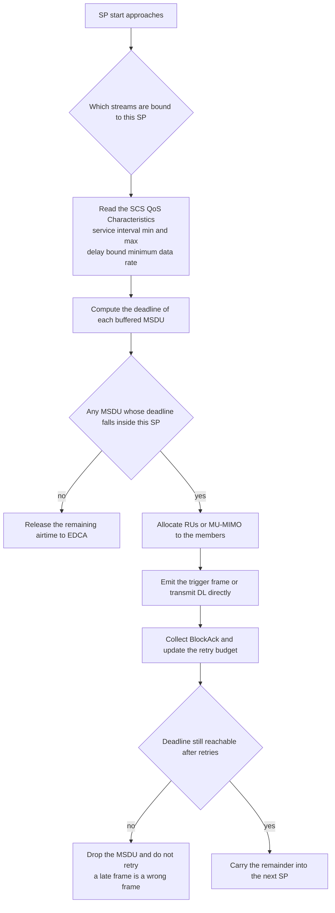

That last decision is the conceptual break from ordinary Wi-Fi. Conventional MAC retry logic retries until a
*count* limit. Deadline-aware scheduling retries until a *time* limit, and then discards — because for a control
loop, a frame that arrives after the cycle has closed is worse than a frame that never arrives.

### 6.3 The evaluation literature on r-TWT, and what it can and cannot show

The most careful published evaluation to date (Mozaffariahrar, Wilhelmi, Galati-Giordano, Imputato, Menth and
Avallone, **ETFA 2025**, DOI 10.1109/ETFA65518.2025.11205686) used **ns-3** to compare r-TWT against power-save
mode and DCF across worst-case latency, energy efficiency, collision rate and throughput, for uplink UDP and TCP.
The findings: r-TWT achieves bounded latency for IoT and real-time traffic classes, improves energy efficiency and
collision rate over the legacy mechanisms, and stays stable as the network grows.

One methodological detail deserves attention because it constrains how far the result can be generalised: the
study **mimics restricted access using individual TWT with non-overlapping wake times**, rather than a full r-TWT
implementation. That is a faithful model of the *protection* and a partial model of the *signalling*. When citing
this work, say what it measured.

A second strand (Haxhibeqiri, Jiao, Shen, Pan, Jiang, Hoebeke and Moerman, **IEEE Communications Magazine**
62(8):118–124, August 2024, DOI 10.1109/MCOM.001.2300431) went in the opposite direction — a **real
implementation** of coordinated spatial reuse and r-TWT on the **openwifi** open-source SDR platform. That paper
matters for a different reason: it demonstrates that these mechanisms are implementable in firmware on real
hardware, not only in a simulator, and that the coordination between APs is the hard part rather than the SP
itself.

---

## 7. QoS signalling — from "describe everything" to "describe four numbers"

A bound can only be computed if the network knows what the traffic is. Three generations of mechanism, in
historical order, and the reason each one exists:

| Mechanism | Generation | What the station says | Why it succeeded or failed |
| --- | --- | --- | --- |
| **TSPEC** | 802.11e | A large traffic specification: nominal and peak MSDU size, mean and peak data rate, delay bound, surplus bandwidth allowance, and more | Failed in the market — applications cannot populate it |
| **SCS** | 802.11aa, extended in 802.11be | A classifier plus requested treatment, attached to a TID or User Priority | Survived, and is the basis of everything after |
| **MSCS** | REVmd (802.11-2020), certified from 2021 | Nothing explicit — the AP *mirrors* the uplink QoS onto the downlink | Solves the unmarked-downlink problem |
| **QoS Characteristics** | 802.11be | Four mandatory parameters and up to eight optional ones | The version that may ship |

The 802.11be QoS Characteristics element, carried in the SCS Descriptor of an SCS Request:

- **Control Info** — direction (uplink, downlink, or direct link for peer-to-peer), TID, User Priority, a presence
  bitmap for the optional parameters, and a link ID when the direction is a direct link.
- **Four mandatory traffic parameters** — Minimum Service Interval, Maximum Service Interval, Minimum Data Rate,
  and Delay Bound. The first two express periodicity; the third is in kbit/s at the MAC SAP; the fourth is the
  targeted maximum time to transport an MSDU or A-MSDU.
- **Up to eight optional parameters** — Maximum MSDU Size, Service Start Time, MSDU Delivery Ratio and others.

Two details that come up in design reviews: the TID field is set to the same value as the User Priority field in
802.11be (the separation exists to allow future expansion beyond eight TIDs); and the AP's obligation is stated in
terms of *enabling* rather than *guaranteeing* — an EHT AP "should" schedule downlink so that the requested delay
bound and minimum data rate are met. **How** the AP uses the information is not specified, which is precisely why
two conforming APs can behave very differently.

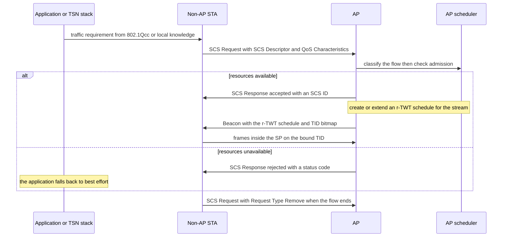

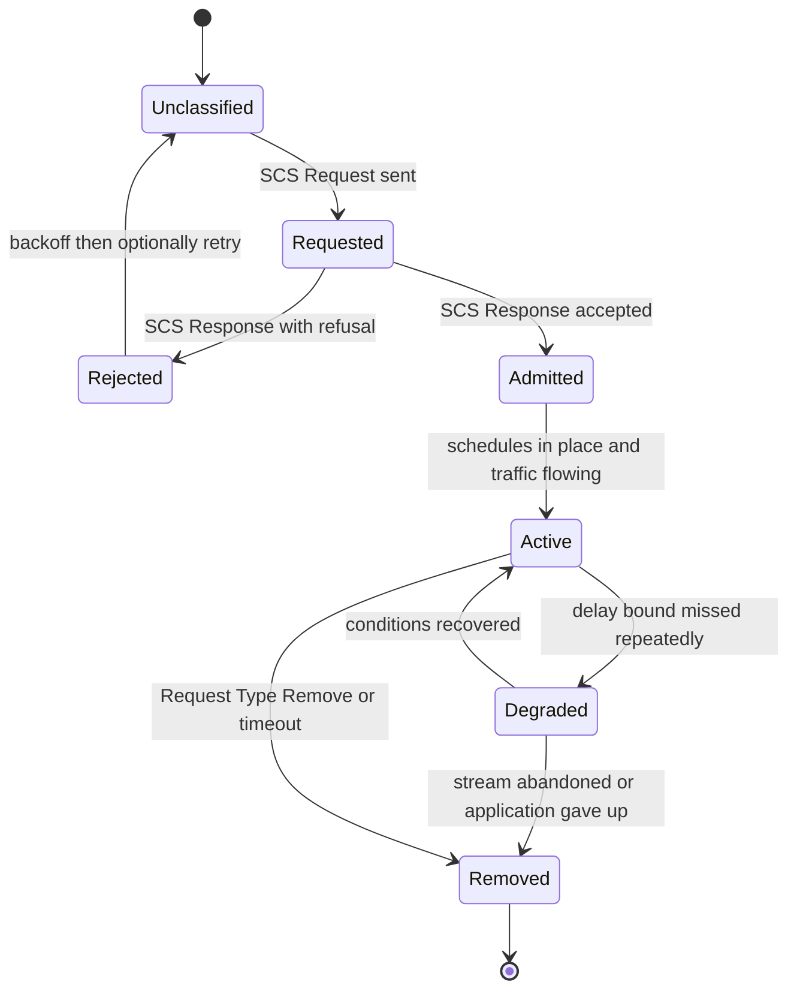

The *Degraded* state is the one no standard specifies and every implementation needs. Something must decide when a
stream that is missing its bound should be renegotiated, downgraded, or torn down — and that something is policy,
living in the AP or in the CNC.

---

## 8. Reliability — 802.1CB over multiple links, and what redundancy cannot fix

802.1CB provides Frame Replication and Elimination for Reliability: send each frame over two disjoint paths, drop
the duplicate at the far end. It removes the loss due to a single link or node failure.

Wi-Fi has no disjoint paths in the wired sense, but MLO gives two or more links inside one device, and the IEEE's
own liaison describes the mapping: multiple links within an MLD can implement redundancy with a single 802.11
network interface, with the upper MLD MAC discarding the duplicated packets received by its affiliated lower MACs.

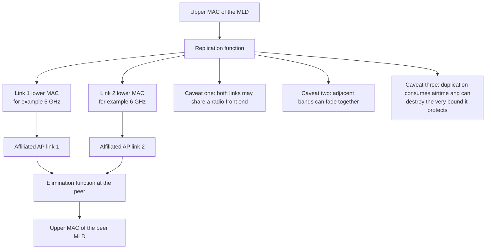

That last caveat is the important one, and it is the reason redundancy in Wi-Fi is a decision rather than a
default. Duplicating every frame doubles the airtime the stream consumes. Under a tight delay bound, the extra
airtime raises everyone's latency, including the duplicated stream's.

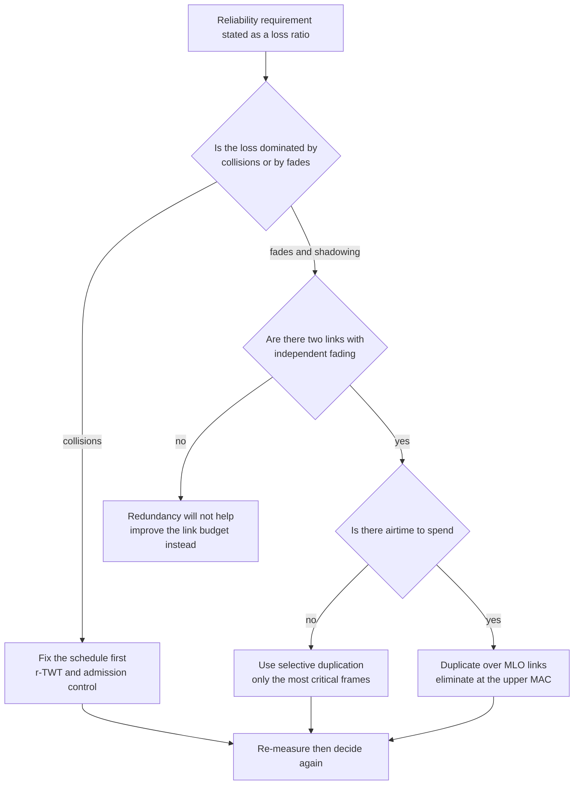

A useful way to say this in an interview: **in wired TSN, redundancy is nearly free because the paths are disjoint
and the capacity is not scarce; in Wi-Fi, redundancy is bought with the same currency as latency, so it has to be
budgeted like any other expense.**

---

## 9. Wi-Fi 8 (802.11bn) — where determinism becomes the objective

802.11bn is the first generation whose PAR is written in the language of this note. The mechanisms under
development divide cleanly into four groups.

### 9.1 Channel access — cutting the tail

- **P-EDCA (prioritised EDCA).** A station with an urgent frame sends a **defer signal** (a CTS variant referred to
  as DS-CTS) that temporarily excludes stations with non-urgent traffic from contending, while legacy stations
  continue with ordinary EDCA. The result is explicitly *not* higher average throughput: it is a tighter delay
  distribution, fewer spikes where a voice or game-input frame waits far longer than usual.
- **NPCA (non-primary channel access).** Every previous generation depends on the primary 20 MHz channel for beacons,
  trigger frames and channel announcements, so an OBSS busy on that channel blocks the entire 80/160/320 MHz
  bandwidth. NPCA lets a device use a different 20 MHz channel as a temporary primary. This is capacity work that
  shows up directly as a latency improvement.
- **Preemption.** Stop an ongoing transmission and start an urgent one. This is the Wi-Fi answer to 802.1Qbu and
  802.3br, and the last structural gap from §3 closes here.
- **LLI (low-latency indication).** A station that is a TXOP *responder* can report that it has buffered urgent
  traffic by setting an indication bit in a response frame, so the holder can grant it a slot in the current or
  next TXOP. This closes the signalling gap where the AP simply did not know a deadline was pending.
- **Group-based TXOP allocation** for low-latency peer-to-peer, and off-channel P2P coordination.

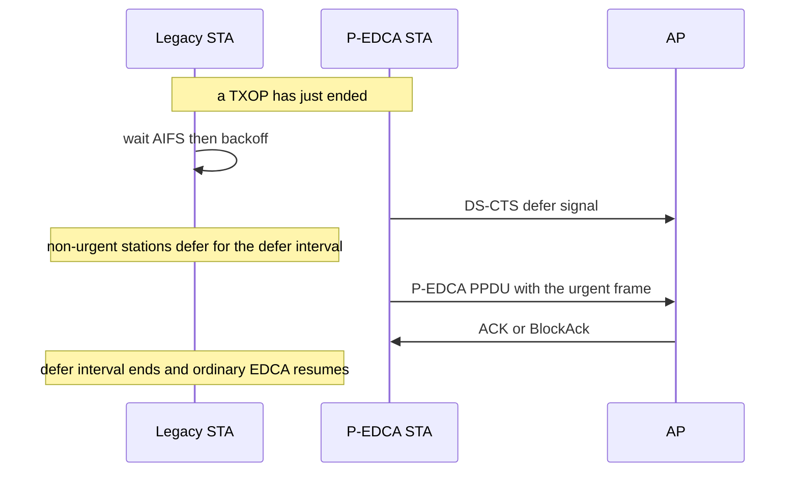

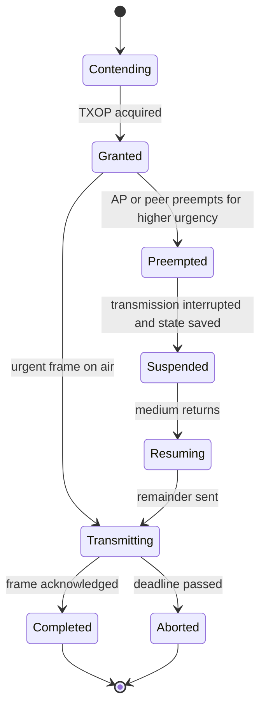

The *Aborted* transition is worth noticing. Once deadlines are first-class, the MAC needs a rule for a frame whose
deadline expires mid-transmission, and that rule is "stop", not "finish".

### 9.2 Multi-AP coordination — the OBSS problem, finally addressed

Multi-AP coordination was discussed in 802.11be and postponed for specification complexity; 802.11bn took it up.
In essence it strengthens classical mechanisms — r-TWT, spatial reuse, beamforming — by making them work
cooperatively across BSSs: **Co-BF** (coordinated beamforming), **Co-SR** (coordinated spatial reuse), Co-OFDMA,
Co-CR, and coordinated r-TWT. This is the level at which reason 3 in §2 is attacked, and it is the only mechanism
in the whole note that can produce a bound that survives a neighbour.

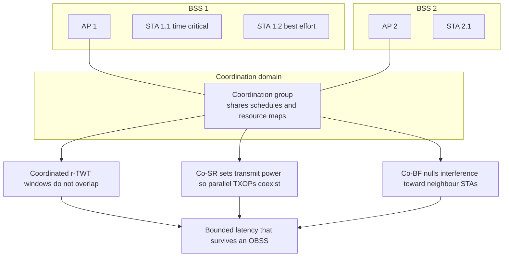

### 9.3 Seamless mobility and the rest

**SMD (Seamless Mobility Domain)** defines a single entity spanning several AP MLDs — not necessarily in one
physical device — within which handshake states, sequence numbers, security keys and capabilities can be
transferred. It enables per-link transition of a client MLD between AP MLDs. For a mobile robot crossing cells,
this is the difference between a bound that holds and a bound with a 200 ms hole in it — the phenomenon
[[02-6 WLAN - Multi-AP Roaming, Healing and Steering]] describes from the client's side.

Also in scope, with latency relevance: **DSO** (dynamic subband operation) and **DBE** (dynamic bandwidth
expansion) for spectrum use; **ELR** (enhanced long range, 20 MHz, one spatial stream, BPSK/QPSK with
quadruplication for a 6 dB gain) and **DRU** (distributed-tone resource units, to raise uplink transmit power under
PSD limits) for the link budget; **PUO/DUO** (periodic and dynamic unavailability operation) for in-device
coexistence with Bluetooth and others, which is a real source of otherwise inexplicable latency spikes.

---

## 10. Wired–wireless integration — making the bound end to end

None of the above produces a *network* guarantee by itself. That requires the AP to behave as a bridge that can
state its own delay, and a controller that can add it up.

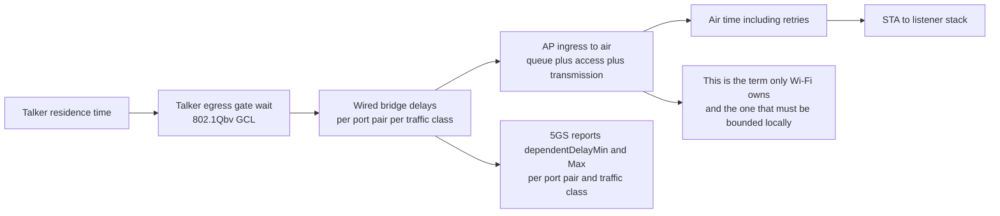

In the 5G system, the analogue is explicit: the TSN Application Function computes the 5GS bridge delay from the
**UE–DS-TT residence time** plus the per-traffic-class minimum and maximum delay between the UE and the
UPF/NW-TT, and reports `dependentDelayMin` and `dependentDelayMax` as defined in IEEE 802.1Qcc. **Wi-Fi has no
equivalent normative quantity.** That absence is the deepest remaining difference between the cellular and Wi-Fi
answers to the same question, and it is why Wi-Fi TSN is usually deployed as an engineered system with measured
bounds rather than as a computed one.

### 10.1 Aligning the Qbv schedule with r-TWT

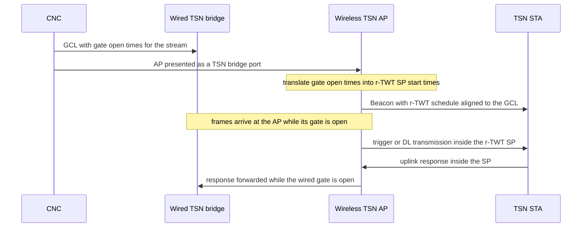

The alignment is the whole trick: the r-TWT service period is placed so that the wireless hop happens *while the
wired gate is open*, which means the wireless segment has to be inside the wired cycle, and the wired cycle has to
be long enough to contain the worst-case wireless access delay. If the wireless worst case exceeds the gate-open
window, the schedule cannot be met by alignment alone and the cycle time has to grow.

### 10.2 The lifecycle of a stream in a managed network

```mermaid
stateDiagram-v2
    [*] --> Discovered
    Discovered --> Demanded: CUC collects talker and listener requirements
    Demanded --> Computed: CNC computes paths gates and service periods
    Computed --> Admitted: resources reserved on bridges and AP
    Admitted --> Running: traffic flows under the schedule
    Running --> Monitored: KPIs collected latency CDF loss and sync error
    Monitored --> Running: within bounds
    Monitored --> Violated: bound exceeded more than the allowed ratio
    Violated --> Computed: recompute with the observed behaviour
    Violated --> Rejected: no feasible schedule
    Rejected --> [*]
    Running --> Withdrawn: stream ends
    Withdrawn --> [*]
```

Note the *Monitored → Violated → Computed* loop. A deterministic network is not configured once; it is a control
loop, and the feedback signal — measured latency distributions, not averages — is what distinguishes a deployment
that holds its bound from one that held it on commissioning day.

§11 turns that model into a design: what the client and the AP each have to implement for the two halves of
it — the shared clock and the shared schedule — to meet in the middle.

---

## 11. The converged network — when both the client and the AP are TSN-aware

Everything above asks what Wi-Fi can do. This section asks the question a real deployment has to answer: **what
does it take to make the wired TSN domain and the wireless domain into one network**, with the client inside the
design and not merely attached to it.

### 11.0 Why convergence is the direction of travel

Three independent things happened, and they happened in the right order. First the time standard took Wi-Fi into
scope. Then the Wi-Fi standard grew 802.1-shaped hooks. Then the profiles and the certification bodies started
talking about determinism rather than throughput. None of that is marketing; each step is a document with a date.

```mermaid
flowchart TD
    A["Clock<br/>802.1AS takes 802.11 links into scope<br/>TM in 2011 then FTM in 2020"] --> D["One TSN network<br/>wired and wireless"]
    B["MAC<br/>802.11be ships SCS MSCS QoS Characteristics<br/>r-TWT and TID-to-link mapping"] --> D
    C["Profiles and ecosystem<br/>60802 2026 for industry 802.1DG 2025 for cars<br/>802.1DP 2025 for aerospace"] --> D
    E["Silicon and certification<br/>Wi-Fi 7 features certified at 20 MHz for IoT<br/>802.11bn makes reliability the objective"] --> D
    D --> F["What is still missing<br/>a normative wireless bridge delay<br/>and hardware timestamping in clients"]
```

| Layer | Document or event | What it establishes |
| --- | --- | --- |
| Time | **IEEE 802.1AS-2020** specifies transport of gPTP over IEEE 802.11 links using the medium's native timing mechanism — TM in 802.1AS-2011, FTM in 802.1AS-2020 | The clock standard already has Wi-Fi in scope. It is not an annex; the 802.1AS architecture is deliberately split into a media-independent and a media-dependent layer so that a medium with its own timing mechanism can supply one |
| MAC | **IEEE 802.11be-2024**, published 22 July 2025 | The Wi-Fi standard already carries 802.1-shaped hooks: a stream is described with four numbers (QoS Characteristics), classified with SCS or mirrored with MSCS, given a service period by r-TWT, and steered onto a link by TID-to-link mapping |
| Profile | **IEC/IEEE 60802:2026**, published 29 June 2026 — two conformance classes ccA and ccB, seven traffic types, multiple gPTP domains with a working clock and a global time | Industrial automation has a profile. Everything a wireless hop has to plug into is now written down, including a synchronisation error budget in Annex D |
| Neighbouring profiles | **IEEE 802.1DG-2025** automotive, **IEEE 802.1DP-2025 / SAE AS6675** aerospace | The pattern repeats industry by industry: a narrow selection from a common toolbox. That is how a toolbox becomes infrastructure |
| Clock robustness | **802.1ASdm-2024** hot standby and clock drift error reduction, **802.1ASdn-2024** YANG, **802.1ASed-2026** fault-tolerant timing with time integrity | You only make a clock hot-standby, manageable and integrity-checked when it has become load-bearing |
| Ecosystem | **Wi-Fi Alliance, 6 January 2026**: Wi-Fi CERTIFIED 7 extended to 20 MHz-only devices for smart home, industrial and healthcare IoT | The certification body is now selling determinism to the IoT market — in its own words, Wi-Fi 7 features "improve deterministic behavior, scheduling efficiency, and robustness" in dense environments |
| Wi-Fi 8 | **802.11bn UHR**, PAR approved 21 September 2023 | Reliability and latency are now the objective function of a Wi-Fi amendment, not a side effect of throughput |
| The competitive push | 3GPP Rel-16 makes the 5G system a TSN bridge with a normative bridge delay | The cellular answer exists and is standardised. That is the strongest single reason Wi-Fi had to answer the same question |

Three honest caveats belong next to that table, because they are what separates an architecture from a slide:

- **IEC/IEEE 60802:2026 profiles bridges, end stations and LANs.** Its annexes are the PCS proforma, clock
  control, the time-synchronisation error budget, device flags and accumulated delays. A wireless segment is not
  one of them. The profile tells you what to be synchronised *to*; it does not tell you how to synchronise a radio.
  **VERIFY** before asserting a wireless annex in a tender document.
- **The 20 MHz Wi-Fi 7 certification lists MLO, DL/UL MU-MIMO and Multi-RUs** — not r-TWT, SCS or MSCS. It
  widens the population of industrial clients; it does not certify the TSN machinery.
- **There is still no normative wireless bridge delay.** §10 makes the point with the cellular comparison; it
  remains the deepest gap, and it is why a converged Wi-Fi TSN network is still an engineered and measured system
  rather than a computed one.

### 11.1 One time base across four segments

A scheduled network is a single clock with four kinds of hop. The design is the same at every hop — measure the
link delay, carry a correction, accumulate the rate ratio — and the whole difficulty is that the *measurement* is
different on the wireless hop.

```mermaid
flowchart LR
    GM["Grandmaster<br/>GNSS or a PTP grandmaster<br/>PTP End Instance as the root"]
    BC1["Wired TSN bridge<br/>PTP Relay Instance<br/>boundary clock"]
    BC2["Wired TSN bridge<br/>PTP Relay Instance"]
    AP["Wireless TSN AP<br/>PTP Relay Instance<br/>slave on the wired port<br/>master on the wireless port"]
    STA["TSN client<br/>PTP End Instance<br/>slave only"]
    APP["Application or PLC<br/>reads the PHC or a disciplined system clock"]

    GM -->|"gPTP over 802.3<br/>Pdelay_Req and Pdelay_Resp<br/>residence time in correctionField"| BC1
    BC1 -->|"same mechanism hop by hop"| BC2
    BC2 -->|"gPTP over 802.3"| AP
    AP -->|"gPTP over 802.11<br/>Sync and Follow_Up carried by the<br/>802.11 native timing mechanism"| STA
    STA --> APP
```

Four roles, and getting the vocabulary right is half the design review:

| Role | PTP instance type | What it does |
| --- | --- | --- |
| Grandmaster | PTP End Instance, master only | Originates the time base; one per gPTP domain |
| Wired bridge | PTP Relay Instance | Slave on one port, master on the others; adds its residence time to the correction field |
| Wireless AP | PTP Relay Instance | Same, but the master port is an 802.11 port, so the link delay and the Sync transport come from the 802.11 media-dependent layer |
| TSN client | PTP End Instance, slave only | Computes offset and rate ratio, then serves a clock to the application |

The media-dependent split, which is the part that surprises people:

| Medium | Link delay measured by | Sync carried by | Asymmetry |
| --- | --- | --- | --- |
| Full-duplex Ethernet | IEEE 1588 peer-to-peer delay mechanism; `meanLinkDelay = (r·(t4−t1) − (t3−t2)) / 2` | Sync and Follow_Up as gPTP messages | Measured externally and inserted as a managed object if known |
| IEEE 802.11 | The medium's native timing mechanism — **TM** in 802.1AS-2011, **FTM** in 802.1AS-2020 | Sync and Follow_Up information transported by that same 802.11 exchange | Reciprocity makes the air symmetric in principle; contention makes it asymmetric in practice |

On the wireless hop the 802.1AS media-dependent layer does not send a separate Pdelay_Req. It uses the FTM
exchange already defined by 802.11mc, and — this is the detail that decides whether an implementation works —
the Follow_Up information has to arrive **paired with the measurement it belongs to**. An implementer's reading of
802.1AS-2020 clause 12 is that the media-dependent sync is the FTM exchange, and that the FollowUpInformation
(`preciseOriginTimestamp`, `correctionField`, `rateRatio`) is carried inside that exchange as a **Vendor Specific
information element**, delivered through the `MLME-FINETIMINGMSMT` primitives. Carrying the origin timestamp in a
beacon instead looks equivalent and is not: it is stale by the beacon marshal-to-transmit latency, which corrupts
the transfer. **VERIFY** the exact clause and subclause numbers before quoting them.

```mermaid
sequenceDiagram
    participant GM as Grandmaster
    participant AP as AP relay instance
    participant STA as STA end instance

    GM->>AP: Sync and Follow_Up over 802.3
    Note over AP: AP holds gm time on its wired port<br/>and accumulates rateRatio
    STA->>AP: FTM Request
    AP->>STA: ACK carrying t1
    AP->>STA: FTM frame with t1 and t4
    STA->>AP: ACK carrying t2 and t3
    Note over STA: STA now holds t1 t2 t3 t4
    AP->>STA: FollowUpInformation paired with the same exchange
    Note over STA: offset equals receive time minus preciseOriginTimestamp minus meanLinkDelay minus correctionField
    STA->>STA: apply rateRatio then serve the clock to the application
```

What the **AP** must actually do, in the order it fails if you get it wrong:

1. Run a real gPTP instance on its wired port and hold the time base — an AP that is only a Wi-Fi radio with a
   clock is not a relay instance, it is a lie with a timestamp.
2. Generate `preciseOriginTimestamp` **per FTM exchange**, not once per beacon period.
3. Add its own residence time and the accumulated rate ratio into `correctionField` before the exchange leaves.
4. Timestamp in hardware at the MAC or PHY boundary. Software timestamping costs about 1 µs; IEC/IEEE 60802
   allows 0.1–1 µs from the grandmaster for the whole path.
5. Run the FTM exchange often enough that the client's oscillator cannot drift between corrections, and often
   enough that a contended FTM frame is an outlier rather than the sample.
6. Present the wireless port to the controller as a port with a delay, not as a port with a priority.

What the **client** must do:

1. Participate as a PTP End Instance, not as a device that happens to receive beacons.
2. Compute offset and rate ratio, then **serve a clock** — a PHC, a `ptp4l`-disciplined system clock, or a
   `phc2sys` link into the application's clock — because an application cannot schedule against a TSF counter it
   cannot read.
3. Timestamp in hardware. Everything else is mitigation.
4. Survive loss of sync without moving the clock (holdover), and report that it is in holdover.
5. Use the clock. A synchronised client that schedules nothing has bought an expensive free-running clock.

That fifth point deserves its own diagram, because it is where deployments actually fail. Every design has a
state for *locked*; almost none has a designed state for *the clock is now drifting*.

```mermaid
stateDiagram-v2
    [*] --> Unlocked
    Unlocked --> Acquiring: gPTP instance starts and FTM begins
    Acquiring --> Locked: offset within budget and rateRatio stable
    Acquiring --> Unlocked: no usable exchange for the timeout period
    Locked --> Locked: correction applied each exchange
    Locked --> Holdover: exchanges lost but local oscillator still trusted
    Holdover --> Locked: exchanges resume and offset is small
    Holdover --> Degraded: drift exceeds the holdover budget
    Degraded --> Acquiring: resynchronise from scratch
    Degraded --> Unlocked: application told the time base is unusable
    Locked --> Degraded: offset exceeds the budget repeatedly
```

What has actually been measured over the air, from the literature (a 2024 KTH survey of the field, plus the
original papers it cites):

| Platform | Method | Measured result |
| --- | --- | --- |
| Wireline reference in the same testbed | 802.1AS gPTP over Ethernet | median **52 ns**, maximum **254 ns** |
| Plain IEEE 1588 sent over the air | PTP over Wi-Fi with no 802.11 media-dependent layer | median **≈0.95 ms**, outliers to several ms — unusable for industrial classes |
| Reference Broadcast Infrastructure Synchronisation | COTS Wi-Fi, beacon-based, no driver changes | median **13 µs**, maximum below **40 µs** |
| linuxptp with the AP as a boundary clock | gPTP over 802.11a, one and two hops | **90th percentile 1.4 µs** one hop, **2.8 µs** two hops; and the offset *between* clients is much smaller than the offset from client to AP |
| ath9k with software timestamping | PTP, system clock timestamps on TX or RX interrupt | µs-level accuracy, jitter within **2 µs** |
| ath9k with hardware TSF timestamps | PTP, timestamps taken inside the NIC | error and jitter both below **1 µs** |
| ath5k with outlier removal | post-hoc filtering of Linux-induced outliers | **831 ns** mean error, **767 ns** standard deviation |
| Wireless-aware control loops | Kalman-filtered PTP at the application layer | **100 µs** with the filter, settling about **2 min**; about **3 ms** without it |
| openwifi SDR with ptpd | AP as master, clients as slaves | **50 µs** |
| Bare-metal gPTP on low-cost COTS embedded | gPTP implemented for both Ethernet and 802.11 links | below **10 µs** with low power on standard devices |

Two conclusions fall out of that table and they should be said out loud in any design review. First, **plain PTP
over the air is not a wireless TSN clock** — the gap between 0.95 ms and 13 µs is the gap between using the
802.11 media-dependent layer and ignoring it. Second, **the dominant error source is usually the AP's own delay
variation, not the client's uplink or downlink latency**, which means buying better clients does not fix a bad AP
and the AP is where the timestamping budget has to be spent.

### 11.2 Priority scheduling across the wired–wireless boundary

Clock first, then scheduling: with a shared time base the question becomes how a stream keeps its treatment as it
crosses from 802.1Q queues into 802.11 access categories.

**The boundary is an architectural object, and it has a name.** IEEE 802.1Q requires a bridge to an IEEE 802.11
LAN to connect to an **IEEE 802.11 Portal**; the Portal is the logical point at which MSDUs from an integrated
non-IEEE 802.11 LAN enter the IEEE 802.11 distribution system, and for bridging purposes the service interface it
presents is identical to the one at the 802.11 MAC SAP. Everything below is what the Portal has to do.

```mermaid
flowchart LR
    subgraph Wired["Wired TSN domain"]
        T["Talker<br/>SO_PRIORITY or DSCP then VLAN PCP"]
        B["802.1Q bridge<br/>Qbv GCL per port per queue<br/>Qci PSFP at ingress<br/>Qbu preemption on egress"]
    end
    subgraph Portal["802.11 Portal the mapping point"]
        M["Priority mapping<br/>8 user priorities collapse into 4 access categories"]
    end
    subgraph Air["802.11 BSS"]
        Q["AP per TID queues<br/>EDCA parameters broadcast<br/>r-TWT service period<br/>trigger frame grants the uplink"]
        S["STA per TID queues<br/>waits for the service period or the trigger"]
    end
    T --> B --> M --> Q --> S
    M --> W["The trap: 802.1Q priority 3 means Critical Applications<br/>802.11 maps user priority 3 to AC_BE"]
```

The collapse from eight priorities to four access categories is fixed by the standard and is not configurable.
RFC 8325 states it plainly: it is the *non-configurable* and standard-specified mapping of UP markings to Access
Categories that produces differentiated treatment over the air.

| User priority | 802.1Q meaning | 802.11 access category | AIFS in slot times |
| --- | --- | --- | --- |
| 1 | Background | AC_BK | 7 |
| 2 | Excellent Effort | AC_BK | 7 |
| 0 | Best Effort | AC_BE | 3 |
| 3 | **Critical Applications** | **AC_BE** | 3 |
| 4 | Video | AC_VI | 2 |
| 5 | Video | AC_VI | 2 |
| 6 | Internetwork Control | AC_VO | 2 |
| 7 | Network Control | AC_VO | 2 |

Two things to notice, and both are interview material. **802.1Q priority 2 is "excellent effort" and lands in
Wi-Fi background.** **802.1Q priority 3 is "critical applications" and lands in Wi-Fi best effort.** A stream
marked PCP 3 because it is important gets *worse* treatment over the air than one marked PCP 4 for video. This is
not a bug in anybody's implementation; it is two standards mapping the same three bits to different traffic
classes. The consequence is operational: **pick the 802.11 user priority deliberately and let the wired marking
follow from it**, rather than the other way round, and drive the Diffserv-to-UP mapping from RFC 8325 or from the
QoS Map element rather than from intuition.

On the Linux client, that mapping is one array and one function, both worth knowing by name:

```c
/* net/mac80211/wme.c — the default classifier mapping */
const int ieee802_1d_to_ac[8] = {
	IEEE80211_AC_BE,   /* UP 0 */
	IEEE80211_AC_BK,   /* UP 1 */
	IEEE80211_AC_BK,   /* UP 2 */
	IEEE80211_AC_BE,   /* UP 3 */
	IEEE80211_AC_VI,   /* UP 4 */
	IEEE80211_AC_VI,   /* UP 5 */
	IEEE80211_AC_VO,   /* UP 6 */
	IEEE80211_AC_VO    /* UP 7 */
};
```

`ieee80211_select_queue()` takes `skb->priority`, and if no priority has been set it derives one from the VLAN tag
or the DSCP via `cfg80211_classify8021d()`. If the AP has set the **admission control mandatory** bit for that
access category and no TSPEC or SCS has been admitted for it, `wme_downgrade_ac()` walks the priority down one
category at a time — 6 or 7 becomes 5, 4 or 5 becomes 3, 0 or 3 becomes 2 — until it reaches an AC that is not
gated. That is the whole of Wi-Fi admission control as seen from the client: **an unadmitted high-priority stream
is not dropped, it is silently reclassified downwards.** If your TSN stream is mysteriously sharing a queue with
bulk traffic, this is usually why.

Now the three schedulers, and the asymmetry between them:

| Scheduler | Where it lives | What it can decide | What it cannot |
| --- | --- | --- | --- |
| 802.1Qbv gate control list | Every wired bridge port | Exactly when each queue may transmit, with a cycle and a base time | Nothing about the air |
| The AP's wireless port | The AP | EDCA parameters for the BSS, MU EDCA, the r-TWT service period and its TID bitmap, which stations get a trigger and which RUs, which link carries which TID | It cannot stop a neighbour on the same channel |
| The client | The STA | Which TID a frame is classified into, and whether it is awake for its service period | It cannot launch a frame at a chosen instant |

That last row is the one wired TSN engineers get wrong. On Ethernet, a TSN end station *launches* traffic:
`tc mqprio` maps flows to traffic classes, `tc taprio` gates them, `tc etf` with `SO_TXTIME` releases each packet
at a launch time, and with `offload` the NIC performs the arbitration in hardware. On Wi-Fi the launch time is
not the client's to set. The mac80211 queueing design **bypasses the qdisc layer entirely on Wi-Fi interfaces** —
the smart queue management lives inside mac80211, because a generic qdisc has no way to split a flow into the
per-TID aggregates the 802.11 MAC requires. So `taprio` and `etf` are Ethernet tools; on a Wi-Fi interface the
decision of *when* belongs to the AP, and the client's contribution is to be classified correctly, awake, and
holding a frame ready when the trigger arrives.

```mermaid
sequenceDiagram
    participant CUC as CUC and CNC
    participant Talker as Talker
    participant Bridge as Wired bridge
    participant AP as AP with Portal
    participant STA as TSN client

    Talker->>CUC: talker advertise with StreamID and requirements
    CUC->>CUC: match with listener then ask the CNC for a path
    CUC->>STA: SCS Request with QoS Characteristics
    STA->>AP: SCS Request over the air
    AP->>AP: admission control then r-TWT schedule and TID assignment
    AP->>STA: SCS Response accepted with an SCS ID
    CUC->>Bridge: GCL installed on wired ports
    CUC->>AP: AP presented as a TSN bridge port with a wireless delay
    Note over Bridge,AP: wired gate opens while the r-TWT service period runs
    Talker->>Bridge: frame marked with the chosen user priority
    Bridge->>AP: frame delivered inside the open gate
    AP->>AP: Portal maps priority to TID then queues for the service period
    AP->>STA: trigger frame grants an uplink or the AP transmits downlink
    STA->>AP: TB PPDU inside the service period
    Note over STA: no contention and no backoff because the AP granted the access
```

The chain of admission, end to end, and where it can break:

1. **Describe the stream.** 802.1Qcc talker advertise carries the StreamID, the destination and the traffic
   specification. Over the air the equivalent is the SCS Request with its QoS Characteristics: four mandatory
   numbers — minimum service interval, maximum service interval, minimum data rate, delay bound — plus options
   such as maximum MSDU size and MSDU delivery ratio.
2. **Classify it.** DSCP or VLAN PCP to user priority on the wired side (RFC 8325), UP to TID at the Portal,
   and if the traffic is uplink-originated, MSCS so the AP mirrors the classification onto the downlink.
3. **Admit it.** The AP decides, and its answer is not a guarantee — 802.11be states the AP's obligation in terms
   of *enabling* the requested treatment. If the AP sets ACM and the stream is not admitted, the client's own
   stack quietly downgrades the priority one category at a time.
4. **Schedule it.** A service period whose start the wired gate can be aligned to, a TID bitmap that says which
   traffic may use it, and a trigger frame that removes contention from the uplink.
5. **Policing.** 802.1Qci per-stream filtering and policing exists on the wired side and has no 802.11
   counterpart. The nearest thing is admission control plus per-AC airtime limits — and that difference is why a
   misbehaving wireless client can still damage a schedule that every wired device is honouring.
6. **Configure and verify it.** 802.1Qcp, 802.1Qcw and 802.1Qdj give YANG models for the wired side. There is no
   equivalent wireless model, which is why wireless TSN configuration is still vendor-specific and why the
   controller's view of the wireless hop is usually a configured guess that only measurement can confirm.

### 11.3 The both-ends checklist

If you are asked "what does it take for the client and the AP to both support TSN", this is the answer in one
table. Every row is something you can check with a command, a sniffer or a datasheet.

| Capability | Client must | AP must | How you verify |
| --- | --- | --- | --- |
| Clock | gPTP end instance; hardware timestamping; a PHC or disciplined clock exposed to the application; designed holdover | gPTP relay instance; hardware timestamping; per-exchange origin timestamps; residence time in the correction field | `ptp4l` and `pmc` on both; measure the offset distribution, not the mean |
| Ranging | FTM initiator, and the FollowUpInformation paired with the exchange | FTM responder with vendor-information support | Capture the FTM exchange and confirm the origin timestamp is not beacon-derived |
| Stream description | SCS Request with QoS Characteristics | SCS admission, TID assignment, r-TWT schedule | Association capture; check the SCS Response status code |
| Mirroring | MSCS so the uplink classification is mirrored onto the downlink | MSCS support and a mirrored classifier | `iw` or vendor tooling; check the downlink treatment of a stream whose uplink is marked |
| Scheduled access | r-TWT membership; end TXOPs before the SP; wake for the SP; answer the trigger | Broadcast the r-TWT schedule in beacons; grant triggers; protect the SP | Beacon decode of the r-TWT element with its TID bitmap; per-SP airtime accounting |
| Priorities | Mark at the source with `SO_PRIORITY` or DSCP; know the UP to AC mapping | Broadcast EDCA and MU EDCA parameters; set ACM deliberately | `ieee802_1d_to_ac` on the client; EDCA Parameter Set in the beacon; watch for priority downgrades |
| Redundancy | MLO with TID-to-link mapping, or dual radios | MLO on the AP side; 802.1CB-style replication and elimination | Measure both the latency improvement and the airtime cost |
| Mobility | 802.11k and 802.11v; 802.11r or OKC so a transition does not cost a full EAP exchange | Neighbour reports; transition management; 802.11bn single mobility domain where available | Measure the transition gap and compare it with the cycle time |
| Offload | Know which offload paths bypass the queueing you configured | Know that hardware offload can bypass AQL and the fair queueing | Latency under load with and without offload — always measure both |
| Management | Report sync status and stream KPIs | Expose per-stream latency and loss distributions, not averages | The *Monitored to Violated to Computed* loop of §10.2 |

### 11.4 What still does not close

Say these before someone else says them for you.

- **No normative wireless bridge delay.** 802.1Qcc has `dependentDelayMin` and `dependentDelayMax`; the 5G system
  computes them; Wi-Fi does not define them. A converged Wi-Fi TSN network is therefore measured, not computed.
- **Hardware timestamping is not a commodity client feature.** The 0.1–1 µs budget of IEC/IEEE 60802 is not
  reachable with software timestamps, and most clients do software timestamps.
- **Eight priorities become four access categories at a boundary nobody configures.** The PCP 3 trap is not
  exotic; it is the default.
- **Policing stops at the Portal.** 802.1Qci has no 802.11 counterpart, so the wireless hop is the one place a
  misconfigured device can still injure a schedule.
- **Preemption is 802.11bn, not 802.11be.** Until it ships, a long low-priority frame can still occupy the medium
  in front of a critical one.
- **The configuration plane is vendor-specific.** Wired TSN has YANG models. Wireless TSN has datasheets.

---

## 12. The research landscape — what has actually been established, and how

It is worth separating three kinds of evidence, because they support very different claims.

| Layer | Method | Representative work | What it can support | What it cannot |
| --- | --- | --- | --- | --- |
| **Analytical** | Queueing and probability models of EDCA, TWT and r-TWT | Delay-distribution models for real-time traffic over r-TWT parametrised by SP and wake interval | Comparative insight and parameter choice | Absolute numbers for a real deployment |
| **Simulation** | ns-3, and purpose-built Wi-Fi 8 simulators such as Kom8ndor | The ETFA 2025 r-TWT evaluation; the 802.11bn MAPC tutorial with system-level results | Mechanism comparison at scale, sensitivity analyses | Claim that a specific product meets a specific bound |
| **Implementation** | Open-source SDR, notably openwifi | Coordinated SR and r-TWT implemented and measured on openwifi | Proof that the mechanism is implementable, and realistic overheads | Certification-grade conformance |
| **Standardisation** | Contributions, liaisons, TIG reports | The 802.11 RTA TIG report; the 802.11→802.1 TSN liaisons | The agreed direction and the agreed vocabulary | Nothing about shipped behaviour |
| **Profiles and certification** | IEC/IEEE 60802, 802.1DG, WFA programs | 60802 published 29 June 2026; Wi-Fi QoS Management from 2021 | Interoperability claims | That Wi-Fi segments are inside the profile's scope in every case |

Five findings are solid enough to state without hedging:

1. **Prioritisation is not determinism.** EDCA and WMM-era QoS improve the mean and do not bound the tail. Every
   serious study of latency-sensitive traffic over Wi-Fi reaches this conclusion in its first section.
2. **Granted access is the necessary step.** Trigger-based access is what converts a contended medium into a
   scheduled one; everything after 802.11ax is built on it.
3. **Protection of the service period is the sufficient step**, and it is only as strong as the least capable
   device in the BSS. r-TWT's guarantee is a property of a managed deployment, not of an AP.
4. **Time synchronisation is the binding constraint in practice.** Software timestamping on commodity hardware
   consumes the profile's entire synchronisation budget before scheduling begins.
5. **Multi-AP coordination is where the remaining uncertainty lives.** No single-BSS mechanism can bound the
   effect of a neighbouring BSS, which is why 802.11bn's MAPC is the most consequential item in the pipeline.

Three open problems are worth naming, because they are where a candidate can show they have thought rather than
read:

- **How does a Wi-Fi segment report a bridge delay?** 5G answers this with `dependentDelayMin/Max`; Wi-Fi has no
  normative equivalent, so the CNC has no standard number to add up.
- **What is the right failure model?** TSN bounds are computed under a stated failure model. For Wi-Fi, the honest
  model includes a bystander turning on a microwave, and no standard writes that down.
- **How should redundancy and latency share one budget?** Duplication for reliability consumes the airtime that
  bounded latency depends on, and the trade-off has no standard rule.

---

## 13. Application method — how to actually deploy this

Research findings do not deploy themselves. The practical procedure has nine steps, and the ordering matters
because each step can invalidate the one before it.

```mermaid
flowchart TD
    S1["1. Write the requirement as four numbers<br/>cycle bound reliability jitter"] --> S2{"Is the bound tighter than about 1 ms<br/>with jitter near 1 us"}
    S2 -->|"yes"| W1["Wireless is probably not the answer<br/>use a wire or accept a relaxed bound"]
    S2 -->|"no"| S3["2. Secure spectrum and a managed BSS<br/>prefer 6 GHz where every client understands the schedule"]
    S3 --> S4["3. Fix the clock first<br/>hardware timestamping FTM and 802.1AS"]
    S4 --> S5{"Measured sync error inside the budget"}
    S5 -->|"no"| W2["No schedule can hold<br/>fix timestamping before anything else"]
    S5 -->|"yes"| S6["4. Admission control<br/>bound the load before bounding the latency"]
    S6 --> S7["5. Choose the access mechanism<br/>trigger then TWT then r-TWT then preemption"]
    S7 --> S8["6. Bind the streams<br/>SCS with QoS Characteristics per direction"]
    S8 --> S9["7. Align the schedule<br/>r-TWT SPs inside the Qbv gate open times"]
    S9 --> S10["8. Decide the retry policy<br/>retry until a deadline not until a count"]
    S10 --> S11["9. Measure the tail<br/>latency CDF P99 P99.9 and loss under load"]
    S11 --> S12{"Bound held under the worst planned load"}
    S12 -->|"no"| S7
    S12 -->|"yes"| OK["Commission then keep monitoring"]
```

Five rules that come out of practice and are worth memorising:

1. **Fix the clock before the schedule.** Every scheduled mechanism is meaningless without hardware timestamping,
   and this is the step most often skipped because it is invisible in a datasheet.
2. **Bound the load before the latency.** Admission control is the only mechanism that limits how much contention
   exists to be scheduled around.
3. **Prefer a band where everyone understands the rules.** The r-TWT guarantee is only as strong as the least
   capable station present; 6 GHz with no pre-802.11ax devices is the cleanest place to get it.
4. **Retry until a deadline, not until a count.** A frame delivered after the cycle closed is a wrong answer.
5. **Measure the tail.** The mean will look excellent while the 99th percentile is unusable — this is the defining
   failure mode of Wi-Fi latency work.

### 13.1 A worked latency budget

The following is an **illustrative** design calculation, not a specification-derived number. Its purpose is to show
which term dominates.

Scenario: a control stream of 128 bytes, cycle 2 ms, deadline 1 ms, one wireless hop, two wired bridges.

| Component | Typical | Worst case in this design |
| --- | --- | --- |
| Wait for the next r-TWT SP (SP every 500 µs) | 250 µs | 500 µs |
| Guard and quiet interval at the SP start | 50 µs | 150 µs |
| Trigger + TB PPDU + SIFS + BlockAck | 220 µs | 300 µs |
| One scheduled retry | 0 µs | 300 µs |
| Wired segment, two bridges | 20 µs | 60 µs |
| Synchronisation error contribution | ±0.1 µs | ±1 µs |
| **Total** | **~540 µs** | **~1.31 ms** |

The worst case exceeds the 1 ms deadline. The fix is not a faster MCS: it is a **shorter SP period** (250 µs) and a
policy that **drops rather than retries** a frame that has already missed its bound, which brings the worst case to
roughly 0.6 ms. The general lesson, and it is the one to carry into an interview: **in a scheduled wireless system
the service-period interval is the dominant term in the latency bound, and the retry policy is the second.**

---

## 14. Measurement and troubleshooting

### 14.1 The KPIs that matter

| KPI | Why it is the right one | What a wrong value looks like |
| --- | --- | --- |
| **Latency CDF, especially P99 and P99.9** | The requirement is a bound, so the tail is the product | P50 of 3 ms with P99 of 90 ms |
| **Per-stream loss ratio** | Reliability is stated per stream, not per link | Aggregate loss of 0.1 % hiding 2 % on one stream |
| **Packet delay variation** | Jitter is what breaks isochronous execution | P99 stable but PDV growing with load |
| **Synchronisation error from the grandmaster** | Everything scheduled depends on it | Software timestamping showing ~1 µs |
| **Deadline-miss ratio** | The only KPI the application actually cares about | Excellent latency, missed cycles |
| **Service-period utilisation** | Shows whether the schedule is correctly sized | SP always full, meaning SP too short or load unbounded |

### 14.2 Symptom table

| Symptom | Most likely cause | How to confirm | Fix |
| --- | --- | --- | --- |
| P50 excellent, P99 terrible | Contention, not scheduling | Compare P99 with and without best-effort load | Admission control, then r-TWT |
| Latency spikes at a regular period | Another station's TXOP or a beacon interval interaction | Capture the airtime and correlate | Align SPs, shorten TXOP limits |
| r-TWT configured and no improvement | A non-participating or legacy station in the BSS | Check capability of every associated STA | Enforce a managed band, or admit only capable STAs |
| Bound holds when idle, breaks under load | Load is unbounded, so the schedule is over-committed | Measure deadline-miss ratio versus offered load | Admission control, or a longer cycle |
| Jitter fine, occasional huge outliers | Roaming or scanning | Correlate with roam events and scan results | See [[02-6 WLAN - Multi-AP Roaming, Healing and Steering]]; SMD in Wi-Fi 8 |
| Duplicate frames arriving | An elimination function is missing or misconfigured | Count sequence numbers per stream | Fix the FRER elimination point |
| Sync error exceeds budget | Software timestamping or long FTM intervals | Compare HW and SW timestamp paths, check FTM rate | Move timestamping to hardware, shorten intervals |
| SCS requests rejected | Resources unavailable or capability missing | Read the status code in the SCS Response | Reduce the request, or add airtime |
| Latency good in the lab, bad on site | OBSS interference | Channel utilisation and OBSS scan | Channel plan, then multi-AP coordination |
| Frame delivered but cycle missed | Retry policy is count-based | Correlate retries with deadline misses | Deadline-aware retry and drop |

```mermaid
flowchart TD
    A["Bound is being missed"] --> B{"Is the clock inside budget"}
    B -->|"no"| F1["Fix timestamping then re-measure"]
    B -->|"yes"| C{"Is the tail or the whole distribution affected"}
    C -->|"whole distribution"| D{"Is offered load within the admitted load"}
    D -->|"no"| F2["Admission control or more airtime"]
    D -->|"yes"| F3["Check the SP period it is probably too long"]
    C -->|"tail only"| E{"Do spikes correlate with a period or an event"}
    E -->|"periodic"| F4["Align schedules and check TXOP limits"]
    E -->|"event driven"| F5["Check roaming scanning and OBSS activity"]
    E -->|"neither"| F6["Suspect retries switch to deadline aware policy"]
```

---

## 15. Wi-Fi TSN versus 5G TSN — the same question, two answers

Both communities were asked to carry deterministic traffic over a shared medium, and their answers differ in a way
that is more instructive than either answer alone.

| Aspect | Wi-Fi (IEEE 802.11 + 802.1) | 5G (3GPP since Release 16) |
| --- | --- | --- |
| Architectural model | The AP is presented as a TSN bridge; the wireless hop is inside the 802.1Q domain | The 5G system **is** a TSN bridge: DS-TT and NW-TT terminate the TSN domain at its edges |
| Integration point | 802.11ak makes the link a transit link inside a bridged network | TS 23.501 §5.28 defines 5GS-TSN integration; §5.29 covers 5G LAN |
| Control function | CNC plus CUC, with the AP configured as a bridge | TSN Application Function (TSN-AF), and from Rel-17 the TSCTSF |
| Time synchronisation | 802.1AS over TM (10 ns) and FTM (0.1 ns) | 5G access-stratum timing distribution plus a gPTP domain, with PTP timestamping at DS-TT and NW-TT |
| Bridge delay reporting | No normative equivalent | `dependentDelayMin` and `dependentDelayMax` per port pair and traffic class, per 802.1Qcc |
| Medium access | Contended by construction; determinism has to be granted by the AP (trigger, r-TWT) | Scheduled by construction; the gNB owns the resources every slot |
| Reliability | 802.1CB emulated over MLO links | Packet duplication over two PDU sessions or two 5QI flows; Rel-17 adds survival time to QoS |
| Where it is strong | Cost, spectrum availability, enterprise ownership, evolution to 802.11bn | Licensed spectrum, mobility, a normative delay model |
| Where it is weak | The neighbour BSS, and the absence of a reported bridge delay | Cost, spectrum, deployment ownership |

The one-sentence version: **5G was designed as a scheduled system and had to learn to speak TSN; Wi-Fi was designed
as a contended system and has to keep buying pieces of a schedule.** The cellular comparison is also the sharpest
way to see what
[[02-8 WLAN - Scheduling - Channel Access, EDCA, OFDMA Resource Allocation, Airtime and Implementation]] means
by "a scheduler that must first win a contended medium".

---

## 16. Ten answers worth having on the tip of your tongue

1. **"What is TSN?"** Not a standard — the IEEE 802.1 toolbox: time synchronisation (802.1AS), bounded latency
   (802.1Qbv, Qch, Qcr), reliability (802.1CB), and resource management (802.1Qcc). Grew out of AVB, renamed in
   November 2012.
2. **"Why can't Wi-Fi just use 802.1Qbv?"** Because Qbv assumes you own the medium at the scheduled instant. Wi-Fi
   has to win the medium first, so the schedule must be carried by a granted-access mechanism — trigger frames and
   r-TWT — and even then a bystander can break it.
3. **"What did 802.11be actually add for TSN?"** Three things: SCS with the QoS Characteristics element (four
   mandatory parameters), restricted TWT for protected periodic access, and TID-to-link mapping over MLO so
   critical traffic can be steered to the best link and 802.1CB-style redundancy becomes possible.
4. **"How is r-TWT different from TWT?"** TWT saves energy and anyone may contend inside a service period; r-TWT
   exists to bound latency — only members on the bound TIDs transmit, they are triggered, other stations must end
   their TXOPs before the SP starts, and the AP may announce a quiet interval.
5. **"What breaks r-TWT?"** Legacy or non-participating stations. The feature is optional in 802.11be and its
   guarantee is a property of a managed deployment, not of an AP.
6. **"Why does time synchronisation matter so much?"** Because without a shared clock there is no "at time T", so
   there is no schedule, so there is no bound. And in practice hardware timestamping gives 10–40 ns while
   software timestamping gives about 1 µs — which can consume the whole 0.1–1 µs budget allowed by IEC/IEEE 60802.
7. **"What is the biggest structural gap versus wired TSN?"** Preemption. 802.1Qbu and 802.3br let an express frame
   interrupt a long one, cutting worst-case blocking from about 12 µs to about 1 µs at 1 Gbit/s. Wi-Fi has no
   equivalent until 802.11bn.
8. **"What does Wi-Fi 8 change?"** The target becomes quantified: 25 % lower latency at the **95th percentile**,
   25 % lower MPDU loss, 25 % higher throughput at a given SINR. The mechanisms are P-EDCA, NPCA, preemption, LLI,
   multi-AP coordination and SMD.
9. **"How does this compare with 5G?"** 5G is scheduled by construction and reports a bridge delay
   (`dependentDelayMin/Max`); Wi-Fi is contended by construction and has no normative bridge delay. Wi-Fi is
   cheaper and enterprise-owned; 5G has licensed spectrum and a normative delay model.
10. **"If I had to deploy wireless TSN next quarter, what would I do?"** Choose a managed band with capable clients,
    fix hardware timestamping first, bound the load with admission control, schedule with r-TWT aligned to the Qbv
    cycle, retry until a deadline rather than a count, and then measure the P99.9 — not the mean.

---

## Anchors — verified facts

- **IEEE Std 802.11ax-2021** published **19 May 2021**. **IEEE Std 802.11be-2024**: PAR approved **21 March 2019**,
  IEEE-SA board approval **26 September 2024**, published **22 July 2025**, DOI 10.1109/IEEESTD.2024.11090080; its
  scope requires at least one mode with **30 Gbit/s** at the MAC SAP and "at least one mode of operation capable of
  improved worst case latency and jitter".
- **IEEE P802.11bn** PAR approved **21 September 2023**; first TG meeting November 2023; D1.0 July 2025; D2.0 WG
  letter ballot July 2026; final 802.11 WG approval projected March 2028, RevCom May 2028. UHR targets: **≥25 %
  throughput** at the MAC SAP at ≥1 SINR level, **≥25 % latency reduction at the 95th percentile**, **≥25 % MPDU
  loss reduction**, AP power reduction, improved P2P, 1–7.250 GHz, backward compatible in 2.4/5/6 GHz.
- **IEEE Std 802.11ak-2018**, "Enhancements for Transit Links Within Bridged Networks", published 2018; developed
  alongside IEEE Std 802.1Qbz-2016 and 802.1AC-REV; rolled into IEEE Std 802.11-2020.
- **802.11aa-2012** "MAC Enhancements for Robust Audio Video Streaming": SCS, intra-access-category prioritisation
  (primary and alternate queues), Drop Eligibility Indicator, OBSS management, GCR, declared support for IEEE
  802.1Qat SRP.
- **Timing Measurement (TM)**: 802.11v, **10 ns** timestamp resolution, the basis of 802.1AS over 802.11 in IEEE Std
  802.11-2012. **Fine Timing Measurement (FTM)**: 802.11mc, **0.1 ns** resolution; **IEEE 802.1AS-2020 specifies
  the use of FTM** for TSN integration over 802.11.
- **Hardware timestamping 10–40 ns** versus **software timestamping ~1 µs**; **IEC/IEEE 60802** allows
  **0.1–1 µs** synchronisation error from the grandmaster.
- **Industrial targets** quoted consistently: closed-loop transaction within a **1 ms cycle** at **99.999 %**
  reliability, **1 µs** jitter implying better than **±500 ns** synchronisation; PROFINET IRT **clock rate < 1 ms,
  jitter < 1 µs**.
- **802.11be QoS Characteristics element**: Control Info carries direction (uplink, downlink, direct link), TID and
  User Priority; four mandatory traffic parameters — Minimum Service Interval, Maximum Service Interval, Minimum
  Data Rate, Delay Bound — plus up to eight optional ones including Maximum MSDU Size, Service Start Time and MSDU
  Delivery Ratio. TID is set to the same value as UP in 802.11be.
- **r-TWT**: a broadcast TWT parameter set whose **Broadcast TWT Recommendation subfield is 4**; announced in beacon
  and probe response frames; Restricted TWT Traffic Info carries **TID bitmaps per direction**; r-TWT-capable STAs
  **must end their TXOPs before the SP start**; the AP **may set a quiet interval** (published evaluations model
  **1024 µs**); legacy STAs are not obliged to honour any of it; r-TWT is **optional** in 802.11be and is expected
  to be used in **managed networks**.
- **IEEE 802.11 WG liaison to 802.1, December 2022**, maps the 802.1 toolbox onto 802.11be in three rows: time
  synchronisation → 802.1AS over TM/FTM; bounded latency → 802.11ax scheduling plus SCS, r-TWT and TID-to-link
  mapping; reliability → 802.1CB over multi-radio devices using MLO.
- **TSN toolbox dates**: 802.1Qav-2009, 802.1AS-2011, 802.1Qat-2010, 802.1Qbv-2015, 802.1Qca-2015, 802.1Qbu-2016
  with 802.3br-2016, 802.1CB-2017, 802.1Qch-2017, 802.1Qci-2017, 802.1Qcc-2018, 802.1CM-2018, 802.1CS-2020,
  802.1Qcr-2020, 802.1AS-2025. AVB TG renamed TSN TG in **November 2012**.
- **IEC/IEEE 60802:2026** published **29 June 2026**, Edition 1.0, IEC TC 65/SC 65C with IEEE 802.1, ISBN
  9782832712870. Two conformance classes, **ccA** feature-rich and **ccB** resource-constrained, for both bridge
  and end-station components; **seven traffic types** - isochronous, cyclic synchronous, cyclic asynchronous,
  alarms and events, configuration and diagnostics, network control, best effort; **multiple gPTP domains** with a
  working clock and a global time; Annex C clock control, **Annex D time synchronisation error budget**.
  Its annexes are the PCS proforma, clock control, the sync error budget, device flags and accumulated delays.
  **VERIFY** whether a wireless segment appears anywhere in it before asserting one.
- **Profiles**: **IEC/IEEE 60802** published **29 June 2026**; **IEEE 802.1DG-2025** approved 28 May 2025,
  published 6 June 2025; **IEEE 802.1DP-2025 / SAE AS6675** aerospace, 2025; **IEEE 802.1BA-2021** AVB profile.
- **Wi-Fi CERTIFIED QoS Management** launched **23 February 2021** with MSCS and DSCP mapping based on **RFC 8325**;
  extended **21 October 2021** to four features: SCS, MSCS, DSCP mapping and DSCP Policy. MSCS is the mirroring
  mechanism defined in IEEE 802.11 REVmd.
- **IEEE 802.1AS architecture** is split into a **media-independent** and a **media-dependent** layer, precisely so
  that a medium with a native timing mechanism can supply one. Transport is specified over full-duplex Ethernet
  (IEEE 1588 peer-to-peer delay), **IEEE 802.11** (TM in 802.1AS-2011, **FTM in 802.1AS-2020**), IEEE 802.3 EPON and
  coordinated shared networks. meanLinkDelay = (r.(t4-t1) - (t3-t2)) / 2 and neighborRateRatio
  r = (t3(N) - t3(0)) / (t4(N) - t4(0)), with the rateRatio relative to the grandmaster obtained by accumulating
  neighborRateRatio. 802.1AS-2020 adds **multiple domains**, improved detection of non-compliant devices, and the
  Common Mean Link Delay Service of IEEE 1588-2019. Later amendments: **802.1ASdn-2024** YANG, **802.1ASdm-2024**
  hot standby and clock drift error reduction, **802.1ASed-2026** fault-tolerant timing with time integrity.
- **The wired-wireless boundary is an IEEE 802.11 Portal.** 802.1Q requires a bridge to an IEEE 802.11 LAN to
  connect to an 802.11 Portal, and for bridging purposes the service interface presented at the Portal is identical
  to the one at the 802.11 MAC SAP; the Portal is the logical point at which MSDUs from an integrated non-802.11 LAN
  enter the 802.11 distribution system.
- **Eight user priorities collapse into four access categories, and the mapping is not configurable.** RFC 8325
  reproduces the table from IEEE 802.11-2016 clause 10.2.4.2 Table 10-1: UP 7 and 6 to AC_VO, 5 and 4 to AC_VI,
  3 and 0 to AC_BE, 2 and 1 to AC_BK; AIFS in slot times from clause 9.4.2.29 Table 9-137 is BK 7, BE 3, VI 2, VO 2.
  RFC 8325 calls the mapping **non-configurable**. The consequence: 802.1Q priority 2 is excellent effort but lands
  in Wi-Fi background, and 802.1Q priority 3 is critical applications but lands in Wi-Fi best effort.
- **mac80211 implements that mapping and its admission-control fallback.** `ieee802_1d_to_ac[8]` in
  `net/mac80211/wme.c` is {BE, BK, BK, BE, VI, VI, VO, VO}; `ieee80211_select_queue()` takes `skb->priority` or
  derives it with `cfg80211_classify8021d()`; when the AP sets the **admission control mandatory** bit for the AC and
  no stream is admitted, `wme_downgrade_ac()` walks the priority down one category at a time - 6 or 7 to 5, 4 or 5 to
  3, 0 or 3 to 2. **mac80211 bypasses the qdisc layer entirely on Wi-Fi interfaces**, so `taprio` and `etf` are
  Ethernet mechanisms; on a Wi-Fi interface the launch time belongs to the AP.
- **Measured synchronisation over the air** (KTH survey and the papers it cites): wireline 802.1AS in the same
  testbed median **52 ns** and max **254 ns**; plain IEEE 1588 over the air median about **0.95 ms** with outliers to
  several ms; Reference Broadcast Infrastructure Synchronisation on COTS median **13 us** and max below **40 us**;
  linuxptp with the AP as a boundary clock **90th percentile 1.4 us** one hop and **2.8 us** two hops, with the
  client-to-client offset much smaller than client-to-AP; ath9k with software timestamps us-level and jitter within
  2 us, with hardware TSF timestamps below 1 us; ath5k with outlier removal 831 ns plus or minus 767 ns; openwifi
  with ptpd **50 us**; bare-metal gPTP on low-cost COTS embedded below **10 us**. The dominant error source in
  infrastructure mode is usually **delay variation inside the AP**, not the client's uplink or downlink.
- **Wi-Fi Alliance, 6 January 2026**: Wi-Fi CERTIFIED 7 extended to **20 MHz-only** client devices for smart home,
  industrial and healthcare IoT, with MLO, DL/UL MU-MIMO and Multi-RUs; in the Alliance's words the features improve
  deterministic behavior, scheduling efficiency, and robustness. **r-TWT, SCS and MSCS are not in the certified
  feature list.**
- **VERIFY**: the 802.1AS-2020 clause and subclause numbers for the 802.11 media-dependent layer and for carrying
  FollowUpInformation as a Vendor Specific information element inside the FTM exchange (an implementer reading places
  them in clause 12 and 12.7 Type 0 via the `MLME-FINETIMINGMSMT` primitives), and whether IEC/IEEE 60802:2026 has
  any wireless annex.
- **3GPP**: Rel-16 makes the 5G system a TSN bridge with **DS-TT** and **NW-TT** and the **TSN-AF** (TS 23.501
  §5.28; §5.29 covers 5G LAN); bridge delay reported as `dependentDelayMin`/`dependentDelayMax` per 802.1Qcc,
  computed from UE–DS-TT residence time plus per-traffic-class UE↔UPF/NW-TT delay. Rel-17 adds **TSCTSF**,
  **TSCAI**, uplink time synchronisation and RTT-based propagation delay compensation.
- **Key literature**: Adame, Carrascosa-Zamacois and Bellalta, *Sensors* **21**(15):4954, 2021, DOI
  10.3390/s21154954; Haxhibeqiri et al., *IEEE Communications Magazine* **62**(8):118–124, 2024, DOI
  10.1109/MCOM.001.2300431 (openwifi SDR implementation of C-SR and r-TWT); Mozaffariahrar et al., **ETFA 2025**,
  DOI 10.1109/ETFA65518.2025.11205686 (ns-3 evaluation; mimics restricted access with individual TWT);
  Karamyshev, Levitsky, Bankov and Khorov, *Problems of Information Transmission* **61**(2):164–210, 2025, DOI
  10.1134/S003294602502005X.
- **VERIFY**: the exact clause number in which MSCS is specified (sources place it in the 2016 revision and in
  REVmd/IEEE Std 802.11-2020; the Wi-Fi Alliance states REVmd). The quiet-interval duration used with r-TWT is
  variously given as 1024 µs in published evaluations and 1 ms in some vendor documentation.

---

## Related

- [[02-10 WLAN - Baseband and Driver Architecture for Wi-Fi 6, 7 and 8 - Qualcomm as the Reference Design]] — the machinery a latency bound has to be delivered by: where frames actually queue, what the firmware scheduler owns, why the host's airtime estimate is systematically low, and the missing host API that would carry a requirement down to the thing that can honour it
- [[02-8 WLAN - Scheduling - Channel Access, EDCA, OFDMA Resource Allocation, Airtime and Implementation]] — the mechanism layer this note's determinism story sits on: EDCA, the RU grid, trigger frames, airtime fairness, and why a Wi-Fi scheduler must win the medium before it can schedule it
- [[02-2 WLAN - Power Saving Mechanisms and Evolution]] — TWT as a power-saving mechanism, and therefore the origin of the service period that r-TWT turns into a latency tool
- [[02-1 WLAN - Wi-Fi Generations Evolution]] — which generation each feature belongs to, and where Wi-Fi 8's quantified latency target came from
- [[02-6 WLAN - Multi-AP Roaming, Healing and Steering]] — the client-controlled transition that puts a hole in any latency bound, and what SMD does about it
- [[02-4 WLAN - Packet TX-RX Datapath and Offload Evolution]] — where the deadline is actually spent: host, firmware, and the offload boundaries a scheduled design has to respect
- [[02-7 WLAN - Wi-Fi EasyMesh, Operation, Tuning and Troubleshooting]] — the multi-AP management plane that a coordinated-schedule deployment has to configure, and what a controller can actually observe
- [[02-3 WLAN Ecosystem - WFA, EasyMesh and prpl]] — where certification constrains practice: WMM, Wi-Fi QoS Management, and what vendors actually implement
- [[02-5 WLAN - STA-AP Discovery, Authentication and Association]] — what has to have happened before a station can be scheduled at all
- [[01-6 NR DU MAC Scheduler - Resource Allocation, HARQ and Real-Time Implementation]] — the cellular scheduler: a slot that is already owned, against a medium that must first be won
- [[01-7 NR HARQ - Retransmission Flow, Timelines and LTE Comparison]] — the other side of reliability: retransmission counted against a deadline rather than a retry limit
- [[04-4 Linux Interrupts - Types, Handlers, Threaded IRQs and Deferred Work]] — the execution context a host-side TSN stack and its timestamping path run in
- [[04-6 Linux Device Drivers - Model, Probe, Data Path, Power and Bring-Up]] — where hardware timestamping lives: the NIC driver, its DMA path, and the interrupt latency that decides whether a timestamp is trustworthy
- [[08-1 Programming Languages Toolchain and Performance Engineering]] — profiling worst-case rather than mean behaviour in a path whose deadline is measured in microseconds

- [[02-11 WLAN - OpenWrt and the Software Architecture of a Wireless System]] — the box that has to be configured for a latency bound, and the offload-versus-observability trade that decides whether the bound is even measurable
- [[02-12 WLAN - openwifi - An Open-Source FPGA 802.11 Platform]] — a platform where scheduled access can be built in hardware: time-gated FPGA queues addressed by MAC address

- [[02-13 WLAN - Reliability, Low Latency and Determinism - What the Wi-Fi Stack Can Actually Do]] — the implementation view of the same problem: which driver and protocol mechanisms produce the numbers the 802.1 toolbox asks for, and what is honestly achievable

---

## References

1. IEEE. *IEEE Std 802.11be-2024 — Amendment 2: Enhancements for Extremely High Throughput (EHT)*. Published 22 July 2025. DOI 10.1109/IEEESTD.2024.11090080. — The TSN-relevant MAC: SCS with the QoS Characteristics element, restricted TWT, MLO and TID-to-link mapping. Free via the IEEE GET program.
2. IEEE. *IEEE Std 802.11ax-2021 — Amendment 1: Enhancements for High Efficiency WLAN*. Published 19 May 2021. — OFDMA, trigger-based uplink access and TWT: the granted-access foundation.
3. IEEE. *IEEE Std 802.11ak-2018 — Amendment 4: Enhancements for Transit Links Within Bridged Networks*. — The amendment that lets a Wi-Fi link be an internal transit link inside an 802.1Q bridged network.
4. IEEE. *IEEE Std 802.11aa-2012 — Amendment 2: MAC Enhancements for Robust Audio Video Streaming*. — SCS, intra-AC prioritisation, DEI, OBSS management and GCR: where the vocabulary of wireless TSN was established.
5. IEEE. *IEEE Std 802.11-2024* (maintenance revision), published 28 April 2025. — The consolidated base document.
6. IEEE 802.11 Working Group. *P802.11bn PAR and Criteria for Standards Development*. PAR approved 21 September 2023. <https://grouper.ieee.org/groups/802/11/PARs/P802.11bn_PAR.pdf> — The UHR targets quoted in §4.8 and the Anchors, in the task group's own words.
7. IEEE 802.11 Working Group. *Task Group BN (UHR) status*. <https://www.ieee802.org/11/Reports/tgbn_update.htm> — Milestones, officers, and the comment-resolution topics that reveal what is actually in the draft.
8. IEEE 802.11 Working Group. *Liaison communication to IEEE 802.1 regarding TSN support*, 20 December 2022. <https://grouper.ieee.org/groups/802/11/Liaisons/2022-12-20-802-11%20liaison%20to%20802-1%20re%20TSN%20support.pdf> — The working group's own three-row mapping of the 802.1 toolbox onto 802.11be; the single best primary source for §3 and §4.7.
9. Cavalcanti, D., and Venkatesan, G. *802.1 TSN over 802.11, with updates from developments in 802.11be*. IEEE 802.1 Plenary, November 2020. <https://www.ieee802.org/1/files/public/docs2020/new-Cavalcanti-802-1TSN-over-802-11-1120-v00.pdf> — The architecture of a wireless TSN domain, the 802.1AC GLK convergence function, and which TSN features already operate over 802.11.
10. IEEE 802.1 Time-Sensitive Networking Task Group. *TSN standards and projects*. <https://1.ieee802.org/tsn/> — Base standards, profiles and publication dates: 802.1AS-2025, 802.1Qbv-2015, 802.1Qbu-2016, 802.1CB-2017, 802.1Qci-2017, 802.1Qch-2017, 802.1Qcc-2018, 802.1CS-2020, 802.1CM-2018, 802.1DG-2025, 802.1DP-2025, 802.1BA-2021.
11. IEC/IEEE. *IEC/IEEE 60802 — Time-Sensitive Networking Profile for Industrial Automation*. Published 29 June 2026. <https://1.ieee802.org/tsn/iec-ieee-60802/> — The industrial profile: which features, defaults and configuration a converged network must implement.
12. IEEE. *IEEE Std 802.1DG-2025 — TSN Profile for Automotive In-Vehicle Ethernet Communications*. Published 6 June 2025. — The automotive counterpart; useful for understanding how a profile narrows a toolbox.
13. Adame, T., Carrascosa-Zamacois, M., and Bellalta, B. "Time-Sensitive Networking in IEEE 802.11be: On the Way to Low-Latency WiFi 7." *Sensors* 21(15):4954, 2021. DOI 10.3390/s21154954. — The reference survey: how each 802.1 TSN tool maps onto 802.11be, with the multimedia, healthcare, industrial and transport use cases. Open access.
14. Haxhibeqiri, J., Jiao, X., Shen, X., Pan, C., Jiang, X., Hoebeke, J., and Moerman, I. "Coordinated SR and Restricted TWT for Time Sensitive Applications in WiFi 7 Networks." *IEEE Communications Magazine* 62(8):118–124, August 2024. DOI 10.1109/MCOM.001.2300431. — A real implementation of C-SR and r-TWT on the openwifi SDR platform; the evidence that these mechanisms are implementable in firmware.
15. Mozaffariahrar, E., Wilhelmi, F., Galati-Giordano, L., Imputato, P., Menth, M., and Avallone, S. "R-TWT in Wi-Fi 7 and Beyond: Enabling Bounded Latency, Energy Efficiency, and Reliability." *IEEE 30th International Conference on Emerging Technologies and Factory Automation (ETFA)*, 2025. DOI 10.1109/ETFA65518.2025.11205686. — The ns-3 evaluation behind §6.3, including the honest caveat that restricted access is mimicked with individual TWT.
16. Karamyshev, A., Levitsky, I., Bankov, D., and Khorov, E. "A Tutorial on Wi-Fi 8: The Journey to Ultra High Reliability." *Problems of Information Transmission* 61(2):164–210, 2025. DOI 10.1134/S003294602502005X. — Feature by feature on 802.11bn: DRU, UEQM, P-EDCA, NPCA, preemption, roaming and multi-AP coordination.
17. Wilhelmi, F., Bellalta, B., Geraci, G., Galati-Giordano, L., Meneghello, F., Kijanka, A., Val, I., and López-Pérez, D. "A Tutorial on IEEE 802.11bn Multi-AP Coordination for Wi-Fi 8: From Standardization to Performance Evaluation." arXiv:2606.13759. — Co-TDMA, Co-SR, Co-BF and Co-RTWT, with the Kom8ndor open-source Wi-Fi 8 simulator.
18. Khorov, E., Kiryanov, A., Lyakhov, A., and Bianchi, G. "A Tutorial on IEEE 802.11ax High Efficiency WLANs." *IEEE Communications Surveys & Tutorials* 21(1):197–216, 2019. — The Wi-Fi 6 PHY and MAC reset: OFDMA, the new numerology, trigger-based uplink.
19. Nurchis, M., and Bellalta, B. "Target Wake Time: Scheduled Access in IEEE 802.11ax WLANs." *IEEE Wireless Communications* 26(2), 2019. — The origin of the service period as a scheduling primitive rather than a sleep mechanism.
20. Bellalta, B. "IEEE 802.11ax: High-Efficiency WLANs." *IEEE Wireless Communications* 23(1):38–46, 2016. — Why dense deployments forced a different approach, written while 802.11ax was still being designed.
21. Reshef, E., and Cordeiro, C. "Future Directions for Wi-Fi 8 and Beyond." *IEEE Communications Magazine* 60(10):50–55, 2022. — The market drivers and candidate directions that became the UHR brief.
22. Geraci, G., Meneghello, F., Wilhelmi, F., López-Pérez, D., Val, I., Galati Giordano, L., Cordeiro, C., Ghosh, M., Knightly, E., and Bellalta, B. "Wi-Fi: Twenty-Five Years and Counting." arXiv:2507.09613. — From 802.11b to 802.11bn, organised by mechanism rather than generation.
23. Liu, X., Gan, M., Dai, W., Dong, Y., Chan, C. C.-K., and Song, J. "Towards Ultra-High Reliability in Wi-Fi 8: IEEE 802.11bn Core Mechanisms, mmWave Integration, and Performance Verification." arXiv:2607.19931. — System-level simulations of whether the 802.11bn mechanisms actually meet their targets.
24. IEEE 802.11 Real Time Applications Topic Interest Group. *RTA TIG Report*, doc. 11-18/2009-06, 2019. <https://www.ieee802.org/11/Reports/rtatigupdate.htm> — Where the requirement set for real-time applications over 802.11 was first written down by the working group itself.
25. Hu, C. et al. "Protected TWT Enhancement for Latency Sensitive Traffic." IEEE 802.11 contribution 11-20/1046r14, 2020. — The TGbe contribution lineage from which restricted TWT emerged.
26. 3GPP. *TS 23.501 — System Architecture for the 5G System*, §5.28 (TSN integration) and §5.29 (5G LAN). — The cellular answer: DS-TT, NW-TT, TSN-AF and bridge delay; the sharpest contrast with the Wi-Fi approach in §15.
27. Wi-Fi Alliance. *Wi-Fi CERTIFIED QoS Management*. Announced 23 February 2021; extended 21 October 2021 to SCS, MSCS, DSCP mapping and DSCP Policy. <https://www.wi-fi.org/news-events/newsroom/wi-fi-alliance-enhances-consistent-quality-of-service-for-latency-sensitive-wi> — What is actually certified, and therefore what actually ships.
28. Wi-Fi Alliance. *Wi-Fi CERTIFIED QoS Management prioritizes traffic to improve user experience*. <https://www.wi-fi.org> — MSCS defined in IEEE 802.11 REVmd, DSCP mapping defaulting to RFC 8325, and the QoS Map feature from 802.11u.
29. IETF. *Reliable and Available Wireless Technologies* (RAW), draft-ietf-raw-technologies. <https://ftp.ripe.net/mirrors/internet-drafts/draft-ietf-raw-technologies-05.html> — An unusually accurate cross-technology summary: what 802.11-2012, 802.11-2016, 802.11ak, 802.11ax and 802.11be each contribute to TSN, and the trade-offs of extending TSN to any wireless medium.
30. Jiao, X. et al. "openwifi: A Free and Open-Source IEEE 802.11 SDR Implementation on SoC." *IEEE VTC*, 2020. — The platform on which r-TWT and coordinated SR have been implemented and measured.
31. Aslam, M. et al. "Hardware Efficient Clock Synchronization Across Wi-Fi and Ethernet Based Network Using PTP." *IEEE Transactions on Industrial Informatics*, 2021. — The hardware-timestamping argument in §5 with measurements.
32. Samsung Research. *IEEE 802.11bn (Ultra-High Reliability, Wi-Fi 8)* — Ha, T., Shafin, R., and Manasi. <https://research.samsung.com/blog/IEEE-802-11bn-Ultra-High-Reliability-UHR-Wi-Fi-8> — An engineering walkthrough from a TGbn contributor: P-EDCA and DS-CTS, LLI, NPCA, ELR and DRU, with the certification timeline.
33. MaxLinear. *Quality of Service (QoS) Mechanisms in Wi-Fi*, white paper, 2024. <https://www.maxlinear.com/news/white-papers/2024/quality-of-service-(qos)-mechanisms-in-wi-fi> — A readable secondary account of the amendment-by-amendment QoS story from 802.11e through 802.11be.
34. Things Embedded. *Time Sensitive Networking (TSN): Standards, Scheduling and Hardware*. <https://things-embedded.com/uk/white-paper/time-sensitive-networking-tsn-guide/> — The clearest short explanation of why priority alone is not enough, and what preemption buys at 1 Gbit/s.
35. Garner, G. *The Transport and Impact of Synchronization in Time-Sensitive Networking: An Introduction to IEEE 802.1AS*. IEEE 802 Foundational Technologies webinar, February 2022. <https://www.ieee802.org/1/files/public/docs2022/webinar-garner-synchronization-0222.pdf> — The single clearest primary explanation of §11.1: the media-independent and media-dependent layers, which media have native timing mechanisms, the meanLinkDelay and neighborRateRatio formulas, and how the correction field and accumulated rate ratio are built hop by hop.
36. IEEE 802.1. *Draft blog post for IEEE Std 802.1AS-2020*, July 2020. <https://www.ieee802.org/1/files/public/docs2020/as-draft-blog-post-0720-v01.pdf> — What 802.1AS-2020 adds over 802.1AS-2011 in the working group's own words: FTM transport over 802.11, multiple domains for redundancy and for a working clock alongside global time, detection of non-compliant devices, and the Common Mean Link Delay Service.
37. IEEE 802.1 Time-Sensitive Networking Task Group. *TSN summary*, July 2025. <https://ieee802.org/1/files/public/docs2025/admin-tsn-summary-0725-v01.pdf> — The one-page map of the whole toolbox and every profile, including the recent amendments quoted in §11.0: 802.1ASdn-2024, 802.1ASdm-2024, 802.1ASed-2026, 802.1Qdj-2024, 802.1Qdx-2024, 802.1DG-2025 and 802.1DP-2025.
38. Broadcom. *802.11 QoS Queue Architecture and Possible 802.1bz Bridge Model*. IEEE 802.11 contribution 11-13-0221-01-00ak, March 2013. <https://mentor.ieee.org/802.11/dcn/13/11-13-0221-01-00ak-802-11-qos-queue-architecture-and-possible-802-1bz-bridge-model.pptx> — The source of the Portal argument and of the side-by-side table showing that 802.1Q-2012 traffic classes and 802.11 access categories are different mappings of the same eight priorities; also where 802.11aa's alternate voice and video queues come from.
39. IETF. Szigeti, T., Baker, F., Mohapatra, P., and McCann, J. *Mapping Diffserv to IEEE 802.11*, RFC 8325, February 2018. <https://www.rfc-editor.org/rfc/rfc8325> — The UP-to-AC table reproduced from IEEE 802.11-2016 Table 10-1, the AIFS table, the statement that the mapping is non-configurable, and the Diffserv-to-UP mapping a converged network should use.
40. Linux. *net/mac80211/wme.c* — `ieee802_1d_to_ac`, `ieee80211_select_queue()`, `wme_downgrade_ac()`, `ieee80211_downgrade_queue()`. <https://git.kernel.org/pub/scm/linux/kernel/git/torvalds/linux.git/plain/net/mac80211/wme.c> — The mapping and the admission-control downgrade as code, which is the only place the behaviour is unambiguous.
41. Høiland-Jørgensen, T., Kazior, M., Täht, D., Hurtig, P., and Brunstrom, A. *Bufferbloat mitigation in the WiFi stack — status and next steps*, Netdev 2.2. <https://www.netdevconf.info/2.2/papers/jorgensen-wifistack-talk.pdf> — The source of the asymmetry in §11.2: mac80211 disables the qdisc layer entirely on WiFi interfaces, because a generic qdisc cannot split a flow into the per-TID aggregates 802.11 aggregation requires.
42. iproute2 and Linux man-pages. *tc-etf(8) — Earliest TxTime First qdisc*; *tc-taprio(8)*; *socket(7)*, `SO_TXTIME` and `SCM_TXTIME`. <https://man7.org/linux/man-pages/man8/ETF.8.html> — The wired end-station launch-time machinery, documented precisely so that the contrast with a Wi-Fi client is exact rather than rhetorical.
43. Wu, P. *Time Synchronization Protocols for Industrial Use Cases: A Performance Review of NTP and PTP and a Wireless-aware Enhancement*. KTH Royal Institute of Technology, 29 October 2024, DiVA diva2:1942067. <https://www.diva-portal.org/smash/get/diva2:1942067/FULLTEXT01.pdf> — The survey behind the measured table in §11.1: LinuxPTP over Wi-Fi, ath9k software versus TSF hardware timestamping, outlier filtering, Kalman filtering, openwifi, and the finding that in infrastructure mode most error comes from delay variation inside the AP.
44. *Extending Reference Broadcast Infrastructure Synchronization Protocol in IEEE 802.11 as Enabler for the Industrial Internet of Things*. arXiv:2106.03732. <https://arxiv.org/html/2106.03732v1> — The three-way comparison: wireline gPTP median 52 ns and max 254 ns, plain IEEE 1588 over Wi-Fi median about 0.95 ms with outliers to several ms, and RBIS at median 13 us with a maximum below 40 us on commodity hardware.
45. *Integration of IEEE 802.1AS-based Time Synchronization in IEEE 802.11 as an Enabler for Novel Industrial Use Cases*. arXiv:2101.02434. <https://arxiv.org/pdf/2101.02434> — A worked integration of 802.11 with 802.1AS using a TSN evaluation kit as grandmaster and linuxptp, with the plus or minus 350 ns result at a 31.25 ms sync interval and the contrast against carrying PTP directly over the air.
46. *Practical IEEE 802.1AS-Based TSN Time Synchronization over Wi-Fi for Bare-Metal Devices*. Project WiWiOPT, supported by the German Federal Ministry for Economic Affairs and Climate Action, grant KK5189604MS1. <https://dtic.dimensions.ai/details/publication/pub.1186205720> — A bare-metal gPTP implementation supporting both Ethernet and 802.11 links on low-cost embedded hardware, reaching below 10 us without additional components.
47. Espressif Systems. *Wi-Fi FTM: carry and retrieve Vendor Specific IE in FTM frames*, issue IDFGH-17768. <https://github.com/espressif/esp-idf/issues/18689> — An implementer's working reading of 802.1AS-2020 over 802.11: the media-dependent sync is the FTM exchange, the FollowUpInformation rides inside it as a Vendor Specific element, and putting it in a beacon instead makes the origin timestamp stale by the beacon marshal-to-transmit latency. Read as implementation evidence, not as the standard.
48. IEC/IEEE. *IEC/IEEE 60802:2026 — Time-Sensitive Networking Profile for Industrial Automation*. Edition 1.0, published 29 June 2026, ISBN 9782832712870. <https://webstore.iec.ch/en/publication/60188> — The profile a wireless segment has to plug into: ccA and ccB, the seven traffic types, multiple gPTP domains with working clock and global time, the Annex C clock control model and the Annex D synchronisation error budget.


---

Copyright (c) 2026 Washington Ruan. All rights reserved.


