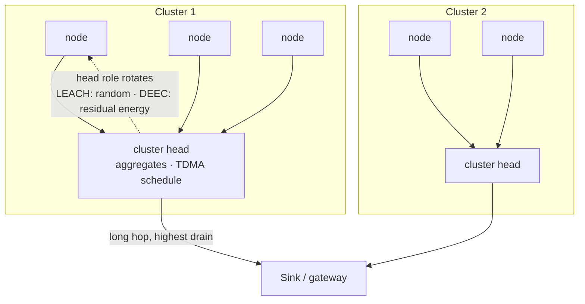
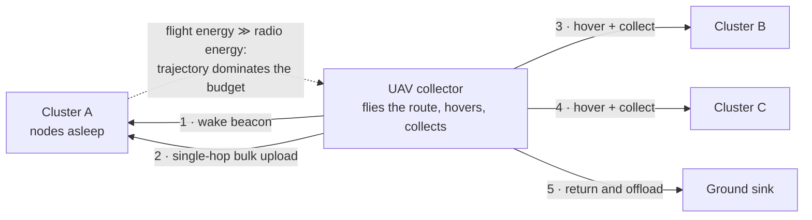
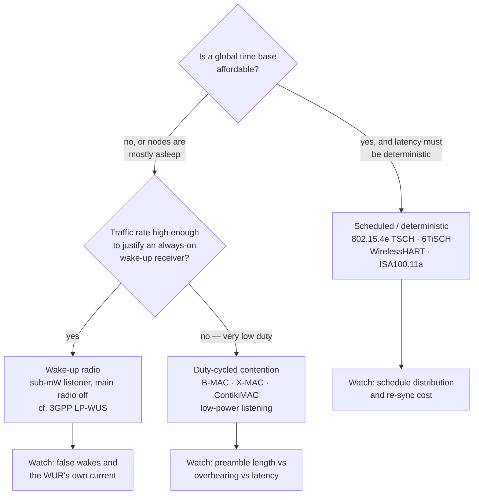
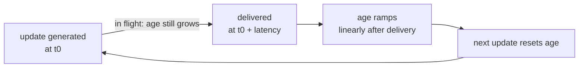

# Wireless Sensor Networks and Low-Power MAC

## 1. The energy model that drives everything

- In a multi-hop WSN, **relaying dominates**: forwarding traffic for others consumes a large fraction of total energy; commonly cited as roughly **30–50% of total energy per hop-relay burden** in cluster-based designs.
- Radio is the dominant consumer: transmit ≈ receive ≈ idle-listening ≫ sleep. Therefore **the MAC layer's job is to make the radio sleep as much as possible while still meeting latency**.
- Two orthogonal levers:
  - **Reduce transmit energy** — shorten hops, cluster, aggregate, compress.
  - **Reduce idle energy** — duty cycle, wake-up radio, scheduled access instead of contention.

## 2. Classical clustering protocols — the baseline you must be able to critique

| Protocol | Idea | Why it matters / limitation |
| --- | --- | --- |
| **LEACH** (Low-Energy Adaptive Clustering Hierarchy) | Randomised rotation of cluster heads, TDMA within cluster, head aggregates and forwards | The reference model for energy balancing; but random rotation ignores residual energy and location |
| **DEEC** (Distributed Energy-Efficient Clustering) | Cluster-head probability weighted by residual energy | Fixes the blind spot in LEACH; basis for most "energy-aware" variants |
| PEGASIS | Chain-based, one node transmits to the sink per round | Reduces cluster overhead; long delay and single-point fragility |
| HEED | Clustering by residual energy + intra-cluster communication cost | Better distribution of heads |
| TEEN / APTEEN | Threshold-sensitive, event-driven reporting | Good for event detection, bad for periodic monitoring |

The failure mode of every protocol in this family is visible here: the cluster head spends its own energy on two jobs — intra-cluster aggregation **and** the long hop to the sink — so whichever node holds that role dies first. Rotation is the entire point, and the difference between LEACH and DEEC is only *how the next holder is chosen*.

Critique to offer: these are **energy-balancing heuristics under idealised radio models**. They rarely survive contact with real duty-cycled MACs, asymmetric links and node heterogeneity. They remain valuable as the vocabulary, not as deployable code.

## 3. Where the field actually moved: UAV-enabled WSN

- **Core insight**: instead of paying multi-hop relay energy, move the sink to the data. A UAV flies to (or near) sensor clusters and collects on demand.

- Why it wins: it converts an exponential multi-hop energy cost into a single-hop uplink plus a mobility energy cost paid by a platform that is already flying.
- Sub-problems that make it a real engineering topic:
  - **Trajectory optimisation** — visiting order, hover points, altitude versus link budget
  - **Collection scheduling** — which nodes wake when, given UAV dwell time
  - **Sensor sleep coordination** — nodes stay asleep until the collector is in range
  - **UAV energy budget** — flight power dwarfs radio power, so radio-side optimisation must not increase flight time
- Reported effect (typical of the literature): coordinated sleep plus proximity collection can cut standby current dramatically — figures above **90% reduction in standby current** are commonly claimed. *(Literature-level claim; VERIFY against the specific paper before quoting.)*

## 4. Low-power MAC design space

The choice is a function of traffic rate, synchronisation cost and latency requirement — not of fashion:

### 4.1 Duty-cycled contention MACs
- **B-MAC** — long preamble, asynchronous low-power listening (LPL)
- **X-MAC** — strobed short preambles, early acknowledgment, reduces overhearing
- **S-MAC / T-MAC** — synchronised sleep schedules, virtual clustering, adaptive duty
- **ContikiMAC** — fast, phase-optimised LPL with precise timing; the reference for embedded low-power practicality
- Key trade: preamble length versus overhearing versus latency

### 4.2 Scheduled / deterministic MACs
- **IEEE 802.15.4e TSCH** — time-slotted channel hopping; a schedule (slotframe) plus channel offset gives deterministic latency and frequency diversity.
- **6TiSCH** — IPv6 over TSCH, with a minimal scheduling function (MSF) and RPL routing. This is the industrial-standard answer for deterministic low-power mesh.
- **WirelessHART / ISA100.11a** — industrial TSCH profiles.
- **Wi-SUN FAN** — large-scale field-area networks.

### 4.3 Wake-up radio
- Move the listening function to an always-on, sub-mW receiver; the main radio stays off until woken.
- Directly analogous to **3GPP LP-WUS** work in Rel-19 for cellular IoT — see [[01-4 Cellular IoT RedCap eRedCap and NTN]].
- The engineering question is always: does the wake-up receiver's own power plus false-wake cost beat the duty-cycled main radio at your traffic rate? Below some packet rate, duty cycling wins; above it, wake-up radio wins.

## 5. Routing and network layer

- **RPL** (Routing Protocol for Low-Power and Lossy Networks) — DODAG construction, Objective Function (OF0, MRHOF), trickle timer, DAG repair.
- **6LoWPAN** — IPv6 adaptation: header compression, fragmentation, mesh-under versus route-over.
- Metric choice matters: ETX (expected transmission count) versus hop count versus energy-aware metrics produce very different topologies.

## 6. Freshness: Age of Information (AoI)

- AoI measures **the time elapsed since the newest update at the receiver was generated** — not throughput, not latency of a single packet. Formally, at time *t* with the newest received update generated at *u(t)*: **Δ(t) = t − u(t)**. Time-average AoI is the area under Δ(t) over the horizon divided by that horizon; **peak AoI** is the maximum just before each delivery.
- Consequence that is easy to miss: AoI is minimised by **evenly spaced, small, fresh** updates — batching to raise throughput *raises* average AoI, and a long queue is pure waste because a packet that arrives stale carries no value.

- Relevant because both 802.11 "next-gen" discussions and industrial sensing are shifting from "how many bits" to "how stale is the state".
- Scheduling for AoI changes policy: it favours fresh, small, evenly-spaced updates over batched large transfers, and it penalises queues.
- See [[02-1 WLAN - Wi-Fi Generations Evolution]] — AoI scheduling is an explicit theme in post-802.11bn scope discussions.

## 7. The embedded-system hard question

The question that separates people who have shipped firmware from people who have read papers:

> How do you co-design the RTOS low-power scheduler, the wake-up mechanism, and the MAC duty cycle so that the radio is only on when it must be — and still meet the collection deadline?

Answer shape:
- The MAC duty cycle must be driven from the same timer domain as the RTOS tick, or you get drift and missed rendezvous.
- Use **tickless idle** in the RTOS so the sleep duration is MAC-schedule-driven, not tick-driven.
- Put the MAC wake in a high-priority task or ISR bottom half with a hard deadline; keep the radio driver's ISR short.
- Account for **worst-case wake cost**: oscillator stabilisation, PLL lock, RX ramp, and cache/PMU restore — these are often larger than the intended RX window.
- Budget the join/re-synchronisation cost: a node that loses sync may burn more energy re-acquiring than it saved sleeping.

See [[04-1 Embedded Systems RTOS and Hardware Interfaces]].

## Anchors — verified facts

- Cluster routing baselines: **LEACH** (randomised cluster-head rotation), **DEEC** (residual-energy-weighted head election).
- **IEEE 802.15.4e TSCH** is the scheduled, channel-hopping MAC underpinning **6TiSCH**, WirelessHART and ISA100.11a.
- **RPL** with DODAG and trickle-based control messaging is the standard routing layer for LLNs; **6LoWPAN** provides IPv6 adaptation.
- AoI is an explicitly named theme in the post-802.11bn scope discussions alongside AI-native PHY and deterministic MAC.
- Multi-hop relay burden in cluster-based WSN is commonly modelled at **30–50% of total energy**.

## Related

- [[01-4 Cellular IoT RedCap eRedCap and NTN]]
- [[04-1 Embedded Systems RTOS and Hardware Interfaces]]
- [[02-1 WLAN - Wi-Fi Generations Evolution]]
- [[02-2 WLAN - Power Saving Mechanisms and Evolution]] — the Wi-Fi answer to the same duty-cycling problem: TWT, TIM segmentation, wake-up radio, ambient power

---

Copyright (c) 2026 Washington Ruan. All rights reserved.
