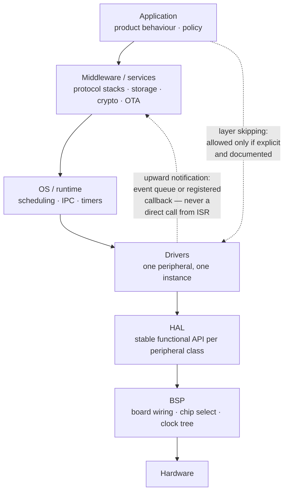
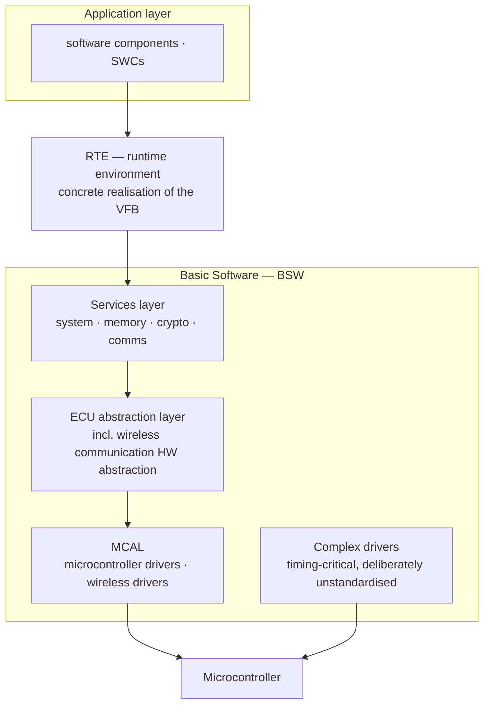
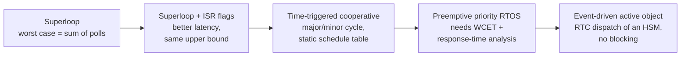
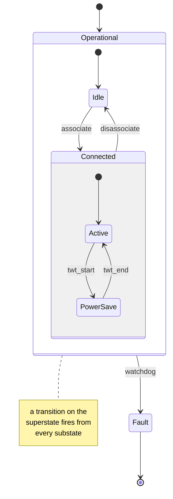
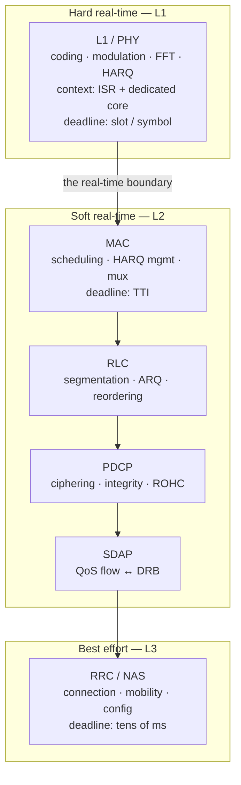
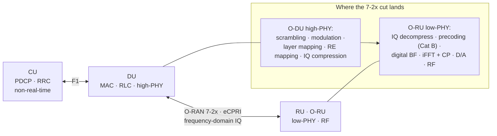
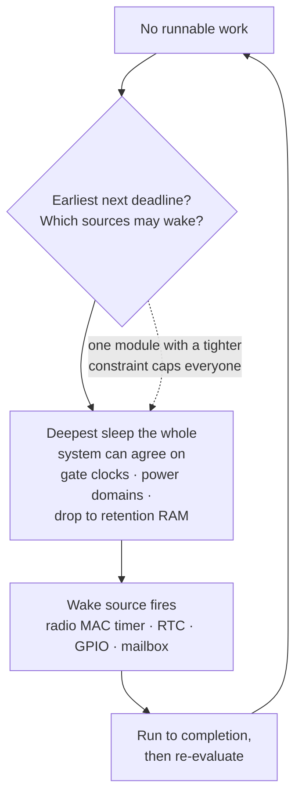

# Embedded Software Architecture — Patterns, Layering and Wireless System Structure

> **Scope.** This note is about *structure and decomposition*: how an embedded system is split into layers, execution contexts, states and interfaces, and why. Mechanics live elsewhere — [[04-1 Embedded Systems RTOS and Hardware Interfaces]] covers RTOS primitives, buses and the Cortex-M exception model; [[04-2 Linux Embedded Development - Drivers, Applications and Core Subsystems]] covers the Linux side; [[08-2 C and C++ Programming - Language Features, STL and Systems Practice]] covers the language. This note is the level above all three.

## 0. Why "architecture" is a separate question in embedded

In general software, architecture is largely about change cost. In embedded it is about **four budgets that are fixed by physics and silicon before you write a line of code**:

| Constraint | What it forces architecturally |
| --- | --- |
| **Time** — hard deadlines tied to physical events (slot, TTI, control loop) | Execution architecture must be schedulable and analysable; you need a WCET story, not a benchmark |
| **Memory** — tens of KB to a few MB, often no MMU | Static allocation policy; no unbounded queues; stack depth is part of the design, not an afterthought |
| **Energy** — battery or thermal envelope | Duty cycle is an architectural property: a system that cannot sleep deeply is unfixable later |
| **Field lifetime** — 5–15 years, unattended, often unreachable | Update, rollback, diagnostics and degradation must be designed in, not bolted on |

Two consequences that separate embedded architecture from application architecture:

1. **Interfaces are contracts with hardware, not just with other code.** A register layout, a mailbox descriptor, an image header — each is an ABI you may have to honour for a decade, across silicon revisions, and in both directions (host→firmware and firmware→host).
2. **Non-functional requirements dominate.** In an interview, "we chose a preemptive RTOS" is a weak answer. "We chose a cooperative time-triggered scheduler because the control loop had a 1 ms deadline with 3% jitter tolerance, and every dynamic-priority scheme we evaluated made the WCET bound unprovable at our toolchain's analysis depth" is an architectural answer.

**Definition used here:** architecture is the set of decisions that are *expensive to reverse*. In embedded that is: layering boundaries, execution model (what runs in which context), ownership of data, and the image/update scheme. Everything else is design.

---

## 1. The layered reference model

### 1.1 Canonical stack

| Layer | Responsibility | Must not know about |
| --- | --- | --- |
| **Application** | Product behaviour, state machines, policy | Which MCU, which bus, which register |
| **Middleware / services** | Protocol stacks, storage, crypto, diagnostics, OTA | Board specifics |
| **OS / runtime** | Scheduling, IPC, timers, memory | Application semantics |
| **Drivers** | One peripheral, one instance; exposes a capability | Other peripherals, application policy |
| **HAL** | Stable *functional* API over a peripheral class (e.g. `spi_transfer()`) | Board wiring |
| **BSP** | Board-specific wiring: which SPI is the radio, GPIO polarity, clock tree | Application semantics |



The distinction people get wrong in interviews: **HAL abstracts a peripheral class; BSP binds it to a board.** A HAL is reusable across boards. A BSP is the one file you should expect to rewrite per board. Chip-select polarity, DMA channel assignment and clock gating belong in the BSP, not the driver.

### 1.2 The dependency rule and what layering costs

The rule is *dependencies point downward and never skip*. In practice:

- **Layer skipping** is the common pragmatic violation (application calls a driver directly for a latency-critical path). It is legitimate, but it must be explicit and documented, because it is precisely the code that breaks on the next port.
- **Upward notification** must never be a direct call from ISR to application. It is either an event posted to a queue or a callback registered at init. Direct upward calls from interrupt context are the single most common source of "works in the lab, hangs in the field".

**Cost of a layer:** each additional layer in an embedded stack costs context switches, buffer copies, or both. On a modem or MAC datapath this is not academic — a copy per layer at line rate is a measurable throughput and power regression. The architectural question is always *which layers to collapse*, and the answer must be justified by a measured budget.

### 1.3 AUTOSAR — the reference layered architecture, worth knowing even outside automotive

AUTOSAR (AUTomotive Open System ARchitecture, founded 2003) is the most fully specified embedded software architecture that exists. It is worth studying as a *vocabulary and a set of solved problems*, even if you never ship it.



The VFB is the idea worth exporting: components talk through typed, location-agnostic ports, and *the RTE decides whether that conversation is a local function call or a CAN/Ethernet frame*. That is the same trick as a portable modem or Wi-Fi stack.

**Classic Platform (CP)** — deeply embedded, hard real-time, statically configured. Three top layers on a microcontroller:

- **Application layer** — software components (SWCs), largely hardware independent.
- **Runtime Environment (RTE)** — the full interface for applications; the concrete realisation of the **Virtual Functional Bus (VFB)**. The VFB is the key idea: components communicate through typed ports and are *location-agnostic* — the same component talks to another component on the same ECU or across a bus, and the mapping to a real bus (CAN, LIN, FlexRay, Ethernet) happens below the RTE.
- **Basic Software (BSW)** — three sublayers plus complex drivers:
  - **Services layer** (system, memory, crypto, communication, off-board communication)
  - **ECU abstraction layer** (onboard device abstraction, memory HW abstraction, crypto HW abstraction, **wireless communication HW abstraction**, communication HW abstraction, I/O HW abstraction)
  - **Microcontroller abstraction layer (MCAL)** (microcontroller drivers, memory drivers, crypto drivers, **wireless communication drivers**, communication drivers, I/O drivers)
  - **Complex drivers** — timing-critical or non-standardisable hardware (complex sensors/actuators). Deliberately unstandardised: flexible, but the least portable part of the stack.

**Adaptive Platform (AP)** — high-performance ECUs, POSIX-based OS, service-oriented, dynamic. Implements the **AUTOSAR Runtime for Adaptive Applications (ARA)**, functional clusters grouped into services, plus the Adaptive Basis. Designed for dynamic update and reconfiguration.

**Why this matters beyond cars:** the VFB/RTE pattern is *exactly* the same problem as a portable Wi-Fi or modem stack — decouple applications from transport so the same code runs over a local API or over a bus. See [[02-3 WLAN Ecosystem - WFA, EasyMesh and prpl]] for the WLAN analogue (prpl's abstraction of the Multi-AP control plane).

**Interesting for a comms person:** the CP BSW explicitly contains a *wireless communication* stack — drivers and HW abstraction for cellular/V2X. So AUTOSAR CP is not "the car stack", it is "the deeply-embedded stack" that happens to include radio.

---

## 2. Execution architecture — organising time and concurrency

This is the single most consequential architectural decision. Five models, in increasing order of capability and cost.

### 2.1 The five execution models



Capability and cost rise together: every step right buys responsiveness or modularity and pays for it in analysis burden, RAM (stacks and queues) or loss of provable determinism.

| Model | Structure | Deadline story | When it is the right answer |
| --- | --- | --- | --- |
| **Superloop** | `while(1) { poll_all(); }` | Worst case = sum of all poll times. No preemption. | Trivial devices, <10 kLOC, no hard deadlines, cost-dominated |
| **Superloop + ISR flag** | ISRs set flags; loop services them | Better latency, same upper bound | Most bare-metal products |
| **Time-triggered cooperative** | Fixed **major/minor cycle**; tasks run to completion in scheduled slots | Fully deterministic; schedulability is a static table | Safety-related control, IEC 61508 / ISO 26262 SIL-2..3 with limited resources |
| **Preemptive priority RTOS** | Fixed-priority or EDF tasks; ISR → deferred work | Requires WCET + schedulability analysis | Connected devices, protocol stacks, mixed workloads |
| **Event-driven active object (RTC)** | Each active object has its own event queue; RTC dispatch of an HSM; no blocking | Determinism via run-to-completion + priority per active object | Complex reactive behaviour with many states and modes |

### 2.2 Time-triggered vs event-triggered — the honest comparison

- **Time-triggered**: task activation comes from a global time base. Predictable, trivially testable, easy to argue to an assessor. Fragile under overload (no adaptation) and poor at handling rare, latency-critical events — the classic failure is a 1 ms major cycle with one event needing a 50 µs response.
- **Event-triggered**: activation comes from events. Responsive and efficient, but arrival patterns must be bounded or the system is unschedulable, and proving the worst case requires arrival-rate assumptions that field data often contradicts.

**The production pattern is hybrid**: a time-triggered backbone for periodic control and supervision, with event-driven handling at the edges (interrupts, communication). Pont's work is the canonical source for the time-triggered side, and his later book explicitly targets SIL 2/ASIL D/DO-178C Level A designs with this structure.

### 2.3 Scheduling theory you must be able to state

- **Rate Monotonic (RM)** — Liu & Layland, 1973. Static priority by period: shortest period, highest priority. *Optimal among fixed-priority assignments* for implicit-deadline (deadline = period), independent, preemptive periodic tasks.
- **Liu & Layland utilization bound**: `U ≤ n(2^(1/n) − 1)`, which tends to `ln 2 ≈ 0.693` as `n → ∞`. Practical reading: RM is provably schedulable below ~69% utilization; above it you need exact response-time analysis, not the bound.
- **EDF** — dynamic priority by absolute deadline. Schedulable up to `U ≤ 1` (Dertouzos, 1974 showed preemptive EDF is optimal on a single processor). More CPU-efficient, but degrades unpredictably in transient overload and is rarely available natively in commercial RTOSes.
- **Deadline Monotonic (DM)** — Leung & Whitehead, 1982. Priority by *deadline*, not period. Optimal fixed-priority assignment for constrained deadlines (deadline ≤ period). Identical to RM when deadline = period.
- **Audsley's Optimal Priority Assignment (OPA)** — for arbitrary deadlines, finds an optimal priority ordering in at most `n(n+1)/2` schedulability tests.
- **Priority inversion** — a low-priority task holding a lock blocks a high-priority task. Fixes: **priority inheritance** and **priority ceiling**; for a rigorous bound, **Stack Resource Policy** (Baker, 1990), which also gives the best known worst-case stack bound. See [[04-1 Embedded Systems RTOS and Hardware Interfaces]] for the FreeRTOS-level mechanics.
- **Release jitter** — tasks triggered by an ISR or another task do not become ready instantly. Audsley et al. (1993) and Tindell et al. (1994) extend the analysis; "Deadline minus Jitter monotonic" is optimal for constrained deadlines with jitter.

**Interview framing that lands:** don't recite the bound. Say *why you did not rely on it*: "RM's 69% bound is sufficient but conservative, so for a modem L2 task set we did exact response-time analysis per task including OS overhead and ISR interference, and reserved the remaining budget for best-effort work at lowest priority."

### 2.4 Run-to-completion (RTC) — the event-driven discipline

In an active-object/event-driven architecture, event dispatch is **run-to-completion**: an event is processed fully before the next is dequeued, with no blocking inside. This is the mechanism that replaces a mutex across most of the system:

- Because dispatch never blocks, shared state is only touched inside RTC steps → most concurrency problems disappear structurally.
- Context is preserved in the state machine hierarchy rather than on a stack, so an HSM holds the "where was I" information that a blocking thread would hold in its call stack.
- Inversion of control: the framework calls your state handler; your handler never waits.
- Cost: a long RTC step delays everything at that priority. The architectural rule is therefore *RTC steps must be short*; long work is split across states or handed to a lower-priority worker.

---

## 3. State machines as the architectural spine

### 3.1 Why HSM, not FSM

A flat FSM's state count explodes combinatorially as behaviour grows. **UML statecharts / hierarchical state machines (HSM)** add the constructs that keep it manageable — the one that matters most is behavioural inheritance:



A protocol stack is exactly this shape — RRC states, Wi-Fi association states, connection lifecycle — which is why the HSM *is* the architecture rather than a detail inside it. See [[01-2 5G NR RAN Layer 2 Protocol Stack]] and [[02-1 WLAN - Wi-Fi Generations Evolution]].

Constructs, and what each buys:

| Construct | What it buys |
| --- | --- |
| **Hierarchically nested states** | A substate inherits its superstate's transitions; one handler for "this behaviour applies in all of these states" |
| **Behavioural inheritance** | A transition defined on the superstate fires from every substate — this is what removes the combinatorial blow-up |
| **Orthogonal regions** | Genuinely concurrent sub-behaviours within one object (e.g. "radio on" and "connection state") |
| **Entry / exit actions** | Guaranteed initialisation and cleanup regardless of which path reached or left the state |
| **Internal transitions** | React without re-running entry/exit |
| **Guards, choice/junction pseudostates** | Conditional routing inside the model rather than in ad-hoc `if` chains |
| **Extended state variables** | Guard against state explosion when behaviour varies over a continuous parameter rather than a mode |

### 3.2 Implementation techniques and their trade-offs

| Technique | Structure | ROM/RAM | Dispatch cost | When |
| --- | --- | --- | --- | --- |
| **Nested switch** | `switch(state)` inside `switch(event)` | Low | O(1), fast | Small FSMs; becomes unmaintainable past ~15 states |
| **State table** | 2-D table: `[state][event] → (action, next)` | ROM-heavy if dense, compressible if sparse | O(1) | Many states with uniform events; table can be generated and *validated* mechanically |
| **Function-pointer / table of handlers** | Each state is a function returning the next state | Low | O(1) | Flat FSMs in C; no hierarchy support |
| **OO State pattern** | State objects with virtual handlers | Higher (vtables, objects) | Indirect call | C++ designs; clean, but watch RAM and no-RTTI/no-exception profiles |
| **Hierarchical event processor (QEP)** | State handler returns superstate on unhandled event; dispatch walks the hierarchy | Low | O(depth) | Real HSM in C/C++; the technique behind QP |

The hierarchical dispatch trick, in essence: a state handler either consumes an event (returns "handled") or returns a pointer to its superstate, and the dispatcher walks *up* the hierarchy until someone handles it. That single mechanism delivers behavioural inheritance with no table generation and no tool dependency.

### 3.3 Practical rules

- **Enumerate signals first**, then define event structures. Signals are the ABI.
- **Every state machine needs an explicit top-state initial transition**, and every orthogonal region needs its own initial transition.
- **Never transition inside an entry or exit action** — it produces ill-formed handlers with ambiguous semantics.
- **Event deferral** (queue an event for later rather than dropping it) is a first-class mechanism in HSM frameworks; using it deliberately is better than a `bool pending_later` flag.
- Where the state machine is the protocol state (RRC states, Wi-Fi association states, connection lifecycle), the HSM *is* the architecture — link it to [[01-2 5G NR RAN Layer 2 Protocol Stack]] and [[02-1 WLAN - Wi-Fi Generations Evolution]], where the same "modes with inherited behaviour" pattern appears as spec-level state machines.

---

## 4. Design patterns that survive on small targets

The GoF catalogue applies, but with different cost accounting: every virtual call is an indirect branch, every object is RAM, and many patterns exist to *remove* coupling that costs nothing on a desktop.

| Pattern | Embedded intent | Cost / caution |
| --- | --- | --- |
| **Adapter / Facade** | The HAL: stable narrow API over a messy peripheral family | Zero-cost if header-only + static inline |
| **Proxy / Hardware surrogate** | A fake peripheral for host-side unit testing (see §8) | The single highest-value testability pattern in embedded |
| **Active Object** | Own thread (or queue) + private event queue + RTC; serialises access by construction | One queue and one stack per object — budget it |
| **Reactor / event demultiplexer** | One loop demultiplexes many event sources to handlers | See [[04-2 Linux Embedded Development - Drivers, Applications and Core Subsystems]] for `epoll`; same shape on RTOS with a queue set |
| **Observer / Publish-Subscribe** | Decouple producer from consumers (sensor → UI, telemetry) | Prefer static subscriber lists; dynamic registration on a small heap invites fragmentation |
| **Strategy** | Swap algorithms at runtime (modulation scheme, power policy) | Function-pointer struct; no allocation |
| **Command** | Queue operations; enables undo, deferred execution, logging | Good for OTA job queues and diagnostic command dispatch |
| **State / HSM** | See §3 | |
| **Mediator** | Centralise interaction between subsystems (mode manager) | Prevents every module knowing every other module |
| **Chain of Responsibility** | Layered handling: try fast path, then slow path | Useful in protocol dispatch (cached vs full lookup) |
| **Template Method** | Fixed algorithm skeleton with hooks | Prefer compile-time (CRTP) over virtual where latency matters |
| **Flyweight** | Share immutable config/const data in ROM | Directly maps to `const` tables in flash |
| **Composite** | Treat single device and device group uniformly | Careful: adds indirection to hot paths |
| **Visitor** | Add an operation over a fixed set of node types | See [[08-2 C and C++ Programming - Language Features, STL and Systems Practice]] — `std::visit` with an `overloaded` lambda set |
| **Memento** | Snapshot/restore configuration or calibration | Natural fit for "revert to last known good config after a failed OTA" |
| **Singleton** | **Usually an anti-pattern in embedded** | Hidden global state, untestable, and initialisation order across translation units is a real bug source. Prefer explicit dependency injection — an init function taking a pointer to its context. |
| **Dependency Inversion / Ports & Adapters** | Application depends on abstract ports; adapters bind to HAL/BSP | The pattern that makes host-based testing possible; also the AUTOSAR VFB idea in miniature |

### 4.1 The C idiom for an abstract interface

```c
/* radio_port.h — the port (abstract interface) */
typedef struct radio_port {
    int  (*send)(struct radio_port *self, const void *buf, size_t len);
    int  (*recv)(struct radio_port *self, void *buf, size_t len);
    int  (*set_channel)(struct radio_port *self, uint8_t ch);
    void *ctx;                 /* opaque: board/driver state */
} radio_port_t;

/* application depends only on this — never on the driver header */
int app_send(radio_port_t *r, const void *p, size_t n) { return r->send(r, p, n); }
```

The pattern: a struct of function pointers plus an opaque `void *ctx`. Cost is one indirect call and one pointer per instance; benefit is that the entire application compiles and unit-tests on the host against a surrogate that implements the same struct. This is how you get continuous integration for firmware.

---

## 5. Data and interface architecture

### 5.1 Ownership models — decide before you write code

| Model | Description | Where it fits |
| --- | --- | --- |
| **Single-owner, zero-copy** | Exactly one owner at a time; ownership transferred, buffer never copied | Datapaths (L2 ↔ L1, radio ↔ host). Requires a strict "who frees on error" rule |
| **Pool / arena** | Fixed-size blocks from a pre-allocated pool; free returns to pool | Everywhere dynamic lifetime is needed. Deterministic, no fragmentation |
| **Reference-counted** | Shared ownership; free when count hits zero | Only with atomic ops and a clear cycle policy; rare on MCUs |
| **Ring buffer (SPSC)** | One producer, one consumer, lock-free with acquire/release | ISR → task handoff, logging, audio/sample streams (see §5.3) |
| **Double / triple buffer** | Writer fills one buffer while reader drains another | Streaming between two rates; triple buffer avoids writer stalls |
| **Copy on the boundary** | Deliberate copy at a layer boundary | Acceptable when it buys isolation (e.g. crossing a safety partition) — but budget it |

**The rule that prevents most field failures:** every buffer's owner is defined at every point in its lifecycle, including on every error path. "Who frees this if the send fails?" must have a written answer.

### 5.2 Message passing vs shared memory

| Axis | Message passing | Shared memory |
| --- | --- | --- |
| Coupling | Loose — producer and consumer know only the message | Tight — both know the layout |
| Copies | 1–2 (or zero with pool ownership transfer) | 0 |
| Debugability | High — you can log, replay and count messages | Low — races are invisible in a dump |
| Isolation | Strong; works across an MPU or core boundary | Poor; requires trust or a partition |
| Throughput | Bounded by queue depth × copy cost | Bounded by cache/bus contention |

**Decision heuristic:** use message passing for *control* (low rate, high value, must be debuggable) and shared memory with explicit ownership for *data* (high rate, latency-critical). Every real modem and Wi-Fi stack does exactly this split.

### 5.3 The lock-free SPSC ring — the ISR/task boundary

```c
typedef struct { _Atomic uint32_t head, tail; uint8_t buf[N]; } ring_t;
/* producer (ISR): */
uint32_t h = atomic_load_explicit(&r->head, memory_order_relaxed);
uint32_t t = atomic_load_explicit(&r->tail, memory_order_acquire);
if (((h + 1) % N) != t) { r->buf[h] = b;
    atomic_store_explicit(&r->head, (h + 1) % N, memory_order_release); }
```

Why this is an *architectural* fact, not an optimisation: on x86-64 `relaxed`, `acquire` and `release` are free (no fence emitted); only `seq_cst` costs an `mfence`/locked op. On ARM Cortex-M the same claim requires care — the barrier instructions are real — so the architecture must state per-target what the handoff costs. Always `alignas`-separate producer and consumer indices to avoid false sharing when the ring crosses cores.

### 5.4 The mailbox / doorbell pattern — firmware ↔ host

The standard heterogenous-processor interface (application core ↔ modem/baseband core, host ↔ L1 firmware):

1. **Shared memory region** with a descriptor ring (or fixed slots), in non-cacheable or explicitly-synchronised memory.
2. **Producer writes payload, then writes the index/valid flag** with a release store.
3. **Doorbell**: producer raises an interrupt to the peer (a mailbox peripheral or software IRQ).
4. **Consumer** takes the interrupt, drains all completed descriptors, then acknowledges — acknowledgement clears the doorbell, so one interrupt can retire many descriptors (interrupt coalescing).

Design points that make or break it: cache coherency (see [[04-1 Embedded Systems RTOS and Hardware Interfaces]]), whether the doorbell is level- or edge-triggered, ordering between payload write and doorbell, and a version/feature handshake at boot so mismatched host and firmware images fail loudly rather than silently.

---

## 6. Wireless-specific architecture

This is where this note earns its place in this vault: the structure of a radio system is a *software architecture* problem before it is a DSP problem.

### 6.1 The protocol stack as a layered, multi-context architecture



Everything below the L1/L2 line needs hard-partitioned time or dedicated acceleration; everything above it can be a general-purpose core with an RTOS. That one line explains both why baseband SoCs are heterogeneous and why O-RAN splits the stack where it does.

| Layer | Functions | Execution context | Deadline driver |
| --- | --- | --- | --- |
| **L1 / PHY** | Coding, modulation, FFT/iFFT, HARQ, measurements | ISR + dedicated firmware core, hard-real-time | Slot / symbol; processing budget per TTI |
| **L2 — MAC** | Scheduling, HARQ management, multiplexing, random access | High-priority task, 1 ms–level | Transmission time interval |
| **L2 — RLC** | Segmentation, ARQ, reordering | Task | Buffered, deadline = reordering timer |
| **L2 — PDCP** | Ciphering, integrity, header compression, duplication | Task | Buffered, throughput-bound |
| **L2 — SDAP** | QoS flow ↔ DRB mapping | Task, often fused into PDCP | Throughput-bound |
| **L3 — RRC / NAS** | Connection, mobility, configuration, security | Low-priority task | 10s of ms; event-driven |

**Architectural rule:** the real-time boundary sits between L1 and L2. Above it, deadlines are soft-ish and a general-purpose core with an RTOS is fine; below it, you need either hard-partitioned time or dedicated acceleration. That single line explains why baseband SoCs are heterogeneous (see [[07-1 RISC-V for Communication Infrastructure]]) and why O-RAN splits the stack where it does.

### 6.2 Modem / host architecture

In a device (UE, CPE, IoT module) the modem subsystem and the application host are typically separate processors:

- **Transport**: shared memory descriptor rings + mailbox doorbell (§5.4), or a serial/USB/PCIe link with a multiplexing layer.
- **Control protocol**: three common choices, with real trade-offs —
  - **AT commands**: text, human-debuggable, huge legacy footprint, poor for high-rate or structured data, awkward to version.
  - **RPC / IDL-generated binary**: typed, versioned, compact, efficient; needs tooling and a schema discipline.
  - **Proprietary binary frames**: smallest and fastest, but every protocol change is a compatibility risk — which is why it must carry a version field from day one.
- **Data path**: zero-copy buffer handoff, not AT. A modem exposing data over AT commands is a throughput ceiling.

### 6.3 RAN-side splits — the same decomposition at network scale

- **CU/DU split (higher-layer split)** — the gNB is split into a Central Unit and Distributed Unit; F1 between them. Standardised in the 3GPP NG-RAN architecture description (**TS 38.401**) with the F1 and E1 interface specifications alongside. This is a *software architecture* decision driven by centralisation vs fronthaul capacity.
- **O-RAN 7-2x lower-layer split** — the open fronthaul between O-DU and O-RU, specified by O-RAN WG4 and published through ETSI as **TS 103859** (O-RAN.WG4.CUS.0). The split is inside the PHY:
  - **O-DU (high-PHY)**: scrambling/descrambling, modulation/demodulation, layer mapping, precoding (optional location), resource-element mapping, IQ compression.
  - **O-RU (low-PHY)**: IQ decompression, precoding (if Category B), digital beamforming, iFFT + cyclic prefix, D/A, analog beamforming, RF.
  - **Category A** O-RU: no precoding in the radio — precoding stays in the O-DU. **Category B** O-RU: precoding is executed in the radio, which enables modulation compression. The DU must support at least 8 precoded streams for Category A.
  - Transported as **eCPRI** over Ethernet, carrying frequency-domain IQ. **BFP (block floating point)** compression typically cuts fronthaul bandwidth by roughly 50–75% with minimal EVM impact. Fronthaul latency and jitter are hard constraints, which is why 7-2x is fibre-oriented.
- **SCF FAPI / nFAPI** — the MAC↔PHY API from the Small Cell Forum; the de-facto software interface when MAC and PHY are separate software components. `VERIFY`: check the current release/numbering of the FAPI and nFAPI specifications before quoting specific versions.



The cut is chosen so each side has a tractable real-time budget *and* a stable interface: the DU buys centralisation and pooling, the RU stays simple, and the fronthaul pays the price in bandwidth (hence BFP compression) and in a hard latency and jitter budget (hence fibre).

**Why this belongs in an embedded architecture note:** all three are the *same* decision — where do you cut the system so that each side has a tractable real-time budget and a stable interface? Answering "why 7-2x and not option 8" well is an architecture answer, not a telecom trivia answer.

### 6.4 Where the layers meet the vault's other notes

- MAC scheduling and HARQ timing → [[01-2 5G NR RAN Layer 2 Protocol Stack]]
- RAN intelligence moved out of the box → [[01-3 AI-ML for RAN and O-RAN RIC]]
- Wi-Fi: `mac80211`/`cfg80211` is the Linux embodiment of this split → [[04-2 Linux Embedded Development - Drivers, Applications and Core Subsystems]], [[02-3 WLAN Ecosystem - WFA, EasyMesh and prpl]]
- Constrained-device radio duty cycling → [[03-1 Wireless Sensor Networks and Low-Power MAC]]

---

## 7. Memory architecture

### 7.1 The allocation policy decision

| Policy | Determinism | Fragmentation | Typical use |
| --- | --- | --- | --- |
| **Fully static** (everything at compile/link time) | Total | None | Safety-critical, tiny MCUs |
| **Static pools / slab / arena** | Total within pool limits | None | The default for any real product |
| **Heap with fixed cap + monitoring** | Bounded by cap | Possible | Linux-class or non-safety use |
| **General `malloc`/`free`** | Not analysable | Yes | Usually forbidden in safety code |

MISRA C forbids dynamic memory allocation in critical systems (Rule 21.3 in MISRA C:2012 and its successors) — the practical consequence is that pools and arenas are not an optimisation, they are a *compliance* mechanism.

### 7.2 Protection and partitioning

- **MPU** (Cortex-M) or **MMU** (Cortex-A, RISC-V with Sv39/Sv48): define regions for code, RO data, stacks, shared memory, and peripherals. Default-deny is the goal.
- **Freedom from interference (FFI)** — an ISO 26262 concept: a lower-ASIL component must not be able to corrupt a higher-ASIL one. Enforced by memory protection, temporal isolation (partition scheduling), and controlled shared services.
- **Reality check worth citing**: the academic review *"Good Motive but Bad Design: Why ARM MPU Has Become an Outcast in Embedded Systems"* (Zhou et al., arXiv:1908.03638, 2019) documents how rarely the ARM MPU is actually used as intended. It is a strong, credible thing to raise in an architecture discussion — the mechanism exists but the ecosystem rarely configures it.
- **Static partitioning hypervisors** and mixed-criticality co-existence are covered in [[04-2 Linux Embedded Development - Drivers, Applications and Core Subsystems]]; note that static core assignment removes *scheduler* interference but not *cache and interconnect* interference, which is the harder argument.

### 7.3 What to define in the memory map

ROM/flash layout (bootloader, primary image, secondary/OTA slot, filesystem, calibration/FactoryData), RAM layout (`.data`, `.bss`, pools, stacks, shared/non-cacheable regions, retention RAM), stack budget per context with a measured high-water mark, and the linker script as a *reviewed artefact*. Stack sizing by "it seems to work" is the defect that ships.

---

## 8. Testability as an architectural property

You cannot retrofit testability into firmware; it is produced by three decisions:

1. **Hardware abstraction with surrogates** — every peripheral the application uses is reached through a port (§4.1). On the host, a surrogate implements the same port and simulates behaviour, including *faults* (NACK, timeout, corruption).
2. **No hidden global state** — modules take a context pointer. Two instances can coexist, so tests can run in parallel and state is resettable.
3. **Deterministic time** — the application reads time through a port, so tests can advance a virtual clock instead of sleeping.

Then the standard test pyramid, adapted:

| Level | Runs on | Catches |
| --- | --- | --- |
| **Host unit tests** | Developer machine / CI | Logic, state machines, parsing, error paths |
| **Host simulation with hardware models** | CI | Protocol behaviour, timing logic |
| **Hardware-in-the-loop (HIL)** | Real board, scripted stimuli | Driver behaviour, real timing, electrical issues |
| **Fault injection** | Board or simulation | Failure handling, watchdog behaviour, recovery |
| **Field telemetry / soak** | Fleet | The failures only volume reveals |

**Replay is the highest-leverage tool** — if events, inputs and time are all captured through ports, a field failure can be replayed deterministically on the host. This is the same methodology argument made for AI-RAN in [[01-3 AI-ML for RAN and O-RAN RIC]] (sim → replay → HIL).

---

## 9. Update and lifecycle architecture

| Element | Design requirement |
| --- | --- |
| **Bootloader** | Immutable (or at least independently updatable), minimal, verified. Lives in a write-protected region |
| **Image format** | Magic, version, size, CRC/signature, target hardware ID, dependency/compat version |
| **A/B slots** | Two full image slots; boot the one marked valid; fall back automatically after N failed boots |
| **Rollback** | Automatic (failed boot / failed self-test) and manual (operator command) |
| **Anti-rollback** | Monotonic version counter held in OTP or a secure element; refuse downgrade |
| **Signing** | Signature verified before activation; root of trust in ROM or a secure element |
| **Atomicity** | Never erase the running image. Power loss at any instant leaves a bootable device |
| **Delta updates** | Smaller transfers for constrained links — but the reconstruct step must be verifiable and crash-safe |

On Linux targets this is RAUC/SWUpdate/Mender (see [[04-2 Linux Embedded Development - Drivers, Applications and Core Subsystems]]); on MCU targets, MCUboot is the common open choice and Zephyr integrates it. **The architectural content is identical**: verified image, two slots, monotonic version, and a power-loss-anywhere guarantee.

---

## 10. Observability and supervision architecture

- **Logging**: a lock-free ring in RAM (§5.3) with a `seq_cst`-free handoff, flushed by a low-priority task. Logging must never block the caller or allocate. Structured, leveled, and rate-limited.
- **Counters and gauges**: a fixed, exported statistics block (drops, retries, CRC errors, queue high-water marks, wakeups). Cheap enough to leave on in production.
- **Health monitoring**: each module publishes a heartbeat/liveness flag; a supervisor checks the *set*. This is far stronger than a single system watchdog: a supervisor can distinguish "task stuck" from "task starving" from "queue overflowing".
- **Watchdog architecture**: the watchdog must be fed from a supervision decision, not from the busiest task. Add **program-flow monitoring** (checkpoint sequence) so a task looping inside one iteration is detected.
- **Crash capture**: on fault, preserve the exception frame, a small RAM region and the log ring into retention RAM or flash before reset. Post-mortem is the difference between a one-week and a one-hour debug.
- **Degraded modes**: define, in the architecture, what the product does under each fault class (sensor dead → operate open-loop; radio dead → buffer and retry; memory pressure → drop low-priority work). Products that have no designed degraded mode fail catastrophically instead of gracefully.

---

## 11. Safety and dependability architecture

### 11.1 The standards landscape

| Standard | Domain | Integrity concept |
| --- | --- | --- |
| **IEC 61508** (1st ed. 1998, 2nd ed. 2010) | Generic industrial — the parent standard | **SIL 1–4**; for high-demand/continuous mode, target dangerous-failure rate per hour ranges roughly `10⁻⁶–10⁻⁵` (SIL 1) down to `10⁻⁹–10⁻⁸` (SIL 4) |
| **ISO 26262:2018** (2nd ed., Dec 2018) | Road vehicles; 12 parts; Part 11 semiconductors, Part 12 motorcycles | **ASIL A–D**, plus **QM** where not safety-relevant |
| **IEC 62304** | Medical device software | Class A/B/C |
| **DO-178C** | Airborne software | Level A–E |
| **IEC 60730** | Household appliance controls | Class A/B/C |
| **EN 5012x** | Railway | — |
| **IEC 61511** | Process industry | SIL |

**ASIL derivation:** Hazard Analysis and Risk Assessment (HARA) rates each hazard on **Severity** (S0–S3), **Exposure** (E0–E4) and **Controllability** (C0–C3). S3+E4+C3 → **ASIL D**. If any factor is at its minimum (S0, E0 or C0), the result is **QM**.

**Hardware architectural metrics** under ISO 26262:

| ASIL | SPFM (single-point fault metric) | LFM (latent fault metric) | PMHF |
| --- | --- | --- | --- |
| B | ≥ 90% | ≥ 60% | < 10⁻⁷ /h |
| C | ≥ 97% | ≥ 80% | < 10⁻⁷ /h |
| D | ≥ 99% | ≥ 90% | < 10⁻⁸ /h |

The insight worth stating: these metrics reward **detecting** faults, not only avoiding them. A very reliable board with poor diagnostics can still miss SPFM. Approximate cross-mapping (ASIL B ≈ SIL 2, ASIL D ≈ SIL 3) is a rough guide only — there is no official conversion.

### 11.2 Coding standards as architecture

- **MISRA C:2025** is the current edition (updated March 2025); it supersedes **MISRA C:2023** (third edition, second revision).
- **MISRA C++:2023** (with TC1:2026) is the current MISRA C++, and is explicitly written against **C++17** — worth knowing, because it means a MISRA-conformant C++ project is not on C++20/23/26.
- **NASA's "Power of Ten"** (Holzmann, IEEE Computer 39(6):95–99, 2006, doi:10.1109/MC.2006.212) — ten rules for safety-critical code, notably: no dynamic allocation after init, restrict all loops to a statically provable bound, and limit the use of `goto`/recursion/interrupts. Short, memorable, and quotable.
- **CERT C** — security-focused rules; complementary to MISRA rather than competing.

### 11.3 Dependability mechanisms at the architecture level

- **Partitioning** (spatial: MPU/MMU; temporal: fixed cyclic schedule) to achieve freedom from interference.
- **Diverse redundancy / lockstep** for the highest integrity levels; **ECC/parity** on all memories; **CRC** on all persistent data and over-the-wire frames.
- **Graceful degradation** paths as a designed feature (§10).
- **Independent supervision** — the monitor should not share a failure mode with the monitored function (different clock source, different core, hardware watchdog).

---

## 12. Power-aware architecture

Power is architectural because sleeping is a *system-wide coordinated* action, not a driver feature.



The failure this diagram is meant to prevent: every driver independently deciding its own sleep depth, so the deepest achievable state is dictated by whichever module forgot to declare its constraint.

- **Tickless idle**: stop the RTOS tick when idle; wake on the next scheduled event or interrupt. A tick-driven design wakes up thousands of times a second for nothing.
- **Event-driven wake**: the architecture must know, at any instant, the earliest next deadline and which peripherals are allowed to wake the system.
- **Peripheral and clock gating**: owned centrally by a power/resource manager, not scattered through drivers — otherwise two drivers disagree about when the bus clock may drop.
- **DVFS**: scale voltage/frequency to the current workload; requires a performance-level negotiation interface between the scheduler and the power manager.
- **Retention RAM**: keep only what must survive sleep; every retained byte costs leakage.
- **Duty cycling** is the dominant term for radio devices — the radio is usually the largest consumer, and the MAC's sleep schedule is therefore an architecture-level decision (see [[03-1 Wireless Sensor Networks and Low-Power MAC]] for TWT/TSCH and duty-cycle reasoning, and [[01-4 Cellular IoT RedCap eRedCap and NTN]] for LP-WUS/eDRX at the cellular level).

The architectural test: can every subsystem answer "what is the deepest sleep state I can be in right now, and what wakes me?" If not, the product's battery life is set by whichever module forgot.

---

## 13. Architecture evaluation and documentation practice

- **Quality attribute scenarios** instead of adjectives. "Fast" is not a requirement; "99.9% of radio event handlers complete in < 200 µs, measured over a 24-hour soak with 50 stations associated" is.
- **Trade-off matrix** with explicit weights: determinism, throughput, RAM, flash, power, portability, certification effort, time to market. Score the candidate architectures and show the arithmetic. This is what makes a decision defensible in review.
- **Architecture Decision Records (ADRs)**: one short file per significant decision — context, options considered, decision, consequences. Status: proposed / accepted / superseded. ADRs are how a team keeps the *reason* for a decision after the people rotate.
- **Verification of architectural properties**: WCET measurement or analysis, stack high-water measurement under worst-case load, fault injection at each interface, long-duration soak with counters enabled, and a deliberate "chaos" test (power-cycle during OTA, bus error injection, peer reset).

---

## 14. Four worked architectures

### 14.1 Battery wireless sensor node

**Structure**: bare metal or tiny RTOS; **time-triggered cooperative** backbone with a tickless sleep; one **HSM** for the node lifecycle (`Init → Join → Sample → Publish → Sleep`, with `Degraded` as a substate of `Join` and `Publish`); radio reached through a `radio_port`; sensor through an `sensor_port`.

**Why**: the deadline is a sampling period (seconds), the hard constraint is µA-average current, and there is no benefit to preemption. Event-driven handling only for interrupts (radio IRQ, RTC alarm). Data ownership: a single static sample buffer owned alternately by the sampler and the radio — no queue, no heap.

**Architecture decisions that matter**: sleep depth negotiated centrally; the HSM's `Sleep` state is the only place the sleep call is made; publishing failures increment a counter and transition to `Degraded` rather than retrying forever.

### 14.2 Wi-Fi router / residential gateway

**Structure**: embedded Linux. Kernel side: `mac80211`/`cfg80211` (softMAC) or a vendor fullMAC driver; userspace: hostapd/wpa_supplicant, a Multi-AP agent (EasyMesh / prplMesh), DHCP/DNS, firewall, telemetry. See [[02-3 WLAN Ecosystem - WFA, EasyMesh and prpl]] and [[04-2 Linux Embedded Development - Drivers, Applications and Core Subsystems]].

**Why**: throughput and feature velocity dominate; determinism matters only inside the driver and firmware. Datapath: `sk_buff` ownership transfer through the stack (single-owner zero-copy), with fast-path offload where the SoC supports it.

**Architecture decisions that matter**: control plane in userspace vs. in the driver; where the Multi-AP control plane lives; A/B root filesystem with automatic rollback; netns/VLAN segmentation for guest and IoT networks.

### 14.3 Modem / baseband subsystem

**Structure**: **heterogeneous**. L1 on dedicated cores or accelerators (increasingly RISC-V clusters — [[07-1 RISC-V for Communication Infrastructure]]), L2/L3 on general-purpose cores with an RTOS, application on a separate host processor. Interfaces: shared-memory descriptor rings + mailbox doorbell (§5.4) internally; RPC or multiplexed binary protocol to the host (§6.2).

**Why**: the L1 processing budget is a fixed number of operations per TTI — it cannot be scheduled on a shared core with anything else. The L1/L2 boundary is the real-time boundary.

**Architecture decisions that matter**: where HARQ state lives; whether L2 runs above an RTOS or as a bare-metal loop; whether measurement/report collection is polled or event-driven (it drives the CPU budget); how the L1↔L2 interface is versioned across silicon generations.

### 14.4 Deeply-embedded safety ECU (AUTOSAR-shaped)

**Structure**: AUTOSAR Classic Platform layering (§1.3): SWCs above the RTE, BSW below, MCAL at the bottom. OSEK/VDX-derived OS with a **static** task and interrupt configuration, entirely generated from configuration rather than coded. Time-triggered or fixed-priority preemptive with SRP for resource access.

**Why**: certification. Static configuration is what makes schedulability, stack usage and interface consistency *provable artefacts* rather than test results.

**Architecture decisions that matter**: ASIL decomposition across elements; which functions share an ECU (freedom from interference); the RTE contract; diagnostics and calibration (XCP/UDS) as first-class services.

---

## 15. Interview anchors — ten answers to have ready

1. **"How do you decide between bare metal, RTOS, and Linux?"** — deadline tightness and whether WCET is analysable; RAM/flash and MMU availability; certification obligations; connectivity stack needs; team and ecosystem. Give the threshold in numbers, not adjectives.
2. **"Why is your HAL separate from your BSP?"** — HAL abstracts a peripheral *class* and is portable; BSP binds a peripheral *instance* to board wiring (chip select, DMA channel, clock tree). Reusable vs. rewritten per board.
3. **"Walk me through your execution architecture."** — contexts (ISR / deferred / tasks), priorities and why, the periodic-vs-event split, and how you bounded the worst case.
4. **"RM or EDF, and why?"** — RM is optimal fixed-priority with the `n(2^(1/n)−1)` bound (→ ln 2 ≈ 0.693); EDF reaches U ≤ 1 but behaves worse under overload and is rarely native in RTOSes. Then say you used exact response-time analysis rather than the bound.
5. **"How do you handle priority inversion?"** — inheritance vs ceiling, and SRP if you need a bound and a stack guarantee.
6. **"Why an HSM rather than a flat state machine?"** — behavioural inheritance removes combinatorial state explosion; entry/exit actions guarantee initialisation and cleanup; orthogonal regions model genuinely concurrent aspects.
7. **"How do you make firmware testable on the host?"** — port/surrogate (§4.1), no hidden global state, virtualised time, plus replay from field captures.
8. **"Describe your OTA design."** — signed image, A/B, monotonic anti-rollback counter, atomic activation, power-loss-safe at every instant, automatic fallback.
9. **"Where do you cut a radio stack, and why?"** — the real-time boundary is between L1 and L2 (§6.1); at network scale the same question gives CU/DU and O-RAN 7-2x with Category A/B (§6.3).
10. **"What does ASIL D actually require architecturally?"** — S/E/C derivation, SPFM ≥ 99%, LFM ≥ 90%, PMHF < 10⁻⁸/h, plus freedom from interference and the process rigor in ISO 26262 Part 6.

---

## Anchors — verified facts (check before repeating)

- **AUTOSAR**: current release is **R25-11**, presented at the virtual Release Event on **4 December 2025** (~1,900 incorporation tasks, 1,500+ change requests, 200+ partners, 20 working groups, 10 new concepts). R25-11 adds **Vehicle Data Protocol** and **DDS support on the Classic Platform**, security work (Adaptive crypto stack rework, extended Security Event specification), a **Rust in the CP outlook**, and advances **CAPI** (Common Adaptive Platform Implementation) with quarterly releases and collaboration with **SOAFEE** and **COVESA**. Classic Platform layering: Application / RTE / BSW (Services, ECU abstraction, MCAL) + Complex Drivers; the **VFB** decouples application components from infrastructure and location. Adaptive Platform implements **ARA** (AUTOSAR Runtime for Adaptive Applications) on POSIX.
- **MISRA**: **MISRA C:2025** is the current C edition (updated March 2025); **MISRA C:2023** (third edition, second revision) is superseded but retained. **MISRA C++:2023** (TC1:2026) is current for C++ and is written against **C++17** (ISO/IEC 14882:2017).
- **Zephyr**: **4.4.0** released **2026-04-14** (latest stable); **3.7.0** is **LTS3**, released **2024-07-26**, EOL **2029-07-27**. Zephyr 4.5 targeted October 2026; **LTS4 is planned as 5.0 (October 2027)**. Major releases on a six-month cadence (April/October); LTS every ~2.5–3 years, maintained ~5 years. Canonical announced a **Zephyr 26.04 LTS** with up to 15 years of security maintenance. `VERIFY` the exact current LTS/maintenance status before citing it as the upstream position.
- **Functional safety**: **ISO 26262:2018** (2nd edition, December 2018), 12 parts, Part 11 semiconductors, Part 12 motorcycles. ASIL from Severity/Exposure/Controllability; any factor at minimum → QM. SPFM/LFM/PMHF targets: B 90/60/<10⁻⁷, C 97/80/<10⁻⁷, D 99/90/<10⁻⁸. **IEC 61508** 1st ed. 1998, 2nd ed. 2010; SIL 1–4. Approximate mapping: ASIL B ≈ SIL 2, ASIL D ≈ SIL 3 — a guide, not a conversion.
- **Scheduling theory**: Liu & Layland, **1973** — rate monotonic is optimal among fixed-priority schemes for implicit deadlines; utilization bound `n(2^(1/n) − 1)` → `ln 2 ≈ 0.693`; EDF schedulable up to `U ≤ 1`. Dertouzos, 1974 — preemptive EDF is optimal on a single processor. Leung & Whitehead, **1982** — deadline monotonic priority ordering is optimal for constrained deadlines. Audsley's OPA finds an optimal ordering in ≤ `n(n+1)/2` tests. Baker, **1990** — Stack Resource Policy.
- **State machines**: Miro Samek, *Practical UML Statecharts in C/C++: Event-Driven Programming for Embedded Systems*, 2nd ed., Newnes/Elsevier, 2008/2009, **ISBN 978-0-7506-8706-5** — UML statecharts, HSM, run-to-completion, inversion of control, the QP framework and the QEP hierarchical event processor.
- **Time-triggered**: Michael J. Pont, *Patterns for Time-Triggered Embedded Systems*, Addison-Wesley, **2001**, ISBN 0-201-33138-1 / 9780201331387 (70+ patterns; free PDF from the author). Successor: *The Engineering of Reliable Embedded Systems*, 2nd ed., SafeTTy Systems, **2016/2017**, ISBN 978-0-9930355-3-1 — second-generation TT architectures, with case studies targeting IEC 61508 SIL 2, IEC 60730 Class B, IEC 62304 Class C, ISO 26262 ASIL D and DO-178C Level A.
- **O-RAN fronthaul**: split option **7-2x** between O-DU (high-PHY) and O-RU (low-PHY), published through ETSI as **TS 103859** (O-RAN.WG4.CUS.0). **Category A** O-RU: no precoding in the radio (DU must support ≥ 8 precoded streams). **Category B** O-RU: precoding executed in the radio, enabling modulation compression. Transport via **eCPRI** over Ethernet carrying frequency-domain IQ; **BFP** compression typically reduces fronthaul bandwidth by ~50–75%. O-RAN has completed **Release 5**, and the O-RAN Software Community is migrating to the Linux Foundation Networking (LFN) umbrella in 2026.
- **NG-RAN architecture**: 3GPP **TS 38.401** describes the NG-RAN architecture including the CU/DU split; F1 and E1 are the corresponding interfaces. `VERIFY` the exact TS numbers for F1/E1 parts before quoting them.
- **ARM MPU critique**: Zhou et al., *"Good Motive but Bad Design: Why ARM MPU Has Become an Outcast in Embedded Systems"*, arXiv:1908.03638, 2019.
- **NASA Power of Ten**: Holzmann, *"The Power of 10: Rules for Developing Safety-Critical Code"*, IEEE Computer 39(6):95–99, 2006, doi:10.1109/MC.2006.212.
- **Books, current editions**: Elecia White, *Making Embedded Systems: Design Patterns for Great Software*, 2nd ed., O'Reilly, **2024**, ISBN 9781098151546. Daniele Lacamera, *Embedded Systems Architecture*, 2nd ed., Packt, **Jan 2023**, ISBN 9781803239545 (342 pages) — chapters on architectural patterns, boot-up, memory management, distributed/IoT architecture, parallel tasks and scheduling, TEE. Philip Koopman, *Better Embedded System Software*, Drumnadrochit Education, 2010, ISBN 978-0-9844490-0-2.
- **Memory ordering cost**: on x86-64, `memory_order_relaxed`, `acquire`, `release` and `acq_rel` compile with no fence; only `seq_cst` requires an `mfence` or a locked instruction. On ARM/RISC-V the barriers are real instructions — always state the target when quoting this.

## Related

- [[04-1 Embedded Systems RTOS and Hardware Interfaces]] — the RTOS and hardware mechanics this note's execution model sits on top of
- [[04-2 Linux Embedded Development - Drivers, Applications and Core Subsystems]] — the Linux-class counterpart: driver model, IPC, OTA, PREEMPT_RT, partitioning
- [[04-4 Linux Interrupts - Types, Handlers, Threaded IRQs and Deferred Work]] — the mechanism behind the execution models in §2: what the top/bottom-half split actually costs, and why a threaded IRQ changes the layering decision
- [[04-5 Linux Concurrency - Kernel and User Mode, Processes, Threads and IPC]] — the mechanism behind the layering in §1 and the lock-free handoffs in §4: which units should be processes, which threads, and what IPC choice the architecture implies
- [[08-2 C and C++ Programming - Language Features, STL and Systems Practice]] — the language mechanisms used to express ports, HSMs and lock-free handoffs
- [[01-2 5G NR RAN Layer 2 Protocol Stack]] — the L1/L2/L3 decomposition in §6.1 at spec level
- [[01-3 AI-ML for RAN and O-RAN RIC]] — where RAN intelligence is placed relative to the stack split
- [[01-6 NR DU MAC Scheduler - Resource Allocation, HARQ and Real-Time Implementation]] — the L1/L2 real-time boundary at full scale: the FAPI interface, the eleven-step per-slot pipeline, and the execution model that the layering in §1 has to support
- [[02-8 WLAN - Scheduling - Channel Access, EDCA, OFDMA Resource Allocation, Airtime and Implementation]] — the wireless case for the split this note argues for: microsecond-scale decisions below any OS, policy above it, and the nearest thing Wi-Fi has to FAPI being vendor-internal
- [[07-1 RISC-V for Communication Infrastructure]] — the silicon substrate for L1 acceleration and heterogeneous baseband
- [[02-3 WLAN Ecosystem - WFA, EasyMesh and prpl]] — the WLAN instantiation of layered control/data separation
- [[03-1 Wireless Sensor Networks and Low-Power MAC]] — duty cycling and sleep architecture at the constrained end
- [[02-2 WLAN - Power Saving Mechanisms and Evolution]] — the worked example of a power policy split across host, firmware and RF capability
- [[01-4 Cellular IoT RedCap eRedCap and NTN]] — LP-WUS, eDRX and the power architecture of cellular IoT devices
- [[05-1 DPDK User Plane and 5G UPF]] — single-owner zero-copy ownership applied at line rate

---

Copyright (c) 2026 Washington Ruan. All rights reserved.
