# Linux Interrupts — Types, Handlers, Threaded IRQs and Deferred Work

Every asynchronous event in a Linux system arrives through the same door: something asserts a signal, the CPU vectors, and a handler runs. The entire craft of embedded Linux performance is the craft of deciding **how much work happens behind that door**.

The organising idea of this note:

> An interrupt handler is a **deadline**, not a work queue. Its only job is to be short and to hand the work somewhere that has a scheduler.

Everything below — the taxonomies, the controllers, the deferred-work mechanisms, the tuning knobs and the failure modes — is an application of that one sentence.

## 1. Why interrupts exist and what they cost

### 1.1 Three ways to notice an event

| Method | Who checks | Latency | CPU cost | Use when |
| --- | --- | --- | --- | --- |
| **Polling** | Software, in a loop | Bounded by the loop period | 100% of a core, always | The rate is so high that the interrupt path costs more than the poll (dataplane busy-polling) |
| **Interrupt** | Hardware, on a signal | Microseconds | One vector per event | The default; event rate is low relative to CPU speed |
| **DMA + interrupt** | Hardware fills memory, one interrupt per batch | Microseconds + batching | Amortised | Bulk movement: network rings, storage, audio, camera |

The crossover is quantitative. A 1 Gb/s link receiving minimum-size frames can present ~1.49 Mpps; a 10 Gb/s link ~14.88 Mpps. At 14.88 M events/s a 5 µs handler would consume the entire core, which is exactly the *interrupt livelock* that **NAPI** was invented to prevent (§9.1).

### 1.2 The three costs everyone forgets

1. **Entry/exit cost** — saving registers, switching stacks, `irq_enter()`/`irq_exit()`, and the scheduler and RCU bookkeeping at each side.
2. **Scheduling delay tax** — an interrupt that arrives while a lower-priority context holds a lock makes a high-priority task wait for *that* lock holder. This becomes priority inversion, and it is why PREEMPT_RT threads interrupts (§8).
3. **Cache and TLB cost** — an interrupt evicts whatever was hot. A handler that touches a large working set pays twice: once for itself, once for whatever it evicted.

Practical implication: on a latency-sensitive system you tune interrupts the way you tune a dataplane — you reduce the *number* of entries (coalescing, NAPI), you shorten the *handler* (top-half discipline), and you isolate the *location* (affinity, CPU isolation).

## 2. Interrupt taxonomy — the types you must be able to name

The single most useful mental model in an interview: interrupt types are orthogonal. One physical interrupt can be classified along every axis below at the same time.

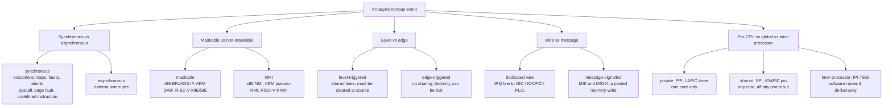

### 2.1 Synchronous vs asynchronous

- **Synchronous (exception)**: caused by instruction execution, delivered to the faulting instruction, restartable. Subtypes every systems engineer should distinguish:
  - **Trap** — intentional and resumable (`svc #0` on ARM, `ecall` on RISC-V, `syscall`/`int 0x80` on x86; also breakpoints).
  - **Fault** — potentially correctable and restartable (**page fault** is the one that matters; it is also what makes demand paging and copy-on-write work).
  - **Abort** — not restartable; signals an unrecoverable condition.
- **Asynchronous (interrupt)**: unrelated to the instruction stream; the CPU takes it at an instruction boundary.

The consequence: a page fault *can sleep* (it is process context); a hardware interrupt *cannot*. Mixing them up is the most common source of "scheduling while atomic" bugs.

### 2.2 Maskable vs non-maskable

| | Maskable | Non-maskable |
| --- | --- | --- |
| x86 | Clearing `EFLAGS.IF` with `cli` blocks external interrupts | **NMI** — vector 2, edges into the LAPIC LVT; also **SMI** which is invisible to the OS, and **#MC** (machine check) |
| ARM | `DAIF` mask bits (`I` for IRQ, `F` for FIQ) | Genuine NMI does not exist; **pseudo-NMI** is emulated with GIC priority — see §2.6 |
| RISC-V | `mstatus.MIE` / `sstatus.SIE` | **RNMI** (resumable NMI) is a separate extension; a machine-check or double-trap path, not a general facility |
| Linux | `local_irq_disable()` / `local_irq_save()` | `CONFIG_HARDLOCKUP_DETECTOR`, the **NMI watchdog**; `nmi_watchdog` and `panic_on_io_nmi` |

- **SMI (System Management Interrupt)** deserves its own warning: it switches the CPU into **SMM**, which the operating system cannot observe, mask or instrument. The classic symptom is a periodic, unexplainable multi-hundred-microsecond latency spike that no tracer attributes to any task. The tool that finds it is **`hwlat_detector`** (rt-tests), not `ftrace`.
- **Machine check (#MC)** is delivered for uncorrectable hardware errors; in production it is handled by `mcelog`/`rasdaemon` and EDAC drivers, not by your driver.

### 2.3 Level-triggered vs edge-triggered

This is the axis that causes the most field failures.

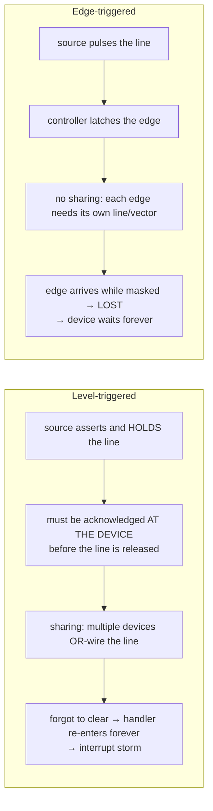

Rules of thumb that map directly onto device-tree practice:

- **Level**: required for wire-OR shared lines; the handler must clear the source (read/ack at the device, or drain the FIFO) before returning. Use `handle_level_irq`, whose flow masks the line during handling and unmask it afterwards.
- **Edge**: one device per line, no sharing, faster, no ack-at-source requirement, but **an edge that arrives while the line is masked is lost**. The kernel compensates with a resend path (`check_irq_resend()`, `CONFIG_HARDIRQS_SW_RESEND`) but that only fixes races the kernel knows about.
- **Active-low level** is the norm on SoC wire-OR lines; the polarity is described in DT (`IRQ_TYPE_LEVEL_LOW`) and must match the schematic, not the datasheet's default.
- Getting the trigger type wrong in the DT is the #1 cause of "the interrupt fires once and never again".

### 2.4 Wire versus message-signalled (MSI / MSI-X)

In the old model a device pulls a physical pin that reaches an interrupt controller. In the MSI model **the device performs a posted memory write** to a special address; the controller decodes that write into an interrupt.

Why it matters:

- No sideband wires, so a big SoC or a PCIe tree does not need hundreds of routed lines.
- No sharing: each vector belongs to exactly one device, which removes the entire class of shared-line problems.
- **Per-vector affinity** — you can steer each queue's interrupt to a different core. This is what makes RSS/multi-queue work (§10.3).
- MSI is edge-like in practice and ordering is guaranteed by the memory system, so the "two writes, one interrupt" coalescing pitfall is real but manageable.

Capacity, stated precisely:

| | MSI | MSI-X |
| --- | --- | --- |
| Max vectors per function | **32** (and it must be a power of two) | **2048** |
| Per-vector masking | No (one mask bit covers the group, or none) | **Yes**, plus per-vector payload |
| Table location | Capability structure in config space | Separate memory-mapped table and PBA |
| Where it matters | Simple devices | NICs with 8–2048 queues, NVMe with many I/O queues |

Linux API: `pci_alloc_irq_vectors(pdev, min, max, PCI_IRQ_MSIX | PCI_IRQ_MSI | PCI_IRQ_LEGACY)` and `PCI_IRQ_AFFINITY` for automatic spreading. The ability to give different interrupt types to different parts of the same device rests on the per-device MSI domain rework that landed in **6.2**.

### 2.5 Private, shared, and inter-processor

| Class | ARM (GIC) | x86 | RISC-V (AIA) | Linux treatment |
| --- | --- | --- | --- | --- |
| Per-core private | **PPI**, INTIDs 16–31 | LAPIC timer, thermal, performance monitor | Local interrupts via `mip`/`sie` | `request_percpu_irq()`, `handle_percpu_irq()` |
| Global/shared | **SPI**, INTIDs 32–1019 | I/O APIC inputs, MSI | APLIC wired sources / IMSIC MSIs | `request_irq()`, affinity-managed |
| Software-raised for another core | **SGI**, INTIDs 0–15 (IPI) | IPI via LAPIC ICR | IMSIC MSI to a target hart's interrupt file | `smp_send_reschedule()` etc.; see `arch_send_call_function_ipi()` |
| Message-signalled | **LPI**, INTID 8192+ (GICv3/ITS) | MSI / MSI-X | IMSIC | `irq_domain` of type `IRQ_DOMAIN_NOMAP` / MSI |

Two knock-on facts worth being able to state:

- **IPIs are how the kernel does remote work**: remote TLB flush, reschedule, function call, `wake_up` on a remote runqueue. An IPI-heavy workload (many small `membarrier` or `mmap`/`munmap` cycles, or RPS steering every packet) shows up in `/proc/interrupts` under names like `Rescheduling interrupts`, `Function call interrupts` and `TLB shootdowns`.
- **IPI latency is the hidden cost of RPS.** Receive Packet Steering distributes work across cores by raising an IPI per batch; on a fast link that IPI can cost more than it saves. Prefer hardware RSS when the NIC supports it (§10.3).

### 2.6 Pseudo-NMI on ARM64

ARM64 has no architecturally distinct NMI. Linux emulates one:

- Build with `CONFIG_ARM64_PSEUDO_NMI` and boot with **`irqchip.gicv3_pseudo_nmi=1`**.
- The mechanism is **GIC priority masking**, not `DAIF` masking: interrupts are delivered at two priority levels and the kernel uses the GIC's running-priority (or, on newer implementations, `PSTATE.I` masking) so that a "pseudo-NMI" can interrupt code that has ordinary IRQs masked.
- What it buys you: an NMI-style path for the **hard lockup detector, `perf` and backtrace-from-NMI** on ARM64 servers.
- What it does not buy you: it is not available on systems without a GICv3-class controller with usable priorities, and it is a debug/robustness facility, not a fast device interrupt path.

## 3. Interrupt controllers across the three ISAs

### 3.1 ARM Generic Interrupt Controller

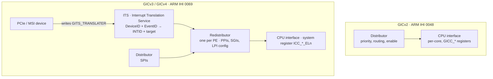

The INTID map you should be able to recite:

| INTID | Type | Notes |
| --- | --- | --- |
| 0–15 | **SGI** | Software Generated Interrupt; the IPI mechanism; banked per PE |
| 16–31 | **PPI** | Private Peripheral Interrupt; banked per PE; e.g. non-secure physical timer = 30, virtual timer = 27, hypervisor timer = 26 |
| 32–1019 | **SPI** | Shared Peripheral Interrupt; the ordinary device interrupts |
| 1020–1023 | **Special** | 1023 = spurious; 1020/1021 = "this pending interrupt belongs to another security state" |
| 1024–8191 | Reserved | — |
| 8192 and up | **LPI** | Locality-specific Peripheral Interrupt; always message-signalled; upper bound is IMPLEMENTATION DEFINED |
| 1056–1119 / 4096–5119 | Extended PPI / SPI | Added by **GICv3.1** |

Additional facts that separate a real answer from a paraphrase:

- **GICv3 splits the controller** into Distributor + per-PE Redistributor + optional **ITS**, and moves the CPU interface from memory-mapped registers to system registers (`ICC_IAR1_EL1` to acknowledge, `ICC_EOIR1_EL1` to end).
- **LPIs have a simpler state machine than SPI/PPI/SGI** (pending/active only) and no per-interrupt register; their configuration lives in memory-based tables.
- **GICv4** adds direct injection of virtual LPIs into a virtual PE for guests; GICv4 requires at least one ITS.
- The four-state SPI/PPI/SGI machine is: Inactive → Pending → Active → Active and Pending.

Device tree form:

```dts
my_device: my-ip@40000000 {
    compatible = "vendor,my-ip";
    reg = <0x0 0x40000000 0x0 0x1000>;
    interrupt-parent = <&gic>;
    interrupts = <GIC_SPI 42 IRQ_TYPE_LEVEL_HIGH>;
};
```

`GIC_SPI` is 0 and `GIC_PPI` is 1 in the first cell; the third cell is the type/flags. A GIC node uses `#interrupt-cells = <3>`.

### 3.2 x86

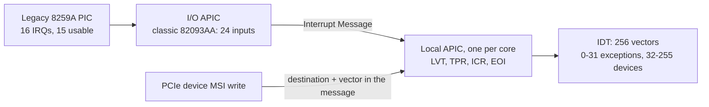

- The **IDT** has 256 entries; vectors **0–31** are architecturally reserved for exceptions (NMI = 2, #MC = 18), so 32–255 are available to devices. The local APIC also has a **spurious-interrupt vector** (commonly 0xFF) that never reaches a device handler.
- **x2APIC** moves the local APIC registers into MSRs and widens APIC IDs to 32 bits, which is what makes >255-CPU systems possible.
- The **IOMMU is in the MSI path**: interrupts can be remapped and translated, which is the mechanism behind secure interrupt delivery to virtual machines.
- For an embedded x86 target the practical note is that most modern SoCs present MSI-capable PCIe devices and a handful of legacy ISA-era resources; the interesting tuning is per-queue MSI-X affinity (§10).

### 3.3 RISC-V: PLIC versus AIA

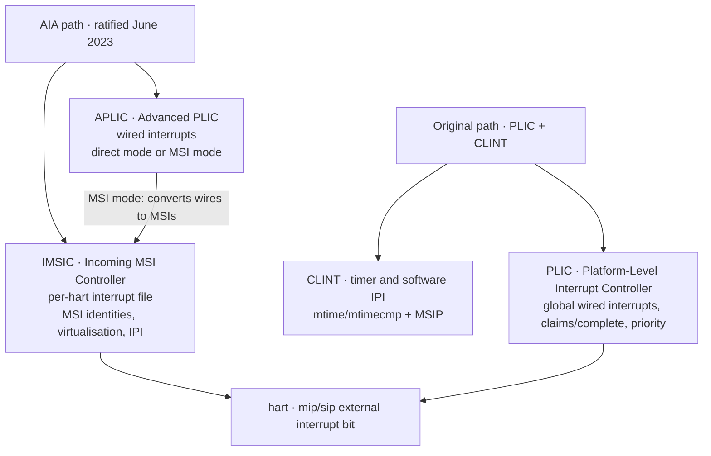

- The **RISC-V Advanced Interrupt Architecture (AIA)** was ratified by RISC-V International in **June 2023**; the current published document is **Version 1.0 (revised 2025-03-12)**.
- It contributes three things: AIA CSRs, the **IMSIC** (a per-hart MSI controller that also supports MSI virtualisation and IPI), and the **APLIC** (a wired-interrupt controller that can operate in direct mode or convert wired interrupts into MSIs).
- Contrast with the original scheme: **PLIC** has one global wired-interrupt controller with a claim/complete model, and **CLINT** provides the timer and software-IPI. Under AIA, IPIs move to IMSIC MSIs and the external-interrupt path moves to APLIC/IMSIC.
- The benefit is the same as GICv3's: **MSIs scale to PCI and to virtualisation**, whereas a PLIC's wired model does not.
- Linux support: the `irq-riscv-imsic-*` and `irq-riscv-aplic-*` drivers merged in the **6.10** cycle (`ca8df97fe679` "irqchip/riscv-aplic: Add support for MSI-mode" is the first affected commit). If you are targeting a RISC-V SoC, check the kernel version before assuming AIA works, and confirm the firmware (OpenSBI) and the DTB agree.

### 3.4 Controller comparison

| | ARM GICv3/v4 | x86 LAPIC + I/O APIC | RISC-V AIA |
| --- | --- | --- | --- |
| Interrupt identity | INTID, 16-bit minimum with LPIs | IDT vector, 8-bit | Major interrupt number + IMSIC identity |
| MSIs | LPI via ITS (GICv3), SPIs can also be MSI | Native, since PCI 2.2 | IMSIC |
| IPI | SGI, INTID 0–15 | ICR write → all/self/others | IMSIC MSI to a hart |
| Virtualisation | GICv4 direct vLPI injection | Posted interrupts + IOMMU remapping | IMSIC guest interrupt files + IOMMU MRIF |
| Per-CPU interrupts | PPI | LAPIC LVT entries | Local interrupt bits |
| Linux irqchip driver | `irq-gic-v3.c`, `irq-gic-v4.c` | `irq_remapping`, `vector` domain | `irq-riscv-intc.c`, `irq-riscv-aplic-*.c`, `irq-riscv-imsic-*.c` |

## 4. The Linux generic IRQ layer

The generic IRQ layer exists so that a driver never deals with a hardware interrupt number. There are four objects and you should be able to draw them.

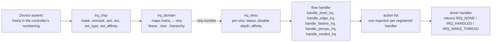

- **`irq_desc`** — kernel-side descriptor for one Linux IRQ. It holds the status flags, the disable depth, the affinity mask, the `irq_chip`, and the chained list of `irqaction`s. Drivers see only the number (the **virq**).
- **`irq_chip`** — the controller-level operations. `->irq_mask`, `->irq_unmask`, `->irq_ack`, `->irq_eoi`, `->irq_set_type`, `->irq_set_affinity`, `->irq_set_wake`. The generic layer calls these at the right moments so a driver does not have to.
- **`irq_domain`** — the map from the controller's numbering to Linux IRQ numbers. Three mapping kinds: **linear** (fixed-size table), **radix/tree** (sparse, for huge ID spaces like LPIs), and **hierarchical** (stacked domains, used for MSI parent/child and for chained GPIO controllers).
- **Flow (high-level) handlers** — the per-interrupt policy:

| Flow handler | Used for | Behaviour |
| --- | --- | --- |
| `handle_level_irq` | Level-triggered | Masks during handling, unmasks afterwards — safe for shared lines |
| `handle_edge_irq` | Edge-triggered | Latches pending edges, handles all of them, no masking (no sharing) |
| `handle_fasteoi_irq` | Modern edge/level controllers that do EOI at the chip | Treats EOI as the unmask; cheapest |
| `handle_percpu_irq` | PPIs / per-CPU | No masking at all; the interrupt is inherently local |
| `handle_simple_irq` | Software/virtual sources | No chip interaction |
| `handle_nested_irq` | IRQs handled in a threaded parent (e.g. a chained expander) | Runs the child handler inside the parent thread |

- **Chained versus nested** is a real interview question. A **chained** irqchip (an I²C GPIO expander, a pinctrl bank) handles its children in the *primary* handler, so the children run in hard-IRQ context and may not sleep. A **nested** irqchip declares `irq_set_nested_thread()` and handles children in a thread, so it costs latency but stays schedulable. On PREEMPT_RT the chained path gets threaded anyway.
- **Wakeup: `enable_irq_wake()` / `irq_set_irq_wake()`** marks an IRQ as a wakeup source; the generic layer keeps it enabled across suspend and routes it to the wakeup controller. Forgetting it is why "the GPIO key does not wake the board".

### 4.1 Registration API and flags

```c
/* simplest form: a primary handler only */
request_irq(irq, handler, 0, "my-ip", dev);

/* threaded form: primary + thread — the modern default for drivers */
request_threaded_irq(irq, my_hardirq, my_thread, IRQF_ONESHOT, "my-ip", dev);

/* managed and device-managed variants */
devm_request_threaded_irq(dev, virq, my_hardirq, my_thread,
                          IRQF_ONESHOT, dev_name(dev), dev);
```

| Flag | Meaning | When |
| --- | --- | --- |
| `IRQF_SHARED` | Line may be shared; all parties must set it, `dev_id` must be non-NULL, and the handler must return `IRQ_NONE` if the device did not interrupt | Wire-OR level lines |
| `IRQF_ONESHOT` | Keep the interrupt masked until the threaded handler finishes | **Mandatory** for a threaded handler on a level/edge line; the kernel will not let you have a thread without it |
| `IRQF_TRIGGER_*` | `RISING`, `FALLING`, `HIGH`, `LOW`, `NONE` | Prefer describing it in the device tree; only pass it if the source cannot be described there |
| `IRQF_NO_THREAD` | Opt this handler out of forced threading | Only for handlers that must be real hard IRQs (timer, IPI, some perf paths) |
| `IRQF_NOBALANCING` | Exclude from `irqbalance` | Dataplane interrupts you have pinned deliberately |
| `IRQF_NO_SUSPEND` | Keep running across suspend (but do not use as a wakeup source) | Timers that must not stop |
| `IRQF_COND_SUSPEND` | Same, but only if it shares a line with a wakeup interrupt | Rare |
| `IRQF_IRQPOLL` | Allow polling fallback for a broken edge source | Firmware/board workarounds |
| `IRQF_TIMER` | Keep the interrupt running during `suspend-to-idle` with no kernel timers | Timer chips |

Two API facts that matter in code review:

- `disable_irq()` **waits** for any running handler to complete and therefore must not be called from a handler on the same IRQ (it deadlocks). In handler context use `disable_irq_nosync()`.
- `free_irq()` before a disable, and `synchronize_irq()` when you need to be sure a handler is not still running on another CPU.

## 5. The path from wire to handler

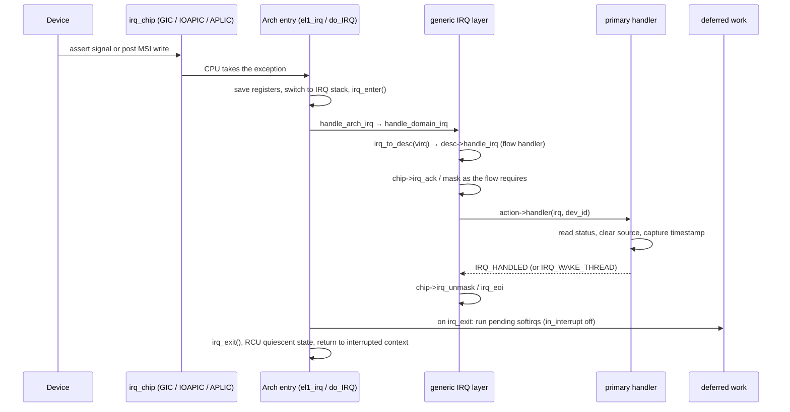

The three things that happen at `irq_exit()` and that every latency discussion eventually touches:

1. If the interrupted context was process context (not nested inside another interrupt), pending **softirqs** run right there.
2. If the softirq loop exceeds its budget, it hands off to **ksoftirqd**.
3. If preemption is enabled and a higher-priority task became runnable, the scheduler runs next — which is where the wakeup latency you measure with `cyclictest` actually comes from.

On **PREEMPT_RT** the shape changes: the primary handler does nothing but wake the thread, and the device work happens in that thread (§8).

## 6. Top-half discipline

A primary handler runs with interrupts (at least its own line) disabled, in interrupt context, on a small stack, and it is not allowed to sleep.

| You may | You may not |
| --- | --- |
| Read/write MMIO with `readl()/writel()` | Call `mutex_lock()`, `schedule()`, or any sleeping lock |
| Take a `spinlock_t` (correctly) | `kmalloc(GFP_KERNEL)` — use `GFP_ATOMIC` |
| Use `tasklet_schedule()`, `queue_work()`, `raise_softirq()` | `copy_from_user()` / `copy_to_user()` |
| `wake_up_interruptible()` a wait queue | Do unbounded work — no long loops, no logging storms |
| Return `IRQ_WAKE_THREAD` | Use floating point, or assume `current` means anything useful |

Return values, precisely:

- `IRQ_NONE` — "not my device". **Required** for correct handling on a `IRQF_SHARED` line so the generic layer can detect an unhandled interrupt.
- `IRQ_HANDLED` — "mine, and I am done".
- `IRQ_WAKE_THREAD` — "mine, and the thread should run now".

If you get `IRQ_NONE` from every handler on a shared line repeatedly, the generic layer eventually reports **"irq N: nobody cared"** and disables the IRQ — which is a useful, if brutal, diagnostic.

Finally: **measure, do not guess.** A handler you believe takes 2 µs can take 40 µs once the caches are cold and another interrupt is nested. The measurement tools are in §11.

## 7. Bottom halves — four mechanisms, one decision

### 7.1 The mechanism table

| | softirq | tasklet | BH workqueue (`WQ_BH`) | workqueue | threaded IRQ |
| --- | --- | --- | --- | --- | --- |
| Context | softirq (bottom half), irqs on | softirq, irqs on | softirq, irqs on | **kernel thread (process)** | **kernel thread (process)** |
| Can sleep | No | No | No | Yes | Yes |
| Concurrency | Same softirq runs on many CPUs at once | Serialised against itself, even across CPUs | One BH execution context per CPU; serialised per CPU | Up to `max_active` per CPU | Serialised per IRQ by `IRQF_ONESHOT` |
| Who may use it | **Static, kernel-core only** | Deprecated, do not use in new code | Any driver, replacing tasklet | Any driver | Any driver — the default recommendation |
| Registered | `open_softirq()` at compile time | `tasklet_setup()` | `alloc_workqueue(WQ_BH ...)` or `system_bh_wq` | `alloc_workqueue()` | `request_threaded_irq()` |
| Priority | Fixed vector order | `HI_SOFTIRQ` or `TASKLET_SOFTIRQ` | `WQ_HIGHPRI` selects `system_bh_highpri_wq` | `WQ_HIGHPRI` → nice −20 pool | `SCHED_FIFO`, priority **50** |
| Preempts a RT task? | Yes (it is not scheduled) | Yes | Yes | No (subject to CFS/EEVDF) | No (it is scheduled, and can be out-prioritised) |

### 7.2 The fixed softirq vectors

There are **ten**, statically allocated at compile time with `open_softirq()`, and the index **is** the priority:

| # | Softirq | Owner |
| --- | --- | --- |
| 0 | `HI_SOFTIRQ` | High-priority tasklets (legacy), BH work items via `system_bh_highpri_wq` |
| 1 | `TIMER_SOFTIRQ` | Timer callbacks |
| 2 | `NET_TX_SOFTIRQ` | Network transmit completion |
| 3 | `NET_RX_SOFTIRQ` | Network receive (NAPI) |
| 4 | `BLOCK_SOFTIRQ` | Block layer |
| 5 | `IRQ_POLL_SOFTIRQ` | IRQ polling |
| 6 | `TASKLET_SOFTIRQ` | Ordinary tasklets |
| 7 | `SCHED_SOFTIRQ` | Scheduler / load balancing |
| 8 | `HRTIMER_SOFTIRQ` | High-resolution timers |
| 9 | `RCU_SOFTIRQ` | RCU callbacks |

The receive path sits deliberately above timers and below the timer: `NET_RX_SOFTIRQ` at index 3 gets service before most work, which is a design decision you inherit whether or not you agree with it.

The loop that runs them has two brakes, and you should know the numbers:

- **`MAX_SOFTIRQ_TIME = msecs_to_jiffies(2)`** — no more than ~2 ms in one softirq round.
- **`MAX_SOFTIRQ_RESTART = 10`** — at most 10 restarts.

When either limit is hit and work is still pending, `__do_softirq()` calls `wakeup_softirqd()` and the per-CPU **ksoftirqd/N** thread finishes the job in process context. That is why a saturated network load can turn into `ksoftirqd/2` using 100% CPU: you are seeing the brake doing its job, and the fix is either more CPUs (RSS/RPS), fewer interrupts (coalescing), or a bigger budget (§10.4).

### 7.3 Tasklets are deprecated; say so explicitly

- The API modernisation (callback argument changed from `unsigned long data` to `struct tasklet_struct *`, `tasklet_setup()`) happened around **5.9**, and the explicit intent from that discussion was removal. The gap it left — "the fast atomic-context path with no sleeping" — had no clean replacement.
- **WQ_BH (BH workqueue)** closed that gap. It was suggested by Linus Torvalds in January 2024, implemented by Tejun Heo, and **merged for Linux 6.9**, along with bulk conversions of existing tasklet users (dm-crypt, dm-verity, USB HCD, TCP TSQ and others).
- BH workqueues have the semantics of a per-CPU workqueue but execute in the **softirq context**. Constraints: `max_active` must be **0**, the flag may only be combined with `WQ_HIGHPRI`, and **BH work items may not sleep**.
- The honest current state: the tasklet API still exists and still has real users; with well over 500 call sites at the time of conversion, the work is **ongoing, not finished**. In an interview the correct answer is: *"for new atomic-context deferral use `WQ_BH` or `system_bh_wq`; for anything that can sleep use a workqueue or a threaded IRQ; if you are touching an existing tasklet, converting it is the right direction."*

```c
/* BH workqueue: the modern tasklet substitute */
static DECLARE_WORK(my_bh_work, my_bh_fn);          /* queue on system_bh_wq */
static void my_hardirq(int irq, void *d)
{
    latch_status();
    queue_work(system_bh_wq, &my_bh_work);           /* or system_bh_highpri_wq */
    return IRQ_HANDLED;
}
```

### 7.4 Ordinary workqueues

```c
static struct workqueue_struct *my_wq;
static DECLARE_WORK(my_work, my_work_fn);

static int my_probe(struct platform_device *pdev)
{
    /* dedicated, unbound, high priority, memory-reclaim safe */
    my_wq = alloc_workqueue("my-wq",
                            WQ_UNBOUND | WQ_HIGHPRI | WQ_MEM_RECLAIM, 0);
    if (!my_wq)
        return -ENOMEM;
    return 0;
}

/* from the handler, or from the BH context, or from a thread */
queue_work(my_wq, &my_work);
queue_delayed_work(my_wq, &my_dwork, msecs_to_jiffies(10));
/* teardown: cancel then drain */
cancel_work_sync(&my_work);
flush_workqueue(my_wq);
```

- **`WQ_UNBOUND`** — not tied to a CPU; the scheduler decides where. Use for long-running or CPU-intensive work, and when the concurrency demand fluctuates.
- **`WQ_HIGHPRI`** — items go to the per-CPU high-priority worker pool (nice −20). Use for work that must not wait behind bulk work.
- **`WQ_CPU_INTENSIVE`** — the work item does not count against the concurrency level, so it does not block other work items; the system scheduler throttles it instead. Meaningless for unbound queues.
- **`WQ_MEM_RECLAIM`** — **required** if the work can run in the memory-reclaim path; it reserves an execution context so reclaim cannot deadlock waiting for the work.
- **`@max_active`** — the maximum number of execution contexts. The maximum permitted is **512** and the default when you pass **0** is **256**; the documentation's guidance is to pass 0 unless you have a reason. Note that the concurrency enforcement is per-`wq`, not per-CPU, for unbound queues after the 6.9 rework.
- **Ordered**: use `alloc_ordered_workqueue()` if you need strict FIFO single-flight, not `max_active = 1`.
- Use the system queues (`system_wq`, `system_highpri_wq`, `system_bh_wq`, `system_long_wq`, `system_unbound_wq`) unless you have a specific reason; a dedicated `wq` buys you a flush domain and attribute domain, not a performance change by itself.

### 7.5 The decision logic

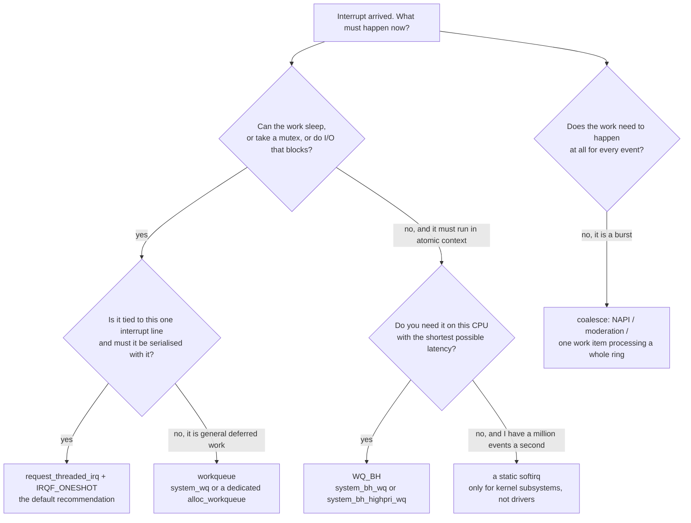

## 8. Threaded interrupts — the modern default

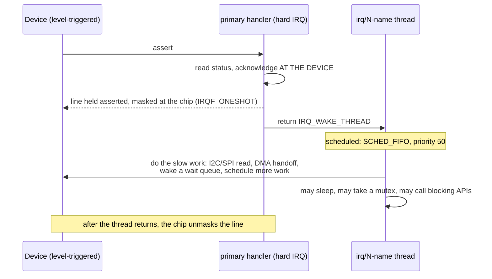

- **API**: `request_threaded_irq(irq, handler, thread_fn, flags, name, dev_id)`. If `handler` is NULL, the kernel installs `irq_default_primary_handler`, which returns `IRQ_WAKE_THREAD` immediately — the whole thing becomes a thread.
- **The thread**: created in `setup_irq_thread()` as `kthread_create(irq_thread, ..., "irq/%d-%s", irq, name)`, scheduled **SCHED_FIFO with priority 50** (`MAX_USER_RT_PRIO / 2`, i.e. halfway up the RT range). A secondary thread for a shared line is named `irq/<n>-s-<name>` and gets priority 49. You can see them with `ps -eLo pid,comm,rtprio | grep irq/`.
- **Why priority 50 and not 99**: it deliberately leaves room. A user-space RT task with a higher priority preempts the interrupt thread; a user-space RT task with a lower one does not. That is the entire point — it makes interrupt handling a schedulable activity instead of an un-maskable one.
- **`IRQF_ONESHOT`** keeps the interrupt masked at the chip until the thread returns. It is required with a thread, and it is also what makes a threaded handler equivalent to the old non-reentrant primary handler.
- **Under PREEMPT_RT, threading is forced**: the primary handler does nothing but wake the thread, and the handler you passed to `request_irq()` becomes the thread function. `IRQF_NO_THREAD` opts a handler out.
- **Forced threading without PREEMPT_RT**: boot with **`threadirqs`** (`CONFIG_IRQ_FORCED_THREADING`). This is the single cheapest experiment for turning a jittery non-RT kernel into a usable one, and it is the fastest way to discover which driver was doing too much in its hard handler.
- **Priority setting**: `irq_thread` priority is fixed at creation; to give a specific device a different priority, use `sched_setscheduler()` on the thread from userspace, or better, keep the handler short and let the real work happen in a workqueue or a dedicated `kthread` you control.

```c
static irqreturn_t my_hardirq(int irq, void *dev_id)
{
    struct my_dev *m = dev_id;
    u32 st = readl(m->base + STATUS);
    if (!(st & INT_MINE))
        return IRQ_NONE;                 /* shared line discipline */
    writel(st, m->base + STATUS);        /* clear at the source — the critical line */
    return IRQ_WAKE_THREAD;
}

static irqreturn_t my_thread(int irq, void *dev_id)
{
    struct my_dev *m = dev_id;
    mutex_lock(&m->lock);                /* sleeping is fine here */
    m->last = i2c_smbus_read_byte_data(m->client, REG_DATA);
    mutex_unlock(&m->lock);
    wake_up_interruptible(&m->wq);       /* release a blocking read() */
    return IRQ_HANDLED;
}

ret = devm_request_threaded_irq(dev, virq, my_hardirq, my_thread,
                                IRQF_ONESHOT, dev_name(dev), m);
```

## 9. Six applications — the same pattern six times

### 9.1 NIC receive and NAPI

NAPI is the canonical answer to "a million interrupts a second"; it is also the archetype of the coalesce-then-poll pattern.

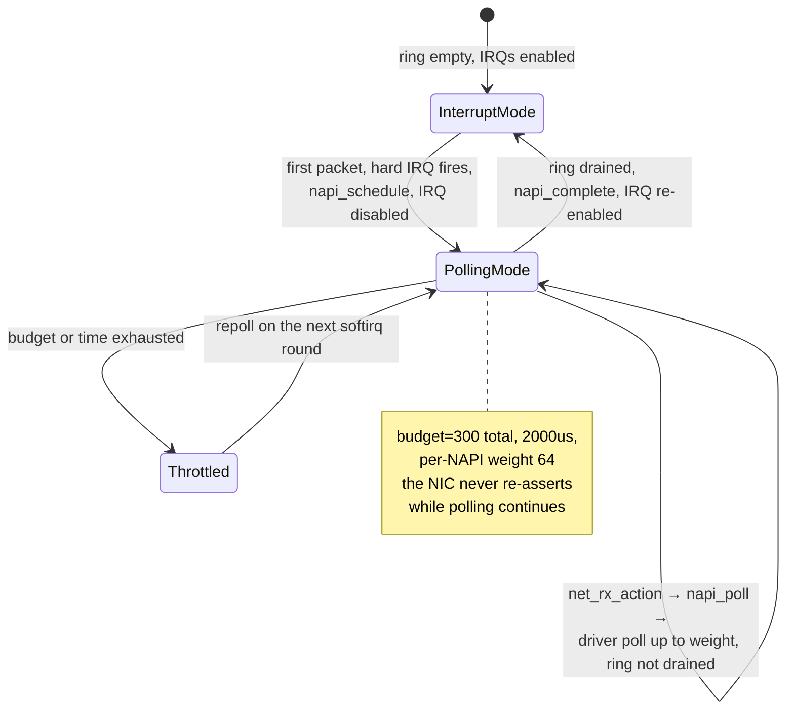

- Sequence: packet → DMA into the RX ring → **hard IRQ** → `napi_schedule()` (which disables that queue's IRQ and raises `NET_RX_SOFTIRQ`) → `net_rx_action()` → driver `poll()` drains up to `weight` descriptors → `napi_complete()` and re-enable the IRQ.
- The three knobs: `net.core.netdev_budget` (**300** total packets per `net_rx_action`), `net.core.netdev_budget_usecs` (**2000** µs time cap), and the per-NAPI **`weight`** (**64**). If `/proc/net/softnet_stat`'s **time_squeeze** column keeps climbing, the softirq is being cut off before it finishes — raise the budget or spread the load.
- The opposite failure: raising the budget makes each softirq round longer, which directly lengthens scheduling latency for everything else. Tune, measure, and stop.

### 9.2 DMA completion on a descriptor ring

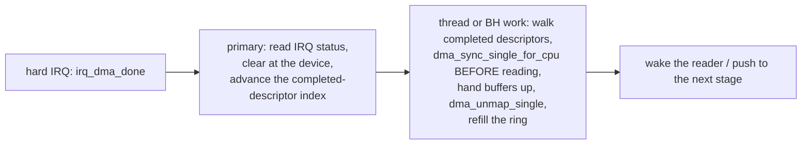

The rule that matters more than the schedule: **ownership transfer**. Before the CPU reads a buffer the device wrote, `dma_sync_single_for_cpu()`; before the device reads a buffer the CPU wrote, `dma_sync_single_for_device()`. Missing these is the classic "works in the unit test, fails under load" DMA bug on non-coherent SoCs.

### 9.3 A GPIO key with wakeup

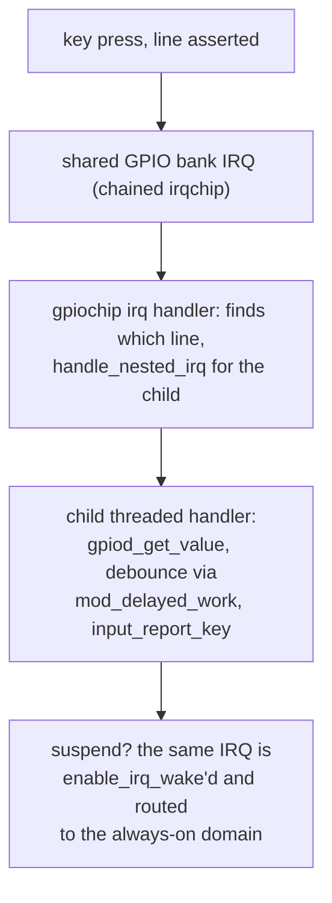

- Use `gpiod_to_irq()` on a descriptor obtained from the device tree, with `debounce-interrupt`/`debounce-delay-ms` handled by the gpiochip or by a delayed work.
- `enable_irq_wake()` in `suspend()`, if `device_init_wakeup(dev, true)` is set and the DT marks the GPIO as `wakeup-source`.

### 9.4 IIO triggered buffer

An ADC or IMU with a data-ready line is the same shape: hard IRQ → the IIO trigger fires → the device's `pollfunc` (in a thread or BH) → `iio_push_to_buffers_with_timestamp()` → the consumer reads through the char device or a `dmabuf`. This is the pattern behind the sensor pipelines feeding the TinyML workloads in [[06-3 Machine Learning - Foundations, Core Algorithms and Applications]].

### 9.5 A userspace driver: UIO and VFIO

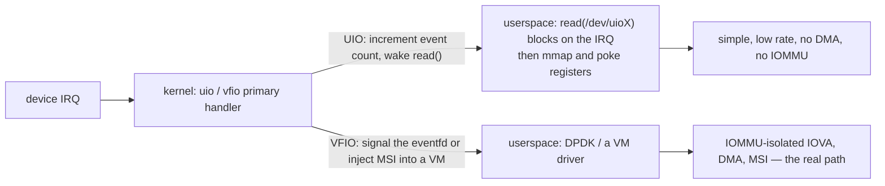

- **UIO** is fine for a slow, MMIO-only device: `read()` on `/dev/uioX` blocks until an interrupt. No DMA and no IOMMU, and it is increasingly discouraged.
- **VFIO** is the production answer and the one DPDK uses for real NIC access — see [[05-1 DPDK User Plane and 5G UPF]].

### 9.6 Doorbells: rpmsg, mailbox, and IPIs

On a heterogeneous SoC the "interrupt" between Linux and an RTOS core is a **mailbox/IPC doorbell**: the sender writes a register or shared memory and kicks the mailbox; the receiving side's mailbox IRQ wakes an `rpmsg` virtio worker. The mailbox controller is itself an irqchip/irq-domain with a **per-channel** interrupt, and the rpmsg virtqueue notification is just another doorbell. See [[04-1 Embedded Systems RTOS and Hardware Interfaces]].

## 10. Tuning

### 10.1 Affinity

| Interface | Meaning |
| --- | --- |
| `/proc/irq/<n>/smp_affinity` | CPU bitmask in hex, one word per 32 CPUs |
| `/proc/irq/<n>/smp_affinity_list` | The same thing as a CPU list — use this, it is far less error-prone |
| `/proc/irq/<n>/effective_affinity` | What is actually in force (some interrupts are **managed** and not user-settable) |
| `/proc/irq/<n>/affinity_hint` | What the driver suggests (e.g. one hint per queue) |
| `/proc/irq/<n>/node` | NUMA node |
| `/proc/irq/<n>/spurious` | Count of unhandled and of unhandled-but-ignored events |

```sh
# pin the storage controller to CPU 3
echo 3 > /proc/irq/40/smp_affinity_list
# spread the NIC's queues over cores, one queue per core
n=0
for i in $(grep eth0 /proc/interrupts | cut -d: -f1 | tr -d ' '); do
    echo "$n" > /proc/irq/$i/smp_affinity_list
    n=$((n + 1))
done
```

- **Managed interrupts** (allocated with `PCI_IRQ_AFFINITY`) have their affinity assigned by the kernel and **cannot** be written. Trying is the most common source of "my affinity change did not stick".
- `irqbalance` helps on a general-purpose box and hurts on a comlatane-critical one. On a dataplane system: stop it, pin by hand, or configure `IRQBALANCE_BANNED_CPUS` to keep it off the isolated cores.
- Boot-time: `irqaffinity=<cpu-list>` sets the default mask; it also respects `isolcpus=`/isolation.

### 10.2 Isolation

```sh
# kernel command line for a 4-core SoC: cores 2,3 reserved for the dataplane
isolcpus=domain,managed_irq,2-3 nohz_full=2-3 rcu_nocbs=2-3 irqaffinity=0-1
```

- On a modern kernel also move the housekeeping workqueues off those cores:
  `echo 0-1 > /sys/devices/virtual/workqueue/cpumask`.
- Combine with `sched_setaffinity()` for the dataplane threads and with `IRQF_NOBALANCING` on the interrupts you have deliberately pinned.

### 10.3 Multi-queue: RSS, RPS, RFS, XPS

| Mechanism | Where | What it does |
| --- | --- | --- |
| **RSS** | NIC hardware | Hash the 5-tuple to pick an RX queue; the queue's MSI-X vector lands on a chosen core — the cheapest and best |
| **RPS** | Kernel software | Distribute the softirq work across cores when the NIC lacks queues; costs an **IPI** |
| **RFS** | Kernel software | Send the flow to the CPU that runs the application, for cache locality |
| **XPS** | Kernel software | Choose the TX queue by the CPU doing the transmit |

```sh
ethtool -L eth0 combined 4            # number of hardware queues
ethtool -X eth0 equal 4               # indirection table
echo f > /sys/class/net/eth0/queues/rx-0/rps_cpus
```

### 10.4 Coalescing and moderation

```sh
ethtool -c eth0                       # inspect
ethtool -C eth0 adaptive-rx on        # let the NIC follow the traffic
ethtool -C eth0 rx-usecs 50 rx-frames 64
```

The trade is explicit and is worth stating in these words: **coalescing trades latency for throughput and CPU.** Low `rx-usecs` = lower latency, more interrupts; high = the opposite. Adaptive mode is usually right on a general-purpose system and usually wrong on a latency-critical one.

### 10.5 The four-way trade

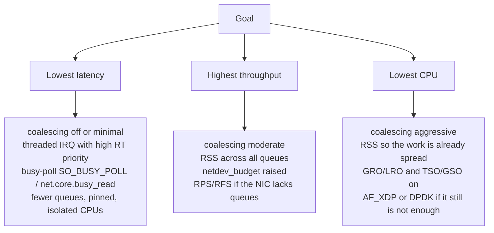

### 10.6 Interrupt-related boot parameters worth memorising

| Parameter | Effect |
| --- | --- |
| `threadirqs` | Force all interrupt handlers to be threaded (needs `CONFIG_IRQ_FORCED_THREADING`) |
| `irqaffinity=<list>` | Default affinity mask for interrupts |
| `irqchip.gicv3_pseudo_nmi=1` | ARM64 pseudo-NMI (needs `CONFIG_ARM64_PSEUDO_NMI`) |
| `irqchip.gicv3_nolpi=1` | Ignore LPI/ITS availability |
| `irqpoll` | Poll all handlers each timer interrupt when an interrupt is unhandled — a broken-firmware workaround |
| `irqfixup` | A lighter version of the same |
| `nmi_watchdog=0/1` | Hard lockup detector |
| `unknown_nmi_panic` | Panic on an unhandled NMI, for capture |

## 11. Debugging and failure modes

### 11.1 Read these first

```sh
cat /proc/interrupts          # per-CPU counts, chip name, type, devname
watch -n1 'cat /proc/interrupts'   # which counter is moving — and on which CPU
cat /proc/softirqs            # per-CPU softirq counts: which vector is hot
cat /proc/stat                # the "intr" line is total interrupts since boot
cat /proc/net/softnet_stat    # columns: total, dropped, time_squeeze, ...
ls /proc/irq/40/              # affinity, effective_affinity, spurious, node
```

`/proc/interrupts` columns are: `IRQ: CPU0 CPU1 ...  chip  [type]  actions`. A `[threaded]` marker appears for threaded IRQs in the actions field.

### 11.2 The symptom table

| Symptom | Most likely cause | Where to look |
| --- | --- | --- |
| Interrupt fires once, never again | **Edge** interrupt but the device is level; or level but not cleared at the source | DT trigger type; handler must ack the device; check `spurious` |
| Interrupt storms, system unusable | Level line not cleared, or `IRQF_ONESHOT` missing so the line unmasks into a still-asserted source | `cat /proc/interrupts` deltas; add the clear; add `IRQF_ONESHOT` |
| "irq N: nobody cared", then the IRQ is disabled | A handler returned `IRQ_NONE` for an interrupt it could not identify — shared line with the wrong `dev_id`, or the wrong IRQ number | Return `IRQ_NONE` only when it really is not yours; verify the DT `interrupts` cell |
| Shared line works with one device, breaks with two | One side missing `IRQF_SHARED`, or a NULL `dev_id` | All parties need the flag and a unique non-NULL `dev_id` |
| Interrupts are all on CPU 0 | No affinity set, or `irqbalance` has not been told about the isolated cores | `smp_affinity_list`, `IRQBALANCE_BANNED_CPUS` |
| `ksoftirqd/N` at 100% CPU | The softirq budget is being exceeded every round | `netdev_budget`, RSS/RPS, coalescing |
| Unexplained 100s-of-µs latency spikes that no tracer attributes | **SMI / SMM**, or firmware, not the kernel | `hwlatdetect`; vendor BIOS settings |
| Interrupts stop after `echo mem > /sys/power/state` | Missing `enable_irq_wake()` / `wakeup-source` | `device_init_wakeup()`, DT `wakeup-source` |
| Affinity change silently does nothing | The interrupt is **managed** (`PCI_IRQ_AFFINITY`) | `effective_affinity` |
| Driver works on a -rt kernel and hangs on a non-rt one, or vice versa | The handler does something illegal in the hard-IRQ context, or sleeps where it may not | Boot the non-rt kernel with `threadirqs` to confirm |
| Spurious interrupt at the very top of `/proc/interrupts` | The platform's spurious vector (INTID **1023** on GIC, the LAPIC spurious vector on x86) | Usually harmless; if it climbs, suspect a floating line |

### 11.3 The toolchain

| Tool | Finds |
| --- | --- |
| `perf` (`perf top`, `perf record -a`, `perf probe`) | Where interrupt time actually goes |
| **ftrace** `irqsoff` tracer | The longest intervals with interrupts off, with a call trace to the offender |
| **ftrace** `preemptoff` / `preemptirqsoff` | The same for preemption-disabled regions |
| **`osnoise` tracer** | The *sources* of OS noise: interrupts, softirqs, threads — the one to reach for first on a -rt system |
| **`hwlatdetect`** (rt-tests) | SMI/SMM and hardware-induced latency the kernel cannot see |
| **`cyclictest`** (rt-tests) | Worst-case wakeup latency; the number you quote for a -rt system |
| **dynamic debug** / `dev_dbg` | Runtime tracing without a rebuild |
| **`lockdep`** | Lock inversions, including the ones involving IRQ-context locks |
| `trace-cmd` / **KernelShark** | Visualise the trace: IRQ entry/exit, softirq, scheduling |
| `irqtop` (util-linux) | A live, sorted view of `/proc/interrupts` |
| `ethtool -S` | Per-queue drop counters, which localise a network loss to a queue and therefore to a core |
| `dropwatch` | Where skbs are being freed |

Method, in order:

1. **Localise**: which IRQ, which CPU, which type — `/proc/interrupts` and `/proc/softirqs` tell you this in two reads.
2. **Classify**: is it a rate problem (too many), a duration problem (too long), or a placement problem (wrong core)? Each has a different fix.
3. **Instrument the rate before the latency.** Fix the entry count first: coalescing, NAPI, or a fewer-events-per-work design.
4. **Then measure the tail**: `cyclictest` or `osnoise` for the interval, `irqsoff` for the worst offender, `hwlatdetect` if the spikes are invisible to the kernel.
5. **Prove the fix with the same tool you used to find the problem**, and keep the before/after numbers.

## Anchors — verified facts (check before repeating)

- **GICv3 INTID map**: 0–15 SGI, 16–31 PPI, 32–1019 SPI, 1020–1023 special, 1024–8191 reserved, **8192 and above LPI** (upper bound IMPLEMENTATION DEFINED). GICv3.1 adds extended PPI 1056–1119 and extended SPI 4096–5119. Specific IDs: **1023 = spurious**; 1020/1021 = "pending interrupt belongs to another security state". Common PPIs: 30 = non-secure physical timer, 27 = virtual timer, 26 = hypervisor timer.
- **GICv3** splits into Distributor + per-PE Redistributor + optional **ITS**; LPIs are always message-signalled and use `GITS_TRANSLATER`; SPIs can be message-signalled via `GICD_SETSPI_NSR`.
- **x86 IDT** has 256 vectors; 0–31 are architecturally reserved for exceptions (NMI = 2, #MC = 18). The classic 82093AA I/O APIC has **24** inputs.
- **MSI** supports at most **32** vectors per function and must be a power of two; **MSI-X** supports up to **2048** with per-vector masking and per-vector payload.
- **RISC-V AIA** was ratified by RISC-V International in **June 2023**; the current document is **v1.0 (revised 2025-03-12)**. It adds AIA CSRs, the **IMSIC** (per-hart MSI controller supporting MSI virtualisation and IPI) and the **APLIC** (wired controller, direct or MSI mode). The Linux drivers `irq-riscv-imsic-*` and `irq-riscv-aplic-*` merged in the **6.10** cycle.
- **ARM64 pseudo-NMI**: `CONFIG_ARM64_PSEUDO_NMI` plus the boot parameter **`irqchip.gicv3_pseudo_nmi=1`**; it is GIC-priority based, and is a debug/robustness facility, not a fast device path.
- **Softirq**: ten fixed vectors, index = priority; `NET_RX_SOFTIRQ` is index 3. **`MAX_SOFTIRQ_TIME = msecs_to_jiffies(2)`** and **`MAX_SOFTIRQ_RESTART = 10`**; exceeding either wakes **ksoftirqd**.
- **NAPI defaults**: `net.core.netdev_budget` = **300**, `net.core.netdev_budget_usecs` = **2000**, per-NAPI `weight` = **64**.
- **Workqueue `@max_active`**: maximum **512**, default **256** when 0 is passed; the documentation recommends 0. Use `alloc_ordered_workqueue()` for strict ordering.
- **WQ_BH** merged for **Linux 6.9** (suggested by Linus Torvalds, implemented by Tejun Heo), with `system_bh_wq` and `system_bh_highpri_wq`; `max_active` must be 0, it may only combine with `WQ_HIGHPRI`, and BH work items **may not sleep**.
- **Tasklets are deprecated** but the API still exists and has real users; the API modernisation (`tasklet_setup()`, `struct tasklet_struct *` callback) landed around 5.9 and conversion to `WQ_BH` is ongoing.
- **Threaded IRQs**: the thread is named `irq/<n>-<name>` (secondary: `irq/<n>-s-<name>`) and is created with **`SCHED_FIFO` priority 50** (`MAX_USER_RT_PRIO / 2`); the secondary gets 49. Forced threading: boot with **`threadirqs`**; PREEMPT_RT forces it.
- **`IRQF_ONESHOT` is mandatory** for a threaded interrupt; `disable_irq()` may not be called from a handler on the same IRQ (use `disable_irq_nosync()`).

## Related

- [[04-2 Linux Embedded Development - Drivers, Applications and Core Subsystems]] — the parent note: driver model, device tree, DMA and cache coherency, the debugging toolbox, and where interrupts sit in the whole stack
- [[04-5 Linux Concurrency - Kernel and User Mode, Processes, Threads and IPC]] — the companion note: the execution-context matrix, preemption models, kernel threads, and the user-space side of concurrency
- [[04-1 Embedded Systems RTOS and Hardware Interfaces]] — the Cortex-M/NVIC/PendSV counterpart, and the reasons an RTOS may beat Linux here
- [[04-3 Embedded Software Architecture - Patterns, Layering and Wireless System Structure]] — where the top/bottom-half split becomes an architectural layering decision
- [[05-1 DPDK User Plane and 5G UPF]] — what happens when you remove interrupts from the dataplane entirely: polling, VFIO, hugepages, core isolation
- [[02-4 WLAN - Packet TX-RX Datapath and Offload Evolution]] — the Wi-Fi flavour of the same path: interrupt moderation, FullMAC versus SoftMAC, and offload as a way to remove interrupts
- [[07-1 RISC-V for Communication Infrastructure]] — AIA, IMSIC and APLIC on the RISC-V targets this note is validated against
- [[08-2 C and C++ Programming - Language Features, STL and Systems Practice]] — the C idioms that handlers depend on: `container_of`, `READ_ONCE`/`WRITE_ONCE`, memory ordering, `volatile` misuse
- [[06-3 Machine Learning - Foundations, Core Algorithms and Applications]] — why inference latency inherits interrupt latency, and why an NPU completion interrupt is still an interrupt
- [[08-1 Programming Languages Toolchain and Performance Engineering]] — measuring the cost: `perf`, tracing, and the kernel-bypass options that eliminate the interrupt path

---

## References

### Books

- **[Book · ★★★ · EN]** **Linux Device Drivers**, 3rd ed. — Jonathan Corbet, Alessandro Rubini, Greg Kroah-Hartman, O'Reilly, 2005. ISBN 0-596-00590-3. Chapter 10 is the canonical treatment of interrupts, bottom halves (`tasklet`, `workqueue`), shared handlers and `IRQF_*`. Freed under a Creative Commons licence by the authors (`lwn.net/Kernel/LDD3`) — the one reference you can legitimately have read cover to cover.
- **[Book · ★★★ · EN]** **Linux Kernel Development**, 3rd ed. — Robert Love, Addison-Wesley, 2010. ISBN 978-0-672-32946-3. Chapters 7 ("Interrupts and Interrupt Handlers") and 8 ("Bottom Halves and Deferring Work"). The clearest short account of the top/bottom-half split and of why you cannot sleep in interrupt context.
- **[Book · ★★ · EN]** **Professional Linux Kernel Architecture** — Wolfgang Mauerer, Wrox, 2008. ISBN 978-0-470-34343-2. The exhaustive reference: the generic IRQ layer, `irq_desc`/`irq_chip`/`irq_domain`, and the architecture-specific entry paths with line-level commentary.
- **[Book · ★★ · EN]** **Understanding the Linux Kernel**, 3rd ed. — Daniel P. Bovet, Marco Cesati, O'Reilly, 2005. ISBN 0-596-00565-2. Chapter 4 ("Interrupts and Exceptions") for the x86 IDT, APIC and the IRQ data structures; dated in places, structurally still excellent.
- **[Book · ★★★ · EN]** **Embedded Linux Primer: A Practical, Real-World Approach**, 2nd ed. — Christopher Hallinan, Prentice Hall, 2010. ISBN 978-0-13701783-0. The board-level view: what an interrupt looks like on a real SoC, and the practical bring-up sequence.
- **[Book · ★★ · EN]** **Modern Operating Systems**, 4th ed. — Andrew S. Tanenbaum, Herbert Bos, Pearson, 2015. ISBN 978-0-13-359162-0. Grounds the synchronous/asynchronous and level/edge distinctions in OS theory rather than in Linux specifics.
- **[Book · ★★ · EN]** **Operating System Concepts**, 10th ed. — Abraham Silberschatz, Peter B. Galvin, Greg Gagne, Wiley, 2018. ISBN 978-1-119-32091-3. Chapter 12 for I/O and interrupts from first principles.
- **[Book · ★★★ · EN]** **The Linux Programming Interface** — Michael Kerrisk, No Starch Press, 2010. ISBN 978-1-59327-220-3. The authoritative user-space counterpart for everything on the other side of the boundary.

### Papers and talks

- **[Paper · ★★★ · EN]** Eric Dumazet, **"softirq: reduce latencies"** — Linux kernel mailing list, January 2013. The patch that introduced the 2 ms time budget on top of the 10-restart limit; the commit message is the best short explanation of why softirqs need a brake.
- **[Paper · ★★★ · EN]** Tejun Heo, **"[PATCHSET wq/for-6.9] workqueue: Implement BH workqueue and convert several tasklet users"** — LKML, January 2024. The primary record of why `WQ_BH` exists and what it is expected to replace.
- **[Paper · ★★ · EN]** Julien Thierry, **"arm64: Enable the support of pseudo-NMIs"** — LKML, December 2018. The patch series that introduced `CONFIG_ARM64_PSEUDO_NMI` and the boot parameter.
- **[Paper · ★★ · EN]** Anup Patel, **"Linux RISC-V AIA Support"** (v16 series), LKML / Patchwork, March 2024. The authoritative description of what IMSIC and APLIC each do in the kernel and of their dependencies.
- **[Paper · ★★ · EN]** Jonathan Salter et al., **"NAPI: a new API for network drivers"** and the subsequent **"Network receive path scalability"** work — the design rationale behind the interrupt/poll hybrid in §9.1.

### Standards and architecture specifications

- **[Spec · ★★★ · EN]** **Arm Generic Interrupt Controller Architecture Specification, GICv3 and GICv4** — Arm, ARM IHI 0069. The normative source for the INTID map, the ITS, LPIs and the GICv4 virtual-LPI injection.
- **[Spec · ★★ · EN]** **Arm Generic Interrupt Controller Architecture Specification, GICv2** — Arm, ARM IHI 0048. The predecessor; still what many embedded SoCs implement.
- **[Doc · ★★★ · EN]** **Learn the Architecture: Generic Interrupt Controller v3 and v4** (Overview / Locality-specific Peripheral Interrupts / Virtualization) — Arm developer documentation. The readable entry point; the INTID table and the MSI versus-wire figures in this note follow it.
- **[Spec · ★★★ · EN]** **The RISC-V Advanced Interrupt Architecture**, Version 1.0 — John Hauser (ed.), ratified by RISC-V International, **June 2023** (document revision 2025-03-12). `docs.riscv.org/reference/aia`. Chapters 3 (IMSIC), 4 (APLIC), 5 (machine/supervisor interrupts), 6 (virtual machines), 7 (IPIs).
- **[Spec · ★★ · EN]** **The RISC-V Instruction Set Manual, Volume II: Privileged Architecture** — the base external-interrupt and `mip`/`mie` conventions that AIA extends.
- **[Spec · ★★ · EN]** **Intel 64 and IA-32 Architectures Software Developer's Manual, Volume 3A** — chapters on the Local APIC, the I/O APIC, the IDT and NMI/SMI/MCE. The x86 ground truth.
- **[Spec · ★★ · EN]** **PCI Express Base Specification** (PCI-SIG) — the MSI and MSI-X capability structures, the vector counts, and the MSI-X table/PBA layout.

### Kernel documentation

- **[Doc · ★★★ · EN]** **Documentation/core-api/irq/** — the generic IRQ subsystem: `irq-domain.rst`, `irq-generic.rst`, `concepts.rst`. `docs.kernel.org/core-api/irq/`. The upstream description of everything in §4.
- **[Doc · ★★★ · EN]** **Documentation/core-api/workqueue.rst** — `docs.kernel.org/core-api/workqueue.html`. The normative text for `WQ_BH`, `WQ_UNBOUND`, `WQ_HIGHPRI`, `WQ_CPU_INTENSIVE`, `WQ_MEM_RECLAIM` and `@max_active`.
- **[Doc · ★★ · EN]** **Documentation/admin-guide/IRQ-affinity.rst** — `docs.kernel.org/admin-guide/IRQ-affinity.html`. Affinity, `irqbalance`, and the interaction with CPU isolation.
- **[Doc · ★★★ · EN]** **Documentation/admin-guide/kernel-parameters.txt** — the authoritative list for `threadirqs`, `irqaffinity`, `irqchip.gicv3_pseudo_nmi`, `irqchip.gicv3_nolpi`, `irqpoll`, `irqfixup`, `nmi_watchdog`. `docs.kernel.org/admin-guide/kernel-parameters.html`.
- **[Doc · ★★★ · EN]** **Documentation/core-api/real-time/differences.rst** (added 2025) — the official description of PREEMPT_RT's sleeping locks and forced-threaded interrupts, including the "SCHED_FIFO priority 50" statement.
- **[Doc · ★★ · EN]** **Documentation/networking/scaling.rst** — RSS, RPS, RFS and XPS, upstream.
- **[Doc · ★★ · EN]** **Documentation/networking/napi.rst** — the NAPI contract for driver authors.

### Man pages and tools

- **[Man · ★★★ · EN]** **Linux man-pages** — `request_irq` is kernel-internal, but the user-space side of the same material is `sched(7)` (scheduling policies and priorities), `capabilities(7)`, `epoll(7)`, `cgroups(7)`. `man7.org/linux/man-pages/`.
- **[Tool · ★★★ · EN]** **rt-tests** — `cyclictest`, `hwlatdetect`, `osnoise`, `signaltest`. The measurement suite for everything claimed in §11. `wiki.linuxfoundation.org/realtime/documentation/`.
- **[Tool · ★★ · EN]** **trace-cmd and KernelShark** — recording and visualising IRQ entry/exit, softirq and scheduling events.
- **[Tool · ★★ · EN]** **util-linux** (`irqtop`, `taskset`, `chrt`) — the interactive view of `/proc/interrupts` and the affinity/priority tools.

---

Copyright (c) 2026 Washington Ruan. All rights reserved.
