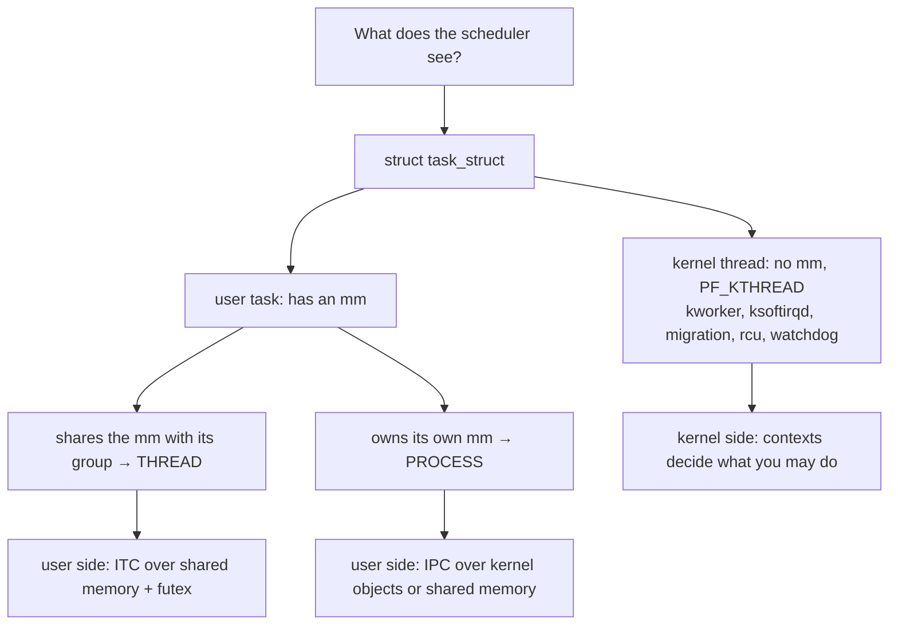
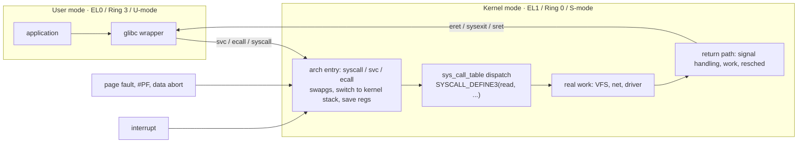
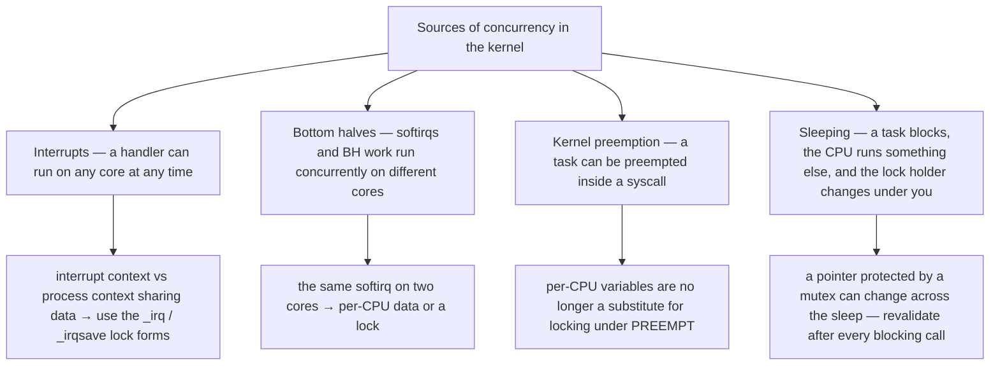
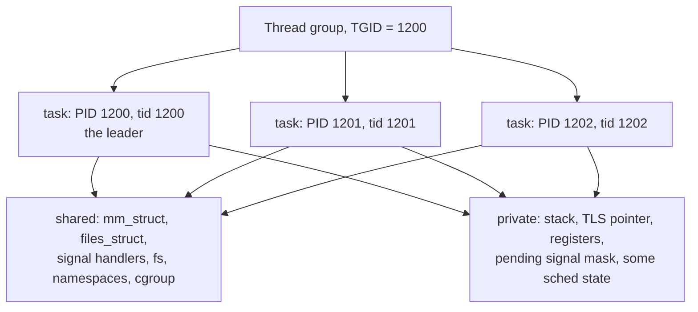
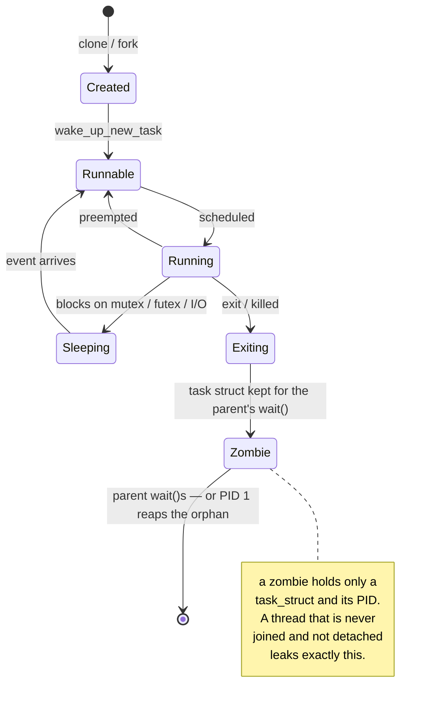
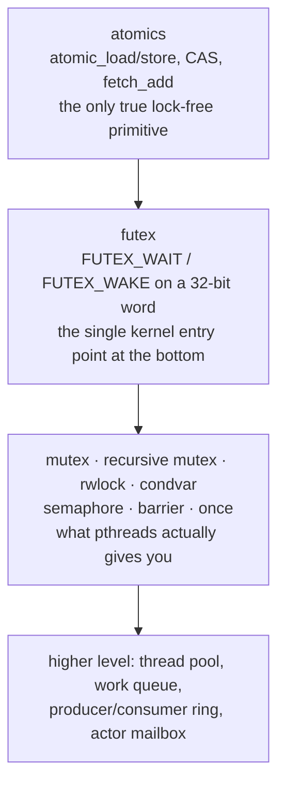
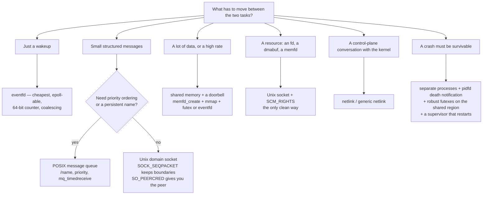
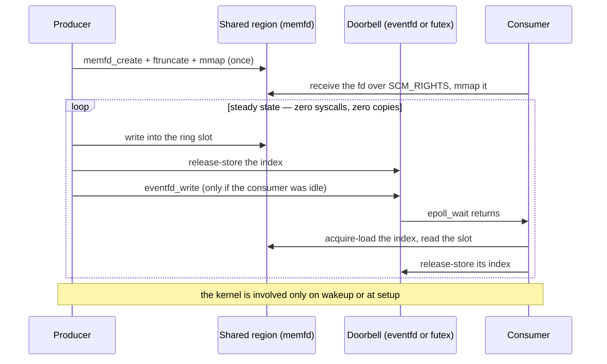
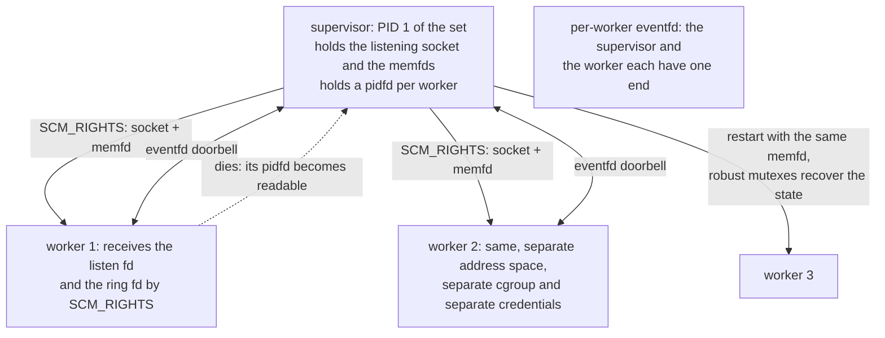

# Linux Concurrency — Kernel and User Mode, Processes, Threads and IPC

Every concurrency bug is a mismatch between **where the code runs** and **what it is allowed to do there**. This note is organised around that one sentence: first the two privilege worlds, then the execution contexts inside the kernel, then the tasks that the scheduler sees, then the primitives that let them communicate.

The framing that makes the whole subject hang together:

> In Linux, **ITC and IPC are the same primitives at the bottom**. A thread is a task that shares its address space; a process is a task that does not. The synchronisation primitive underneath both is the **futex** — a 32-bit word in shared memory plus a syscall that the kernel only sees on contention.



## 1. Kernel mode versus user mode

### 1.1 What the boundary actually protects

| | x86 | ARM / ARM64 | RISC-V |
| --- | --- | --- | --- |
| Privilege naming | Ring 0 = kernel, Ring 3 = user (1 and 2 unused) | EL0 = user, EL1 = kernel, EL2 = hypervisor, EL3 = secure monitor | U = user, S = supervisor, M = machine (HS/VS/VU with the H extension) |
| Concurrent page tables | One `CR3`, user half + kernel half | `TTBR0_EL1` = user, `TTBR1_EL1` = kernel (two base registers, one table walk set) | `satp`, with a supervisor/user split |
| Entering the kernel | `syscall` / `sysenter` / `int 0x80` | `svc #0` | `ecall` |
| Masking interrupts | `EFLAGS.IF` | `DAIF` | `mstatus.MIE` / `sstatus.SIE` |

The kernel half of the address space is mapped in every process but is only accessible at privileged level. That single fact is why a context switch between two processes of the same system does not need to reload the kernel mapping, and it is why a syscall is cheaper than a process switch.

### 1.2 The three things that separate the modes

1. **Privileged instructions.** Control-register access (page-table base, interrupt masking, cache and TLB maintenance) is allowed only in kernel mode. A user-space equivalent does not exist.
2. **Memory visibility.** The kernel can, in principle, reach both halves; user code can only reach its own user half. On modern CPUs the "in principle" is enforced by hardware: **x86 SMAP** (Supervisor Mode Access Prevention) and **ARM PAN** (Privileged Access Never) make even the kernel fault if it dereferences a user pointer casually. That is why `copy_{to,from}_user()` exists and why it is not just a `memcpy` with extra steps: it is a `memcpy` wrapped in the correct enable/disable of that hardware feature plus an `access_ok()` bounds check and a fault handler.
3. **Interrupt and scheduling control.** Only the kernel can mask interrupts, and only the kernel decides who runs next. User-space concurrency is *advisory*; kernel concurrency is *enforced*.

### 1.3 Crossing the boundary



Crossing mechanisms, and which one you get:

| Trigger | Synchronous or asynchronous | Cause | Returns to |
| --- | --- | --- | --- |
| **Syscall** | Synchronous, deliberate | `svc`/`ecall`/`syscall` | The instruction after the trap |
| **Page fault** | Synchronous, caused by the instruction | Missing mapping, write to a COW page, protection violation, or a bad access | The same instruction (after the fault is resolved) |
| **Other exception** | Synchronous | Undefined instruction, alignment, FPU trap, breakpoint | The same instruction, or a signal |
| **Interrupt** | Asynchronous | Hardware | The next instruction |

What a syscall costs:

- The direct cost is two transitions plus the dispatch: save registers, switch to the kernel stack, dispatch, do the work, and return. On a modern embedded core this is typically **hundreds of nanoseconds to a few microseconds**, dominated by the cache and TLB effects rather than by the instruction count.
- The indirect costs are what you actually feel: **any syscall is a preemption point**, a possible signal-delivery point, and a possible scheduling point.
- Contrast with a **process context switch**, which additionally reloads the page-table base and hence invalidates the TLB entries not tagged by ASID/PCID. This is the reason an IPC design that avoids a copy *and* avoids a scheduler wake is measurably better than one that avoids only the copy.

### 1.4 The investment rules

**What user space must never do:**

- Dereference a kernel pointer; there is nothing meaningful there.
- Disable interrupts, or expect to be non-preemptible.
- Assume a shared variable is protected; two threads on two cores will race unless you synchronise.

**What the kernel must never do:**

- Dereference a `__user` pointer directly. Use `copy_to_user()`/`copy_from_user()`/`get_user()`/`put_user()` and **check the return value** — a short copy means a bad pointer, and a non-checked `copy_from_user()` leaves uninitialised kernel memory.
- Use floating point (the FPU state is not saved for kernel contexts; `kernel_fpu_begin()`/`kernel_fpu_end()` are the narrow, explicit exceptions).
- Sleep in atomic context (§2).
- Put a large object on the stack: the kernel stack is commonly **8 KB on 32-bit** and **16 KB on arm64**. No big arrays, no deep recursion, no huge structs by value.
- Trust `set_fs()`: the old escape hatch that let a driver widen the uaccess address limit has been removed on the mainstream architectures. The rule is now absolute — a driver handles user memory through the uaccess API or it does not handle it.

## 2. The execution contexts inside the kernel

This is the table that separates someone who writes kernel code from someone who guesses at it.

### 2.1 The context matrix

| Context | Can sleep | Can be preempted | Can access user memory | Can allocate | Examples |
| --- | --- | --- | --- | --- | --- |
| **NMI / pseudo-NMI** | No | No | No | No | Lockup detector, `perf` |
| **Hard IRQ** | **No** | No (unless a higher-priority IRQ nests) | No | `GFP_ATOMIC` only | Primary handler |
| **softirq / tasklet / BH work** | No | Only by a hard IRQ | No | `GFP_ATOMIC` only | `net_rx_action`, `WQ_BH` items |
| **Process context (syscall)** | **Yes** | Yes, if the preemption model allows | **Yes** | `GFP_KERNEL` | A `read()` that blocks |
| **Kernel thread / workqueue / threaded IRQ** | Yes | Yes | No (unless it borrowed an mm) | `GFP_KERNEL` | `kworker`, `irq/N-name` |
| **NMI on PREEMPT_RT** | No | No | No | No | The one context RT cannot thread |

The four questions to ask before writing a line of code in a given context: **can it sleep, can it be preempted, can it touch user memory, and can it be interrupted by something that will run the same code?** The fourth is the one people forget; it is what forces you to choose between a plain spinlock and the `_irqsave` form.

### 2.2 The preemption models

Four mutually exclusive models, selected in `kernel/Kconfig.preempt` at build time — a module load cannot change it:

| Model | Preemption points | Use |
| --- | --- | --- |
| `PREEMPT_NONE` | Only on return to user space or explicit `schedule()` | Maximum throughput, worst latency; server builds |
| `PREEMPT_VOLUNTARY` | As above, plus explicit `might_sleep()`/cond_resched points | The traditional compromise (desktop distros) |
| `PREEMPT` (full) | Anywhere in kernel code that is not explicitly protected | The general-purpose default on most distributions |
| `PREEMPT_RT` | Everywhere; interrupt handlers are threaded and spinlocks are sleeping locks | Real-time; merged into mainline in **6.12** |

On `PREEMPT_RT` the consequences are structural, not cosmetic: **most `spinlock_t` become sleeping RT-mutexes**, interrupt handlers are forced-threaded, RCU callbacks move into threads, and `local_lock_t` becomes a per-CPU sleeping lock. Code that assumed a spinlock disables preemption or interrupts is wrong on RT — which is precisely why `raw_spinlock_t` exists for the scheduler and a handful of other places where sleeping is impossible.

### 2.3 Knowing where you are

```c
in_interrupt();      /* hard IRQ or softirq (or bottom half disabled) */
in_irq();            /* hard IRQ */
in_softirq();        /* softirq, tasklet, or BH work */
in_atomic();         /* cannot sleep: preemption or BH or IRQ is disabled */
in_task();           /* process or kernel-thread context */
irqs_disabled();     /* the CPU's interrupt flag is off */
```

Underneath these is the **`preempt_count`** word, whose fields are:

| Field | Meaning |
| --- | --- |
| `PREEMPT` | `preempt_disable()` nesting depth |
| `SOFTIRQ` | `local_bh_disable()` nesting depth |
| `HARDIRQ` | Nested hard-IRQs on this CPU |
| `NMI` | Nested NMIs |

A non-zero `preempt_count` is what makes the scheduler refuse to preempt you, and it is what `might_sleep()` asserts on. `DEBUG_ATOMIC_SLEEP` turns every violation into a BUG — enable it during development.

### 2.4 Kernel concurrency: where the parallelism comes from

Four independent sources, all of which can be in flight at once:



The fourth one deserves its own emphasis, because it is the subtle one: **a mutex-protected critical section that contains a blocking call is not atomic.** Whatever you read before the call may be invalid after it.

## 3. The process model

### 3.1 What a task is

The scheduler schedules `struct task_struct`. There is no separate "process" object, and this is the single most clarifying fact in the whole subject:

| Concept | Kernel representation | You see it as |
| --- | --- | --- |
| **Thread** | One `task_struct`, one TID | `gettid()`, `/proc/<pid>/task/<tid>/` |
| **Thread group** | Tasks sharing a TGID | `getpid()` — the TGID of the leader |
| **Process** | A thread group with its own `mm` | `ps` |
| **Kernel thread** | A `task_struct` with `mm == NULL` (`PF_KTHREAD`) | `[kworker/0:1]`, `[ksoftirqd/3]` |



### 3.2 Creating a task: the clone flags

`fork()`, `vfork()` and `pthread_create()` are all wrappers over `clone()` (or, since 5.3, `clone3()`). The flags say *what is shared*; everything not named is copied.

| Flag | Shares | Note |
| --- | --- | --- |
| `CLONE_VM` | Address space (`mm_struct`) | This is what makes a thread a thread |
| `CLONE_FILES` | File descriptor table | Threads share it; also usable deliberately |
| `CLONE_FS` | Root/cwd/umask | |
| `CLONE_SIGHAND` | Signal handlers and blocked mask | Required with `CLONE_THREAD` |
| `CLONE_THREAD` | Puts the child in the same **thread group** → same TGID | The second half of "a thread" |
| `CLONE_SETTLS` | Installs the TLS pointer the child will use | How `__thread` variables work |
| `CLONE_PARENT_SETTID` / `CLONE_CHILD_CLEARTID` | Writes the child TID and clears it on exit | How `pthread_join()` and futex-based exit notification work |
| `CLONE_VFORK` | Parent sleeps until the child execs/exits | `vfork()`, `posix_spawn()` |
| `CLONE_NEW*` | A new namespace (`NS`, `PID`, `NET`, `USER`, `UTS`, `IPC`, `CGROUP`, `TIME`) | Containers |
| `CLONE_PIDFD` | Returns a **pidfd** instead of/at the same time as a PID | Race-free process handling |
| `CLONE_INTO_CGROUP` (via `clone3`) | Places the child in a cgroup v2 at birth, with no fork-then-move race | |

`posix_spawn()` deserves mention for embedded targets: it is a fast `clone(CLONE_VM|CLONE_VFORK)` + `execve`, avoiding the page-table churn of a COW `fork()` on a system without an MMU or with a slow one.

### 3.3 Copy-on-write

`fork()` does not copy the address space. It duplicates the page tables and marks every writable page read-only, so that the first write from either side takes a **write-protection fault**, and `do_wp_page()` allocates a new page for the writer. Consequences worth being able to state:

- `fork()` of a large process is fast; the cost arrives later, spread across the faults.
- The COW cost is proportional to the number of pages *actually written*, so a `fork()` immediately followed by `execve()` pays almost nothing — which is what makes `posix_spawn()` cheap.
- On a **no-MMU** system (`CONFIG_MMU=n`, uClinux) there is no COW, `fork()` is unavailable, and you get `vfork`/`posix_spawn` semantics only. This is a genuinely useful fact to volunteer in an embedded interview.

### 3.4 Lifecycle



- **Zombies** hold only a `task_struct` and a PID. A `pthread_create()` that is neither joined nor detached leaks one forever; the fix is `pthread_detach()` or `pthread_join()`.
- **Orphans** are reparented to PID 1 (or to the nearest subreaper, via `PR_SET_CHILD_SUBREAPER`). A container whose PID 1 ignores `SIGTERM` is the canonical shutdown bug.
- **PID 1 semantics**: it has no default signal handlers and it reaps orphans. A supervised service is restarted on failure; a hand-rolled double-forked daemon is not.

### 3.5 Where cgroup v2 and namespaces meet the process model

- **cgroups v2**: one unified hierarchy. Controllers: `cpu`, `memory`, `io`, `pids`, `cpuset`, `hugetlb`. This is the same mechanism you use to pin and budget dataplane cores — see [[05-1 DPDK User Plane and 5G UPF]].
- **Namespaces**: `mnt`, `pid`, `net`, `ipc`, `uts`, `user`, `cgroup`, `time`. `/proc/<pid>/ns/*` are the handles; `unshare` and `nsenter` are the tools for poking at them.
- Together they are the container: a task tree with its own view of the system and a budget.

## 4. Threads

### 4.1 History, stated correctly

Three implementations existed; the winner's design decisions are still visible in the API.

| | Model | Key properties | Fate |
| --- | --- | --- | --- |
| **LinuxThreads** (Xavier Leroy, ~1996) | Distinct processes sharing an address space, plus a manager thread | Each thread had its own PID, so `getpid()` differed inside one program; signals were not delivered process-wide; the manager thread was a single point of failure | Superseded |
| **NGPT** (IBM) | M:N — many user threads over fewer kernel tasks | Clever, complex | Withdrawn |
| **NPTL** (Ulrich Drepper, Ingo Molnár) | **1:1** — one kernel task per thread | Pushed the hard part into new kernel primitives, above all the **futex** | The only implementation |

**NPTL** became the runtime default in glibc 2.3 and the default *development* library in glibc 2.3.4-19 (April 2005). The kernel support it requires is exactly three things: `CLONE_THREAD`, the futex, and `set_tid_address`.

The lesson that generalises, and is worth quoting: **fast uncontended locking in user space plus a cheap kernel wait primitive beats clever user-level scheduling for most real workloads.** Solaris went through the same arc and also moved to 1:1.

### 4.2 What creation costs

```c
pthread_attr_t attr;
pthread_attr_init(&attr);
pthread_attr_setstacksize(&attr, 64 * 1024);   /* 8 MB default is huge on embedded */
pthread_attr_setdetachstate(&attr, PTHREAD_CREATE_DETACHED);
pthread_attr_setschedpolicy(&attr, SCHED_FIFO);
struct sched_param sp = { .sched_priority = 60 };
pthread_attr_setschedparam(&attr, &sp);
pthread_attr_setinheritsched(&attr, PTHREAD_EXPLICIT_SCHED);
pthread_attr_setaffinity_np(&attr, sizeof(mask), &mask);
rc = pthread_create(&tid, &attr, worker, arg);
pthread_setname_np(tid, "rx-worker");
```

- **Stack size**: the default is usually **8 MB** (from `RLIMIT_STACK`), which is virtual and lazily faulted but still absurd on a 256 MB device — and it becomes real memory if `mlockall()` is in play. **Always set it explicitly.**
- **Naming**: `pthread_setname_np()` is what makes `ps -eLf`, `top -H` and `perf` useful instead of anonymous. Non-portable, indispensable.
- **Affinity**: `pthread_setaffinity_np()` / `sched_setaffinity()`.
- Priorities and policies: `SCHED_OTHER` (the default, **EEVDF** since 6.6), `SCHED_BATCH`, `SCHED_IDLE`, `SCHED_FIFO`, `SCHED_RR`, `SCHED_DEADLINE`.

### 4.3 The four things shared versus private

| | Shared by threads | Private per thread |
| --- | --- | --- |
| Memory | The whole address space: heap, globals, `mmap` regions | **Stack** and the TLS area |
| File descriptors | The whole table | — |
| Signal dispositions | Shared; the **mask** is per-thread | Pending signals: process-directed go to the group, thread-directed to the target |
| Credentials and namespaces | Shared | — |
| Identity | TGID (`getpid()`) | TID (`gettid()`) |
| Scheduling | Policy and priority are **per-thread** | — |

The practical implications of the signals row:

- `pthread_sigmask()` blocks signals for one thread; `sigprocmask()` in a multithreaded program is unspecified.
- A process-directed signal is delivered to **any** thread that does not block it. `pthread_kill()` targets a specific thread; `tgkill()`/`tkill()` are the raw forms.
- The clean way to handle signals in a threaded daemon is to block them all in `main()`, then create a dedicated thread that does `sigwaitinfo()` — or, better, use `signalfd()` and handle them inside the `epoll` loop.

### 4.4 Thread or process

| Question | If yes → |
| --- | --- |
| Must a crash or a memory corruption in one unit be survivable by the others? | **Process** |
| Do the units need independent credentials, namespaces or a cgroup budget? | **Process** |
| Do they need to be restarted independently? | **Process** |
| Is the shared data big, or is the handoff latency-critical? | **Thread** |
| Do they need to hold pointers to each other's objects? | **Thread** |
| Is the machine small and the unit count low? | Usually **threads + one event loop** |

On an embedded target the usual answer is: **a small number of processes for isolation boundaries (supervisor, network-facing parser, privileged helper), each with a thread pool and an event loop inside.** Process-per-connection designs do not survive contact with a 512 MB device.

## 5. Kernel threads

- Born from **`kthreadd`** (PID 2); created with `kthread_create()` / `kthread_run()`, stopped with `kthread_stop()` and `kthread_should_stop()` in the loop.
- They have `mm == NULL` and the `PF_KTHREAD` flag; if they must touch another address space they use `use_mm()`/`kthread_use_mm()` explicitly.
- The families you will see in `ps`:

| Name pattern | Role |
| --- | --- |
| `kworker/<cpu>:<id><flags>` | Workqueue workers. Flags: `H` = high-priority pool, `C` = CPU-intensive, `F` = freezable, `P` = power-efficient, `U` = unbound |
| `ksoftirqd/<cpu>` | Runs pending softirqs when the inline loop exceeded its budget |
| `migration/<cpu>` | CPU migration and isolation work, at the highest RT priority |
| `rcu*`, `rcuc/<cpu>`, `rcub/<cpu>` | RCU grace-period and callback handling |
| `watchdogd`, `watchdog/<cpu>` | Soft/hard lockup detector |
| `irq/<n>-<name>` | Threaded interrupt handlers (see [[04-4 Linux Interrupts - Types, Handlers, Threaded IRQs and Deferred Work]]) |
| `kcompactd`, `khugepaged`, `kswapd` | Memory management housekeeping |

The naming convention `[name]` in `ps` means "kernel thread, no user address space".

## 6. ITC — synchronisation inside a process

### 6.1 The primitive hierarchy



Everything below the mutex is assembly-assisted and contended-path-only. Everything above it is ergonomics. The correct engineering instinct is to use the highest level that meets the latency requirement, and to drop to atomics only with a measured reason.

### 6.2 Memory ordering — the part that eludes people

Three facts that make the whole subject tractable:

1. **The compiler and the CPU both reorder.** A mutex makes the reordering irrelevant *inside* the critical section, but nothing else does. A hand-rolled flag protected by "I declare it `volatile`" is not synchronisation — `volatile` controls the compiler, not the hardware, and not the other core.
2. **The primitives you need are acquire and release, not barriers everywhere.** A release store pairs with an acquire load to create a *happens-before* edge; that is enough for the classic message-passing ring.
3. **`seq_cst` is the safe default and is cheaper than people fear on x86/arm64**, but on a weakly ordered core a needlessly strong ordering on a hot path is a real, measurable cost.

| C11 / C++ | Meaning |
| --- | --- |
| `memory_order_relaxed` | Atomicity only — no ordering. Use for counters where only the total matters |
| `memory_order_consume` | Dependency-ordered; in practice promoted to acquire — do not rely on it |
| `memory_order_acquire` | No subsequent access may be hoisted before it |
| `memory_order_release` | No prior access may sink past it |
| `memory_order_acq_rel` | Both, for a read-modify-write |
| `memory_order_seq_cst` | Plus a single total order across all such operations — the default in C++ and in `__ATOMIC_SEQ_CST` |

```c
/* C11 lock-free SPSC ring: the shape that works */
struct ring { _Atomic unsigned head; _Atomic unsigned tail;
              struct item buf[N] __attribute__((aligned(64))); };

/* producer */
unsigned h = atomic_load_explicit(&r->head, memory_order_relaxed);
unsigned t = atomic_load_explicit(&r->tail, memory_order_acquire);
if (((h + 1) % N) == t) return -ENOSPC;          /* full */
r->buf[h] = item;
atomic_store_explicit(&r->head, (h + 1) % N, memory_order_release);

/* consumer */
unsigned t = atomic_load_explicit(&r->tail, memory_order_relaxed);
unsigned h = atomic_load_explicit(&r->head, memory_order_acquire);
if (t == h) return -EAGAIN;                       /* empty */
item = r->buf[t];
atomic_store_explicit(&r->tail, (t + 1) % N, memory_order_release);
```

The acquire on the *other* index is the whole trick: it guarantees you see the writes the peer made before it published. The release on your own index publishes yours. `relaxed` on your own index is legal only because a single producer/consumer owns it.

### 6.3 Futex — the one primitive at the bottom

**History and versions.** Futexes were designed by Hubertus Franke (IBM), Matthew Kirkwood, Ingo Molnár and Rusty Russell, presented at the Ottawa Linux Symposium in 2002 as *"Fuss, Futexes and Furwocks: Fast Userlevel Locking in Linux"*, and integrated into the kernel in **2.5.7** with the current semantics from **2.5.40**. `FUTEX_REQUEUE` arrived around **2.5.70** and `FUTEX_CMP_REQUEUE` in **2.6.7**.

**How it works.**

```c
/* an uncontended mutex touches the kernel zero times */
lock:   if (atomic_cmpxchg(&word, 0, 1) == 0) return;      /* fast path */
        atomic_store(&word, 2);                            /* 2 = locked with waiters */
        while (atomic_cmpxchg(&word, 0, 2) != 0)
            futex(&word, FUTEX_WAIT, 2, NULL, NULL, 0);    /* slow path: sleep */

unlock: if (atomic_exchange(&word, 0) == 1) return;        /* no waiters, done */
        futex(&word, FUTEX_WAKE, 1, NULL, NULL, 0);        /* otherwise wake one */
```

| Operation | Purpose |
| --- | --- |
| `FUTEX_WAIT` / `FUTEX_WAIT_BITSET` | Sleep while the word still holds the expected value |
| `FUTEX_WAKE` / `FUTEX_WAKE_BITSET` | Wake up to *n* waiters (optionally matching a bitset) |
| `FUTEX_REQUEUE` / `FUTEX_CMP_REQUEUE` | Move waiters from one word to another without waking them — what makes a condition variable efficient |
| `FUTEX_LOCK_PI` / `FUTEX_UNLOCK_PI` / `FUTEX_TRYLOCK_PI` | **Priority-inheritance** futexes, for `PTHREAD_PRIO_INHERIT` mutexes |
| `FUTEX_WAIT_REQUEUE_PI`, `FUTEX_CMP_REQUEUE_PI` | The PI-aware requeue used by PI condvars |
| `FUTEX_FD` | The original file-descriptor form — do not use it, it was superseded |
| `FUTEX_WAITV` | Wait on several futex words in one call |
| `FUTEX_PRIVATE_FLAG` (the `_PRIVATE` variants) | Key the futex by virtual address + `mm` instead of by the underlying object — the flag glibc passes for process-private mutexes |

**Keying is the subtle part, and it is why threads and processes differ:**

- A **private** futex is keyed by the virtual address plus the `mm`. Two tasks in the same address space agree; two processes with the same address do not.
- A **shared** futex is keyed by the underlying object — the page and its offset in a file or shared mapping. Two processes that `mmap` the same `memfd` or the same `shm` object agree even at different addresses.
- This is why `pthread_mutexattr_setpshared(PTHREAD_PROCESS_SHARED)` is a real configuration step, and why a "shared" mutex placed in anonymous private memory across a `fork()` does not do what you hoped.

**Robustness — the price of no kernel involvement.** If a process dies holding a futex-protected mutex, the kernel has no idea the lock existed. The fix:

```c
pthread_mutexattr_t a; pthread_mutexattr_init(&a);
pthread_mutexattr_setpshared(&a, PTHREAD_PROCESS_SHARED);
pthread_mutexattr_setrobust(&a, PTHREAD_MUTEX_ROBUST_NP);   /* FUTEX_OWNER_DIED path */
```

A robust mutex makes the next locker get `EOWNERDEAD`, at which point it must **repair the protected state** and call `pthread_mutex_consistent()`. There is no automatic repair: the invariant is yours to restore, and pretending otherwise is the classic shared-memory corruption bug.

### 6.4 Choosing the primitive

| Primitive | Use | Trap |
| --- | --- | --- |
| **mutex** | Mutual exclusion with an owner | Not recursive by default; a PI mutex needs `PTHREAD_PRIO_INHERIT` |
| **recursive mutex** | Re-entrant locking | Usually a symptom: it means the locking boundary does not match the call structure |
| **rwlock** | Read-mostly, many readers | Writer starvation is configurable; on a short critical section it is often slower than a mutex |
| **spinlock** (`pthread_spinlock_t`) | Very short critical sections, and only with a scheduler-free guarantee | Spinning in a preemptible thread can burn a whole timeslice. On a single core it is pure waste |
| **condition variable** | Wait for a predicate | **Always re-check the predicate in a `while` loop**; wakeups are spurious and the predicate can change before you get the CPU |
| **semaphore** | Counting: a resource pool or a signal with no ownership | Not a mutex: there is no owner, and therefore no priority inheritance |
| **barrier** | Rendezvous of N threads | `pthread_barrier_wait()`; one thread gets `PTHREAD_BARRIER_SERIAL_THREAD` |
| **atomic counters / per-thread counters** | Remove contention entirely | Per-thread counters plus `rseq` (merged in **4.18**) give per-CPU-like performance in user space |
| **`rseq`** | Restartable sequences: per-CPU data structures without locks | Aborts the sequence on preemption or migration |

```c
/* the only correct condvar shape */
pthread_mutex_lock(&m);
while (!predicate_ready())                 /* while, not if */
    pthread_cond_wait(&cv, &m);            /* releases m atomically, reacquires before returning */
do_work();
pthread_mutex_unlock(&m);
```

### 6.5 Priority inversion and the two fixes

The failure: a low-priority task holds a lock, a high-priority task blocks on it, and a medium-priority task preempts the low one — so the high-priority task waits for medium-priority work.

1. **Priority inheritance** — the lock holder temporarily inherits the waiter's priority. In the kernel: `rt_mutex` (and, under `PREEMPT_RT`, most `spinlock_t`). In user space: `pthread_mutexattr_setprotocol(PTHREAD_PRIO_INHERIT)`, which is implemented over `FUTEX_LOCK_PI`.
2. **Priority ceiling** — `PTHREAD_PRIO_PROTECT` raises the holder to a fixed ceiling. Predictable, but you must know the ceiling.
3. The third answer, which is often the right one: **remove the lock** (per-thread or per-CPU data, a lock-free ring, or a design where the low-priority work never holds anything the high-priority path needs).

The canonical cautionary tale is the Mars Pathfinder reset problem: a priority inversion in a shared bus mutex, fixed by enabling priority inheritance after the fact.

### 6.6 False sharing — the performance bug that looks like a design bug

Two hot counters on the same 64-byte cache line bounce the line between cores even though the threads never share a variable. The symptom is "adding threads made it slower". The fixes are `alignas(64)` / `__attribute__((aligned(64)))`, padding between indices, and per-thread counters aggregated on demand.

## 7. IPC — communication between processes

### 7.1 The axes

Every IPC question is answered along the same seven axes. Say them out loud and the choice usually makes itself:

1. **Direction** — one-way, request/response, or multicast.
2. **Copies** — how many times the payload is copied.
3. **Kernel crossings** — and therefore syscalls, and therefore possible scheduling points.
4. **Ordering and priority** — FIFO, priority-ordered, or unordered.
5. **Persistence** — does the object outlive the processes?
6. **Capability passing** — can it carry a file descriptor, and hence a resource?
7. **Crash semantics** — what happens if one peer dies mid-operation? (This is the axis most designs skip, and the one that decides whether a daemon survives a worker crash.)

### 7.2 The mechanism table

| Mechanism | Direction | Copies | Kernel crossing | Persistent | Passes fds | Use | Crash semantics |
| --- | --- | --- | --- | --- | --- | --- | --- |
| **Pipe** | One-way | 1–2 | Yes | No | No | Shell pipelines, parent→child streams | Reader sees EOF when all writers close |
| **FIFO** | One-way, named | 1–2 | Yes | Yes (a filesystem name) | No | A well-known rendezvous point | Same as a pipe |
| **Signal** | Async notification, no payload | 0 | Yes | No | No | Lifecycle only | — |
| **`sigqueue` / rt-signal** | Async + a small value | 0 | Yes | No | No | "Wake up with a reason" | Standard signals coalesce; rt signals queue |
| **POSIX mqueue** | Both, **priority-ordered** | 2 | Yes | Yes (a `/name`) | **No, but it is an fd** | Real-time messaging, `mq_timedreceive` | Message survives the sender; `mq_notify` for async |
| **SysV msg queue** | Both, typed | 2 | Yes | **Yes, kernel-persistent** | No | Legacy | Survives everyone; needs `ipcrm` to clean up |
| **Shared memory** (`shm_open`, `memfd_create`) | Both | **0 after setup** | Setup only | Configurable | No (pass the fd separately) | Large or high-rate data | Needs robust futexes or a supervisor |
| **Semaphore** (POSIX / SysV) | Synchronisation | 0 | Yes | Yes | No | The pairing to shared memory | SysV sems can be undo-on-exit (`SEM_UNDO`), POSIX ones cannot |
| **Unix domain socket** | Both, stream/dgram/**seqpacket** | 1 (0 for an fd) | Yes | Filesystem or abstract | **Yes, via `SCM_RIGHTS`** | Local services, daemon control | Peer sees `EPOLLHUP`/`ECONNRESET` |
| **eventfd** | Counter / doorbell | 0 | Yes | No | No | The cheapest pollable wakeup | — |
| **`signalfd`, `timerfd`, `pidfd`** | fd-ified kernel events | 0 | Yes | No | No | Everything in one `epoll` set | — |
| **futex** | Fast sync over shared memory | 0 uncontended | On contention only | No | No | The primitive under all of it | Needs the robust list |
| **netlink** | Kernel ↔ user (and usable between processes) | 1 | Yes | No | No | Network configuration and events | — |
| **D-Bus** | RPC + signals | 2 + marshalling | Yes (a daemon) | No | Yes | System/desktop service bus | — |
| **Binder** | RPC + shared buffer | 1 | Yes (a driver) | No | Yes, plus shared buffers | Android | Death notifications are built in |

### 7.3 The decision logic



### 7.4 The canonical high-performance pattern



```c
/* producer side: create the region and hand it over */
int memfd = memfd_create("ring", MFD_CLOEXEC | MFD_ALLOW_SEALING);
ftruncate(memfd, RING_SIZE);
void *base = mmap(NULL, RING_SIZE, PROT_READ|PROT_WRITE, MAP_SHARED, memfd, 0);

/* hand both the memfd and an eventfd across a Unix socket */
struct msghdr msg = { 0 };
char control[CMSG_SPACE(2 * sizeof(int))];
msg.msg_control = control; msg.msg_controllen = sizeof(control);
struct cmsghdr *cmsg = CMSG_FIRSTHDR(&msg);
cmsg->cmsg_level = SOL_SOCKET; cmsg->cmsg_type  = SCM_RIGHTS;
cmsg->cmsg_len   = CMSG_LEN(2 * sizeof(int));
int fds[2] = { memfd, doorbell };
memcpy(CMSG_DATA(cmsg), fds, sizeof(fds));
sendmsg(sock, &msg, 0);
```

The three things that go wrong in this pattern, in order of frequency:

1. **Memory-order mistakes** — a bare `volatile` index instead of an acquire/release pair. It works on x86 and fails on arm64 under load.
2. **False sharing** — `head` and `tail` on the same cache line. Pad them to a cache line each.
3. **No answer to "what if a peer dies holding the lock"** — use robust futexes, or an external supervisor, or a design where the ring is single-producer/single-consumer and therefore lockless.

### 7.5 The fd-everything design

The strongest structural idea in Linux IPC is that **everything that can be waited on should be a file descriptor**, because then one `epoll` set owns the whole event loop:

| fd | Represents |
| --- | --- |
| `eventfd` | A doorbell — "this happened *n* times" |
| `signalfd` | A signal, converted so it can be handled in the loop |
| `timerfd` | A timer |
| `pidfd` (`pidfd_open`, **5.3**) | A child process; it becomes readable when the child dies, and it is immune to PID reuse |
| `inotify` / `fanotify` fd | Filesystem events |
| `memfd` (**3.17**) | An anonymous memory region you can seal and pass by fd |
| `io_uring` (**5.1**) | Submission and completion rings for I/O |
| `perf_event` | Hardware counters |

Once every event source is an fd, the concurrency design collapses to "one thread, one `epoll_wait`, a switch on the event type" — which is also the easiest thing to reason about, to test and to profile.

```c
int ep = epoll_create1(EPOLL_CLOEXEC);
/* ... add the socket, the eventfd, the timerfd, the pidfd ... */
for (;;) {
    int n = epoll_wait(ep, evs, MAX, -1);
    for (int i = 0; i < n; i++) {
        if (evs[i].data.fd == doorbell) { uint64_t v; read(doorbell, &v, 8); drain_ring(); }
        else if (evs[i].data.fd == timer) { read(timer, &x, 8); periodic(); }
        else if (evs[i].events & (EPOLLHUP | EPOLLERR)) { peer_died(evs[i].data.fd); }
        else handle_socket(evs[i].data.fd);
    }
}
```

### 7.6 ITC versus IPC — the same problem, one privilege of sharing

| Concern | ITC (threads) | IPC (processes) |
| --- | --- | --- |
| Shared data | A global or heap object | A `memfd`/`shm` mapping at possibly different addresses |
| Notification | `pthread_cond_signal` → futex | `eventfd` or a private futex word |
| Mutual exclusion | `pthread_mutex` (private futex) | The same mutex with `PTHREAD_PROCESS_SHARED` (shared futex) |
| Passing a resource | Just hand the pointer | `SCM_RIGHTS` — the only clean way |
| Failure isolation | None: one fault takes the group | A crash is contained |
| Identity | One TGID, N TIDs | `SO_PEERCRED` gives pid/uid/gid; `SO_PEERSEC` gives the LSM label |
| Cost | Cheapest | One more copy or one more syscall at every boundary |

The punchline that closes a design discussion: **shared memory is the data plane; the doorbell is the control plane.** Choose them independently — a ring plus an `eventfd` is just as correct as a ring plus a futex, and the `eventfd` version is easier to integrate into an `epoll` loop.

### 7.7 A worked multi-process daemon



Properties this buys, and why each one is deliberate:

- **Privilege separation**: only the supervisor binds the privileged port and opens the hardware; workers run with dropped capabilities.
- **Independent restart**: the pidfd makes death detection race-free (no PID reuse), and the robust mutexes make the shared state recoverable.
- **Zero-copy data path**: the ring is `mmap`ed once, forever.
- **One event loop per worker**: socket + doorbell + timerfd in a single `epoll` set.

## 8. Kernel ↔ user concurrency interfaces

The last piece: sometimes the concurrency has to cross the privilege boundary.

| Interface | Direction | Use | Note |
| --- | --- | --- | --- |
| **syscall** | User → kernel | The floor | Hundreds of ns; a preemption point |
| **io_uring** | Both, ring-based | Batched, async I/O | Eliminates most syscalls; `IORING_SETUP_SQPOLL` removes them entirely from the submitting thread |
| **netlink / generic netlink** | Both | Configuration and events | The right answer for a networking control plane |
| **ioctl** | User → kernel | Device-specific commands | Last resort; must be encoded with `_IOC()` and versioned |
| **sysfs / debugfs / configfs** | Both, one value per file | State and configuration | sysfs is ABI; debugfs is not |
| **mmap** | Shared | Zero-copy bulk | The basis of every ring and of `dmabuf` |
| **UIO / VFIO** | Both | Userspace drivers | See [[04-2 Linux Embedded Development - Drivers, Applications and Core Subsystems]] |
| **eBPF** | User → kernel, in the other direction | Moving work into the kernel without a module | Bounded by the verifier, which is exactly why it is safe |
| **signals / `SIGIO`** | Kernel → user | Asynchronous notification | `fasync_helper()` + `kill_fasync()` on the kernel side |

## 9. Debugging and failure modes

### 9.1 The taxonomy of concurrency bugs

| Bug | Shape | Detection |
| --- | --- | --- |
| **Data race** | Two threads touch the same object without synchronisation; at least one writes | TSan / KCSAN; often invisible until the compiler reorders |
| **Deadlock (ABBA)** | Two locks taken in opposite orders | `lockdep` in the kernel; TSan/helgrind in user space |
| **Self-deadlock** | A non-recursive mutex locked twice | Immediate; also the reason a signal handler must not lock |
| **Lost wakeup** | The predicate changed between the check and the `cond_wait` | The `while` loop; a missing wakeup after a state change |
| **Priority inversion** | A low-priority holder blocks a high-priority waiter | Symptom is unexplained latency; the fix is PI |
| **Livelock / starvation** | Everyone is runnable but no one progresses | Counters stop; `rwlock` writer starvation is the classic |
| **Spurious wakeup** | `pthread_cond_wait` returns with the predicate false | The `while` loop fixes it; not a bug in the library |
| **Sleep in atomic context** | A blocking call in a hard IRQ or under a spinlock | `might_sleep()` / `DEBUG_ATOMIC_SLEEP` in the kernel |
| **Use after free across a lock** | An object freed while another thread still holds a reference to it | Refcounts, `refcount_t` in the kernel, ASan in user space |
| **Unjoined thread leak** | `pthread_create` with neither join nor detach | A growing `Threads:` count in `/proc/<pid>/status` |

### 9.2 The toolchain

| Tool | Finds |
| --- | --- |
| `ps -eLf`, `top -H`, `htop` | Thread count, per-thread state, where the CPU is |
| `/proc/<pid>/status` | `Threads:`, `voluntary_ctxt_switches`, `nonvoluntary_ctxt_switches` — the cheap way to spot a thrashing design |
| `/proc/<pid>/task/<tid>/` | Per-thread `status`, `stack` (its kernel stack), `wchan` (where it is blocked) |
| `/proc/<pid>/stack` | The kernel stack of a blocked thread |
| `strace -f -ff -tt -T` | Syscalls with timings, per thread — the fastest way to see contention |
| `perf sched record` / `perf sched latency` | Scheduling latency, migrations, and who waited for whom |
| **ftrace** `sched_switch`, `sched_wakeup`, + KernelShark | The visual timeline of who ran when |
| `gdb` `thread apply all bt`, `info threads` | Post-mortem thread state in a core dump |
| **rr** | Time-travel debugging: replay a data race deterministically |
| **TSan** (ThreadSanitizer) | Data races in user space — the single highest-value tool here |
| **helgrind** (valgrind) | Races and lock-order problems, slower but no rebuild semantics |
| **ASan / LSan** | Use-after-free and leaks |
| **lockdep** (`CONFIG_PROVE_LOCKING`) | Lock-order inversions in the kernel, at runtime |
| **KCSAN** | Data races in kernel code |
| `bpftrace` / `bcc` | Live questions about locks, sleeps and wakeups |

Method, in order:

1. **Count before you guess**: `Threads:` in `/proc/<pid>/status`, plus the interrupt and softirq counts from [[04-4 Linux Interrupts - Types, Handlers, Threaded IRQs and Deferred Work]].
2. **Find the blocked and the waiting**: `wchan` and `stack`, or `perf sched`.
3. **Instrument the contention, not the code**: `strace -fT` will show a `futex` syscall taking 3 ms, which is the contention itself.
4. **Then design the contention away**: per-thread state, a lock-free ring, or fewer participants — not a faster lock.

## Anchors — verified facts (check before repeating)

- **Futexes** were designed by Hubertus Franke (IBM), Matthew Kirkwood, Ingo Molnár and Rusty Russell, presented at the **Ottawa Linux Symposium 2002** as *"Fuss, Futexes and Furwocks: Fast Userlevel Locking in Linux"*, and integrated in **Linux 2.5.7**; current semantics from **2.5.40**, `FUTEX_REQUEUE` ~**2.5.70**, `FUTEX_CMP_REQUEUE` in **2.6.7**.
- **NPTL** is a **1:1** model (one kernel task per thread), by Ulrich Drepper and Ingo Molnár. It became the runtime default in glibc **2.3** and the default development library in glibc **2.3.4-19** (April 2005). Its kernel dependencies are `CLONE_THREAD`, the futex and `set_tid_address`. LinuxThreads (Xavier Leroy) preceded it; NGPT (IBM) was the M:N alternative and was withdrawn.
- **POSIX threads** were ratified as **IEEE Std 1003.1c-1995** and folded into POSIX.1.
- **Threaded IRQ threads** run at `SCHED_FIFO` priority **50** (`MAX_USER_RT_PRIO / 2`) — the number that makes a user-space RT task able to preempt an interrupt thread deliberately.
- **Syscall introduction versions** useful for dating a feature: `memfd_create` **3.17**; `membarrier` **4.3**; `rseq` **4.18**; `io_uring` **5.1**; `pidfd_send_signal` **5.2**; **`clone3` and `pidfd_open` 5.3**; `waitid(P_PIDFD)` **5.4**; `sched_setattr`/`sched_getattr` (**SCHED_DEADLINE**) **3.14**.
- **PREEMPT_RT** merged into mainline in **6.12** (November 2024) for x86 (32/64-bit), arm64 and RISC-V; LoongArch followed in **6.13**, 32-bit ARM in **7.1**. Four preemption models are mutually exclusive and require a rebuild.
- **EEVDF** replaced CFS as the default scheduler in **6.6**.
- **`MAX_RT_PRIO` is 100**; RT priorities are 1–99 and `SCHED_DEADLINE` is the only policy with an admission test (`runtime, period, deadline`).
- **Default pthread stack size** follows `RLIMIT_STACK`, commonly **8 MB** — set it explicitly on embedded targets.
- **`clone3`** was added because `clone`'s flags field was full and its argument list was architecture-dependent; it also carries `CLONE_INTO_CGROUP` and `set_tid`.
- **Namespaces** in current kernels: `mnt`, `pid`, `net`, `ipc`, `uts`, `user`, `cgroup`, `time`. **cgroups v2** is a single unified hierarchy.

## Related
- [[01-8 5G NR - OpenAirInterface - Architecture of an Open-Source NR Stack]] — the execution model in full: POSIX threads at real-time priority, notified FIFOs instead of message queues in the hot path, a worker pool for LDPC, and the shared-address-space trade-off

- [[04-4 Linux Interrupts - Types, Handlers, Threaded IRQs and Deferred Work]] — the sibling note: the hard-IRQ and bottom-half contexts referenced throughout §2 and §5
- [[04-6 Linux Device Drivers - Model, Probe, Data Path, Power and Bring-Up]] — where these primitives get used: which lock for which context in a driver, the five driver-specific concurrency failure modes, and the teardown race that a refcount on state rather than on the device prevents
- [[04-2 Linux Embedded Development - Drivers, Applications and Core Subsystems]] — the parent note: the driver model, device tree, kernel locking primitives, and the IPC decision axes
- [[04-1 Embedded Systems RTOS and Hardware Interfaces]] — the RTOS counterpart: task states, priority inversion, and the primitives that do not need a kernel/user split
- [[04-3 Embedded Software Architecture - Patterns, Layering and Wireless System Structure]] — turning this into a layering decision: which units are processes, which are threads, and where the event loop lives
- [[05-1 DPDK User Plane and 5G UPF]] — concurrency without the kernel: polling instead of notification, per-core memory instead of sharing
- [[08-2 C and C++ Programming - Language Features, STL and Systems Practice]] — the language-level memory model, `std::atomic`, and the C idioms (`container_of`, `READ_ONCE`) used on the kernel side
- [[06-2 Agent Systems and Edge Orchestration]] — IPC and sandboxing at the level of on-device agents
- [[05-2 Cloud-Edge-End Collaboration and Heterogeneous Computing]] — partitioning: the same "what shares memory with what" question asked across a machine boundary
- [[08-1 Programming Languages Toolchain and Performance Engineering]] — measuring contention: `perf`, tracing, and the bypass options
- [[07-1 RISC-V for Communication Infrastructure]] — the privilege levels and CSR names referenced in §1.1
- [[01-6 NR DU MAC Scheduler - Resource Allocation, HARQ and Real-Time Implementation]] — the concurrency model applied to the hardest case: one lock-free per-slot thread, deferred-apply queues for RRC reconfiguration, and a hot path that must not allocate

---

## References

### Books

- **[Book · ★★★ · EN]** **The Linux Programming Interface** — Michael Kerrisk, No Starch Press, 2010. ISBN 978-1-59327-220-3 (the current 2nd printing is ISBN 978-1-59327-353-8). The single most complete and careful account of the POSIX/Linux user-space API. Chapters 24–32 cover processes and threads; chapters 43–57 cover IPC in the exact order used in §7, including pipes, FIFOs, POSIX and System V IPC, shared memory, mapped files, message queues, sockets and `SCM_RIGHTS`. If you read one book for this note, read this one.
- **[Book · ★★★ · EN]** **Advanced Programming in the UNIX Environment**, 3rd ed. — W. Richard Stevens, Stephen A. Rago, Addison-Wesley, 2013. ISBN 978-0-321-63773-4. Chapters 8 (process control), 11 (threads), 12 (thread control) and 15–17 (IPC). The classic treatment, and the source of the process-control discipline in §3.
- **[Book · ★★★ · EN]** **UNIX Network Programming, Volume 2: Interprocess Communications**, 2nd ed. — W. Richard Stevens, Prentice Hall, 1999. ISBN 0-13-081081-9. The most detailed treatment of POSIX IPC, Unix domain sockets, `SCM_RIGHTS` and shared memory available; its Chapter 5 (Posix IPC) and Chapter 15 (Unix domain sockets) are the direct sources for §7.
- **[Book · ★★★ · EN]** **Linux Kernel Development**, 3rd ed. — Robert Love, Addison-Wesley, 2010. ISBN 978-0-672-32946-3. Chapters 3 (process management: `task_struct`, `fork`, `clone`, threads, `exit`) and 9–10 (synchronisation). The shortest correct route to §2 and §3.
- **[Book · ★★ · EN]** **Professional Linux Kernel Architecture** — Wolfgang Mauerer, Wrox, 2008. ISBN 978-0-470-34343-2. The detail-oriented reference for `task_struct`, namespaces, the scheduler classes and the kernel synchronisation primitives.
- **[Book · ★★ · EN]** **Understanding the Linux Kernel**, 3rd ed. — Daniel P. Bovet, Marco Cesati, O'Reilly, 2005. ISBN 0-596-00565-2. Chapter 3 (processes) and Chapter 5 (kernel synchronisation). Dated in places, structurally still the clearest available.
- **[Book · ★★★ · EN]** **Is Parallel Programming Hard, And, If So, What Can You Do About It?** — Paul E. McKenney. Free and continuously updated; the authoritative practical text on memory ordering, locking, lock-free techniques and the deferred-processing patterns. Read the memory-ordering and the counting chapters before designing anything lock-free.
- **[Book · ★★★ · EN]** **The Art of Multiprocessor Programming**, 2nd ed. — Maurice Herlihy, Nir Shavit, Morgan Kaufmann, 2020. ISBN 978-0-12-397337-5 (1st ed. 2008, ISBN 978-0-12-370591-4). The theory: linearisability, spin locks, concurrent queues and stacks, transactional memory. The source of the correctness standards implied in §6.
- **[Book · ★★ · EN]** **Modern Operating Systems**, 4th ed. — Andrew S. Tanenbaum, Herbert Bos, Pearson, 2015. ISBN 978-0-13-359162-0. Chapters 2 (processes and threads) and 6 (deadlock and IPC) for the OS-theory grounding.
- **[Book · ★★ · EN]** **Operating System Concepts**, 10th ed. — Abraham Silberschatz, Peter B. Galvin, Greg Gagne, Wiley, 2018. ISBN 978-1-119-32091-3. Chapters 3–7 cover processes, threads, CPU scheduling and synchronisation from first principles.

### Papers

- **[Paper · ★★★ · EN]** Hubertus Franke, Rusty Russell, Matthew Kirkwood, **"Fuss, Futexes and Furwocks: Fast Userlevel Locking in Linux"** — *Proceedings of the Ottawa Linux Symposium 2002*, pp. 479–495. `kernel.org/doc/ols/2002/ols2002-pages-479-495.pdf`. The primary source of §6.3: the design, the history and the benchmarks.
- **[Paper · ★★★ · EN]** Ulrich Drepper, **"Futexes Are Tricky"** — Red Hat. The document you read before using a bare futex instead of a mutex; it is the reason §6.3 says the primitive is for library authors, not applications.
- **[Paper · ★★★ · EN]** Maged M. Michael and Michael L. Scott, **"Simple, Fast, and Practical Non-Blocking and Blocking Concurrent Queue Algorithms"** — *PODC 1996*. The lock-free queue algorithm that is the reference point for any ring you write.
- **[Paper · ★★ · EN]** Lamport, L., **"Time, Clocks, and the Ordering of Events in a Distributed System"** — *CACM* 21(7): 558–565, 1978. The origin of the happens-before relation that §6.2 leans on.
- **[Paper · ★★ · EN]** Herlihy, M. and Wing, J. M., **"Linearizability: A Correctness Condition for Concurrent Objects"** — *ACM TOPLAS* 12(3): 463–492, 1990. The correctness condition that makes "my lock-free ring is fine" a checkable claim.
- **[Paper · ★★ · EN]** Adve, S. V. and Gharachorloo, K., **"Shared Memory Consistency Models: A Tutorial"** — *IEEE Computer* 29(12): 66–76, 1996. The canonical explanation of why relaxed ordering exists and what it permits.
- **[Paper · ★★ · EN]** Silas Boyd-Wickizer, Austin T. Clements, Yandong Mao, Aleksey Pesterev, M. Frans Kaashoek, Robert Morris, Nickolai Zeldovich, **"An Analysis of Linux Scalability to Many Cores"** — *OSDI 2010*. The measurement that motivated a decade of per-CPU and lock-free work in the kernel.
- **[Paper · ★★ · EN]** Tudor David, Rachid Guerraoui, Vasileios Trigonakis, **"Everything You Always Wanted to Know About Synchronization but Were Afraid to Ask"** — *SOSP 2013*. A systematic empirical comparison of locking and lock-free techniques; the antidote to "lock-free is faster".
- **[Paper · ★★ · EN]** Boehm, H.-J., **"Threads Cannot Be Implemented as a Library"** — *PLDI 2004*. The argument that forced a memory model into C11 and C++11; the reason §6.2 exists at all.

### Standards and specifications

- **[Standard · ★★★ · EN]** **IEEE Std 1003.1c-1995** — the POSIX threads amendment. The origin of `pthread_create`, mutexes, condition variables and thread-specific data.
- **[Standard · ★★★ · EN]** **The Open Group Base Specifications, Issue 7 (POSIX.1-2017)** — `pubs.opengroup.org/onlinepubs/9699919799/`. The current normative text for everything in §7; the per-call and per-object semantics are stated there, not in any book.
- **[Standard · ★★ · EN]** **ISO/IEC 9899:2018 (C17)** and the current **C23** — §7.17 `<stdatomic.h>` and §5.1.2.4 of the earlier C11 text for the memory model and the `memory_order` enumeration.
- **[Standard · ★★ · EN]** **ISO/IEC 14882 (C++20 / C++23)** — §\[atomics.order\] and the memory model; the basis of the C++ view of §6.2.

### Kernel documentation, man pages and sources

- **[Doc · ★★★ · EN]** **Documentation/process/**, **Documentation/core-api/** and **Documentation/scheduler/** — `docs.kernel.org`. In particular the scheduler documents (including `sched-design-CFS` and its successors, `sched-deadline` and the EEVDF material) and the locking documents.
- **[Doc · ★★★ · EN]** **Linux man-pages** — `man7.org/linux/man-pages/`. The directly relevant pages: `futex(2)`, `futex(7)`, `clone(2)`, `clone3(2)`, `set_tid_address(2)`, `pthreads(7)`, `sched(7)`, `cgroups(7)`, `namespaces(7)`, `user_namespaces(7)`, `pid_namespaces(7)`, `mq_overview(7)`, `mq_open(3)`, `sem_overview(7)`, `svipc(7)`, `shm_overview(7)`, `memfd_create(2)`, `eventfd(2)`, `signalfd(2)`, `timerfd_create(2)`, `pidfd_open(2)`, `io_uring(7)`, `unix(7)`, `epoll(7)`. Maintained by Michael Kerrisk and contributors, with authoritative VERSIONS sections.
- **[Code · ★★★ · EN]** **glibc NPTL sources** (`nptl/`) — the actual implementation of `pthread_mutex_t`, `pthread_cond_t` and the robust/PI paths. Reading `nptl/pthread_mutex_lock.c` and `nptl/pthread_cond_wait.c` alongside §6 is the fastest way to internalise why the fast path has no syscall.
- **[Tool · ★★★ · EN]** **ThreadSanitizer (TSan)** — part of GCC and Clang (`-fsanitize=thread`). The default tool for races.
- **[Tool · ★★ · EN]** **rr** (`rr-project.org`) — record-and-replay debugging; makes a racy failure deterministic.
- **[Tool · ★★ · EN]** **perf** and **trace-cmd / KernelShark** — `perf sched`, the `sched_switch` and `sched_wakeup` tracepoints, and the visual timeline.

---

Copyright (c) 2026 Washington Ruan. All rights reserved.
