# Linux Device Drivers — Model, Probe, Data Path, Power and Bring-Up

> **What this note is.** [[04-2 Linux Embedded Development - Drivers, Applications and Core Subsystems]] §3 gives the
> catalogue of driver APIs. This note is the other half: the *shape* of a driver. It follows one device from the moment
> the firmware describes it, through matching and probe, into the data path, through power management, and out again at
> unbind — and at every step it answers the question an interviewer actually asks: **what does the driver own, and what
> happens if it gets it wrong?**
>
> Everything here is written for the embedded case — an SoC peripheral behind MMIO with an interrupt line and, if you are
> lucky, a DMA engine — because that is where driver work lives, and because every rule generalises outward from it.

## 0. How to read this note

| If you have | Read |
| --- | --- |
| 10 minutes | §1 (what a driver is), §5 (the lifecycle state machine), §16 (the ten answers) |
| An hour and want the model | §1 → §3 → §4 → §5 → §6 |
| A driver that will not probe | §3.5 (deferred probe), §4, §14 (bring-up flow and symptom table) |
| A driver that works then hangs | §7 (the data path), §12 (locking), §8.5 (DMA bugs) |
| A driver that kills battery life | §9 (runtime PM state machine, system suspend ordering) |
| An interview tomorrow | §2 (which driver type), §4.2 (probe discipline), §6.4 (ioctl), §8.4 (ownership), §16 |

Two conventions used throughout:

- **`dev`** means `struct device *` — the device-model handle, not the hardware and not the `struct device` inside a bus
  type. Almost every kernel API you call takes it, and `dev_get_drvdata(dev)` / `dev_set_drvdata(dev)` is how you get
  back to your own state.
- **"the driver core"** means `drivers/base/` — the code that owns matching, probing, power management and sysfs. Your
  driver is a guest in someone else's framework; knowing what the host does is most of the job.

---

## 1. What a driver actually is

### 1.1 Five jobs, not one

A driver is kernel code that **owns a piece of hardware** and expresses it through a standard kernel interface. The word
"owns" carries the weight: at any instant exactly one driver is bound to a device, and that driver is responsible for
everything that happens to it.

| Job | What it means | The API that expresses it |
| --- | --- | --- |
| **Discover and bind** | Recognise the hardware, claim it, refuse it if the resources are absent | `struct of_device_id` / `pci_device_id` / `i2c_device_id`, `probe()` |
| **Abstract** | Present it as a char / block / net / IIO / hwmon device so no caller needs hardware knowledge | `cdev`, `gendisk`, `net_device`, `iio_dev` |
| **Mediate** | Turn requests into register writes and move data — PIO, MMIO or DMA | `readl`/`writel`, `regmap_*`, `dma_map_single` |
| **Arbitrate** | Serialise access, service interrupts, respect power states, enforce exclusive use | mutexes/spinlocks, `devm_request_threaded_irq`, `dev_pm_ops` |
| **Report** | Expose state, log errors, raise events | sysfs attributes, `dev_err`, uevent, netlink |

A driver that does the first two and ignores the last three is the classic "works on my bench, fails in the field"
driver.

### 1.2 Where the driver sits

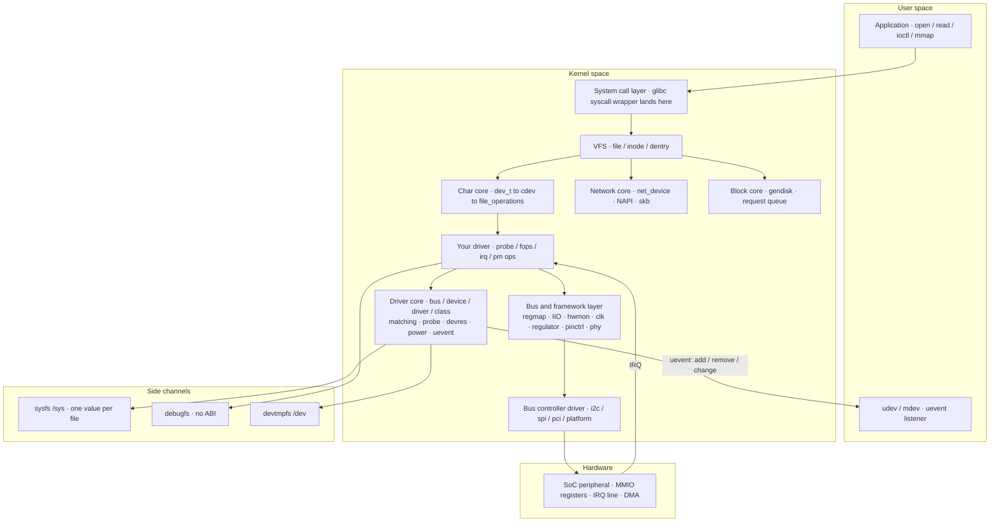

The point of the picture is the **two things that are not in the data path**: sysfs and uevent. A driver that only moves
data is invisible to `udev`, to power management and to the operator debugging it at 3 a.m. Registering with the driver
core is what buys you those.

### 1.3 What you give up by writing kernel code

This is the part that bites experienced application developers:

| Constraint | Consequence |
| --- | --- |
| **No libc** | `printk` not `printf`, `kmalloc` not `malloc`, `copy_to_user` not `memcpy` across the boundary |
| **No floating point** | FPU state is not saved for kernel code; `kernel_fpu_begin()`/`kernel_fpu_end()` only where explicitly allowed |
| **Small stack** | commonly 8 KB on 32-bit, 16 KB on arm64 — no large stack arrays, no deep recursion, no big structs by value |
| **No `__user` dereference** | a user pointer must go through `copy_to_user` / `copy_from_user`, and you must check the return |
| **Sleeping is contextual** | atomic context (hard IRQ, spinlock held, `local_bh_disable`) forbids `mutex_lock`, `kmalloc(GFP_KERNEL)`, `copy_from_user`, `schedule` |
| **Errors are the interface** | return a negative `errno`; `-EINVAL`, `-ENODEV`, `-EBUSY`, `-ENOMEM`, `-EIO`, `-ETIMEDOUT`, and `-ERESTARTSYS` for a signal-interrupted sleep |
| **Your code is the ABI** | once userspace depends on it you cannot change it — "don't break userspace" is kernel policy |

The concurrency half of this is [[04-5 Linux Concurrency - Kernel and User Mode, Processes, Threads and IPC]]; the
interrupt half is [[04-4 Linux Interrupts - Types, Handlers, Threaded IRQs and Deferred Work]]. This note assumes both.

---

## 2. Which kind of driver are you writing

Before any code, classify the device. The wrong choice here is expensive to undo because it decides your userspace
interface, and that interface is ABI.

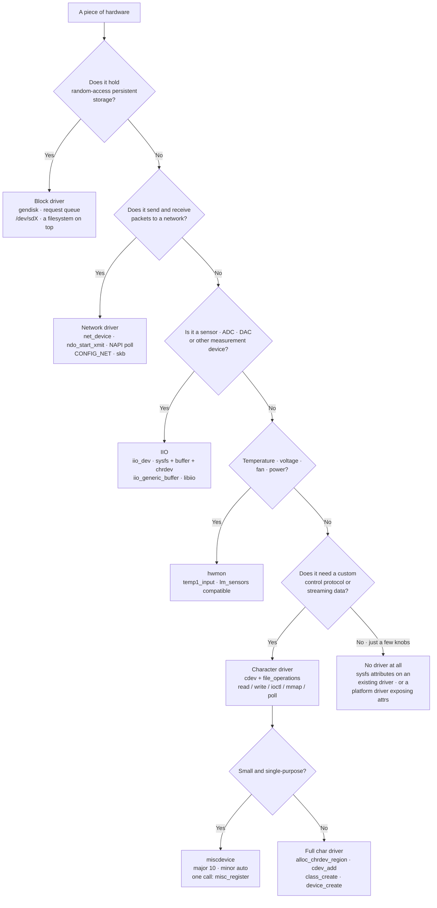

| Family | Kernel object | Userspace sees | You implement |
| --- | --- | --- | --- |
| **Character** | `struct cdev` + `dev_t` | `/dev/foo`, byte stream | `file_operations`: `open`, `read`, `write`, `llseek`, `unlocked_ioctl`, `poll`, `mmap`, `release` |
| **Block** | `struct gendisk` | `/dev/sdX`, mountable | `block_device_operations` + a request queue / `blk_mq` ops |
| **Network** | `struct net_device` | `eth0`, `ip link` | `net_device_ops`: `ndo_open`, `ndo_start_xmit`, `ndo_stop`; NAPI `poll` for RX |
| **IIO** | `struct iio_dev` | `/sys/bus/iio/devices/`, `/dev/iio:deviceN` | `iio_info`: `read_raw`, `write_raw`, buffered capture |
| **misc** | `struct miscdevice` | `/dev/name` with major 10 | just `file_operations` — the char plumbing is done for you |

The single most useful rule: **do not write a raw character driver when a framework exists.** IIO gets you a documented
sysfs ABI, buffered capture, triggers and a userspace library for free. hwmon gets you `lm_sensors` compatibility.
Framework reuse is not laziness; it is how you avoid owning an ABI you did not design.

---

## 3. The device model — the machinery you are a guest in

### 3.1 Four objects and one rule

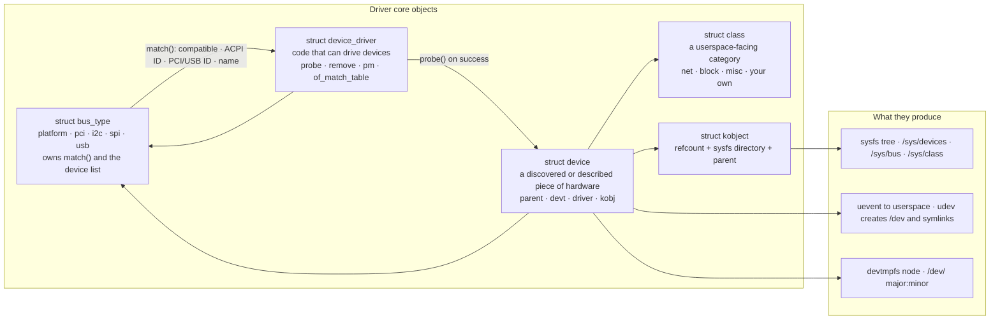

The rule that explains everything else: **`struct device` is the unit of lifetime, and `struct kobject` is its
reference count.** A device is not freed when you drop your pointer; it is freed when the last `kobject` reference goes
away. That is why `devm_*` works, why `dev_get_drvdata` stays valid while bound, and why "use after free" in a driver
almost always means "you kept a pointer past the last `put_device`".

| Object | Lifetime owner | Freed by |
| --- | --- | --- |
| `struct device` | kobject refcount | `put_device()` when the count reaches zero |
| `struct device_driver` | the module that registered it | `driver_unregister()`, which blocks module unload while bound |
| `struct cdev` | you | `cdev_del()` |
| `devm_*` resources | the device | the driver core, in reverse order of acquisition, on detach or failed probe |
| `struct file` | the VFS | `fput()` when the last fd closes — this is why `release()` can be late |

### 3.2 devtmpfs, uevent and udev — who creates `/dev/foo`

Three separate mechanisms and people conflate them constantly:

1. **`device_add()`** calls `devtmpfs_create_node()` for every device that has a `devt`. The kernel itself creates
   `/dev/<name>` with mode `0600`, owned by root — no userspace involved. This is why a working driver gives you a node
   even on a system with no udev at all.
2. **uevent** — the kernel emits `add`, `remove`, `change`, `bind`, `unbind` on a netlink socket with environment
   variables (`ACTION`, `DEVPATH`, `SUBSYSTEM`, `MAJOR`, `MINOR`, `DRIVER`, and every `bus->uevent()` addition).
3. **udev / mdev / eudev** listens and applies *policy*: permissions, ownership, stable symlinks like
   `/dev/serial/by-id/...`, firmware loading, and `MODALIAS`-driven `modprobe`.

So the division is: **kernel owns existence, userspace owns policy.** If `/dev/foo` exists but has the wrong
permissions, that is a udev rule, not a driver bug. If it does not exist at all, check `devt` — a driver that never
called `device_create()` or `misc_register()` has no node to create.

### 3.3 Binding — how a device and a driver find each other

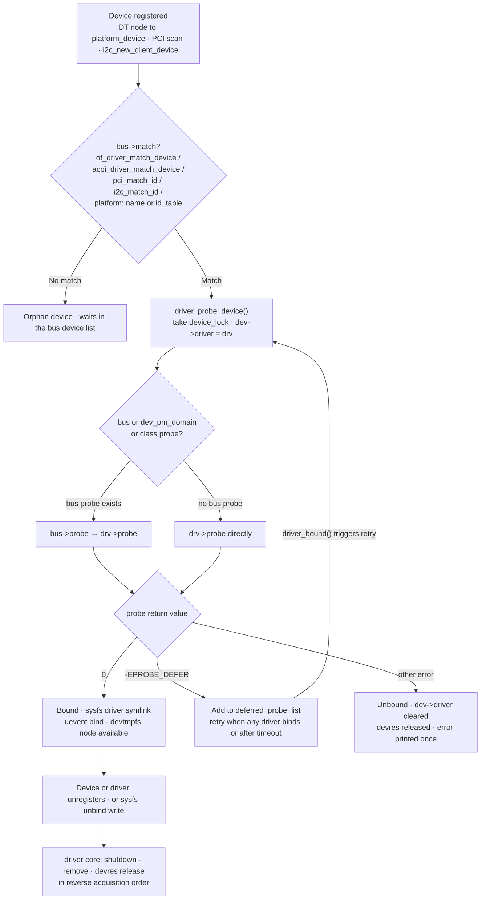

Two subtleties worth being able to state:

- **Matching is by table, never by ad-hoc logic.** `of_match_table` for DT, `acpi_match_table` for ACPI, `id_table`
  for PCI/USB/I²C/SPI, and the driver *name* as the platform fallback. If you find yourself comparing strings in
  `probe()`, you are fighting the model.
- **`probe()` is called with `device_lock()` held and may sleep.** It is ordinary process context. What it may *not* do
  is assume ordering: your supplier (clock, regulator, GPIO controller, IOMMU, PHY) may probe after you.

### 3.4 Deferred probe — the mechanism that makes ordering disappear

Before 2012, ordering was arranged with initcall levels and board-file hacks. Then `-EPROBE_DEFER` arrived: a probe
that returns it is retried later, when something else has bound.

```c
p->vcc = devm_regulator_get(dev, "vcc");
if (IS_ERR(p->vcc))
    return dev_err_probe(dev, PTR_ERR(p->vcc), "vcc supply not ready");
```

`dev_err_probe()` is the modern idiom and does three things at once: it prints only for real errors (a deferral is
silent, or a debug-level note), it records the reason in `/sys/kernel/debug/devices_deferred`, and it returns the
original error code so the core sees the `-EPROBE_DEFER`.

The companion mechanism is **fw_devlink**: the driver core parses firmware-described dependencies (`clocks`, `dmas`,
`iommus`, `power-domains`, `phys`, `pinctrl-*`, `-supply`, `-gpios`, `interrupts-extended`, `nvmem-cells`, ...) and
creates device links so suppliers probe before consumers. Its four modes are `off`, `permissive`, `on`, `rpm`, set with
the `fw_devlink=` boot argument; `on` additionally enforces suspend/resume ordering and `rpm` also orders runtime PM.

### 3.5 The failure mode everyone meets once

> **"My driver probes fine as a module but fails built-in."**

That is the exact symptom `-EPROBE_DEFER` was invented to fix, and if you still see it the cause is almost always one of:

1. A supplier whose driver is a module not yet loaded — fixed by `deferred_probe_timeout` or by correct `fw_devlink`
   links, not by `modprobe` ordering.
2. A cyclic dependency in the device tree, which `fw_devlink` now degrades to permissive rather than deadlocking.
3. A driver that returns a hard error (`-ENODEV`, `-EINVAL`) where it should have returned `-EPROBE_DEFER` — typically
   because it open-codes a resource lookup instead of using `devm_clk_get` / `devm_regulator_get` / `devm_gpiod_get`.

---

## 4. From device tree to a bound driver

### 4.1 The matching chain, in order

For a platform device on an arm64 SoC, matching is tried in this order and stops at the first hit:

| Order | Mechanism | Table | Notes |
| --- | --- | --- | --- |
| 1 | Device tree `compatible` | `driver.of_match_table` | the embedded default; the table entry carries `.data` for per-variant quirks |
| 2 | ACPI ID | `driver.acpi_match_table` | server and PC hardware |
| 3 | Bus ID table | `platform_driver.id_table`, `pci_device_id`, `i2c_device_id` | legacy platform data, PCI/USB/I²C/SPI enumeration |
| 4 | Name match | `driver.name` vs `platform_device.name` | the fallback; avoid depending on it |

```c
static const struct of_device_id my_of_match[] = {
    { .compatible = "vendor,my-ip-v2", .data = &my_v2_cfg },
    { .compatible = "vendor,my-ip",    .data = &my_v1_cfg },  /* most specific first */
    { /* sentinel */ }
};
MODULE_DEVICE_TABLE(of, my_of_match);
```

`MODULE_DEVICE_TABLE` is not decoration: it emits the alias into the module's ELF metadata, which is what makes
`depmod` generate the `modules.alias` entry that lets udev autoload your module when the device appears.

### 4.2 probe() discipline — the ordering that prevents teardown bugs

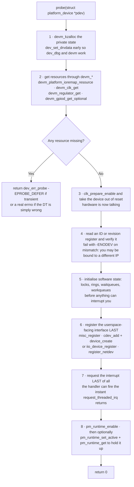

The ordering is not stylistic. Two rules hide inside it:

- **Publish the interface after the hardware is ready, and request the interrupt last.** An interrupt handler that
  fires before your rings are initialised is a NULL dereference in hardIRQ context, which is an unrecoverable panic, not
  an Oops you can debug.
- **Acquire in the reverse of the order you need for teardown.** `devm_*` releases in reverse acquisition order
  automatically, so if you acquire clocks before registering the char device, the char device is unregistered *before*
  the clocks are dropped — which is exactly right.

### 4.3 devres — why remove() is usually empty

Every `devm_*` call appends an entry to the device's `devres_head` list. The core releases them, **in reverse order**,
when probe fails or the device unbinds. This deletes the `goto` ladder from `probe()` and most of `remove()`.

```c
static int my_probe(struct platform_device *pdev)
{
    struct device *dev = &pdev->dev;
    struct my_dev *p;
    void __iomem *base;

    p = devm_kzalloc(dev, sizeof(*p), GFP_KERNEL);
    if (!p)
        return -ENOMEM;
    platform_set_drvdata(pdev, p);

    base = devm_platform_ioremap_resource(pdev, 0);   /* request + ioremap + devres */
    if (IS_ERR(base))
        return PTR_ERR(base);
    p->base = base;

    p->clk = devm_clk_get(dev, NULL);
    if (IS_ERR(p->clk))
        return dev_err_probe(dev, PTR_ERR(p->clk), "clock");

    return devm_request_threaded_irq(dev, platform_get_irq(pdev, 0),
                                     my_hardirq,        /* runs with irqs off: ack only */
                                     my_threaded_fn,    /* runs as SCHED_FIFO 50: does the work */
                                     IRQF_ONESHOT, dev_name(dev), p);
}
```

**The trap**: devres releases *after* `remove()` returns, not before. If `remove()` manually frees something that a
`devm_*` call also owns, you get a double free; if `remove()` frees something the hardware still needs for the
remaining devres releases, you get a use-after-free. The correct pattern for anything devres cannot express is
`devm_add_action_or_reset()` — register your own cleanup handler into the same list, and it runs in the right place.

### 4.4 remove() — what is actually left to do

```c
static void my_remove(struct platform_device *pdev)
{
    struct my_dev *p = platform_get_drvdata(pdev);

    /* 1. stop producing work: nothing new may enter the data path */
    disable_irq(platform_get_irq(pdev, 0));
    /* 2. cancel whatever is in flight, then wait for it to drain */
    cancel_work_sync(&p->work);
    /* 3. quiesce the hardware itself: abort DMA, mask interrupts, assert reset */
    my_hw_stop(p);
    /* 4. unregister the userspace interface — after the datapath is quiet */
    misc_deregister(&p->misc);
    /* 5. devres now releases irq, clocks, ioremap, memory — in reverse order */
}
```

The rule: **`remove()` must not allocate, must not fail, and must return `void`.** The `int`-returning `remove()` was a
decades-long footgun — the driver core ignored the return value — and the bus callbacks were converted to `void`
(`platform_driver` landed in **6.11**, with `.remove_new()` as the transitional name). If you are writing new code,
`.remove()` returns `void`.

---

## 5. The lifecycle of a driver — one state machine

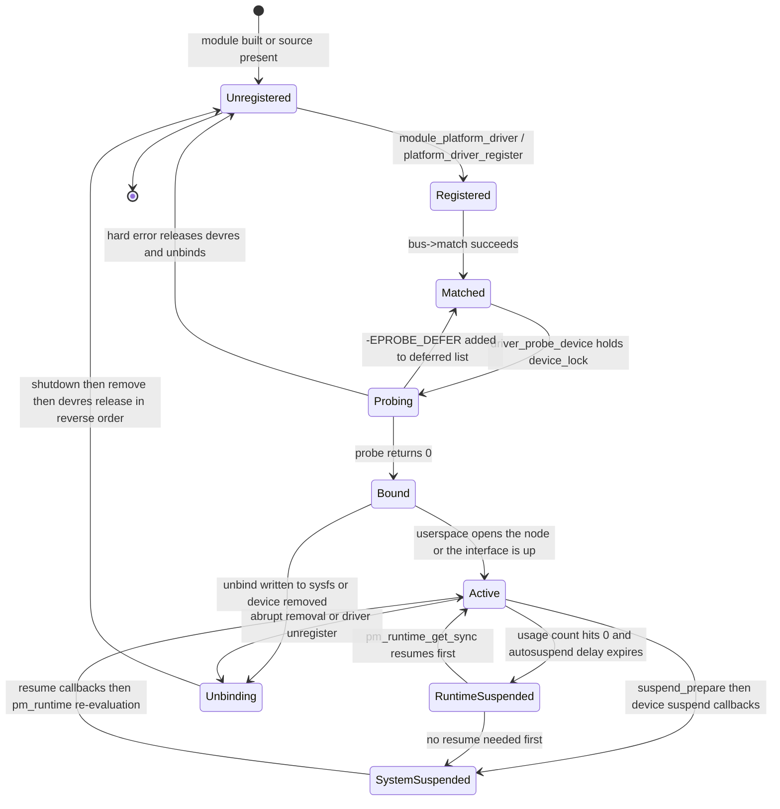

Five transitions carry all the bugs:

| Transition | What goes wrong | Guard |
| --- | --- | --- |
| **Matched → Probing → Matched** | an infinite deferral loop because a supplier never appears | check `/sys/kernel/debug/devices_deferred`; set `deferred_probe_timeout` |
| **Bound → Active** | the interface is published before the hardware is ready | publish last (§4.2 step 6) |
| **Active → RuntimeSuspended** | the device is suspended with DMA in flight, or with a wakeup source armed that you forgot | `pm_runtime_get_sync` around every transfer; `device_init_wakeup` deliberately |
| **Active → SystemSuspended** | a pending work item or an unmasked interrupt fires during suspend | `cancel_work_sync` in suspend; mask the IRQ in `suspend` or use `devm_request_threaded_irq` with `IRQF_NO_AUTOEN` |
| **Any → Unbinding** | a user holds an open fd while the device disappears | the VFS keeps `fput` until close; your `release()` must tolerate a dead device and your fops must check a "device gone" flag |

---

## 6. The character driver, in full

### 6.1 Four structures and how they connect

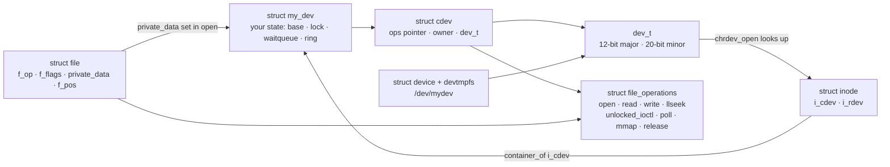

The chain a caller walks: `open("/dev/mydev")` → path walk finds the inode → `i_rdev` gives the `dev_t` → the char dev
map finds the `cdev` → `cdev->ops` is installed into `file->f_op` → `ops->open(inode, file)` runs. Inside `open` you do
the one piece of bookkeeping every char driver needs:

```c
static int my_open(struct inode *inode, struct file *filp)
{
    struct my_dev *p = container_of(inode->i_cdev, struct my_dev, cdev);
    filp->private_data = p;              /* every other fop reaches state through this */
    return 0;
}
```

`dev_t` is a 32-bit value: **12 bits of major, 20 bits of minor** (`MINORBITS` is 20). Dynamic majors are handed out by
`find_dynamic_major()`, which scans **downward from 511** once the classic **234–254** window is full — the extended
**384–511** range exists precisely because `allyesconfig` kernels ran out of the first window.

### 6.2 The read path, end to end

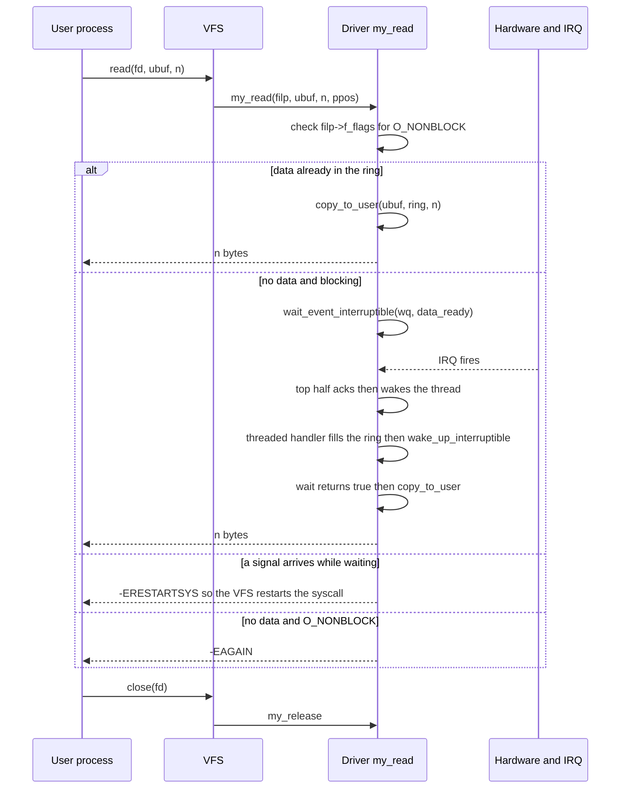

Four rules live inside that diagram:

1. **`-ERESTARTSYS`, not `-EINTR`.** A sleeping `read` that is interrupted by a signal returns `-ERESTARTSYS`; the VFS
   then either restarts the syscall or delivers `-EINTR` to the application depending on the signal handler flags.
   Getting this wrong produces applications that mysteriously fail after installing a handler.
2. **`copy_to_user` may short-copy.** Always check the return, and never assume it moved everything.
3. **Short reads are legal.** POSIX allows `read` to return fewer bytes than requested. Applications that assume
   otherwise are broken, and the kernel's contract is "return > 0 with what you have, or 0 for EOF".
4. **`f_flags & O_NONBLOCK` must be honoured** by any driver that can block, or `select`-based applications will hang.

### 6.3 Blocking I/O, poll, and async notification

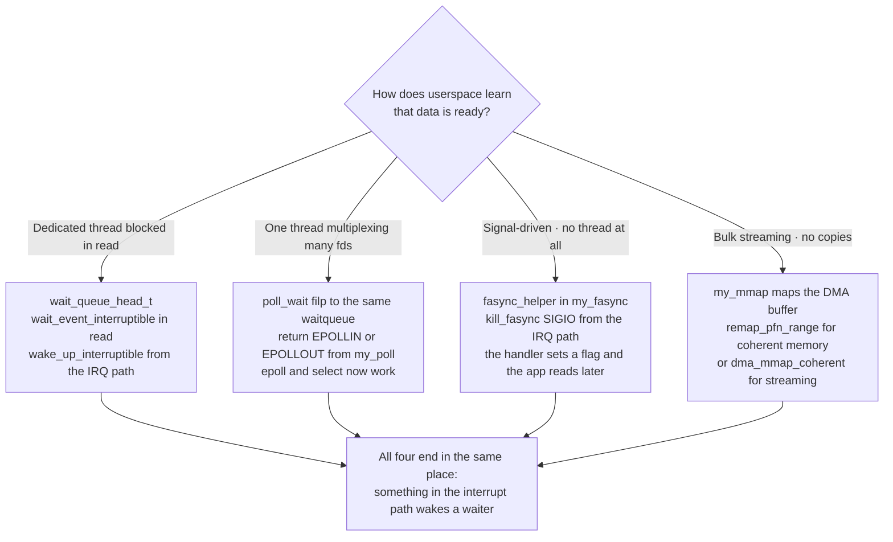

`mmap` deserves the warning: it is the only interface that gives userspace **direct access to a buffer the device also
writes**, so it is also the only one where a mistake corrupts data with no error anywhere. Rules: map only memory the
device owns (coherent DMA or a CMA region), never map kernel `kmalloc` memory, set `VM_PFNMAP` or use the proper
`vm_operations_struct`, and provide a `close` that unmaps before the buffer is freed. On non-coherent platforms, a
userspace mapping must be non-cacheable or the user will read stale cache lines.

### 6.4 ioctl — the interface you will regret

`unlocked_ioctl` is called without the Big Kernel Lock; it is the only `ioctl` you should implement. Rules that
interviewers and reviewers both check:

- **Encode with the macros, never bare integers**: `_IOW(type, nr, argtype)`, `_IOR`, `_IOWR`, `_IO`. The `type` is a
  single character you "own", the `nr` is the command.
- **Validate `nr` and `size` first**, and return `-ENOTTY` for anything you do not recognise — that is the POSIX
  "not a tty" answer and it is what applications expect for a wrong `ioctl`.
- **Copy the argument struct in one go** with `copy_from_user`, then validate the *contents*.
- **Design for 32-bit userspace on a 64-bit kernel**: use fixed-width types (`__u64`, `__u32`), pad explicitly, avoid
  pointers inside the struct, and provide `compat_ioctl` if the layout genuinely differs.
- **Never change the meaning of an existing command.** Add a new `nr`. This is the ABI rule in its sharpest form.

```c
#define MY_MAGIC        'm'
#define MY_SET_CONFIG   _IOW(MY_MAGIC, 1, struct my_config)
#define MY_GET_STATUS   _IOR(MY_MAGIC, 2, struct my_status)

static long my_ioctl(struct file *filp, unsigned int cmd, unsigned long arg)
{
    struct my_dev *p = filp->private_data;
    void __user *argp = (void __user *)arg;

    if (_IOC_TYPE(cmd) != MY_MAGIC)
        return -ENOTTY;

    switch (cmd) {
    case MY_SET_CONFIG: {
        struct my_config cfg;
        if (copy_from_user(&cfg, argp, sizeof(cfg)))
            return -EFAULT;
        if (cfg.rate == 0 || cfg.rate > MY_MAX_RATE)
            return -EINVAL;
        return my_hw_configure(p, &cfg);
    }
    case MY_GET_STATUS: {
        struct my_status st;
        my_hw_status(p, &st);
        if (copy_to_user(argp, &st, sizeof(st)))
            return -EFAULT;
        return 0;
    }
    default:
        return -ENOTTY;
    }
}
```

---

## 7. The interrupt-driven data path

This is where a driver stops being plumbing and starts being a real-time system. The full treatment of interrupt types,
controllers and bottom halves is [[04-4 Linux Interrupts - Types, Handlers, Threaded IRQs and Deferred Work]]; here is
the driver's view of it.

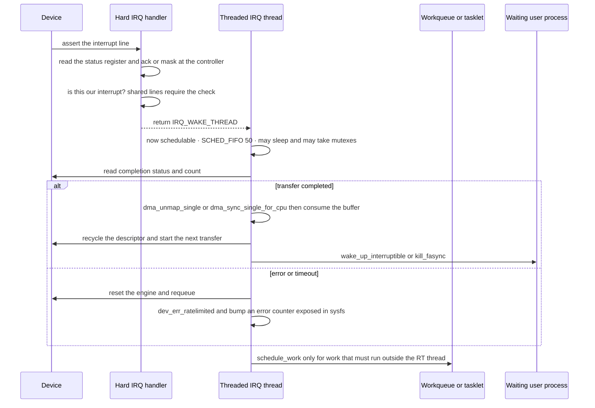

Three decisions are visible there:

| Decision | Rule |
| --- | --- |
| **What goes in the hard IRQ** | Only what must happen with interrupts disabled: read status, acknowledge, mask if level-triggered. Nothing else. No `printk` storms, no loops, no sleeping calls. |
| **Threaded IRQ vs workqueue** | `devm_request_threaded_irq` is the modern default and is forced on PREEMPT_RT. Use a workqueue only for work that must not run at RT priority, and `tasklet`/softirq only if you truly cannot sleep and are in a subsystem that already uses them. |
| **Where the lock lives** | Data touched by both the IRQ path and `read`/`ioctl` must be protected by a lock taken with interrupts disabled *on the process side* (`spin_lock_irqsave`) — or moved out of the handler entirely. A `mutex` in the handler is an instant `DEBUG_ATOMIC_SLEEP` splat. |

### 7.1 One transfer, as a state machine

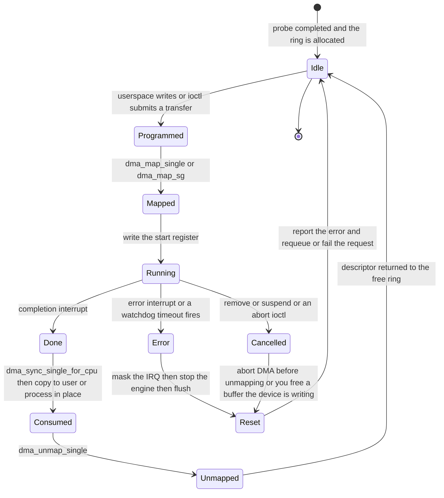

The critical edge is **Cancelled → Reset**, not Error. A `remove()` or a suspend that unmaps DMA memory while the device
is still writing to it is the classic silent memory-corruption bug: no Oops, no error, just wrong data somewhere
unrelated. Always abort the engine *before* unmapping.

---

## 8. Memory, MMIO and DMA

### 8.1 MMIO

```c
base = devm_platform_ioremap_resource(pdev, 0);   /* request_mem_region + ioremap + devres */
val  = readl(p->base + MY_STATUS);
writel(FIELD_PREP(MY_CTRL_ENABLE, 1), p->base + MY_CTRL);
```

- Access `void __iomem *` **only** through `readl`/`writel`/`readb`/`writeb`. Casting it to a plain pointer and
  dereferencing is undefined behaviour and breaks on some architectures.
- **Ordering**: `readl`/`writel` carry the device-ordering barriers you need on most systems; `readl_relaxed`/
  `writel_relaxed` do not. Default to the safe form, and reach for `_relaxed` only in a measured hot path where you can
  state why it is safe.
- **`volatile` is not a synchronisation primitive** and is discouraged in kernel code; use `READ_ONCE`/`WRITE_ONCE` for
  single-access semantics and real barriers for ordering.
- MMIO regions must be mapped as device memory (non-cacheable, non-speculative). Getting this wrong gives you the
  "works until the cache evicts" class of bug.

### 8.2 Choosing a DMA buffer

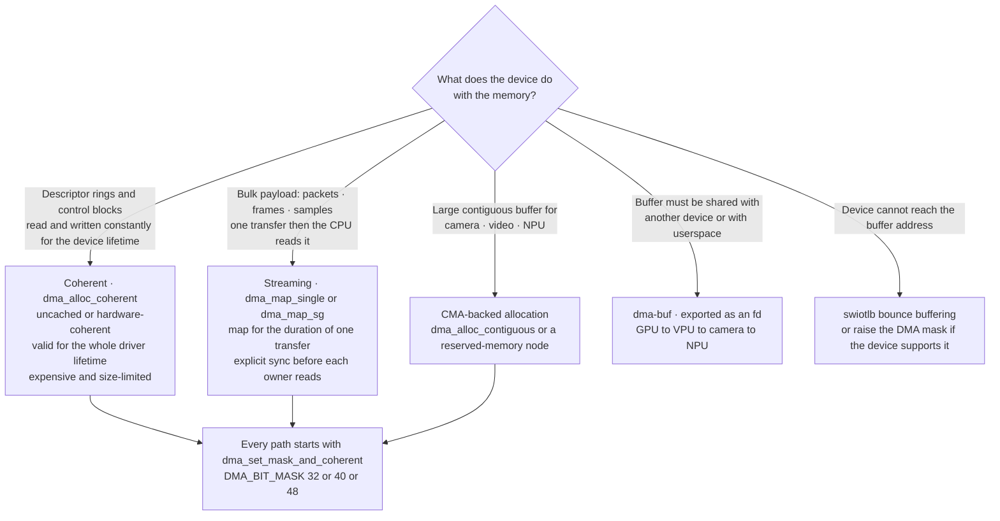

`dma_set_mask_and_coherent(dev, DMA_BIT_MASK(32))` is not optional paperwork: it is the device telling the kernel which
addresses it can reach. Skip it on a device that can only address 32 bits and you get silent allocation failures or
buffers the hardware physically cannot see.

### 8.3 The mapping lifecycle

```c
dma_addr_t dma_handle;

buf = kmalloc(len, GFP_KERNEL);
dma_handle = dma_map_single(dev, buf, len, DMA_TO_DEVICE);   /* or DMA_FROM_DEVICE / DMA_BIDIRECTIONAL */
if (dma_map_error(dev, dma_handle)) { kfree(buf); return -ENOMEM; }

/* ... start the transfer ... */

dma_sync_single_for_cpu(dev, dma_handle, len, DMA_FROM_DEVICE);   /* before the CPU reads */
process(buf);
dma_sync_single_for_device(dev, dma_handle, len, DMA_FROM_DEVICE);/* before the device reads again */

dma_unmap_single(dev, dma_handle, len, DMA_FROM_DEVICE);
kfree(buf);
```

### 8.4 Buffer ownership — the state machine that prevents the #1 DMA bug

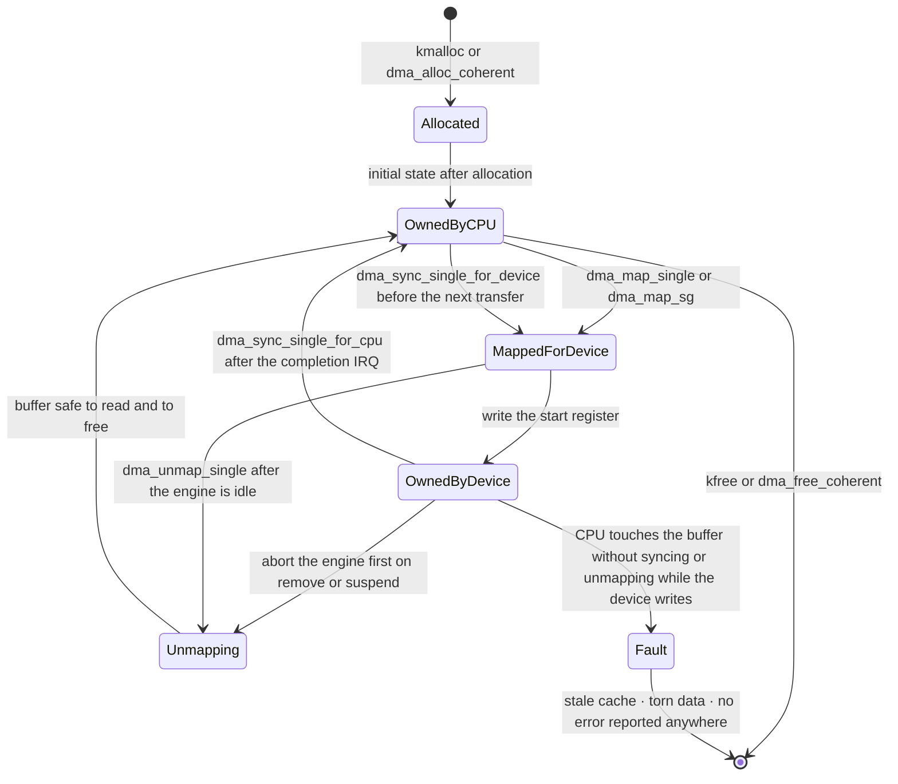

Every arrow is a real function call, and **skipping a sync is only free on cache-coherent hardware**. That is why the
bug is invisible on x86 and fatal on ARM32 and on most arm64 SoCs with a non-coherent DMA path: the same driver passes
CI on a server and corrupts frames on the target board.

Rules that fall out of the diagram:

| Rule | Why |
| --- | --- |
| **Sync before each owner reads, every time** | cache lines may be speculatively fetched at any moment; one correct sync does not cover the next transfer |
| **Never unmap while the device may write** | the device holds a physical address; freeing it hands that memory to someone else |
| **Respect `ARCH_DMA_MINALIGN`** | a buffer sharing a cache line with CPU-written data corrupts both directions |
| **Do not put DMA buffers on the stack** | the kernel stack is not guaranteed physically contiguous or DMA-reachable |
| **Direction must be honest** | `DMA_BIDIRECTIONAL` is slower but safe; a wrong unidirectional hint silently drops a sync |

### 8.5 IOMMU and dma-buf

An IOMMU (ARM SMMU, Intel VT-d, AMD-Vi) translates device addresses, so the device sees an IOVA rather than a physical
address. Consequences for driver authors: mapping is now a translation that can fail; scatter-gather lists can be
collapsed into a contiguous IOVA; and — the security-relevant part — the device can only touch what you mapped for it,
which is what makes **VFIO** safe for userspace drivers and VM device assignment.

`dma-buf` is the sharing primitive: a buffer with an exporter, importers, and a file descriptor. It is the reason a
camera frame can go to an NPU and then to a display without a single copy. If your device produces or consumes buffers
that another device touches, dma-buf is not optional — see the zero-copy discussion in
[[05-1 DPDK User Plane and 5G UPF]] for the userspace end of the same argument.

---

## 9. Power management in a driver

### 9.1 Runtime PM — the per-device state machine

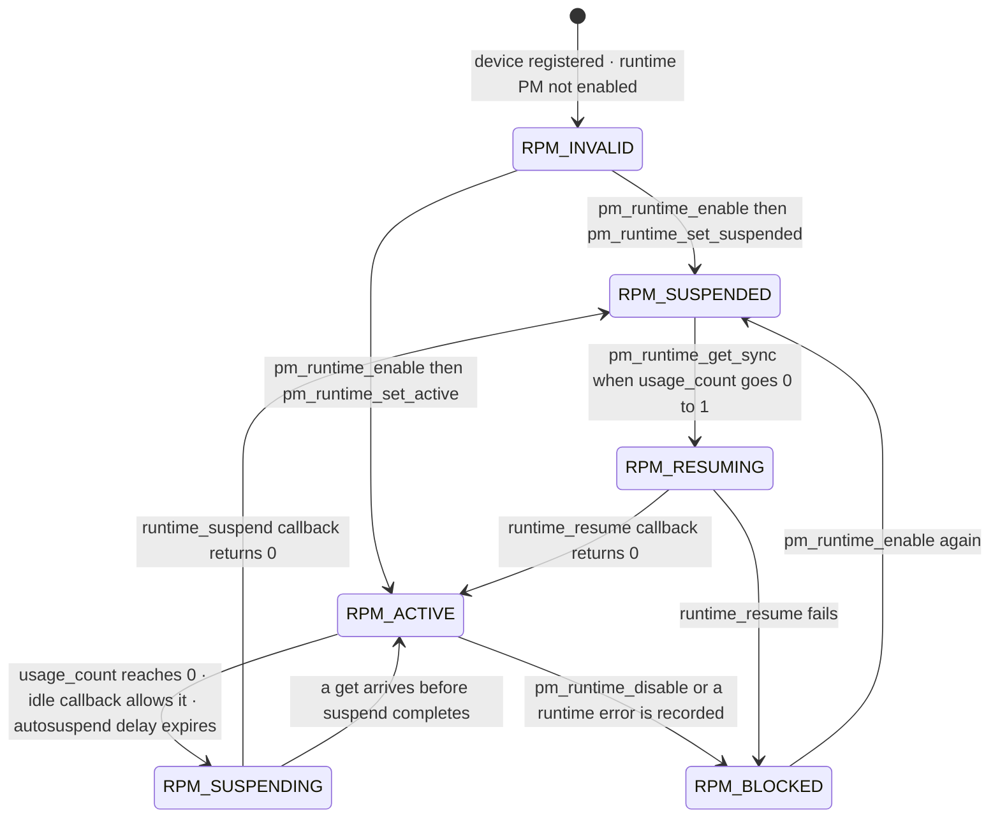

Those names are real: `enum rpm_status` in `include/linux/pm.h` is `RPM_INVALID`, `RPM_ACTIVE`, `RPM_RESUMING`,
`RPM_SUSPENDED`, `RPM_SUSPENDING`, `RPM_BLOCKED`. Being able to recite them in an interview is a cheap signal that you
have actually read the header.

```c
static int my_runtime_suspend(struct device *dev)
{
    struct my_dev *p = dev_get_drvdata(dev);
    clk_disable_unprepare(p->clk);       /* gate the clock */
    return 0;
}

static int my_runtime_resume(struct device *dev)
{
    struct my_dev *p = dev_get_drvdata(dev);
    return clk_prepare_enable(p->clk);
}

static const struct dev_pm_ops my_pm_ops = {
    SET_RUNTIME_PM_OPS(my_runtime_suspend, my_runtime_resume, NULL)
    SET_SYSTEM_SLEEP_PM_OPS(my_suspend, my_resume)
};

/* at the end of probe: */
pm_runtime_set_autosuspend_delay(dev, 1000);   /* 1 s after the last use */
pm_runtime_use_autosuspend(dev);
pm_runtime_enable(dev);

/* around every transfer: */
ret = pm_runtime_get_sync(dev);
if (ret < 0) { pm_runtime_put_noidle(dev); return ret; }
do_the_work();
pm_runtime_mark_last_busy(dev);
pm_runtime_put_autosuspend(dev);
```

Three things drivers get wrong:

1. **`pm_runtime_get_sync` can fail.** If the resume callback errors, the usage count has already been incremented, so
   you must `pm_runtime_put_noidle()` to release it — otherwise the device can never suspend again.
2. **The device is suspended by default after `pm_runtime_enable`.** If your hardware is actually powered at probe time,
   call `pm_runtime_set_active()` first, or the first access will believe it is suspended and the first suspend will
   gate a clock that was never on.
3. **An interrupt can fire while the device is runtime-suspended.** Either use a wakeup-capable IRQ, or mask the
   interrupt in `runtime_suspend` and handle the "device woke up anyway" case in the handler.

### 9.2 System suspend — ordering is everything

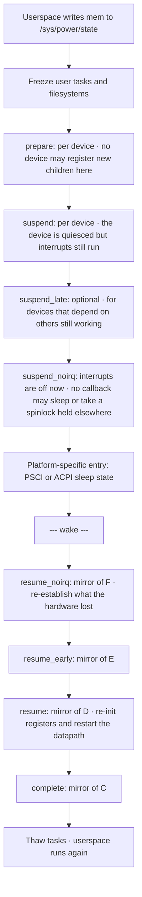

The two callbacks that matter most for an embedded driver:

- **`suspend_noirq`** runs with interrupts disabled. It must not sleep, must not take a lock that a wakeup path takes,
  and is the right place to save a register context that the hardware will lose.
- **`resume`** is where you discover what the hardware actually lost. Assume everything: registers, DMA descriptors,
  FIFO contents, and — if the power domain was dropped — the entire device state. A resume that only re-enables clocks
  is a resume that works once.

Power domains (`struct generic_pm_domain`, `CONFIG_PM_GENERIC_DOMAINS`) sit underneath: a domain stays on until every
device in it has suspended, which is why one misbehaving driver's missing `runtime_suspend` keeps an entire SoC block
awake. `genpd` exposes `/sys/kernel/debug/pm_genpd/` to find out which one.

---

## 10. Bus-specific anatomy: platform, I²C, SPI, PCI

### 10.1 Platform (MMIO SoC peripheral) — the embedded default

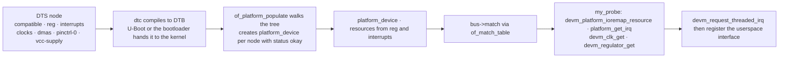

Everything a platform driver needs comes from two calls: `devm_platform_ioremap_resource(pdev, 0)` for the register
window and `platform_get_irq(pdev, 0)` for the interrupt. Note the second: it returns a **virtual** IRQ number, already
mapped through the irqdomain, so you never care about the hardware number.

### 10.2 I²C and SPI — register access behind a bus

| | I²C | SPI |
| --- | --- | --- |
| Bus type | `i2c_driver` / `i2c_client` | `spi_driver` / `spi_device` |
| Addressing | 7-bit or 10-bit client address in DT `reg` | chip select, plus `spi->mode`, `spi->max_speed_hz`, `spi->bits_per_word` |
| Transfer | `i2c_transfer`, `i2c_smbus_read_byte_data` | `spi_sync`, `spi_async`, `spi_write_then_read` |
| Context | `i2c_transfer` **may sleep** — never call it from a hard IRQ | `spi_sync` may sleep; `spi_async` completes in a callback |
| Concurrency | the bus is shared; the adapter locks per transfer | the controller serialises per device; `spi_async` needs its own queueing |
| Register access | **use regmap** — `devm_regmap_init_i2c` | **use regmap** — `devm_regmap_init_spi` |

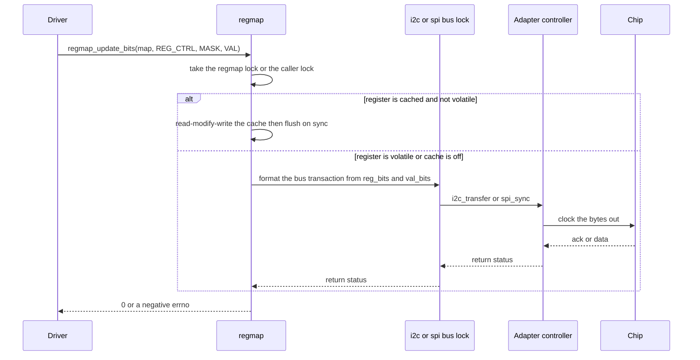

**regmap is the single highest-leverage choice in a peripheral driver.** It gives you: one codebase for I²C, SPI, SPMI,
MMIO and AC97 variants of the same chip; a register cache with volatile/precious/read-only/write-only declarations;
endianness conversion; `debugfs` register dumping for free; and tracepoints. Writing `i2c_transfer` by hand in a new
driver is a review comment waiting to happen.

### 10.3 PCI — discoverable, and different in every way

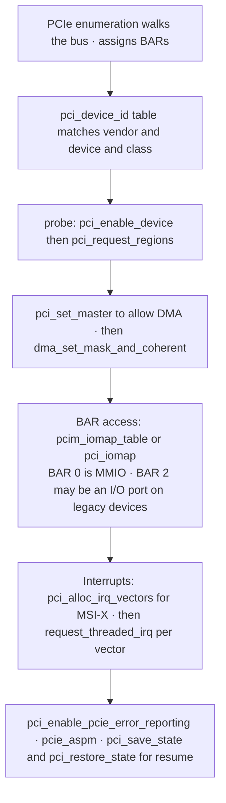

What is genuinely different: the device is **discovered** rather than described, so no device tree; configuration space
replaces the `reg` property; interrupts are **message-signalled** (MSI/MSI-X) and each vector is an independent
interrupt you can pin to a CPU; and the device can be **hot-removed**, so every MMIO access can fail. PCI drivers must
tolerate a device that disappears mid-read, which is what `pci_dev_is_disconnected()` and the `~0` read pattern are for.

### 10.4 Which bus am I on — a comparison worth memorising

| Axis | platform | I²C | SPI | PCI |
| --- | --- | --- | --- | --- |
| Discovery | described in DT or ACPI | enumerated or described | described in DT | enumerated by config space |
| Register access | `readl` / `writel` on MMIO | regmap over `i2c_transfer` | regmap over `spi_sync` | `pci_iomap` then `readl` |
| Speed | full memory bandwidth | 100 kHz to 3.4 MHz | up to tens of MHz | full bandwidth, DMA-native |
| Sleeping in callbacks | probe may sleep; handler may not | transfers sleep; handler may not | `spi_sync` sleeps; handler may not | same, plus hot-remove races |
| Interrupt | shared or dedicated line, often GPIO | usually a GPIO line | usually a GPIO line | MSI-X vector or INTx |
| DMA | SoC DMA engine or the peripheral itself | rare | rare for control, common for data | standard, via the device's own engine |

---

## 11. Which framework should own this device

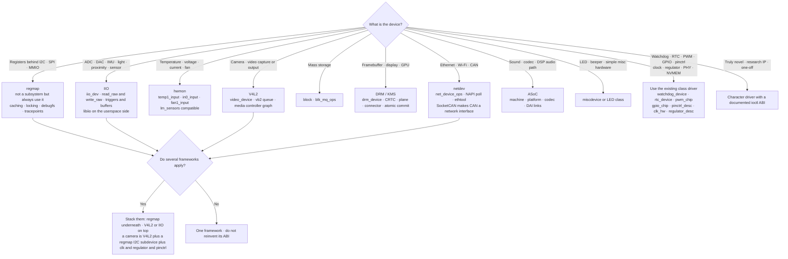

The pattern in every real embedded driver is **a stack, not a choice**: a V4L2 camera sensor is a V4L2 subdevice whose
register access is regmap-over-I²C, whose clocks come from the clk framework, whose power comes from regulators, whose
pins come from pinctrl, and whose power domain comes from genpd. The driver you write is the thin layer that binds them
together and knows the sensor's register map.

Why this matters beyond tidiness: **each framework you reuse is an ABI you did not have to design, a power-management
behaviour you get for free, and a set of userspace tools that already work.** A hand-rolled char driver for a
temperature sensor means writing your own `sysfs` layout, your own units convention, your own `lm_sensors` support, and
your own answer to "what happens on suspend".

---

## 12. Concurrency in a driver

The full treatment is [[04-5 Linux Concurrency - Kernel and User Mode, Processes, Threads and IPC]] §6. The
driver-specific decisions:

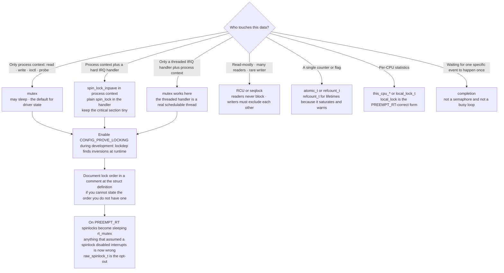

The five driver-specific failure modes:

1. **Sleeping in atomic context** — `mutex_lock` or `kmalloc(GFP_KERNEL)` inside a spinlock or a hard IRQ. Caught by
   `CONFIG_DEBUG_ATOMIC_SLEEP`.
2. **The inverse** — a spinlock where a mutex is needed because the critical section calls something that sleeps.
3. **Lock inversion across subsystems** — your `ioctl` takes `p->lock` then calls into a framework that takes its lock
   and calls back into you. lockdep is the only practical detector.
4. **Unprotected teardown** — `remove()` frees state that an open file descriptor or a pending work item still holds.
   Use refcounts on the state, not on the device.
5. **Assuming probe is single-threaded** — with `PROBE_PREFER_ASYNCHRONOUS` probes run concurrently. Never touch global
   state in `probe()` without a lock.

---

## 13. The kernel-to-userspace interface

```mermaid
flowchart TD
    Q{"What does userspace need?"}
    Q -->|"A few scalar settings or status values"| SYSF["sysfs<br/>one value per file · stable ABI · DEVICE_ATTR_RW<br/>never for bulk data and never for a protocol"]
    Q -->|"Debug knobs and register dumps"| DBG["debugfs<br/>explicitly no ABI · may be absent under lockdown"]
    Q -->|"Streaming bulk data"| CHR["char device plus read or mmap<br/>zero-copy via mmap of DMA memory"]
    Q -->|"Device-specific commands that<br/>do not fit the file model"| IOC["ioctl · last resort · encode with _IO macros and version it"]
    Q -->|"Network configuration and events"| NL["netlink · multicast · extensible attributes"]
    Q -->|"Userspace creates kernel objects"| CFG["configfs · for example DT overlays and USB gadgets"]
    Q -->|"Userspace wants to drive the hardware itself"| VFIO["VFIO with an IOMMU · or UIO for trivial cases"]
    Q -->|"Notification of a rare event"| UEV2["uevent for device-level events<br/>netlink or SIGIO for data-level ones"]
    SYSF --> ABI["Every one of these except debugfs is ABI once it ships"]
    CHR --> ABI
    IOC --> ABI
    NL --> ABI
    ABI --> RULE["Do not break userspace is kernel policy not a suggestion"]
```

The rule that separates junior from senior answers: **sysfs is one value per file.** If you find yourself inventing a
text protocol inside a sysfs attribute, or writing a "command" file that takes arguments, you wanted a char device with
an `ioctl`, or netlink. Reviewers reject sysfs protocols on sight, and the rejection is correct — sysfs files are
parsed by shell scripts and by `udev`, and a multi-value format breaks both.

---

## 14. Bring-up — a repeatable method

```mermaid
flowchart TD
    S["Hardware on the board · datasheet in hand"] --> A["1 · Prove the hardware without a driver<br/>i2cdetect · i2cget · spidev_test · devmem2<br/>a logic analyser or a scope on the bus"]
    A --> B{"Does the chip answer?"}
    B -->|"No"| FIX1["Board problem: supply · reset line · address · pull-ups · pin mux<br/>fixing this in software wastes days"]
    B -->|"Yes"| C["2 · Find the closest upstream driver and read it<br/>plus the DT binding document for its compatible string"]
    C --> D["3 · Write the DT node first · dtc -I dts -O dtb and boot<br/>confirm the node appears under /sys/firmware/devicetree/base"]
    D --> E["4 · Skeleton driver: probe · ioremap · read the ID register<br/>dev_dbg it · nothing else"]
    E --> F{"Does probe run and does the ID match?"}
    F -->|"probe never runs"| FIX2["Check compatible spelling · status okay · the bus node is enabled<br/>check /sys/bus/platform/devices and devices_deferred"]
    F -->|"ID mismatch or read returns 0 or all ones"| FIX3["Clock not enabled · reset not released · wrong BAR or reg<br/>regulator off · pin mux wrong"]
    F -->|"Yes"| G["5 · Add one mechanism at a time:<br/>register access via regmap → interrupt → work or thread → DMA → userspace interface"]
    G --> H["6 · Turn on the debug options:<br/>CONFIG_PROVE_LOCKING · CONFIG_DEBUG_ATOMIC_SLEEP<br/>CONFIG_DEBUG_DEVRES · dynamic debug · CONFIG_DMA_API_DEBUG"]
    H --> I["7 · Test unbind and rebind in a loop<br/>echo -n dev > /sys/bus/platform/drivers/x/unbind<br/>leaks · races · and missing cancels surface here"]
    I --> J["8 · Test remove with an open fd and with traffic running<br/>and test suspend and resume with traffic running"]
    J --> K["9 · Run checkpatch.pl and sparse and coccinelle<br/>then post to the subsystem list with a real commit message"]
```

### 14.1 The symptom table

| Symptom | Almost always | Check |
| --- | --- | --- |
| `probe` never runs | no match, or the device is not there | `ls /sys/bus/platform/devices/`, `ls /sys/firmware/devicetree/base/`, exact `compatible` spelling |
| probe runs, returns `-EPROBE_DEFER` forever | a supplier never appears | `cat /sys/kernel/debug/devices_deferred`, `fw_devlink=on`, `deferred_probe_timeout=` |
| probe works as a module, fails built-in | ordering | see §3.5 |
| ID register reads `0x00000000` or `0xFFFFFFFF` | clock gated, reset asserted, or wrong window | `clk_prepare_enable`, reset line polarity, `devm_platform_ioremap_resource(pdev, 0)` on the right `reg` index |
| Interrupt never fires | wrong IRQ type, or the pin mux, or the handler never registered | `/proc/interrupts`, `platform_get_irq` return value, `IRQ_TYPE_LEVEL_HIGH` vs `EDGE_RISING` in the DT |
| Interrupt fires once then stops | you did not acknowledge, or it is level-triggered without `IRQF_ONESHOT` | ack in the top half; `IRQF_ONESHOT` for threaded level IRQs |
| Works on x86, corrupts data on ARM | missing DMA sync | every `dma_sync_single_for_cpu` / `for_device` (§8.4) |
| `read` hangs forever | nobody wakes the waitqueue, or the wake happened before the wait | `wait_event_interruptible` before the wake; check with `poll` first |
| Oops with a sleeping function called from invalid context | sleeping in atomic context | look for `mutex_lock` or `GFP_KERNEL` under a spinlock; enable `DEBUG_ATOMIC_SLEEP` |
| Cannot `rmmod` | a device is still bound, or a user holds an fd | `lsmod` refcount, `unbind` first, check for leaked `kobject` references |
| System will not suspend | one driver blocks it | `cat /sys/kernel/debug/suspend_stats`, `pm_genpd` summary, `/sys/power/pm_wakeup_irq` |
| Battery drains in idle | missing runtime suspend, or a wakeup source left armed | `cat /sys/devices/.../power/runtime_status`, `power/wakeup`, `runtime_suspended_time` |

### 14.2 The toolbox

| Tool | Finds |
| --- | --- |
| `dev_dbg` + **dynamic debug** | runtime tracing without recompiling: `echo 'file foo.c +p' > /sys/kernel/debug/dynamic_debug/control` |
| **ftrace** (`function`, `function_graph`, `irqsoff`, `wakeup`) | call paths, worst-case latency, who disabled interrupts and for how long |
| **perf** (`perf top`, `perf probe`, `perf kmem`) | hot paths and allocator behaviour |
| **lockdep** | lock inversions before they deadlock in the field |
| **KASAN / UBSAN / KCSAN** | use-after-free, out-of-bounds, UB, data races — test builds only |
| **kmemleak / CONFIG_DEBUG_DEVRES** | leaks, and the devres release order you assumed |
| **CONFIG_DMA_API_DEBUG** | mapping and unmapping mistakes, including the double-unmap and the missing sync |
| `i2c-tools`, `spidev_test`, `devmem2` | "is the hardware alive" before blaming the driver |
| **unbind/rebind loop** | the teardown bugs that only appear on the second bind |
| **KGDB / kdb / JTAG** | live debugging; JTAG is the only option for an early-boot hang |
| `scripts/decode_stacktrace.sh`, `addr2line` | turning an Oops into a line number — keep the `vmlinux` for debug images |

---

## 15. A worked driver — the whole shape in one file

This is the skeleton to be able to write from memory. It is a DMA-capable, interrupt-driven platform peripheral exposed
as a misc character device, with runtime PM and a blocking read.

```c
// SPDX-License-Identifier: GPL-2.0
#include <linux/module.h>
#include <linux/platform_device.h>
#include <linux/mod_devicetable.h>
#include <linux/miscdevice.h>
#include <linux/interrupt.h>
#include <linux/dma-mapping.h>
#include <linux/pm_runtime.h>
#include <linux/wait.h>
#include <linux/uaccess.h>

struct my_dev {
    void __iomem   *base;
    struct device  *dev;
    struct clk     *clk;
    spinlock_t      lock;          /* taken in the IRQ path: irqsave on the process side */
    wait_queue_head_t wq;
    bool            data_ready;
    bool            gone;          /* set in remove; fops must tolerate a dead device */
    void           *buf;
    dma_addr_t      buf_dma;
    size_t          buf_len;
    struct miscdevice misc;
};

/* ---- hard IRQ: acknowledge only, no sleeping, no locking games ---- */
static irqreturn_t my_hardirq(int irq, void *data)
{
    struct my_dev *p = data;
    u32 st = readl(p->base + MY_STATUS_REG);

    if (!(st & MY_STATUS_IRQ))
        return IRQ_NONE;            /* shared line: not ours */
    writel(st & MY_STATUS_IRQ, p->base + MY_STATUS_REG);   /* ack */
    return IRQ_WAKE_THREAD;
}

/* ---- threaded IRQ: schedulable, may sleep, does the real work ---- */
static irqreturn_t my_thread(int irq, void *data)
{
    struct my_dev *p = data;
    unsigned long flags;

    dma_sync_single_for_cpu(p->dev, p->buf_dma, p->buf_len, DMA_FROM_DEVICE);

    spin_lock_irqsave(&p->lock, flags);
    p->data_ready = true;
    spin_unlock_irqrestore(&p->lock, flags);
    wake_up_interruptible(&p->wq);
    return IRQ_HANDLED;
}

/* ---- fops ---- */
/* misc_open() puts the struct miscdevice into filp->private_data before it calls
   ->open, which is what makes the container_of below work. Note this differs from
   the plain-cdev idiom, which goes through inode->i_cdev instead (see section 6.1). */
static int my_open(struct inode *inode, struct file *filp)
{
    struct my_dev *p = container_of(filp->private_data, struct my_dev, misc);
    filp->private_data = p;
    return 0;
}

static ssize_t my_read(struct file *filp, char __user *ubuf, size_t n, loff_t *ppos)
{
    struct my_dev *p = filp->private_data;
    int ret;

    if (p->gone)
        return -ENODEV;

    ret = pm_runtime_get_sync(p->dev);
    if (ret < 0) { pm_runtime_put_noidle(p->dev); return ret; }

    if (wait_event_interruptible(p->wq, p->data_ready || p->gone)) {
        pm_runtime_put(p->dev);
        return -ERESTARTSYS;
    }
    if (p->gone) { pm_runtime_put(p->dev); return -ENODEV; }

    if (n > p->buf_len)
        n = p->buf_len;
    if (copy_to_user(ubuf, p->buf, n)) {
        pm_runtime_put(p->dev);
        return -EFAULT;
    }

    p->data_ready = false;
    pm_runtime_mark_last_busy(p->dev);
    pm_runtime_put_autosuspend(p->dev);
    return n;
}

static __poll_t my_poll(struct file *filp, struct poll_table_struct *pt)
{
    struct my_dev *p = filp->private_data;
    poll_wait(filp, &p->wq, pt);
    return p->data_ready ? EPOLLIN | EPOLLRDNORM : 0;
}

static const struct file_operations my_fops = {
    .owner   = THIS_MODULE,
    .open    = my_open,
    .read    = my_read,
    .poll    = my_poll,
    .llseek  = noop_llseek,
};

/* ---- power ---- */
static void my_clk_disable(void *clk) { clk_disable_unprepare(clk); }

static int my_runtime_suspend(struct device *dev)
{
    struct my_dev *p = dev_get_drvdata(dev);
    clk_disable_unprepare(p->clk);
    return 0;
}

static int my_runtime_resume(struct device *dev)
{
    struct my_dev *p = dev_get_drvdata(dev);
    return clk_prepare_enable(p->clk);
}

static const struct dev_pm_ops my_pm = {
    SET_RUNTIME_PM_OPS(my_runtime_suspend, my_runtime_resume, NULL)
};

/* ---- probe and remove ---- */
static int my_probe(struct platform_device *pdev)
{
    struct device *dev = &pdev->dev;
    struct my_dev *p;
    int irq, ret;
    u32 id;

    p = devm_kzalloc(dev, sizeof(*p), GFP_KERNEL);
    if (!p)
        return -ENOMEM;
    p->dev = dev;
    platform_set_drvdata(pdev, p);

    p->base = devm_platform_ioremap_resource(pdev, 0);
    if (IS_ERR(p->base))
        return PTR_ERR(p->base);

    p->clk = devm_clk_get(dev, NULL);
    if (IS_ERR(p->clk))
        return dev_err_probe(dev, PTR_ERR(p->clk), "clock");
    ret = clk_prepare_enable(p->clk);
    if (ret)
        return ret;
    /* devm_add_action_or_reset registers our own cleanup into the same devres
       list, so the clock is dropped at exactly the right point on any exit path */
    ret = devm_add_action_or_reset(dev, my_clk_disable, p->clk);
    if (ret)
        return ret;

    ret = dma_set_mask_and_coherent(dev, DMA_BIT_MASK(32));
    if (ret)
        return dev_err_probe(dev, ret, "no suitable DMA mask");

    p->buf_len = MY_BUF_SIZE;
    p->buf = dma_alloc_coherent(dev, p->buf_len, &p->buf_dma, GFP_KERNEL);
    if (!p->buf)
        return -ENOMEM;

    spin_lock_init(&p->lock);
    init_waitqueue_head(&p->wq);

    id = readl(p->base + MY_ID_REG);                 /* 4 · verify the hardware */
    if (FIELD_GET(MY_ID_MASK, id) != MY_ID_EXPECTED)
        return dev_err_probe(dev, -ENODEV, "unexpected ID 0x%08x", id);

    p->misc = (struct miscdevice){                   /* 6 · publish the interface */
        .minor = MISC_DYNAMIC_MINOR, .name = "mydev", .fops = &my_fops,
    };
    ret = misc_register(&p->misc);
    if (ret)
        return dev_err_probe(dev, ret, "misc_register");

    irq = platform_get_irq(pdev, 0);                 /* 7 · interrupt last */
    if (irq < 0)
        return dev_err_probe(dev, irq, "irq");
    ret = devm_request_threaded_irq(dev, irq, my_hardirq, my_thread,
                                    IRQF_ONESHOT, dev_name(dev), p);
    if (ret)
        return dev_err_probe(dev, ret, "irq");

    pm_runtime_set_autosuspend_delay(dev, 1000);     /* 8 · power last of all */
    pm_runtime_use_autosuspend(dev);
    pm_runtime_enable(dev);
    return 0;
}

static void my_remove(struct platform_device *pdev)
{
    struct my_dev *p = platform_get_drvdata(pdev);
    unsigned long flags;

    spin_lock_irqsave(&p->lock, flags);              /* stop the datapath first */
    p->gone = true;
    spin_unlock_irqrestore(&p->lock, flags);
    wake_up_interruptible(&p->wq);

    misc_deregister(&p->misc);
    dma_free_coherent(p->dev, p->buf_len, p->buf, p->buf_dma);
    pm_runtime_disable(p->dev);
}

static const struct of_device_id my_of_match[] = {
    { .compatible = "vendor,my-ip" },
    { /* sentinel */ }
};
MODULE_DEVICE_TABLE(of, my_of_match);

static struct platform_driver my_driver = {
    .probe  = my_probe,
    .remove = my_remove,
    .driver = { .name = "my-ip", .of_match_table = my_of_match, .pm = &my_pm },
};
module_platform_driver(my_driver);

MODULE_LICENSE("GPL");
MODULE_AUTHOR("Washington Ruan");
MODULE_DESCRIPTION("Example DMA-capable platform peripheral driver");
```

Every decision in that file is defended somewhere in this note: `devm_*` for teardown (§4.3), interface before
interrupt (§4.2), `IRQF_ONESHOT` because a threaded handler on a level line must keep the line masked until the thread
finishes (§7), `dma_sync_single_for_cpu` before the CPU reads (§8.4), `pm_runtime_get_sync` with the
`pm_runtime_put_noidle` error path (§9.1), `-ERESTARTSYS` for a signal-interrupted sleep (§6.2), and `p->gone` because
a user may hold the fd past `remove()` (§5).

---

## 16. Interview anchors — ten answers to have ready

1. **"Walk me through what happens when you `insmod` a driver."** Module load → `vermagic` and `CONFIG_MODVERSIONS`
   CRC check → `module_init` → `platform_driver_register` → for each unbound device on the bus, `bus->match` against
   `of_match_table` → `probe` → devres registration → interface publication → interrupt request → `pm_runtime_enable`
   → uevent `bind`.
2. **"What does `probe` do and in what order?"** §4.2: state, resources, clocks and reset, ID check, software state,
   userspace interface, interrupt, power. Interface before interrupt is the one they are listening for.
3. **"How does userspace get `/dev/foo`?"** The kernel creates the node in devtmpfs from `devt` at `device_add`; uevent
   tells udev, which applies permissions and symlinks. Kernel owns existence, userspace owns policy.
4. **"`read` blocks forever — why?"** Nobody woke the waitqueue, or the wake happened before the wait. `poll` first,
   then `wait_event_interruptible`, then `-ERESTARTSYS` on a signal.
5. **"Explain `-EPROBE_DEFER`."** A probe that cannot get a supplier returns it and is retried later; invented in 3.4
   by Grant Likely to replace initcall-ordering hacks; now largely handled preemptively by `fw_devlink` device links.
   Debug with `/sys/kernel/debug/devices_deferred`.
6. **"Why does my driver corrupt data on ARM but not x86?"** Missing `dma_sync_single_for_cpu` / `for_device` on a
   non-coherent platform. Draw the ownership state machine in §8.4.
7. **"What goes in an interrupt handler?"** Acknowledge and mask only. Everything else in the threaded handler or a
   workqueue. `IRQF_ONESHOT` for level-triggered lines with a threaded handler.
8. **"How do you make it suspend?"** `SET_SYSTEM_SLEEP_PM_OPS` plus `SET_RUNTIME_PM_OPS`; `suspend_noirq` cannot sleep;
   `resume` must assume the hardware lost *everything*; cancel work and mask interrupts in suspend; a missing
   `runtime_suspend` keeps the whole power domain awake.
9. **"ioctl or sysfs?"** sysfs is one value per file and is ABI; ioctl is for commands that do not fit the file model,
   must be encoded with `_IO*` macros, validated, and 32/64-bit safe. debugfs has no ABI at all.
10. **"How do you bring up a new peripheral?"** §14: prove the hardware with bus tools first, find the closest upstream
    driver, write the DT node, skeleton probe that reads the ID register, add one mechanism at a time, turn on lockdep
    and `DMA_API_DEBUG`, then loop unbind/rebind and suspend/resume under load.

---

## Anchors — verified facts (check before repeating)

- **`dev_t` is 32 bits: 12 bits of major, 20 bits of minor** (`MINORBITS` is 20, `MINORMASK` derives from it, `MKDEV`
  and `MAJOR` and `MINOR` are the accessors).
- **Dynamic character majors**: `CHRDEV_MAJOR_MAX` is 512, `CHRDEV_MAJOR_DYN_END` is 234, `CHRDEV_MAJOR_DYN_EXT_START`
  is 511, `CHRDEV_MAJOR_DYN_EXT_END` is 384. `find_dynamic_major()` scans downward from 255 to 235 first, then from 511
  to 385. The extended 384–511 window was added in 2017 by Logan Gunthorpe after `allyesconfig` kernels exhausted the
  first one and began colliding with statically assigned majors.
- **devtmpfs** was posted by Kay Sievers in August 2009 and merged for **2.6.32**, marked EXPERIMENTAL; the EXPERIMENTAL
  tag was removed in the following cycle. Default node mode is `0600 root:root`; it creates a node for every device that
  has a `devt`.
- **`misc` devices** use major **10** (`MISC_MAJOR`); `MISC_DYNAMIC_MINOR` is **255** and requests an automatically
  assigned minor.
- **devres** was written by **Tejun Heo**, first draft **10 January 2007**, merged for **2.6.21**. Entries are released
  on detach or failed probe by walking the per-device list **in reverse acquisition order**
  (`release_nodes()` uses `list_for_each_entry_safe_reverse`).
- **`-EPROBE_DEFER`** was added by **Grant Likely** in commit `d1c3414c2a9d` (March 2012), appearing in **v3.4-rc1**.
  The original motivation recorded at the time was an OLPC camera that was really three devices with no build-time
  visible ordering.
- **`fw_devlink`** parses firmware-described supplier/consumer dependencies into device links; modes are `off`,
  `permissive`, `on`, `rpm`. `fw_devlink=on` was made the default in **5.12** (commit `e590474768f1`), **reverted**
  within weeks (commit `3e4c982f1ce7`) after boot regressions on Renesas R-Car Gen3 and nios2, then re-enabled after
  cyclic-dependency handling (commit `ea718c699055`).
- **`platform_driver::remove()` returns `void`**; the conversion (transitionally `.remove_new()`) landed for
  **platform in 6.11** (Uwe Kleine-König's series merged on top of v6.10 in 2024). The old `int`-returning form was
  ignored by the driver core and encouraged error handling that could not work.
- **regmap** was introduced in **Linux 3.1** by **Mark Brown** (then Wolfson Microelectronics), having existed inside
  ASoC before that; register caching (Dimitris Papastamos) and the debugfs dump interface followed in **3.2**.
- **Runtime PM states** are `enum rpm_status`: `RPM_INVALID`, `RPM_ACTIVE`, `RPM_RESUMING`, `RPM_SUSPENDED`,
  `RPM_SUSPENDING`, `RPM_BLOCKED`. Devices are **suspended by default** after `pm_runtime_enable()`, which is why
  `pm_runtime_set_active()` exists for hardware already powered at probe time.
- **Threaded IRQ threads** run at `SCHED_FIFO` priority **50** (`MAX_USER_RT_PRIO / 2`).
- **Rust in the kernel**: infrastructure merged for **6.1** (2022); the first Rust driver — the ASIX AX88796B PHY
  reference driver, `ax88796b_rust` — merged in **v6.8-rc1** alongside the PHY abstractions. Rust was declared no
  longer experimental in **December 2025**.
- **No floating point, no libc, small stack** — commonly 8 KB on 32-bit and 16 KB on arm64. The kernel does not save
  FPU state for kernel code outside `kernel_fpu_begin()`/`kernel_fpu_end()`.
- `CONFIG_PROVE_LOCKING` (lockdep), `CONFIG_DEBUG_ATOMIC_SLEEP`, `CONFIG_DEBUG_DEVRES` and `CONFIG_DMA_API_DEBUG` are
  the four development options that catch most driver bugs before they ship.
- Kernel release context at the time of writing: **7.3** mainline (2026-10-18), stable **7.2.12**, longterm
  **6.12.114 / 6.6.160 / 6.1.190 / 5.15.223 / 5.10.272**. Cite a version when you cite a behaviour.

## Related

- [[02-10 WLAN - Baseband and Driver Architecture for Wi-Fi 6, 7 and 8 - Qualcomm as the Reference Design]] — the largest driver in the tree as a worked example of this note's model: firmware loaded by MHI or remoteproc, board data matched by an exact variant string, rings in coherent DMA memory written by the device, and a bus that turns a firmware assert into a board reset
- [[04-2 Linux Embedded Development - Drivers, Applications and Core Subsystems]] — the parent note: the driver API
  catalogue, device tree, locking primitives, DMA, kernel-to-userspace interfaces and the debugging toolbox that this
  note organises into a workflow
- [[02-9 WLAN - Time-Sensitive Networking Across Wi-Fi Generations]] — why the timestamp matters: hardware timestamping in the driver is the difference between a 10–40 ns synchronisation error and a microsecond one, and therefore between a schedule that holds and one that cannot be written
- [[04-4 Linux Interrupts - Types, Handlers, Threaded IRQs and Deferred Work]] — the interrupt half of §7: controller
  types, the generic IRQ layer, the four bottom halves, threaded IRQs and affinity
- [[04-5 Linux Concurrency - Kernel and User Mode, Processes, Threads and IPC]] — the concurrency half of §12: contexts,
  the memory model, and every primitive the driver chooses between
- [[04-1 Embedded Systems RTOS and Hardware Interfaces]] — what the same buses and peripherals look like without a
  kernel/user split, and where the driver model's overhead actually comes from
- [[04-3 Embedded Software Architecture - Patterns, Layering and Wireless System Structure]] — the layering view: a
  driver is the bottom of a stack, and §6.1's L1/L2 boundary argument applies to the kernel/hardware seam too
- [[08-2 C and C++ Programming - Language Features, STL and Systems Practice]] — `container_of`, `FIELD_GET`,
  `READ_ONCE` and the C idioms the kernel relies on
- [[08-1 Programming Languages Toolchain and Performance Engineering]] — cross toolchains, `perf`, and the measurement
  side of driver optimisation
- [[05-1 DPDK User Plane and 5G UPF]] — what happens when you take the driver out of the data path entirely: VFIO,
  polling, and hugepage-backed zero copy
- [[07-1 RISC-V for Communication Infrastructure]] — the platform side: PLIC/AIA irqchips, MMIO, and why the same
  driver port hinges on the memory model and the barriers
- [[01-6 NR DU MAC Scheduler - Resource Allocation, HARQ and Real-Time Implementation]] — the hardest real-time driver
  in this vault: what the kernel-side and offload-side split looks like when the deadline is a slot
- [[05-2 Cloud-Edge-End Collaboration and Heterogeneous Computing]] — accelerators and their drivers: the dma-buf and
  IOMMU arguments of §8.5 asked at the scale of an NPU

- [[02-12 WLAN - openwifi - An Open-Source FPGA 802.11 Platform]] — a driver whose device is an FPGA: device tree addresses and interrupts for soft IP, DMA into a programmable fabric, and a driver that is really the north half of a distributed system

- [[02-13 WLAN - Reliability, Low Latency and Determinism - What the Wi-Fi Stack Can Actually Do]] — DMA and interrupt design as the floor on host-side latency, and the device-model view of a driver whose queues the network stack is trying to bound

- [[09-1 Engineering Project Management - Methodology, Lifecycle, Tools and Best Practice]] — the bring-up method and its symptom table, which is the engineering version of a project diagnosis tree
---

## References

### Books

- **[Book · ★★★ · EN]** **Linux Device Drivers**, 3rd ed. — Jonathan Corbet, Alessandro Rubini, Greg Kroah-Hartman ·
  O'Reilly, 2005 · ISBN 978-0-596-00590-7 · freely available at `lwn.net/Kernel/LDD3/`. Still the best narrative
  account of the character driver, the device model and the interrupt path, even though specific APIs (the `cdev`
  interface, `devres`, threaded IRQs) have moved on. Read it for the model, then check every call against current
  `Documentation/`.
- **[Book · ★★★ · EN]** **Linux Kernel Development**, 3rd ed. — Robert Love · Addison-Wesley, 2010 ·
  ISBN 978-0-672-32946-3. Chapters on the device model, interrupts and the bottom halves, and kernel synchronisation at
  exactly the depth §3, §7 and §12 need.
- **[Book · ★★ · EN]** **Essential Linux Device Drivers** — Sreekrishnan Venkateswaran · Prentice Hall, 2008 ·
  ISBN 978-0-13-239655-4. The bus-by-bus tour: I²C, SPI, PCI, USB, video, audio, and the classes — the practical
  counterpart to §10 and §11.
- **[Book · ★★ · EN]** **Professional Linux Kernel Architecture** — Wolfgang Mauerer · Wrox, 2008 ·
  ISBN 978-0-470-34343-2. The reference for `struct device`, kobjects, sysfs internals and the power-management
  framework.
- **[Book · ★★ · EN]** **Linux Device Drivers Development** — John Madieu · Packt, 2017 · ISBN 978-1-78439-512-8.
  Modern-API coverage: device tree, regmap, IIO, and the devm idioms of §4, written against a recent kernel.
- **[Book · ★★ · EN]** **Embedded Linux Primer: A Practical Real-World Approach**, 2nd ed. — Christopher Hallinan ·
  Prentice Hall, 2010 · ISBN 978-0-13-701782-9. Board bring-up, bootloaders and the device-tree-to-probe path from the
  embedded side rather than the kernel-maintainer side.
- **[Book · ★ · EN]** **Mastering Embedded Linux Programming**, 3rd ed. — Frank Vasquez, Chris Simmonds · Packt, 2021 ·
  ISBN 978-1-78995-253-9. Build systems, root filesystems and the "get from a cold board to a shell" workflow that §14
  assumes.

### Kernel documentation — the primary source, always

- **[Doc · ★★★ · EN]** **The Linux Kernel documentation** — `docs.kernel.org`. In particular:
  `driver-api/driver-model/` (overview, `device.txt`, `driver.txt`, `bus.txt`, `class.txt`, `devres.txt`,
  `platform.txt`), `driver-api/pm/` (`runtime_pm.rst`, `devices.rst`, `drivers.rst`), `core-api/` (locking,
  `genericirq`, `dma-api`, `dma-api-howto`), `devicetree/` (`usage-model`, `bindings/`, `overlay-notes`),
  `process/` (`submitting-patches`, `coding-style`, `stable-api-nonsense`).
- **[Doc · ★★★ · EN]** **Devicetree Specification** — `devicetree.org/specifications/`. The normative text behind
  `compatible`, `reg`, `interrupts`, `#address-cells`, and the binding rules quoted in §4.1.
- **[Doc · ★★★ · EN]** **Documentation/admin-guide/devices.txt** — the registry of statically assigned major and minor
  numbers, and the note that 384–511 is reserved for dynamic assignment.
- **[Doc · ★★ · EN]** **Linux man-pages** — `man7.org/linux/man-pages/`. Directly relevant: `open(2)`, `read(2)`,
  `ioctl(2)`, `poll(2)`, `mmap(2)`, `close(2)`, `udev(7)`, `sysfs(5)`, `proc(5)`, `signal(7)` for the userspace half of
  every contract in §6.
- **[Code · ★★★ · EN]** **Bootlin Elixir cross-referencer** — `elixir.bootlin.com/linux/latest/source`. The fastest way
  to check whether the API you are about to cite still exists, and what its current signature is.

### Standards and specifications

- **[Standard · ★★ · EN]** **IEEE Std 1275-1994 / the Open Firmware bindings** — the ancestor of the device tree; the
  reason `compatible` is a list ordered most-specific-first.
- **[Standard · ★★ · EN]** **PCI Express Base Specification** — `pcisig.com`. Configuration space, BARs, and MSI/MSI-X,
  which is what makes §10.3 different from everything else in the note.
- **[Standard · ★ · EN]** **ACPI Specification** — `uefi.org`. The non-DT discovery path and `_DSD` device properties;
  the server counterpart to §4.1.

### Papers, talks and articles

- **[Paper · ★★★ · EN]** Corbet, J. **"The managed resource API"** — LWN, 2007 · `lwn.net/Articles/222860/`. The
  clearest short account of why devres exists and what it covers; §4.3 in three pages.
- **[Paper · ★★★ · EN]** **"Driver Core: devtmpfs — kernel-maintained tmpfs-based /dev"** — LWN, 2009 ·
  `lwn.net/Articles/345480/`. Kay Sievers' own description of the mechanism and its intended division of labour with
  udev, quoted in §3.2.
- **[Paper · ★★★ · EN]** Corbet, J. **"Deferred driver probing"** — LWN, 2011 · `lwn.net/Articles/450460/`. The OLPC
  camera problem that produced `-EPROBE_DEFER`, which is the anecdote that makes §3.4 memorable.
- **[Paper · ★★★ · EN]** Kannan, S. **"fw_devlink: Device dependency tracking"** — Linux Plumbers Conference 2024 ·
  `lpc.events/event/18/contributions/1734/`. The current statement of what the four modes do, how many DT properties
  are parsed, and how the deferred-probe timeout now extends itself.
- **[Paper · ★★ · EN]** Corbet, J. **"The device model"** and the accompanying driver-model series — LWN. The
  kobject/sysfs/uevent foundations of §3.1 written as they were being merged.
- **[Paper · ★★ · EN]** **"Rust in the Linux kernel"** — `rust-for-linux.com`, and
  LWN **"The (successful) end of the kernel Rust experiment"**. The milestones quoted in the Anchors: 6.1
  infrastructure, the v6.8 ASIX PHY reference driver, and the December 2025 change of status.
- **[Doc · ★★ · EN]** Kleine-König, U. **"[PATCH] platform: Make platform_driver::remove() return void"** —
  LKML, May 2024 · `lore.kernel.org/all/20240527083416.1177106-2-u.kleine-koenig@pengutronix.de/`. The commit message
  states the reason for the change better than any secondary source: the old return value was ignored, and drivers
  wrote error handling that could not work.
- **[Doc · ★ · EN]** **"Debugging kernel and modules via sysfs, ftrace and dynamic debug"** — the practical
  counterpart to §14.2; `Documentation/trace/ftrace.rst` and
  `Documentation/admin-guide/dynamic-debug-howto.rst` are the normative versions.

---

Copyright (c) 2026 Washington Ruan. All rights reserved.


