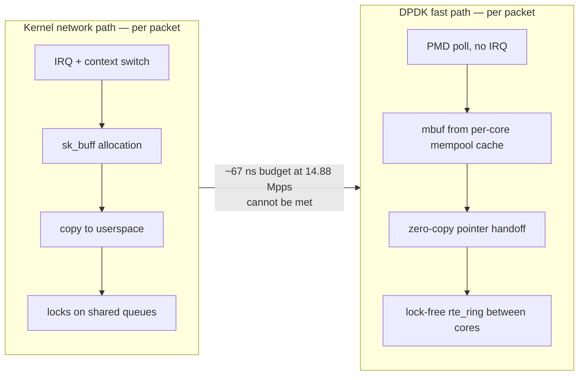
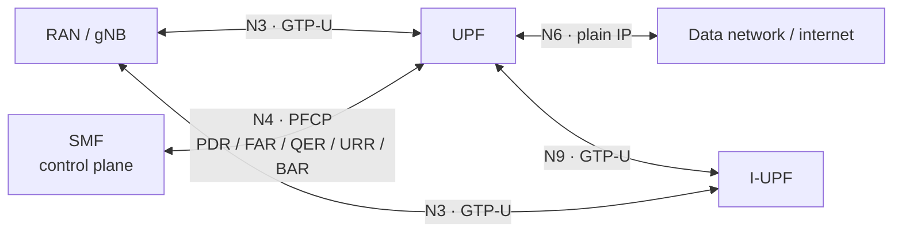
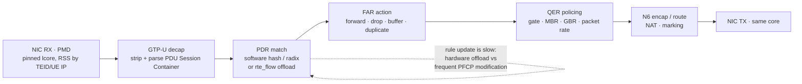

# DPDK, User Plane and the 5G UPF

## 1. Why user-plane bypass exists

The kernel network stack costs: per-packet **interrupt handling**, **context switches** into kernel space, **sk_buff allocation**, **locks** on shared queues, and **copying** between kernel and user buffers. At 10 GbE line rate with 64-byte frames that is **~14.88 Mpps**, i.e. ~67 ns per packet — less than a couple of cache-miss latencies. Nothing that allocates or locks per packet survives that budget.

Where the kernel path spends its budget, and what DPDK removes:

DPDK's answer:
- **Poll Mode Drivers (PMD)** — no interrupts; a core spins on the RX queue.
- **Huge pages** — fewer TLB misses, contiguous physical memory.
- **`rte_mempool`** — pre-allocated, NUMA-aware, per-core-cached mbuf pools; no runtime allocation.
- **Lock-free rings** — `rte_ring` for inter-core handoff.
- **CPU affinity / core pinning** — one RX queue per core, no cross-core migration.
- **Zero-copy** where possible — pass mbuf pointers between stages.

## 2. Core DPDK objects to be fluent in

| Object | Purpose | Tuning that matters |
| --- | --- | --- |
| **mbuf** | Packet buffer metadata + data | Size must cover frame + headroom + alignment; oversized wastes cache, undersized forces segmentation |
| **mempool** (`rte_mempool`) | Pool of mbufs | Pool size ≥ sum of in-flight buffers across RX, TX and all pipeline stages; **per-core cache** size trades memory for lock contention |
| **ring** (`rte_ring`) | Lock-free FIFO between cores | Bulk enqueue/dequeue amortises the CAS cost |
| **RX/TX queues + RSS** | Spread flows across cores | RSS hash symmetry matters: forward and return traffic of a flow must hit the same core |
| **rte_flow** | Hardware flow classification/steering | Offloads classification to NIC |
| **lcore / EAL** | Execution environment | Pin lcores to physical cores on the same NUMA node as the NIC |

**NUMA is the first-order effect.** A NIC on socket 1 with processing cores on socket 0 pays a cross-socket penalty on every packet. Getting mempool allocation and lcore pinning NUMA-local is usually worth more than any algorithmic optimisation.

## 3. 5G UPF fundamentals

### 3.1 Interfaces
- **N3** — access side, GTP-U tunnel from RAN
- **N4** — PFCP control interface from SMF
- **N6** — DN side (internet / data network)
- **N9** — GTP-U between UPFs (e.g. I-UPF to PSA UPF)

### 3.2 PFCP rules (TS 29.244)
- **PDR** (Packet Detection Rule) — match packets: source interface, UE IP, TEID, SDF filter (5-tuple), application ID.
- **FAR** (Forwarding Action Rule) — what to do: forward, drop, buffer, duplicate; plus outer header creation/removal.
- **QER** (QoS Enforcement Rule) — gate status, MBR, GBR, QoS flow identifier, packet rate.
- **URR** (Usage Reporting Rule) — measurement and charging triggers.
- **BAR** (Buffering Action Rule) — buffering when the UE is unreachable.
- PDRs are evaluated by precedence; the highest-precedence match wins.

### 3.3 Encapsulation
- **GTP-U** (TS 29.281) over UDP for N3/N9; extension headers carry QoS flow identifier (PDU Session Container).
- Header operations: GTP-U encapsulation/decapsulation, IP handling, NAT on N6, and per-flow marking.

### 3.4 QoS alignment with the RAN
`Application → QoS Flow (QFI/5QI) → DRB (SDAP, RAN) → GTP-U tunnel (N3) → PDR/FAR/QER (UPF)`

- The same QoS flow traverses both domains; see [[01-2 5G NR RAN Layer 2 Protocol Stack]].
- **Time-scale mismatch is the diagnostic key.** RAN scheduling operates per slot (0.125–1 ms); UPF QoS enforcement operates per flow over milliseconds to seconds. If a user sees poor throughput:
  - Air-interface bottleneck → PRB utilisation high, CQI low, HARQ retransmissions high, BSR non-zero but unserved.
  - User-plane bottleneck → GTP-U queue depth and drop counters grow, per-flow rate caps hit, UPF CPU/core saturation, N6 congestion.
  - Distinguish by correlating **RAN-side PRB/throughput counters** against **UPF-side PDR/QER counters and per-core pps** over the same window.

## 4. Open-source 5GC and accelerated user planes

- **free5GC** (Go) and **Open5GS** (C) are the widely used open-source 5G cores; **OpenAirInterface**, **srsRAN** and **OAI** provide RAN-side stacks.
- Accelerated user-plane datapaths are typically built on **DPDK**, **VPP/FD.io**, **AF_XDP**, or **io_uring**, with the PFCP control plane remaining in the core implementation.
- Typical accelerated UPF pipeline:
  `NIC RX (PMD) → RSS/flow classification → GTP-U decap → PDR match (hash/radix) → FAR action (QER policing) → N6 encap/route → NIC TX`

- Design decision: where does the **PDR lookup** live — software hash in the fast path, or `rte_flow` hardware offload? Hardware offload is faster but has a limited rule count and slow rule update, which conflicts with frequent PFCP session modification.

## 5. Edge forwarding: the metrics that actually matter

At the edge, **throughput is rarely the constraint; packets per second and jitter are**:
- **64-byte small-packet forwarding rate (Mpps)** is the standard stress metric. Line rate on 10 GbE with 64B frames ≈ **14.88 Mpps**.
- **Latency jitter** (P99, P99.9) matters more than mean latency for XR, industrial control and agent workloads.
- **AQM (Active Queue Management)** — CoDel, PIE, RED — must be tuned for mixed traffic; a deep buffer removes loss but destroys tail latency (bufferbloat).
- **Mixed traffic** — a few elephant flows plus a flood of mice flows favours different batching: large batch sizes improve pps but worsen per-packet latency.
- Practical rule: **batch for throughput, bound the batch for latency.** Adaptive batching (fill up to N or until a deadline) is the usual compromise.

## 6. Design exercise: L2 user-plane slice on generic cores + accelerators

Prompt: implement a 5G L2 user-plane slice (PDCP / RLC / GTP-U) on RISC-V general-purpose cores plus domain accelerators.

Data path sketch:
1. **Ingress** — DPDK PMD RX, RSS by (TEID, UE IP) to a pinned lcore; mbufs from a NUMA-local mempool.
2. **GTP-U decap** — header parse and strip; candidate for a domain accelerator or vector/SIMD path.
3. **PDCP** — decipher + integrity (crypto accelerator), ROHC (accelerator or software), reordering (software; needs per-bearer state and timers).
4. **RLC** — segmentation/reassembly and AM ARQ state machines; mostly control-logic, so general-purpose cores fit; state must be core-local to stay lock-free.
5. **QoS enforcement point** — place it **at the PDR match stage, before buffering**, so policing happens once and downstream queues are already QoS-aware.
6. **Egress** — GTP-U encap or N6 route; TX on the same core that processed the packet to avoid cross-core handoff.
7. **Inter-core** — lock-free rings sized to absorb burst; avoid shared state on hot fields (pad to cache lines).

## Anchors — verified facts

- 10 GbE line rate with 64-byte frames ≈ **14.88 Mpps** (~67 ns per packet) — the reason per-packet allocation and locking are fatal.
- PFCP rule types: **PDR, FAR, QER, URR, BAR** (TS 29.244).
- UPF interfaces: **N3** (RAN, GTP-U), **N4** (SMF, PFCP), **N6** (DN), **N9** (UPF-to-UPF, GTP-U).
- GTP-U is specified in **TS 29.281**; QoS flow marking is carried in the PDU Session Container extension header.
- DPDK core primitives: **mbuf, rte_mempool (with per-core cache), rte_ring, PMD, RSS, rte_flow**, EAL lcore pinning, hugepages.

## Related

- [[08-2 C and C++ Programming - Language Features, STL and Systems Practice]] — pool allocation, false sharing, PMR arenas, zero-copy buffer ownership
- [[01-2 5G NR RAN Layer 2 Protocol Stack]]
- [[05-2 Cloud-Edge-End Collaboration and Heterogeneous Computing]]
- [[07-1 RISC-V for Communication Infrastructure]]
- [[04-1 Embedded Systems RTOS and Hardware Interfaces]]
- [[04-2 Linux Embedded Development - Drivers, Applications and Core Subsystems]] — VFIO, hugepages, IRQ affinity, core isolation underneath the PMD

---

Copyright (c) 2026 Washington Ruan. All rights reserved.
