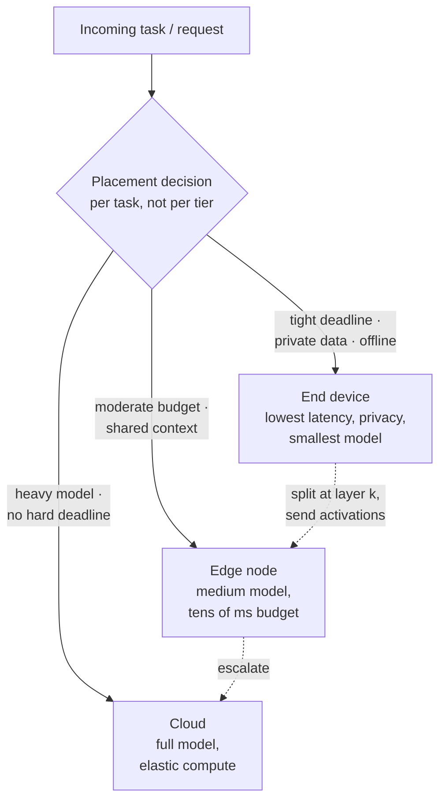
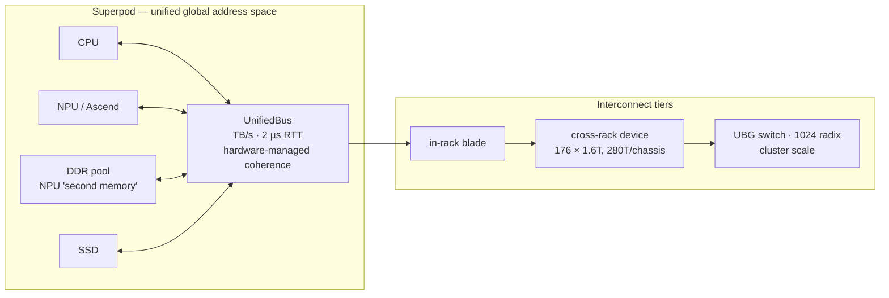

# Cloud-Edge-End Collaboration and Heterogeneous Computing

## 1. The shift: static tiers → task-level dynamic orchestration

The old model was static layering (device → edge → cloud, each with a fixed role). The 2026 direction is **per-task dynamic placement**: decide *per request* which device runs which sub-task, based on capability, current load, privacy and latency budget.

See [[06-2 Agent Systems and Edge Orchestration]] for the concrete system (GRAFT) that demonstrates this.

What makes this hard is not the placement rule — it is that the split point, the fallback path and the merge protocol have to be correct under partial failure, which is the same problem as [[01-2 5G NR RAN Layer 2 Protocol Stack]]'s HARQ/ARQ layering, one abstraction level up.

## 2. The performance model that makes you credible

> **Sustainable performance is not FLOPS. It is interconnect bandwidth × memory semantics × scheduling granularity.**

- **FLOPS** only bounds the compute-bound regime.
- **Interconnect bandwidth** determines how fast activations, gradients and KV blocks move.
- **Memory semantics** determine whether moving data requires a software message round trip (RDMA/RoCE) or a load/store (global address space).
- **Scheduling granularity** determines whether the exposed parallelism can actually be used — fine-grained expert/attention split needs fine-grained dispatch and synchronisation.

### Why memory pooling raises MFU
- **MFU (Model FLOPs Utilisation)** collapses when accelerators stall on data, not on arithmetic.
- In large-scale training, a large share of accelerator time is spent waiting for communication to complete — industry statements put actual MFU at roughly **20% on 100k-card clusters** in conventional architectures.
- Memory pooling converts "copy data to wherever the compute is" into "let compute address the data where it is". That removes copy bandwidth and, more importantly, removes the synchronisation points that idle the accelerator.
- Concretely: treating **DDR as a second tier of NPU memory** reduces the pressure on per-card HBM, which is what otherwise forces smaller batch sizes, more recomputation, and lower occupancy.

### Why operator fusion helps in one regime and not the other
- **Memory-bound phase (decode, elementwise-heavy):** fusion removes intermediate global-memory round trips — large win.
- **Compute-bound phase (large prefill GEMM):** the arithmetic dominates; fusion removes little traffic and can even hurt by reducing tile-shape freedom and occupancy.
- Being able to say "fusion is a memory-traffic optimisation, not an arithmetic optimisation" is the senior-level answer.

## 3. Huawei UnifiedBus (also romanised as Lingqu) — a worked system-level case

Presented at Huawei Connect 2026 (Shanghai, 17–19 September 2026) by Yang Chaobin (Huawei Executive Director, ICT BG CEO).

### 3.1 Four stated characteristics
1. **Protocol convergence with memory semantics** — more than ten interconnect protocols unified into the UnifiedBus protocol; interconnect bandwidth raised from the hundreds-of-GB/s level to the TB/s level; **RTT reduced from 7 µs to 2 µs**; global unified memory addressing inside the superpod.
2. **Diverse compute, heterogeneous coordination** — CPU, NPU, memory and SSD interconnect directly through UnifiedBus with decentralised peer access; **CPU and NPU resources can be flexibly proportioned**; hierarchical Transformer hardware acceleration with **Attention decoupled from FFN (AF disaggregated deployment)**.
3. **Tiered storage, global pooling** — mixed-media resource pooling for activation caching; **DDR used as the NPU's "second memory"**; reported doubling of performance for hundred-billion-scale, thousand-dimension vector retrieval; reduced per-card HBM capacity requirement for 10T-parameter model training, improving cluster MFU.
4. **Optical-electrical interconnect, flexible networking** — three-level interconnect covering in-rack, cross-rack and cluster scale, scaling from a single rack to a million-card cluster.

### 3.2 Interconnect equipment announced
- **In-rack blade** — zero cable, zero circuit loss; a 4096-node superpod saves **196 km of copper cable**.
- **Cross-rack device** — **176 ports at 1.6T each, 280T per chassis**, RTT as low as **2 µs**; described as the highest-bandwidth, highest-port-count high-speed bus interconnect device in the industry.
- **UBG switch** — **1024 radix** fan-out, supporting million-card superpod clusters.
- **Kunpeng superpod** — up to **4096 nodes** forming a **256 TB unified memory pool** over all-optical UnifiedBus networking; targets denser agent sandboxes, faster sandbox startup, and better agent vector retrieval.
- **OceanStor M900** — a "layer 3.5" PB-scale KV-cache cluster built on UnifiedBus with one-hop direct connection.

### 3.3 Scale and roadmap
- Multiple Ascend 960 superpods interconnected via UnifiedBus or RoCE; two-layer CLOS four-plane networking reaches **512k cards**; with multi-rail topology, up to **1 million cards**.
- **Ascend 960** air-cooled superpod (Q2) and liquid-cooled superpod (Q3) of the following year; **Ascend 970 (2028)** and **980 (2029)**, one generation per year.
- **UnifiedBus history**: research began 2019; Atlas 900 SuperPod (UB 1.0) shipping and commercially deployed from March 2025, 300+ deployed by September 2025; **UB 2.0 specification released 18 September 2025 (≈600 pages)**; Atlas 950 SuperPod uses UB 2.0.
- UnifiedBus is described as a **point-to-point, single-protocol interconnect that natively exposes memory semantics**, replacing layered protocol stacks and using **hardware-managed coherence instead of software message passing**. A **UCAL (Unified Communication Abstraction Layer)** decouples physical network (InfiniBand/Ethernet), logical topology (tree/ring/mesh) and protocol semantics (point-to-point/collective).
- Reported figures in secondary sources: **392 GB/s bandwidth, ~15× versus conventional RoCE**, and end-to-end remote access latency reduced from tens of microseconds to ~100 ns. *(Treat these as separate, differently-scoped claims from the 2 µs RTT headline — VERIFY which metric you are quoting.)*
- **XMFS (eXpress Memory FS)** — an experimental filesystem for Linux servers with UnifiedBus, shown at Linux Plumbers Conference 2026.

### 3.4 Software ecosystem
- **CANN** (Ascend heterogeneous compute architecture) now operates as a regular open-source community; external developers exceed internal (61%); monthly active developers above 5,200; 40+ natively trained models; coverage of 90+ mainstream open-source communities including PyTorch, Triton, vLLM and veRL; Ascend became the first Chinese compute platform installable directly from the PyTorch official install list.

## 4. Cluster-scale pain points (ODCC framing)

For ten-thousand-card intelligent computing clusters, the recurring pain points are:
1. **Aggregating heterogeneous compute** — different accelerators, different memory models
2. **Bandwidth bottlenecks** — scale-up and scale-out both saturate
3. **Latency jitter** — tail latency, not average, breaks synchronous training and agent pipelines
4. **Operational complexity** — fault domains, scheduling, observability

Next-stage directions being pursued: **end-network-coordinated new RDMA protocols** and **memory pooling**.

## 5. What disappears and what becomes more important with unified memory semantics

A protocol-stack engineer's answer to "if RTT is 2 µs and memory is globally addressed, which abstractions vanish?"

**Can weaken or disappear:**
- Explicit serialisation/marshalling for intra-superpod transfer — remote memory looks like local memory.
- Application-level sharding of model state just to fit per-card HBM (pooling removes the constraint).
- Some layers of the collective-communication software stack when hardware coherence handles it.

**Becomes more important, not less:**
- **Consistency and ordering semantics** — once everything can address everything, the correctness contract is the hard part.
- **Failure domains and partial failure** — a unified address space widens the blast radius of one node's failure.
- **Scheduling and placement** — the cost moves from "how do I move data" to "where should compute sit relative to data".
- **Observability and telemetry** — you cannot debug a unified memory fabric with per-node logs alone.
- **QoS and isolation** — shared global memory is a noisy-neighbour problem at a new scale.

## 6. Model partitioning and dependable on-device inference

- **DNN partitioning** splits a model across device and edge/cloud at a chosen layer, trading compute for transmission of intermediate activations.
- Partition point selection depends on: activation size at each candidate cut, available uplink bandwidth and its jitter, and the privacy constraint on raw input.
- For **dependable inference without cloud dependence**, partitioning must come with: a fallback path when a peer is unavailable, a verified merge protocol, and per-partition timeout handling.
- Engineering reality: the partitioning logic itself is often more code than the model call, and the failure matrix (peer down mid-batch, partial results, clock skew) is where projects die.

## Anchors — verified facts

- **Traditional architecture: ~20% actual MFU on 100k-card clusters** (Huawei Connect 2026 statement).
- **UnifiedBus: 10+ protocols unified; bandwidth from hundreds of GB/s to TB/s; RTT 7 µs → 2 µs; global unified memory addressing.** Cross-rack device: **176 × 1.6T ports, 280T per chassis**; UBG switch **1024 radix**; in-rack blade saves **196 km copper per 4096-node superpod**.
- **Kunpeng superpod: up to 4096 nodes, 256 TB unified memory pool.**
- Cluster scale: **512k cards** via two-layer CLOS four-plane; up to **1M cards** with multi-rail topology.
- **UB 2.0 spec released 18 September 2025 (~600 pages)**; Atlas 950 SuperPod on UB 2.0; Atlas 900 (UB 1.0) shipping from March 2025.
- **Attention/FFN decoupling (AF disaggregated deployment)** is an explicit hardware acceleration direction.
- Ascend roadmap: **960 (next year Q2 air-cooled / Q3 liquid-cooled), 970 (2028), 980 (2029)**.

## Related

- [[06-3 Machine Learning - Foundations, Core Algorithms and Applications]] — what the training and serving workloads actually are: parallelism strategies, precision, and the memory arithmetic that decides where a workload can run
- [[06-1 LLM Inference Engines and xLLM]]
- [[06-2 Agent Systems and Edge Orchestration]]
- [[05-1 DPDK User Plane and 5G UPF]]
- [[07-1 RISC-V for Communication Infrastructure]]

---

Copyright (c) 2026 Washington Ruan. All rights reserved.
