# Machine Learning — Foundations, Core Algorithms and Applications

This note is written to be read front to back by someone who can program but has never trained a
model. Every concept is stated once in plain language, once with the mathematics that actually gets
implemented, and once as a worked example with real numbers. Nothing here needs a GPU; everything
here is what the rest of group 06 assumes you already know.

The organising idea is a single sentence:

> **A model is a function with knobs. Learning is the procedure that turns the knobs. Everything else
> — loss functions, optimisers, regularisation, cross-validation, MLOps — is machinery for turning
> them in a way that still works on data the model has never seen.**

Everything below is an expansion of that sentence.

---

## 1. Where machine learning sits

### 1.1 The vocabulary, and why the nesting is not a hierarchy of importance

The terms are nested, but the nesting is about **what is assumed about the problem**, not about how
advanced the technique is.

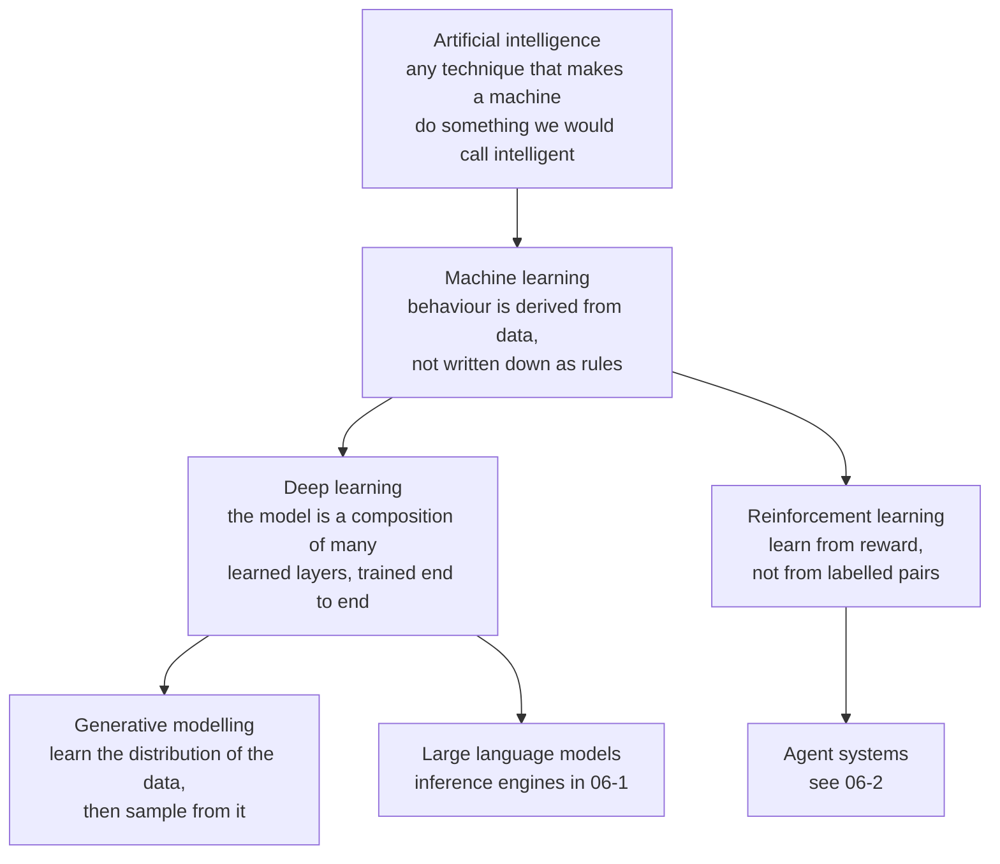

Practical consequence: "deep learning" is a **subset** of machine learning, not a successor to it.
On a table of business records with 20 columns, a gradient-boosted tree ensemble beats a neural
network almost every time, trains in seconds, and is easier to explain. Depth wins when the input is
**high-dimensional and unstructured** (pixels, waveforms, text, graphs) and when you have enough data
to pay for it.

### 1.2 The three ingredients

Every machine learning system reduces to three objects:

| Ingredient | What it is | Concrete instance |
| --- | --- | --- |
| **Hypothesis space** | the family of functions you allow yourself to search | "all linear functions of 8 features", "all trees of depth ≤ 6", "a 32-layer transformer" |
| **Loss function** | a scalar score saying how wrong a particular function is | squared error, cross-entropy, negative log-likelihood |
| **Optimiser** | the procedure that searches the space for the lowest loss | closed-form normal equations, gradient descent, greedy splitting |

"Learning" is formally stated by Tom Mitchell's definition: a program learns from experience **E**
with respect to task **T** and performance measure **P** if its performance on T, as measured by P,
improves with E. Note what this definition does **not** require: it does not require the model to
understand anything, and it does not require the model to be correct — only to be measurably better.

### 1.3 The loop everyone actually runs

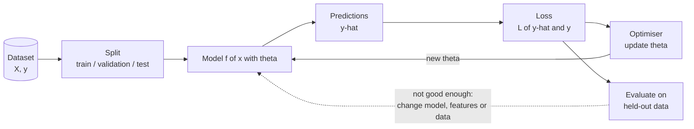

Two rules sit on top of this loop and account for most of the difference between a working project
and a failed one:

1. **The test set is not part of the loop.** It is touched once, at the end. Every decision made by
   looking at test data — including "this threshold looks good" — has quietly turned the test set
   into a training set.
2. **The loop is not finished when accuracy is good.** It is finished when the model is in production
   and still accurate six weeks later. Sections 12 and 13 are about that second half.

### 1.4 Why not just write rules

Consider spam filtering. The rule-based version is a list: subject contains "free", sender not in
contacts, more than three exclamation marks. It works until someone writes "fr ee". Every new trick
needs a new rule, the rules interact, and no one can say what the filter does on an email nobody
anticipated.

The learned version is: represent each email as a vector of word counts, collect 10,000 emails
labelled by users, and let an optimiser find the weights. The "rules" are now numbers, they are
chosen to minimise errors *on data*, and they can be re-derived weekly without anybody writing
anything. You have traded **explicit knowledge** for **data plus an optimisation procedure**.

That trade is only profitable when: the pattern exists in the data, the data is representative of
what you will see later, and you can measure success. If any of the three fails, write the rule.

---

## 2. The learning paradigms

### 2.1 The five you will meet, and the question each one answers

| Paradigm | Data you need | Question it answers | Worked example |
| --- | --- | --- | --- |
| **Supervised** | `(x, y)` pairs | "given x, what is y?" | 50,000 labelled radios → predict tomorrow's throughput from today's counters |
| **Unsupervised** | `x` only | "what structure is in x?" | 200,000 session records → group them into 6 behavioural clusters |
| **Self-supervised** | `x` only, but a task is manufactured from it | "learn a representation that makes the manufactured task easy" | hide 15% of tokens in a sentence and predict them; hide a patch of an image and reconstruct it |
| **Semi-supervised** | a little `(x, y)`, lots of `x` | "use the unlabelled data to sharpen the decision boundary" | 500 labelled medical images, 50,000 unlabelled ones |
| **Reinforcement** | an environment and a reward | "which action maximises long-run reward?" | choose a modulation and coding scheme each TTI; reward is throughput minus retransmissions |

Supervised learning splits again by the type of `y`:

- **Regression** — `y` is a number (price, latency, temperature, remaining lifetime).
- **Classification** — `y` is a category, with two (binary) or many (multi-class) values.
- **Structured prediction** — `y` is a sequence, a tree, a bounding box, an image. The loss is no
  longer a simple mismatch count, which is why this is usually where deep learning starts to pay off.

### 2.2 Choosing a paradigm

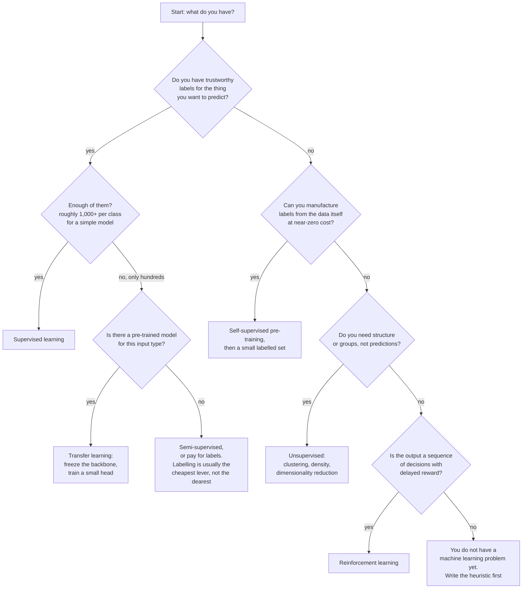

The last branch is the most valuable one in the diagram. A heuristic is the baseline that tells you
whether the model earned its complexity, and it is often good enough to ship.

### 2.3 Three more distinctions that interviewers use

- **Parametric vs non-parametric.** A linear model has a fixed number of knobs regardless of data
  size. k-nearest neighbours has one knob per training point — the "model" is the dataset.
- **Generative vs discriminative.** Discriminative models learn `P(y | x)` or a decision boundary
  directly (logistic regression, SVM, a classifier head). Generative models learn `P(x, y)` or
  `P(x)` and can both classify and *produce* new samples (naive Bayes, VAEs, diffusion models).
- **Batch vs online.** Batch fits on a static dataset; online updates per example or per mini-batch
  as data arrives, which is what a production system with concept drift eventually needs.

---

## 3. The end-to-end workflow

### 3.1 The pipeline

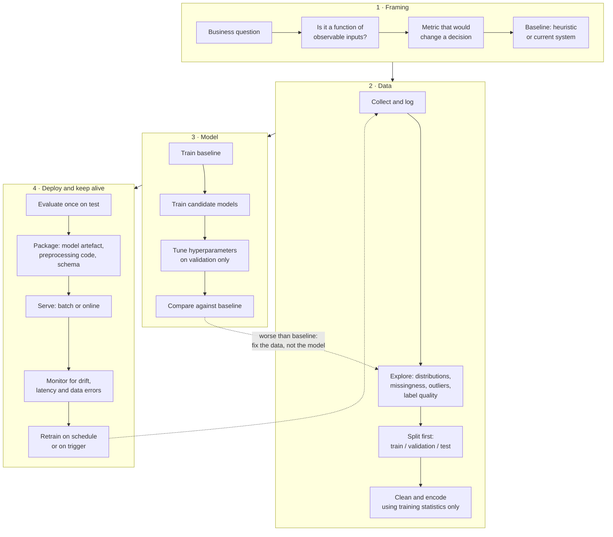

Two details in this diagram are load-bearing:

- **Split before you clean.** Any statistic computed on the full dataset — a mean used for
  imputation, a vocabulary, a scaler's min and max — carries information from the validation and test
  rows into the training rows. Fit the transformer on the training set, apply it to the others.
- **The artefact is not the model.** It is the model *plus* the preprocessing *plus* the input
  schema. Most "the model is wrong in production" incidents are preprocessing mismatch.

### 3.2 Splits and cross-validation

A 60/20/20 train/validation/test split is the default for independent, identically distributed rows.
When data is scarce, use k-fold cross-validation on the training portion: train k times, each time
holding out a different fold, and average.

```mermaid
flowchart LR
    subgraph F1["fold 1"]
        direction TB
        T1["train"] & T1b["train"] & T1c["train"] & V1["VALIDATE"]
    end
    subgraph F2["fold 2"]
        direction TB
        T2["train"] & V2["VALIDATE"] & T2b["train"] & T2c["train"]
    end
    subgraph F3["fold 3"]
        direction TB
        T3["train"] & T3b["train"] & V3["VALIDATE"] & T3c["train"]
    end
    subgraph F4["fold 4"]
        direction TB
        V4["VALIDATE"] & T4["train"] & T4b["train"] & T4c["train"]
    end
    subgraph F5["fold 5"]
        direction TB
        T5["train"] & T5b["train"] & T5c["train"] & V5["VALIDATE"]
    end
    F1 --> F2 --> F3 --> F4 --> F5
```

Rules that people break:

- **Stratify** classification folds so each fold keeps the class ratio. With 1% positives, an
  unstratified fold can contain zero positives.
- **Group** when rows are not independent: several rows from the same user, the same device, the same
  hospital, or the same day must go to the same fold. Otherwise the model is validated on a user it
  has already seen.
- **Respect time.** For forecasting, use a rolling or expanding window: train on months 1–6,
  validate on month 7; then train on 1–7, validate on 8. A random split of a time series lets the
  model see the future.

### 3.3 Data leakage — the number one cause of "too good to be true"

| Leak | What happens | Fix |
| --- | --- | --- |
| Scaling or imputing before the split | test statistics leak into training, scores inflate by a few points | fit transformers inside a pipeline, on the training fold only |
| Target leakage | a feature is a consequence of the label, e.g. "refund issued" predicting fraud | audit every feature: would this value exist at prediction time? |
| Duplicate or near-duplicate rows | the same record appears in train and test | deduplicate before splitting |
| Random split of time series | future informs the past | rolling-origin evaluation |
| Grouped rows split randomly | the model memorises the entity | `GroupKFold` |
| Tuning on the test set | the test set becomes a validation set | keep a final untouched holdout, or accept that the last tuning round invalidates it |

The diagnostic is simple: **if your result is dramatically better than published results on a
comparable dataset, suspect leakage before celebrating.** Audit features one at a time by checking
whether each would be available at the moment you need the prediction.

---

## 4. Data, features and representations

### 4.1 What "a feature vector" means per data type

| Data | Raw form | Usual representation | Typical first model |
| --- | --- | --- | --- |
| **Tabular** | rows and columns, numeric and categorical | numeric matrix after encoding | gradient boosting |
| **Text** | character sequence | bag of words, TF-IDF, or token embeddings | linear model on TF-IDF; transformer when data is large |
| **Image** | height × width × channels | raw pixels normalised to `[0,1]` or `[-1,1]` | CNN, or a pre-trained backbone |
| **Audio** | waveform | spectrogram / mel filterbank energies as an "image" | CNN, or conformer for ASR |
| **Time series** | ordered values | lag features, rolling statistics, seasonal indicators; or the raw window | ARIMA/GBM on features; CNN/Transformer on windows |
| **Graph** | nodes and edges | adjacency plus node/edge features | message-passing GNN |

TF-IDF, still the baseline every text system is compared against:

```
tfidf(t, d) = tf(t, d) x idf(t)
idf(t)      = log( N / (1 + number of documents containing t) )
```

The `(1 + ...)` avoids division by zero and prevents a term in every document from being undefined;
the log keeps the weight from exploding on large corpora.

### 4.2 Encoding and scaling

- **One-hot encoding** for nominal categories. With a high-cardinality column this creates thousands
  of sparse columns; trees survive that, linear models get unstable.
- **Ordinal encoding** only when the order is real (`cold < warm < hot`), never for nominal values —
  an arbitrary integer order invents a monotonic relationship.
- **Target / mean encoding** replaces a category with the mean label in that category. It is powerful
  and it leaks: compute it inside the cross-validation loop, from the training fold only, with
  smoothing towards the global mean.
- **Standardisation** `(x - mean) / std` matters for anything using distances (k-NN, k-means, SVM
  with an RBF kernel, PCA) or gradients (linear and neural models), because those objectives are not
  invariant to the scale of a column. Trees do not care, because a split at `x_j > 3.7` is unaffected
  by rescaling.

**Worked example — why scaling changes k-means.** Customers with `age` in `[18, 80]` and
`annual_spend` in `[0, 200000]`. Unscaled, the distance between two customers is dominated by spend,
so age contributes almost nothing and the clusters are slices of spend. After standardisation both
axes have unit variance and the clustering is a genuine two-dimensional compromise.

### 4.3 Feature engineering, with a concrete transformation

Raw: a timestamp `2026-10-23 14:07:11`. Engineered:

| Feature | Value | Why it helps |
| --- | --- | --- |
| hour of day | 14 | captures daily cycle |
| day of week | 5 | weekday versus weekend behaviour |
| is holiday | 0 | known calendar shocks |
| minutes since midnight | 847 | monotone version of hour, useful for trees |
| time since last event | 312 s | recency, often the strongest feature in churn models |

The general recipe: give the model the quantity in the form in which it is *causally* related to the
target. A tree can carve up "minutes since midnight" far more easily than it can carve up a Unix
epoch.

### 4.4 The curse of dimensionality

Take points uniformly in a `d`-dimensional unit cube and ask how far the nearest neighbour is. In one
dimension with 1,000 points, neighbours are about 0.001 apart. In 100 dimensions with 1,000 points,
almost all pairwise distances are nearly identical and every point is "far" from every other: the
volume of the cube grows exponentially, so a fixed number of samples becomes exponentially sparse.

Consequences you can state in an interview: distance-based methods degrade, the amount of data
needed grows steeply with dimension, and **feature selection or dimensionality reduction is not
cosmetic — it changes whether the problem is learnable at all.**

### 4.5 Train/serve skew

If the training pipeline computes `average_spend_last_30_days` with a SQL window function and the
serving path computes it in Python from a cache with a different boundary convention, the model sees
a different feature distribution online and silently degrades. The fix, used by every mature team, is
a **feature store**: one definition, one implementation, materialised for both training and serving.

---

## 5. Core supervised algorithms, shallow to deep

Each subsection gives the intuition, the objective actually minimised, a worked example, and the
failure mode.

### 5.1 Linear regression

Model: `y-hat = w · x + b`. Objective: minimise the residual sum of squares
`L = Σ (y_i - y-hat_i)²`.

**Worked example.** Three apartments, sizes `x = [1, 2, 3]` (hundreds of square metres) and prices
`y = [1.5, 3.2, 4.1]` (millions).

```
x-bar = 2,  y-bar = 8.8 / 3 = 2.933
S_xy  = (-1)(-1.433) + (0)(0.267) + (1)(1.167) = 2.600
S_xx  = 1 + 0 + 1 = 2
w     = S_xy / S_xx = 1.300
b     = y-bar - w * x-bar = 2.933 - 2.600 = 0.333
```

Predictions: `1.633, 2.933, 4.233`. Residuals: `-0.133, +0.267, -0.133`. Sum of squared errors
`= 0.0177 + 0.0711 + 0.0177 = 0.107`.

Now compute the gradient at the *untrained* point `w = 0, b = 0`, where residuals are just `y`:

```
dL/dw = -2 * sum over i of x_i * r_i = -2 * (1*1.5 + 2*3.2 + 3*4.1) = -2 * 20.2 = -40.4
dL/db = -2 * sum over i of r_i                                       = -2 * 8.8  = -17.6
```

With a learning rate of 0.01, one gradient step gives `w = 0.404`, `b = 0.176`. Repeat a few thousand
times and you arrive at `1.300` and `0.333`. That is gradient descent; the closed-form solution above
is just where the gradient is zero.

Metrics: `MSE = mean(r²)`, `RMSE = sqrt(MSE)`, `MAE = mean(|r|)`, and
`R² = 1 - SSE / SST` where `SST` is the sum of squared deviations from the mean — i.e. "how much
better than predicting the average". RMSE punishes large errors more than MAE does; choose based on
whether a large error is merely twice as bad (MAE) or catastrophically worse (RMSE).

**Failure modes.** Linearity is assumed, outliers dominate because the loss is squared, and
correlated features make the coefficients unstable and uninterpretable. Always plot residuals against
the prediction: a curved pattern means the relationship is not linear.

### 5.2 Logistic regression

Despite the name, it is a classifier. It computes a score `z = w · x + b`, squashes it with the
sigmoid `σ(z) = 1 / (1 + e^-z)` into `[0, 1]`, and interprets the result as `P(y = 1 | x)`. The loss
is the binary cross-entropy:

```
L = - [ y * log(p) + (1 - y) * log(1 - p) ]
```

Worked example: with `z = 1.5`, `p = 0.817`. If the true label is `1`, the loss is
`-log(0.817) = 0.202`. If the true label is `0`, the loss is `-log(0.183) = 1.699`. The asymmetry is
the point: being confidently wrong is punished far harder than being mildly wrong.

Interpretation: each coefficient is a **log-odds** shift. `w_j = 0.7` means that increasing `x_j` by
one unit multiplies the odds of the positive class by `e^0.7 ≈ 2.01`. For multi-class problems the
sigmoid is replaced by the softmax over `K` scores, and the loss becomes the cross-entropy against
the one-hot label.

**Failure modes.** It is still a linear decision boundary, so it needs explicit interaction or
non-linear features; and it assumes `P(y|x)` is a monotone sigmoid of a linear score.

### 5.3 Overfitting, regularisation and the bias–variance trade-off

A model with enough capacity can memorise the training set: training error goes to zero while error
on new data rises. The shape is always the same.

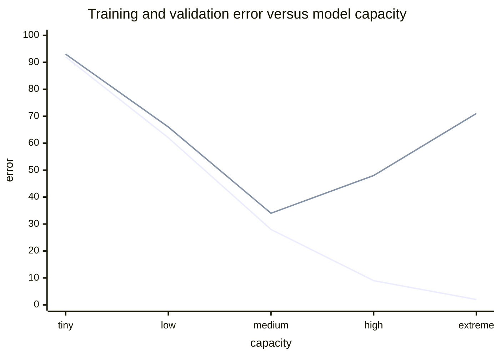

The first line is training error (monotonically down), the second is validation error (down, then up
again). The job is to stop at the bottom of the second curve.

Regularisation adds a penalty to the objective so that the optimiser prefers simpler functions:

| Penalty | Objective added | Effect | Notes |
| --- | --- | --- | --- |
| **L2 (ridge, weight decay)** | `λ · Σ w_j²` | shrinks all weights smoothly towards zero; never exactly zero | the default; keeps all features with reduced influence |
| **L1 (lasso)** | `λ · Σ abs(w_j)` | drives many weights to exactly zero | performs feature selection; unstable with correlated features |
| **Elastic net** | both | compromise | good when features are correlated and you still want sparsity |

`λ = 0` is the unregularised model; `λ → ∞` drives the model to a constant. It is a hyperparameter
chosen on validation data, never on test data.

The bias–variance decomposition puts a name on the two failure regimes:

```
expected error = (bias)^2 + variance + irreducible noise
```

- **Bias** — error from wrong assumptions: fitting a line to a curve. Symptom: training and
  validation error are both bad and close together (**underfitting**). Fix: more capacity, better
  features, more training time.
- **Variance** — error from sensitivity to which training set you happened to get. Symptom: training
  error excellent, validation error much worse (**overfitting**). Fix: more data, regularisation,
  less capacity, ensembling, early stopping.

Two results worth quoting: the **no free lunch theorems** say that averaged over all possible
problems every algorithm performs identically, so any claim of superiority is a claim about a *class*
of problems — which is why domain structure (convolutions for images, trees for tables) matters. And
the **universal approximation theorem** says a single hidden layer with enough units can approximate
any continuous function; it says nothing about whether gradient descent will find it, or how much
data it takes, which is why depth and architecture still matter.

### 5.4 Decision trees

A tree asks a sequence of questions of the form `x_j > threshold` and gives a prediction at each
leaf. It learns by greedily choosing, at each node, the split that most reduces impurity.

```
Gini(node)    = 1 - sum over classes c of p_c^2
Entropy(node) = - sum over classes c of p_c * log2(p_c)
```

**Worked example.** A node holds 10 examples: 6 churned, 4 retained.

```
Gini(parent) = 1 - (0.6^2 + 0.4^2) = 1 - 0.36 - 0.16 = 0.480
Entropy(parent) = -0.6 * log2(0.6) - 0.4 * log2(0.4) = 0.442 + 0.529 = 0.971
```

Candidate split A (`tenure > 12 months`) gives left `(3 churn, 1 stay)` and right `(3 churn, 3 stay)`:

```
Gini(left)  = 1 - (0.75^2 + 0.25^2) = 0.375
Gini(right) = 1 - (0.5^2 + 0.5^2)   = 0.500
weighted    = (4/10)*0.375 + (6/10)*0.500 = 0.150 + 0.300 = 0.450
gain        = 0.480 - 0.450 = 0.030
```

Candidate split B (`support tickets > 3`) gives left `(5 churn, 0 stay)` and right `(1 churn, 4 stay)`:

```
Gini(left)  = 1 - (1^2 + 0^2)                 = 0.000   (pure)
Gini(right) = 1 - (0.2^2 + 0.8^2)             = 0.320
weighted    = (5/10)*0.000 + (5/10)*0.320     = 0.160
gain        = 0.480 - 0.160 = 0.320
```

Split B wins by an order of magnitude, and the tree takes it — even though A looked meaningful. This
is the whole algorithm: repeat greedily, stop at `max_depth`, `min_samples_leaf`, or when the gain is
below a threshold.

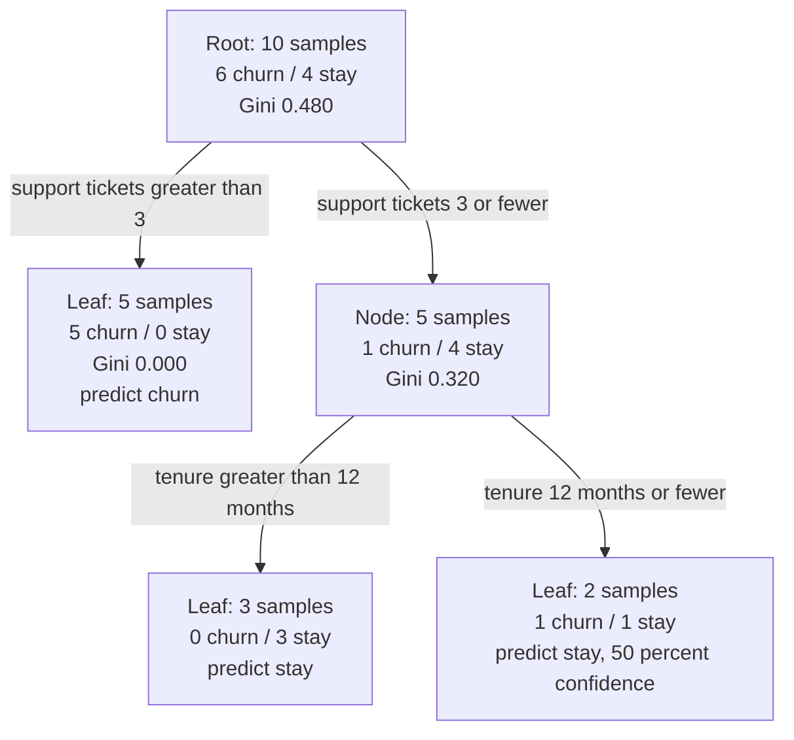

**Properties to state.** Trees need almost no preprocessing: no scaling, irrelevant features are
simply never split on, missing values can be routed to a default branch, and mixed numeric and
categorical inputs are fine. They are also **non-parametric and axis-aligned**, which produces two
hard failures: they cannot extrapolate (a tree trained on prices up to 4.1 will never predict above
its highest leaf value, no matter the input), and they cut only along one feature at a time, so a
diagonal boundary needs a staircase of many splits.

### 5.5 Ensembles: bagging and boosting

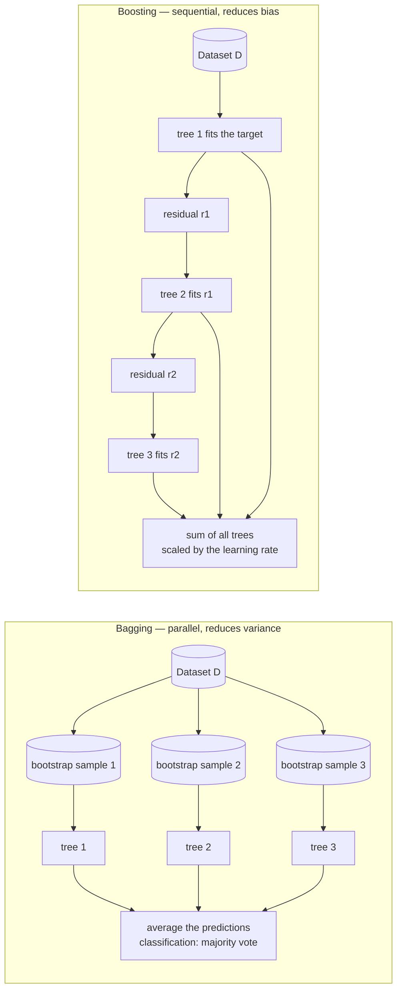

**Bagging** (bootstrap aggregating) trains `B` models on `B` bootstrap samples — draws of `n` rows
with replacement — and averages their predictions. Averaging independent high-variance models cancels
much of the variance while keeping the bias. **Random forests** add one more trick: at each split only
a random subset of `m` features is considered, which decorrelates the trees. Without it, every tree
would split on the same few strong features and the average would barely help.

Random forest facts you can use: out-of-bag error is a free validation estimate (each tree never saw
roughly 37% of the rows, since `(1 - 1/n)^n → 1/e`); feature importances based on impurity decrease
are biased towards high-cardinality features, so prefer permutation importance when the ranking
matters.

**Boosting** fits models sequentially, each one fitting what the current ensemble still gets wrong.
In gradient boosting, the next tree is fitted to the **negative gradient of the loss** — for squared
error, simply the residuals. Each tree contributes a small step scaled by the learning rate. AdaBoost
is the earlier, reweighting version: misclassified examples get higher weight and the next model
focuses on them.

Why this matters practically: **on tabular data, gradient-boosted trees (XGBoost, LightGBM,
CatBoost) are still the default winner** a decade after deep learning won vision and text. They
handle mixed feature types, missing values, non-monotone relationships and feature interactions with
no preprocessing, and they train in seconds. Reach for a neural network on tabular data only when the
dataset is very large or the features are themselves unstructured.

**Failure modes.** Boosting can overfit if the learning rate is high or the number of trees is large,
and it is sensitive to noisy labels because it keeps chasing the examples it cannot get right.
Bagging cannot fix bias — averaging many shallow trees gives you a shallow forest.

### 5.6 k-nearest neighbours

No training at all: to predict, find the `k` closest training points and average (regression) or vote
(classification).

**Worked example.** `k = 3`, three nearest neighbours have labels `[1, 1, 0]` → predict `1`. With
`k = 1` the model reproduces every training point exactly and is maximally sensitive to noise; with
`k = n` it always predicts the majority class. `k` is the bias–variance knob, tuned on validation.

**Failure modes.** Scaling matters (unscaled large-magnitude features dominate the distance), the
curse of dimensionality hits hard, prediction cost grows with dataset size (mitigated by KD-trees and
approximate nearest-neighbour indexes), and it gives no notion of feature importance. Despite this it
is an excellent baseline and an excellent way to detect leakage — if a 1-NN gets suspiciously high
scores, something is leaking.

### 5.7 Support vector machines

The linear SVM maximises the **margin** — the distance between the decision boundary and the nearest
points of either class. Points on the boundary are the support vectors; the solution depends only on
them. Soft-margin SVMs introduce slack variables and a cost parameter `C`: large `C` penalises
training errors heavily (low bias, high variance), small `C` tolerates errors for a wider margin.

The **kernel trick** replaces dot products with a kernel function, implicitly mapping data into a
high-dimensional space where it becomes linearly separable, without ever computing the coordinates.
The RBF kernel `K(x, x') = exp(-gamma * ||x - x'||²)` is the common choice; `gamma` large means each
point has very local influence and the boundary becomes wiggly.

**When it works:** medium-sized datasets, high-dimensional but not huge feature spaces, text
classification with TF-IDF. **When it hurts:** more than ~100,000 samples (training cost grows
super-linearly), and any setting where you need probabilities — standard SVMs give a decision
function, not a calibrated probability.

### 5.8 Naive Bayes

Apply Bayes' rule with a strong independence assumption:

```
P(class | x) proportional to P(class) * product over j of P(x_j | class)
```

**Worked example.** 8 emails: 3 spam, 5 ham. The word "free" appears in 2 of the 3 spam emails and in
1 of the 5 ham emails.

```
P(spam)          = 3/8   = 0.375      P(ham)          = 5/8 = 0.625
P(free | spam)   = 2/3   ≈ 0.667      P(free | ham)   = 1/5 = 0.200
numerator(spam)  = 0.375 * 0.667 = 0.250
numerator(ham)   = 0.625 * 0.200 = 0.125
evidence         = 0.250 + 0.125 = 0.375
P(spam | free)   = 0.250 / 0.375 = 0.667
```

The email is twice as likely to be spam. The trap: if a word never appears in spam in the training
set, `P(word | spam) = 0` and the product collapses to zero regardless of all other evidence. Fix
with **additive (Laplace) smoothing**: `(count + α) / (class_count + α·|V|)`, with `α = 1` typical.

**Why it is still used:** it trains in one pass, needs little data, and works surprisingly well for
text despite an assumption that is obviously false. Its probabilities are usually poorly calibrated,
so use its ranking, not its absolute probabilities.

### 5.9 Unsupervised learning

**k-means.** Pick `k`, initialise `k` centroids, then alternate: assign each point to the nearest
centroid, then move each centroid to the mean of its assigned points. This monotonically decreases
the within-cluster sum of squares (inertia) and therefore terminates.

Worked example on one dimension with points `1, 2, 10, 11, 20` and `k = 2`, initial centroids at `2`
and `11`:

```
iteration 1  assign:  cluster A = {1, 2}       cluster B = {10, 11, 20}
             update:  mean A = 1.50            mean B = 13.67
iteration 2  assign:  cluster A = {1, 2}       cluster B = {10, 11, 20}
             (unchanged) -> converged
```

Choosing `k`: the elbow method plots inertia against `k` and looks for the bend; the silhouette
score measures how much better a point matches its own cluster than the next best one. Run several
random initialisations (k-means++ makes good starts cheap and is the default in scikit-learn).

Failure modes: k-means assumes clusters are roughly spherical and similar in size, so it splits long
or elongated clusters badly and is dragged by outliers. **DBSCAN** instead grows clusters from dense
regions given a radius `eps` and a minimum neighbour count `minPts`, finds arbitrarily shaped
clusters, and labels low-density points as noise — which is often exactly what you want for anomaly
detection. **Hierarchical clustering** builds a dendrogram by repeatedly merging (agglomerative) the
closest clusters under a linkage criterion, and needs no `k` at all: you cut the tree at whatever
height suits the application.

**PCA.** Find the directions of maximum variance and project onto the first `m` of them. Mechanically:
centre the columns (and standardise if the scales differ), form the covariance matrix, take its
eigen-decomposition, and project onto the eigenvectors with the largest eigenvalues. Each
eigenvalue divided by their sum is the **explained variance ratio** of that component; plotting them
in descending order gives the scree plot used to pick `m`.

Worked example: two features that are nearly collinear — house length and house width — are replaced
by "overall size" (first component, ~95% of the variance) plus a small residual "shape" component;
you have halved the dimension and lost almost nothing.

Caveats: PCA is **linear** (use kernel PCA or an autoencoder for curved manifolds), it is
**unsupervised** (the directions of maximum variance are not necessarily the directions that separate
your classes), and the components are linear combinations of features, which harms interpretability.

**Anomaly detection.** Start with a z-score or interquartile-range baseline on one feature; move to
Isolation Forest — which isolates anomalies by random splitting, because an outlier needs few splits
to be separated — or to the reconstruction error of an autoencoder trained only on normal data.

---

## 6. Neural networks

### 6.1 From the perceptron to the MLP

A perceptron computes `output = step(w·x + b)`. Rosenblatt's 1958 model could learn linearly
separable functions, and Minsky and Papert's 1969 analysis showed it could **not** represent XOR —
there is no line separating `(0,1), (1,0)` from `(0,0), (1,1)`. That limitation, and the missing
learning rule for hidden units, caused the first neural-network winter.

The fix is two changes: stack units into layers, and replace the step with a smooth non-linearity.
Then the model is

```
hidden:  h     = activation( W1 * x + b1 )
output:  y-hat = activation( W2 * h + b2 )
```

and the chain rule gives a learning rule for every weight. That is backpropagation.

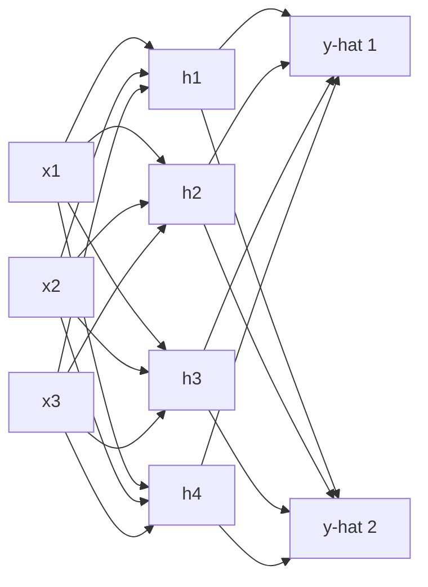

Every arrow carries a weight; every non-input node adds a bias and applies an activation. A "layer"
is one such matrix plus activation; "deep" just means several of them in sequence. Depth buys
compositionality — later layers build features out of earlier features — which is what lets a network
go from edges to shapes to object parts to objects.

### 6.2 Activation functions

| Function | Formula | Range | Notes |
| --- | --- | --- | --- |
| Sigmoid | `1 / (1 + e^-z)` | `(0, 1)` | saturates at both ends, killing gradients; used only in output layers and gates |
| Tanh | `(e^z - e^-z) / (e^z + e^-z)` | `(-1, 1)` | zero-centred, still saturates |
| ReLU | `max(0, z)` | `[0, ∞)` | the default; cheap, non-saturating for z greater than 0 |
| Leaky ReLU | `max(0.01z, z)` | `(-∞, ∞)` | avoids units that die permanently |
| GELU | smooth, approximately `z` times the Gaussian CDF | `(-0.17, ∞)` | the default inside transformers |
| Softmax | `e^z_j / Σ e^z_k` | simplex | turns scores into a probability distribution over classes |

The "dying ReLU" problem: a unit whose inputs always give `z < 0` outputs zero, so its gradient is
zero and it never recovers. Leaky ReLU, ELU and careful initialisation mitigate it.

### 6.3 Backpropagation, with numbers

Take one neuron: input `x = 1`, weight `w = 2`, bias `b = 1`, sigmoid activation, true label
`y = 0`, loss `L = ½ (a - y)²`.

```
forward:   z = w * x + b = 3
           a = sigmoid(3) = 0.9526
           L = 0.5 * (0.9526 - 0)^2 = 0.4537
backward:  dL/da = (a - y)         = 0.9526
           da/dz = a * (1 - a)     = 0.9526 * 0.0474 = 0.0452
           dL/dz = dL/da * da/dz   = 0.0430
           dL/dw = dL/dz * x       = 0.0430
           dL/db = dL/dz * 1       = 0.0430
update:    w = 2 - 0.1 * 0.0430 = 1.9957   (learning rate 0.1)
```

Now replace the squared loss with binary cross-entropy. The gradient simplifies to `dL/dz = a - y`,
which is `0.9526` — **more than twenty times larger** than the squared-error gradient at the same
point. That is the practical reason classification uses cross-entropy: with a sigmoid output and a
squared-error loss, the `a(1-a)` factor throttles the gradient exactly when the prediction is
confidently wrong, and learning stalls.

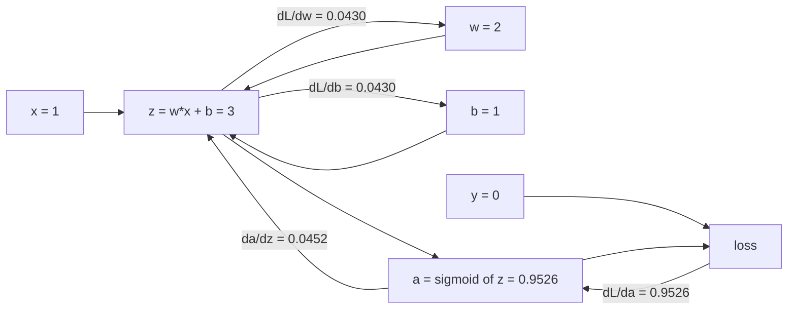

In a real network the same chain rule is applied layer by layer, reusing the gradient computed at
each layer for the one before it. That reuse is why backpropagation costs about the same as a forward
pass rather than one forward pass per parameter.

### 6.4 Optimisers

| Optimiser | Update idea | When to use |
| --- | --- | --- |
| **SGD** | `w ← w - lr · g` | the baseline; with momentum it is still competitive |
| **SGD + momentum** | accumulate a velocity `v ← μv + g`, step along `v` | smoother trajectory, escapes shallow local minima and ravines |
| **RMSprop** | divide the step by a running RMS of the gradient | helps when gradients have very different scales per parameter |
| **Adam** | momentum plus per-parameter RMS scaling, with bias correction | the safe default; Kingma and Ba, 2014 |

Adam's per-parameter scaling is why it works out of the box with a learning rate of `3e-4` on models
whose gradients vary by orders of magnitude across layers. SGD with momentum often generalises
slightly better on vision models, given a tuned schedule — a useful thing to know, but not a reason
to start there.

**Learning rate.** Too large: loss oscillates or diverges to NaN. Too small: training is correct but
hopelessly slow. Practical schedule: a short linear warmup to avoid early instability, then cosine
decay to near zero. And the empirical **linear scaling rule**: multiply the batch size by `k`,
multiply the learning rate by roughly `k` (with warmup), at least until the batch gets very large.

### 6.5 Regularisation for neural networks

| Technique | Mechanism | Effect |
| --- | --- | --- |
| **Weight decay (L2)** | add `λ·Σw²` to the loss, or decay weights in the update | smoother functions, weaker than dropout by itself |
| **Dropout** | zero each activation with probability `p` during training only | forces redundancy, approximates averaging over many sub-networks |
| **Batch normalisation** | normalise each mini-batch per channel, then learn scale and shift | much deeper networks trainable; also a mild regulariser; interacts badly with tiny batches |
| **Layer normalisation** | normalise across features within one example | the transformer default: independent of batch size |
| **Data augmentation** | label-preserving transforms (crop, flip, jitter, mixup) | the strongest regulariser for vision; free extra data |
| **Early stopping** | stop at the best validation score | free, and always worth enabling |
| **Label smoothing** | train against `0.9` instead of `1.0` | better calibration, less overconfidence |

### 6.6 What goes wrong in deep networks

**Vanishing and exploding gradients.** Multiplying many Jacobians makes the gradient shrink or grow
exponentially with depth. Fixes in historical order: careful initialisation, ReLU instead of
saturating activations, normalisation layers, and — the decisive one — **residual connections**,
where a block computes `y = F(x) + x` so that the gradient has an identity path straight through the
network. This is what made 100-plus-layer networks trainable.

**Internal covariate shift** is the original motivation given for batch normalisation: each layer sees
inputs whose distribution keeps changing as earlier layers train. Later work attributes much of the
benefit to a smoother optimisation landscape. Both explanations are quoted in the literature; the
practical behaviour is not in dispute.

---

## 7. Deep learning architectures — a guided tour

### 7.1 Convolutional networks

A fully connected layer on a 224×224×3 image would have ~150,000 inputs per neuron. Convolutions
replace that with a small kernel slid across the image, which encodes three priors: **locality**
(nearby pixels matter together), **weight sharing** (the same feature detector is useful everywhere),
and **translation equivariance** (shift the input, the feature map shifts).

Output size of a convolution:

```
out = floor( (in + 2*padding - kernel) / stride ) + 1
```

**Worked example** — a VGG-style chain on a 224×224 input:

```
conv 3x3 pad 1 stride 1  ->  floor((224 + 2 - 3)/1) + 1 = 224
maxpool 2x2 stride 2     ->  floor((224 - 2)/2) + 1     = 112
maxpool 2x2 stride 2                                     -> 56
maxpool 2x2 stride 2                                     -> 28
maxpool 2x2 stride 2                                     -> 14
maxpool 2x2 stride 2                                     -> 7
flatten 7 x 7 x 512 -> 25,088 features -> fully connected -> 1000-way softmax
```

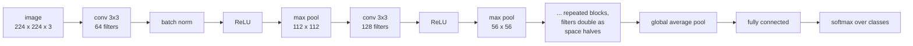

Landmarks worth being able to place on a timeline: **LeNet-5** (LeCun et al., 1998) for digit
recognition; **AlexNet** (Krizhevsky, Sutskever, Hinton, 2012), which won ILSVRC-2012 with a top-5
error of 15.3% against 26.2% for the runner-up, using 60 million parameters across five
convolutional and three fully connected layers on two GPUs; **VGG** (2014), which showed that depth
with uniform 3×3 convolutions works; **GoogLeNet/Inception** (2014), which introduced multi-scale
branches; **ResNet** (He et al., 2015), which introduced residual connections and pushed to 152
layers. Since 2020 the vision field has split between improved convolutions and the **vision
transformer**, which patches the image into tokens and applies a standard transformer.

### 7.2 Sequence models

A recurrent network processes a sequence one step at a time, carrying a hidden state
`h_t = activation(W_x x_t + W_h h_{t-1} + b)`. Unrolled over time it is a very deep network with
shared weights, which is exactly why it suffers vanishing gradients: information from step 1 must
survive many multiplications to influence step 100.

**LSTM** addresses this with an explicit cell state and three gates — forget, input, output — so that
the gradient has an additive path through time. **GRU** is a two-gate simplification that usually
performs comparably at lower cost. Both are still fine choices for short sequences on constrained
hardware.

**Attention** (Bahdanau et al., 2014) removed the bottleneck of compressing a whole sentence into one
vector: at each output step, the decoder looks at *all* encoder states and takes a weighted average,
with the weights learned. Encoder–decoder with attention was the state of the art in translation —
and then a 2017 paper asked whether the recurrence was needed at all.

### 7.3 The transformer

The answer was no. The transformer keeps only attention and feed-forward layers, which makes every
position computable in parallel and thus trainable at scale.

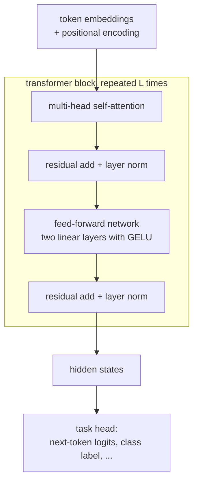

The core operation on one head:

```
Attention(Q, K, V) = softmax( Q * K-transpose / sqrt(d_k) ) * V
```

`Q`, `K` and `V` are learned linear projections of the input. The division by `sqrt(d_k)` is not
cosmetic: without it, the dot products grow in magnitude with `d_k`, the softmax saturates, and the
gradient vanishes — the same saturation problem as the sigmoid, arriving through a different door.

**Worked sizing.** `d_model = 512`, `h = 8` heads → each head works in `d_k = d_v = 64`, so the
per-head cost matches the single-head case and the concatenation is back to 512. Sequence length
`n = 1024`: the attention matrix is `n × n = 1,048,576` scores per head per layer. Cost is
**quadratic in sequence length** and memory is too — which is precisely why long-context inference is
an engineering problem and why group 06 continues in `06-1` with KV-cache management.

**Worked KV-cache arithmetic.** For a 7-billion-parameter-class model — say 32 layers, hidden size
4096, full multi-head attention — the cache for one sequence of 2048 tokens in fp16 is

```
bytes = 2 (K and V) * 32 layers * 2048 tokens * 4096 hidden * 2 bytes
      = 1,073,741,824 bytes = 1 GiB per sequence
```

Before you serve a batch of 32 sequences you need 32 GiB of cache. This single arithmetic is the
reason grouped-query attention, multi-query attention, paged caches and quantised caches exist, and
it is the bridge into `06-1`.

Positional information is added because attention is permutation-invariant — shuffle the tokens and
the attention outputs shuffle identically. Positional encodings (sinusoidal, or learned, or relative
via RoPE) restore order.

### 7.4 Transfer learning, pre-training and fine-tuning

Training a vision model from scratch needs millions of labelled images. In practice you take a model
already trained on a large corpus — ImageNet for vision, a language-modelling corpus for text — and
adapt it:

1. **Feature extraction** — freeze the backbone, train only a new head. Fast, safe, works with ~1,000
   labelled examples.
2. **Fine-tuning** — unfreeze the last few blocks and train with a learning rate 10–100× smaller than
   the head's. More capacity, more risk of catastrophic forgetting.
3. **Full fine-tuning** — unfreeze everything. Needs substantial data and careful hyperparameters.
4. **Parameter-efficient fine-tuning** — LoRA and relatives train small low-rank adapter matrices and
   leave the base weights untouched, so many adapters can share one backbone.

This is the single most useful practical fact in modern machine learning: **you rarely train from
scratch, and you rarely need to.**

### 7.5 Generative models

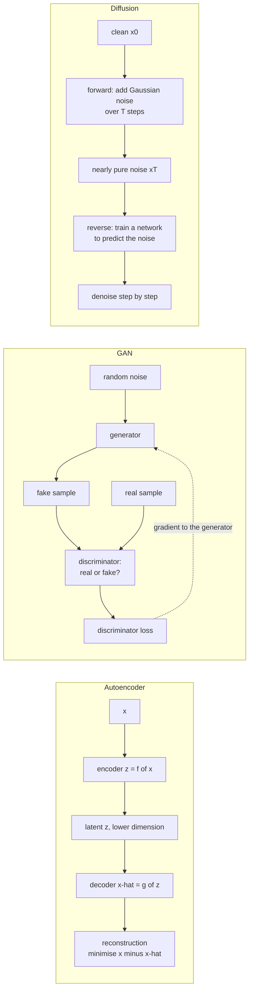

- **Autoencoders** learn a compressed representation by reconstructing the input; **VAEs**
  additionally constrain the latent distribution so it can be sampled.
- **GANs** train a generator against a discriminator in a minimax game. Powerful and famously
  unstable: mode collapse (the generator finds one convincing output) and vanishing gradients when
  the discriminator wins too easily.
- **Diffusion models** destroy structure by adding noise, then train a network to reverse the
  process one step at a time. The training objective is simple — predict the noise that was added —
  which makes it far more stable to train than a GAN, at the cost of many sequential denoising steps
  at inference. This is what current image, video and audio generators are built on.

### 7.6 A note on graph networks

For data on irregular structures — molecules, road networks, a mesh of access points — graph neural
networks use **message passing**: each node aggregates features from its neighbours, transforms them,
and repeats. Stacking `k` layers lets a node see its `k`-hop neighbourhood. The same
locality-and-sharing prior as convolution, applied to a domain with no grid.

---

## 8. Training at scale — where ML meets systems

### 8.1 Why accelerators

Neural network training is dominated by large matrix multiplications and elementwise operations.
Two properties decide the speed: **arithmetic intensity** (how many floating-point operations per
byte moved) and **memory bandwidth**. A GPU wins over a CPU not because its clock is higher but
because it has thousands of simple cores, very high bandwidth memory, and hardware designed for
dense linear algebra. A training step that is bandwidth-bound — many small elementwise kernels —
will sit idle on a GPU no matter how fast the cores are; this is why kernel fusion matters.

### 8.2 Precision

Training in **bf16 or fp16 with fp32 master weights** roughly doubles throughput and halves memory.
Two details: fp16 has a narrow exponent range and underflows small gradients, so a **loss scaler**
multiplies the loss before backpropagation and divides the gradients afterwards; bf16 has fp32's
exponent range and therefore usually needs no scaler, at the cost of less mantissa precision.
Inference goes further: fp8, int8 and int4 quantisation of weights, with calibration on a
representative sample.

### 8.3 Parallelism

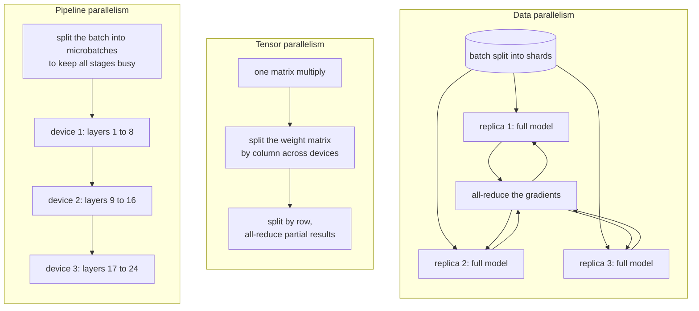

- **Data parallelism** — every device holds the whole model and a shard of the batch, then gradients
  are averaged. Simplest and almost always used first.
- **Tensor (model) parallelism** — one layer's weight matrix is split across devices; needed when a
  single layer does not fit in one device's memory. Requires communication inside the layer.
- **Pipeline parallelism** — different layers on different devices, with the batch chopped into
  microbatches so the idle time ("bubble") at the start and end of the pipe is amortised.
- **Sharding (ZeRO / FSDP)** — partition optimizer state, gradients and parameters across devices
  and gather them only when needed; this is what makes very large models fit at all.
- **Activation checkpointing** — discard intermediate activations on the forward pass and recompute
  them during backward. Trades ~30% extra compute for a large memory saving, which is usually the
  right trade.

### 8.4 Budget arithmetic

The compute-optimal scaling result from Hoffmann et al. (2022) — the "Chinchilla" paper — is that
for a fixed compute budget, model size and training tokens should grow together, with roughly
**20 training tokens per parameter**. Earlier practice had been to train far larger models on far
fewer tokens, i.e. under-trained. For your own projects the transferable lesson is simpler: state
your budget in FLOPs, then decide how to split it between parameters and data, because spending it
all on one axis is usually wrong.

Where this meets the rest of the vault: `05-2` covers the interconnect and memory behaviour that
makes all-reduce fast or slow, and `06-1` covers what happens after training, when the same model
becomes a latency- and memory-bound service.

---

## 9. Evaluation

### 9.1 Classification metrics from one confusion matrix

**Worked example.** 1,000 transactions screened, 90 truly fraudulent. The model flags 100; 80 of
those are truly fraudulent.

```
                 predicted fraud    predicted clean
actual fraud            80 TP              10 FN
actual clean            20 FP             890 TN

accuracy   = (80 + 890) / 1000 = 0.970
precision  = 80 / (80 + 20)    = 0.800   of what we flagged, how much was right
recall     = 80 / (80 + 10)    = 0.889   of the real fraud, how much we caught
F1         = 2 * 0.800 * 0.889 / (0.800 + 0.889) = 0.942
specificity= 890 / (890 + 20)  = 0.978
```

The trap: a model that flags nothing scores 91% accuracy — better than most naive classifiers and
completely useless. **Accuracy is only meaningful when classes are balanced and costs are symmetric.**
With 9% positives, use precision/recall/PR-AUC.

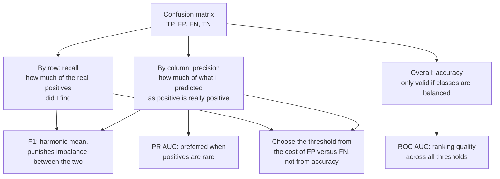

**ROC-AUC** is the probability a random positive is ranked above a random negative; `0.5` is random,
`1.0` is perfect. It is threshold-independent and insensitive to the base rate, which is exactly its
weakness for rare events: with 0.1% positives, ROC-AUC can look excellent while precision is awful.
**PR-AUC** tracks precision against recall and is the honest metric there.

**Threshold choice is a business decision, not a metric.** Fraud review costs 20 per case; a missed
fraud costs 400. Then flagging is worth it while `precision × 400 > 20`, i.e. precision above 5%.
Pick the threshold that maximises expected value, then report the metric.

**Calibration.** A model that outputs 0.7 should be right 70% of the time. Reliability diagrams and
the Brier score measure this; Platt scaling and isotonic regression fix it. Uncalibrated
probabilities are fine for ranking and dangerous for decision-making — a downstream system that
treats a score as a probability will be wrong in a systematic direction.

### 9.2 Regression metrics

`RMSE` penalises large errors quadratically; `MAE` is robust to outliers but not differentiable at
zero; `MAPE` is scale-free and undefined when the target is near zero; `R²` is dimensionless and
comparable across datasets. Always report at least one error in the target's own units — "the model
is off by 1.8 ms on average" is more useful than "R² = 0.87".

### 9.3 Making evaluation trustworthy

- **Stratified k-fold** for classification, **rolling origin** for time series, **GroupKFold** when
  rows share an entity.
- Report the **spread across folds and seeds**, not just the mean. A 2-point improvement with a 3-point
  fold-to-fold standard deviation is not an improvement.
- **Nested cross-validation** when you tune hyperparameters and want an unbiased score: an outer loop
  estimates performance, an inner loop tunes. Without it, the tuning score is optimistic.

---

## 10. Model selection and tuning

**Parameters** are learned by the optimiser (weights). **Hyperparameters** are set by you (tree
depth, `λ`, `k`, learning rate, number of layers). Confusing them is a common interview own-goal.

| Method | How it works | Use when |
| --- | --- | --- |
| **Grid search** | exhaustively tries every combination | at most two or three hyperparameters; otherwise it wastes almost all its budget |
| **Random search** | samples the space | the default. Bergstra and Bengio (2012) showed it beats grid search for the same budget, because usually only a few hyperparameters matter and grid search wastes trials on the rest |
| **Bayesian optimisation (TPE, SMAC)** | fits a surrogate model of the score and samples where it is most promising | expensive evaluations, budgets of tens to hundreds of trials |
| **Successive halving / Hyperband** | trains many configurations briefly, keeps the best, gives them more budget | deep learning, where a bad configuration reveals itself early |

**A practical XGBoost search space**, which is a reasonable thing to be able to write down:

| Hyperparameter | Range to search | Effect |
| --- | --- | --- |
| `learning_rate` | 0.01 – 0.3 | lower needs more trees, generalises better |
| `n_estimators` | 100 – 2000, with early stopping | the main capacity knob |
| `max_depth` | 3 – 10 | interaction order; 3–6 is typical for tabular |
| `min_child_weight` | 1 – 20 | higher is more conservative |
| `subsample`, `colsample_bytree` | 0.6 – 1.0 | randomness that reduces variance |
| `reg_lambda`, `reg_alpha` | 0 – 10 | L2 and L1 penalties |
| `gamma` | 0 – 5 | minimum loss reduction to make a split |

**Early stopping** is both a regulariser and a budget saver: stop when validation score has not
improved for `n` rounds. Always keep the number of trees it selected as a hyperparameter you report.

---

## 11. Application directions

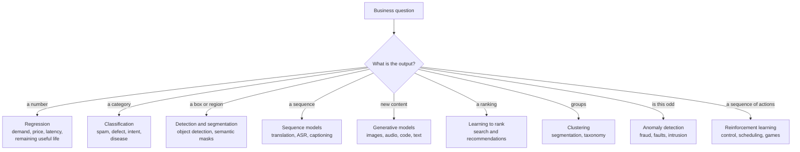

| Domain | Typical tasks | Typical approach | Example |
| --- | --- | --- | --- |
| **Computer vision** | classification, detection, segmentation, OCR | pre-trained CNN or ViT, fine-tuned | PCB defect detection from 5,000 labelled images, where the defect class is 1% and PR-AUC is the metric |
| **NLP** | classification, NER, extraction, summarisation, translation, generation | TF-IDF plus a linear model for simple tasks; a pre-trained transformer otherwise | routing support tickets to 40 categories from 20,000 labelled examples |
| **Speech** | ASR, keyword spotting, speaker ID | conformer or wav2vec-style encoder; tiny CNNs for keyword spotting on-device | wake-word detection running in 200 kB of RAM on a Cortex-M |
| **Recommenders** | candidate generation, ranking | two-tower retrieval plus a gradient-boosted or neural ranker | 40 million items retrieved in 10 ms, then 500 ranked |
| **Time series** | forecasting, nowcasting, anomaly detection | lag features with GBM; deep models for many related series | hourly traffic forecast per cell site, evaluated with rolling-origin |
| **Tabular business** | churn, credit risk, pricing, propensity | gradient boosting, with a linear model as the interpretable baseline | churn model where the lift over "contact the highest spenders" is the business metric |
| **Anomaly and security** | fraud, intrusion, fault detection | supervised when labels exist; isolation forest or reconstruction error otherwise | detecting a failing fan from vibration spectra with no failure labels |
| **RL and control** | scheduling, resource allocation, robotics | MDP formulation: state, action, reward, transition; policy or value methods | choosing a beam or an MCS index per slot, reward = throughput minus latency penalty |
| **Scientific and surrogate models** | replacing expensive simulation | physics-informed or purely data-driven surrogates | a network that approximates an electromagnetic solver 1,000× faster |
| **AI for wireless** | traffic prediction, channel estimation, beam management, RIC control | depends entirely on the timescale: milliseconds for PHY, seconds for RIC | see `01-3`, where the same algorithms have to live inside a RAN's real-time loop |

The last row is the one that connects this note to the rest of the vault: in a RAN, an ML model is
not a batch job, it is a component with a latency budget, a retraining policy and a failure mode.
Everything in sections 12 and 13 gets sharper when the loop closes in milliseconds.

**Edge and TinyML.** Getting a model onto a microcontroller or an NPU means quantisation (int8,
sometimes int4), pruning and structured sparsity, knowledge distillation into a smaller student, and
operator support checks against the actual runtime. Accuracy is the easy constraint; latency, memory
and power are the real ones. See `04-1` for the target platforms and `05-2` for where the compute
sits.

---

## 12. MLOps — making it survive production

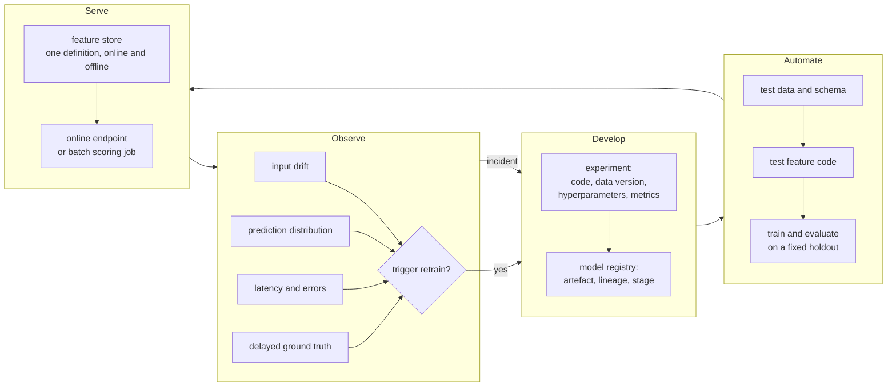

Types of drift:

| Drift | Meaning | Detection |
| --- | --- | --- |
| **Data drift** | the input distribution changed | population stability index or a two-sample test per feature |
| **Concept drift** | the relationship `x → y` changed | performance drops once delayed labels arrive |
| **Upstream / pipeline drift** | a feature's computation changed (a unit, a currency, a join) | schema and range assertions in the pipeline; this one is usually a bug, not a modelling problem |

Serving patterns: **batch scoring** (nightly, cheap, fine for most business problems), **online
inference** (a request–response endpoint with a latency SLO), **streaming** (score events as they
flow), and **embedded** (the model runs on the device). Rollouts: shadow mode (predict but do not
act), canary (a small percentage of traffic), and A/B with the business metric as the judge.

Reproducibility checklist: pin the library versions, fix the seeds, record the data version, and save
the preprocessing together with the model. A model you cannot retrain to the same numbers is a model
you cannot debug.

---

## 13. Failure modes, misuse and responsible practice

1. **Leakage** (section 3.3). The dominant cause of models that look brilliant and fail immediately.
2. **Distribution shift.** The model was trained on weekday traffic and is deployed on a holiday.
   Monitor, and keep a holdout from the deployment period.
3. **Shortcut learning.** A pneumonia model that learned to detect the portable X-ray marker because
   sicker patients were scanned with portable machines. It scores well in validation and fails in a
   new hospital. Diagnose by examining which features drive predictions.
4. **Class imbalance.** Fix with class weights or resampling, and evaluate with PR-AUC. Resampling
   the *test* set destroys the metric — never do it.
5. **Feedback loops.** A fraud model's decisions change which transactions get labelled, which
   changes what the next model learns. Randomised holdout traffic breaks the loop.
6. **Fairness.** Aggregate metrics hide per-group performance. Measure the metric per protected
   group; bias enters through labels, sampling, features and the choice of target.
7. **Interpretability.** Permutation importance measures the accuracy drop when a feature is shuffled
   — model-agnostic and reliable but computationally expensive. SHAP attributes a prediction to
   features based on cooperative game theory and gives local explanations. Both explain *the model*,
   not *the world*: a high importance does not imply causation.
8. **Privacy.** Models can memorise training examples and are vulnerable to membership inference.
   Differential privacy bounds what a model can leak; federated learning keeps raw data on device and
   aggregates only updates.
9. **Cost.** A model with a 200 ms latency budget on a CPU will not ship. Measure early.
10. **Not using ML.** If a rule, a lookup table or a simple statistic solves it, ship that.

---

## 14. A staged learning path, and what to be able to say

**Four weeks to competence on the fundamentals**

| Week | Do | Checkpoint |
| --- | --- | --- |
| 1 | linear and logistic regression from scratch with NumPy; gradient descent on a toy dataset | you can derive `dL/dw` for a two-layer network by hand |
| 2 | scikit-learn end to end: pipeline, cross-validation, grid search, three model families on two datasets | you can explain why the scaler goes inside the pipeline |
| 3 | trees, random forests, gradient boosting; feature importance; calibration | you can explain why boosting reduces bias and bagging reduces variance |
| 4 | PyTorch: an MLP, then a small CNN, then fine-tune a pre-trained model | you can state what a residual connection fixes and what `sqrt(d_k)` fixes |

**Facts worth being able to state precisely**

- AlexNet won ILSVRC-2012 with 15.3% top-5 error against 26.2% for the runner-up.
- A tree cannot extrapolate beyond values seen in training.
- Cross-entropy with a sigmoid output gives `dL/dz = a - y`; squared error does not.
- Attention cost is quadratic in sequence length.
- A 7B-class model with 32 layers and hidden 4096 needs 1 GiB of KV cache per 2048-token sequence in
  fp16, before grouped-query attention.
- Random search beats grid search at equal budget.
- Gradient boosting is still the default for tabular data.

**Symptom → cause → check**

| Symptom | Likely cause | First check |
| --- | --- | --- |
| Validation score far above any published result | leakage | has any preprocessing seen the validation fold? |
| Training error near zero, validation poor | overfitting | more data, regularise, reduce capacity |
| Both errors poor | underfitting, or the signal is not there | more capacity, better features; check a 1-NN baseline |
| Great offline, terrible online | train/serve skew or drift | compare feature distributions offline versus online |
| Loss is NaN | learning rate too high, or a division by zero in the loss | lower the learning rate, check for log(0) |
| Model predicts one class | imbalance, or a broken target encoding | class counts; the encoded feature's distribution |
| Training loss falls, validation stalls immediately | leakage in reverse, or a split bug | are there duplicate rows across folds? |
| Scores swing between runs | small dataset, unfixed seeds, no cross-validation | report fold spread |
| Incredible test score after tuning | you tuned on test | hold out a final set you never touch |
| Production latency unacceptable | model too large, or per-request Python overhead | batch the requests, quantise, move preprocessing out of the request path |

---

## Anchors

Dated, checkable facts used in this note.

- **Tooling versions (checked 2026-10-23).** scikit-learn **1.9.1** is the current release, announced
  September 2026; 1.9.0 was June 2026 and 1.8.0 December 2025. PyTorch **2.14** was released
  2026-09-02 and **2.14.1** on 2026-09-30; 2.14 ships NVGEMM, a preview rewritten NCCL backend from
  torchcomms, and native linear algebra on Apple Silicon.
- **AlexNet / ILSVRC-2012.** Krizhevsky, Sutskever and Hinton's network won ILSVRC-2012 with a top-5
  test error of **15.3%**, against **26.2%** for the second-best entry. The network has five
  convolutional and three fully connected layers, **60 million parameters** and **650,000 neurons**.
  On the LSVRC-2010 test set the same design gave 37.5% top-1 and 17.0% top-5 error.
- **Adam.** Kingma and Ba, *Adam: A Method for Stochastic Optimization*, arXiv:1412.6980, presented at
  ICLR 2015.
- **Residual networks.** He, Zhang, Ren and Sun, arXiv:1512.03385, 2015 — residual connections made
  152-layer networks trainable.
- **Transformer.** Vaswani et al., *Attention Is All You Need*, arXiv:1706.03762, 2017.
- **Diffusion.** Ho, Jain and Abbeel, *Denoising Diffusion Probabilistic Models*, arXiv:2006.11239,
  2020.
- **Compute-optimal scaling.** Hoffmann et al., 2022: roughly **20 training tokens per parameter** for
  a compute-optimal language model.
- **Random versus grid search.** Bergstra and Bengio, *Random Search for Hyper-Parameter
  Optimization*, JMLR 13 (2012).
- **Hyperband.** Li, Jamieson, DeSalvo, Rostamizadeh and Talwalkar, JMLR 18 (2018).
- **Historical anchors.** Perceptron: Rosenblatt, 1958. XOR limitation analysed in Minsky and Papert's
  *Perceptrons*, 1969. Backpropagation popularised by Rumelhart, Hinton and Williams, *Nature*, 1986.
  Universal approximation: Cybenko, 1989; Hornik, 1991. PAC learning: Valiant, 1984. No free lunch:
  Wolpert and Macready, 1997. Random forests: Breiman, *Machine Learning* 45, 2001. AdaBoost: Freund
  and Schapire, 1997. LSTM: Hochreiter and Schmidhuber, 1997. GANs: Goodfellow et al., 2014.
- **VERIFY.** Exact per-version differences between fp16 and bf16 numerics depend on the accelerator
  generation and the framework's kernels; the loss-scaling behaviour described in §8.2 is the
  standard practice but should be confirmed against the target framework's current documentation
  before being quoted as a guarantee.

---

## Related

- [[06-1 LLM Inference Engines and xLLM]] — what happens after this note ends: the trained model
  becomes a service, and the constraints change from "can it learn" to "can it serve" — KV cache,
  paged attention, quantisation, continuous batching, prefill versus decode
- [[06-2 Agent Systems and Edge Orchestration]] — models that act rather than predict: planning,
  tool use, and the safety boundary around a system that takes actions
- [[01-3 AI-ML for RAN and O-RAN RIC]] — these algorithms under a RAN's timing constraints: what can
  run in a millisecond loop, what belongs in the near-real-time RIC, and what must stay offline
- [[05-2 Cloud-Edge-End Collaboration and Heterogeneous Computing]] — where the training and serving
  compute physically sits, and what the interconnect costs
- [[04-1 Embedded Systems RTOS and Hardware Interfaces]] — the target platforms for TinyML and
  on-device inference, and the memory and power budgets that decide whether a model fits
- [[08-3 Python Programming - Language, Object Model and Engineering Practice]] — the language this
  entire stack is written in: NumPy's strided arrays and broadcasting, which are what make the
  vectorised formulations above fast rather than merely correct
- [[04-5 Linux Concurrency - Kernel and User Mode, Processes, Threads and IPC]] — the concurrency
  model behind the data loading, batching and parallel training described above: ITC over shared
  memory, the doorbell pattern for a producer/consumer pipeline, and the seven-axis IPC choice
- [[04-4 Linux Interrupts - Types, Handlers, Threaded IRQs and Deferred Work]] — the NPU or accelerator
  completion interrupt behind inference latency, and why its scheduling latency is the floor of the
  inference SLO

- [[09-1 Engineering Project Management - Methodology, Lifecycle, Tools and Best Practice]] — the clearest example of work whose requirements are not knowable up front, and therefore of the time-boxed experiment instead of the schedule
---

## References

1. Gareth James, Daniela Witten, Trevor Hastie and Robert Tibshirani. *An Introduction to Statistical
   Learning with Applications in R*, 2nd ed. Springer, 2021. ISBN 978-1-0716-1417-4.
   <https://www.statlearning.com>
2. Trevor Hastie, Robert Tibshirani and Jerome Friedman. *The Elements of Statistical Learning: Data
   Mining, Inference, and Prediction*, 2nd ed. Springer, 2009. ISBN 978-0-387-84857-0.
   <https://hastie.su.domains/ElemStatLearn/>
3. Christopher M. Bishop. *Pattern Recognition and Machine Learning*. Springer, 2006.
   ISBN 978-0-387-31073-2.
4. Aurélien Géron. *Hands-On Machine Learning with Scikit-Learn, Keras, and TensorFlow*, 3rd ed.
   O'Reilly, 2022. ISBN 978-1-098-12597-4.
5. Kevin P. Murphy. *Probabilistic Machine Learning: An Introduction*. MIT Press, 2022.
   ISBN 978-0-262-04682-4. <https://probml.github.io/pml-book/book1.html>
6. Tom M. Mitchell. *Machine Learning*. McGraw-Hill, 1997. ISBN 978-0-07-042807-2 — source of the
   "experience E, task T, performance measure P" definition used in §1.2.
7. Alex Krizhevsky, Ilya Sutskever and Geoffrey E. Hinton. "ImageNet Classification with Deep
   Convolutional Neural Networks." *NeurIPS*, 2012. <https://papers.nips.cc/paper_files/paper/2012>
8. Kaiming He, Xiangyu Zhang, Shaoqing Ren and Jian Sun. "Deep Residual Learning for Image
   Recognition." arXiv:1512.03385, 2015. <https://arxiv.org/abs/1512.03385>
9. Ashish Vaswani, Noam Shazeer, Niki Parmar et al. "Attention Is All You Need." arXiv:1706.03762,
   2017. <https://arxiv.org/abs/1706.03762>
10. Dzmitry Bahdanau, Kyunghyun Cho and Yoshua Bengio. "Neural Machine Translation by Jointly
    Learning to Align and Translate." arXiv:1409.0473, 2014. <https://arxiv.org/abs/1409.0473>
11. Sepp Hochreiter and Jürgen Schmidhuber. "Long Short-Term Memory." *Neural Computation* 9(8),
    1997. <https://direct.mit.edu/neco/article/9/8/1735/6109>
12. Diederik P. Kingma and Jimmy Ba. "Adam: A Method for Stochastic Optimization." arXiv:1412.6980,
    2014 (ICLR 2015). <https://arxiv.org/abs/1412.6980>
13. Nitish Srivastava, Geoffrey Hinton, Alex Krizhevsky, Ilya Sutskever and Ruslan Salakhutdinov.
    "Dropout: A Simple Way to Prevent Neural Networks from Overfitting." *JMLR* 15(56), 2014.
    <https://jmlr.org/papers/v15/srivastava14a.html>
14. Sergey Ioffe and Christian Szegedy. "Batch Normalization: Accelerating Deep Network Training by
    Reducing Internal Covariate Shift." arXiv:1502.03167, 2015 (ICML 2015).
    <https://arxiv.org/abs/1502.03167>
15. Ian J. Goodfellow, Jean Pouget-Abadie, Mehdi Mirza et al. "Generative Adversarial Nets."
    arXiv:1406.2661, 2014. <https://arxiv.org/abs/1406.2661>
16. Jonathan Ho, Ajay Jain and Pieter Abbeel. "Denoising Diffusion Probabilistic Models."
    arXiv:2006.11239, 2020. <https://arxiv.org/abs/2006.11239>
17. Leo Breiman. "Random Forests." *Machine Learning* 45, 5–32, 2001.
    <https://link.springer.com/article/10.1023/A:1010933404324>
18. Yoav Freund and Robert E. Schapire. "A Decision-Theoretic Generalization of On-Line Learning and
    an Application to Boosting." *Journal of Computer and System Sciences* 55(1), 1997.
19. Tianqi Chen and Carlos Guestrin. "XGBoost: A Scalable Tree Boosting System." arXiv:1603.02754,
    2016 (KDD 2016). <https://arxiv.org/abs/1603.02754>
20. Fei Tony Liu, Kai Ming Ting and Zhi-Hua Zhou. "Isolation Forest." *ICDM*, 2008.
21. James Bergstra and Yoshua Bengio. "Random Search for Hyper-Parameter Optimization." *JMLR* 13,
    2012. <https://jmlr.org/papers/v13/bergstra12a.html>
22. Lisha Li, Kevin Jamieson, Giulia DeSalvo, Afshin Rostamizadeh and Ameet Talwalkar. "Hyperband: A
    Novel Bandit-Based Approach to Hyperparameter Optimization." *JMLR* 18, 2018.
    <https://jmlr.org/papers/v18/16-558.html>
23. Scott M. Lundberg and Su-In Lee. "A Unified Approach to Interpreting Model Predictions."
    arXiv:1705.07874, 2017 (NeurIPS 2017). <https://arxiv.org/abs/1705.07874>
24. Jordan Hoffmann, Sebastian Borgeaud, Arthur Mensch et al. "Training Compute-Optimal Large
    Language Models." arXiv:2203.15556, 2022. <https://arxiv.org/abs/2203.15556>
25. Priya Goyal, Piotr Dollár, Ross Girshick et al. "Accurate, Large Minibatch SGD: Training ImageNet
    in 1 Hour." arXiv:1706.02677, 2017. <https://arxiv.org/abs/1706.02677>
26. scikit-learn developers. *scikit-learn User Guide and API Reference*, release 1.9.1 (2026).
    <https://scikit-learn.org/stable/user_guide.html> — including "Choosing the right estimator" and
    the "Common pitfalls and recommended practices" page that §3.3 and §4 draw on.
27. PyTorch Foundation. *PyTorch 2.14 Release Blog*, 2026-09-02, and the PyTorch tutorials.
    <https://pytorch.org/blog/pytorch-2-14-release-blog/> · <https://pytorch.org/tutorials/>
28. Google. *Machine Learning Crash Course*. <https://developers.google.com/machine-learning/crash-course>
29. Google. *Rules of Machine Learning: Best Practices for ML Engineering*.
    <http://martin.zinkevich.org/rules_of_ml/rules_of_ml.pdf> — the source of the "start with a
    heuristic" and "keep the first model simple" advice in §2.2 and §13.
30. David H. Wolpert and William G. Macready. "No Free Lunch Theorems for Optimization." *IEEE
    Transactions on Evolutionary Computation* 1(1), 1997.
31. Frank Rosenblatt. "The perceptron: a probabilistic model for information storage and
    organization in the brain." *Psychological Review* 65(6), 1958.
32. David E. Rumelhart, Geoffrey E. Hinton and Ronald J. Williams. "Learning representations by
    back-propagating errors." *Nature* 323, 1986.
33. Alexey Dosovitskiy, Lucas Beyer, Alexander Kolesnikov et al. "An Image Is Worth 16x16 Words:
    Transformers for Image Recognition at Scale." arXiv:2010.11929, 2020.
    <https://arxiv.org/abs/2010.11929>

---

Copyright (c) 2026 Washington Ruan. All rights reserved.
