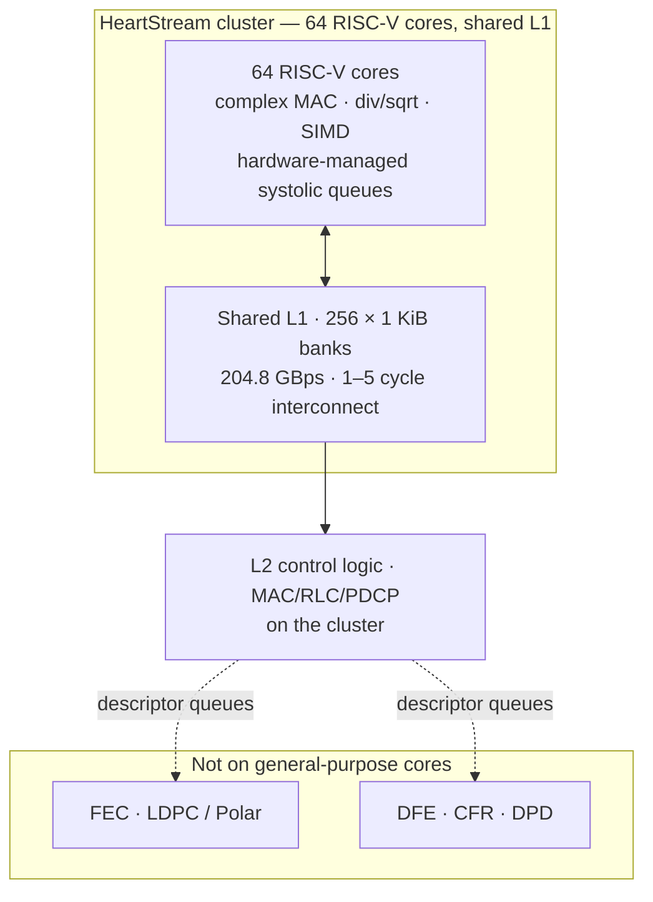
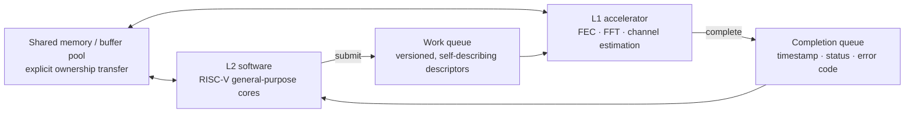

# RISC-V for Communication Infrastructure

## 1. Why RISC-V is entering baseband

- **Programmability + open ecosystem.** Modem vendors want to ship a production L1 and still let customers differentiate; a proprietary DSP toolchain makes that a multi-year porting exercise.
- **No licence friction on ISA extensions.** Baseband wants custom instructions (complex MAC, division/square-root, SIMD, systolic queues) — see §3.
- **GNU toolchain by default.** Compilers, tracers, debuggers and JTAG flows that already exist, rather than a closed vendor toolchain.
- **Standards churn.** A software-defined PHY can be upgraded from Rel-16 to Rel-17/18 over the air; a hardened one cannot.

## 2. The counter-argument that must be stated

**L1 in a base station is an energy-efficiency problem before it is a compute problem.** General-purpose cores — RISC-V or otherwise — lose badly to domain-specific accelerators on FEC, DFE, FFT and channel estimation. The realistic architecture is therefore **heterogeneous**: RISC-V general-purpose cores for control, L2/L3 and programmable signal processing, plus hardware accelerators for the highest-energy kernels.

The research framing to know: RISC-V baseband SoC work explicitly targets **closing the gap between GPP programmability and ASIC energy efficiency**, with published work reporting compression from roughly **10³× down to about 10×**. *(Figure cited in secondary industry discussion — VERIFY against the primary paper before quoting.)*

## 3. HeartStream — a concrete silicon data point

**"A 410 GFLOP/s, 64 RISC-V Cores, 204.8 GBps Shared-Memory Cluster in 12 nm FinFET with Systolic Execution Support for Efficient B5G/6G AI-Enhanced O-RAN"**
- Presented at **ESSERC 2025** (IEEE European Solid-State Electronics Research Conference), Munich, **8–11 September 2025**; DOI **10.1109/ESSERC66193.2025.11214075**; also **arXiv:2509.08608**.
- Authors: Yichao Zhang, Marco Bertuletti, Sergio Mazzola, Samuel Riedel, Luca Benini — **IIS, ETH Zürich** and **DEI, University of Bologna**.
- Open-source lineage: **github.com/pulp-platform/mempool** (the PULP MemPool cluster).

Measured / claimed characteristics:
- **64 RISC-V cores**, shared-L1 memory organised as **256 × 1 KiB banks**, **204.8 GBps** L1 bandwidth, hierarchical low-latency interconnect (**1–5 cycles**).
- **410 GFLOP/s peak** at 800 MHz / 0.8 V; **243 GFLOP/s** on complex-valued wireless workloads; up to **72 GOP/s** for AI processing on received data.
- Up to **213 GFLOP/s/W** in baseband and data-parallel DL workloads, i.e. **1.89× improvement** over a non-systolic kernel baseline.
- **Software-defined PUSCH efficiency: 49.6 GFLOP/s/W**; **0.68 W** at 645 MHz / 0.65 V.
- Up to **8.99 Gbps PUSCH computing** at 0.8 V.
- **Meets the 4 ms end-to-end constraint** for the baseband uplink of an 8×8 MIMO configuration with 32 antennas, 8 beams, 8 users, 15 kHz SCS on a 15 MHz FR1 carrier.
- ISA extensions for baseband: **complex (16-bit real + imaginary) multiply & accumulate, division & square-root, SIMD**, and **hardware-managed systolic queues**.

Why this matters to an L2 engineer: the numbers are stated against **real base-station latency and power budgets**, not against a synthetic benchmark. A 4 ms uplink budget is the kind of number you can reason about from [[01-2 5G NR RAN Layer 2 Protocol Stack]].

## 4. EdgeQ — commercial converged baseband SoC

- EdgeQ markets a **"5G Base Station-on-a-Chip"** — a converged SoC integrating baseband, AI acceleration, CPU and networking.
- Architecture as described by the vendor:
  - **RISC-V compute complex for baseband processing**, with **RISC-V ISA extensions for AI**; a **specialised baseband processor**; **FEC acceleration**; **L2/L3 accelerators for MAC and cryptographic processing**.
  - An **Arm Neoverse CPU cluster** (eight-core) for service provisioning and data processing.
  - External interfaces: **O-RAN-compliant eCPRI** for fronthaul/midhaul, PCIe, USB; support for ethernet fronthaul and midhaul.
  - RF interface chain: ADCs/DACs, up/down samplers, CFR and DPD.
  - Security: secure boot from NOR/SPI/NAND, root of trust.
- **Software-defined PHY** with customisable L1 functions: waveform processing, accelerated FEC, beamforming, constellation mapping, channel estimation and equalisation, complex integer ops, scrambling/descrambling, layer mapping.
- **L2/L3 runs on the host CPU**: scheduler, **nFAPI interface**, power control, mobility, MAC/RLC/PDCP processing.
- Programmable from **C/C++ with GNU toolchains**; SDK includes Linux kernel, FAPI/nFAPI APIs.
- Same silicon can act as **gNB (small cell), RU, or DU** depending on the loaded PHY firmware — the "any O-RAN split on one chip" claim.
- Product lines now extend to **space / satellite**: described as **6:1 single-chip integration (B5G + 6G + NTN + custom waveform + CPU + antenna controller)** for LEO/MEO payloads and ground terminals; Airspan has launched AirUnity small cells powered by EdgeQ.
- Markets: small cells, private 5G (CBRS), fixed wireless, and now physical AI (robotics, drones, wearables) and satellite/D2D.

## 5. The L1/L2 interface question — the interview centrepiece

> If L2 runs on RISC-V general-purpose cores and L1 runs on domain accelerators, what must the interface guarantee?

Answer across four dimensions:

**a) Interface semantics**
- Descriptor-based work submission (queue in, completion queue out) rather than register-level hand-holding.
- Explicit ownership transfer: who owns the buffer at each point, and when is it safe to recycle. This is the same contract as an `mbuf` pool — see [[05-1 DPDK User Plane and 5G UPF]].
- Versioned, self-describing descriptors so accelerator firmware and L2 software can evolve independently.

**b) Cache coherency**
- Whether the accelerator is coherent with the core cluster determines whether you need explicit flush/invalidate. Non-coherent accelerators are cheaper in silicon and cost you software bugs.
- On a shared-L1 many-core cluster, coherence is often handled by making the accelerator operate on shared memory directly and by relying on explicit barrier/synchronisation primitives rather than full hardware coherence.
- Practical rules: cache-line-align shared structures to avoid false sharing, mark accelerator-visible buffers non-cacheable or manage them with explicit maintenance operations.

**c) Real-time scheduling**
- L1 work has hard deadlines tied to slot/symbol timing; L2 has slot-to-multi-slot deadlines.
- Needs: bounded worst-case execution time for the L2 path, priority-aware descriptor queues, and **isolation** so a burst of L3/control work cannot starve an L1 deadline.
- Interrupt/completion latency must be bounded — which is exactly the PendSV-style deferral argument from [[04-1 Embedded Systems RTOS and Hardware Interfaces]].

**d) Observability and fallback**
- Per-descriptor timestamps and completion/error codes, because debugging a miss-rate regression across an L1/L2 boundary without timestamps is guesswork.
- A software fallback path for accelerator features that are not yet hardened.

## 6. Where RISC-V fits versus where it does not

| Function | Fit for RISC-V general-purpose cores | Notes |
| --- | --- | --- |
| L3 / RRC / control plane | Excellent | Not real-time critical |
| L2 (MAC/RLC/PDCP) | Good | Control logic, state machines; fits a many-core cluster |
| Programmable L1 signal processing | Conditional | Only with complex-arithmetic and systolic extensions |
| FEC (LDPC/Polar) | Poor | Belongs in a hardened accelerator |
| DFE / CFR / DPD | Poor | Fixed-function / RF-domain |
| AI inference at the edge | Good with extensions | Needs MAC arrays or systolic support |
| mmWave beamforming control | Conditional | Timing-critical, often hardware state machines |

## 7. Satellite and NTN angle

- RISC-V baseband SoC vendors have announced **5G-NR/NTN dual-mode satellite backhaul** solutions, targeting the convergence of terrestrial and non-terrestrial waveforms on one programmable platform.
- Rationale: a satellite payload wants the flexibility to change waveform and band allocation after launch, which a hardened modem cannot offer.
- See [[01-4 Cellular IoT RedCap eRedCap and NTN]] for the protocol-side implications. *(Specific vendor model numbers: VERIFY against current announcements.)*

## Anchors — verified facts

- **HeartStream**: 64 RISC-V cores, 256 × 1 KiB shared-L1 banks, **204.8 GBps**, **410 GFLOP/s peak @800 MHz/0.8 V**, **12 nm FinFET**, **1.89× energy-efficiency improvement** on key baseband kernels, **243 GFLOP/s** on complex wireless workloads, **72 GOP/s** AI, **49.6 GFLOP/s/W** software-defined PUSCH, **0.68 W @645 MHz/0.65 V**, meets **4 ms** uplink E2E constraint, **8.99 Gbps PUSCH @0.8 V**. ESSERC 2025, DOI **10.1109/ESSERC66193.2025.11214075**, arXiv **2509.08608**.
- Systolic support via **hardware-managed systolic queues**; ISA extensions for **complex 16-bit MAC, division & square-root, SIMD**.
- **EdgeQ**: RISC-V baseband + AI ISA extensions, Arm Neoverse CPU cluster, FEC acceleration, L2/L3 accelerators, software-defined PHY, nFAPI/FAPI, O-RAN eCPRI; one chip configurable as gNB/RU/DU; extended to **B5G + 6G + NTN + custom waveform** satellite payload and terminal.
- Claimed GPP-to-ASIC energy gap compression from ~**10³× to ~10×** in RISC-V baseband SoC research. *(VERIFY primary source.)*

## Related

- [[04-3 Embedded Software Architecture - Patterns, Layering and Wireless System Structure]] — heterogeneous baseband partitioning, mailbox/doorbell firmware interfaces, why L1 is offloaded
- [[08-2 C and C++ Programming - Language Features, STL and Systems Practice]] — RVV intrinsics vs `std::simd` portability, C23 `_BitInt` on RISC-V, custom extensions
- [[01-2 5G NR RAN Layer 2 Protocol Stack]]
- [[04-1 Embedded Systems RTOS and Hardware Interfaces]]
- [[05-1 DPDK User Plane and 5G UPF]]
- [[01-1 5G-Advanced and 6G Radio Access]]
- [[01-4 Cellular IoT RedCap eRedCap and NTN]]
- [[04-2 Linux Embedded Development - Drivers, Applications and Core Subsystems]] — H extension, AIA and IOMMU in the Linux virtualization stack
- [[04-4 Linux Interrupts - Types, Handlers, Threaded IRQs and Deferred Work]] — where the AIA/APLIC/IMSIC drivers are described in full: the ratified June 2023 specification, the PLIC comparison, and the 6.10 merge
- [[04-5 Linux Concurrency - Kernel and User Mode, Processes, Threads and IPC]] — the U/S/M privilege levels in the concurrency model, and the mailbox doorbell path between Linux and an RTOS core

---

Copyright (c) 2026 Washington Ruan. All rights reserved.
