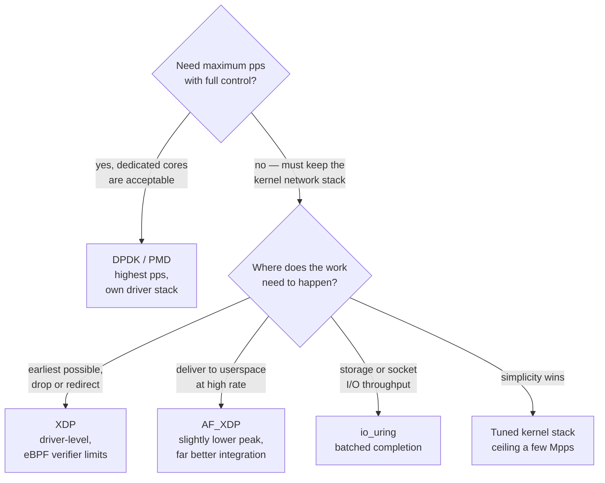
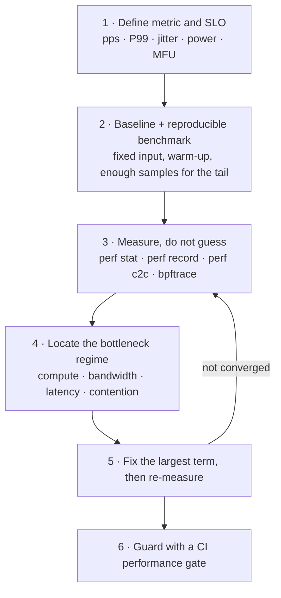

# Programming Languages, Toolchain and Performance Engineering

The layer that makes every other note in this vault executable.

## 1. C/C++ for protocol stacks and dataplanes

### 1.1 What interviewers actually probe
- **Object lifetime and ownership** in a zero-copy pipeline: who frees the buffer, and what happens on error paths.
- **`const` correctness, RAII, move semantics**, and avoiding accidental copies in hot paths.
- **Alignment and padding**: `alignas`, cache-line alignment to avoid false sharing, `offsetof`-safe struct layout.
- **Volatile and atomics**: `volatile` is *not* a synchronisation primitive; `std::atomic` with explicit memory ordering is.
- **Lock-free structures**: single-producer/single-consumer rings, ABA problems, and when a mutex is genuinely faster than a bad lock-free queue.
- **Undefined behaviour**: strict aliasing, signed overflow, unaligned access, data races — all of which show up as "works in debug, fails at -O2".

### 1.2 Modern C++ worth using in systems code
- C++17/20 features that pay off: structured bindings, `std::span`, `string_view`, `constexpr`/`consteval`, concepts, `std::atomic_ref`, coroutines (for state machines), `std::jthread`.
- Features to use with care in dataplane code: exceptions (unwinding cost and `-fno-exceptions` builds), RTTI, `std::function` (type-erasure allocation), and `std::shared_ptr` (atomic refcount contention across cores).

### 1.3 Build and toolchain
- **CMake** for cross-platform builds; toolchain files for cross-compilation; `cmake --build` with Ninja for speed.
- **GCC / Clang**: `-O2`/`-O3`, `-flto`, `-march=native` or explicit `-march` for target ISA extensions (relevant for RISC-V custom extensions — see [[07-1 RISC-V for Communication Infrastructure]]).
- **Sanitizers**: ASan, UBSan, TSan in CI; they find the UB class of bug that protocol stacks are full of.
- **vcpkg / Conan** for dependency management (xLLM uses vcpkg).
- **Cross-compilation** for ARM/RISC-V targets with sysroot isolation.

## 2. Python for modelling, tooling and ML

- Where it belongs: **simulation, data analysis, test harnesses, model prototyping, tooling**. Not in a sub-millisecond dataplane loop.
- **numpy / scipy** for signal processing and numerical work; **pandas** for KPI analysis.
- **PyTorch** for model work; the integration path to production is export (ONNX / TorchScript / vendor compilers) into a C++ runtime — see [[06-1 LLM Inference Engines and xLLM]].
- **asyncio** for test harnesses driving many simulated UEs/devices concurrently.
- **Bindings**: pybind11 or nanobind to expose C++ to Python (xLLM uses pybind). This is the standard "Python flexibility + C++ performance" compromise.
- Be explicit about the GIL: it is why Python serving stacks use multi-process, and it is part of the tail-latency argument for C++ inference engines.
- Full treatment — execution model, dunder protocols, class system, asyncio, typing, NumPy array model, performance decision tree, packaging — is in [[08-3 Python Programming - Language, Object Model and Engineering Practice]].

## 3. Linux systems programming

### 3.1 Essentials
- Process/thread model, `futex`, `epoll`, `io_uring`, `mmap`, shared memory.
- **cgroups / namespaces** — the basis of containers, and of CPU isolation for dataplane cores.
- **`sched_setaffinity`, `isolcpus`, `nohz_full`, `rcu_nocbs`** — isolating cores for deterministic packet processing.
- **Huge pages**: `hugetlbfs` and THP — required by DPDK; see [[05-1 DPDK User Plane and 5G UPF]].
- **`/proc` and `/sys`** introspection; `perf`, `ftrace`, `bpftrace`, `eBPF` for production-visible tracing.
- Full treatment of the kernel side — boot chain, device tree, drivers, IPC, networking, virtualization — is in [[04-2 Linux Embedded Development - Drivers, Applications and Core Subsystems]].

### 3.2 Kernel-bypass options and when to pick them

| Mechanism | Use case | Trade-off |
| --- | --- | --- |
| **DPDK / PMD** | Maximum pps, full control | Dedicated cores, own driver stack, no kernel networking features |
| **AF_XDP** | High pps while keeping kernel stack | Slightly lower peak, much better integration |
| **XDP** | Early drop/redirect in driver | Limited program size, eBPF verifier constraints |
| **io_uring** | High-throughput storage/socket I/O | Lower per-packet control than DPDK |
| **Kernel stack + tuning** | Simplicity, compatibility | Ceiling around a few Mpps |

### 3.3 RTOS versus Linux
- **Linux with PREEMPT_RT** for soft real-time with a full ecosystem.
- **RTOS** for hard real-time, tight footprint and deep sleep — see [[04-1 Embedded Systems RTOS and Hardware Interfaces]].
- The decision axis is **worst-case latency and power**, not average throughput.

## 4. Verilog HDL and FPGA

- **Design level**: RTL in Verilog/SystemVerilog; simulation with ModelSim/Questa/Verilator/Icarus; synthesis with Vivado/Quartus.
- **Mindset difference from software**: everything is parallel and clocked; you are designing hardware, not sequencing instructions.
- Key concepts: blocking (`=`) versus non-blocking (`<=`) assignment, clock domains and **CDC (clock domain crossing)** synchronisation, metastability, pipelining for timing closure, resource versus throughput trade-offs.
- Where it is used in this domain: **prototyping baseband blocks, hardware-in-the-loop testbeds, accelerating specific kernels (FEC, FFT, CRC), and pre-silicon validation**.
- **HLS** (C/C++ → RTL) exists but rarely beats hand-written RTL on the kernels that matter.
- Verification: testbenches, assertions (SVA), UVM for larger designs, and co-simulation against a C model.
- Full treatment — standard lineage, assignment scheduling, FSM/reset discipline, timing arithmetic, CDC mechanisms, SystemVerilog classes and UVM, synthesis flows — is in [[08-5 Verilog HDL - RTL Design, Verification and Synthesis Practice]].
- The **MATLAB/Simulink** path into the same RTL (fixed point, HDL Coder, SIL/PIL) is in [[08-4 MATLAB and Simulink - Programming, Modelling and Code Generation]].

## 5. Performance engineering method

The discipline that distinguishes senior from mid-level:

1. **Define the metric and the SLO.** Throughput (Gbps/pps), mean latency, P99/P99.9, jitter, power, or MFU. They conflict — decide before optimising.
2. **Establish a baseline and a reproducible benchmark.** Fixed input, fixed environment, warm-up, enough samples for the tail.
3. **Measure, do not guess.** `perf stat` for counters; `perf record`/`report` and flame graphs for hot paths; `perf c2c` for false sharing and cache-line contention; `bpftrace` for latency distributions.
4. **Locate the bottleneck regime.** Compute-bound, memory-bandwidth-bound, latency-bound (cache misses / TLB), or contention-bound (locks, atomics). Roofline-style reasoning: is the kernel above or below the arithmetic-intensity ridge point?
5. **Fix the largest term, then re-measure.** Typical wins in order of magnitude: remove per-packet allocation → fix NUMA placement → batch → eliminate false sharing → fuse operators → vectorise.
6. **Guard against regressions** with a CI performance test that fails on a defined threshold.

### Common root causes, ranked by frequency in dataplane work
1. **NUMA-remote memory** — NIC and mempool on different sockets
2. **Cross-core shared state** — atomic contention and false sharing on hot counters
3. **Per-packet allocation** — allocator and TLB pressure
4. **Unnecessary copies** — kernel↔user, or stage-to-stage duplication
5. **Interrupt/context-switch overhead** — using interrupts where polling is needed
6. **Tail latency from batching** — large batches improve pps and destroy P99

## 6. Version control, CI and engineering hygiene

- **Git**: trunk-based or short-lived branches; conventional commits; bisect for regression hunting (`git bisect` is the single most useful tool for "it used to work").
- **CI**: build matrix across targets, unit tests, sanitizer runs, static analysis (clang-tidy, cppcheck), and **performance regression gates**.
- **Code review focus in systems code**: error paths, ownership, integer overflow, bounds, and concurrency — not style.
- **Documentation of assumptions**: the timing budget, the memory budget, and the failure model should be written down before the code.

## Anchors — verified facts

- Core dataplane mechanisms and trade-offs: **DPDK PMD / AF_XDP / XDP / io_uring / tuned kernel stack**, each with a distinct peak-pps versus integration trade-off.
- Kernel bypass requires **hugepages**, **core isolation (`isolcpus`, `nohz_full`)**, and **NUMA-local memory** to deliver its advertised rate.
- Observability toolchain: **`perf` (stat/record/report/c2c), `ftrace`, `bpftrace`, eBPF, flame graphs**.
- Sanitizers (**ASan / UBSan / TSan**) plus static analysis (**clang-tidy**) are standard CI gates for C/C++ systems code.
- FPGA/RTL flow: **Verilog/SystemVerilog → simulation (Verilator/Icarus/ModelSim) → synthesis (Vivado/Quartus)**, with CDC handling and timing closure as the recurring constraints.

## Related

- [[08-2 C and C++ Programming - Language Features, STL and Systems Practice]] — the language-level counterpart: C23/C++26 features, templates, memory model, STL
- [[08-3 Python Programming - Language, Object Model and Engineering Practice]] — the tooling and modelling language in depth
- [[08-4 MATLAB and Simulink - Programming, Modelling and Code Generation]] — model-based design and code generation
- [[08-5 Verilog HDL - RTL Design, Verification and Synthesis Practice]] — the RTL counterpart of the build/profiling method
- [[05-1 DPDK User Plane and 5G UPF]]
- [[07-1 RISC-V for Communication Infrastructure]]
- [[04-1 Embedded Systems RTOS and Hardware Interfaces]]
- [[06-1 LLM Inference Engines and xLLM]]
- [[04-2 Linux Embedded Development - Drivers, Applications and Core Subsystems]]
- [[04-4 Linux Interrupts - Types, Handlers, Threaded IRQs and Deferred Work]] — the interrupt and softirq latency that the profiling and bypass discussion is measuring
- [[04-5 Linux Concurrency - Kernel and User Mode, Processes, Threads and IPC]] — the concurrency and IPC model whose contention the profiler is attributing

---

Copyright (c) 2026 Washington Ruan. All rights reserved.
