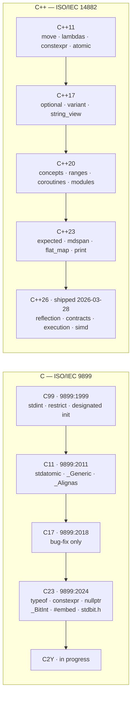
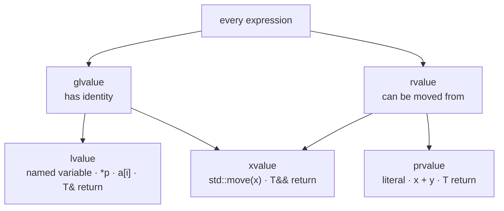
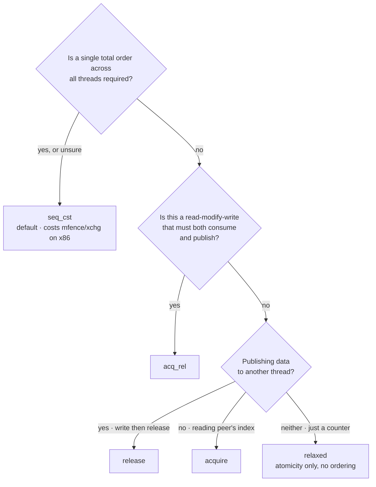
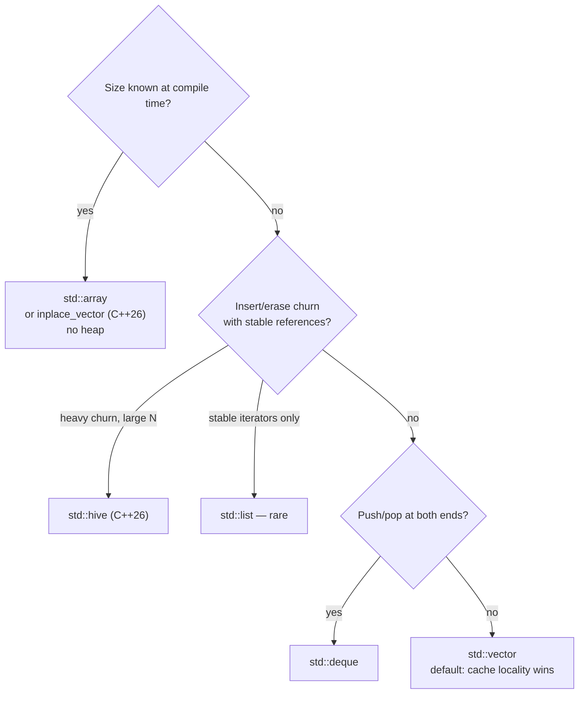
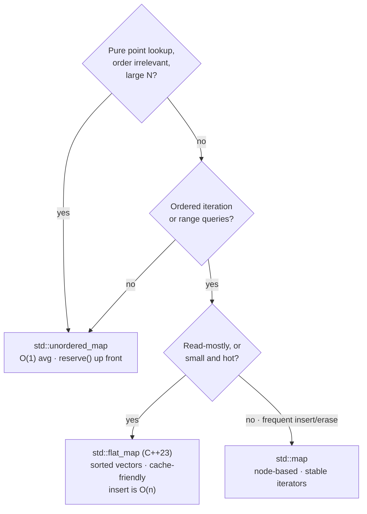

# C and C++ Programming — Language Features, STL and Systems Practice

The language layer. Every note in this vault eventually compiles down to this one: protocol stacks are C, dataplanes are C with C++ control planes, inference engines are C++ with C kernels, drivers are C, and the boundary between them is where most real bugs live.

Companion to [[08-1 Programming Languages Toolchain and Performance Engineering]] (build systems, profiling, kernel bypass) and [[04-2 Linux Embedded Development - Drivers, Applications and Core Subsystems]] (the OS-facing side).

---

## 1. Orientation: where each language is used and why

| Layer | Language | Reason |
| --- | --- | --- |
| L1 PHY / DSP kernels | C + intrinsics, assembly | Deterministic cycle counts, vector registers, no hidden allocation |
| L2 MAC/RLC/PDCP | C (sometimes C++17 subset) | Zero-copy buffers, explicit ownership, ABI stability, MISRA-style rules |
| UPF / dataplane | C + DPDK, C++ control plane | Poll-mode loops and hugepages; config plane can afford abstraction |
| Device drivers | C (kernel), Rust emerging | Kernel ABI, no exceptions, no RTTI, no libstdc++ |
| Inference engine | C++17/20 + C/CUDA kernels | RAII for device memory, templates for dtype dispatch, C++ for scheduling |
| Agent / orchestration | C++ or Rust, Python at the edge | Latency budget vs. development speed |
| Test harness / modelling | Python, C++ gtest | Iteration speed |

The rule of thumb that survives review: **C for interfaces and data layout, C++ for ownership and invariant enforcement, and never let the abstraction leak into the hot loop.**

---

## 2. The standards timeline



Two facts that are worth more than the feature lists: **C23 is ISO/IEC 9899:2024** (the nickname comes from the `202311L` feature macro), and **C++26 was shipped by WG21 on 28 March 2026** (draft N5046), so it is a real, quotable release — not a plan.

### 2.1 C (ISO/IEC 9899, WG14)

| Version | ISO identifier | `__STDC_VERSION__` | Notable |
| --- | --- | --- | --- |
| C89/C90 | 9899:1990 | — | The baseline everyone still targets |
| C95 | AMD1 | 199409L | Wide chars, digraphs |
| C99 | 9899:1999 | 199901L | `//` comments, `long long`, `stdint.h`, `restrict`, VLAs, designated initialisers, `inline`, `snprintf` |
| C11 | 9899:2011 | 201112L | `<stdatomic.h>`, `<threads.h>`, `_Generic`, `_Alignas`/`_Alignof`, `_Noreturn`, `_Static_assert`, bounds-checking Annex K |
| C17/C18 | 9899:2018 | 201710L | Bug-fix release; no new features |
| **C23** | **9899:2024** | **202311L** | `typeof`, `constexpr`, `nullptr`, `bool` keyword, `_BitInt`, `#embed`, `<stdbit.h>`, attributes |
| C2Y | — | in progress | Working draft stage |

Note the mismatch that trips people up: the nickname "C23" comes from the frozen feature-test macro `202311L`, but the ISO document is **9899:2024**, published **31 October 2024**.

### 2.2 C++ (ISO/IEC 14882, WG21)

| Version | Headline features |
| --- | --- |
| C++98/03 | Templates, STL, exceptions, RTTI, namespaces |
| **C++11** | Move semantics, `auto`, lambdas, `constexpr`, `<atomic>`, `<thread>`, smart pointers, `nullptr`, range-for, variadic templates |
| C++14 | Generic lambdas, `make_unique`, relaxed `constexpr`, `[[deprecated]]`, return type deduction |
| C++17 | Structured bindings, `if constexpr`, `std::optional`/`variant`/`any`/`string_view`, `std::filesystem`, parallel algorithms, `std::string_view`, fold expressions, guaranteed copy elision |
| **C++20** | Concepts, Ranges, Coroutines, Modules, `<=>`, `consteval`/`constinit`, `std::span`, `std::format`, `std::jthread`, `std::atomic_ref`, designated initialisers |
| C++23 | `std::expected`, `std::print`/`println`, `std::mdspan`, `std::flat_map`/`flat_set`, `std::generator`, `std::stacktrace`, deducing `this`, `if consteval`, `import std;`, monadic `optional` |
| **C++26** | **Reflection**, **Contracts**, `std::execution` (senders/receivers), `std::simd`, `std::linalg`, `std::inplace_vector`, `std::hive`, `#embed`, expansion statements, hazard pointers + RCU, standard library hardening, erroneous behaviour |

C++26 was **shipped by WG21 on 28 March 2026** at the London meeting, after ballot-comment resolution at Kona (November 2025). The working draft is N5046. It goes to ISO for final approval ballot and publication as ISO/IEC 14882:2026. Herb Sutter called it the most compelling release since C++11.

---

## 3. C — complete feature map

### 3.1 Object model, storage duration and linkage

| Concept | Meaning | Gotcha |
| --- | --- | --- |
| **Automatic** | Block scope, stack, lifetime = block | Not zero-initialised; reading before assignment is UB (C) / erroneous behaviour (C++26) |
| **Static** | File/block with `static`, program lifetime | Zero-initialised; initialiser must be a constant expression |
| **Thread** (`_Thread_local` / `thread_local`) | One instance per thread | Order of destruction is not what you assume |
| **Allocated** | `malloc`/`calloc`/`realloc`/`free` | Lifetime ends at `free`; alignment follows `alignof(max_align_t)` unless over-aligned |
| **Linkage**: external / internal / none | `static` at file scope → internal | `static` means three different things in C |

**Translation unit model**: each `.c` is compiled independently; the linker resolves externals. That is why headers must contain *declarations* only, and why `static inline` in a header gives every TU its own copy.

### 3.2 The type system

- **Integer types**: `<stdint.h>` is mandatory in real code — `int8_t`…`uint64_t`, `intptr_t`/`uintptr_t`, `intmax_t`. Use `uint32_t` for wire formats, never `int`.
- **Fixed-width vs least vs fast**: `uint32_t` (exact), `uint_least32_t` (at least), `uint_fast32_t` (fastest to load). Fresh engineers always pick the wrong one.
- **`char` signedness is implementation-defined** — never use bare `char` for byte arithmetic.
- **Qualifiers**:
  - `const` — read-only through this lvalue, *not* a compile-time constant in C (unlike C++).
  - `volatile` — forces an actual memory access per abstract-machine read/write. **Not** a synchronisation primitive, **not** atomicity, **not** a memory barrier against other cores. It is for MMIO registers and signal-handler/`setjmp` variables.
  - `restrict` — the programmer's promise that no other pointer aliases this one. This is what lets the compiler vectorise `memcpy`-style loops; violating it is UB.
  - `_Atomic` (C11) — real atomicity with a memory-order parameter.

### 3.3 Operators, evaluation order and the UB catalogue

The single most common source of "works at -O0, fails at -O2":

```c
a[i] = i++;          // UB: unsequenced modification and use
f() + g();           // unspecified order, but no UB (function calls are indeterminately sequenced)
*p++ = *p++;         // UB
i = i++ + 1;         // UB
signed_overflow: INT_MAX + 1   // UB — the classic one in packet length arithmetic
shift: 1 << 32      // UB (width or greater)
strict aliasing: float f = *(float*)&some_int;  // UB — use memcpy or a union
```

**Strict aliasing** is the rule that lets the compiler assume a `float*` and an `int*` never refer to the same object. Violating it is why `-fno-strict-aliasing` "fixes" bugs that were really bugs. The legal ways to type-pun: `memcpy` (compiles to a single load/store at any optimisation level), a union, or `_Alignas`-correct placement new in C++.

Practical rule for protocol stacks: **never cast a received buffer to a struct pointer.** Either `memcpy` field-by-field into a properly aligned struct, or use packed accessors. Unaligned access is fine on x86, a fault on some ARM, and slow on others.

### 3.4 The preprocessor

- Object-like and function-like macros; `#` stringise, `##` token paste.
- Always parenthesise: `#define SQR(x) ((x) * (x))` — and note `SQR(i++)` is still UB.
- **X-macros** for keeping an enum and its string table in sync:

```c
#define SIGNAL_LIST(X)      \
    X(SIG_RACH,  "rach")    \
    X(SIG_SR,    "sr")      \
    X(SIG_BSR,   "bsr")

typedef enum { SIGNAL_LIST(ENUM_ENTRY) } signal_t;   /* expand with a different X each time */
static const char *const signal_name[] = { SIGNAL_LIST(STR_ENTRY) };
```
One definition, no drift. This pattern is everywhere in real modem code.

- Include guards vs `#pragma once` (non-standard but universally supported and faster).
- C23 adds `#elifdef`, `#elifndef`, `#warning`, `#embed`, and `__has_embed`.

### 3.5 Arrays, pointers and decay

- An array *is not* a pointer; it *decays* to one in most expression contexts and, critically, **when declared as a function parameter**. `void f(int a[10])` is `void f(int *a)` — `sizeof(a)` inside is the pointer size. This is the interview question that separates people.
- Pointer arithmetic is defined only within (and one past) the same array object.
- `void *` and `char *` alias anything; `unsigned char` is the legal way to inspect an object's bytes.
- **Function pointers**: the basis of every vtable hand-rolled in C.

```c
struct phy_ops {
    int (*init)(void *ctx);
    int (*tx)(void *ctx, const uint8_t *buf, size_t len);
    void (*deinit)(void *ctx);
};
```

### 3.6 Structs: layout, padding and the idiom that pays the rent

```c
struct mac_header {
    uint8_t  fc[2];      /* offset 0  */
    uint16_t duration;   /* offset 2  */
    uint8_t  addr1[6];   /* offset 4  */
    uint8_t  seq_ctl[2]; /* offset 10 */
    uint8_t  qos[2];     /* offset 12 */
} __attribute__((packed));   /* GCC/Clang */
```

Rules:
- Members are laid out in declaration order, each aligned to its own alignment; the struct is padded to its own alignment.
- **Sort members by descending alignment** to minimise padding — do it by habit, not by measuring later.
- `__attribute__((packed))` removes padding but forces byte-wise access; on ARM32 pre-v7 unaligned loads fault. Prefer explicit serialise/deserialise.
- **Flexible array member**: `uint8_t payload[];` as the last member — the standard way to do a variable-length header + one allocation.

```c
struct pdu { uint32_t len; uint8_t data[]; };
struct pdu *p = malloc(sizeof(struct pdu) + n);
memcpy(p->data, src, n);
```
One allocation, one free, cache-friendly, no pointer chasing. This is how mbufs, skbs and every protocol PDU are built.

**`container_of`** — the intrusive-container primitive at the heart of the Linux kernel and most C protocol stacks:

```c
#define container_of(ptr, type, member) \
    ((type *)((char *)(ptr) - offsetof(type, member)))

struct timer { struct list_head node; void (*fn)(void *); uint64_t expiry; };

struct list_head *n = list_next(&runq);
struct timer *t = container_of(n, struct timer, node);
```
No allocation per link, cache-hot traversal, O(1) removal from the middle. Contrast with `std::list<T>`, which allocates per node and scatters memory.

**Bit-fields**: `uint32_t harq : 4;` — layout is implementation-defined (allocation unit, ordering, signedness). **Never use bit-fields for wire formats.** Use explicit masks:

```c
static inline uint32_t field_get(uint32_t v, unsigned sh, uint32_t mask) { return (v >> sh) & mask; }
static inline uint32_t field_set(uint32_t v, unsigned sh, uint32_t mask, uint32_t x) {
    return (v & ~(mask << sh)) | ((x & mask) << sh);
}
```
Deterministic on every compiler and every endianness.

### 3.7 Memory management

- `malloc`/`calloc`/`realloc`/`free`, plus `aligned_alloc` (C11, size must be a multiple of alignment), `posix_memalign`, and `memalign`.
- `alloca` and VLAs: avoid in production — unbounded stack growth, and an 8 KB kernel stack or a 4 KB RTOS task stack will not forgive you.
- **Ownership convention must be documented per API**: caller frees / callee frees / pool returns. Most C bugs are a disagreement about this, not a `malloc` bug.
- **Pool/mempool first**: fixed-size slab allocation eliminates fragmentation and makes worst-case latency bounded. See [[05-1 DPDK User Plane and 5G UPF]] (`rte_mempool`).

### 3.8 Bit manipulation — C11 vs C23

```c
/* portable C11 */
static inline int is_pow2(uint32_t x) { return x && !(x & (x - 1)); }
static inline uint32_t next_pow2(uint32_t x) { x--; x |= x>>1; x |= x>>2; x |= x>>4; x |= x>>8; x |= x>>16; return x + 1; }

/* C23: <stdbit.h> — standard, type-generic */
#include <stdbit.h>
stdc_has_single_bit(x);   stdc_bit_ceil(x);    stdc_bit_floor(x);
stdc_bit_width(x);        stdc_count_ones(x);  stdc_count_zeros(x);
stdc_leading_zeros(x);    stdc_trailing_zeros(x);
stdc_first_leading_one(x);stdc_first_trailing_one(x);
```
C23 also gave us `memset_explicit()` (a secure wipe the optimiser cannot delete — the thing `memset` on a key buffer silently fails at), `memccpy()`, `strdup()`/`strndup()`, `memalignment()`, `timegm()`, and `%b` in printf/scanf.

### 3.9 C23 in practice

```c
#define MAX(a, b) ({ typeof(a) _a = (a); typeof(b) _b = (b); _a > _b ? _a : _b; })  /* statement expr, GCC */
typeof(x) tmp;                 /* now standard, no compiler extension */
constexpr int RING_SIZE = 4096;/* real compile-time constant, usable as an array bound */
[[nodiscard]] int parse(const uint8_t *p, size_t n);   /* standard attributes */
[[deprecated("use v2")]] void old_api(void);
_BitInt(128) wide;             /* bit-precise integer — arbitrary width */
uint8_t raw[] = {
#embed "firmware.bin"          /* binary resource into the translation unit */
};
nullptr                        /* a real null pointer constant, type nullptr_t */
bool ok = true;                /* bool/true/false are keywords, no <stdbool.h> */
int f(int, const char *);      /* unnamed parameters in a definition are legal */
```

---

## 4. C++ — complete feature map

### 4.1 Value categories and the object model



| Category | Examples | Can bind to |
| --- | --- | --- |
| **lvalue** | named variable, `*p`, `a[i]`, function returning `T&` | `T&`, `const T&`, `T&&` (no) |
| **xvalue** (eXpiring) | `std::move(x)`, function returning `T&&` | `const T&`, `T&&` |
| **prvalue** | literal, `x + y`, function returning `T` | `const T&`, `T&&`, and initialises a `T` directly |

`glvalue = lvalue ∪ xvalue`; `rvalue = prvalue ∪ xvalue`. This taxonomy is not trivia — it determines which overload is chosen and whether a move happens.

**Lifetime**: storage duration vs object lifetime. `malloc` gives storage; the object's lifetime only begins after a constructor runs (hence placement new, and hence `std::start_lifetime_as` in C++23 for implicit-lifetime types).

### 4.2 RAII and the Rule of Zero / Three / Five

```cpp
class Socket {
    int fd_ = -1;
public:
    explicit Socket(int domain, int type) : fd_(::socket(domain, type, 0)) {
        if (fd_ < 0) throw std::system_error(errno, std::generic_category(), "socket");
    }
    ~Socket() { if (fd_ >= 0) ::close(fd_); }
    Socket(const Socket&)            = delete;
    Socket& operator=(const Socket&) = delete;
    Socket(Socket&& o) noexcept : fd_(std::exchange(o.fd_, -1)) {}
    Socket& operator=(Socket&& o) noexcept {
        if (this != &o) { reset(); fd_ = std::exchange(o.fd_, -1); }
        return *this;
    }
    int native_handle() const noexcept { return fd_; }
    void reset() noexcept { if (fd_ >= 0) { ::close(fd_); fd_ = -1; } }
};
```
**Rule of Zero**: if your class only holds RAII members (`unique_ptr`, `vector`, `string`), write *no* special member functions — the compiler-generated ones are correct. **Rule of Five**: if you write any one of destructor / copy ctor / copy assign / move ctor / move assign, you almost certainly need all five (Rule of Three pre-C++11).

Move constructors and `swap` should be `noexcept` — `std::vector::resize` only uses the move path if the move cannot throw, otherwise it copies. A missing `noexcept` silently costs you a copy on every reallocation.

### 4.3 Overload resolution, lookup and ADL

The pipeline: name lookup → template argument deduction → overload set construction → viability (does an implicit conversion sequence exist?) → best-viable-function ranking → tie-breakers.

Ranking, best to worst: exact match → promotion (`char`→`int`) → conversion (`int`→`double`) → user-defined conversion → ellipsis.

**ADL (argument-dependent lookup)**: an unqualified call `swap(a, b)` also searches the namespaces associated with `a`'s and `b`'s types. This is *why* the idiom is:

```cpp
template <class T> void exchange_values(T& a, T& b) {
    using std::swap;   // bring the fallback into scope
    swap(a, b);        // unqualified: ADL finds a type-specific swap if one exists
}
```
Writing `std::swap(a, b)` directly would always call the generic one. This is the single most-quoted C++ idiom in code review.

### 4.4 Templates

- **Function templates** with deduction; **class templates**; **variable templates** (C++14).
- **Explicit specialisation** vs **partial specialisation** (class templates only — functions cannot be partially specialised; overload instead).
- **Variadic templates** and parameter packs:

```cpp
template <class... Args>
void log(std::string_view fmt, Args&&... args) {
    std::print(std::cerr, fmt, std::forward<Args>(args)...);
}

/* C++17 fold expression — no recursion needed */
template <class... Ts> bool all_true(Ts... ts) { return (... && ts); }
template <class... Ts> auto sum(Ts... ts)      { return (ts + ...); }
```

- **SFINAE** (Substitution Failure Is Not An Error) — the pre-C++20 constraint mechanism:

```cpp
template <class T, class = std::enable_if_t<std::is_integral_v<T>>>
T twice(T v) { return v + v; }
```
- **CTAD** (class template argument deduction, C++17): `std::vector v{1,2,3};` plus explicit deduction guides.
- **Two-phase name lookup**: non-dependent names are bound at definition time; dependent names at instantiation. Hence `typename T::value_type` and `template T::foo<0>()`.
- **Compile-time cost**: templates are the main driver of C++ build times. Use explicit instantiation (`extern template`) and prefer `if constexpr` over tag-dispatch recursion where possible.

### 4.5 Concepts and constraints (C++20)

```cpp
template <class T>
concept Packet = std::is_trivially_copyable_v<T> && requires(T t) {
    { t.size() }  -> std::convertible_to<size_t>;
    { t.data() }  -> std::same_as<const std::byte*>;
};

template <Packet P> void transmit(const P& p);

/* or as a constrained auto */
void transmit(const Packet auto& p);
```
Concepts replace SFINAE with readable errors — instead of a 40-line template instantiation backtrace you get "constraint `Packet` not satisfied: `t.data()` does not return `const std::byte*`". Requires-clauses can also be used to pick an overload, subsumption rules and all.

### 4.6 Compile-time computation

| Mechanism | Standard | Meaning |
| --- | --- | --- |
| `constexpr` variable | C++11 | Compile-time constant |
| `constexpr` function | C++11/14/20 | *Can* be evaluated at compile time if inputs are constant |
| `consteval` function | C++20 | *Must* produce a constant — a compile-time-only function |
| `constinit` | C++20 | Guarantee static initialisation (kills the static-init-order fiasco for that variable) |
| `if constexpr` | C++17 | Compile-time branch; the discarded branch is not instantiated |
| `static_assert` | C++11 (single-arg since C++17) | Compile-time assertion |
| Non-type template params | C++20 | `template <std::size_t N>`, and now class-type NTTPs with structural equality |

```cpp
/* compile-time CRC or lookup table — zero runtime cost, no init order problem */
consteval std::array<uint16_t, 256> make_crc_table() {
    std::array<uint16_t, 256> t{};
    for (std::size_t i = 0; i < 256; ++i) {
        uint16_t c = static_cast<uint16_t>(i);
        for (int b = 0; b < 8; ++b) c = (c & 1) ? (c >> 1) ^ 0xA001u : (c >> 1);
        t[i] = c;
    }
    return t;
}
inline constexpr auto CRC_TABLE = make_crc_table();
```

`if constexpr` replaced an entire era of tag dispatch and specialisation scaffolding:

```cpp
template <class T> std::string to_hex(T v) {
    if constexpr (std::is_enum_v<T>)           return to_hex(std::to_underlying(v));
    else if constexpr (std::is_integral_v<T>)  return std::format("{:x}", v);
    else                                        static_assert(false, "unsupported");
}
```
(The `static_assert(false, ...)` in the else branch needs care in a non-template context — in a template it is fine because it is only instantiated when taken.)

### 4.7 Object-oriented machinery

- **Dynamic dispatch**: virtual functions through a vtable; one `vptr` per polymorphic object, one vtable per class. Cost: one indirect load plus an unpredictable branch — which is why per-packet virtual calls are avoided in dataplanes.
- `override` and `final` are not decoration — `override` makes a signature mismatch a compile error.
- **Multiple inheritance** and **virtual inheritance** (for the diamond). Prefer composition.
- **CRTP (curiously recurring template pattern)** — static polymorphism with zero indirection:

```cpp
template <class Derived>
struct Counter {
    void increment() { static_cast<Derived*>(this)->on_increment(); }
    int count() const { return static_cast<const Derived*>(this)->count_; }
};
struct RlcCounter : Counter<RlcCounter> {
    int count_ = 0;
    void on_increment() { ++count_; }
};
```
Used for mixins, for `enable_shared_from_this`, and for devirtualised hot paths.

**Interview answer**: "virtual dispatch costs an indirect branch and defeats inlining; I use it at configuration time and CRTP/templates where the type is known at compile time in the hot path."

### 4.8 Move semantics

```cpp
template <class T>
void push_node(std::vector<T>& v, T&& node) {
    v.emplace_back(std::forward<T>(node));   // perfect forwarding
}
```
- `std::move` is a *cast* to an xvalue; it moves nothing by itself. `std::forward<T>` is a conditional cast preserving the deduced category — only valid on a forwarding reference `T&&`.
- **Guaranteed copy elision** (C++17): `T t = T();` constructs in place; no copy/move required, and the type need not have an accessible copy ctor. This made factory functions returning non-movable types legal.
- **NRVO** remains an optimisation, not a guarantee — do not rely on it for correctness.
- Rule: after a move, the source is in a *valid but unspecified* state. Only assignment, destruction, or calling a function with no preconditions is safe.

### 4.9 Exceptions

- **Exception safety guarantees**: *nothrow*, *strong* (commit-or-rollback), *basic* (no leaks, invariants preserved), *none*.
- `noexcept` is part of the signature. Marking a move ctor `noexcept` is what enables `vector` to move instead of copy on growth.
- Cost model: modern implementations use **zero-cost exceptions** — no runtime cost on the happy path, but larger binaries and expensive, unpredictable unwinding on the throw path.
- Many embedded/dataplane builds use `-fno-exceptions`; then error handling becomes `std::expected` (C++23) or error codes. Know which regime you are in.
- **Never throw from a destructor** — if unwinding is already in progress, `std::terminate` is called.

### 4.10 Lambdas and callable objects

```cpp
/* C++11 */  auto add = [](int a, int b) { return a + b; };
/* C++14 */  auto add = [](auto a, auto b) { return a + b; };          // generic
/* C++14 */  auto t   = [p = std::move(buf)] { return p.size(); };     // init-capture
/* C++17 */  auto s   = [](auto self, int n) -> int { return n ? self(self, n-1) * n : 1; }; // Y-combinator
/* C++20 */  auto f   = []<class T>(std::vector<T> v) { return v.size(); };  // template lambda
/* C++23 */  auto g   = [ptr = auto(*ref)] { return ptr; };            // decay-copy, avoids dangling
```
- Capture-default hazards: `[=]` captures `this` by value as a *pointer* (deprecated in C++20 for this reason) — a lambda outliving `this` dangling. Prefer explicit captures.
- `std::function` type-erases: usually heap-allocates for large captures and costs an indirect call. In a hot loop, use a template parameter or `function_ref` instead. C++26 adds `std::copyable_function` (copyable, const-invocable, no allocation guarantee for small objects).

### 4.11 The memory model and concurrency

Choosing an order is a question about *which* guarantee you actually need:



The pairing that must be stated out loud: **release on the producer's store pairs with acquire on the consumer's load** — that pair is what makes the non-atomic payload writes visible. `relaxed` alone never publishes data.

**Six memory orders** — this is the part interviewers actually push on:

| Order | Guarantee | Cost on x86 | Use |
| --- | --- | --- | --- |
| `relaxed` | Atomicity only, no ordering | free | counters, statistics |
| `consume` | (deprecated in C++26) | — | avoid |
| `acquire` | No later read/write moves before it | free | lock acquire, read index |
| `release` | No earlier read/write moves after it | free | lock release, publish data |
| `acq_rel` | Both | free | read-modify-write |
| `seq_cst` | Single total order across all threads | `mfence`/`xchg` | default; correctness first |

```cpp
class SpscRing {
    static constexpr std::size_t N = 1024, MASK = N - 1;
    alignas(64) std::array<uint32_t, N> buf_{};          // separate cache lines
    alignas(64) std::atomic<std::size_t> head_{0};        // producer writes
    alignas(64) std::atomic<std::size_t> tail_{0};        // consumer writes
public:
    bool push(uint32_t v) {
        auto h = head_.load(std::memory_order_relaxed);
        if (h - tail_.load(std::memory_order_acquire) == N) return false;  // full
        buf_[h & MASK] = v;
        head_.store(h + 1, std::memory_order_release);     // publish
        return true;
    }
    bool pop(uint32_t& out) {
        auto t = tail_.load(std::memory_order_relaxed);
        if (t == head_.load(std::memory_order_acquire)) return false;       // empty
        out = buf_[t & MASK];
        tail_.store(t + 1, std::memory_order_release);
        return true;
    }
};
```
Three details that matter: (1) `alignas(64)` on head and tail prevents **false sharing** — two cores ping-ponging the same cache line; (2) `relaxed` on the thread's own index because only that thread writes it; (3) `acquire`/`release` pairs to publish and consume the buffer contents. Power-of-two size lets `& MASK` replace modulo.

Concurrency facilities: `std::thread`, `std::jthread` (C++20, auto-joins and supports `stop_token`), `mutex`/`timed_mutex`/`recursive_mutex`/`shared_mutex`, `lock_guard`/`unique_lock`/`scoped_lock` (C++17, deadlock-free multi-lock), `condition_variable` (always with a predicate — spurious wakeups are real), `std::atomic`/`atomic_ref`/`atomic_flag`, `future`/`promise`/`async`/`packaged_task`, `latch`/`barrier`/`semaphore` (C++20), `std::stop_token`.

### 4.12 Coroutines (C++20)

A coroutine is a function containing `co_await`, `co_yield`, or `co_return`. The compiler synthesises a frame (heap-allocated unless the optimiser does **HALO** — heap allocation elision), plus promise type, return object, and awaiter.

```cpp
std::generator<uint64_t> fibonacci() {          // C++23 std::generator
    uint64_t a = 0, b = 1;
    for (;;) { co_yield a; std::tie(a, b) = std::pair{b, a + b}; }
}

/* protocol state machine as a coroutine — the highest-value use in this domain */
Task<void> run_attach_procedure(UeContext& ue) {
    co_await ue.wait_for_rach();        // suspends, no thread blocked, no callback pyramid
    co_await ue.send_msg3();
    co_await ue.wait_for_contention_resolution();
    ue.mark_attached();
}
```
Why it matters here: protocol procedures and RPC handlers are naturally sequential but event-driven. Coroutines let you write them sequentially while remaining non-blocking — replacing the state-machine-plus-callback code that dominates L3 implementations. The cost is a heap frame per suspended coroutine, so check whether the allocator is a pool.

### 4.13 Modules (C++20)

```cpp
export module phy;
import <vector>;
import :internal;                 // module partition
export namespace phy { class Fft { /* ... */ }; }

/* consumer */
import phy;                       // no #include, no macro leakage, no reparse
```
Benefits: real encapsulation (macros and non-exported names do not leak), dramatically faster builds (BMI is parsed once), no ODR ambiguity. Adoption is still gradual — build-system support and the ecosystem lag, so most production code still uses headers with `import std;` (C++23) as an intermediate win.

### 4.14 Ranges (C++20)

```cpp
namespace v = std::views;
auto result = packets
            | v::filter([](const Packet& p) { return p.valid(); })
            | v::transform([](const Packet& p) { return p.length(); })
            | v::filter([](std::size_t n) { return n > 64; });

for (auto n : result) process(n);                  // lazy: no intermediate containers
std::vector<int> v = ints | v::filter(pred) | std::ranges::to<std::vector>();  // C++23
```
Key properties: composable pipelines, lazy evaluation, and now **compile-time-checked** adaptors via concepts. Available adaptors: `filter`, `transform`, `take`, `drop`, `reverse`, `join`, `split`, `chunk`, `slide`, `stride`, `zip`, `enumerate`, `cartesian_product`, `concat` (C++26), plus `std::ranges::to` (C++23) to materialise.

### 4.15 C++23 — the completion release

- **`std::expected<T, E>`** — the error-handling answer for `-fno-exceptions` code and ABI boundaries:

```cpp
std::expected<uint32_t, ParseError> parse_length(std::string_view s) {
    if (s.empty()) return std::unexpected{ParseError::Empty};
    uint32_t v; auto r = std::from_chars(s.data(), s.data() + s.size(), v);
    if (r.ec != std::errc{}) return std::unexpected{ParseError::NotANumber};
    return v;
}
auto n = parse_length(hdr).transform([](uint32_t v){ return v * 8; })
                          .or_else([](ParseError e){ log(e); return std::expected<uint32_t,ParseError>{0}; });
```
- **`std::print`/`std::println`** — `std::format` straight to a stream, compile-time-checked format string, faster than iostreams, works on `FILE*`.
- **`std::mdspan`** — a non-owning multidimensional view with configurable layout (`layout_right`, `layout_left`, `layout_stride`), the substrate for `std::linalg`.
- **`std::flat_map` / `flat_set`** (P0429 / P1222) — sorted vectors instead of a tree. See §5.5.
- **`std::generator`** — a standard coroutine generator type.
- **`std::stacktrace`** — portable stack traces, no more `backtrace()` or `DbgHelp`.
- **Deducing `this`** — `auto get(this auto&& self)` replaces four overloads with one.
- **`if consteval`** — separate compile-time and runtime paths in one function.
- **Monadic `std::optional`** — `and_then`, `transform`, `or_else`.
- **`import std;`** — the entire standard library as a module; the single largest build-time win available today.
- **`std::byteswap`**, `std::to_underlying`, `std::start_lifetime_as`, `std::out_ptr`/`inout_ptr`, `std::is_scoped_enum`, range constructors on every container.

### 4.16 C++26 — the release that changes how you write C++

**Reflection (P2996)** — compile-time introspection and code generation:

```cpp
template <class T>
void dump(const T& obj) {
    template for (constexpr auto m : std::define_static_array(std::meta::nonstatic_data_members_of(^^T, std::meta::access_context::current()))) {
        std::println("{} = {}", std::meta::identifier_of(m), obj.[:m:]);   // splice
    }
}
```
The `^^` operator (the "cat ears" operator) yields a `std::meta::info` reflection value; `[: ... :]` splices it back into source. This kills the macro and template-metaprogramming scaffolding behind serialization, ORM, enum-to-string, and protobuf-style reflection. GCC 16 supports it under `-freflection`; Herb Sutter and Hana Dusíková described it as "a whole new language."

**Contracts (P2900)**:

```cpp
double sqrt_safe(double x)
    pre (x >= 0.0)
    post (r : r >= 0.0)
{
    contract_assert(!std::isnan(x));
    return std::sqrt(x);
}
```
`pre`, `post` and `contract_assert` become language-level; violation handling is configurable per build (`<contracts>` header). Practical value: an assertion the optimiser can *use* for codegen, not merely check.

**`std::execution` (P2300)** — senders/receivers, the standard async model:

```cpp
using namespace std::execution;
auto work = schedule(sch) | then([]{ return 41; }) | then([](int x){ return x + 1; });
auto [r]  = std::this_thread::sync_wait(std::move(work)).value();   // 42
```
Based on libunifex/stdexec lineage; `std::execution::task` is the coroutine task type. This is the intended substrate for future standard networking.

**`std::simd` (P1928)** — portable explicit vectorisation:

```cpp
using floatv = std::simd::vec<float, 8>;
for (std::size_t i = 0; i < n; i += floatv::size()) {
    auto x = std::simd::unchecked_load(a.begin() + i, floatv::size());
    auto y = std::simd::unchecked_load(b.begin() + i, floatv::size());
    std::simd::unchecked_store(x * y + 1.0f, out.begin() + i, floatv::size());
}
```
One source for AVX-512, NEON, SVE and RVV instead of per-ISA intrinsics — directly relevant to [[07-1 RISC-V for Communication Infrastructure]].

**Other C++26 highlights**: `std::inplace_vector` (`<inplace_vector>`, P0843 — fixed capacity, no heap, the embedded `vector`), `std::hive` (`<hive>`, P0447 — bucket container reusing erased slots, from `plf::colony`, ideal for entity/connection pools), `std::linalg` (`<linalg>`, P1673 — BLAS-level ops over `mdspan`), `#embed` (P1967), expansion statements `template for` (P1306), hazard pointers (P2530) and RCU (P2545), **standard library hardening** (P3471 — bounds checks turning UB into contract violations), **erroneous behaviour** for uninitialised reads (P2795) with `[[indeterminate]]` as an explicit opt-out, `std::submdspan`, `std::views::concat`, saturating arithmetic (`std::saturating_add` etc.), `std::copyable_function`, `std::is_within_lifetime`, `= delete("reason")`, placeholder `_`, adding `@ $ \`` to the basic character set, and deprecation of `memory_order::consume`.

### 4.17 C ↔ C++ interop

```cpp
#ifdef __cplusplus
extern "C" {
#endif
int phy_init(const struct phy_config *cfg);
int phy_process(void *ctx, const uint8_t *in, size_t len);
#ifdef __cplusplus
}
#endif
```
`extern "C"` disables name mangling so the C++ compiler and linker agree with the C side. Rules: never let exceptions cross the boundary (wrap in try/catch and translate to an error code), never pass STL types across it, and be explicit that C and C++ are different languages with different ABI, different `struct` layout guarantees (in practice identical for PODs), and different `bool`/`enum` sizes in theory.

---

## 5. The Standard Template Library

### 5.1 The six components

1. **Containers** — own and manage storage
2. **Iterators** — the generalised pointer gluing containers to algorithms
3. **Algorithms** — ~100 generic functions over iterator ranges
4. **Function objects** — predicates, comparators, `std::function`, lambdas
5. **Adapters** — `stack`, `queue`, `priority_queue`; iterator adaptors; `std::views`
6. **Allocators** — the memory-sourcing policy, replaceable

The design insight worth stating in an interview: **algorithms are decoupled from containers by iterators**, so `std::sort` works on `vector`, `deque`, a C array, or a custom ring buffer with an iterator. That is what "generic" buys, and it costs nothing at runtime.

### 5.2 Sequence containers



| Container | Layout | Push/pop | Random access | Use when |
| --- | --- | --- | --- | --- |
| `std::array<T,N>` | contiguous, stack | — | O(1) | Fixed size known at compile time; no allocation |
| `std::vector<T>` | contiguous heap | amortised O(1) back / O(n) front | O(1) | **Default choice.** Cache locality beats everything |
| `std::deque<T>` | segmented blocks | O(1) both ends | O(1) | Queue needs; avoids `vector` realloc, but slower scan |
| `std::list<T>` | doubly-linked nodes | O(1) anywhere | O(n) | Rarely. Only when stable iterators across mutation matter |
| `std::forward_list<T>` | singly-linked | O(1) insert after | no | Minimal overhead, intrusive-ish use |
| `std::inplace_vector<T,N>` (C++26) | contiguous, inline | O(1) | O(1) | Bounded capacity, zero heap — embedded and per-packet |
| `std::hive<T>` (C++26) | bucketed, reuses slots | O(1) | no | Large collections with heavy insert/erase churn |

`vector` specifics worth knowing: `reserve()` to avoid reallocation; growth factor is implementation-defined (libstdc++ and libc++ use 2, MSVC ~1.5); `shrink_to_fit()` is non-binding; `emplace_back` constructs in place and avoids a temporary; iterators/references invalidate on reallocation.

### 5.3 Associative containers



| Container | Structure | Lookup | Ordered | Notes |
| --- | --- | --- | --- | --- |
| `std::map` | red-black tree | O(log n) | yes | Node-based; iterators stable across insert/erase |
| `std::set` | red-black tree | O(log n) | yes | Same |
| `std::unordered_map` | hash table | O(1) avg | no | Default for point lookup; iterator invalidation on rehash |
| `std::flat_map` (C++23) | sorted vector(s) | O(log n) binary search | yes | Contiguous — much faster scans, lower memory |
| `std::multi*`/`unordered_multi*` | as above | — | — | Allows duplicates |

`unordered_map` pitfalls: rehashing invalidates iterators and is O(n) — `reserve()` up front; the default hash is identity for integers, which is why clustered IDs can perform badly; `std::hash` has no specialisation for user types unless you write one.

### 5.4 Container adaptors

`std::stack` (LIFO over `deque`), `std::queue` (FIFO over `deque`), `std::priority_queue` (binary heap over `vector` — the scheduler's run queue, O(log n) push/pop, O(1) top). All are thin wrappers; you can swap the underlying container.

### 5.5 `std::flat_map` — worth a paragraph because it wins real benchmarks

P0429 / P1222. Two parallel sorted vectors (keys, values), lookup by binary search.

- **Wins**: contiguous keys → prefetcher-friendly binary search; no per-node allocation (a tree node carries 3 pointers plus a colour bit per element); `std::sorted_unique` lets you adopt pre-sorted data with zero work; `extract()` hands the vectors back.
- **Costs**: insertion into a populated map is **O(n)** (everything shifts); insert/erase invalidate iterators and references; a throwing mutation may leave the container empty (invariants are restored, possibly by clearing).
- **Competes with `std::map`, not `std::unordered_map`** — a good hash table still wins pure point lookups on large data. `flat_map` adds ordered iteration with a much smaller footprint.

This is exactly the right structure for routing tables, symbol tables, configuration and any read-mostly lookup in a baseband or UPF.

### 5.6 Views (non-owning)

| View | Standard | Purpose |
| --- | --- | --- |
| `std::span<T>` | C++20 | Contiguous view over any buffer; replaces `(T*, len)` pairs. `std::as_bytes`, `subspan`, `first`, `last` |
| `std::string_view` | C++17 | Non-owning string. **Dangling is the #1 bug** — never return a view into a temporary |
| `std::mdspan` | C++23 | Multidimensional view with layout policy |
| `std::ranges::ref_view` | C++20 | View over any range |

```cpp
/* parsing a PDU without a single allocation */
std::span<const std::byte> buf = rx_buffer();
auto hdr = buf.first<MacHeaderSize>();
auto payload = buf.subspan(MacHeaderSize());
```

### 5.7 Iterator categories and invalidation

| Category | Supports | Example |
| --- | --- | --- |
| input | `++`, `*` once | `istream_iterator` |
| forward | `++`, `*` repeatedly | `forward_list` |
| bidirectional | `--` | `list`, `map`, `set` |
| random access | `+=`, `-`, `[]`, `<` | `vector`, `deque`, array |
| contiguous | random access + guaranteed contiguous | `vector`, `array`, `string` |

**Invalidation rules** (frequently asked):

| Operation | `vector` | `deque` | `map`/`set` | `unordered_*` |
| --- | --- | --- | --- | --- |
| insert | all if realloc, else after point | all | none | all if rehash |
| erase | from point on | all (middle) / ends only | only erased | only erased |
| `reserve` | all | — | — | — |

### 5.8 Algorithms

- **Non-modifying**: `find`, `count`, `all_of`/`any_of`/`none_of`, `for_each`, `equal`, `mismatch`, `search`, `min_element`/`max_element`, `minmax_element`.
- **Modifying**: `copy`, `move`, `transform`, `replace`, `fill`, `generate`, `remove`/`remove_if` (note: does *not* shrink the container — the **erase-remove idiom**), `unique` (same), `reverse`, `rotate`, `shuffle`, `sample`.
- **Sorting**: `sort` (introsort, O(n log n)), `stable_sort` (merge sort), `partial_sort`, `nth_element` (O(n) for "top k" / median), `partition`, `is_sorted`, `lower_bound`/`upper_bound`/`equal_range`/`binary_search` on sorted ranges.
- **Numeric** (`<numeric>`): `accumulate`, `reduce` (parallelisable, C++17), `inner_product`, `iota`, `partial_sum`, `exclusive_scan`/`inclusive_scan` (C++17), `transform_reduce`.
- **Heap**: `make_heap`/`push_heap`/`pop_heap`/`sort_heap` — the primitive behind `priority_queue`.
- **Execution policies** (C++17): `std::sort(std::execution::par, ...)` with `seq`/`par`/`par_unseq`/`unseq`.
- **`<ranges>` versions of all of the above** — safer and composable.

```cpp
/* erase-remove: the idiom everyone gets wrong once */
v.erase(std::remove_if(v.begin(), v.end(), is_stale), v.end());

/* top-k without a full sort */
std::nth_element(beams.begin(), beams.begin() + 4, beams.end(), std::greater{});
```

### 5.9 Utility types

| Type | Standard | Use |
| --- | --- | --- |
| `std::optional<T>` | C++17 | May-not-have-a-value; monadic ops in C++23 |
| `std::variant<Ts...>` | C++17 | Type-safe tagged union; `std::visit`, `holds_alternative`, `get_if` |
| `std::any` | C++17 | Type-erased single value; avoid in hot paths |
| `std::expected<T,E>` | C++23 | Value or typed error — the modern error channel |
| `std::pair` / `std::tuple` | C++98/11 | Aggregates; structured bindings make them pleasant |
| `std::reference_wrapper<T>` | C++11 | Store a reference in a container |

```cpp
using Event = std::variant<RachInd, SrInd, BsrInd, HarqInd>;
void handle(const Event& e) {
    std::visit(overloaded{                       // the overload-set trick
        [](const RachInd& r) { grant_rar(r); },
        [](const SrInd&  s) { schedule_sr(s); },
        [](const BsrInd& b) { allocate(b); },
        [](const HarqInd& h){ process_harq(h); },
    }, e);
}
/* template <class... Ts> struct overloaded : Ts... { using Ts::operator()...; };  // C++17 */
```
This replaces a `switch` on an enum with a compiler-checked exhaustive dispatch: add a variant alternative and every non-exhaustive visitor fails to compile.

### 5.10 Smart pointers

| Type | Ownership | Use |
| --- | --- | --- |
| `std::unique_ptr<T>` | exclusive, zero overhead (same size as `T*`) | **Default.** Make it the default and upgrade only when needed |
| `std::shared_ptr<T>` | shared, atomic refcount | Genuine shared ownership. Refcount is an atomic RMW — a contention point across cores |
| `std::weak_ptr<T>` | non-owning observer | Breaks `shared_ptr` cycles, caches, observers |
| `std::enable_shared_from_this<T>` | — | Getting a `shared_ptr` from inside a member |

Costs to state: `shared_ptr` is 16 bytes, its control block is a second allocation unless you use `make_shared`, the refcount is atomic (slow under contention), and `shared_ptr` passing across a hot path is a classic hidden cost. Always `make_unique`/`make_shared` — never raw `new`, and it also closes the leak-on-throw hole in `f(shared_ptr(new T), g())`.

### 5.11 Allocators and PMR

`std::pmr::polymorphic_allocator` (C++17) makes the allocator a runtime property rather than a template parameter, so one `std::pmr::vector<int>` type can draw from different arenas.

```cpp
std::array<std::byte, 64 * 1024> arena;                  // stack or hugepage-backed
std::pmr::monotonic_buffer_resource pool{arena.data(), arena.size(), std::pmr::null_memory_resource()};
std::pmr::vector<Session> sessions{&pool};               // no malloc, no per-element free

/* per-connection scratch: allocate everything, free all at once when the connection closes */
```
This is one of the highest-leverage STL techniques in server and UPF code: per-connection arenas eliminate fragmentation, make teardown O(1), and improve locality. `monotonic_buffer_resource` never frees until destroyed; `unsynchronized_pool_resource` recycles fixed-size blocks.

### 5.12 `<chrono>`, `<filesystem>`, `<format>`, `<random>`, `<regex>`

- **`<chrono>`**: `steady_clock` for intervals (never `system_clock` for timing — it can jump with NTP), `system_clock` for wall time, `high_resolution_clock` (usually an alias), `duration`, `time_point`, `duration_cast`, plus C++20 calendar types, time zones (`std::chrono::tzdb`), and `std::chrono::floor`/`round`/`abs`. Formatting durations is now built in.
- **`<filesystem>`**: `path`, `exists`, `create_directories`, `directory_iterator`, `recursive_directory_iterator`, `file_size`, `last_write_time`, `space`, `temp_directory_path`. Error handling has both throwing and `error_code` overloads.
- **`<format>` / `<print>`**: `std::format("{:.2f}", x)`, compile-time format-string checking via `consteval`, custom `std::formatter` specialisations, `std::format_to` into a buffer.
- **`<random>`**: never use `rand()` or `std::default_random_engine` for anything that matters. `std::mt19937` + `uniform_int_distribution` / `normal_distribution`; seed from `std::random_device`; C++26 adds `std::ranges::generate_random`.
- **`<regex>`**: ECMAScript grammar, but slow and it throws `std::regex_error` on some patterns. For a hot path, hand-write the parser or use a DFA — regex is a cold-path tool.

### 5.13 Type traits and concepts

`<type_traits>`: `is_same_v`, `is_integral_v`, `is_trivially_copyable_v`, `remove_reference_t`, `decay_t`, `underlying_type_t`, `is_nothrow_move_constructible_v`, `enable_if_t`, `void_t` (the detection idiom). `<concepts>`: `same_as`, `convertible_to`, `integral`, `regular`, `invocable`, `ranges::range`.

`std::is_trivially_copyable_v` is the trait you actually want in protocol code: it tells you `memcpy` is a legal copy, which is the difference between a fast path and UB.

---

## 6. Worked examples in this domain

### 6.1 Zero-copy buffer pool (C)

```c
typedef struct buf { struct buf *next; uint32_t len; uint8_t data[]; } buf_t;

typedef struct { buf_t *free_list; uint32_t count; } pool_t;

buf_t *pool_get(pool_t *p) {
    buf_t *b = p->free_list;
    if (b) p->free_list = b->next;               /* O(1), no search, no alloc */
    return b;
}
void pool_put(pool_t *p, buf_t *b) { b->next = p->free_list; p->free_list = b; }
```
Pre-allocate all buffers at init (from hugepages if possible). No malloc in the datapath, bounded worst-case latency, no fragmentation. Ownership is by convention: the pool owns it until handed out, and exactly one module owns it after that.

### 6.2 Parsing with `string_view` + `expected`, zero allocation

```cpp
std::expected<std::string_view, Err> field(std::string_view line, char sep, std::size_t n) {
    std::size_t start = 0;
    for (std::size_t i = 0; i < n; ++i) {
        auto pos = line.find(sep, start);
        if (pos == std::string_view::npos) return std::unexpected{Err::TooFewFields};
        if (i == n - 1) return line.substr(start, pos - start);
        start = pos + 1;
    }
    return std::unexpected{Err::NotFound};
}
```
Returns views into the caller's buffer — no allocation, no copy, explicit error type. The lifetime rule is the whole game: the view is valid exactly as long as `line`.

### 6.3 RAII scope guards

```cpp
auto on_exit = std::experimental::scope_exit;   // or a hand-rolled guard
class ScopeGuard {
    std::function<void()> fn_;
public:
    explicit ScopeGuard(std::function<void()> f) : fn_(std::move(f)) {}
    ~ScopeGuard() { if (fn_) fn_(); }
    ScopeGuard(const ScopeGuard&) = delete;
};
/* C++26 alternative: std::scope_exit is not standardised — use unique_resource patterns */
```
Note honestly: `std::scope_exit` exists in the Library Fundamentals TS and in Boost.Scope / folly, but is **not** in a published standard. C++26's `<debugging>` and hazard-pointer work do not change that. Marking this `VERIFY` for anyone who wants to claim otherwise in an interview.

### 6.4 Type-pinning a configuration table at compile time

```cpp
struct McsEntry { uint8_t mcs; uint16_t tbs_index; uint8_t qam; };
inline constexpr std::array kMcsTable{{
    McsEntry{0, 0, 2}, McsEntry{1, 1, 2}, /* ... */ McsEntry{27, 26, 8},
}};
static_assert(kMcsTable.size() == 28);
/* constant-folded into .rodata, no static initialisation order issue, checked at build time */
```

### 6.5 `mdspan` for a beamforming matrix (C++23)

```cpp
std::vector<std::complex<float>> h(nr * nt);
auto H = std::mdspan(h.data(), nr, nt);            // row-major by default
std::mdspan Hs(h.data(), nr, nt, std::layout_stride::mapping{nr*nt, {1, nr}});  // transposed view, no copy
/* C++26: std::linalg::matrix_vector_product(H, x, y); */
```
One buffer, multiple views, no transposition copy. Directly applicable to channel estimation and to any tensor view in [[06-1 LLM Inference Engines and xLLM]].

### 6.6 PMR arena per connection

```cpp
struct Connection {
    std::pmr::monotonic_buffer_resource arena;
    std::pmr::vector<std::pmr::string> headers{&arena};
    std::pmr::vector<uint8_t> body{&arena};
    explicit Connection(std::byte* buf, std::size_t n) : arena(buf, n) {}
};   /* destroy the connection -> all memory back at once, no per-object free */
```

---

## 7. C versus C++ — the decision rule

| Choose C when | Choose C++ when |
| --- | --- |
| It is a stable ABI boundary (kernel, driver, cross-vendor API) | You own the whole build and want invariants enforced |
| Binary size / determinism dominates | Resource lifetime is complex and RAII pays for itself |
| Toolchain is constrained (some RTOS/compiler combinations) | Generic code over dtypes/layers is worth the template cost |
| MISRA-C / safety certification is required | You need `variant`/`expected`-style compile-checked dispatch |

And the honest caveats for C++ in embedded: exceptions and RTTI increase binary size and make worst-case timing harder; `std::function` and `shared_ptr` allocate; iostreams are slow; templates inflate build times. The standard embedded C++ profile is **C++17/20 with `-fno-exceptions -fno-rtti`, a pool allocator, and no iostreams**.

---

## 8. Undefined behaviour catalogue worth memorising

| UB | Why it bites |
| --- | --- |
| Signed integer overflow | Length/offset arithmetic; `-fwrapv` is not the fix, using unsigned or checked arithmetic is |
| Out-of-bounds access | The classic. Bounds-check at every trust boundary |
| Use after free / double free | Ownership disagreement in C; dangling views in C++ |
| Null dereference | Check at API entry |
| Strict aliasing violation | Type-punning a receive buffer into a struct |
| Data race | Two threads, one non-atomic, at least one write |
| Reading uninitialised memory | (C++26 downgrades this to *erroneous behaviour* — diagnosable, not UB) |
| Shift by ≥ width | Index calculations |
| Signed/unsigned comparison | `-Wsign-compare` catches it; still the source of `n < -1` bugs |
| Misaligned access | Packed structs on strict-alignment targets |

Defence: `-Wall -Wextra -Wconversion -Wsign-conversion -Wshadow -Wpedantic`, plus **ASan / UBSan / TSan in CI**, plus `-D_FORTIFY_SOURCE=2` and `-fstack-protector-strong` in production builds.

---

## 9. Interview anchors

1. **"`new` vs `malloc`"** — `new` allocates *and* constructs (and can be overloaded, and throws / returns `nullptr` with `std::nothrow`); `malloc` gives raw bytes. Never mix `malloc`/`delete` or `new`/`free`.
2. **"What is `volatile`?"** — forces an access per the abstract machine; for MMIO and signal handlers. It gives no ordering and no atomicity. Use `std::atomic` for cross-thread or cross-core visibility.
3. **"Explain move semantics"** — rvalue references let you steal resources from expiring objects; `std::move` is a cast; `std::forward` preserves the deduced category; `noexcept` on the move ctor is what makes `vector` move instead of copy.
4. **"What does `static` mean?"** — internal linkage at file scope, static storage duration at block scope, and (in C++ classes) a member belonging to the class rather than an instance. Three different meanings.
5. **"How does `vector` grow?"** — geometric growth (typically 2×), amortised O(1) `push_back`, all iterators/references invalidated on reallocation; `reserve` avoids it.
6. **"`shared_ptr` costs?"** — 16 bytes, a control block (second allocation unless `make_shared`), atomic refcount (contended RMW), and a cycle risk needing `weak_ptr`.
7. **"Virtual dispatch cost?"** — one indirect load plus a branch that the predictor often misses; fine for configuration, bad per packet. CRTP or templates when the type is compile-time known.
8. **"Why is `memcpy` legal for type-punning but a cast is not?"** — strict aliasing; `memcpy` of a trivially copyable type is defined behaviour and compiles to a single load/store.
9. **"What changed in C++26?"** — reflection (`^^`, `[: :]`), contracts (`pre`/`post`/`contract_assert`), `std::execution`, `std::simd`, `std::linalg`, `std::inplace_vector`, `std::hive`, library hardening, erroneous behaviour.
10. **"How do you make a C++ datapath deterministic?"** — pool/arena allocation up front, no exceptions in the loop, hugepages, NUMA-local buffers, cache-line alignment against false sharing, no `shared_ptr` or `std::function` per packet, measure P99 not mean.

---

## Anchors — verified facts

- **C23** = ISO/IEC 9899:2024, published **31 October 2024**; `__STDC_VERSION__` = **202311L**; supersedes C17 (9899:2018). Features: `typeof`/`typeof_unqual`, `constexpr` objects, `nullptr`/`nullptr_t`, `bool`/`true`/`false` keywords, `_BitInt(N)`, `0b` literals, `'` digit separators, standard attributes (`[[nodiscard]] [[deprecated]] [[fallthrough]] [[maybe_unused]] [[noreturn]] [[reproducible]] [[unsequenced]]`), unnamed parameters, `#elifdef`/`#elifndef`/`#warning`/`#embed`, `<stdbit.h>` (`stdc_*` bit utilities), `memset_explicit`, `memccpy`, `strdup`/`strndup`, `memalignment`, `timegm`, `%b` conversion.
- **C++26** was **shipped by WG21 on 28 March 2026** (London meeting), after ballot-comment resolution at Kona in November 2025; working draft **N5046**; to be published as **ISO/IEC 14882:2026**. Headline: Reflection (P2996), Contracts (P2900), `std::execution` (P2300), `std::simd` (P1928), `std::linalg` (P1673), `std::inplace_vector` (P0843), `std::hive` (P0447), `#embed` (P1967), expansion statements (P1306), hazard pointers (P2530) and RCU (P2545), standard library hardening (P3471), erroneous behaviour for uninitialised reads (P2795) with `[[indeterminate]]`.
- **C++23**: `std::expected`, `std::print`/`println`, `std::mdspan`, `std::flat_map`/`flat_set` (P0429R9, P1222R4), `std::generator`, `std::stacktrace`, deducing `this`, `if consteval`, `import std;`.
- **C++20**: Concepts, Ranges, Coroutines, Modules, three-way comparison `<=>`; `std::span`, `std::format`, `std::jthread`, `std::atomic_ref`, `consteval`/`constinit`, `latch`/`barrier`/`semaphore`.
- **Compiler state (2026)**: GCC **16.1** released **30 April 2026** — C++ default dialect is now `gnu++20` (since GCC 15.1) and C default is `gnu23` (since GCC 15); experimental C++26 support includes Reflection (`-freflection`), Contracts, expansion statements and `std::simd`; C23 `_BitInt` extended to RISC-V, ARM, S/390 and LoongArch. Clang 20+ and MSVC (VS 2026) have partial C++26 support.
- **Memory-order cost on x86-64**: `relaxed`, `acquire`, `release` and `acq_rel` are free (no fence emitted); only `seq_cst` requires an `mfence` or a locked instruction. `memory_order::consume` is deprecated in C++26 along with `[[carries_dependency]]` and `std::kill_dependency`.
- `std::flat_map` insertion into a populated container is **O(n)**; insert/erase invalidate iterators and references; a throwing mutation may clear the container. It competes with `std::map`, not `std::unordered_map`.
- Guaranteed copy elision is C++17; NRVO remains an optimisation, not a guarantee.
- `VERIFY`: `std::scope_exit` is **not** in a published ISO standard (it exists in the Library Fundamentals TS, Boost.Scope and folly). Do not claim otherwise.

## Related

- [[08-1 Programming Languages Toolchain and Performance Engineering]] — build systems, sanitizers, profiling, kernel bypass
- [[05-1 DPDK User Plane and 5G UPF]] — mempools, zero-copy mbufs, hugepages, NUMA
- [[04-3 Embedded Software Architecture - Patterns, Layering and Wireless System Structure]] — ports and surrogates, HSM dispatch, lock-free handoffs as architectural mechanisms
- [[04-2 Linux Embedded Development - Drivers, Applications and Core Subsystems]] — kernel C conventions, IPC, syscalls, PREEMPT_RT
- [[04-1 Embedded Systems RTOS and Hardware Interfaces]] — bare-metal C, DMA, cache coherency, `-fno-exceptions`
- [[06-1 LLM Inference Engines and xLLM]] — C++17/20 and pure-C++ inference engines, KV cache, SIMD kernels
- [[07-1 RISC-V for Communication Infrastructure]] — RVV, `std::simd` portability, custom extensions
- [[01-2 5G NR RAN Layer 2 Protocol Stack]] — the C implementation target for most of this

---

Copyright (c) 2026 Washington Ruan. All rights reserved.
