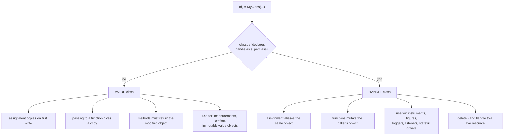
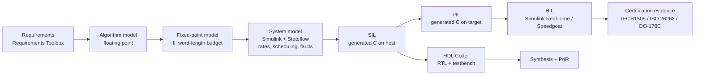
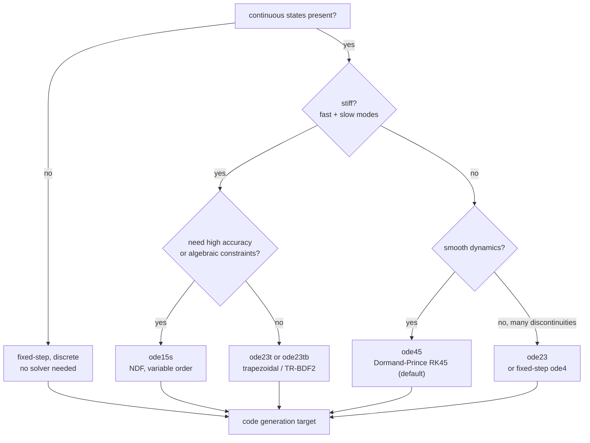
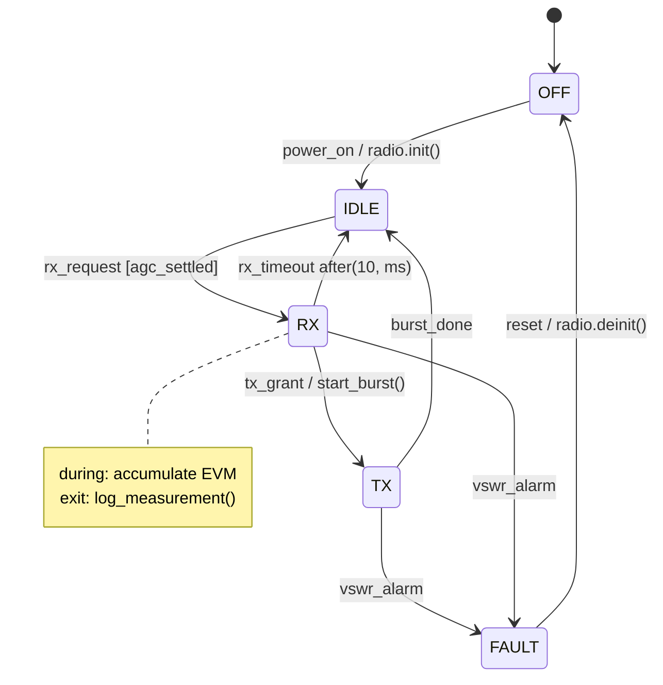

# MATLAB and Simulink — Programming, Modelling and Code Generation

MATLAB is the environment where a communications algorithm is *proved* before it is written in C or RTL: floating-point reference, then fixed-point, then generated code, then bit-true comparison against the reference. Simulink is the same idea applied to systems with time in them — feedback loops, sample rates, scheduling, state.

The thesis of this note: **MATLAB is an array language with a class system bolted on top of a JIT, and Simulink is a dataflow scheduler with a numerical integrator attached.** Every performance and modelling decision follows from those two sentences.

Companion notes: [[08-3 Python Programming - Language, Object Model and Engineering Practice]] (the other modelling environment), [[08-5 Verilog HDL - RTL Design, Verification and Synthesis Practice]] (the HDL target of HDL Coder), [[01-1 5G-Advanced and 6G Radio Access]] (the algorithms being modelled), [[04-3 Embedded Software Architecture - Patterns, Layering and Wireless System Structure]] (where generated code has to fit).

---

## 1. What MATLAB and Simulink are for, and where each stops

| Stage | Tool | Output | Fidelity |
| --- | --- | --- | --- |
| Algorithm exploration | MATLAB, floating point | Plots, BER/BLER curves | Ideal, no implementation loss |
| Fixed-point refinement | Fixed-Point Designer (`fi`) | Word-length budget, quantisation loss | Bit-true to the intended hardware |
| System / timing modelling | Simulink + Stateflow | Sample-rate and state behaviour | Cycle-approximate or rate-based |
| C/C++ implementation | Embedded Coder, MATLAB Coder | MISRA-checkable C | Bit-true to the model |
| RTL implementation | HDL Coder | VHDL / Verilog / SystemVerilog | Bit-true, latency-annotated |
| Verification | SIL / PIL / HIL, Polyspace, Simulink Test | Coverage, equivalence proof | Hardware in the loop |
| Deployment | Simulink Real-Time, FMU export | Executable on target | Real-time |

The boundary that matters: **MATLAB answers "what is the algorithm"; Simulink answers "what happens when it runs on a clock with feedback".** A link-level simulator that only needs a BER curve is MATLAB work. A scheduler with HARQ retransmission timers is Simulink + Stateflow work, because the state and the timing *are* the design.

---

## 2. Language core — everything is an array

```matlab
% Every scalar is a 1x1 double unless told otherwise.
x = 5;                 % 1x1 double
v = [1 2 3];           % 1x3 double (row)
c = [1; 2; 3];         % 3x1 double (column)
s = "text";            % string scalar (R2016b+); char arrays are the legacy type
m = zeros(3, 4);       % preallocated double matrix

% 1-based indexing, end keyword, logical indexing
v(end)                 % last element
v(v > 1)               % logical mask -> values, not indices
v([true false true])   % same thing written out

% Column-major storage: A(:) walks down columns first
A = reshape(1:6, 2, 3);   % [1 3 5; 2 4 6]
A(:)'                     % 1 2 3 4 5 6
```

Facts that decide correctness and speed:

- **MATLAB is column-major** (LAPACK heritage). A column-wise traversal is contiguous; a row-wise one strides. For a 10⁴×10⁴ matrix this is the difference between memory-bandwidth-bound and cache-miss-bound.
- **Indexing is 1-based**; there is no 0 index. Off-by-one translations at the C boundary are a classic source of silent array shifts.
- **Copy-on-write.** `b = a` does not copy; the copy happens on the first write to either name. This is why passing a 500 MB array into a function is cheap *until* the function modifies it — then peak memory doubles.
- **`double` is the default and the fast path.** `single` halves memory and doubles SIMD width but changes results; integer types are for storage, not arithmetic, unless you are modelling hardware.
- **Growing an array in a loop reallocates.** `x(end+1) = v` inside a loop over 10⁶ iterations is quadratic. Preallocate with `zeros`, `false`, or `cell`, or build once and assign by index.
- **`string` and `char` are different types.** `'abc'` is a 1×3 char array; `"abc"` is a 1×1 string. Concatenation rules differ, and `==` on char arrays does element-wise comparison rather than string equality.

### 2.1 Vectorisation and the memory model

```matlab
% Loop form — fine since the R2015b execution engine, but still per-element work
y = zeros(size(x));
for n = 1:numel(x)
    y(n) = 0.5*x(n) + 0.5*x(max(n-1,1));
end

% Vectorised form — one kernel, contiguous access
y = filter([0.5 0.5], 1, x);

% FIR with explicit taps, and implicit expansion instead of repmat/bsxfun
h = fir1(63, 0.2);
y = conv(x, h, 'same');
G = exp(1j*2*pi*fc*(0:M-1).') * ones(1,N);   % (M,1) .* (1,N) -> (M,N), R2016b+
```

Since the R2015b execution engine, **plain `for` loops are JIT-compiled and are no longer automatically slower than `arrayfun`**. The modern rule is: vectorise when a built-in function does the job (`filter`, `conv`, `fft`, `cumsum`, matrix multiply), and keep the loop when the body has branches or state. `arrayfun`/`cellfun` are convenience, not optimisation — they carry per-element function-call overhead.

---

## 3. Classes — `classdef` and the two object kinds

MATLAB has exactly two object semantics, and choosing between them is the decision that determines whether a function can modify its argument.



### 3.1 A value class with validation and a derived property

```matlab
classdef Measurement
    properties (SetAccess = immutable)
        SnrDb (1,1) double {mustBeFinite} = 0
        NumRe (1,1) double {mustBePositive, mustBeInteger} = 1
    end
    properties (Dependent)
        EvmPercent
    end
    methods
        function obj = Measurement(snrDb, numRe)
            arguments
                snrDb (1,1) double {mustBeFinite}
                numRe (1,1) double {mustBePositive, mustBeInteger} = 1
            end
            obj.SnrDb = snrDb;
            obj.NumRe  = numRe;
        end
        function v = get.EvmPercent(obj)
            % crude mapping, kept explicit so the assumption is visible
            v = 100 * 10^(-obj.SnrDb/20);
        end
    end
end
```

- The `arguments` block (R2019b+) is the modern replacement for hand-written `validateattributes` prologues, and it does three things at once: type/size/shape declaration, default values, and validator calls. `mustBePositive`, `mustBeMember`, `mustBeInteger`, `mustBeNonNan` are the workhorses.
- `properties (SetAccess = immutable)` makes the field writable only inside the constructor — the closest thing to a `const` member.
- A `Dependent` property has no storage; it is computed in `get.PropName`. It behaves like a Python `property`, including the cost.

### 3.2 A handle class with events — the pattern for hardware and logging

```matlab
classdef RadioLink < handle
    properties (SetAccess = private)
        State (1,1) string = "idle"
        TxCount (1,1) double = 0
    end
    events
        StateChanged
    end
    methods
        function transmit(obj, n)
            arguments
                obj
                n (1,1) double {mustBeNonnegative, mustBeInteger}
            end
            obj.State = "tx";
            notify(obj, 'StateChanged');       % synchronous, in registration order
            obj.TxCount = obj.TxCount + n;
            obj.State = "idle";
            notify(obj, 'StateChanged');
        end
    end
end

% Usage: the listener receives the caller's object, not a copy
link = RadioLink();
lh = addlistener(link, 'StateChanged', @(src,evt) fprintf("state=%s\n", src.State));
link.transmit(10);
delete(lh);                                    % explicit unregistration
```

Event/listener is the MATLAB equivalent of the observer pattern and the reason handle semantics exist: a listener registered on a value-class object would be attached to a copy that no longer exists in the caller's workspace.

### 3.3 The class features interviewers ask about

| Feature | Syntax | Purpose / caveat |
| --- | --- | --- |
| Package scoping | `+mypkg/Class.m`, `import mypkg.*` | Namespaces; required for large codebases |
| Static method | `methods (Static)` | Utility belonging to the class; no `obj` |
| Abstract | `methods (Abstract)` + `< matlab.mixin.Heterogeneous` | Interface contract; enables heterogeneous arrays |
| Sealed | `classdef (Sealed) X` | Forbid subclassing |
| Operator overload | methods named `plus`, `mtimes`, `eq`, `lt`, `disp`, `subsref` | `subsref`/`subsasgn` is powerful and dangerous; prefer `matlab.mixin.indexing.RedefinesParen` (R2021b+) for custom indexing |
| Enumeration | `classdef Color < uint8; enumeration ... end` | Typed constants with methods, better than string comparisons |
| Copy semantics helper | `< matlab.mixin.Copyable` | Gives a handle class a `copy()` method with defined shallow/deep behaviour |
| System object | `< matlab.System` | Streaming algorithm: `setupImpl`/`stepImpl`/`resetImpl`, supports code generation |
| Custom display | `disp`, `display`, `matlab.mixin.CustomDisplay` | Readable objects in the Command Window |

`matlab.System` deserves emphasis because it is the bridge between "object-oriented MATLAB" and "code that can be generated and run on hardware". A System object separates one-time setup from per-sample `step`, which is exactly the structure C and RTL implementations need:

```matlab
classdef FirFilter < matlab.System
    properties (Nontunable)
        Coefficients (1,:) double = [0.5 0.5]
    end
    properties (DiscreteState)
        Buffer
    end
    methods (Access = protected)
        function setupImpl(obj)
            obj.Buffer = zeros(1, numel(obj.Coefficients) - 1);
        end
        function y = stepImpl(obj, x)
            [y, obj.Buffer] = filter(obj.Coefficients, 1, x, obj.Buffer);
        end
        function resetImpl(obj)
            obj.Buffer(:) = 0;
        end
    end
end
```

### 3.4 When classes are the wrong answer

More often than in C++ or Python, because MATLAB's dispatch and copy semantics have real cost and the JIT optimises plain functions better. Use classes when you need (a) an invariant enforced at construction, (b) identity and mutation shared across call sites, (c) an event, (d) a code-generation-compatible System object. Use a struct, a `table`, or a function with an `arguments` block for everything else. A 10⁶-iteration loop creating objects will be slower than the same loop on numeric arrays, and no amount of `properties` discipline fixes that.

---

## 4. Performance and profiling

```matlab
profile on
run_experiment();          % the workload
profile off
profile viewer             % per-line time, call counts, M-Lint advice

t = timeit(@() heavy(x));  % warm-up + repeated timing, more reliable than tic/toc
```

| Symptom | Cause | Fix |
| --- | --- | --- |
| Quadratic runtime in a loop | Array growth `x(end+1)` | Preallocate; assign by index |
| Memory doubles on call | Copy-on-write triggered by modification | Modify in place, or pass back explicitly |
| Slow element access in a loop | `cellfun`/`arrayfun`/`struct` field access | Numeric arrays; struct-of-arrays instead of array-of-structs |
| Slow startup | Script instead of function; `clear all` in a loop | Functions are JIT-compiled; scripts less so |
| Slow FFT/linear algebra | `double` precision on data that is really `single` | Cast once at the boundary; `gpuArray` for large problems |
| Threads idle | `parfor` with loop-carried dependency | Restructure; `parfeval` for task parallelism |

Parallelism vocabulary: `parfor` (independent iterations, sliced variables only), `parpool`/`parfeval` (task-level, returns futures), `spmd` (explicit inter-worker communication), `distributed`/`tall` (out-of-core arrays), `gpuArray` (device arrays; `gather` brings them back — every `gather` inside a loop is a bug).

---

## 5. Interoperability — the boundaries you will actually cross

| Direction | Mechanism | Notes |
| --- | --- | --- |
| MATLAB → Python | `py.module.func`, `py.numpy.array`, `pyenv` | R2026a supports Python 3.9–3.13 and manages environments from the desktop; NumPy/Pandas conversions are automatic |
| Python → MATLAB | MATLAB Engine API, `matlab.engine.start_matlab()` | Out-of-process by default; good for orchestration, poor for per-sample calls |
| MATLAB → C/C++ | MEX (`mexFunction`, `mxArray`), `loadlibrary`/`calllib`, `coder.ceval` | MEX is the standard way to reuse an existing C kernel verbatim |
| MATLAB → generated C | MATLAB Coder `codegen` | Function subset; dynamic memory off by default; `coder.typeof` declares shapes |
| Simulink → C | Embedded Coder | ERT target, AUTOSAR, calibration (ASAP2/A2L), MISRA checks |
| Simulink → RTL | HDL Coder | VHDL/Verilog/SystemVerilog, latency balancing, native floating point |
| Model → other tools | FMU export (Simulink FMU Builder, R2026a), FMI co-simulation | The neutral exchange format for system-level simulation |

The rule for every one of these boundaries: **cross it in batches, not per sample.** The call overhead is microseconds to milliseconds; a per-sample crossing destroys the reason you used the fast language at all.

---

## 6. Simulink — time as a first-class dimension

A Simulink model is a directed graph of blocks with declared sample times; the engine topologically sorts it, detects algebraic loops, and integrates continuous states with a chosen solver.



### 6.1 Sample time, the thing that breaks models

- Every signal has a sample time: `Inf` (continuous), a finite period, or inherited. **Sample Time Colors** (Display → Sample Time → Colors) is the first diagnostic to run on any model that "behaves differently than the maths".
- Mixing rates introduces **rate transition** blocks; without them you get either an error or a silently non-deterministic read of a signal sampled at the wrong instant.
- A **fixed-step** model is what you can generate code from for a real-time target; a **variable-step** model is what you use for accurate continuous dynamics. Confusing the two is the most common reason generated code does not match simulation.

### 6.2 Solvers — choose by stiffness, not by habit



| Solver | Type | Order | When |
| --- | --- | --- | --- |
| `ode45` | variable, explicit | 4(5) | Default for smooth non-stiff systems |
| `ode23` | variable, explicit | 2(3) | Loose tolerance, mild discontinuities |
| `ode113` | variable, explicit | 1–13 | Tight tolerance on smooth problems |
| `ode15s` | variable, implicit | 1–5 | **Stiff** systems, DAEs |
| `ode23t` | variable, implicit | 2 | Moderately stiff, no numerical damping |
| `ode23tb` | variable, implicit | 2 | Stiff with crude tolerances |
| `ode1`/`ode4`/`ode5` | fixed | 1 / 4 / 5 | Real-time and code generation (Euler / RK4 / Dormand-Prince) |
| `ode14x` | fixed, implicit | extrapolation | Stiff fixed-step |

### 6.3 Structural patterns that keep models maintainable

- **Model reference** — a referenced model compiles once and is reused; this is the only way large model hierarchies stay fast. R2026b added *published* referenced models (SLXP) that initialize without a rebuild.
- **Libraries** — shared blocks with locked interfaces for reuse inside one model.
- **Variants** — `Variant Subsystem` for compile-time or startup-time selection; R2026b added **Simulink Variant Manager** for product-family configuration management.
- **Data dictionary** — the single source of truth for signals, parameters, buses. R2026b can store them as plain **JSON** so Git diffs are readable; MATLAB projects moved to a single **`matlab.toml`** file in the same release.
- **Bus objects** — typed interfaces between subsystems; without them, every connection is an untyped line and refactoring is unsafe.
- **`Simulink.SimulationInput` + `parsim`** — the supported way to sweep parameters in parallel; do not loop `sim()` when you need throughput.

### 6.4 Algebraic loops

A loop with direct feedthrough (output depends on input in the same instant) has no causal solution. Three legitimate fixes, in order of preference: break it with a **unit delay** if a one-sample delay is physically real; restructure the equations to remove the direct feedthrough; or let the solver iterate (`--` algebraic loop solving), which costs performance and can fail to converge. "It simulates" is not the same as "it is well-posed".

---

## 7. Stateflow — state machines that are actually checkable

Stateflow is a synchronous state machine notation executed by the Simulink engine. It is the right tool when behaviour is dominated by *modes and transitions* rather than arithmetic — radio state control, HARQ process management, link adaptation, fault handling.



Constructs that matter: **hierarchical states** (a parent state's transitions apply to all children), **entry/during/exit actions**, **temporal logic** (`after(10, ms)`, `before`, `every`), **history junctions** (`H`/`H*`), **parallel (AND) decomposition**, **truth tables** for decision logic, and **`en`/`ex`/`du`** for state activity in actions. The generated code from Stateflow is a switch-based state machine that is genuinely readable in C — which is why it is accepted in safety-critical workflows where hand-written state machines are not.

---

## 8. Fixed point — where the model meets the hardware

Floating point is an abstraction the hardware may not afford. Fixed-Point Designer makes the word-length decision explicit and measurable.

```matlab
% Q15: signed, 16-bit, 15 fractional bits, range [-1, 1)
T = numerictype(1, 16, 15);
F = fimath('RoundingMethod', 'Nearest', ...
           'OverflowAction',  'Saturate', ...
           'ProductMode',     'FullPrecision', ...
           'SumMode',         'KeepMSB');

xq = fi(x, T, F);
yq = fi(zeros(size(x)), T, F);
for n = 1:numel(x)
    yq(n) = xq(n) * 0.5;          % quantisation and saturation applied here
end

% What you actually report: the implementation loss
lossDb = 10*log10(mean(abs(double(x) - double(xq)).^2) / mean(abs(x).^2));
```

| Decision | Options | Consequence |
| --- | --- | --- |
| Rounding | Floor, Convergent, Nearest, Round, Zero | Bias vs noise floor; convergent avoids DC bias in long accumulations |
| Overflow | Saturate, Wrap | Saturate costs comparators but preserves sign; wrap is a silent sign inversion — the classic DSP bug |
| Product mode | Full precision, Keep LSB/MSB | Adder width and DSP-slice mapping |
| Sum mode | Full precision, Keep MSB, Specify | Accumulator growth in a filter |
| Word length | 8 / 12 / 16 / 18 / 24 | Droop in the passband, EVM floor, resource use |

The habit worth having: sweep the word length, plot EVM or BLER against bits, and pick the knee. Reporting "16 bits is enough" without the curve is an assertion, not an engineering result.

---

## 9. Code generation and verification

| Path | Product | Key constraints |
| --- | --- | --- |
| MATLAB → C/C++ | MATLAB Coder (`codegen`) | Supported subset; no dynamic typing; predeclare sizes with `coder.typeof`; dynamic memory off by default |
| Simulink → C/C++ | Embedded Coder | Fixed-step discrete model; ERT target; calibration and measurement via ASAP2/A2L; AUTOSAR composition |
| Simulink → RTL | HDL Coder | Synthesizable subset; latency balancing; pipelining; native floating-point or fixed-point |
| Model → FMU | Simulink FMU Builder (R2026a) | Standalone co-simulation unit for other tools |
| Code → proof | Polyspace Bug Finder / Code Prover | MISRA C:2023 rule checking, runtime-error proof, tainted-data analysis |

Verification levels, in increasing confidence: **MIL** (model in the loop, the model against itself — nearly worthless alone), **SIL** (generated code on the host, compared bit-for-bit against the model), **PIL** (generated code on the target processor, exercising the real compiler and word sizes), **HIL** (target code against a real-time plant model). The only one that finds compiler and target-dependent bugs is PIL; the only one that finds I/O and timing bugs is HIL.

---

## 10. Communications-specific workflows

- **5G Toolbox** provides NR waveform generation, channel models (TDL/CDL), and reference measurement channels — the starting point for a link-level simulation rather than a from-scratch PHY.
- **Link-level loop**: generate → channel → receiver → measure (BER, BLER, EVM, throughput). Keep the loop in a function with an `arguments` block and a seed, so a curve is reproducible.
- **HDL-optimised algorithms** are written differently from floating-point references: streaming, fixed latency, no data-dependent loops, no division where a reciprocal multiply will do.
- **Wireless Network Toolbox** (new in R2026a) models network-level behaviour above the link — useful when the question is scheduling and interference rather than modulation.

---

## 11. Interview anchors

1. **"Why is MATLAB slow here?"** — Array growth, copy-on-write triggered by modification, per-element function calls (`arrayfun`), or `double` where `single` would do. Diagnose with `profile`, not intuition.
2. **"Value class or handle class?"** — Value unless you need shared mutation, a live resource, an event, or listener identity. Getting this wrong makes functions silently operate on copies.
3. **"How does `classdef` differ from a C++ class?"** — Single inheritance only (plus mixins for multiple *behaviour*), no templates, no destructors except `delete` on handle classes, and property access is dynamic unless the JIT can specialise it.
4. **"What does `arguments` give you?"** — Type, size, class, validator, and default in one declaration, enforced at call time; plus name-value argument support and better error messages.
5. **"Fixed-step or variable-step?"** — Variable-step for accurate continuous dynamics offline; fixed-step for real-time and code generation. Mixing them is why generated code and simulation diverge.
6. **"How do you pick a solver?"** — Stiffness first (`ode15s` family), then smoothness (`ode45`), then the real-time constraint (fixed-step `ode4`). State the trade: accuracy vs step count vs stability.
7. **"What is an algebraic loop and how do you break it?"** — Direct feedthrough with no causal order; break with a unit delay if physically real, restructure the equations, or let the solver iterate. Say which one and why.
8. **"How do you know the generated code is correct?"** — SIL then PIL bit-exact comparison against the model, plus MISRA/Polyspace static analysis, plus requirements-linked tests. Model-in-the-loop alone proves nothing.
9. **"How do you choose a word length?"** — Sweep it, measure EVM/BLER against bits, and choose the knee with margin for temperature and process; state rounding and overflow policy explicitly.
10. **"Where does MATLAB stop in your workflow?"** — At the point where the artefact must be maintained by someone else, run on a target, or meet a cycle budget. Then it is C or RTL, and the model becomes the reference, not the product.

---

## Anchors — verified facts

- **MATLAB R2026b released 24 September 2026** (MathWorks newsroom, 24 Sep 2026). New products: **Simulink Variant Manager**, **Visual Inspection Toolbox**, **Polyspace Test Server**, **Point Cloud Toolbox**. Platform changes: **`matlab.toml`** single-file project format, **JSON** Simulink data dictionaries, **custom Simulink solvers**, published referenced models (SLXP) that skip rebuilds, App Designer apps saved as plain text, MATLAB no longer bundles Java (install a compatible OpenJDK, including OpenJDK 25).
- **MATLAB R2026a released April 2026** (MathWorks blog, 21 Apr 2026). New: **Simulink Copilot**, **MATLAB Course Designer**, **Raspberry Pi Blockset**, **Simulink FMU Builder**, **STM32 Microcontroller Blockset**, **Wireless Network Toolbox**, Polyspace as You Code. Base MATLAB gained **automatic differentiation for ODE Jacobians** (`ode` object `JacobianMethod="autodiff"`) and the **`metafunction`** introspection object. **Python support in R2026a: 3.9 through 3.13**, with an External Languages panel to create and manage environments.
- **`arguments` block** introduced in **R2019b**; property validation syntax (`prop (1,1) double {mustBePositive}`) in **R2019b**.
- **New MATLAB execution engine** (JIT, loops no longer penalised) shipped in **R2015b**.
- **Implicit expansion** (removing the need for `bsxfun`) and **`string` arrays** both in **R2016b**; `timetable` also R2016b.
- **`dictionary`** (typed key-value map, replacing many `containers.Map` uses) introduced in **R2022b**.
- **`matlab.mixin.indexing.RedefinesParen`** (custom `()` indexing) introduced in **R2021b**.
- Default Simulink solver is **`ode45`** (Dormand–Prince); `ode15s` is the NDF stiff solver; fixed-step code generation typically uses **`ode4`** (RK4) or `ode1` (Euler).
- **MATLAB is column-major** (`A(:)` traverses columns), inherited from LINPACK/LAPACK, and array indexing is **1-based**.
- **`copy-on-write`**: assignment is lazy; the copy is materialised at the first modification of either variable.
- **Python interoperability is out-of-process by default** (a separate `python` process, not an embedded interpreter); the MATLAB Engine API for Python is the reverse direction.
- **HDL Coder** generates VHDL, Verilog, or SystemVerilog from a synthesizable MATLAB/Simulink subset.
- **MISRA C:2023** is the current MISRA C revision (superseding MISRA C:2012); Polyspace and Embedded Coder check against it.
- `VERIFY`: exact MATLAB release date within the month (R2026a in April, R2026b in September) — MathWorks announces by press release, not on a fixed calendar day, so cite the release name rather than a date when precision matters.

## Related

- [[08-3 Python Programming - Language, Object Model and Engineering Practice]] — the same algorithms in a different modelling environment; `py.` interop both ways
- [[08-5 Verilog HDL - RTL Design, Verification and Synthesis Practice]] — the RTL target of HDL Coder, and why HDL-optimised algorithms look different
- [[08-1 Programming Languages Toolchain and Performance Engineering]] — profiling method shared across languages
- [[04-3 Embedded Software Architecture - Patterns, Layering and Wireless System Structure]] — where generated code lands in an embedded architecture
- [[01-1 5G-Advanced and 6G Radio Access]] — the link-level algorithms these tools model
- [[02-1 WLAN - Wi-Fi Generations Evolution]] — PHY feature set that the simulations must reproduce
- [[07-1 RISC-V for Communication Infrastructure]] — the hardware alternative to a fixed-point DSP/FPGA implementation

## References

**Language and object model**

1. MathWorks. *MATLAB Documentation — Language Fundamentals*. <https://www.mathworks.com/help/matlab/language-fundamentals.html>
2. MathWorks. *Object-Oriented Programming in MATLAB*. <https://www.mathworks.com/help/matlab/matlab_oop/object-oriented-programming.html>
3. MathWorks. *Comparison of Handle and Value Classes*. <https://www.mathworks.com/help/matlab/matlab_oop/comparing-handle-and-value-classes.html>
4. MathWorks. *Function Argument Validation (`arguments` block)*. <https://www.mathworks.com/help/matlab/matlab_prog/function-argument-validation-1.html>
5. MathWorks. *Performance and Memory*. <https://www.mathworks.com/help/matlab/performance-and-memory.html>
6. MathWorks. *Vectorization*. <https://www.mathworks.com/help/matlab/matlab_prog/vectorization.html>

**Simulink and Stateflow**

7. MathWorks. *Simulink User's Guide*. <https://www.mathworks.com/help/simulink/>
8. MathWorks. *Choose a Solver*. <https://www.mathworks.com/help/simulink/ug/choose-a-solver.html>
9. MathWorks. *Stateflow User's Guide*. <https://www.mathworks.com/help/stateflow/>
10. MathWorks. *Model Referencing*. <https://www.mathworks.com/help/simulink/ug/model-reference.html>
11. MathWorks. *Simulink Data Dictionary*. <https://www.mathworks.com/help/simulink/ug/what-is-a-data-dictionary.html>

**Code generation and verification**

12. MathWorks. *Embedded Coder User's Guide*. <https://www.mathworks.com/help/ecoder/>
13. MathWorks. *HDL Coder User's Guide*. <https://www.mathworks.com/help/hdlcoder/>
14. MathWorks. *Fixed-Point Designer User's Guide*. <https://www.mathworks.com/help/fixedpoint/>
15. MathWorks. *MATLAB Coder User's Guide*. <https://www.mathworks.com/help/coder/>
16. MathWorks. *Polyspace Bug Finder / Code Prover Documentation*. <https://www.mathworks.com/help/polyspace/>

**Release notes**

17. MathWorks. *MATLAB and Simulink Release Notes*. <https://www.mathworks.com/help/relnotes/>
18. MathWorks. "MathWorks Introduces Release 2026b of MATLAB and Simulink." Press release, 24 September 2026. <https://www.mathworks.com/company/newsroom/mathworks-introduces-release-2026b-of-matlab-and-simulink.html>
19. MathWorks. "MATLAB R2026a has been released — What's new?" *MATLAB Blog*, 21 April 2026. <https://blogs.mathworks.com/matlab/2026/04/21/matlab-r2026a-has-been-released-whats-new/>

**Books**

20. Higham, D. J., and Higham, N. J. *MATLAB Guide*, 3rd ed. SIAM, 2017. ISBN 978-1-611974-18-6.
21. Moler, C. B. *Numerical Computing with MATLAB*. SIAM, 2004. ISBN 978-0-89871-660-3.
22. Attaway, S. *MATLAB: A Practical Introduction to Programming and Problem Solving*, 5th ed. Butterworth-Heinemann, 2019. ISBN 978-0-12-815479-3.
23. Colgren, R. D. *Basic MATLAB, Simulink, and Stateflow*. AIAA Education Series, 2007. ISBN 978-1-56347-838-1.

---

Copyright (c) 2026 Washington Ruan. All rights reserved.
