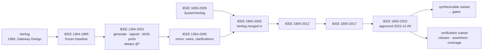
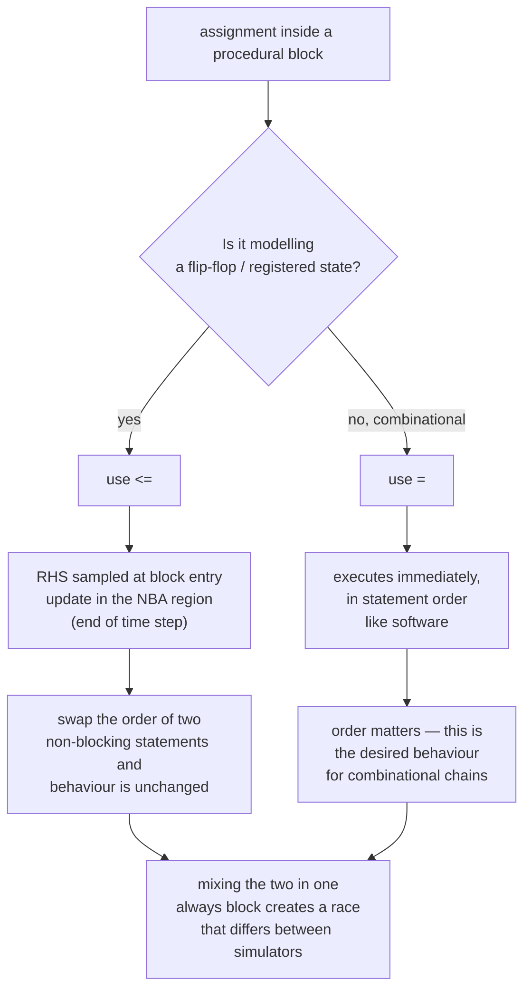
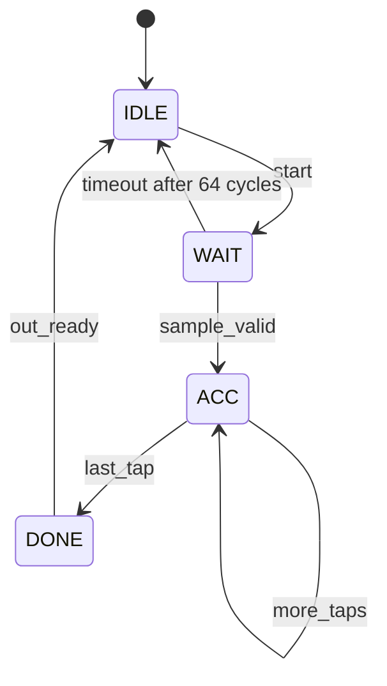
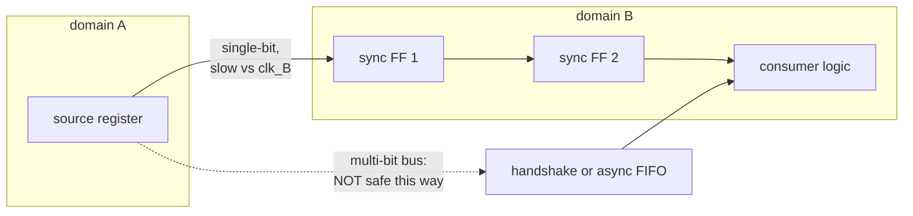
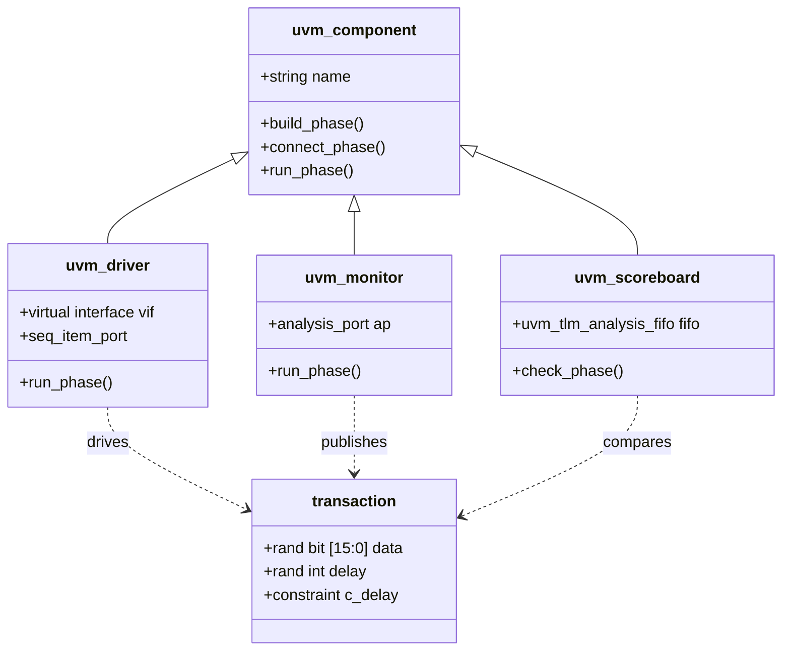
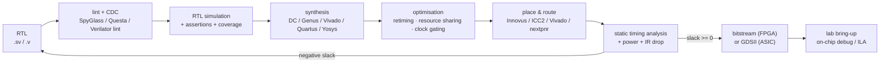

# Verilog HDL — RTL Design, Verification and Synthesis Practice

Verilog is the language in which the baseband finally becomes gates. Everything upstream — the MATLAB floating-point reference, the fixed-point model, the C bit-true model — exists to constrain what this code is allowed to do; everything downstream — synthesis, place-and-route, timing closure — exists to punish what this code got wrong.

The thesis: **Verilog is not a programming language with parallel extensions; it is a hardware description whose simulation semantics are defined by an event-driven scheduler and whose synthesis semantics are defined by a small synthesizable subset.** Almost every RTL bug is a disagreement between those two readings of the same file.

Companion notes: [[08-1 Programming Languages Toolchain and Performance Engineering]] (toolchain and performance method), [[08-4 MATLAB and Simulink - Programming, Modelling and Code Generation]] (HDL Coder as one producer of this code), [[07-1 RISC-V for Communication Infrastructure]] (the ISA that the cores are built from), [[01-1 5G-Advanced and 6G Radio Access]] (the PHY functions being implemented), [[02-1 WLAN - Wi-Fi Generations Evolution]] (the WLAN PHY variants).

---

## 1. Standard lineage — one language, two lives



Two facts that resolve most confusion:

- **There has been no standalone Verilog standard since 2005.** IEEE 1364-2005 was merged into IEEE 1800-2009; "Verilog" is now the synthesizable core of SystemVerilog. When someone says "we write Verilog", they mean the 1364-2001/2005 style or that subset of 1800.
- **The language has two disjoint halves.** The design half is structural and synthesizable; the verification half (classes, `rand`, `covergroup`, `mailbox`, `virtual interface`) is **not synthesizable and never will be**. Mixing them in one file is legal and, in a design file, a lint error waiting to happen.

---

## 2. Language core

```verilog
module fir_axis #(
    parameter int unsigned TAPS   = 16,
    parameter int unsigned DWIDTH = 16
) (
    input  logic                 clk,
    input  logic                 rst_n,
    input  logic signed [DWIDTH-1:0] x,
    input  logic                 x_valid,
    output logic signed [DWIDTH+3:0] y,
    output logic                 y_valid
);

    // nets vs variables: `logic` is a variable that may be driven by one
    // continuous assignment or one procedural block — never both
    logic signed [DWIDTH-1:0] delay_line [0:TAPS-1];
    logic signed [DWIDTH+3:0] acc;

    always_ff @(posedge clk or negedge rst_n) begin
        if (!rst_n) begin
            for (int i = 0; i < TAPS; i++) delay_line[i] <= '0;
            acc     <= '0;
            y_valid <= 1'b0;
        end else begin
            for (int i = TAPS-1; i > 0; i--) delay_line[i] <= delay_line[i-1];
            delay_line[0] <= x;
            y_valid       <= x_valid;
            acc           <= acc + (x * 3);
        end
    end

    assign y = acc;
endmodule
```

### 2.1 Nets, variables, and the four-state universe

| Concept | Verilog-2005 | SystemVerilog | Rule |
| --- | --- | --- | --- |
| Wire (structural connection) | `wire` | `wire` | Multiple drivers resolved by strength; cannot hold state |
| Variable (procedural) | `reg` | `logic` | One driver only; `reg`/`logic` are interchangeable names |
| Named constant | `parameter` | `parameter` / `localparam` | `parameter` overridable at instantiation, `localparam` not |
| Value set | `0 1 X Z` | same | `X` = unknown, `Z` = high-impedance; both are *simulation* values |

The four-state value set is not academic: `X` is how the simulator says "two drivers disagree" or "this register was never reset". A design that only works because `X` happened to be treated as `0` in a comparison (`if (a == 1'b1)` fails on `X`, `if (a)` treats `X` as false) is a design that will behave differently in silicon.

### 2.2 Blocking versus non-blocking — the one rule that matters



The mechanism, stated precisely: at a clock edge the simulator evaluates the right-hand sides of all `<=` assignments using the values that existed **before** the edge, then schedules the updates for the **non-blocking assign** region, after all blocking assignments in the active region have settled. This models the physical fact that all flip-flops sample simultaneously.

Classic failures, all of them real:

```verilog
// WRONG: two registers "swap" but end up both equal to a
always @(posedge clk) begin
    a = b;      // blocking: a becomes b immediately
    b = a;      // b becomes the NEW a -> b = b
end

// RIGHT: the swap works because both RHS are sampled first
always @(posedge clk) begin
    a <= b;
    b <= a;
end
```

```verilog
// WRONG: a combinational block that infers a latch
always @* begin
    if (sel) y = a;          // no else -> y must remember its value -> latch
end

// RIGHT: default assignment removes the latch
always_comb begin
    y = 8'h00;
    if (sel) y = a;
end
```

`always_comb` (SystemVerilog) is strictly better than `always @*`: it fires once at time zero, it errors if the block infers a latch, and it forbids a second driver. `always_ff` similarly enforces one clock and no blocking assignments inside it.

### 2.3 Parameters, generate, and elaboration

```verilog
generate
    for (genvar i = 0; i < LANES; i++) begin : g_lane
        dsp_lane #(.WIDTH(DWIDTH)) u_lane (
            .clk (clk),
            .din (din[i]),
            .dout(dout[i])
        );
    end
endgenerate
```

Elaboration happens **before** simulation, so `generate` is compile-time replication, not a runtime loop. Named generate blocks (`begin : g_lane`) are mandatory in practice because they produce the hierarchical path names that waveforms, synthesis reports and assertions refer to. `defparam` is deprecated; use ordered or named parameter overrides at instantiation.

`function` returns a value with no time consumption (zero delay) and is synthesizable within limits; `task` may consume time and is generally for testbenches. Neither can contain `@` or `#` in a synthesizable function.

---

## 3. Sequential design discipline

### 3.1 Finite state machines — the three-block pattern



Three blocks, three responsibilities, no exceptions:

1. **State register** — `always_ff`, `state <= next_state`, reset to the initial state.
2. **Next-state logic** — `always_comb`, pure function of `state` and inputs, default `next_state = state` first.
3. **Output logic** — `always_comb` (Moore) or a registered output stage. Registering outputs removes combinational glitches from the interface, at the cost of one cycle.

Encoding choice is a real trade: **binary** minimises flip-flops, **one-hot** minimises next-state logic depth (good for FPGA, where FFs are cheap and LUT levels are the critical path), **gray** for sequences where only one bit may change. Let synthesis choose with `(* fsm_encoding = "one_hot" *)` when you do not have a reason.

### 3.2 Reset strategy

| Strategy | Behaviour | Use when |
| --- | --- | --- |
| Asynchronous assert, synchronous de-assert | Reset works without a clock; removal is glitch-free | Default for most ASIC designs |
| Fully synchronous | Simpler timing, no recovery/removal checks | FPGA-friendly, high-speed datapaths |
| No reset on datapath registers | Saves routing; `X` until written | Valid only if every consumer is guaranteed to write first — and `X` propagation will find you |

The rule that avoids the classic bug: **asynchronous assertion must be synchronised on release** (`reset_sync` module: two FFs, `async clear`, `sync release`), otherwise different flip-flops leave reset on different cycles and the machine starts from an undefined state.

### 3.3 Pipelining, retiming, and resource sharing

- **Pipelining** cuts the combinational path between registers; it increases throughput (one result per cycle) and *latency* (result arrives later). Every pipeline stage is a contract change, so the latency must be documented and matched in the C model.
- **Retiming** moves registers across combinational logic without changing function; synthesis can do it, but only with correct timing constraints and only within a module boundary.
- **Resource sharing** (one multiplier time-multiplexed across operations) saves area and costs cycles; it is the standard lever when a design is DSP-slice-bound.
- **Folding** is the systematic version of resource sharing: express the algorithm with a folding factor N and trade N cycles for 1/N of the hardware.

---

## 4. Timing — the arithmetic of a closed design

For a single register-to-register path:

```text
setup : T_clk >= T_cq + T_comb_max + T_setup + T_skew
hold  : T_cq + T_comb_min >= T_hold + T_skew
```

- **Slack** is the difference between the requirement and the arrival time; negative slack on setup means the clock is too fast for that path, and the fix is pipelining, retiming, or a faster cell — not "trying a different synthesis effort" until the report changes.
- **Hold violations are not fixed by slowing the clock.** They are fixed by adding delay or removing the minimum-delay path, because hold is a same-edge race. This asymmetry is a favourite interview question.
- **Clock skew** can help setup on one path and hurt hold on another; useful skew is a deliberate technique, accidental skew is a bug.
- **False paths and multicycle paths** must be declared in SDC (`set_false_path`, `set_multicycle_path`), otherwise the tool optimises logic that never toggles and reports timing that does not exist. Declaring them wrongly is worse than not declaring them.

---

## 5. Clock domain crossing

Any signal that crosses from one clock domain to another and is not handled is a metastability bug that passes every simulation.



| Crossing | Mechanism | Constraint |
| --- | --- | --- |
| Single bit, level | Two-FF synchroniser | Source must be stable for > 1 destination clock period; MTBF improves exponentially with added stages |
| Single bit, pulse | Pulse to level + synchroniser + edge detect | Do not synchronise a pulse shorter than the destination clock |
| Multi-bit counter | Gray code + synchroniser | Only one bit may change per increment |
| Multi-bit data | Handshake (req/ack) or async FIFO | Data must be held stable while `req` crosses |
| Reset | Async assert / sync release | Otherwise the release itself is a CDC event |
| Clock mux | Glitch-free clock switch | Never mux a clock combinationally |

The **asynchronous FIFO** (Cummings, SNUG 2002) is the canonical answer: dual-port memory, Gray-coded read/write pointers each synchronised into the opposite domain, and full/empty computed from the *synchronised* pointer — which is why the flags are conservative by a couple of cycles and why the depth must absorb that latency plus the burst.

---

## 6. Verification — the half of the language that is not hardware

### 6.1 A self-checking testbench in plain Verilog

```verilog
module tb_fir;
    logic clk = 0, rst_n = 0;
    logic signed [15:0] x; logic x_valid;
    logic signed [19:0] y; logic y_valid;

    fir_axis dut (.clk(clk), .rst_n(rst_n), .x(x), .x_valid(x_valid),
                  .y(y), .y_valid(y_valid));

    always #5 clk = ~clk;                       // 100 MHz

    integer errors = 0;
    task automatic drive(input signed [15:0] v);
        @(posedge clk); x <= v; x_valid <= 1'b1;
    endtask

    initial begin
        $dumpfile("tb_fir.vcd"); $dumpvars(0, tb_fir);
        repeat (3) @(posedge clk);
        rst_n <= 1'b1;
        for (int i = 0; i < 1000; i++) begin
            drive($random);
            @(posedge clk);
            if (y_valid && y !== $expected(i)) begin
                errors++;
                $display("MISMATCH at %0t: got %0d", $time, y);
            end
        end
        $display("done, errors=%0d", errors);
        $finish;
    end
endmodule
```

The `$expected` function must come from the **same reference model** that the RTL implements — a golden vector file from MATLAB/C, or a cycle-accurate behavioural model. A testbench that computes the expected value with the same algorithm it is testing proves nothing.

What plain Verilog cannot do well is *constrained random verification* and *functional coverage*, which is why the industry moved:

### 6.2 SystemVerilog classes — the object layer of verification

Classes exist in SystemVerilog **for testbenches only**. They are the mechanism behind UVM, and understanding the class layer is what separates "can write a testbench" from "can build a verification environment".



The four constructs that carry the whole methodology:

```systemverilog
class transaction extends uvm_sequence_item;
    rand bit [15:0] data;
    rand int unsigned delay;
    constraint c_delay { delay inside {[0:8]}; }
    `uvm_object_utils_begin(transaction)
        `uvm_field_int(data, UVM_ALL_ON)
        `uvm_field_int(delay, UVM_ALL_ON)
    `uvm_object_utils_end
    function new(string name = "transaction");
        super.new(name);
    endfunction
endclass
```

| Construct | Purpose | Why it exists |
| --- | --- | --- |
| `class` / `extends` / `virtual` | OOP with single inheritance and virtual dispatch | Reusable agents, protocol layering |
| `rand` / `randc` + `constraint` | Constrained random stimulus with a solver | Cover the legal input space, not the three cases you thought of |
| `virtual interface` | A class handle to a static signal bundle | Classes cannot hold static nets; the virtual interface is the bridge |
| `mailbox` / `uvm_tlm_*` | Inter-thread communication | Producer/consumer between generator, driver, monitor |
| `covergroup` / `coverpoint` / `cross` | Functional coverage | Proves the stimulus reached the states you claim to have tested |
| `assert property` (SVA) | Temporal assertions checked every cycle | Protocol rules expressed declaratively, checked in simulation and formal |
| `fork`/`join_none` | Concurrent threads | Parallel stimulus streams |

An SVA example that encodes a real AXI4-Stream rule — `tvalid` must not drop until `tready`:

```systemverilog
property p_valid_stable;
    @(posedge clk) disable iff (!rst_n)
        (tvalid && !tready) |=> (tvalid && $stable(tdata));
endproperty
assert property (p_valid_stable) else $error("AXI-Stream valid dropped early");
```

`UVM` (IEEE 1800.2-2020) is a library on top of these constructs: phases, factory overrides, configuration database, sequencer/driver handshake, and a reporting mechanism. You are not expected to have written a UVM environment from scratch, but you are expected to know why the factory override exists (swap a component without editing the test) and why phases exist (deterministic build/connect/run ordering).

### 6.3 What "verified" means

| Evidence | What it proves | What it does not |
| --- | --- | --- |
| Directed tests pass | The cases you thought of work | Nothing about the cases you did not |
| Constrained random + coverage | The legal input space was sampled to a target | Nothing about unreachable states |
| Assertions (SVA) | Protocol invariants hold on every cycle simulated | Nothing outside the simulation trace |
| Formal property checking | The property holds for **all** inputs, bounded or unbounded | Only the properties you wrote |
| Lint / CDC / RDC | No inferred latches, no unsynchronised crossings | Nothing functional |
| Equivalence check (LEC) | Synthesis did not change function | Nothing about the source spec |
| Gate-level sim with SDF | Timing-aware behaviour on critical paths | Full coverage of all paths |

The honest answer to "is it verified" is a coverage number plus a list of what is *not* covered.

---

## 7. Synthesis and implementation



| Aspect | FPGA | ASIC |
| --- | --- | --- |
| Building blocks | LUTs, FFs, DSP slices, BRAM/URAM | Standard cells, memories from a compiler |
| Cost model | Fixed device, so area is "free" until it is not | Area = money; every gate is a mask |
| Timing closure | Iterative, fast (minutes to hours) | Long, sign-off critical (days) |
| Clocking | Global clock networks, MMCM/PLL | CTS, skew optimisation, useful skew |
| Reset | Often synchronous, active-low | Async assert / sync release typical |
| Prototyping | The product | Emulation, then silicon |
| Open flow | Yosys + nextpnr | Yosys + OpenROAD/OpenLane + SkyWater SKY130 |

Two practical notes: **synthesis is not a compiler** — it infers hardware from a coding pattern, so `for` loops unroll, arrays of registers become flip-flops unless they are memories, and division by a non-constant becomes a multi-cycle divider you did not ask for. And **the lint/CDC pass is cheaper than the bug**: an unsynchronised crossing costs a re-spin, an inferred latch costs a debug week, and both are static-checkable.

---

## 8. DSP patterns for communications RTL

| Function | Structure | Implementation note |
| --- | --- | --- |
| FIR filter | Direct form (N multipliers) vs **transposed form** (N multipliers, shorter critical path) | Transposed form is usually the better timing/area point |
| Half-band / CIC | Exploit zero coefficients; CIC needs only adders | The standard decimation/interpolation pair |
| NCO / DDS | Phase accumulator + sine lookup or CORDIC | SFDR is set by the accumulator and LUT width, not by the clock |
| CORDIC | Iterative rotations, one adder/subtractor per stage | Vectoring (magnitude/phase) and rotation (sin/cos) share hardware |
| Mixer | Complex multiply: 4 multipliers, or 3 with the Gauss trick | 3-multiplier form trades adders for DSP slices |
| AXI4-Stream interface | `tvalid`/`tready`/`tlast`/`tdata` handshake | Back-pressure must be handled at every stage, not just the last |
| Fixed point | Q-format, explicit growth, saturation | `signed` arithmetic in Verilog is a trap: mixing signed and unsigned silently widens |

Two Verilog-specific fixed-point traps worth memorising: a **part-select of a signed vector is unsigned** unless you use `$signed()`, and **`>>>` on an unsigned value is a logical shift**, so an arithmetic shift requires an explicitly signed operand. Both produce code that simulates differently from the C model and synthesises into the wrong hardware.

---

## 9. Interview anchors

1. **"Blocking vs non-blocking?"** — `=` executes in statement order within the active region; `<=` samples the RHS at block entry and updates in the NBA region, modelling simultaneous flops. Use `<=` for sequential, `=` for combinational, never mix in one block.
2. **"What infers a latch?"** — An incomplete assignment in a combinational block: an `if` without `else`, a `case` without `default`. Fix with a default assignment at the top, not with a `default` that hides the real case.
3. **"`wire` vs `reg`?"** — `wire` is a net driven continuously (or by a port); `reg`/`logic` is a variable assigned procedurally. In SystemVerilog `logic` covers both roles but still permits only one driver.
4. **"Why is `always_comb` better than `always @*`?"** — Fires at time zero, errors on inferred latch, forbids multiple drivers, and infers the sensitivity list correctly including function contents.
5. **"Clock domain crossing, one bit?"** — Two flip-flops in the destination domain, source stable for longer than a destination period, and `set_false_path`/`set_max_delay` on the crossing so STA does not try to time an asynchronous path.
6. **"Multi-bit CDC?"** — Never a plain synchroniser. Gray code if the value is a counter; handshake or async FIFO if it is data, so the destination samples a stable word.
7. **"Setup vs hold, and why is hold worse?"** — Setup is a single-cycle requirement fixable by slowing down or pipelining; hold is a same-edge race that a slower clock does not fix, so it is fixed in the physical design.
8. **"Can you write a class in Verilog?"** — Not in IEEE 1364. Classes exist in SystemVerilog for verification and are not synthesizable; the synthesizable language is structural and procedural, with no dynamic allocation or dispatch.
9. **"What does synthesis do with a `for` loop?"** — Unrolls it at elaboration into replicated hardware. A loop with a variable bound that cannot be resolved statically is not synthesizable, and a loop with 1024 iterations is 1024 copies of the body.
10. **"How do you make an FIR meet timing?"** — Transposed form, register the multiplier output (DSP slice has an internal pipeline register), retime the adder tree, and pipeline the input. Then re-check that the latency still matches the C model.
11. **"How do you know the RTL matches the MATLAB reference?"** — Bit-true comparison against vectors generated from the fixed-point model, with the RTL latency accounted for by the testbench; then formal equivalence between RTL and the synthesized netlist.

---

## Anchors — verified facts

- **Verilog** was created in **1984** at Gateway Design Automation by **Prabhu Goel, Phil Moorby and Chi-Lai Huang**; it was standardized as **IEEE 1364** in **1995**, revised in **2001** (generate, signed arithmetic, ANSI-style ports, `always @*`) and **2005** (`uwire`, clarifications).
- **IEEE 1364-2005 was merged into IEEE 1800-2009**, so there is **no standalone Verilog standard after 2005**. Current revision: **IEEE 1800-2023**, approved **6 December 2023** (IEEE Xplore document 10458102); previous revisions 1800-2012 and 1800-2017.
- **SystemVerilog** began as Superlog (donated to Accellera in 2002) plus OpenVera verification technology from Synopsys; first standard **IEEE 1800-2005**.
- **Four-state logic**: `0`, `1`, `X` (unknown), `Z` (high impedance). Contrast with VHDL's `std_logic`, which has nine states (IEEE 1164).
- **Non-blocking assignment semantics**: RHS evaluated in the active region, update scheduled in the NBA region of the same time step; this is defined in IEEE 1800 (formerly 1364) clause on scheduling semantics.
- **UVM** is standardized as **IEEE 1800.2-2020** (Universal Verification Methodology), built on SystemVerilog classes.
- **Verilator** is a 2-state, cycle-based compiler that translates synthesizable Verilog to C++/SystemC for fast simulation; it does not model `X` and historically ignored timing delays.
- **Yosys** is an open-source synthesis framework; **OpenLane/OpenROAD** with the **SkyWater SKY130** PDK form a fully open ASIC flow. **Icarus Verilog** is the long-standing open IEEE-1364 simulator; **GTKWave** is the usual waveform viewer.
- **AXI4-Stream** handshake rule: once `TVALID` is asserted it must remain asserted with stable `TDATA` until `TREADY` — the property asserted in §6.2 is the standard formulation of that rule.
- **Asynchronous FIFO** design with Gray-coded pointers synchronised into the opposite domain, and the resulting conservative flag timing, is documented in Cummings, "Simulation and Synthesis Techniques for Asynchronous FIFO Design" (SNUG 2002).
- **Reset synchroniser**: asynchronous assertion, synchronous de-assertion, two flip-flops — the standard remedy for reset removal violating recovery/removal timing.
- **Timing equations** in §4 assume a single-cycle path with no clock uncertainty; real sign-off adds `T_uncertainty` (jitter + skew) and on-chip variation derates.
- `VERIFY`: the exact clause numbers in IEEE 1800-2023 differ from 1364-2005; cite the standard, not a clause number, unless you have the document in front of you.

## Related

- [[08-1 Programming Languages Toolchain and Performance Engineering]] — toolchain and performance method, Verilog block in the wider stack
- [[08-4 MATLAB and Simulink - Programming, Modelling and Code Generation]] — HDL Coder as a producer of this RTL, and fixed-point as the contract
- [[07-1 RISC-V for Communication Infrastructure]] — cores implemented in this language family; baseband accelerator integration
- [[01-1 5G-Advanced and 6G Radio Access]] — PHY functions the RTL implements
- [[02-1 WLAN - Wi-Fi Generations Evolution]] — WLAN PHY variants and their implementation cost
- [[04-1 Embedded Systems RTOS and Hardware Interfaces]] — the software side of the same hardware boundary
- [[08-2 C and C++ Programming - Language Features, STL and Systems Practice]] — the bit-true C model the testbench compares against

## References

**Standards**

1. IEEE. *IEEE Standard for Verilog Hardware Description Language*, IEEE Std 1364-2005. Available through the IEEE Standards Association and IEEE Xplore.
2. IEEE. *IEEE Standard for SystemVerilog — Unified Hardware Design, Specification, and Verification Language*, IEEE Std 1800-2023, approved 6 December 2023. <https://ieeexplore.ieee.org/document/10458102>
3. IEEE. *IEEE Standard for Universal Verification Methodology Language Reference Manual*, IEEE Std 1800.2-2020.
4. IEEE. *IEEE Standard VHDL Language Reference Manual*, IEEE Std 1076-2019 (for the `std_logic` nine-state comparison).

**Books**

5. Palnitkar, S. *Verilog HDL: A Guide to Digital Design and Synthesis*, 2nd ed. Prentice Hall, 2003. ISBN 0-13-044911-3.
6. Thomas, D. E., and Moorby, P. R. *The Verilog Hardware Description Language*, 5th ed. Springer, 2002. ISBN 978-0-7923-7621-7.
7. Chu, P. P. *FPGA Prototyping by Verilog Examples: Xilinx Spartan-3 Version*. Wiley-IEEE Press, 2008. ISBN 978-0-470-18532-2.
8. Spear, C. *SystemVerilog for Verification: A Guide to Learning the Testbench Language Features*, 3rd ed. Springer, 2012. ISBN 978-1-4614-0714-0.
9. Kilts, S. *Advanced FPGA Design: Architecture, Implementation, and Optimization*. Wiley-IEEE Press, 2007. ISBN 978-0-470-05437-6.

**Papers and application notes**

10. Cummings, C. E. "Nonblocking Assignments in Verilog Synthesis, Coding Styles That Kill!" SNUG-2000, San Jose. <https://www.sunburst-design.com/papers/>
11. Cummings, C. E., and Mills, D. "Synchronous Resets? Asynchronous Resets? I am so confused! How will I ever know which to use?" SNUG-2002, San Jose. <https://www.sunburst-design.com/papers/>
12. Cummings, C. E. "Simulation and Synthesis Techniques for Asynchronous FIFO Design." SNUG-2002, San Jose. <https://www.sunburst-design.com/papers/>
13. Cummings, C. E. "Clock Domain Crossing (CDC) Design & Verification Techniques Using SystemVerilog." SNUG-2008, Boston. <https://www.sunburst-design.com/papers/>

**Tools and open flows**

14. Verilator documentation. <https://verilator.org/guide/latest/>
15. Yosys Open SYnthesis Suite manual. <https://yosyshq.readthedocs.io/>
16. Icarus Verilog documentation. <https://steveicarus.github.io/iverilog/>
17. OpenLane / OpenROAD documentation. <https://openlane.readthedocs.io/>
18. SkyWater SKY130 PDK. <https://skywater-pdk.readthedocs.io/>

---

Copyright (c) 2026 Washington Ruan. All rights reserved.
