# 10-1 Value-Driven Business Model — Methodology, Process, Tools and Best Practice

> **The claim this note defends.** Engineering decides *what is possible*; a business model decides *who gets paid for it, how much, and for how long*. A value-driven business model is the deliberate design of that second decision: it starts from the value a named customer segment gets from a named outcome, puts a number on it, chooses a **value metric** that tracks it, and then builds the cost structure, the capture mechanism and the governance that let the firm keep a defensible share of it. Everything else in this note is a method for doing those four steps without self-deception.
>
> It is written for engineers who have to argue about price, licence terms, subscriptions, outcome-based contracts and platform economics — the commercial side of the same systems described in groups `01` to `08`.

---

## 0. How to read this note

Sections are in dependency order. If you only have twenty minutes: read §1, §3, §8, §12, §16.

| If you are asking … | Go to |
| --- | --- |
| What does "value-driven" mean, and what is it *not*? | §1 |
| How is a business model decomposed? | §2 |
| Is this actually worth doing — what is the evidence? | §3 |
| How do I put a number on customer value? | §4 |
| Which school of thought applies to my situation? | §5 |
| What is the end-to-end process, with gates? | §6 |
| Which tool for which artefact, and how does each fail? | §7 |
| What are the candidate business models, and when does each work? | §8 |
| How do I stop competitors taking the value I created? | §9 |
| How do I set and defend a price? | §10 |
| Who owns this, and how is it governed? | §11 |
| What do mature companies actually do? | §12 |
| How does it fail? | §13 |
| What goes on the dashboard? | §14 |
| Show me one worked case end to end | §15 |
| Give me ten short interview answers | §16 |
| Verified facts with dates and numbers | §17 Anchors |
| Where to argue next | §18 Related |

Conventions used throughout: **VERIFY** marks a claim I could not tie to a primary source and that you should re-check before quoting. Percentages are given as stated by the source; where a commonly repeated figure disagrees with the primary source, both are shown.

---

## 1. What "value-driven" actually means

### 1.1 Three meanings that get conflated

The phrase is used for three different things. Conflating them is the commonest source of nonsense in a strategy discussion.

| Meaning | Unit of analysis | Central question | Main instrument | Where it is strong |
| --- | --- | --- | --- | --- |
| **Value-based management (VBM)** | The firm | Which decisions raise enterprise value? | Free cash flow, ROIC versus WACC, value driver trees, EVA | Capital allocation, portfolio choices, executive incentives |
| **Value-based pricing** | The offer | What is this worth to *this* segment? | Economic value to the customer, willingness-to-pay research, price structure and fences | Launch pricing, tiers, discount governance |
| **Value-driven business model** | The activity system | How is value created, delivered and captured — and by whom? | Canvas, patterns, price metric, appropriability, unit economics | Choosing *what business you are in* and how money recurs |

A value-driven **business model** contains the other two: it has to survive the finance test of VBM, and it needs the customer arithmetic of value-based pricing to set its price metric. But it is a bigger object — it includes who does which activity, who owns the asset, and what stops the value from leaking to customers, suppliers, complementors or imitators.

### 1.2 The value slice

The cleanest formalisation is the value-based view of strategy (Brandenburger and Stuart, 1996). Along a vertical chain, the total value created is the difference between what the end buyer would be willing to pay and the opportunity cost of the suppliers' inputs. That total is then *divided* — by price, by cost, by bargaining — and the firm's share is not a reward for effort. It is a residual determined by how much **added value** the firm has: the value created by the whole chain minus the value created by the chain without you.

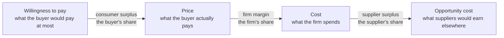

Three consequences that engineers find counter-intuitive:

1. **Creating value and capturing it are different activities.** A firm can create enormous value and capture almost none of it (see §9 and §13). "Our technology is better" says nothing about the second.
2. **The split is set by scarcity, not by merit.** Your share is bounded by your added value: how much worse off the chain would be without you. Anything you are easily replaced for, you do not get paid for.
3. **Both directions are levers.** Raising willingness to pay (differentiation, outcomes, risk removal) and lowering suppliers' opportunity cost (unique demand for their inputs, lower risk to them) both enlarge your slice. Cost reduction only enlarges your slice *if* competitors cannot copy it.

### 1.3 What "value-driven" is not

| Not this | Why | Instead |
| --- | --- | --- |
| Cost-plus | Cost sets the **floor**, not the price. Cost-plus systematically under-prices where differentiation is high and over-prices where it is low | Price from differential value; use cost to decide whether to serve at all |
| Share-driven | Volume at a loss is not value. The S&P 1500 arithmetic in §3 shows a 5% price cut needs ~18.7% extra volume to break even | Price to the value metric; let share be an outcome |
| Feature-driven | Features are inputs, not value. Customers buy progress on a job (§4) | Sell the outcome the feature produces |
| Revenue-driven | Revenue without gross margin or retention is a loan from the future. Recurring revenue exposes churn faster, it does not fix it | Unit economics per cohort, per segment |
| "Charge what the market bears" | The market bears it once. Price is a repeated game with memory; extraction destroys willingness to pay | Capture a share, leave the customer visibly better off |

### 1.4 Three overstated claims to handle carefully

| Popular claim | What is actually true |
| --- | --- |
| "Value-based pricing means charging what the value is" | Value is a *range* under uncertainty, not a point, and the top of the range is the point where the customer stops buying. Value-based pricing means choosing a point inside the measured range and defending it with fences. It also means pricing **structure** — usually a bigger lever than level. |
| "Recurring revenue is better revenue" | It is better only if gross retention holds and expansion outruns churn. Subscription is a magnifying glass: it makes a sticky business compound and a leaky business bleed visibly every month. Net revenue retention, not revenue model, is the test (§14). |
| "Outcome-based contracts align incentives" | They align incentives **and transfer risk**, and the transferred risk has a price. They work when the outcome is measurable, attributable to your asset, and influenceable by your behaviour — Rolls-Royce can price per flying hour because it designs the engine, owns the data and controls the maintenance (§12). Where any of the three is missing, the contract becomes a fixed-price warranty with a longer name. |

---

## 2. How a business model is decomposed

### 2.1 The five-part value frame

The most useful decomposition for design work is the value-based one used in the business-model-innovation literature: creation, proposition, delivery, capture, and network. Each is a design surface, and they are coupled — change one and at least one other must move.

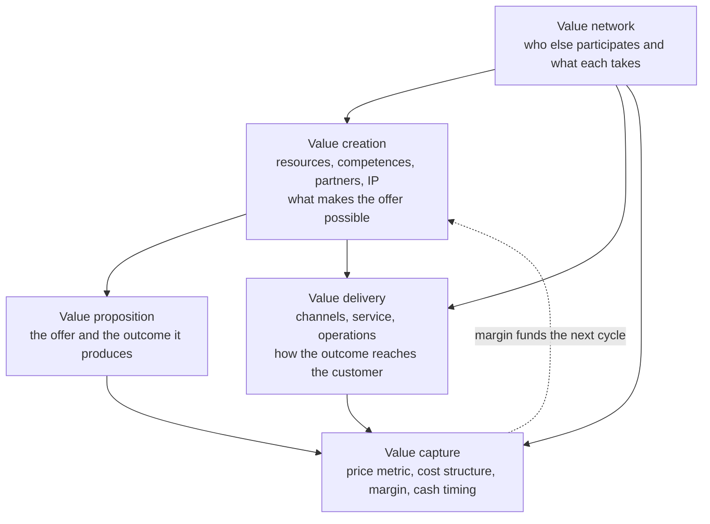

Read the loop: capture is not the last step, it is what funds creation. A model that cannot fund its own next cycle is a project, not a business.

### 2.2 The three canvases and what each hides

| Artefact | Blocks | Designed for | What it hides |
| --- | --- | --- | --- |
| **Business Model Canvas** (Osterwalder and Pigneur, *Business Model Generation*, 2010) | 9: customer segments, value propositions, channels, customer relationships, revenue streams, key resources, key activities, key partnerships, cost structure | A shared picture of one business model; right side customer-facing, left side infrastructure, value proposition as the keystone | Competitive interaction, timing, and whether the pieces fit. It is a static snapshot — the book insists on testing assumptions early and often |
| **Value Proposition Canvas** (Osterwalder et al., *Value Proposition Design*, 2014) | Customer profile (jobs, pains, gains) × value map (products and services, pain relievers, gain creators) | Fit between one segment and one offer, checked item by item | Whether the segment is big enough or reachable. Fit is necessary, not sufficient |
| **Lean Canvas** (Maurya, *Running Lean*, 2010, 3rd ed. 2022) | 9: problem, segments, unique value proposition, solution, key metrics, unfair advantage, channels, cost structure, revenue streams | Startups under uncertainty; leads with the problem and the unfair advantage | The operating model of a going concern; deliberately thin on partnerships and relationships |
| **Magic Triangle** (Gassmann, Frankenberger and Csik, St. Gallen) | Who, What, How, Why (value) | Recombination: change at least two of the four to get a genuinely new model | Execution detail; it is an ideation frame, not a plan |

Two rules for using any of them: one canvas per segment (a canvas with two segments on it is two canvases pretending to be one), and every cell is a **hypothesis with an owner and a test**, not a fact.

### 2.3 The four-box model

Johnson, Christensen and Kagermann (*Harvard Business Review*, 2008) compress a model into four interlocking elements, which is the most useful frame for an engineer because it makes the binding constraint visible:

| Element | The question | Typical failure |
| --- | --- | --- |
| **Customer value proposition** | Does it get an important job done, for a group that cares? | A better mousetrap for a job nobody has |
| **Profit formula** | How do *we* make money — revenue model, cost structure, margin model, resource velocity? | Unit economics that only work at a volume you cannot reach |
| **Key resources** | What must be in place: people, technology, IP, channels, brand, cash? | A resource you rent rather than own, at a price that rises with your success |
| **Key processes** | What must be repeatable: development, manufacturing, service, hiring, pricing? | Processes inherited from the old model, which are precisely what will not fit |

Seat-of-the-pants tests from that article, which are still the fastest diagnostics: can you repeat the success with a new offering (resources), and does the model still work when a key person leaves (processes)?

---

## 3. The evidence base

### 3.1 The numbers, with their sources

| Claim | Figure | Source | Caveat |
| --- | --- | --- | --- |
| A 1% price improvement raises operating profit | **11.1%** | Marn and Rosiello, *Harvard Business Review*, 1992 — average economics of 2,463 companies | Assumes no volume loss |
| Same, on S&P 1500 average income statement | **~8%** (about 50% more than a 1% variable-cost cut, 3× a 1% volume gain) | McKinsey, *The power of pricing*, 2003 | Same assumption; shows direction, not elasticity |
| Same, for the Global 1200 | **8.7%** | Baker, Marn and Zawada, *McKinsey Quarterly*, 2010 | Widely quoted; also the figure McKinsey's later big-data pricing work repeats |
| Offsetting a 5% price cut | Needs **~18.7%** volume increase | McKinsey, 2003, S&P 1500 economics | "Extremely rare" demand elasticity — the reason price wars destroy profit |
| Share of pricing decisions that miss the best price | **up to 30%** | McKinsey, big-data pricing work | Estimate, not a measured census |
| Adobe's subscription transition | Creative Cloud paid subs **1.439M** exiting Q4 FY2013 (+402k in the quarter); Creative ARR **$768M**; Digital Media ARR **$911M**; total revenue **$4.06B** in FY2013 against **$4.40B** in FY2012 | Adobe Q4 FY2013 earnings release (primary) | The −8% revenue dip was forecast and pre-announced; later figures (3.4M subs end-2014, 93% subscription share by 2023) come from secondary sources — **VERIFY** |
| Rolls-Royce Power-by-the-Hour | Invented **1962** for the Viper engine on the de Havilland/Hawker Siddeley 125; CorporateCare launched **2002**; TotalCare charged per flying hour; services roughly **50%** of group revenue; CorporateCare enrolment 550 aircraft (2005) → 1,000 (2010) → over 1,500 (2013) → 2,000 (2016) | Rolls-Royce press releases and corporate stories (primary) | TotalCare launch year is reported as **1997** by secondary sources; Rolls-Royce's own material dates PBH to 1962 and CorporateCare to 2002 — **VERIFY** the 1997 date |
| Arm's licensing model | Two revenue lines: licence fees and royalties; royalty is a percentage of chip selling price, commonly reported at **1–2%** (some sources **1–3%**); royalty ≈ **60%** of revenue, licence ≈ **40%**; FY2023 revenue **$2.679B**; **~30.6B** Arm-based chips shipped in FY2023 at roughly **$0.10** of royalty each; royalty of **$1.68B** on **$98.9B** of Arm-based chip value (≈**1.7%**) | Arm prospectus coverage and company reporting, via specialist secondary analysis | Percentages vary by source and by licence type — **VERIFY** before quoting a single number |
| Limits on royalty-based capture | China NDRC, February 2015: fine of **6.088 billion RMB** (8% of 2013 China sales); remedy includes a royalty base of **65% of net selling price**, a patent list, no charge for expired patents, no free reverse licence, no bundling of non-SEP licences, no no-challenge condition tied to chip supply | NDRC announcement (primary) | Reported rate cuts (e.g. 4.5% → 3.25%) come from press coverage, not the NDRC text — **VERIFY** |
| SaaS efficiency benchmarks | LTV:CAC **≥ 3**; CAC payback **under 12 months** (SMB) / **under 18** (enterprise); gross margin **75–80%+**; Rule of 40 **≥ 40** | Practitioner benchmark sets (Bessemer, David Skok, SaaS Capital) | Ranges move with the cycle; the post-2021 reset pushed median NRR down from ~120% to roughly 106–110% — **VERIFY** before quoting a single "median" |
| Net revenue retention | **100% acceptable, 110% good, 120%+ best-in-class**; below 100% means growth must be bought with new logos | Bessemer / ICONIQ-style benchmark sets | Benchmarks are clusters, not targets |
| Business model innovation is mostly recombination | **90%** of business model innovations came from recombination of **55** recurring patterns | Gassmann, Frankenberger and Csik, *The Business Model Navigator* | Post-hoc taxonomy: it has descriptive, not predictive, power |
| Outcome-driven innovation success | **86%** commercial success across 73 projects, against a **17%** baseline | Ulwick, *What Customers Want*, 2005, via Strategyn | Self-reported, vendor-authored, and the opportunity algorithm is criticised for largely reproducing the importance ranking — **VERIFY** |

### 3.2 The four caveats you must state when quoting these

1. **Constant-volume assumptions.** The pricing-power figures assume no volume loss. They establish that price is the highest-leverage variable, not that you should raise prices by 1% tomorrow. Always pair them with the break-even volume arithmetic: a 5% cut needs ~18.7% more units.
2. **Averages hide distributions.** Budzier and Flyvbjerg's IT-project work puts a one-in-six chance of a "black swan" overrun; McKinsey's large-IT study found ~17% of projects in that category on cost. A business model that is fine at the mean can still be destroyed by the tail — which is exactly what an outcome-based contract with unbounded downside does.
3. **Survivorship and self-reporting.** The 86%-versus-17% figure and most SaaS benchmarks come from vendor or investor surveys of companies that survived long enough to answer. Treat them as ranges to reason with, not as facts about your case.
4. **Optimism bias and strategic misrepresentation are different failures** (Flyvbjerg, Holm and Buhl, 2002). No estimation technique repairs the second. A value model built by the team that needs it to be true is a sales document; this is why value claims need an owner, a measurement, and an independent reviewer (§11).

---

## 4. Defining and quantifying value

### 4.1 Start from the job, not the product

The unit of analysis is the job the customer is trying to get done, not the customer's demographics and not your product category. Two lineages share that claim and differ on method:

| | Ulwick / Outcome-Driven Innovation | Christensen and Moesta |
| --- | --- | --- |
| What a job is | A process that can be mapped into steps, each with measurable desired outcomes | The progress a person seeks in a particular circumstance: functional, social, emotional |
| How it is studied | Structured outcome statements, then a survey rating importance and satisfaction | Switch interviews, the purchase timeline, the four forces of progress (push, pull, anxiety, habit) |
| Artefact produced | Job map, outcome list, **opportunity scores**, needs-based segments | Job stories, the competing set of "hires", circumstances |
| Best used for | Prioritising what to build, sizing an underserved segment | Understanding why people switch, and who your real competitors are |

The opportunity algorithm is worth knowing precisely, including its weakness:

```
Opportunity score = Importance + max(Importance − Satisfaction, 0)
```

Importance is counted twice and satisfaction once, so a score can never fall below the outcome's own importance. The consequence: an important outcome you already serve perfectly still scores highly, and a high score is therefore **not** proof of an open opportunity. Read the ranked list as evidence to weigh, never as a verdict.

A well-formed outcome statement has four parts — direction of improvement, unit of measurement, object, and context — e.g. "minimise the time to bring a new production line into compliance". Statements that name a solution ("add a dashboard") are not outcomes and cannot be scored.

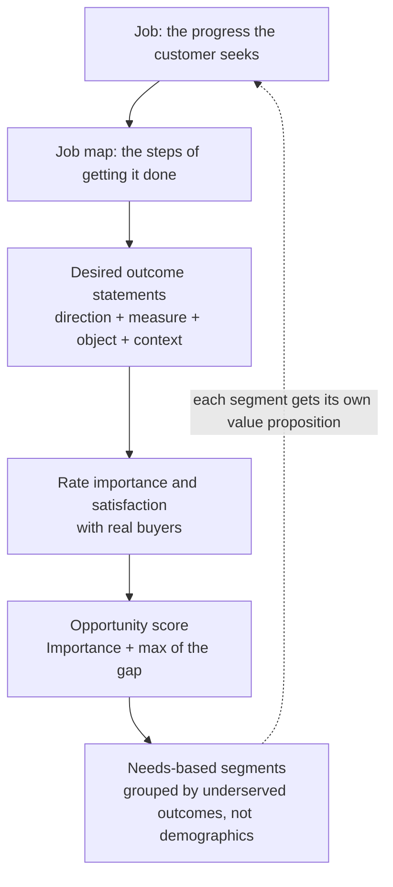

### 4.2 Economic value to the customer (EVC)

Value in money is always measured against a **named alternative**, never in the abstract. The standard construction:

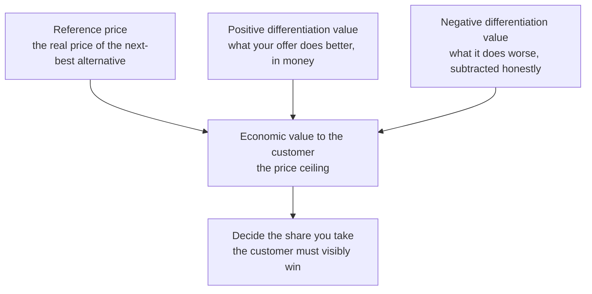

Rules that make this survive contact with a buyer:

- The reference must be a **real, priced alternative** the customer actually considered, not a category average.
- Every positive claim needs a monetary figure *and* a stated assumption. "Reduces downtime" is not a number; "removes 4 hours of line stoppage per month at a contribution margin of X per hour" is.
- Negative differentiation is counted, not hidden. The fastest way to lose credibility in a value conversation is to have the customer raise the thing you omitted.
- The output is a **range** with its sensitivity understood, and the price is set inside it — usually well inside it, because the customer's share is what makes the deal repeat.

For engineering products the same arithmetic has a second use: it tells you which specification to build. If a 30% improvement in a parameter moves EVC by 2%, that parameter is not a value driver and should not be funded.

### 4.3 Measuring willingness to pay

| Method | What it yields | Sample / cost | When to use | Failure mode |
| --- | --- | --- | --- | --- |
| **Direct questions** ("what would you pay?") | A starting hypothesis, nothing more | Cheap, fast | Never on its own | Systematic overstatement; buyers have no incentive to be honest |
| **Van Westendorp Price Sensitivity Meter** (1976) | An acceptable range from four questions: too cheap, cheap, expensive, too expensive | Hundreds of respondents | New offers, early positioning | All four questions must be asked including "too cheap"; read as a range to test, never as the answer |
| **Gabor–Granger** | Maximum acceptable price by purchase probability, hence a revenue-maximising point | Hundreds | When you need a point estimate inside the range | Assumes respondents can state their own reservation price |
| **Conjoint / choice-based** | Part-worth utilities: what each attribute is worth, and the trade-offs buyers actually make | Larger and more expensive | Multi-attribute engineering offers, packaging and tiering | Attribute lists that omit the thing buyers really choose on |
| **Live experiments** | Actual behaviour | Requires traffic or a sales channel | Always, where possible | Small samples read as big truths; run long enough and hold the price long enough to be believed |
| **Revealed preference / win–loss data** | What has actually been paid and lost | Free if you have the data | Continuously | Confounded by discounting — which is why pocket price, not list price, is the number to track |

### 4.4 Two different "value driver trees" — do not mix them

| | Customer value driver tree | Financial value driver tree |
| --- | --- | --- |
| Root | Willingness to pay for this segment | Enterprise value |
| Branches | Jobs → outcomes → measurable improvements → money | Rappaport's seven drivers: sales growth, operating profit margin, cash tax rate, working-capital investment, fixed-capital investment, cost of capital, and the competitive advantage period |
| Used for | Pricing and specification decisions | Capital allocation and strategy testing |
| Coupling | A customer value driver that does not show up in the financial tree is philanthropy | A financial driver with no customer counterpart is extraction, and it decays |

The single most useful sentence in the financial tree: **growth only creates value when ROIC exceeds WACC.** A business model that grows by buying revenue at a return below its cost of capital destroys value faster the faster it grows — which is exactly what a subscription business with negative gross margin, or an outcome-based contract priced below the risk it carries, does.

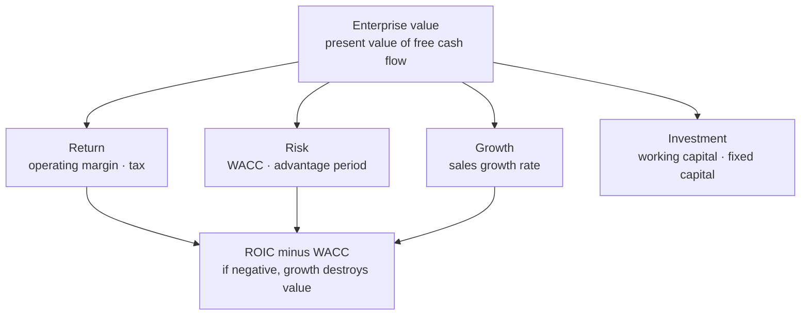

---

## 5. The methodology family

Eight schools, each with a different unit of analysis. They are complements, not substitutes; the skill is knowing which one is leading for your decision.

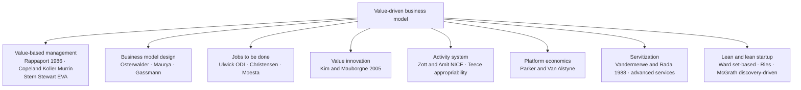

| School | Unit of analysis | Question it answers | Main instrument | Blind spot |
| --- | --- | --- | --- | --- |
| Value-based management | The firm | Is this worth more than it costs, and versus what alternative? | DCF, ROIC−WACC, value driver trees, EVA | Long-horizon and intangible-heavy bets; undervalues options |
| Business model design | The model | What is the configuration, and is it coherent? | Canvas, VPC, magic triangle, 55 patterns | Fit is not proof; canvases say nothing about competition or timing |
| Jobs to be done | The job | What progress is the customer trying to make, and how badly served? | Job map, outcome statements, opportunity scores, switch interviews | Expensive; weak at discontinuous innovation; scores can be gamed by framing |
| Value innovation (blue ocean) | The industry's factors of competition | Which factors should be eliminated, reduced, raised, created? | Four actions framework and the ERRC grid, strategy canvas | Needs real research with buyers **and non-customers**; a grid filled in a meeting room produces fantasy |
| Activity system | The activity | Which activities, by whom, and what makes the system hard to copy? | NICE themes: novelty, lock-in, complementarities, efficiency; Teece's appropriability and complementary assets | Abstract; hard to attach to a quarterly decision |
| Platform economics | The interaction | Which side pays, what is the subsidy, where is the network effect? | Two-sided and multi-sided design, take rate, liquidity | Platform dynamics are slow to start and hard to stop once they reverse |
| Servitization | The asset's outcome | Should we sell the product, its availability, or its result? | Base → intermediate → advanced services ladder; per-use and outcome-based contracts | The "service paradox": heavy investment in services with profit that does not follow |
| Lean / lean startup | The hypothesis | What is the cheapest experiment that kills this assumption? | Build-measure-learn, discovery-driven planning, reverse P&L, set-based design | Optimises locally; can iterate forever inside a model that was wrong |

A practical way to choose: if the uncertainty is **about the customer**, lead with JTBD and lean. If it is **about the industry's structure**, lead with value innovation and the activity-system view. If it is **about the economics**, lead with VBM and unit economics. Most failures come from leading with the wrong one — typically running experiments on a model whose unit economics cannot work at any volume.

---

## 6. The process

Eight phases, each with an artefact, an exit criterion and an explicit stop branch. The stop branch is not decoration: a process with no way to stop is a process that funds everything.

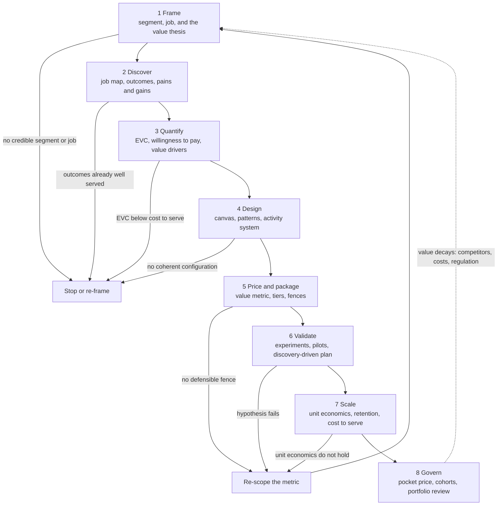

| Phase | Artefact produced | Exit criterion — written as a test, not an opinion | Owner |
| --- | --- | --- | --- |
| 1 Frame | Value thesis; named segment and job | The segment can be reached by a channel you can name, and the thesis states what value is unlocked and why now | Product |
| 2 Discover | Job map; ranked outcome statements; competing "hires" | At least N real buyers interviewed; top outcomes ranked; segments defined by *unmet* outcomes | Research |
| 3 Quantify | EVC range with assumptions; WTP range; customer value driver tree | Every value claim has a number and an owner; the range is corroborated by two methods | Product + Finance |
| 4 Design | Canvas per segment; pattern choice with rationale; activity system | Changing at least two dimensions of the magic triangle if a new model is claimed; coherence check on resources and processes | Product + Ops |
| 5 Price and package | Value metric; Good-Better-Best ladder; fences; discount policy | The metric tracks the value driver so heavy users pay more; fences are defensible; existing customers cannot trade down without losing something they use | Pricing / PMM |
| 6 Validate | Experiment results; reverse P&L; pilot reference | Leading indicator moves in a pre-declared direction with a pre-declared sample; worst case is survivable | Product |
| 7 Scale | Unit economics by cohort; cost to serve; retention curves | LTV:CAC ≥ 3, CAC payback inside the target, gross margin on target, and the numbers hold *by cohort*, not in aggregate | Finance + Growth |
| 8 Govern | Value dashboard; pocket price report; portfolio review | Price realisation reported monthly; a trigger exists for repricing; a review has authority to stop | Leadership |

Two techniques make phase 6 honest:

- **Discovery-driven planning** (McGrath and MacMillan, 1995): write the P&L backwards from the profit you require, derive the allowable cost, and list the assumptions that must hold for each line. Fund the assumptions in order of risk, and stop at the first one that fails.
- **Reverse P&L**: profit → allowable cost → allowable cost to serve → allowable functionality. It is the commercial analogue of a timing budget: if the sum of the parts does not fit, you change the design, not the arithmetic.

---

## 7. The tool stack

### 7.1 Tools and their failure modes

| Class | Representative tools | Output | How it fails |
| --- | --- | --- | --- |
| Framing | Business Model Canvas, Lean Canvas, Value Proposition Canvas, magic triangle | A shared picture and a hypothesis list | Treated as a deliverable; never updated; two segments on one canvas |
| Customer understanding | Job map, outcome statements, opportunity scoring, switch interviews, win–loss | Ranked unmet outcomes, needs-based segments | Interviews with colleagues instead of buyers; solution-flavoured outcome statements |
| Value quantification | EVC model, value driver trees, Van Westendorp, Gabor–Granger, conjoint | A price range and a value story with numbers | Numbers with no stated assumptions; one method only; range read as a point |
| Business model design | 55 pattern cards, activity-system mapping, NICE themes | Candidate configurations with rationale | Pattern-copying without context fit; only obvious industry patterns considered |
| Pricing operations | Price bands, pocket-price waterfall, discount-authority matrix, CPQ, bid desk | Realised price and controlled exceptions | List price tracked while pocket price leaks; exception pricing becomes standard pricing |
| Unit economics | Cohort retention, LTV/CAC, CAC payback, Rule of 40, cost-to-serve model | Whether growth is worth funding | Aggregate numbers that hide deteriorating cohorts; LTV computed on revenue instead of gross profit |
| Experimentation | A/B tests, pilots, design partners, staged rollouts | Evidence on the risky assumption first | Underpowered tests read as truth; no pre-declared stopping rule |
| Governance | Value dashboard, quarterly value review, portfolio and stage-gate | Decisions to fund, reprice or stop | Metrics with no owner and no decision attached |

### 7.2 How the artefacts connect

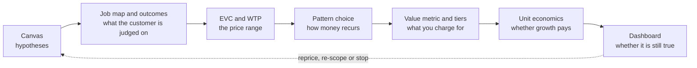

The single most common break in this chain is between C and E: teams do the customer research, produce a credible value number, and then ship a price structure copied from their industry — per-seat when the value is per-outcome, or perpetual when the value is continuous. **Structure usually matters more than level**: the same total value can be captured or lost depending on what the metric is and how buyers can self-select.

### 7.3 What a value model document contains

A one-document version of the chain, which is what a pricing committee should be reviewing:

1. Segment and job statement, with the competing "hires" named.
2. Ranked outcome statements with importance, satisfaction and score.
3. EVC calculation: reference price, each differentiation item with its money and its assumption, negative items, resulting range and its sensitivity.
4. Willingness-to-pay evidence: method, sample, range, and what would change it.
5. Value metric and why it tracks the value driver; tier ladder; fences; discount authority.
6. Unit economics: CAC by channel, gross margin, cost to serve, payback, LTV:CAC, by cohort.
7. Capture risk: what imitators, customers, suppliers or complementors can take, and the defence (§9).
8. Kill criteria: the numbers that, if not met by a date, end it.

---

## 8. The pattern catalogue

Gassmann and colleagues' finding is the useful starting point: most business-model innovation is **recombination** of a finite pattern library, not invention. Roughly 55 patterns account for about 90% of what they observed. The catalogue below is the subset that matters for technical products, with the value metric — the thing you actually charge for — as the first column, because that is the decision most often copied unthinkingly.

| Pattern | Value metric | Who it suits | Worked example | The trap |
| --- | --- | --- | --- | --- |
| **One-time sale / perpetual licence** | Unit or licence | Durable value, slow change, customer prefers capex | Creative Suite before 2013 at ~$2,500 a box | Revenue resets to zero each period; upgrade cycles stretch; piracy becomes the competitor |
| **Subscription** | Seat or account per period | Continuous value delivery, high switching cost | Adobe Creative Cloud from 2013 at $49.99/month | Churn is exposed monthly; subscription magnifies leaky retention rather than fixing it |
| **Consumption / usage-based** | Unit consumed: GB, vCPU-hour, token, API call | Value scales with consumption and can be metered | Cloud infrastructure billing by the second | Revenue volatility for both sides; buyers fear unbounded bills; metering must be trusted |
| **Freemium / open core** | Conversion to paid above a value line | Large self-serve funnel, low marginal cost | Open-core infrastructure software | The free tier must be bounded by a value line, not an artificial restriction; support costs are real |
| **Razor and blade** | Consumable or attach | Attach is defensible and high-margin | Printers and consumables; razors | Requires a durable lock on the consumable, and attracts regulation and aftermarket competition |
| **IP licensing and royalty** | Per unit, or a percentage of selling price | Your asset is IP others embed; you cannot or will not manufacture | Arm: licence fees plus a royalty commonly reported at 1–2% of chip price, royalty ≈ 60% of revenue | The **royalty base** is fought over; SEP licences are bounded by FRAND commitments and antitrust law (§9) |
| **Pay-per-use** | Unit of use: page, kilometre, cycle | Ownership retained; usage measurable; you can influence durability | Michelin Fleet Solutions per kilometre; Xerox Managed Print Services per page | You inherit demand risk: when freight volumes fall, kilometres fall, and so does revenue |
| **Outcome-based / performance-based** | Availability, uptime, or a verified outcome | You design the asset, own the data, and control the maintenance | Rolls-Royce per flying hour; Alstom per mile with penalties for delay | Needs attribution, influence and bounded downside; otherwise it is a fixed-price warranty with a longer name |
| **Platform / two-sided market** | Take rate on transactions | Two distinct sides that need each other; liquidity achievable | Marketplaces, app stores, ad platforms | Chicken-and-egg; multi-tenanting; disintermediation once participants know each other |
| **Ecosystem / full-stack platform** | Attach rate across silicon, software, tools and services | Complements are where the value compounds | Arm's partner ecosystem; CUDA as the layer that makes the silicon worth more | Ecosystem investment pays slowly and must be funded through a trough |
| **Servitization ladder** | Base → intermediate → advanced services | Installed base with predictable failure modes and data | Base: spares and warranty; intermediate: maintenance and overhaul; advanced: capability and outcome contracts | The service paradox: investment in services with profit that does not follow |
| **Gain sharing / shared savings** | A share of verified savings | Savings are measurable and attributable | Energy performance contracting | Attribution disputes; the measurement system is the product |
| **Membership** | Membership fee, with goods near cost | Repeat purchase, price-transparent goods | Warehouse clubs, Prime-style bundles | Membership only stays rational if the underlying prices stay visibly fair |
| **Open source plus commercial layer** | Support subscription, commercial licence, or hosted service | The project needs contributors, including firms with patents to protect | Red Hat-style support subscriptions; dual licensing; the OAI move from GPL to OAI Public License v1.1 (2017) and then CSSL v1.0 — a FRAND patent clause so standard-essential-patent holders can contribute | The free/paid line must be a value line; licence choice decides who is allowed to contribute |
| **Franchise / business-system licence** | Royalty on the operator's revenue | The system is the asset, not the outlet | Franchised service networks | Quality drift damages the brand faster than royalties build it |

### 8.1 Choosing a pattern

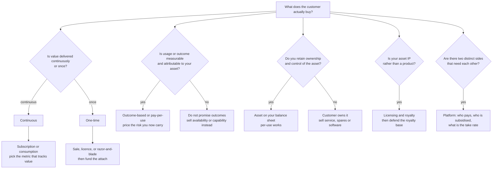

The test that separates a good pattern choice from a fashion: **does the metric rise when the customer gets more value?** If your revenue is flat while the customer's realised value doubles, you have chosen the wrong metric, and sooner or later you will try to fix it with a price rise instead.

### 8.2 Where value is captured in the communications and silicon stack

The pattern library is generic; where value actually lands in this vault's industries is not. The same end product distributes its value very unevenly across the stack, and the distribution changes when an interface becomes standardised.

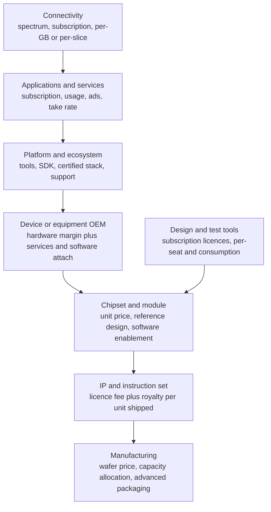

| Layer | Typical capture mechanism | Why the share moves |
| --- | --- | --- |
| Applications and services | Subscription, usage, transaction take rate | Recurring, and closest to the outcome the buyer cares about; expands as the installed base grows |
| Platform and ecosystem | Free or cheap access plus paid tooling, certification, support | The lock-in layer: once developers are trained and code is written, migration is the real cost |
| Device / equipment OEM | Hardware margin plus software and service attach | Compresses when the hardware becomes interchangeable; recovers when software or service differentiates |
| Chipset and module | Unit price, reference design, software enablement | Strong while performance differentiates; erodes as the interface above it standardises |
| IP and instruction set | Licence fee plus royalty per unit, commonly reported at 1–2% of chip price for Arm-class IP | Scales with volume rather than with value delivered; the royalty base is the recurring battleground |
| Manufacturing | Wafer price, capacity allocation, advanced packaging | Value migrates here when the process node is the scarce capability; a pure-play model captures it by staying neutral |
| Design and test tools | Subscription licences, seats and consumption | High switching cost and low marginal cost — one of the most durable subscription models in engineering |
| Connectivity | Spectrum, subscription, per-GB or per-slice | Utility-like; differentiation only through quality, coverage and guarantees |

Three observations worth carrying into an interview:

1. **Value migrates to the layer with the strongest lock-in, not the hardest engineering.** Tools and ecosystems often capture more, per unit of difficulty, than the silicon does.
2. **Standardisation moves value from the interface owner to the implementers and users.** That is the structural reason the royalty base is fought over, and the reason open interfaces attract contributors who then sell something else.
3. **Separating layers can be the business-model innovation itself.** The pure-play foundry separated manufacturing from design and let an entire fabless industry exist; open-source stacks separate adoption from monetisation and then sell support, hosted operation or a commercial licence.

---

## 9. Capturing what you create

### 9.1 Appropriability

Creating value and capturing it are separate activities. Teece's framing is the practical one: your share depends on the **appropriability regime** (how well the asset is protected by patents, copyright, trade secrecy, lead time, or simply by being hard to reverse-engineer) and on who controls the **complementary assets** needed to bring it to market — manufacturing, distribution, service, software ecosystem, brand, data.

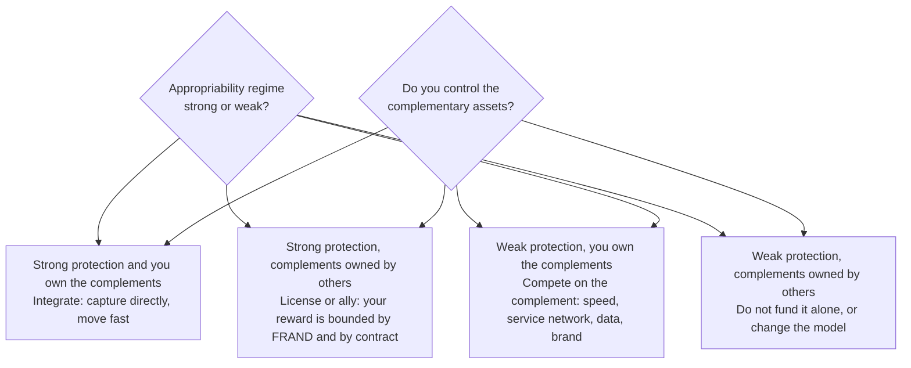

Sector note for this vault's domains: open standards are a **weak appropriability regime by construction**. If your invention becomes a standard-essential patent, your reward is bounded by FRAND commitments and by competition law, and the royalty base becomes a legal question rather than a commercial one. The NDRC's 2015 Qualcomm decision is the boundary marker: a fine of 6.088 billion RMB, and a remedy that fixed the base at 65% of net selling price, required a patent list, forbade charging for expired patents and free reverse licences, forbade bundling non-SEP licences, and forbade making chip supply conditional on a no-challenge clause. Patented but non-standardised technology, by contrast, can still be priced to value.

### 9.2 The capture mechanisms

| Mechanism | What it protects | How it decays | Example |
| --- | --- | --- | --- |
| Patents and SEPs | The invention, within jurisdiction and term | Expiry; invalidation; FRAND and antitrust limits on the base and rate | Royalty licensing |
| Trade secrecy and lead time | Process know-how, models, tuning | People move; reverse engineering | Manufacturing yields, model training recipes |
| Complementary assets | The ability to deliver at all | Partners learn to do it themselves | Service network, distribution, foundry capacity |
| Switching costs and lock-in | The installed base | Standards, portability mandates, procurement pressure | File formats, toolchains, muscle memory |
| Network effects | The value of the whole | Fragmentation; multi-homing | Ecosystems, marketplaces |
| Data and feedback | Performance that improves with use | Data portability rules; competitors' synthetic data | Per-flying-hour engine health data |
| Brand and trust | Risk aversion in a purchase | One public failure | Safety-critical and regulated domains |
| Contract | Specific deals | Renegotiation at renewal | Long-term service agreements |

### 9.3 Who else can take the value

The value slice of §1 has four claimants, and only one of them is you. Write them out explicitly:

| Claimant | How they take it | Counter |
| --- | --- | --- |
| **Customer** | Price negotiation, benchmarking, multi-sourcing, demanding the value be unbundled | Differentiate on outcomes they cannot specify elsewhere; keep the relationship on the outcome, not the unit |
| **Supplier** | Raising input prices when they see your margin | Dual sources, design for substitution, long-term agreements with transparency, unique demand for their capacity |
| **Complementors** | Capturing the layer adjacent to yours | Own at least one complement that is critical; otherwise make the complement thrive and take a platform cut |
| **Imitators** | Copying the configuration once it is proven | Lock-in, complementarities, data advantage, continuous renewal — not secrecy alone |

---

## 10. Pricing and packaging

### 10.1 Three decisions, in this order

1. **Metric** — what you charge for. The highest-leverage decision, and the one most often inherited from the industry.
2. **Structure** — tiers, fences, bundles, terms. This is how buyers self-select, and it is usually worth more than the level.
3. **Level** — the number. This is where most of the argument happens and where the least value is decided.

A good value metric satisfies five tests: it rises when the customer gets more value; it is easy to measure and verify; it is hard to game; the buyer can predict it; and a buyer's board can understand it in one sentence.

### 10.2 Tiers and fences

Good-Better-Best works because buyers self-select on their own willingness to pay rather than being sorted by a salesperson. The fence between tiers must be **defensible**: a capacity limit, an SLA, a support response, a security or compliance feature, an integration — something the buyer would genuinely miss. Feature fences that nobody misses are discounts with extra steps.

Two rules: existing customers must not be able to trade down without losing something they use; and the top tier must be priced to the value it delivers, not to the bottom tier plus a markup.

### 10.3 Pocket price, not list price

The gap between list and realised price is where value-based pricing goes to die. McKinsey's list of leakages is worth pinning to the wall: annual volume bonus, cash discount, consignment cost, cooperative advertising, end-customer discount, freight, market-development funds, off-invoice promotions, on-line order discount, performance penalties, receivables carrying cost, slotting allowance, stocking allowance.

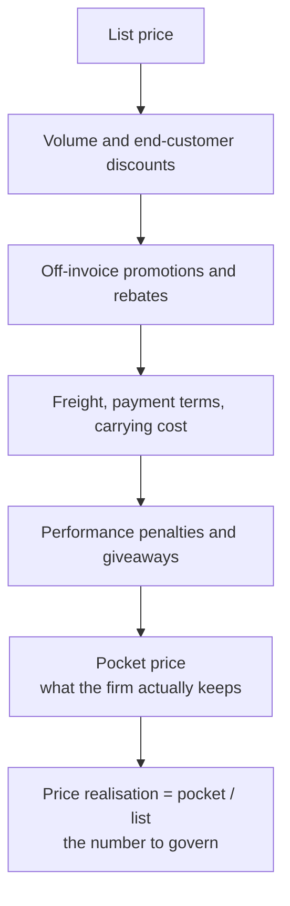

Discipline that makes it work: a discount-authority matrix with named approvers by depth; a bid desk that reviews exceptions and tracks their frequency and depth; price bands published to the field; and a monthly report where pocket price, not bookings, is the reviewed number. If sales compensation is on bookings, none of this survives.

### 10.4 Selling to value

A value-based sale has four moves, in order: name the alternative the buyer is considering and its real price; quantify the difference in the buyer's own units and money; state the assumptions and let the buyer correct them; then price, and leave the buyer visibly better off. The assumptions step is not a courtesy — it is what makes the number survive the buyer's internal review.

Behavioural facts worth knowing: buyers judge price against a reference, so what you present first sets the anchor; presenting options top-down rather than bottom-up raises realised price; and price is read as a signal of quality when the offering cannot be evaluated before purchase — which is true of most engineering services.

### 10.5 Managing price over time

Price is not set once. Governance needs: scheduled re-estimation of value as the market moves; a trigger for repricing when costs, competitors or regulation move; a value narrative attached to every change, never a bare letter; and control of the renewal, which is where a subscription business actually earns its money.

### 10.6 The clauses that decide capture

Commercial terms quietly move more money than the headline price. The ones to read before signing an engineering or platform deal:

| Clause | What it decides | What to watch |
| --- | --- | --- |
| **Metric and unit definition** | What the customer is actually billed on | Definitions of a "user", a "message", a "device", a "link" — ambiguity here is a permanent discount |
| **Payment terms** | Carrying cost and cash timing | Net-30 versus Net-90 is a financing decision, not an administrative detail; it belongs in the pocket-price waterfall |
| **Indexation** | Who absorbs inflation and input-cost movement | Without an index, a long contract transfers all cost inflation to you |
| **Downside cap** | Whether an outcome or usage commitment is survivable | Cap credits, cap liability, and make the cap a percentage of fees, not an open number |
| **Service credits** | The price of missing the commitment | Credits should be bounded, predictable, and priced into the margin rather than treated as a contingency |
| **IP and derived data** | Who owns what the deployment teaches you | Ownership of telemetry, models and derived insight decides whether you can compound the advantage |
| **Audit and verification rights** | Whether usage-based revenue can be trusted | Without verification, consumption revenue is self-reported |
| **Most-favoured-customer clauses** | Whether one discount becomes the market price | Poison for price bands; refuse, or bound it narrowly and temporarily |
| **Termination and exit** | Switching cost in both directions | Data export, notice period, and what happens to prepaid value |
| **Change of control and scope** | Whether the model survives the customer's reorganisation | Escalation path and repricing trigger on scope change |

The test for a terms review: if you removed the price from the contract, would the remaining terms still decide who captures the value? Usually they do.

---

## 11. Organisation, incentives and cadence

### 11.1 Who owns what

| Question | Owner | Everyone else's role |
| --- | --- | --- |
| Which job, which segment, which outcome | Product | Research supplies evidence; sales supplies the competing alternatives |
| What the value is worth, in money | Product + Finance, jointly | Value engineering validates with customers |
| What we charge for, and the fences | Pricing / product marketing | Legal reviews the terms; finance models the outcome |
| What it costs to serve | Finance + Operations | Product designs to the allowable cost |
| Whether to grant an exception | Pricing, with a bid desk | Sales proposes; nobody approves their own discount |
| Whether to keep funding it | Leadership, on the dashboard | Finance supplies cohorts, not aggregates |

The test of whether this is real: can one person be named for each row, and does that person's compensation depend on the number? A value model with no owner and no metric attached to anyone's pay is a document.

### 11.2 Incentives

- Compensate on **pocket price or gross margin**, not bookings, wherever the offer is discountable.
- Give the field **price bands and guidance**, not just authority.
- Reward **retention and expansion** as visibly as acquisition; otherwise the renewal becomes an afterthought and net revenue retention quietly falls below 100%.
- Prefer **mechanisms** — a standing review, a published dashboard, a written narrative required before a decision — over exhortations. Intentions do not survive a quarter.

### 11.3 The operating rhythm

| Cadence | Forum | Agenda | Output |
| --- | --- | --- | --- |
| Weekly | Commercial review | Pipeline, exceptions, win–loss | Discount decisions; corrected value messages |
| Monthly | Value dashboard review | Pocket price, cohorts, CAC payback, cost to serve | Repricing or channel changes |
| Quarterly | Value and portfolio review | Per segment: value delivered, value captured, competitive response | Fund, reprice, re-scope or stop |
| Annually | Model review | The canvas, the pattern, the metric, and whether the industry moved | A changed model or an explicit decision not to change |

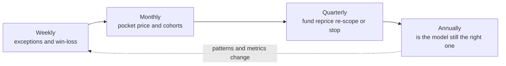

### 11.4 Anti-patterns

| Anti-pattern | Symptom | Why it happens | Fix |
| --- | --- | --- | --- |
| Sales-owned discounting | Realised price falls while list rises | Compensation on bookings; no bid desk | Authority matrix; comp on pocket price |
| Feature factory | Roadmap full, willingness to pay flat | Output measured instead of outcomes | Rank by outcome scores; kill features with no value link |
| Cost-plus culture | Prices move with costs, not with value | Finance owns pricing without customer input | EVC in the pricing pack; a named alternative on every quote |
| Engineering outside the value conversation | Specifications that do not move EVC | Value research handed over as a slide | Engineers present in WTP and EVC sessions; build to the value driver |
| Pricing deferred to launch | Price set in the last week | No one owned the metric | Metric decided in phase 5, before validation |
| Aggregate reporting | Healthy totals, deteriorating cohorts | Convenience | Cohort views mandatory; newer cohorts must retain better |

---

## 12. Best practice in mature organisations

Practices are only real if they are mechanisms — a recurring event, an artefact, a named owner, and a number. What follows is what mature organisations have actually institutionalised, with the mechanism named each time.

### 12.1 Toyota — value defined by the customer, cost designed to the price

- **Value is what the customer is willing to pay for; everything else in the stream is waste.** The value stream is mapped from the customer backwards, and the three wastes — muda, mura, muri — are named and removed.
- **Target costing**: the price a segment will pay is established first, the required profit is subtracted, and the remainder is the *allowable cost* the product must be designed to. Cost is not discovered after design; it is a design constraint. This is the clearest mechanism in management for making value rather than cost the driver.
- **Chief engineer (shusa)**: one person accountable for the whole product's value, without authority over the functional organisations — accountability without hierarchy, deliberately.
- **Set-based concurrent engineering**: keep multiple design alternatives alive longer, narrow by evidence, and converge late. The commercial equivalent of not committing to one price metric before the alternatives are tested.
- **Front-loading and obeya**: invest in resolving the hard trade-offs early, in one room, with the data on the wall.

### 12.2 Amazon — working backwards, input metrics, and sharing the gains of scale

- **Working backwards**: the press release and FAQ are written before the product exists; if the customer value cannot be stated, the product is not started. The artefact is the mechanism.
- **Single-threaded leaders and two-pizza teams**: one owner, small enough to be accountable.
- **Input metrics over output metrics**: manage the controllable inputs, because the outputs lag and are confounded.
- **Mechanisms instead of intentions**: a recurring written narrative, a standing review, a published metric.
- **Usage-based pricing and repeated price reductions**: cloud infrastructure billed by the unit consumed, with reductions passed through as scale improves. This is value capture done by making the metric track consumption and then letting customers see the gains — which raises retention and makes the competition's cost structure the problem.

### 12.3 Adobe — the subscription transition as a designed trough

The interesting part is not the decision; it is that the trough was engineered. From the company's own FY2013 release: total revenue fell from $4.40B in FY2012 to $4.06B in FY2013, while paid Creative Cloud subscriptions reached 1.439 million exiting Q4 FY2013 (+402k in the quarter), Creative ARR reached $768M and total Digital Media ARR $911M. The company pre-announced a 20% compound revenue growth target for FY2014–FY2016 and stated plainly that subscription revenue is recognised over time while perpetual revenue lands at once.

The transferable practice: **declare the transition metric in advance** (ARR and subscribers, not reported revenue), pre-announce the trough, hold the narrative through it, and do not run the old and new models indefinitely side by side.

### 12.4 Rolls-Royce — selling the outcome and carrying the risk

Power-by-the-Hour was invented in 1962 for the Viper engine on the de Havilland/Hawker Siddeley 125: a complete engine and accessory replacement service at a fixed cost per flying hour. The mechanism:

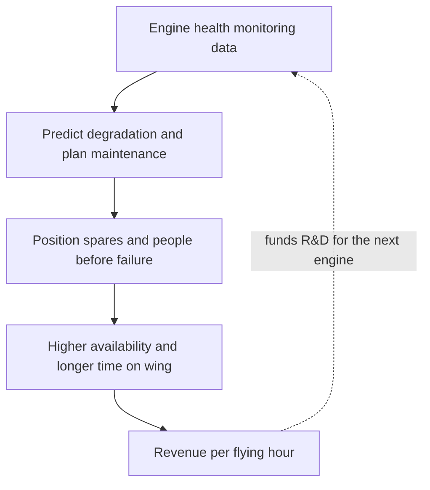

Why it is a real value model rather than a financing trick: the manufacturer designs the engine, owns the in-service data, and controls the maintenance — the three conditions from §1.4. It converts unpredictable maintenance cost into a predictable operating cost for the airline, and it converts a spare-parts business into an availability business. Roughly half of Rolls-Royce's revenue comes from services. Note the trade honestly: the manufacturer now carries the maintenance risk, and revenue follows hours flown, so a downturn in flying hits revenue even though the engines are performing.

### 12.5 Michelin, Signify and Xerox — per use rather than per unit

- **Michelin Fleet Solutions**: tyres for truck fleets charged per kilometre, with Michelin retaining ownership and responsibility for maintenance and retreading. The incentive flips from selling more tyres to making tyres last longer and run more efficiently.
- **Signify (formerly Philips Lighting) light as a service**: the customer pays for light delivered, not for fixtures; the supplier retains ownership and therefore wants efficient, durable, maintainable luminaires.
- **Xerox Managed Print Services**: charged per page, with the supplier managing devices, consumables and upgrades — which makes reliability and duplex printing the supplier's problem.

The common mechanism: ownership stays with the supplier, the metric tracks use or outcome, and durability becomes a revenue strategy rather than a cost. The common risk, stated in the literature: the service paradox, where investment in service capability does not produce proportional profit because cost to serve, pricing and organisational change were underestimated.

### 12.6 Arm — licensing as the value metric for an ecosystem

Arm's model is the cleanest example of value capture from an architecture rather than a product: a licence fee for access to the IP, plus a royalty on each chip shipped, commonly reported at 1–2% of chip selling price, with royalty accounting for roughly 60% of revenue. The consequences are instructive: revenue per unit is tiny (on the order of $0.10 per chip in FY2023) while the aggregate is large; a substantial share of royalty comes from architectures launched decades earlier, because "design once, collect for the life of the product"; and the ecosystem — tools, software, partners — is the complementary asset that makes the architecture the default choice. The recurring fight is over the **royalty base**: charging against chip price versus device price changes revenue by multiples, which is why proposed changes to that base meet customer resistance.

### 12.7 Porter and Teisberg — value per unit of cost, applied to a whole domain

Value-based health care delivery is the largest attempt to run a whole industry on a value metric: value = health outcomes achieved per dollar spent, measured over the **full cycle of care for a medical condition**, not per intervention. The six-part agenda is worth borrowing wholesale by any engineering organisation that wants a value metric:

1. Organise into integrated practice units around the condition.
2. Measure outcomes **and** cost for every patient.
3. Reimburse through bundled prices for care cycles.
4. Integrate delivery across separate facilities.
5. Expand geographic coverage for excellent providers.
6. Build an enabling information technology platform.

The honest counter-argument, which you should state when you cite it: outcomes are multidimensional, hard to measure, and gameable; risk adjustment is imperfect and creates incentives to avoid difficult patients; and payment reform runs into the politics of incumbents. The transferable part is the discipline — numerator and denominator measured over the whole cycle — not the health-care specifics.

### 12.8 What not to copy

| Popular | Why caution |
| --- | --- |
| The Spotify model (squads, tribes, chapters, guilds) | Widely copied from a 2012 description of a work in progress; later accounts from inside describe it as never implemented as described. Copy the intent — autonomous, aligned teams — not the org chart |
| "Recurring revenue at any cost" | Subscription exposes churn faster. Without gross retention and a real metric, it accelerates failure |
| Servitization as a growth strategy | The service paradox is documented: manufacturers invest heavily in services and profit does not follow, because cost to serve, pricing capability and organisational change were underestimated |
| Land-and-expand without retention discipline | Expansion revenue hides a leaking base until the expansion engine stalls, and then the churn arrives all at once. Always read net revenue retention together with gross revenue retention |
| Platform ambitions without liquidity | Two-sided models need liquidity before take rate matters; subsidising the wrong side, or both, is the standard failure |

---

## 13. How it fails

### 13.1 The seven failure modes

| Failure | What it looks like | Root cause | First check |
| --- | --- | --- | --- |
| **Create but do not capture** | The technology becomes an industry standard; someone else makes the money | Weak appropriability plus complements owned by others | Who owns the complementary assets? |
| **Wrong metric** | Value delivered grows, revenue does not | Metric inherited from the industry, or chosen for billing convenience | Does revenue move when the customer's outcome moves? |
| **Leakage** | List price rises, pocket price falls | No discount authority, comp on bookings | Pocket price waterfall by channel |
| **Unbounded outcome risk** | Outcome-based contracts that lose money when usage is high | Outcome not attributable or not controllable; no cap | Can you influence the outcome, and is the downside bounded? |
| **Negative unit economics at any volume** | Growth funded by discounting; CAC payback beyond the customer's life | LTV computed on revenue; CAC under-loaded; cohorts not read | LTV on gross profit, fully loaded CAC, per cohort |
| **Service paradox** | Service revenue up, profit flat | Cost to serve not modelled; pricing capability missing | Cost to serve per contract versus price |
| **Value decay** | The value story was true three years ago | No scheduled re-estimation; competitors matched the differentiation | When was the EVC last recomputed? |

### 13.2 Three cases that get cited, and what they actually show

| Case | What happened | The lesson, stated carefully |
| --- | --- | --- |
| **Xerox PARC** | Produced the graphical user interface, the mouse, Ethernet-style networking and laser printing in the 1970s; the company captured comparatively little of the value those created | Creating the technology is not capturing it. Appropriability and complementary assets decide the split. Widely told; the specifics vary by account — **VERIFY** before quoting figures |
| **Qualcomm and the NDRC (2015)** | A fine of 6.088 billion RMB, and remedies fixing the royalty base at 65% of net selling price and forbidding expired-patent charges, free reverse licences, bundling of non-SEP licences, and no-challenge conditions on chip supply | Value capture from standardised technology has a legal ceiling. The mechanism you use to capture value must be defensible in the jurisdictions you sell in. From the NDRC announcement (primary); reported rate changes come from press coverage — **VERIFY** |
| **Subscription transitions that failed** | Firms that added a subscription without changing the value metric, the cost to serve or the retention mechanism | Subscription is a magnifying glass. Adobe's worked because the metric, the narrative and the trough were designed; copy the design, not the word |

### 13.3 A diagnosis tree

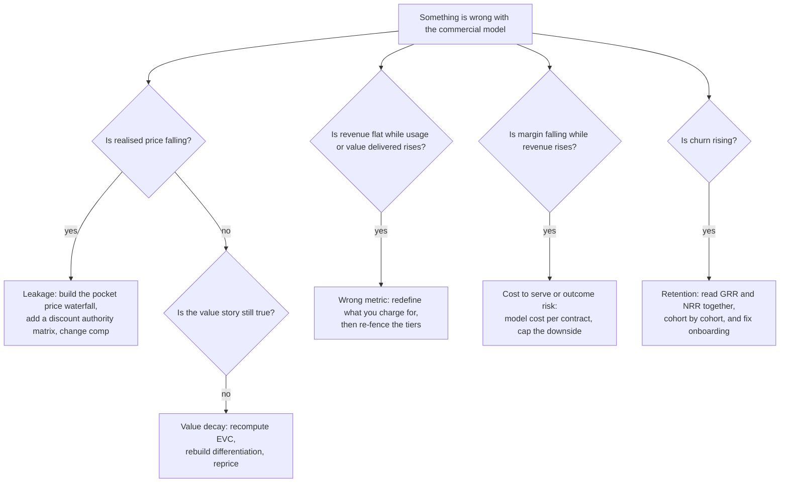

---

## 14. The value dashboard

A dashboard is only useful if every metric is tied to a decision someone actually makes. Eight to twelve metrics, four categories, each with a named owner and a paired leading indicator.

| Category | Metric | What it tells you | Healthy range | Paired leading indicator |
| --- | --- | --- | --- | --- |
| Value delivered | Outcome metric per customer (uptime, throughput, latency bound, defect rate) | Whether the value story is still true | Defined per segment, trending up | Feature adoption; time to first value |
| Value captured | **Pocket price** and price realisation | Whether value is being kept or discounted away | Stable or rising | Discount depth and exception frequency |
| Retention | Gross revenue retention, then net revenue retention | Stickiness, then expansion | GRR high; NRR 100% acceptable, 110% good, 120%+ best-in-class | Usage trends; support burden; renewal risk score |
| Efficiency | LTV:CAC (on gross profit), CAC payback | Whether growth pays | LTV:CAC ≥ 3; payback under 12 months for SMB, under 18 for enterprise | Pipeline quality; win rate; onboarding time |
| Health | Rule of 40 (growth + margin), gross margin | Whether growth and discipline are balanced | ≥ 40; gross margin 75–80%+ for pure software | Spend split by function |
| Cost to serve | Fully loaded cost per customer per period | Whether the model scales | Falling with volume | Manual touches per account; support minutes |
| Risk | Concentration, contract downside exposure | Whether one event can break it | Declared limits, monitored | Renewal calendar; single points of failure |
| Portfolio | Share of revenue from models younger than N years | Whether the firm is renewing itself | A stated target | Pipeline of experiments in phases 2–6 |

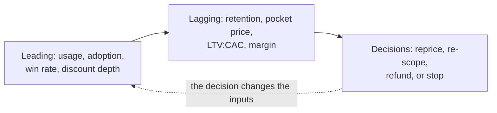

Two reading rules that prevent most analytical mistakes: read **net revenue retention together with gross revenue retention**, because expansion revenue hides a leaking base until the expansion stalls; and read everything **by cohort**, because aggregate numbers can stay flat for a year while every new cohort is worse.

---

## 15. A worked example

A value-driven model for a product from this vault's own territory: an **industrial wireless link** replacing cabling on moving machinery, built on Wi-Fi 7 multi-link operation with the TSN mechanisms described in 02-9 and 02-13.

### 15.1 Job, outcomes and opportunity

- **Job statement**: when a production line is reconfigured, get a deterministic control link to moving equipment running again without recabling, within one shift.
- Competing "hires": a physical cable and drag chain; an industrial Ethernet slip ring; a proprietary wireless link; a cellular private network.
- Three outcomes, scored with real maintenance and controls engineers (illustrative numbers):

| Outcome statement | Importance | Satisfaction | Score |
| --- | --- | --- | --- |
| Minimise the time to re-establish a control link after a line change | 9 | 4 | 14 |
| Minimise the number of unplanned stops attributable to the link | 9 | 6 | 12 |
| Minimise the engineering effort to prove the link meets its latency bound | 7 | 3 | 11 |

The first outcome is the one to build against, and the third is the one nobody sells — which is where the differentiation is.

### 15.2 Economic value to the customer, for one cell

| Component | Basis | Annual money |
| --- | --- | --- |
| Reference price: cable, drag chain, installation and re-installation across the year | 6 reconfigurations at 12 engineer-hours each plus materials, loaded | 38,000 |
| Positive: reconfiguration time removed | 5 of 6 reconfigurations avoided, 12 hours each | 28,000 |
| Positive: unplanned stops removed | 4 stops per year, 90 minutes each, contribution margin per hour | 24,000 |
| Positive: no recabling spares and no drag-chain wear | Historical spend | 6,000 |
| Negative: latency bound is probabilistic, not hard; occasional retries | 2 events per year of quality loss | −7,000 |
| **EVC ceiling** | | **≈ 89,000 per cell per year** |

Assessment: the ceiling is real but the negative item is honest and material — the value depends on how often the bound is missed, which makes **the measured latency distribution the product**. That single sentence decides the metric.

### 15.3 Metric, tiers and fences

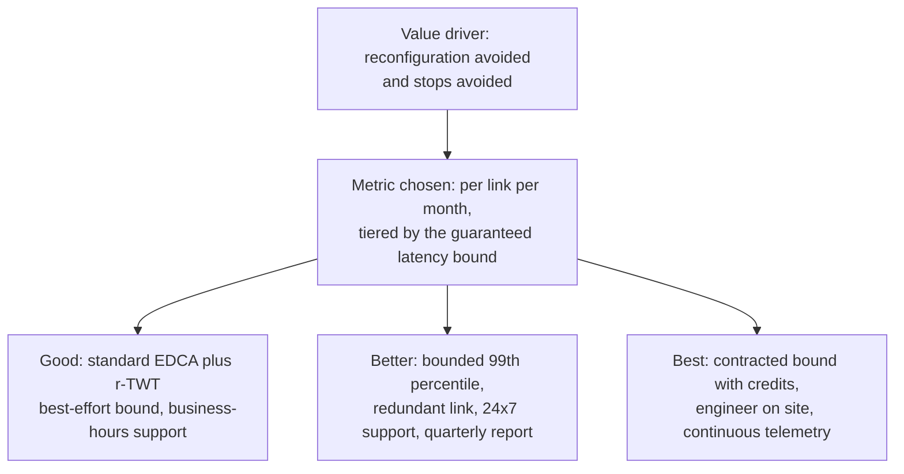

Why per link per month rather than per device once: the value recurs with every reconfiguration and every avoided stop; a one-time sale would leave money on the table and give no reason to keep improving the bound. Why tier on the bound: it is the fence buyers actually care about, it is measurable, and it cannot be gamed without engineering work.

Price set at roughly a third of EVC for the middle tier, leaving the customer visibly better off — the condition for renewal.

### 15.4 Unit economics

| Line | Value | Note |
| --- | --- | --- |
| ARPA per link per month | 240 | Middle tier; about 2,900 per cell per year |
| Gross margin | 72% | Hardware plus telemetry; falls with site visits, which is why tier 3 is priced with credits rather than with people |
| Fully loaded CAC per cell | 6,800 | Field sales, pilot support, commission |
| Gross profit per cell per year | ≈ 2,090 | |
| CAC payback | ≈ 39 months | **Fails** the under-12/under-18 test |
| Required change | Cut pilot cost or raise ARPA by moving the sale to tier 3 with a multi-year term | Re-run phase 5 |
| After change: multi-year term, standardised pilot | CAC 3,100; ARPA 320 | Payback ≈ 12 months, LTV:CAC ≈ 3.4 with 90% GRR |

The point of showing the failing version is that this is what the process is for: the model was attractive as a story and broken as arithmetic, and the fix was a commercial design change — standardised pilot, multi-year term, higher tier — not a discount.

### 15.5 Validation plan and kill criteria

| Window | Test | Pre-declared success | Kill criterion |
| --- | --- | --- | --- |
| 30 days | Five engineers confirm the outcome list and the EVC assumptions | At least 4 of 5 rank the reconfiguration outcome first and accept the EVC basis | No agreement on the reference alternative |
| 60 days | Two pilot cells with the latency bound instrumented | 99th percentile inside the tier-2 bound for 95% of shifts | Misses the bound more than 1 shift in 20 |
| 90 days | Commercial: quote tier 2 at the new price to five prospects | Two orders at list, no discount | Zero orders at list, or both orders discounted below the floor |

### 15.6 Risk register, top five

| Risk | Exposure | Mitigation | Owner |
| --- | --- | --- | --- |
| Latency bound not met on a specific site | Credits under tier 3; reputational | Site survey in the pilot; per-site bound, not a blanket one | Engineering |
| Competing "hire" is a private cellular network | Loss of the segment | Position on time-to-reconfigure and cost, not on raw latency | Product marketing |
| Cost to serve rises with bespoke integration | Margin erosion | Standardised integration kit; professional services priced separately | Operations |
| Royalty or standards exposure if the mechanism is standardised later | Capture ceiling | Track the standardisation path; prefer implementation differentiation | Legal + Product |
| Champion leaves the customer | Renewal loss | Value report delivered to the buyer's management, not only to the champion | Customer success |

---

## 16. Ten short answers

1. **What is a value-driven business model?** One whose price metric, cost structure and capture mechanism are derived from a measured value to a named segment, rather than from cost, from share, or from convention. It answers: who gets what outcome, what they pay, how the payment recurs, and what stops the value leaking.
2. **How is value defined?** As the difference between the buyer's willingness to pay and the suppliers' opportunity cost; your share is bounded by your **added value** — what the chain loses without you. Creating value and capturing it are different activities.
3. **Why is pricing the highest-leverage lever?** On the average S&P 1500 income statement a 1% price rise raises operating profit by about 8% (roughly 8.7% on Global 1200 figures), about 50% more than a 1% variable-cost cut and three times a 1% volume gain — and a 5% cut needs roughly 18.7% more volume to break even.
4. **How do you put a number on value?** Pick the next-best alternative and its real price, add the monetary value of positive differentiation, subtract negative differentiation honestly, and validate the range with willingness-to-pay research — Van Westendorp for the acceptable range, conjoint for trade-offs, live tests for behaviour.
5. **What matters more than the price level?** The **metric** and the **structure**. If revenue does not move when the customer's outcome improves, the metric is wrong; and a Good-Better-Best ladder with defensible fences usually captures more than a better point price.
6. **When is subscription the right model?** When value is delivered continuously, the cost to serve is low, and gross retention holds. It is a magnifying glass: it compounds a sticky business and exposes a leaky one. Judge it with gross and net revenue retention read together.
7. **When is an outcome-based contract honest?** When you design the asset, own the data, control the maintenance, can influence the outcome, and have bounded downside. Rolls-Royce per flying hour satisfies all five; most "outcome-based" proposals satisfy two.
8. **How do you keep competitors from taking the value?** Name the appropriability regime and the complementary assets. If protection is weak and you do not own the complements, licence or partner rather than funding it alone; if your technology is standardised, expect a FRAND and antitrust ceiling on royalties.
9. **What is the fastest diagnostic when a commercial model is underperforming?** Ask in order: is realised price falling (leakage), is revenue flat while value delivered rises (wrong metric), is margin falling while revenue rises (cost to serve or unbounded risk), is churn rising (retention), and is the value story still true (decay)?
10. **What single discipline makes it all work?** Write every value claim as a number with a named owner, a stated assumption and a date for re-estimation — and give a named person the authority to stop. Value models fail far more often from missing ownership than from missing arithmetic.

---

## 17. Anchors

Checked facts, with the date or number that makes them checkable.

- **Marn and Rosiello, *Harvard Business Review*, 1992**: a 1% price improvement raises operating profit by **11.1%** on the average economics of 2,463 companies, against 3.3% for a 1% volume gain, assuming no volume loss.
- **McKinsey, *The power of pricing*, 2003** (S&P 1500 average income statement): revenue 100.0%, fixed costs 19.2%, variable costs 68.3%, operating profit 13.5%; a 1% price rise lifts operating profit about **8%**; offsetting a 5% price cut requires about **18.7%** more volume.
- **Baker, Marn and Zawada, *McKinsey Quarterly*, August 2010**: one percentage point of average price is worth **8.7%** of operating profit for the typical Global 1200 company; pricing programmes commonly yield 2–4 points, i.e. roughly 15–25% of total profits.
- **Adobe Q4 and FY2013 results**: revenue **$4.06B** in FY2013 against **$4.40B** in FY2012; **1.439 million** paid Creative Cloud subscriptions exiting Q4 FY2013, up 402k in the quarter; Creative ARR **$768M**; Digital Media ARR **$911M**; FY2014–FY2016 compound revenue growth target of 20%. Later figures (3.4M subscribers at end-2014; subscription share rising from 28% in 2013 to 93% by 2023) come from secondary sources — **VERIFY**.
- **Rolls-Royce Power-by-the-Hour**: invented **1962** for the Viper engine on the de Havilland/Hawker Siddeley 125, offering complete engine and accessory replacement at a fixed cost per flying hour; **CorporateCare** launched **2002**, with enrolment growing 550 aircraft (2005) → 1,000 (2010) → over 1,500 (2013) → 2,000 (2016); aftermarket services roughly **50%** of revenue; TotalCare credited with extending time between overhauls by around **25%** (company figure). The **1997** date for TotalCare is reported by secondary sources — **VERIFY**.
- **China NDRC decision on Qualcomm, February 2015**: fine of **6.088 billion RMB**, being 8% of 2013 China sales; remedies include royalties calculated on **65% of net selling price** for phones sold for use in China, provision of a patent list, no charging for expired patents, no free reverse licensing, no unjustified bundling of non-SEP licences, and no no-challenge conditions tied to chip supply. Reported rate changes (for example 4.5% to 3.25%) come from press coverage rather than the NDRC text — **VERIFY**.
- **Arm's licensing model**: two revenue lines — licence fees and royalties — with royalty commonly reported at **1–2%** of chip selling price (some sources 1–3%); royalty about **60%** of revenue and licence about **40%**; FY2023 revenue **$2.679B**; roughly **30.6 billion** Arm-based chips shipped in FY2023 at about **$0.10** of royalty each; royalty of about **$1.68B** on **$98.9B** of Arm-based chip value, i.e. about **1.7%**; about **46%** of FY2023 royalty revenue came from products launched between 1990 and 2012. Percentages vary by source and licence type — **VERIFY** against the F-1 before quoting one number.
- **Gassmann, Frankenberger and Csik, *The Business Model Navigator***: about **90%** of business model innovations studied resulted from recombination of **55** recurring patterns; the magic triangle has four dimensions — who, what, how, value — and a new model requires changing at least two of them.
- **Ulwick opportunity algorithm**: `Opportunity score = Importance + max(Importance − Satisfaction, 0)`; a score of **12.0 or more** is commonly read as an underserved outcome and below **10.0** as adequately served; the 86%-versus-17% success claim comes from 73 projects in vendor-authored material — **VERIFY**.
- **Zott and Amit**: a business model is a system of interdependent activities spanning the firm and its partners, creating value through four themes — **novelty, lock-in, complementarities, efficiency**; empirical work finds novelty-centred designs improving performance, and finds business model and product-market strategy to be complements, not substitutes.
- **Teece**: the business model is the architecture of value creation, delivery and capture; the innovator's share depends on the appropriability regime and on control of complementary assets.
- **Vandermerwe and Rada, 1988**: "servitization of business — adding value by adding services", the origin of the term; the service ladder runs from base services (spares, warranty) through intermediate (maintenance, repair, overhaul) to advanced services delivering capability or outcomes, priced per use or per outcome.
- **Porter and Teisberg, *Redefining Health Care*, 2006**: value = health outcomes achieved per dollar of cost, measured over the full cycle of care for a medical condition; the six-part agenda is integrated practice units, outcome and cost measurement for every patient, bundled prices for care cycles, integration across facilities, geographic expansion for excellent providers, and an enabling IT platform.
- **Kim and Mauborgne**: value innovation is the simultaneous pursuit of differentiation and low cost; the four actions framework asks what to **eliminate, reduce, raise and create**, and the ERRC grid turns the answers into a new value curve. Their own guidance insists on field research with buyers **and non-customers**.
- **Johnson, Christensen and Kagermann, *Harvard Business Review*, 2008**: a business model has four interlocking elements — customer value proposition, profit formula, key resources, key processes — with the two tests of whether success can be repeated and whether it survives a key person leaving.
- **Rappaport, *Creating Shareholder Value*, 1986**: seven value drivers — sales growth rate, operating profit margin, tax rate, working capital investment, fixed capital investment, cost of capital, and the competitive advantage period; and the rule that growth creates value only when return on invested capital exceeds the cost of capital.
- **SaaS benchmark conventions**: LTV:CAC **≥ 3** with LTV computed on gross profit; CAC payback **under 12 months** for SMB and **under 18** for enterprise; gross margin **75–80%+** for pure software; **Rule of 40** (growth rate plus profit margin ≥ 40); net revenue retention **100% acceptable, 110% good, 120%+ best-in-class**. These are practitioner clusters that move with the cycle, and median NRR is reported to have fallen from around 120% in 2021 to roughly 106–110% afterwards — **VERIFY** before quoting a median.
- **Deliberate VERIFY flags carried in this note**: the 1997 TotalCare date; Adobe's post-2013 subscription figures; Arm's exact royalty percentages; the reported Qualcomm rate reduction; the Ulwick success rate; Xerox PARC specifics; and the post-2021 SaaS benchmark medians.

---

## 18. Related

- [[09-1 Engineering Project Management - Methodology, Lifecycle, Tools and Best Practice]] — the sibling discipline: this note decides **which** value is worth pursuing and how it is captured, and 09-1 decides whether the attempt is planned, resourced, gated and stopped. Read them together — a business model without a kill criterion is a funding commitment, and a project plan without a value model is a schedule for the wrong thing
- [[01-8 5G NR - OpenAirInterface - Architecture of an Open-Source NR Stack]] — the licence as a business-model instrument in this very domain: GPL to OAI Public License v1.1 (2017) to CSSL v1.0, and why a FRAND patent clause exists — so that holders of standard-essential patents can contribute. The sharpest local example of §9's appropriability argument
- [[07-1 RISC-V for Communication Infrastructure]] — an instruction-set architecture as a licensing and ecosystem business model, and the same question Arm answers: where the royalty base is drawn, and what complementary assets make the architecture the default
- [[05-2 Cloud-Edge-End Collaboration and Heterogeneous Computing]] — the portfolio form of the same question: what runs where, who owns the decision, and what it costs to change later; the place where cost to serve is decided for a value model
- [[02-13 WLAN - Reliability, Low Latency and Determinism - What the Wi-Fi Stack Can Actually Do]] — how to write an exit criterion that is a measurement rather than an opinion, which is exactly what a tier fence and an outcome-based contract need
- [[02-9 WLAN - Time-Sensitive Networking Across Wi-Fi Generations]] — the converged wired–wireless network, and the reason a deterministic bound can be a contracted, tiered product rather than a marketing adjective
- [[01-3 AI-ML for RAN and O-RAN RIC]] — ecosystem and platform economics applied to the RAN: who supplies the xApp, who owns the data, and where the take rate sits
- [[06-3 Machine Learning - Foundations, Core Algorithms and Applications]] — the clearest case of value that is hard to specify up front, and therefore of time-boxed experiments and leading indicators over scheduled deliverables
- [[08-1 Programming Languages Toolchain and Performance Engineering]] — the measurement discipline behind every number on a value dashboard, and the reason performance claims need stated assumptions before they become value claims
- [[04-3 Embedded Software Architecture - Patterns, Layering and Wireless System Structure]] — architecture as the mechanism that decides how much of the work can run in parallel, and therefore what the cost to serve of a new tier will be
- [[02-11 WLAN - OpenWrt and the Software Architecture of a Wireless System]] — open source plus a commercial layer in practice: what is not source (firmware, board data, MACs, regulatory), and how a project's neighbours fund themselves
- [[02-12 WLAN - openwifi - An Open-Source FPGA 802.11 Platform]] — the honest distance between a research platform and a product, which is precisely the gap a value thesis has to close
- [[01-6 NR DU MAC Scheduler - Resource Allocation, HARQ and Real-Time Implementation]] — where the hardest engineering constraints live, and why the value of a bound has to be negotiated against a per-slot budget rather than promised

---

## 19. References

Grouped by what each one is for. Primary sources are preferred; where a figure could only be traced to a specialist secondary source, that is stated.

### Value, strategy and capture

- **[Paper · ★★★ · EN]** Brandenburger, A. M. and Stuart, H. W. "Value-based business strategy." *Journal of Economics and Management Strategy*, 1996.
  - The formal basis of §1: total value created as willingness to pay minus opportunity cost, added value as the difference the firm makes, and why the split between creation and capture is a separate question. **VERIFY** the volume and page numbers before citing them.
- **[Paper · ★★★ · EN]** Teece, D. J. "Profiting from technological innovation: implications for integration, collaboration, licensing and public policy." *Research Policy* 15(6), 1986; and "Business Models, Business Strategy and Innovation." *Long Range Planning* 43(2–3), 2010.
  - Appropriability regimes, complementary assets, and the definition of the business model as the architecture of value creation, delivery and capture. The backbone of §9.
- **[Paper · ★★★ · EN]** Chesbrough, H. and Rosenbloom, R. S. "The role of the business model in capturing value from innovation: evidence from Xerox Corporation's technology spin-off companies." *Industrial and Corporate Change* 11(3), 2002.
  - The empirical version of §13's first failure mode: technology with no business model, and the value that left through the spin-offs.
- **[Paper · ★★★ · EN]** Zott, C. and Amit, R. "Business Model Design: An Activity System Perspective." *Long Range Planning* 43(2–3), 2010; Amit, R. and Zott, C. "Value creation in e-business." *Strategic Management Journal* 22(6–7), 2001; Amit, R. and Zott, C. "Creating value through business model innovation." *MIT Sloan Management Review*, 2012.
  - The activity-system view and the four themes — novelty, lock-in, complementarities, efficiency — with the evidence that novel designs improve performance and that business model and product-market strategy are complements.

### Shareholder value and financial architecture

- **[Book · ★★★ · EN]** Rappaport, A. *Creating Shareholder Value: The New Standard for Business Performance*. Free Press / Macmillan, 1986; 2nd ed. 1998.
  - The seven value drivers and the rule that growth only creates value above the cost of capital. Read it before you argue about a business case.
- **[Book · ★★★ · EN]** Copeland, T., Koller, T. and Murrin, J. *Valuation: Measuring and Managing the Value of Companies*. McKinsey and Company / Wiley.
  - The value driver tree in its practical form, and the decomposition of ROIC, growth and free cash flow that most corporate value models actually use.
- **[Book · ★★ · EN]** Stern, J. M. and Shiely, J. S. *The EVA Challenge: Implementing Value-Added Change in an Organization*. Wiley, 2001.
  - Economic profit as a management system, and the capital-charge discipline that keeps a business model honest about the assets it consumes. The EVA lineage — Stern's 1974 article, Stern Stewart founded 1982, EVA registered as a trademark — is recounted in the firm's own material.

### Business model design

- **[Book · ★★★ · EN]** Osterwalder, A. and Pigneur, Y. *Business Model Generation: A Handbook for Visionaries, Game Changers, and Challengers*. Wiley, 2010 · ISBN 978-0-470-87641-1
  - The nine-block canvas, the discipline that every cell is a hypothesis to be tested, and the insistence on empathising with customers before designing the rest.
- **[Book · ★★★ · EN]** Osterwalder, A., Pigneur, Y., Bernarda, G. and Smith, A. *Value Proposition Design: How to Create Products and Services Customers Want*. Wiley, 2014.
  - The Value Proposition Canvas: customer profile (jobs, pains, gains) against value map (products and services, pain relievers, gain creators), with fit checked item by item.
- **[Book · ★★ · EN]** Maurya, A. *Running Lean: Iterate from Plan A to a Plan That Works*. O'Reilly, 3rd ed. 2022.
  - The Lean Canvas for start-up contexts: problem first, solution second, with key metrics and unfair advantage made explicit.
- **[Book · ★★★ · EN]** Gassmann, O., Frankenberger, K. and Csik, M. *The Business Model Navigator: 55 Models That Will Revolutionise Your Business*. FT Publishing / Pearson, 2014.
  - The magic triangle, the 55-pattern library, and the finding that about 90% of business model innovation is recombination. Best used as a vocabulary and a workshop tool, not as a decision procedure.
- **[Article · ★★★ · EN]** Johnson, M. W., Christensen, C. M. and Kagermann, H. "Reinventing Your Business Model." *Harvard Business Review*, December 2008.
  - The four-box model and the two tests that decide whether a model can be repeated. Short and re-readable.

### Customer value and pricing

- **[Book · ★★★ · EN]** Nagle, T. T., Hogan, J. E. and Zale, J. *The Strategy and Tactics of Pricing: A Guide to Growing More Profitably*. Routledge, 5th ed., 2016.
  - The standard codification of value-based pricing: economic value to the customer, price structure, value communication, pricing policy, price level, and implementation. The Van Westendorp Price Sensitivity Meter (1976) and conjoint analysis appear here as tools.
- **[Article · ★★★ · EN]** Marn, M. V. and Rosiello, R. L. "Managing Price, Gaining Profit." *Harvard Business Review*, September–October 1992.
  - The 2,463-company study behind the 11.1% figure, and the original argument that price beats volume and cost as a profit lever.
- **[Report · ★★★ · EN]** Marn, M. V., Roegner, E. V. and Zawada, C. C. "The power of pricing." *McKinsey Quarterly*, 2003.
  - The S&P 1500 income statement, the ~8% result, the 18.7% volume arithmetic, and the pocket price waterfall with its long list of leakages.
- **[Article · ★★ · EN]** Baker, W. L., Marn, M. V. and Zawada, C. C. "Building a better pricing infrastructure." *McKinsey Quarterly*, August 2010.
  - The 8.7% Global 1200 figure, and the argument that pricing needs processes, ownership, performance management and systems — in that order.
- **[Article · ★★ · EN]** McKinsey and Company. "Using big data to make better pricing decisions."
  - The modern restatement of the 8.7% figure, plus the estimate that up to 30% of pricing decisions miss the best price, and the four steps for granular B2B pricing.
- **[Book · ★★★ · EN]** Ulwick, A. W. *What Customers Want: Using Outcome-Driven Innovation to Create Breakthrough Products and Services*. McGraw-Hill, 2005; and "Turn Customer Input into Innovation." *Harvard Business Review*, January 2002.
  - Job maps, outcome statements and the opportunity algorithm. Read the method; treat the success-rate claim as vendor-reported.
- **[Book · ★★★ · EN]** Christensen, C. M., Hall, T., Dillon, K. and Duncan, D. S. *Competing Against Luck: The Story of Innovation and Customer Choice*. HarperBusiness, 2016; and "Know Your Customers' 'Jobs to Be Done'." *Harvard Business Review*, September 2016.
  - The job as the unit of analysis, circumstances over demographics, and the milkshake study as the worked example.
- **[Book · ★★ · EN]** Moesta, B. *Demand-Side Sales 101: Stop Selling and Help Your Customers Make Progress*. Idea Bite Press, 2020.
  - Switch interviews, the purchase timeline, and the four forces of progress — the practical interviewing companion to JTBD.
- **[Book · ★★★ · EN]** Kim, W. C. and Mauborgne, R. *Blue Ocean Strategy*. Harvard Business School Press, 2005; expanded edition 2015; and "Value Innovation: The Strategic Logic of High Growth." *Harvard Business Review*, 1997.
  - Value innovation, the four actions framework and the ERRC grid. The authors' own guidance on researching buyers and non-customers is what separates use from misuse.

### Recurring revenue, platforms and services

- **[Book · ★★★ · EN]** Vandermerwe, S. and Rada, J. "Servitization of business: adding value by adding services." *European Management Journal* 6(4), 1988.
  - Where the term comes from, and the move from selling goods to selling goods-plus-services.
- **[Paper · ★★★ · EN]** Gebauer, H., Fleisch, E. and Friedli, T. "Overcoming the service paradox in manufacturing companies." *European Management Journal* 23(1), 2005.
  - The service paradox named and diagnosed: heavy service investment with profit that does not follow, and what separates the manufacturers who make it work.
- **[Book · ★★ · EN]** Baines, T. and Lightfoot, H. *Made to Serve: How Manufacturers Can Compete Through Servitization and Product Service Systems*. Wiley, 2013.
  - Base, intermediate and advanced services with the organisational change each requires; the reference for the ladder in §8.
- **[Report · ★★ · EN]** Advanced Services Group. *Leading examples of servitization* — Rolls-Royce, Alstom and Xerox case notes.
  - The practice view of advanced services: pence per mile with penalties, per-page managed print, and what "delivering an outcome" means in a contract.
- **[Book · ★★★ · EN]** Parker, G. G., Van Alstyne, M. W. and Choudary, S. P. *Platform Revolution: How Networked Markets Are Transforming the Economy and How to Make Them Work for You*. W. W. Norton, 2016.
  - Two-sided and multi-sided platform design: which side to subsidise, take rate, and the failure modes of disintermediation.
- **[Report · ★★★ · EN]** Bessemer Venture Partners. *State of the Cloud*; and David Skok, *SaaS metrics* (forentrepreneurs.com).
  - The benchmark conventions used in §14: LTV:CAC, CAC payback, net revenue retention, the Rule of 40, and the warning that they are clusters rather than targets.
- **[Article · ★★ · EN]** Feld, B. "The Rule of 40." 2015.
  - Where the rule comes from, and the reason growth and margin have to be read together.

### Practice in mature organisations

- **[Book · ★★★ · EN]** Cooper, R. and Slagmulder, R. *Target Costing and Value Engineering*. Productivity Press, 1997.
  - The mechanism behind §12.1: price first, profit second, allowable cost as a design constraint. The most concrete value-driven practice in the literature.
- **[Book · ★★★ · EN]** Morgan, J. M. and Liker, J. K. *The Toyota Product Development System: Integrating People, Process and Technology*. Productivity Press, 2006 · ISBN 978-1-56327-282-3
  - The chief engineer system, set-based concurrent engineering, obeya and front-loading, with the Prius programme as the worked example.
- **[Book · ★★ · EN]** Womack, J. P. and Jones, D. T. *Lean Thinking: Banish Waste and Create Wealth in Your Corporation*. Simon and Schuster, 1996 · ISBN 978-0-684-81003-5
  - Value defined by the customer and the value stream mapped from the customer backwards — the origin of the definition used throughout this note.
- **[Book · ★★★ · EN]** Bryar, C. and Carr, B. *Working Backwards: Insights, Stories, and Secrets from Inside Amazon*. St. Martin's Press, 2021 · ISBN 978-1-250-26702-8
  - Working backwards, single-threaded ownership, input metrics, and mechanisms instead of intentions — the practices behind §12.2.
- **[Report · ★★★ · EN]** Adobe Systems. *Adobe's Cloud Innovations Drive Strong Q4 and FY2013 Financial Results*, 2013-12-12.
  - The primary numbers for the subscription transition: revenue $4.06B, 1.439M paid Creative Cloud subscriptions, Creative ARR $768M, Digital Media ARR $911M, deferred revenue $828.8M, and the FY2014–2016 growth target.
- **[Report · ★★★ · EN]** Rolls-Royce. *Rolls-Royce celebrates 50th anniversary of Power-by-the-Hour*, press release, 2012-10-30; and *TotalCare*, corporate story, 2017.
  - The primary account of the 1962 origin, CorporateCare in 2002, per-flying-hour charging, services as roughly half of revenue, and engine health monitoring as the data loop.
- **[Report · ★★★ · EN]** National Development and Reform Commission of the People's Republic of China. *Decision on Qualcomm's abuse of market dominance*, February 2015.
  - The primary text for the fine of 6.088 billion RMB and the five remedies, including the 65%-of-net-selling-price royalty base. The cleanest available statement of where royalty-based capture meets competition law.
- **[Filing · ★★★ · EN]** Arm Holdings plc. *Form F-1 registration statement*, 2023.
  - The primary source for the licence-plus-royalty split, shipment volumes and revenue by type. Use it rather than secondary summaries when a precise royalty percentage matters.
- **[Book · ★★★ · EN]** Porter, M. E. and Teisberg, E. O. *Redefining Health Care: Creating Value-Based Competition on Results*. Harvard Business School Press, 2006; Porter, M. E., "Value-Based Health Care Delivery." *Annals of Surgery* 248(4), 2008; Porter, M. E. and Lee, T. H., "The Strategy That Will Fix Health Care." *Harvard Business Review*, 2013.
  - The largest worked attempt to run an industry on a value metric, with the six-part agenda and the condition-level measurement discipline.
- **[Article · ★★★ · EN]** Reinhardt, U. E. "Health Reform: Porter and Teisberg's Utopian Vision." *Health Affairs* Forefront, 2006.
  - The serious critique: outcomes are multidimensional and gameable, risk adjustment is imperfect, and payment reform meets incumbent politics. Read it alongside the book.
- **[Book · ★★★ · EN]** Ries, E. *The Lean Startup*. Crown Business, 2011 · ISBN 978-0-307-88789-4
  - Build-measure-learn, and the reason an experiment is only valid with a pre-declared hypothesis and stopping rule.
- **[Article · ★★★ · EN]** McGrath, R. G. and MacMillan, I. C. "Discovery-Driven Planning." *Harvard Business Review*, July–August 1995.
  - Writing the P&L backwards from required profit to allowable cost, and funding assumptions in order of risk. The technique behind §6.

---

*Copyright (c) 2026 Washington Ruan. All rights reserved.*


