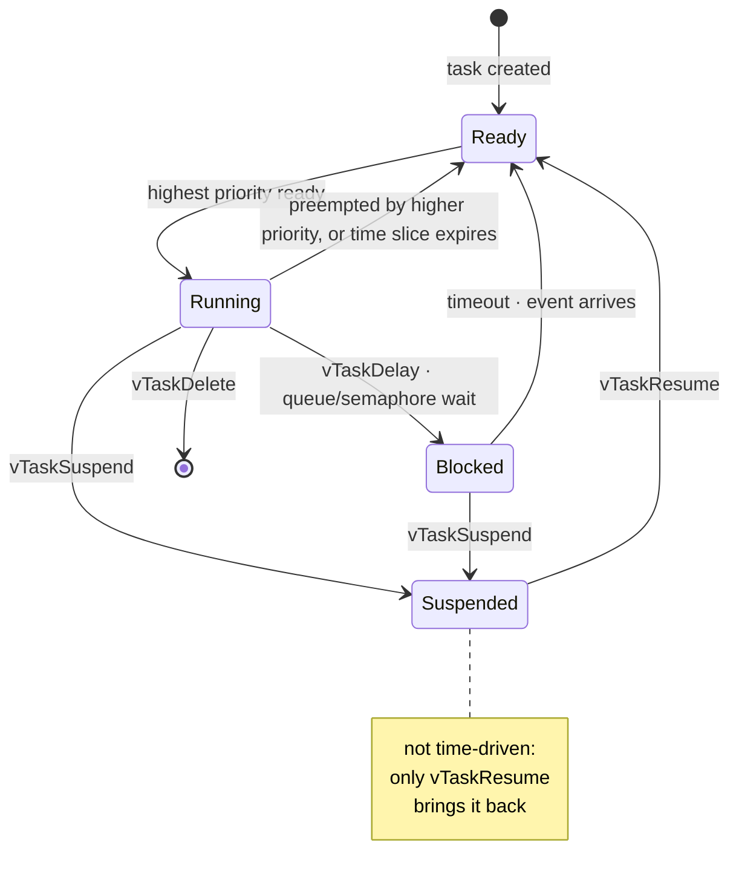
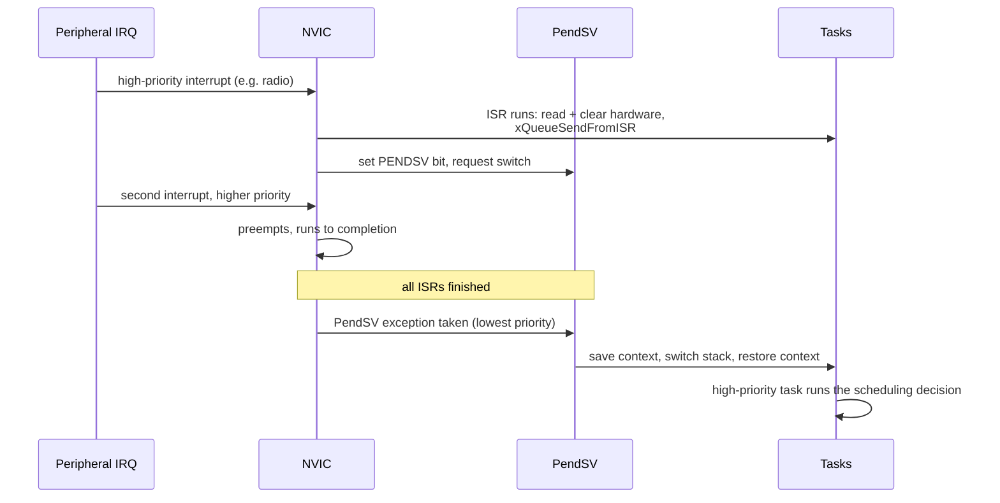
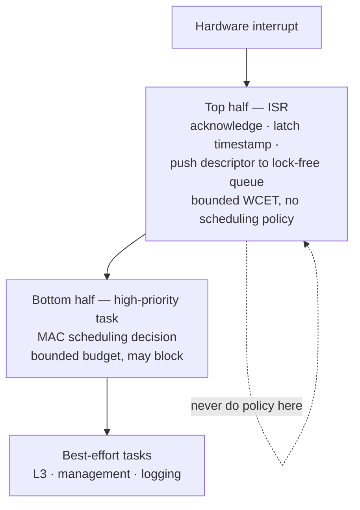

# Embedded Systems, RTOS and Hardware Interfaces

## 1. FreeRTOS core mechanics

### 1.1 Scheduling model
- **Fixed-priority preemptive scheduling** by default; equal-priority tasks round-robin under time slicing if configured.
- `configMAX_PRIORITIES` bounds the priority count; a **higher number = higher priority**.
- **Tick**: periodic SysTick interrupt drives the time base; `configTICK_RATE_HZ` sets it. Every tick the scheduler checks for a higher-priority ready task.
- **Tickless idle** (`configUSE_TICKLESS_IDLE`) suppresses the tick during idle to allow deep sleep — essential for the low-power designs in [[03-1 Wireless Sensor Networks and Low-Power MAC]].

### 1.2 Task state machine
`Running → Ready → Blocked → Suspended`

- **Running** — currently executing (one per core).
- **Ready** — able to run, waiting for a core.
- **Blocked** — waiting on a time event (delay) or a synchronisation event (queue/semaphore/notification).
- **Suspended** — explicitly removed from scheduling via `vTaskSuspend`, resumed only by `vTaskResume`. Not time-driven.
- Deleted tasks await idle-task cleanup of their resources.

### 1.3 PendSV — why it exists
On ARM Cortex-M, the exception model provides **SysTick** (periodic tick), **SVC** (supervisor call, used to start the scheduler from privileged context), and **PendSV** (a pended, lowest-priority system-level exception).

**The problem PendSV solves**: a context switch must not run *inside* a higher-priority ISR, or it would delay other interrupts and could be re-entered. PendSV is therefore **pended** during a tick or ISR and only executes **after all other ISRs complete**, at the lowest exception priority. This makes the context switch atomic and safely deferred.

The invariant this buys: **interrupt latency is bounded by the ISRs themselves**, and the scheduler's cost is paid once, at the end of the burst.

Why it matters for a wireless stack: the context-switch cost lands *after* the interrupt burst, so **ISR latency is bounded independently of how long the scheduler takes**. If you instead make scheduling decisions inside the interrupt handler, you break that property.

### 1.4 Risks of doing MAC scheduling in interrupt context
- **Unbounded ISR duration** → missed radio deadlines (the protocol stack's MAC is hard real-time).
- **Stack overflow** — ISR stack is small and shared.
- **Re-entrancy** — nested interrupts touching shared scheduler state.
- **Priority inversion with the tick** — long ISRs delay the scheduler.
- **Debugging and determinism loss** — no bounded worst-case execution time.
Correct pattern: ISR does the minimum (read/clear hardware, push to a queue using the `...FromISR` API), a high-priority task performs the scheduling decision.

### 1.5 Priority inversion
- A low-priority task holds a resource; a high-priority task blocks on it; a medium-priority task then preempts the low one — so the high-priority task waits for medium-priority work.
- **Fix: priority inheritance.** FreeRTOS mutexes (`xSemaphoreCreateMutex`) implement priority inheritance; **binary semaphores do not**. This is the canonical reason to distinguish mutex from semaphore.
- Classic reference failure: the Mars Pathfinder reset problem.

### 1.6 Synchronisation primitives — pick the right one
| Primitive | Use | Notes |
| --- | --- | --- |
| **Queue** | Move data between tasks/ISR | Copies data; `xQueueSendFromISR` for ISR use |
| **Binary semaphore** | Signal an event | No ownership, **no priority inheritance** |
| **Counting semaphore** | Resource pool / event counting | No ownership |
| **Mutex** | Mutual exclusion with ownership | **Has priority inheritance**; recursive mutex exists |
| **Recursive mutex** | Re-entrant locking | Same task may lock repeatedly |
| **Event group** | Wait on multiple event bits | 24 event bits (configurable), no data transfer |
| **Task notification** | Lightweight single-word signal | Fastest and smallest; replaces many semaphores |
| **Stream / message buffer** | Byte stream / variable-length messages | Efficient for serial and IPC |

### 1.7 Other mechanisms worth naming
- **Idle task and idle hook** — power management and background cleanup live here.
- **Software timers** — run in the timer service (daemon) task; callback context is a task, not an ISR.
- **Critical sections** — `taskENTER_CRITICAL` / `taskEXIT_CRITICAL` disable interrupts; keep them very short, especially with a radio running.
- **MPU support** — memory protection for safety-critical or certified designs.
- **SMP FreeRTOS** — core affinity for multi-core parts; relevant to the heterogeneous-core discussion in [[07-1 RISC-V for Communication Infrastructure]].

## 2. Bus and peripheral interfaces

### 2.1 I2C
- Two-wire, **open-drain**; requires **pull-up resistors**. Pull-up value is set by bus capacitance and desired rise time — too large a resistor gives slow edges, too small wastes current and may exceed drive capability.
- Specification limits total bus capacitance (commonly **400 pF** for the standard mode budget).
- **Arbitration is wired-AND**: a device driving a 0 wins over a device releasing to 1; a losing master detects the mismatch and backs off. No data is lost in the arbitration itself.
- **Clock stretching** — a slave holds SCL low to slow the transaction; the master must tolerate it.
- Repeated START for combined write-then-read transactions; 7-bit and 10-bit addressing.
- Speed modes: 100 kbps standard, 400 kbps fast, 1 Mbps fast-plus, 3.4 Mbps high-speed.
- Failure modes to diagnose: missing/incorrect pull-ups, address conflicts, bus lock-up from a slave holding SDA low, and ground bounce on long cables.

### 2.2 SPI
- Four-wire full duplex (SCLK, MOSI, MISO, CS); **CPOL / CPHA** define the four clock modes — mode mismatch is the most common bring-up bug.
- Push-pull, so no pull-ups and far higher rates than I2C.
- Multi-slave via separate chip selects, or daisy-chain for shift-register-style devices.
- Almost always **DMA-driven** for throughput; watch for CS de-assert timing relative to the last clock.

### 2.3 UART
- Asynchronous; start bit, data bits, optional parity, stop bits; both sides must agree on baud within tolerance.
- Hardware flow control (RTS/CTS) when the receiver cannot keep up.
- In embedded practice: **DMA + idle-line detection** or DMA + circular buffer, rather than byte-by-byte interrupts, to avoid ISR storms at high baud.

### 2.4 CAN
- Differential two-wire bus; **non-destructive arbitration** by identifier — the lowest identifier value wins, and the loser retries automatically. This is CSMA/CD+AMP (carrier sense, multiple access with collision detection and arbitration on message priority).
- Bit stuffing, CRC, error frames, error-active/error-passive/bus-off states.
- **CAN FD** — payload up to **64 bytes** and a second (higher) bit rate during the data phase.
- Relevant to industrial and automotive edge deployments.

### 2.5 DMA and cache coherency
- **Scatter-gather / descriptor-based DMA** avoids CPU per-byte work.
- On Cortex-A and many Cortex-M7 parts with data cache, DMA writes to memory the CPU may have cached → stale reads; CPU writes to memory DMA will read → dirty lines not yet flushed.
- Remedies: **clean/invalidate the D-cache** at the right boundaries, use **non-cacheable or write-through regions** configured in the MPU, and align buffers to cache-line boundaries to avoid false sharing.

## 3. ARM Cortex-M exception model

- **NVIC** with programmable priorities; priority grouping splits preemption priority from sub-priority.
- Exceptions: Reset, NMI, HardFault, MemManage, BusFault, UsageFault, SVC, PendSV, SysTick, then peripheral IRQs.
- **HardFault debugging** — stacked PC/LR, fault status registers (CFSR, HFSR, MMFAR, BFAR) — the practical skill for field failures.
- **TrustZone-M** for secure/non-secure partitioning on M23/M33 and later.

## 4. Zero-copy and buffer management — the embedded-to-dataplane bridge

The strongest cross-domain answer you can give here:

- **RTOS message queues** typically copy small fixed-size items, or pass pointers. Passing pointers is cheap but hands you lifetime-ownership problems.
- **DPDK `rte_mempool`** solves the same problem with pre-allocated, NUMA-aware, per-core-cached `mbuf` pools — see [[05-1 DPDK User Plane and 5G UPF]].
- **DPAA / DPDK on embedded multi-core** adds hardware buffer pools and queue managers.
- The tradeoff is identical in both worlds: **pre-allocation and pooling eliminates allocation jitter and fragmentation at the cost of fixed memory commitment.** On a constrained device that commitment is the whole design question.

## 5. Interrupt top-half / bottom-half and protocol stack real-time behaviour

- **Top half (ISR)**: acknowledge hardware, minimal bookkeeping, hand off.
- **Bottom half**: deferred processing — tasklet/workqueue in Linux, or a high-priority RTOS task.

- Mapping onto a wireless stack:
  - L1 processing has the hardest deadline (slot/symbol) → ISR or dedicated accelerator completion interrupt
  - L2 scheduling decision belongs in a high-priority task with a bounded budget, not in the ISR
  - L3 and above are best-effort tasks
- Getting this split wrong is the usual root cause of "the modem misses deadlines under load".

## Anchors — verified facts

- Cortex-M exception model provides **SysTick, SVC and PendSV**; **PendSV is pended and runs at the lowest priority after all other ISRs**, which is what makes deferred context switching safe.
- **FreeRTOS mutexes implement priority inheritance; binary semaphores do not.**
- CAN arbitration is non-destructive by identifier priority; **CAN FD payload up to 64 bytes** with dual bit rate.
- I2C is open-drain with wired-AND arbitration, requires pull-ups, and supports clock stretching; bus capacitance budget is commonly **400 pF**.
- SPI clocking is defined by **CPOL/CPHA**, giving four modes.

## Related

- [[04-3 Embedded Software Architecture - Patterns, Layering and Wireless System Structure]] — the layer above: execution models, HSM, time-triggered vs event-triggered, safety cases built on these primitives
- [[08-2 C and C++ Programming - Language Features, STL and Systems Practice]] — bare-metal C idioms, volatile vs atomic, `-fno-exceptions` embedded C++ profile
- [[05-1 DPDK User Plane and 5G UPF]]
- [[03-1 Wireless Sensor Networks and Low-Power MAC]]
- [[02-2 WLAN - Power Saving Mechanisms and Evolution]] — the consumer of these primitives: sleep-clock ppm setting the TWT wake margin, RTC domains, out-of-band host wake
- [[07-1 RISC-V for Communication Infrastructure]]
- [[06-3 Machine Learning - Foundations, Core Algorithms and Applications]] — TinyML as an RTOS workload: quantised models on Cortex-M class parts, inference inside a task's deadline, and the memory budget that decides whether a model fits at all
- [[08-1 Programming Languages Toolchain and Performance Engineering]]
- [[04-6 Linux Device Drivers - Model, Probe, Data Path, Power and Bring-Up]] — the Linux counterpart in full: the same buses and DMA questions answered inside the driver model, plus the interrupt and power machinery this note's RTOS primitives replace
- [[04-2 Linux Embedded Development - Drivers, Applications and Core Subsystems]] — the Linux counterpart: PREEMPT_RT, OpenAMP/rpmsg, driver model
- [[04-4 Linux Interrupts - Types, Handlers, Threaded IRQs and Deferred Work]] — the Linux answer to the top/bottom-half split in §5: threaded IRQs at priority 50 versus a high-priority RTOS task, and the same "no policy in the ISR" rule enforced by different machinery
- [[04-5 Linux Concurrency - Kernel and User Mode, Processes, Threads and IPC]] — the counterpart to §1.6: the same primitives (mutex with inheritance, queue, semaphore) on a kernel that also has a privilege boundary and a futex underneath them

---

_Copyright (c) 2026 Washington Ruan and contributors · licensed under **GPL-3.0-or-later** or **AGPL-3.0-or-later**, at your option · see `LICENSE` and `LICENSE-AGPL`._
