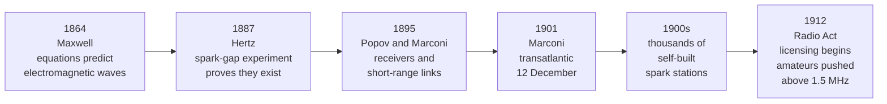
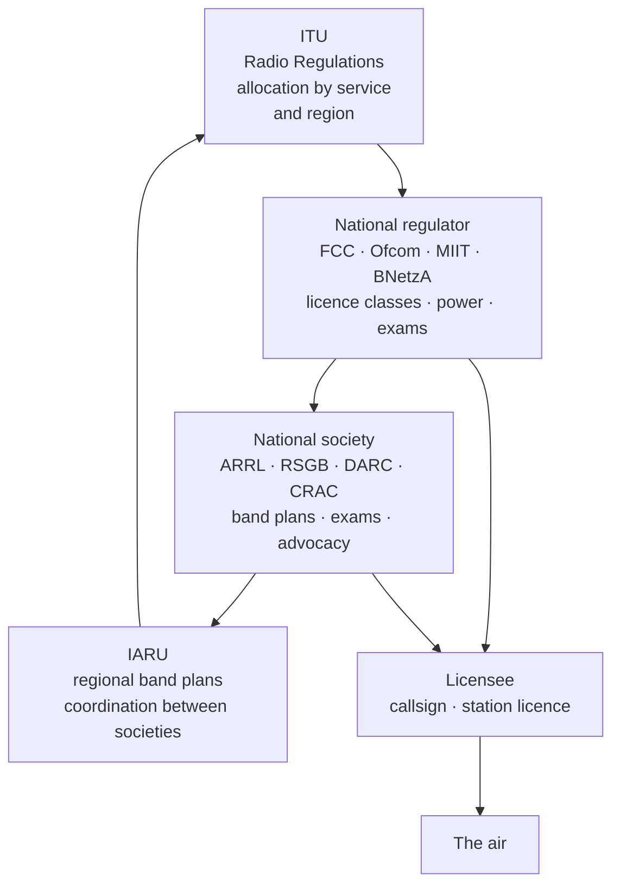
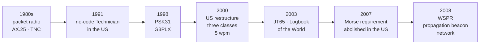
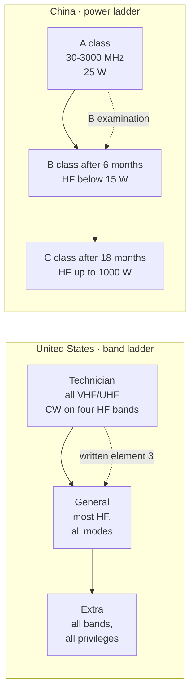
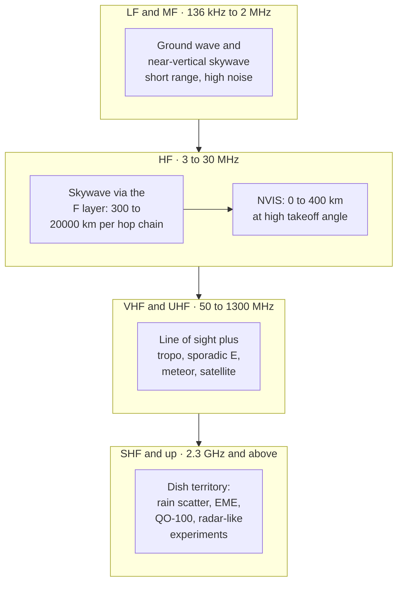

# HAM — Amateur Radio: History, Regulation and the State of the Hobby

> **The only radio service whose spectrum is licensed to individuals rather than to operators of a
> network.** Everything else in this vault — a gNB, an AP, a UPF — exists to carry somebody else's
> traffic under a licence held by a company. Amateur radio is the one corner of the spectrum where
> the licensee is the experimenter, the transmitter is theirs to modify, and the only prohibition on
> content is that it must not be commercial. That single structural fact explains a century of
> outsized technical output, the peculiar etiquette of the air, and why the service is simultaneously
> dying by headcount and thriving by capability.

Two notes cover this domain. This one is the **history and the institutional map**: who wrote the
rules, what each era discovered, and what the 2026 numbers actually say. Its sibling,
[[11-2 HAM - Operating Practice - Station, Propagation, Modes and the QSO]], is the **method**: how a
station is budgeted, built, aimed, and worked.

## 1. The service, defined

### 1.1 The treaty definition

Amateur radio is not a hobby that happens to be regulated; it is a *radiocommunication service*
created by treaty and then filled in by national law. The definition in the ITU Radio Regulations
(No. 1.56) is short enough to quote in full:

> **Amateur service:** A radiocommunication service for the purpose of self-training,
> intercommunication and technical investigations carried out by amateurs, that is, by duly
> authorized persons interested in radio technique solely with a personal aim and without pecuniary
> interest.

And the companion, No. 1.57:

> **Amateur-satellite service:** A radiocommunication service using space stations on earth
> satellites for the same purposes as those of the amateur service.

Six words in that definition do all the legal work, and each of them has been litigated, clarified and
narrowed over a hundred years:

| Phrase | What it actually constrains |
| --- | --- |
| **Self-training** | The service exists to make the operator more competent. It is the reason examination requirements are legitimate at all — a licence is a certificate of training, not a property right |
| **Intercommunication** | Two-way, between amateurs. Not broadcasting: one-to-many transmission to the public is forbidden in every national code |
| **Technical investigations** | The licence to experiment. This is the clause that lets an amateur build a transceiver that no type-approval would ever cover |
| **Duly authorized** | Licensed by a state. There is no such thing as unlicensed amateur radio, however informal the entry exam has become |
| **Personal aim** | Not for an employer, a customer, or a campaign |
| **Without pecuniary interest** | No payment, no advertising, no sponsorship of content. Equipment may be sold; airtime may not |

### 1.2 What the definition forbids

The prohibitions are more instructive than the permissions, because they are what separates amateur
radio from podcasting with a power amplifier:

- **No broadcasting.** A transmission intended for the general public is not permitted. A CQ is
  addressed to *amateurs*, which is why the distinction survives: a QSO is a conversation between
  licensees, not a programme.
- **No commercial traffic.** Third-party traffic is allowed in many jurisdictions (and prohibited in
  some) but never for hire. This is why the service cannot become a cheap backhaul business, and why
  the spectrum has stayed available to individuals.
- **No encryption.** Messages must be intelligible to other amateurs or use published protocols. A
  self-designed digital mode is legal only if its specification is public — the same rule that makes
  FT8 and JS8 legal and a private scrambled link not.
- **No interference.** Universally: the amateur must not cause harmful interference, and where the
  allocation is secondary, must not claim protection from the primary service. This is the same
  obligation 02-17 describes for DFS clients, applied to an entire service instead of a channel.

### 1.3 Why the states agreed to it

Three rationales appear in every regulatory impact assessment from 1927 to 2024, and they are worth
knowing because they are the arguments that keep the spectrum allocated:

1. **A trained reserve.** Amateur operators are a standing pool of people who can run
   communications when infrastructure fails. Wartime mobilisation made this concrete twice.
2. **Cheap research.** The service has repeatedly explored spectrum and techniques before they were
   commercially interesting — shortwave in the 1920s, VHF in the 1930s, moonbounce in the 1950s,
   packet radio in the 1970s, weak-signal coding in the 2010s.
3. **A pipeline into engineering.** Most professional radio engineers of a certain age passed
   through it. The pipeline claim is the weakest of the three empirically and the strongest
   politically.

## 2. Before the hobby, 1864–1912

The technology arrived before the hobby, and the hobby arrived only when the technology became cheap
enough for a teenager to afford.

The sequence matters for a reason that is easy to miss. Hertz's 1887 apparatus could barely span a
room; by 1901 a signal crossed an ocean. In between, the components — coherer, spark coil, Leyden
jar, long wire — were simple enough that an amateur could build them from a catalogue, and thousands
did. The first radio amateurs were therefore not users of a service; they were the service.

Two events converted that enthusiasm into an institution:

- **The *Titanic*, April 1912.** Radio's role in the rescue — and the operators who missed the
  distress traffic — made unregulated private transmission a public-safety problem. The US Radio Act
  of 1912 followed within months: licences, examinations, assigned wavelengths, and a hard partition
  of the spectrum between commercial, government and private stations.
- **The 200-metre clause.** Amateurs were pushed to wavelengths of 200 m and shorter — that is,
  above 1.5 MHz — because long wavelengths were believed to be the only ones useful for distance, and
  the commercial and maritime services wanted them. The estimate of amateur station numbers in the
  US dropped from roughly 10,000 to about 1,200 within a year.

The 200-metre clause is the most consequential accident in the history of the service. The band the
professionals discarded turned out to be the band that reflects off the ionosphere. Within a decade
amateurs had proved that shortwave worked better for long distance than anything the professionals
had, and had forced a complete rewrite of commercial radio practice.

## 3. The accident that created shortwave, 1912–1927

### 3.1 The transatlantic tests

The proof came in two steps, and the distinction between them is a good interview question because it
separates "heard them" from "talked to them":

| Date | Event | Why it mattered |
| --- | --- | --- |
| December 1921 | ARRL sends Paul Godley to Ardrossan, Scotland, with a superheterodyne receiver; he copies US amateur station **1BCG** | One-way reception proved the path, but a listener is not a contact |
| November 1923 | **1MO** (Fred Schnell) and **1XAM** (John Reinartz) in the US exchange two-way traffic with **8AB** (Léon Deloy) in France | The first sustained two-way transatlantic amateur contact, on about 110 m |
| 1924 | New bands at 80, 40, 20 and 5 m; spark prohibited on them | The service moves from a wavelength to a band plan |
| 1925 | **IARU founded in Paris** by representatives of 25 countries | Amateur radio acquires a body that can speak to treaty conferences |
| 1927 | International Radiotelegraph Conference, Washington: 70 nations | Amateur bands get treaty status; international call-sign prefixes introduced |

The 1923 contact is the hinge. Once two amateurs could hold a conversation across an ocean with
equipment worth a few weeks' wages, the commercial services that had dismissed shortwave as useless
had to move onto it, and the amateurs' claim to a share of it became a treaty question rather than a
technical one. From that point the history of amateur radio is a history of *negotiating spectrum*,
not of discovering it.

### 3.2 The organisations that still exist

Three bodies were created in this window and all three still set the terms:

- **ARRL** (American Radio Relay League), founded April 1914 by Hiram Percy Maxim and Clarence Tuska.
  Its original purpose was a relay network — "league" is literal — because a 200 m spark station
  reached about 25 miles. Its magazine *QST* began in 1915 and is still the US journal of record.
- **IARU** (International Amateur Radio Union), 1925, Paris. Three regions, mirroring the ITU:
  Region 1 Europe/Africa/Middle East, Region 2 the Americas, Region 3 Asia-Pacific. The IARU is a
  *member society* federation, not a regulator; it has no enforcement power and considerable moral
  authority. It is the body that produces the regional band plans amateurs actually follow.
- National societies — RSGB in the UK, DARC in Germany, JARL in Japan, CRAC in China, RAC in Canada.
  They administer examinations in some countries, represent the hobby to the regulator in all of
  them, and run the awards programmes.

The loop in that diagram is the whole governance system: the ITU allocates a service, the state
licenses a person, the society writes the operating conventions that no law could specify, and the
society then lobbies the state and the ITU for the next allocation. Where the loop is weak — a country
with no active society — the hobby is weak.

## 4. Maturity, war and the first spectrum loss, 1927–1945

The interwar period is when amateur radio became a *culture* rather than an experiment: examinations,
call books, QSL cards, contests, and the first operating conventions that survive verbatim in 2026.

- **1927–1939: growth through depression.** Despite the Depression, US amateur numbers rose from about
  17,000 to about 47,000 between 1929 and 1936. Cheap war-surplus-quality components made a station
  affordable; the superheterodyne made it usable.
- **1933: the first ARRL Field Day**, the emergency-preparedness exercise that is still the largest
  single on-air event in North America. Its premise — operate for 24 hours on emergency power, away
  from mains — is a systems test disguised as a picnic.
- **1934: the FCC replaces the Federal Radio Commission** under the Communications Act. US amateur
  licensing is reorganised into classes, the ancestor of the present three.
- **1938: the Cairo conference** ends exclusive amateur use of 40 m, sharing it with broadcasters — the
  first demonstration that an amateur allocation is never permanent.
- **1939–1945: total shutdown.** Every belligerent suspended amateur transmission; in the US stations
  were dismantled and *QST* ceased publication for the duration. The technical consequence was
  enormous and usually underrated: thousands of radio amateurs went into signals intelligence, radar
  and HF direction-finding, and came back with VHF, FM, crystal filters and pulse techniques that
  redefined what a hobby station could be.

## 5. The postwar technical arc, 1945–1980

The postwar years produced the pattern that still defines the hobby: a technique is tried by amateurs
at low cost, proves itself, and is then absorbed by commercial radio.

| Year | Development | Where it ended up |
| --- | --- | --- |
| Late 1940s | **Single sideband** replaces AM on HF: half the bandwidth, all the power in the information | Every HF professional service; SSB is still the default voice mode on the amateur bands |
| 1946–1950s | Surplus military equipment floods the market: ARC-5, BC-348, Command sets | The first cheap VHF/UHF capability; the origin of "homebrew" as a mass practice |
| 1950s | **VHF and UHF weak-signal work**: tropospheric ducting, meteor scatter, aurora | Propagation science that later informed radar and satellite link design |
| 1953–1960 | **Moonbounce (EME)** experiments on 1296 MHz and 144 MHz | The first demonstration that a two-way link could close over 770,000 km with amateur-class antennas, and the template for deep-space link budgets |
| 12 December 1961 | **OSCAR 1**, the first amateur satellite: 10 kg, 140 mW, 144.983 MHz, sending "HI" in Morse for 22 days | The first non-government satellite and the first piggyback payload; a $68 out-of-pocket budget |
| 1965 onward | OSCARs carry linear transponders rather than beacons | Amateur radio becomes a satellite service in substance, not just in name |
| 1979 | **WARC-79** creates the 30, 17 and 12 m bands | The last major new HF allocations; effective from 1982 |
| 1978–1984 | **Packet radio**: terminal-node controllers, the Vancouver protocol work, AX.25 | The direct ancestor of the amateur digital network, and a case study for the OSI model that was being written at the same time |

Two of those rows deserve emphasis because they are the ones that get forgotten.

**OSCAR 1** is the single most cited "amateurs did it first" fact, and it is worth knowing the
numbers rather than the claim: a 10 kg box, 140 mW of transmitter power, no solar cells, 22 days of
life, launched as ballast on a Thor-Agena, and built for $68 in out-of-pocket cost. It was also the
first satellite ejected as a secondary payload into its own orbit — using a spring bought at a
hardware store. The engineering lesson is not "amateurs are clever"; it is that **the launch
opportunity, not the spacecraft, was the scarce resource**, which is still true of every amateur
satellite flown in 2026.

**Packet radio** matters for a different reason. AX.25 is a derivative of X.25 adapted for a shared
radio channel, with a AX.25 frame carrying callsigns in its address field so that a digipeater can
relay without routing tables. It is the reason the first amateur digital networks looked like the
early internet, and the reason APRS — a position-reporting network running at 1200 baud — still works
when cellular does not.

## 6. The digital arc and deregulation, 1980–2010

This period is where the hobby's regulatory bargain changed permanently: the technical bar to entry
was lowered, and the technical ceiling was raised.

The deregulation sequence is the part that outsiders misread most often. Each step removed a
*testing* requirement, never the licence:

- **1991: the no-code Technician.** A US entry licence with no Morse requirement, giving full VHF/UHF
  privileges. Numbers grew immediately, and the demographic of the hobby changed with them.
- **April 2000: restructuring to three classes** — Technician, General, Extra — with a 5 wpm Morse
  requirement retained only for the HF licence.
- **February 2007: Morse abolished entirely** as a licensing requirement, following a worldwide trend
  after WRC-03 deleted the treaty obligation. Morse did not disappear from the bands; it stopped
  being a gate.
- **2003: Logbook of the World.** A cryptographically signed, cardless confirmation system. Its
  effect on DXing was comparable to the effect of email on correspondence: it removed a months-long
  postal delay from the feedback loop of every award programme.

## 7. The weak-signal revolution, 2010–2026

The last fifteen years are the most technically interesting in the hobby since the 1950s, and they are
almost entirely a *software* story.

### 7.1 FT8 and the change in what a contact is

FT8 arrived in July 2017 in WSJT-X 1.8.0, written by Steven Franke (K9AN) and Joe Taylor (K1JT). The
protocol is a study in doing the minimum very well:

| Parameter | FT8 |
| --- | --- |
| Transmit/receive cycle | 15 s, aligned to :00, :15, :30, :45 UTC |
| Transmission length | 12.64 s, leaving about 2.4 s to decode |
| Modulation | 8-FSK, 6.25 Hz tone spacing, constant envelope |
| Occupied bandwidth | about 50 Hz |
| Message | 77 bits of payload plus 14 bits of CRC; 13-character free text |
| Forward error correction | LDPC(174, 91) since WSJT-X 2.0 (10 December 2018); the original 2017 protocol used a 75-bit payload and LDPC(174, 87) |
| Decoding threshold | about −21 dB SNR in a 2.5 kHz reference bandwidth |

The consequence is arithmetic, not magic. Fifty hertz of bandwidth buys roughly 17 dB against a
2.5 kHz SSB signal; a 15-second integration buys more; a low-rate LDPC code buys the rest. What is
left is a mode that decodes signals no ear could find, at the cost of carrying almost no information.
A complete QSO is four to six structured messages and takes about 90 seconds.

That trade — enormous sensitivity for almost zero content — is the most contested thing in the hobby
in 2026, and both sides are right. FT8 made DX accessible to a 100 W station with a wire antenna, and
it made the bands sound like a data channel rather than a conversation. It also, measurably, changed
the composition of activity: a large fraction of all HF contacts now happen in 50 Hz slices, and the
traditional phone subbands are quieter than they were in 1990.

### 7.2 The rest of the decade

- **2018: QO-100 / Es'hail-2.** Launched 15 November 2018 to 25.9° E, the first amateur transponders in
  geostationary orbit: a 250 kHz narrowband linear transponder (2400.05–2400.30 MHz up,
  10489.55–10489.80 MHz down) and an 8 MHz wideband digital transponder. A geostationary amateur
  satellite removes Doppler, tracking and pass planning from the operating problem, which is why it
  became the most-used amateur satellite within a year.
- **2019: FT4**, a 7.5-second, 4-FSK variant built for contest rates rather than maximum sensitivity.
- **2019: WRC-19** allocated 50 MHz in Region 1, with country footnotes and power limits, ending a
  decades-long asymmetry in which only Region 2 and 3 had a 6 m band.
- **2020–2026: remote operation.** Stations that can be operated over the internet turn antenna farms
  into shared infrastructure. The regulatory question — whose licence governs when the operator and
  the transmitter are in different countries — is still being answered country by country.
- **2023: FCC eliminates the HF symbol-rate limit**, replacing it with a 2.8 kHz bandwidth limit
  (FCC 23-93, adopted 13 November 2023, effective 2024). The 300-baud rule that had constrained HF
  data since the 1980s disappeared; PACTOR-IV and faster modes became legal in the US without a
  waiver.
- **2025: the 60 m allocation finally lands.** On 9 December 2025 the FCC released the Report and
  Order implementing the WRC-15 secondary allocation at **5351.5–5366.5 kHz**, 9.15 W ERP, General
  class and above, 2.8 kHz maximum bandwidth, while retaining four channels at 5332, 5348, 5373 and
  5405 kHz at 100 W ERP.
- **2023–2026: machine learning enters the receiver.** Neural decoders and denoisers now run in
  software on ordinary PCs, and the same models that improved FT8 decoding are being applied to
  speech enhancement and signal classification. The hobby is, once again, an early adopter of a
  technique it did not invent.

## 8. Who may transmit, and on what

### 8.1 Licence classes, compared

Every administration answers the same question differently: how much technical competence should be
demonstrated before an operator is allowed to build a transmitter that can reach another continent?

| Country | Classes (entry → top) | Examination | Privilege ladder |
| --- | --- | --- | --- |
| **United States** | Technician → General → Amateur Extra | Element 2: 35 questions, 26 to pass · Element 3: 35/26 · Element 4: 50/37 | Technician: all VHF/UHF, plus CW on parts of 80/40/15 m and CW plus phone on part of 10 m · General: most HF · Extra: all amateur bands |
| **United Kingdom** | Foundation → Intermediate → Full | Three tiers, Foundation being a practical-plus-multiple-choice entry | 10 W → 50 W → 1 kW (the Full limit was raised in the 2024 licence variation, `VERIFY` on the exact figure by band) |
| **China** | A → B → C | A: 30 questions, 25 to pass, 30 min · B: 50 questions, 40 to pass, 60 min · C: paper examination, requires 18 months of an HF-authorised licence | A: 30–3000 MHz, ≤25 W · B: below 30 MHz <15 W, above 30 MHz ≤25 W · C: below 30 MHz ≤1000 W, above 30 MHz ≤25 W |
| **Germany** | Class E (entry) → Class A | 90-minute technical examination for A; E is a reduced syllabus | E: VHF/UHF and limited HF · A: full |
| **Japan** | Fourth → Third → Second → First | National examination, with a separate Morse credit | Power and band ladder by class; the 4th class is the mass-market entry point |

Two details in that table are worth pulling out because they are the ones candidates get wrong:

- **A US Technician does have HF privileges.** They are CW-only on four bands, plus a 200 kHz phone
  segment at 28.3–28.5 MHz. "Technician means VHF only" is a convenient shorthand and a factual
  error.
- **China's C class is the only route to high power on HF** (up to 1000 W below 30 MHz), and it is
  gated on *time at the previous class* — 18 months holding an HF-authorised licence — not only on an
  examination. The A and B examinations are free of charge; the rules are set out in the Ministry of
  Industry and Information Technology order No. 67, published 18 January 2024 and in force from
  1 March 2024.

The ladder itself is worth drawing, because the two systems climb it differently: the US adds a class
that unlocks *bands*, while China adds a class that unlocks *power*.

### 8.2 The Chinese framework in detail

Because the 2024 order rewrote the whole national framework, it is worth stating precisely — it is
also a useful contrast with the US model, where the regulator delegates examination to volunteers.

| Item | Rule under MIIT Order No. 67 |
| --- | --- |
| Instrument | *Measures for the Administration of Amateur Radio Stations*, MIIT Order No. 67: adopted 11 January 2024, published 18 January 2024, in force 1 March 2024 |
| Classes | A, B, C — determined by an operating-technical-competence certificate issued after examination |
| A class | 30–3000 MHz, maximum 25 W |
| B class | Below 30 MHz and less than 15 W; above 30 MHz and no more than 25 W. Requires 6 months holding an A-class licence |
| C class | Below 30 MHz up to 1000 W; above 30 MHz no more than 25 W. Requires 18 months holding a licence that lists frequencies below 30 MHz |
| Minors | May operate 30–3000 MHz at no more than 25 W |
| Licence term | No more than 5 years; renewal 30 working days before expiry |
| Log | Must be kept, with two years' retention |
| Identification | Callsign at the start and end of every contact, and at least every 10 minutes during it |
| Above 15 W on HF | Application goes to the national regulator, not the provincial one |

The 10-minute identification rule and the two-year log retention are the two obligations most often
forgotten by newly licensed operators, and both are checkable facts rather than conventions.

## 9. The spectrum

### 9.1 The bands

Amateur allocations run from 135.7 kHz to above 100 GHz, but the useful map is much smaller than that.

| Band | Frequency | Wavelength | Character |
| --- | --- | --- | --- |
| 2200 m | 135.7–137.8 kHz | 2200 m | Experimental; very high atmospheric noise, tiny antennas, WSPR only in practice |
| 630 m | 472–479 kHz | 630 m | Same physics, slightly kinder; a WRC-12 allocation |
| 160 m | 1.8–2.0 MHz | 160 m | Winter night only; high noise; "top band" prestige |
| 80 m | 3.5–4.0 MHz | 80 m | Night regional; NVIS; the busiest emergency band in Europe |
| 60 m | 5351.5–5366.5 kHz | 60 m | Secondary, channelised history, strict power limits; near-NVIS |
| 40 m | 7.0–7.3 MHz | 40 m | Day and night; the workhorse DX band; NVIS by day at high angle |
| 30 m | 10.1–10.15 MHz | 30 m | WARC; CW and narrow data only in most countries; no contests |
| 20 m | 14.0–14.35 MHz | 20 m | The DX band; open day and night at solar maximum |
| 17 m | 18.068–18.168 MHz | 17 m | WARC; quieter, low power |
| 15 m | 21.0–21.45 MHz | 15 m | Daylight DX; excellent at solar maximum |
| 12 m | 24.89–24.99 MHz | 12 m | WARC; sensitive to solar flux |
| 10 m | 28.0–29.7 MHz | 10 m | Sporadic E in summer; huge at solar maximum; the classic first DX band |
| 6 m | 50–54 MHz | 6 m | "The magic band": sporadic E, TEP, aurora; Region 2 and 3 primary, Region 1 since WRC-19 |
| 2 m | 144–148 MHz | 2 m | Local, repeaters, satellites, EME |
| 70 cm | 430–440 MHz | 70 cm | Repeaters, DMR, satellites, the most-used UHF band |
| 23 cm and up | 1240 MHz → 241 GHz | 23 cm → 1.2 mm | Microwave experimentation, QO-100 uplink, 10 GHz rain scatter |

Three structural observations that the table hides:

1. **The bands are harmonised, the edges are not.** 40 m is 7.0–7.2 MHz in Region 1 and 7.0–7.3 MHz
   in Region 2; 6 m does not exist in most of Region 1 before 2023. A band plan is therefore regional
   first and national second.
2. **Width shrinks as frequency rises.** 80 m is 500 kHz wide; 2 m is 4 MHz; 23 cm is 30 MHz. In
   *percentage* terms the opposite is true, which is why microwave operation is about narrowband modes
   and dish gain rather than about spectrum.
3. **The WARC bands (30, 17, 12 m) are contest-free by agreement.** They were created in 1979 on the
   condition that they not be used for contests, and the convention has held for four decades. They
   are where you go during a contest weekend.

### 9.2 What each band is for

## 10. The state of the hobby in 2026

### 10.1 The numbers

| Metric | Value | Date and source |
| --- | --- | --- |
| Licensed amateurs worldwide | About 3 million | IARU standing statement |
| US licences, all classes | 770,217 at the 2022 peak; 745,571 at end-2024; 734,841 in April 2026 | FCC via ARRL licence counts |
| US class split, April 2026 | Technician 361,108 (49.1%) · General 184,824 (25.2%) · Extra 157,882 (21.5%) · Advanced 26,714 · Novice 4,313 | ARRL/FCC |
| ARRL membership | About 16% of US licensees in 2024, down from about 24% in 2000 | K4FMH analysis of ARRL data |
| Median ARRL member age | 68 in 2019; non-members averaged 52 | *QST*, May 2019 editorial |
| Japan | About 382,000 licensees, declining from a peak above 430,000 | JARL-adjacent counts, `VERIFY` |
| China | Growth from roughly 100,000 in the late 2010s toward 200,000+ | `VERIFY` — no single published series |
| Germany | DARC membership declining for two decades | DARC annual reports |

### 10.2 What the numbers mean

Read carefully, the statistics say something more specific than "ham radio is dying" or "ham radio is
booming":

- **The US peaked in 2022 and is now declining at about 1.4% a year.** The causes are identifiable:
  a $35 licence fee introduced in 2022, the natural attrition of a cohort licensed in the 1970s, and
  a federal shutdown in late 2025 that suspended processing for about two months and cost roughly
  7,000 licences in the count.
- **The decline is concentrated in exactly one class.** Technician lost about 5,500 in 2025; General
  was flat; Extra *gained* about 1,300. The people leaving are the ones who never upgraded, which
  means the loss is not a loss of capability but of pipeline.
- **The association is shrinking faster than the base.** ARRL membership fell from 24% to 16% of
  licensees in twenty-four years. A national society with 16% penetration cannot claim to speak for
  the service, and its finances reflect that.
- **Worldwide, growth is in Asia.** The three-million figure is roughly stable only because growth in
  China, Indonesia, India and Thailand offsets contraction in Japan, Germany and the US.

### 10.3 The four structural shifts

1. **From voice to data.** A majority of HF *activity* — not of licensees — is now digital, and much
   of that is FT8. The bands are busier in decodes and quieter in conversation.
2. **From station to service.** Remote operation separates the operator from the antenna. Cloud-hosted
   FT8 skimmers, WebSDR receivers and remote transceiver services mean a licence can be exercised
   against hardware the licensee will never touch.
3. **From owning to assembling.** A 2026 station is a transceiver, a computer, a sound interface, an
   SDR for panadapter duty, and software that is updated weekly. The homebrew tradition survives in
   antennas and in software, less in transceivers.
4. **From hobby to citizen science.** HamSCI, the Personal Space Weather Station network, WSPR
   propagation mapping and meteor-scatter campaigns turn thousands of stations into a distributed
   ionospheric observatory. This is the strongest argument for the service's continued allocation.

### 10.4 What people actually do with it

"Amateur radio" is a licence category, not an activity. The licence supports at least ten distinct
pursuits, and they have almost nothing in common except the spectrum:

| Activity | What it is | Entry cost | What it teaches |
| --- | --- | --- | --- |
| **DXing** | Confirming contacts with as many countries as possible | Low | Propagation, antennas, patience |
| **Contesting** | 24–48 hours of maximum-rate contacts | Low to very high | Station engineering, operator discipline, fatigue management |
| **Ragchewing** | Conversations, often with the same people for decades | Lowest | Operating manners, and the social layer that keeps clubs alive |
| **QRP** | Operating at 5 W or less | Low | Antenna efficiency and the arithmetic of every dB |
| **Homebrew** | Building transceivers, amplifiers, antennas, software | Low, in time | Analogue and RF design, embedded programming, mechanical work |
| **Digital modes** | FT8, PSK, RTTY, packet, APRS, Winlink | Low | DSP, protocol design, time synchronisation |
| **VHF/UHF and microwave** | Weak-signal work from 50 MHz to 100 GHz | Medium to high | Propagation, dish and feed design, phase noise |
| **Satellites** | LEO and geostationary operation | Low to medium | Orbital mechanics, Doppler, link budgets |
| **Emergency communications** | Public-service nets and deployments | Low | Message handling, logistics, working under pressure |
| **Citizen science** | WSPR networks, ionospheric sounding, meteor scatter campaigns | Low | Measurement discipline, data analysis |

The distribution is heavily skewed: a large majority of licensees are active mainly through local
repeaters and occasional HF operating, while the contest, DX and digital sub-populations generate most
of the on-air activity. This is why the same hobby can look thriving (a contest weekend, an FT8 band
full of decodes) and empty (a weekday afternoon on 80 m phone) depending on which sample you take.

### 10.5 The four pressures

| Pressure | Mechanism | Who feels it |
| --- | --- | --- |
| **Aging base** | Median member age in the high 60s; entry rate below attrition rate | Every national society |
| **Urban noise** | Switching power supplies, LED drivers, PLC, VDSL: the HF noise floor in a city has risen by tens of dB in thirty years | Anyone operating below 30 MHz from an apartment |
| **Antenna restrictions** | Planning law, covenants, tenancy; the physical antenna is the part no software can virtualise | Urban operators, especially in Europe |
| **Spectrum pressure** | Every MHz is wanted by mobile; amateur allocations are secondary or shared in most bands | IARU and national societies, permanently |

The mitigation for all four is the same and is worth stating as a conclusion: **the hobby's future is
in the parts that are cheap to site and hard to commercialise** — weak-signal digital modes, receive
networks, satellite and microwave work, and the citizen-science role. A 50 Hz signal at −21 dB does
not need a tower.

## 11. What the service actually contributed

The list is longer than the hobby usually claims and shorter than its advocates claim. Each row is a
technique first demonstrated at amateur scale and later absorbed commercially.

| Contribution | Amateur origin | Where it went |
| --- | --- | --- |
| Shortwave propagation | 1921–1923 transatlantic tests | All international broadcasting and HF communications |
| Single sideband | Amateur adoption in the late 1940s | Every professional HF service; marine and aeronautical HF |
| VHF/UHF practice | 1930s–1950s experimentation | Land mobile, radar, satellite |
| Moonbounce link budgets | 1953 onward | Deep-space communications methodology |
| Small satellites | OSCAR 1, 1961 | CubeSats; the piggyback launch model |
| Packet radio and AX.25 | Late 1970s | Early internet protocol work; telemetry and APRS |
| Weak-signal coding | JT65, WSPR, FT8, 2003–2017 | Low-rate FEC practice; the decoders are now textbook examples |
| Software-defined radio at hobby price | 2000s onward; SoftRock, USRP, RTL-SDR | SDR became a consumer and academic instrument |
| Distributed propagation sensing | RBN, WSPR, PSK Reporter, HamSCI | Ionospheric research, space-weather monitoring |
| Emergency communications doctrine | ARES/RACES, 1935 onward | Civil defence and NGO disaster response |

The honest counter-claim is also worth knowing: amateur radio has not produced a *fundamental* advance
in information theory or semiconductor physics, and it did not invent packet switching. Its role is
consistently that of the **first cheap, public, unsponsored demonstration** — which is a real role and
a different one from invention.

## 12. Where this domain touches the rest of the vault

Amateur radio is not a separate universe; it is the same physics with a different licence holder, and
several notes in this vault read better with that in mind.

- **Link budgets and the receiver** — [[02-15 WLAN - The Transceiver - From Superheterodyne to Wi-Fi 7 and the AI-Native Radio]]
  derives the same noise-figure and EVM arithmetic this domain uses with a 50 Ω antenna in place of a
  MIMO array. An HF receiver's dynamic range problem is the WLAN receiver's adjacent-channel problem
  at a different frequency.
- **Propagation and spectrum** — [[02-17 WLAN - Dynamic Frequency Selection - Radar Detection, Channel Rules and Regulatory Behaviour]]
  is the regulatory view of spectrum as a shared resource; the amateur band plans are the same
  problem solved by convention instead of by detector.
- **Software-defined radio** — [[02-12 WLAN - openwifi - An Open-Source FPGA 802.11 Platform]] is an
  SDR 802.11 stack; a 2026 amateur microwave station is an SDR with a much simpler MAC, and the
  GNU Radio toolchain is common to both.
- **Emergency and determinism** — [[02-13 WLAN - Reliability, Low Latency and Determinism - What the Wi-Fi Stack Can Actually Do]]
  asks what a latency target costs; amateur emergency communications asks the same question with no
  infrastructure at all.
- **The method note** — [[11-2 HAM - Operating Practice - Station, Propagation, Modes and the QSO]]
  turns everything above into a station that works.

## 13. Four things widely said that are wrong

1. **"Amateur radio is licence-free."** It is the most heavily licensed radio service per capita:
   operator licence, station licence, callsign, power limits, band limits, identification rules, log
   retention.
2. **"No-code means no technical examination."** It means no *Morse* examination. Every class still
   requires a written technical and regulatory examination; the US Extra pool alone is 50 questions
   drawn from a pool of more than 500.
3. **"'Ham' is an insult amateurs adopted."** The derivation from "ham-fisted" telegraph operators is
   folklore with no primary source. The word's origin is genuinely unknown; what is documented is
   that commercial operators used it pejoratively in the 1910s and amateurs reclaimed it. Treat the
   etymology as `VERIFY`.
4. **"The bands are empty now."** The *phone* subbands are quieter; total activity is not. A modern
   receiver will show dozens of FT8 signals in a 3 kHz window on 20 m at any hour the band is open.

## Anchors

- **ITU Radio Regulations No. 1.56** defines the amateur service as self-training, intercommunication
  and technical investigation, by duly authorised persons, personal aim, no pecuniary interest;
  **No. 1.57** defines the amateur-satellite service.
- **Radio Act of 1912** (US) introduced amateur licensing and confined private stations to 200 m and
  shorter; US amateur station numbers fell from roughly 10,000 to about 1,200.
- **ARRL** founded April 1914 by Hiram Percy Maxim and Clarence Tuska; *QST* first published 1915;
  ARRL is the secretariat of the IARU.
- **December 1921:** Paul Godley copies US amateur **1BCG** at Ardrossan, Scotland — one-way.
  **November 1923:** first sustained two-way transatlantic amateur contact, **1MO/1XAM** to **8AB**.
- **IARU** founded in Paris in **1925** by representatives of 25 countries; three regions matching the
  ITU. **1927** Washington Radiotelegraph Conference gives amateur bands treaty status and introduces
  international prefixes.
- **First ARRL Field Day: 1933.** US amateur numbers rose from about 17,000 (1929) to about 47,000
  (1936).
- **OSCAR 1: launched 12 December 1961**, 10 kg, 140 mW on **144.983 MHz**, sent "HI" in Morse for
  **22 days**; first non-government satellite and first piggyback payload; $68 out-of-pocket.
- **WARC-79** created the 30, 17 and 12 m bands, effective 1982.
- **FCC restructuring:** no-code Technician 1991; three-class structure April 2000; Morse requirement
  abolished February 2007. **Logbook of the World** launched 2003.
- **FT8** first shipped in **WSJT-X 1.8.0, July 2017**: 15 s cycles, 8-FSK at 6.25 Hz spacing, 50 Hz
  bandwidth, 12.64 s transmission, LDPC(174,87). **WSJT-X 2.0, 10 December 2018** moved to a 77-bit
  payload with LDPC(174,91). Decoding threshold about **−21 dB** in 2.5 kHz.
- **QO-100 / Es'hail-2** launched **15 November 2018** to 25.9° E: narrowband transponder
  2400.05–2400.30 MHz up and 10489.55–10489.80 MHz down; 8 MHz wideband transponder at
  2401.5–2409.5 / 10491–10499 MHz. First amateur transponders in geostationary orbit.
- **FCC 23-93**, adopted **13 November 2023**: HF symbol-rate limit removed, replaced by a **2.8 kHz**
  bandwidth limit; effective 2024.
- **FCC 60 m Report and Order, 9 December 2025:** **5351.5–5366.5 kHz** secondary, **9.15 W ERP**,
  General class and above, 2.8 kHz maximum bandwidth; four legacy channels at 5332, 5348, 5373 and
  5405 kHz retained at 100 W ERP.
- **US licence counts:** peak **770,217** in 2022; 745,571 at end-2024; **734,841 in April 2026**;
  Technician 49.1% of the total. FCC licence fee **$35** since 2022.
- **ARRL membership** about **16%** of US licensees in 2024, from about 24% in 2000; median ARRL member
  age **68** in 2019 (*QST*, May 2019).
- **China:** MIIT Order No. 67, adopted 11 January 2024, published 18 January 2024, effective
  **1 March 2024**. Classes A/B/C; A: 30–3000 MHz ≤25 W; B: <30 MHz <15 W or >30 MHz ≤25 W, after
  6 months at A; C: <30 MHz ≤1000 W or >30 MHz ≤25 W, after 18 months holding an HF-authorised
  licence; licence term ≤5 years; log retention 2 years; identification at least every 10 minutes.
- **US written elements** (47 CFR 97.503): Element 2 — 35 questions, 26 to pass; Element 3 — 35/26;
  Element 4 — 50/37.
- **Global licensee count** about **3 million** (IARU).
- `VERIFY`: the "ham-fisted" etymology; Japanese and Chinese licensee totals; the exact UK Full-licence
  power limit after the 2024 variation; the precise effective date of the 50 MHz Region 1 allocation.

## Related

- [[11-2 HAM - Operating Practice - Station, Propagation, Modes and the QSO]] — the method note: the
  same domain as a set of budgets, antennas, modes and procedures
- [[02-15 WLAN - The Transceiver - From Superheterodyne to Wi-Fi 7 and the AI-Native Radio]] — the
  receiver and transmitter physics this domain shares, derived from the WLAN side
- [[02-17 WLAN - Dynamic Frequency Selection - Radar Detection, Channel Rules and Regulatory Behaviour]] —
  spectrum as a regulated commons, and what happens when a primary user has priority
- [[02-14 WLAN - Wi-Fi Fundamentals - History, Architecture, PHY, MAC and the Road to Wi-Fi 7]] — the
  other history of radio, told from the standards side
- [[02-12 WLAN - openwifi - An Open-Source FPGA 802.11 Platform]] — SDR as a hobby-scale instrument
- [[03-1 Wireless Sensor Networks and Low-Power MAC]] — the opposite constraint: energy instead of
  spectrum
- [[09-1 Engineering Project Management - Methodology, Lifecycle, Tools and Best Practice]] — the
  discipline a DXpedition or a satellite project actually runs on

## References

1. International Telecommunication Union. *Radio Regulations*, Articles 1 and 25 and Appendix 4.
   Geneva: ITU, 2020 edition with WRC-19 Final Acts. — Nos. 1.56 and 1.57, the definition of the
   amateur and amateur-satellite services, and Article 25, the amateur service operating rules.
2. International Amateur Radio Union. "What is Amateur Radio?" — iaru.org. — The three-million
   licensee figure, the regional structure and the public-service rationale quoted in §1.3 and §10.1.
3. American Radio Relay League. *The ARRL Handbook for Radio Communications*, 2025 edition. Newington,
   CT: ARRL. — The standard technical reference for station design, propagation and safety; the basis
   of the practical figures in note 11-2.
4. American Radio Relay League. "OSCAR I and Amateur Radio Satellites: Celebrating 50 Years," ARRL
   News, 2011. — The 140 mW, 144.983 MHz, 22-day figures and the Project OSCAR history in §5.
5. ARRL. "FCC Allocates 60-Meter World-Wide Amateur Band Approved at WRC-15," ARRL News,
   11 December 2025. — The 5351.5–5366.5 kHz allocation, 9.15 W ERP, 2.8 kHz bandwidth and the four
   retained channels, quoted in §7.2 and the Anchors.
6. Federal Communications Commission. *Amendment of Part 97 … to Permit Greater Flexibility in Data
   Communications*, Report and Order and Further Notice of Proposed Rulemaking, FCC 23-93, WT Docket
   16-239, adopted 13 November 2023. — The 2.8 kHz bandwidth limit replacing the HF symbol-rate limit.
7. Federal Communications Commission. *47 CFR Part 97*, Subpart F, §§97.501–97.507, and §97.301. —
   Licence classes, element standards and the US band edges.
8. Ministry of Industry and Information Technology of the People's Republic of China. *Measures for
the Administration of Amateur Radio Stations*, MIIT Order No. 67, published 18 January 2024, in force
1 March 2024. — The A/B/C class structure, power limits, licence term, log retention and
identification interval cited in §8.2.
9. Federal Communications Commission. "Examinations," Wireless Bureau, Mobility Division, Amateur
   Radio Service. — The 35/26, 35/26 and 50/37 element standards and the volunteer examiner system.
10. Franke, S., Somerville, B., and Taylor, J. "The FT4 and FT8 Communication Protocols," *QEX*,
    July/August 2020. — The definitive protocol description: 8-FSK, 6.25 Hz spacing, LDPC(174,91),
    the −21 dB threshold and the message field structure used in §7.1.
11. Taylor, J. (K1JT). "WSJT-X 1.8.0 Release Notes," July 2017, and "WSJT-X 2.0 Release Notes,"
    December 2018. — The original FT8 parameters and the 77-bit protocol change of 10 December 2018.
12. AMSAT-UK. "Es'hail 2 / QO-100," amsat-uk.org. — Transponder frequencies, launch date, orbital
    position and the narrowband operating guidelines cited in §7.2.
13. DeSoto, C. (WB6RER) et al. "OSCAR 1," *Proceedings of the IEEE* and Project OSCAR archives. —
    Spacecraft mass, power and the secondary-payload ejection mechanism.
14. Maxim, H. P. "The American Radio Relay League," *QST*, 1915. — The founding purpose of the ARRL as
    a relay network, quoted in §3.2.
15. ITU. *Final Acts of the World Administrative Radio Conference, Geneva 1979* (WARC-79). — The 30,
    17 and 12 m allocations and the "no contest" condition attached to them.
16. ITU. *Final Acts of WRC-19*, Geneva 2019, footnotes 5.169A, 5.169B and 5.A11bis. — The 50 MHz
    allocation in Region 1 and its country-specific conditions.
17. ARRL. "FCC Amends Amateur Radio Rules for Greater Flexibility," FCC-23-93 summary and the ARRL
    filed comments in WT Docket 16-239, April 2025. — The regulatory sequence behind §7.2, including
    the "Delete, Delete, Delete" docket 25-133.
18. Rutledge, D. and others. *The ARRL Antenna Book*, 25th edition. Newington, CT: ARRL, 2022. —
    Antenna and transmission-line theory and the practical tables referenced in note 11-2.
19. OERadio. "Amateur Radio by the Numbers: Demographics, Trends, and the Future of the Hobby,"
    2026. — The US licence series from 2005 to April 2026, the class split and the ARRL market-share
    and age figures in §10.1.
20. *QST*, May 2019, editorial by Howard Michel (WB2ITX). — The median ARRL member age of 68 and the
    non-member average of 52.
21. Silver, H. W., ed. *The ARRL Spread Spectrum Sourcebook* and *The ARRL Digital Communications
    Sourcebook*. Newington, CT: ARRL. — Packet radio, AX.25 and the early amateur digital network
    described in §5.
22. HamSCI. "HamSCI Workshop 2026" and the Personal Space Weather Station programme, hamsci.org. —
    The citizen-science role cited in §10.3.
23. IARU Region 1. *Band Plans* and *S-meter Standard* (Technical Recommendation). — The S9
    definitions at HF and VHF used in note 11-2, and the regional band-plan structure in §9.

---

_Copyright (c) 2026 Washington Ruan and contributors · licensed under **GPL-3.0-or-later** or **AGPL-3.0-or-later**, at your option · see `LICENSE` and `LICENSE-AGPL`._
