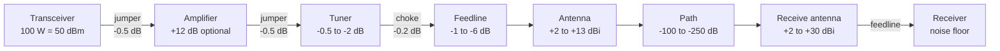
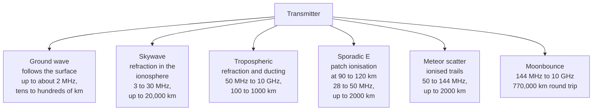
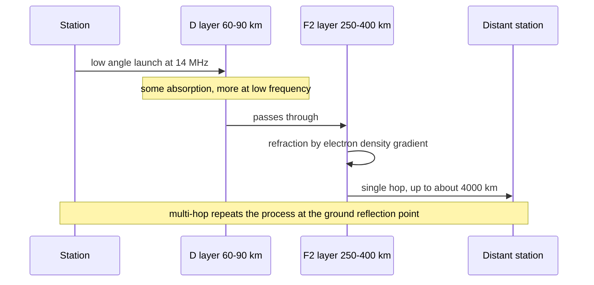
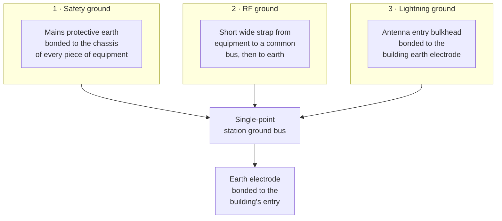
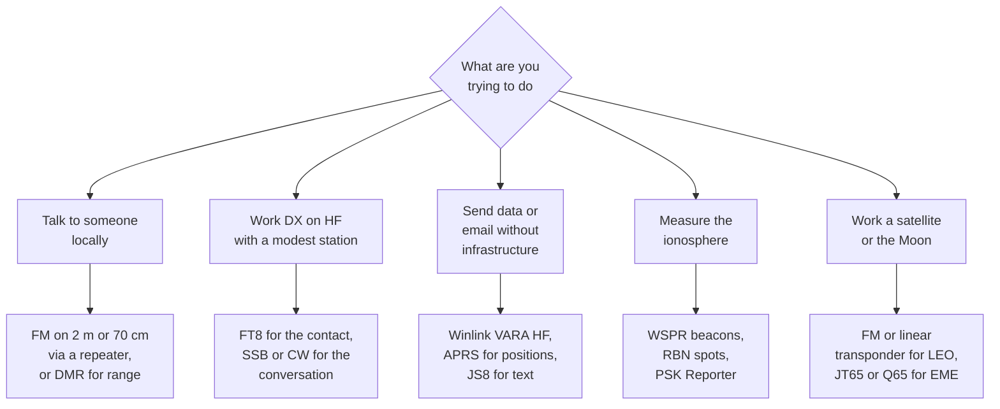
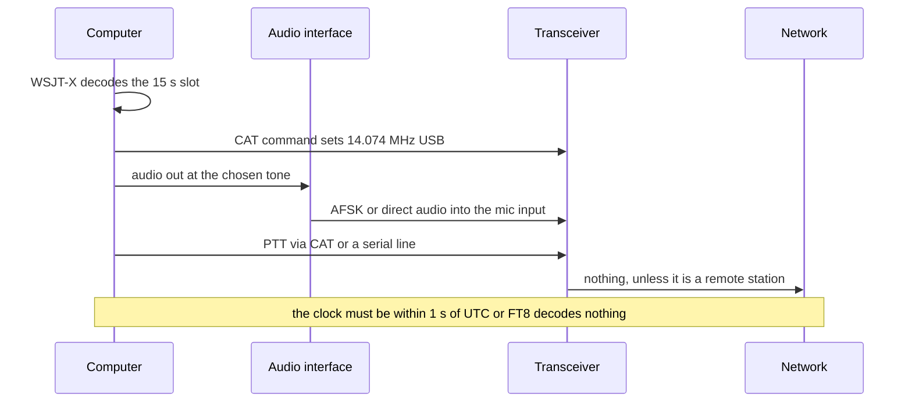
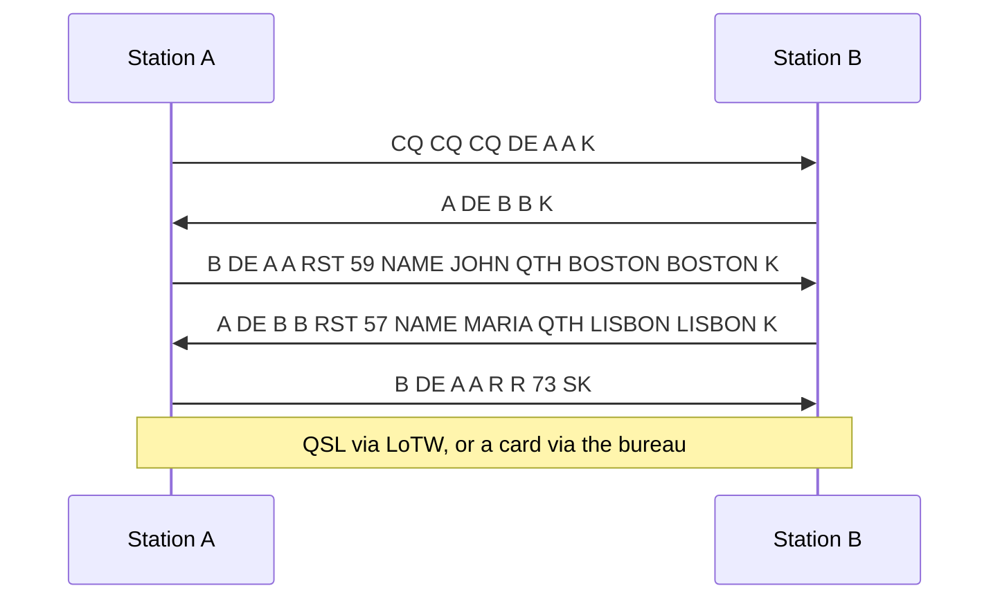

# HAM — Operating Practice: Station, Propagation, Modes and the QSO

> **A station is four numbers and a chain.** Transmitter power, antenna gain, path loss, and the
> noise floor at the receiver — everything else is bookkeeping. Amateur radio is unusual not because
> the arithmetic differs from a cellular link budget but because the operator owns every term in it,
> can change any of them, and must therefore understand all of them. This note follows the chain from
> the power supply to the log entry: what each stage costs, how the path behaves, which mode suits
> which path, and what the conventions of a contact are.

The companion note, [[11-1 HAM - Amateur Radio - History, Regulation and the State of the Hobby]],
covers why the service exists, who licenses it, and where the bands are. This one assumes a licence
and a radio, and answers the practical question: *how do I make this work, and why does it work that
way?*

## 1. The budget that decides everything

### 1.1 The four numbers

Every link, from a 5 W handheld to a 1 kW HF station to a 10 GHz dish, closes or fails on the same
four quantities:

| Quantity | Symbol | Typical amateur value | Where it comes from |
| --- | --- | --- | --- |
| Transmitter power at the antenna | P<sub>tx</sub> | 5 W to 1.5 kW; 100 W is the norm | The licence class, the amplifier, and the feeder loss |
| Antenna gain | G | 2.15 dBi for a dipole; 13 dBi for a 5-element Yagi; 30 dBi for a 3 m dish at 10 GHz | Boom length and aperture, never "gain" as a marketing figure |
| Path loss | L | 100 dB on 2 m line of sight; 140 dB on 20 m at 3,000 km; 250 dB to the Moon at 10 GHz | Distance and frequency, plus the propagation mechanism |
| Receiver noise floor | N | −140 dBm in 2.5 kHz at HF in a quiet location; −120 dBm in a city | Thermal noise, receiver noise figure, and man-made noise |

The closure condition is one line:

> **P<sub>tx</sub> + G<sub>tx</sub> − L + G<sub>rx</sub> − N ≥ required SNR**

Everything an operator does — choose a band, raise the antenna, add an amplifier, switch to a
narrower mode — is an attempt to move one of those five terms.

### 1.2 The station as a chain

A station is a cascade, and each element either adds gain or subtracts it. Drawing it once makes the
losses visible, which is why the losses are where most beginners lose their first 10 dB.



Two observations that follow immediately from the diagram:

- **Loss before the amplifier costs more than loss after it.** A 1 dB loss in the jumper between
  transceiver and amplifier is 1 dB of output power; the same 1 dB after the amplifier is 1 dB of
  ERP and, on receive, 1 dB of noise figure.
- **On receive, every dB of feedline loss adds directly to the system noise figure** if the loss is
  ahead of the first amplifier. This is why a mast-mounted preamplifier at 10 GHz is worth more than
  any amount of extra transmit power.

### 1.3 A worked example: 2 m SSB, two stations 80 km apart

| Term | Value | Note |
| --- | --- | --- |
| Transmit power | 50 W = **+47 dBm** | A typical 2 m all-mode radio |
| Feedline loss | **−2.5 dB** | 15 m of RG-213 at 144 MHz |
| Antenna gain | **+11.2 dBi** | 5-element Yagi |
| EIRP | **+55.7 dBm** = 370 W EIRP | Sum of the three |
| Path loss at 144 MHz over 80 km | **−133.6 dB** | Free-space, plus 6 dB for terrain |
| Receive antenna gain | **+11.2 dBi** | Same Yagi at the other end |
| Received power | **−66.7 dBm** | +55.7 − 133.6 + 11.2 |
| Receiver noise floor, 2.5 kHz, NF 3 dB | **−137 dBm** | kTB = −140 dBm, plus 3 dB |
| SNR at the detector | **70 dB** | Enormous margin |

The margin is the point: a 2 m SSB contact at 80 km is not a marginal link, it is a 70 dB one. The
same calculation at 3,000 km on 20 m gives a much smaller margin because the path loss is 40 dB
greater while the antennas are smaller — which is why HF is a *propagation* problem and VHF is a
*geometry* problem.

### 1.4 The same link in FT8

FT8 changes only the last term: it needs an SNR of about −21 dB in 2.5 kHz instead of +10 dB. That is
a **31 dB** improvement in required SNR, obtained entirely by processing. It is equivalent to a 1,250×
increase in power, or to a 6 dB improvement in both antennas plus a 19 dB increase in power. This is
the arithmetic behind the observation that FT8 "made 100 W and a wire competitive" — it did not make
the antenna better, it moved the threshold.

## 2. Decibels, without the fog

Every amateur calculation is done in dB, and the five conversions below cover almost all of it.

| Rule | Statement | Use |
| --- | --- | --- |
| 3 dB | Doubles or halves power | One S-unit is about 6 dB, so 3 dB is half an S-unit |
| 6 dB | Doubles or halves voltage, or doubles distance in free space | Doubling the height of an antenna on HF is worth about 6 dB at low angles |
| 10 dB | Ten times power | "One S-unit" is often quoted as 6 dB; 10 dB is unmistakable |
| 20 dB | Ten times voltage | Antenna gain in dBi is a power ratio; 20 dB is 100× |
| 0 dBm | 1 mW; **+30 dBm = 1 W; +60 dBm = 1 kW** | Everything in a station budget |

Two formulas are worth memorising because they are checkable in the field:

- **Free-space path loss:**
  `FSPL(dB) = 32.44 + 20 log₁₀(d_km) + 20 log₁₀(f_MHz)`.
  At 144 MHz and 10 km: 32.44 + 20 + 43.2 = **95.6 dB**.
- **Thermal noise in a bandwidth:**
  `N(dBm) = −174 + 10 log₁₀(B_Hz) + NF`.
  In 2.5 kHz with a 3 dB noise figure: −174 + 34 + 3 = **−137 dBm**.

The second formula is the one that explains why narrow modes win. Going from 2.5 kHz to 50 Hz is
17 dB of free sensitivity, before any coding gain at all.

## 3. The receiver is the hard half

### 3.1 Sensitivity, and what actually limits it

Receiver sensitivity is not one number. Three different limits apply, and which one binds depends on
the environment:

| Limit | Mechanism | Consequence |
| --- | --- | --- |
| **Thermal noise** | kTB plus the receiver's noise figure | The floor on a quiet band; improved only by narrower bandwidth or a better first stage |
| **Man-made noise** | Switching supplies, LED lighting, power-line communication, VDSL, solar inverters | Dominates below 30 MHz in any city; can be 20–30 dB above thermal |
| **Dynamic range** | Strong nearby signals intermodulating in the front end | The limit on a contest weekend or next to a broadcast transmitter |

The practical implication: below 30 MHz, **lowering the noise floor is worth more than raising the
power**. A quiet antenna site, a common-mode choke, and ferrites on every cable can be worth 10–20 dB
that no amplifier can buy.

### 3.2 The S-meter, and why it lies

The S-meter is a relative indicator that happens to have a standard behind it.
IARU Region 1 defines **S9 as 50 µV into 50 Ω at HF, which is −73 dBm**, and **S9 as 5 µV, or
−93 dBm, at VHF and above**. Each S-unit is nominally 6 dB.

| Reading | HF (dBm) | VHF/UHF (dBm) | What it means in practice |
| --- | --- | --- | --- |
| S9+20 | −53 | −73 | Strong; audible on a bad antenna |
| S9 | −73 | −93 | The reference; a good SSB signal |
| S7 | −85 | −105 | Workable SSB |
| S5 | −97 | −117 | Weak but readable SSB |
| S3 | −109 | −129 | CW territory; FT8 still comfortable |
| S1 | −121 | −141 | At or below the noise floor for SSB |

Most transceivers compress the top of the scale and are uncalibrated below S3, so the meter is a
*relative* instrument. For real measurements, use a calibrated step attenuator and the receiver's own
noise floor.

### 3.3 Dynamic range and the strong-signal problem

A receiver that can hear a −130 dBm signal must also survive a −20 dBm one 2 kHz away. The ratio is
the dynamic range, and it is quantified by:

- **Blocking:** the level at which a strong off-frequency signal desensitises the receiver.
- **IMD3:** two strong signals generate a third-order product inside the passband. A receiver with
  high IP3 keeps that product below the noise.
- **Reciprocal mixing:** close-in phase noise of the local oscillator mixes with a strong adjacent
  signal, raising the noise floor around it. This is why a cheap SDR sounds fine in a quiet band and
  terrible next to a contest station.

In 2026 the strong-signal problem has moved: an SDR with a 16-bit ADC and no roofing filter can be
overloaded by an AM broadcast transmitter 2 MHz away, where an analogue radio with a narrow first IF
would not notice. Direct-sampling architecture trades close-in dynamic range for bandwidth, which is
an excellent trade on a quiet hilltop and a poor one in a city.

## 4. Propagation: the part you cannot buy

### 4.1 The mechanisms

There are six propagation mechanisms an amateur uses, and they are distinguished by frequency and by
what in the atmosphere does the bending.



### 4.2 Skywave, in one page

The ionosphere is a plasma produced by solar ultraviolet and X-ray ionisation. It forms layers that
persist at different altitudes and with different electron densities:

| Layer | Altitude | Behaviour | Effect on amateur bands |
| --- | --- | --- | --- |
| **D** | 60–90 km | Exists only in daylight; high collision frequency | Absorbs HF, especially 3.5–7 MHz; this is why 80 m dies by day |
| **E** | 90–120 km | Weak daytime ionisation; occasional intense sporadic-E patches | 40 m daytime hops; 6 m magic in summer |
| **F1** | 150–220 km | Daytime only, mid-latitude | Briefly merges with F2 near noon |
| **F2** | 250–400 km | The main reflecting layer; persists at night | 20, 15, 10 m; the layer that makes worldwide HF possible |

The critical frequency **foF2** is the highest frequency that reflects vertically. Above it, the signal
punches through into space. For an oblique path the usable frequency is higher, to first order by the
secant law:

> **MUF ≈ foF2 / cos θ**, where θ is the angle of incidence from the vertical.

A 3,000 km single hop from an F2 layer at 300 km gives a takeoff angle near 74° from vertical, so
cos θ ≈ 0.28 and **MUF ≈ 3.5 × foF2**. With foF2 = 6 MHz — a good solar-maximum daytime value — the
3,000 km MUF is about 21 MHz, which is why 15 m opens at solar maximum and not at minimum.

The **lowest usable frequency** (LUF) is set by absorption in the D layer, which rises as frequency
falls. Between LUF and MUF is the window; the *optimum working frequency* is conventionally 85% of the
MUF, because the MUF itself is unstable.



### 4.3 NVIS: the deliberate use of a bad angle

Near-vertical incidence skywave is the counter-intuitive case. By launching at 60–90° from the
horizontal, a signal comes almost straight down after refraction, covering a disc of roughly
0–400 km with no skip zone. It works on 3.5, 5 and 7 MHz, needs the antenna **lower** than a quarter
wavelength above ground, and is the standard solution for regional emergency networks — which is why
80 m is the emergency band in Europe and 40 m in much of the world.

The trade is bandwidth and noise: an NVIS path is short, so the signal is strong, but 80 m at night is
also the noisiest place on the dial.

### 4.4 Sporadic E, tropospheric ducting, and the weather-driven paths

- **Sporadic E** is patchy, highly ionised clouds at 90–120 km, most common in May–August in the
  northern hemisphere and around the solstices. It supports 28 MHz and 50 MHz contacts over
  1,000–2,000 km with modest power, and it is the reason 6 m is called "the magic band": the band can
  be dead for days and then open across a continent for twenty minutes.
- **Tropospheric ducting** occurs when a temperature inversion traps VHF/UHF energy in a layer a few
  hundred metres thick. It is a weather phenomenon, forecastable from surface pressure charts, and it
  routinely extends 144 MHz and 430 MHz range to 500–1,000 km over the sea.
- **Rain scatter** works at 10 GHz and above: precipitation reflects enough energy for narrowband
  contacts when a storm cell is between the two stations.

### 4.5 Meteor scatter and moonbounce

Both are paths that use a physical object rather than an atmospheric layer, and both are exercises in
budget arithmetic.

| Path | Geometry | Typical band | Mode | The binding constraint |
| --- | --- | --- | --- | --- |
| **Meteor scatter** | Reflection from ionised trails at 80–120 km | 50, 144 MHz | MSK144, 15 s bursts | Trail lifetime: a burst lasts 0.1–10 s, so the protocol must be burst-oriented |
| **EME** | Reflection from the lunar surface | 144 MHz to 10 GHz | JT65, Q65, CW | Two-way spreading loss of about **375 dB** at 144 MHz; antenna gain and receiver noise temperature dominate everything |

The EME number is worth internalising: 375 dB of two-way path loss means a 1,000 W transmitter and a
15 dBi antenna still arrive at the receiver at around −180 dBm, which is below the thermal noise of a
2.5 kHz receiver. EME works because the mode integrates for minutes and because a quiet sky at 144 MHz
has a system noise temperature of a few hundred kelvin rather than 290 K. It is the purest example in
the hobby of sensitivity bought by integration time.

### 4.6 Space weather, and what to watch

| Index | What it measures | Amateur consequence |
| --- | --- | --- |
| **SFI** (solar flux at 10.7 cm) | Solar EUV proxy | Above 150: 10 m and 12 m open worldwide by day; below 90: only 20 m and lower |
| **SSN** | Sunspot number | Correlated with SFI; the cycle matters more than the daily value |
| **Kp / Ap** | Geomagnetic disturbance | Kp ≥ 5: high-latitude paths degrade, aurora enhances VHF at the expense of HF |
| **foF2 / MUF maps** | Direct measurement, from ionosondes | The only reliable forecast; read a real map, not a number |
| **Solar wind speed** | Coronal hole streams | Recurrent disturbances with a 27-day period |

Solar Cycle 25 peaked around 2024–2026, which is why 10 m and 6 m have been unusually good in this
window and why the same period is the best time in twenty years to be a beginner on HF.

## 5. Antennas

### 5.1 Three numbers describe an antenna

Antenna marketing uses a dozen terms; three matter:

1. **Gain**, in dBi, relative to an isotropic radiator. A half-wave dipole is **2.15 dBi**; that
   reference is called dBd, and a figure in dBd is 2.15 dB higher when converted to dBi. Gain is
   bought by *directivity*, not by magic: the antenna radiates the same total power, just not in all
   directions.
2. **Pattern**, and specifically the takeoff angle in the vertical plane. On HF the takeoff angle
   decides which hop distance the antenna serves; on VHF it decides whether you clear the terrain.
3. **Impedance and bandwidth.** A resonant dipole is about 73 Ω in free space and 50–70 Ω at a
   practical height; a small loop is a few ohms; a full-size vertical is about 36 Ω. Bandwidth follows
   from the conductor diameter: a thin wire has a narrow 2:1 SWR bandwidth, a cage or a conical
   element is wideband.

The reciprocity theorem is the reason a single set of numbers serves both directions: an antenna's
transmit gain pattern and its receive pattern are identical. What is *not* reciprocal is the noise
temperature it sees, which is why a small lossy antenna can be a fine transmitter and a poor receiver.

### 5.2 The dipole family

The half-wave dipole is the reference because it is the simplest structure with a predictable pattern:
a figure-eight in the horizontal plane, 2.15 dBi, and a feedpoint impedance near 70 Ω.

| Variant | Length | Feedpoint | Character |
| --- | --- | --- | --- |
| Half-wave dipole | `143 / f(MHz)` metres, or `468 / f(MHz)` feet | 50–73 Ω | The baseline; needs no ground |
| Inverted V | Same wire, apex at 8–12 m, ends at 2–3 m | ~50 Ω | One support instead of two; slightly higher takeoff angle; the standard portable HF antenna |
| Off-centre fed | 33% / 67% split | ~200 Ω at the feed, matched by a 4:1 transformer | Multi-band on one wire with a tuner; the "OCF" compromise |
| End-fed half wave | ~0.5 λ of wire, fed at the end through a 49:1 transformer | Very high, transformed down | One support, no feedline at the current maximum; needs a counterpoise or the coax becomes the antenna |
| Doublet | Any length, fed with open-wire line | 300–600 Ω | Lowest loss on multi-band operation, because the line itself is low-loss even at high SWR |
| Loop | 1 λ of wire, horizontal or vertical | 100–150 Ω | Quiet on receive: less pickup of local noise than a dipole |

The end-fed half wave deserves a warning because it is the most popular beginner antenna of the last
decade and the most misunderstood. It works, but the "no counterpoise needed" claim is false: without a
return path the outside of the coaxial shield becomes the other half of the antenna, which produces
common-mode current, receiver noise, and RF in the shack. A counterpoise of 0.05–0.1 λ, a choke at the
feedpoint, and a short ground strap fix it.

### 5.3 Verticals and the ground question

A quarter-wave vertical over a perfect ground plane is 36 Ω with a low takeoff angle — good for DX on
the low bands. Over real ground the picture changes completely:

| Radial system | Efficiency at 7 MHz | Comment |
| --- | --- | --- |
| No radials, earth stake | 10–25% | Most of the power heats the soil; a "dead" vertical |
| 4 radials, 0.1 λ | 40–55% | The practical minimum |
| 16 radials, 0.2 λ | 70–80% | Good, and the point of diminishing returns for most stations |
| 32–64 radials, 0.25 λ | 85–90% | Broadcast-grade ground system |
| Elevated radials, 4 × 0.25 λ at 3 m | 80–90% | Works without a buried mat; the portable solution |

The efficiency loss is not just transmit: ground loss adds noise on receive as well, because a lossy
ground is a warm resistor. This is why verticals have a reputation for noise that dipoles do not.

### 5.4 Directional antennas

| Type | Typical gain | Front-to-back | Boom or size | Use |
| --- | --- | --- | --- | --- |
| 2-element Yagi | 5–6 dBi | 8–12 dB | 0.15 λ | Portable, satellite |
| 3-element Yagi | 7.5–8.5 dBi | 12–18 dB | 0.2 λ | The classic 6 m and 2 m starter beam |
| 5-element Yagi | 10.5–11.5 dBi | 16–20 dB | 0.4 λ | 2 m SSB and weak-signal work |
| 7–9 element long-boom Yagi | 13–14 dBi | 18–25 dB | 0.8–1.2 λ | EME, tropo, contest |
| Moxon rectangle | 6–7 dBi | 15–20 dB | 0.15 λ | Two elements, high F/B, very light |
| Quad or loop Yagi | 1 dB more than a Yagi of the same boom | Similar | Larger | Quiet on receive, wider bandwidth |
| Log-periodic | 6–8 dBi | Moderate | Long | One antenna for several bands, at the cost of gain |
| Dish, 1–3 m | 25–35 dBi at 10 GHz | Very high | Aperture | Microwave, EME, QO-100 downlink |

Gain and boom length are tied together by physics, not by design cleverness: a Yagi's gain in dBi is
roughly `10 log₁₀(boom length in wavelengths) + 8`, which is why a 1 λ boom gives about 8 dBi and a
4 λ boom about 14 dBi, and why the marketing claim of "12 dBi from a 1 m 2 m Yagi" is a fiction.

### 5.5 Height, takeoff angle, and the HF inversion

On VHF, height is simple: get the antenna above the Fresnel zone and the path closes. On HF the
relationship is counter-intuitive and it is the single most useful thing a beginner can learn:

- **A dipole at 0.25 λ radiates at about 60–90°** — an NVIS antenna, good to 400 km, useless for DX.
- **At 0.5 λ it radiates at about 30°**, the classic DX angle for a single hop.
- **At 1 λ and above, the main lobe splits** and the lowest lobe drops to 10–15°, which is what a
  low-angle DX path wants on 20 m and above.
- **On 80 m, 1 λ is 40 m of height.** Nobody has that, so 80 m DX is a vertical-and-radials problem,
  not a height problem.

The same physics explains why a "high" antenna is worse for NVIS: at 1 λ the vertical lobe is a null.

### 5.6 Feedline, SWR, and the two things they do not tell you

| Cable | Loss at 144 MHz per 30 m | Loss at 430 MHz per 30 m | Note |
| --- | --- | --- | --- |
| RG-58 | 5.5 dB | 9.5 dB | Acceptable only for short jumpers |
| RG-213 / RG-8 | 2.5 dB | 4.5 dB | The default for a 2 m run |
| LMR-400 | 1.5 dB | 2.7 dB | The practical best value |
| 7/8 inch hardline | 0.7 dB | 1.2 dB | Fixed installations, EME |
| Open-wire line | 0.1 dB | 0.2 dB | The lowest loss, and the reason doublets win |

**SWR** measures the mismatch between the feedline's characteristic impedance and the load. It is not
a measure of antenna performance:

| SWR | Reflected power | Return loss | Mismatch loss |
| --- | --- | --- | --- |
| 1.0:1 | 0% | ∞ | 0 dB |
| 1.5:1 | 4% | 14 dB | 0.18 dB |
| 2.0:1 | 11% | 9.5 dB | 0.51 dB |
| 3.0:1 | 25% | 6 dB | 1.25 dB |
| 5.0:1 | 44% | 3.5 dB | 2.5 dB |

Read the last column: a 3:1 SWR costs only **1.25 dB**, which is a quarter of an S-unit. The real cost
of a bad match is not the reflected power — a modern transmitter folds back rather than failing — but
the **additional loss in the feedline**, which rises with SWR and is worst in a lossy cable at HF.
This is why a doublet fed with open-wire line and an ATU outperforms a trapped multiband dipole fed
with coax, even though its SWR on any single band may be 4:1.

**Common-mode current** is the other invisible problem. Coax carries the signal on its inside and
nothing on its outside; when the antenna is unbalanced, the outside becomes a radiating element. The
symptoms are RF in the audio, a computer that disconnects when you transmit, and a receive noise floor
that rises when the feedline is connected. The fix is a **current choke** — a 1:1 balun or 8–10 turns
of coax through a ferrite toroid, mix 31 for HF, mix 43 or 61 for VHF — placed at the feedpoint, with
a second one at the shack end.

### 5.7 What a tuner can and cannot do

An antenna tuner transforms the impedance presented at the *shack end* of the feedline. It does not
change the antenna, and it cannot recover loss:

- It **can** present 50 Ω to the transmitter, which keeps the final amplifier happy and lets a
  non-resonant wire be used on several bands.
- It **cannot** reduce the loss caused by high SWR in a lossy feedline. Matching at the transmitter
  end means the feedline carries the standing wave, and the loss rises accordingly — the exact
  opposite of matching at the antenna.
- It **cannot** widen the antenna's bandwidth. SWR at the transmitter reads 1:1 while the antenna
  itself is still narrow.

This is the reason the open-wire-fed doublet is the connoisseur's multi-band antenna: the tuner is at
the shack, but the line is nearly lossless, so the standing wave costs almost nothing.

## 6. The station: power, ground, and lightning

### 6.1 A DC power budget

A 100 W transceiver draws far more than 100 W, and the supply is the part beginners undersize.

| Load | Current at 13.8 V | Note |
| --- | --- | --- |
| Transceiver, receive | 0.6–1.5 A | Display, DSP, preamp |
| Transceiver, 100 W SSB transmit | 18–22 A peak | The figure the supply must survive |
| Transceiver, 100 W CW key-down | 20–23 A continuous | Worse than SSB for a supply |
| VHF/UHF mobile, 50 W | 10–12 A | |
| Linear amplifier, 500 W out | 40–60 A | Requires 220 V mains, not a 13.8 V supply |
| Small accessories | 1–3 A | Interface, SDR, Raspberry Pi |

The rule that follows: size the supply at **1.5× the peak transmit current**, and size the wiring for
voltage drop, not for ampacity. A 1 V drop on a 20 A key-down pulse is 20 W dissipated in the cable
and a transmitter that produces 80 W instead of 100 W.

### 6.2 Grounding and bonding

Grounding in an amateur station serves three distinct purposes, and conflating them is the most common
installation error:



The three rules that matter:

1. **One point, star topology.** Every chassis bonds to a single bus with short, wide conductors. A
   daisy chain of green wires through three pieces of equipment creates a loop, and a loop is an
   antenna.
2. **Bond the station ground to the building's earth at the entry point**, never to a separate rod
   without bonding: two earths at different potentials is how equipment gets destroyed and people get
   hurt.
3. **The antenna feedline must enter through a bulkhead** with a surge arrestor bonded to that same
   earth, and must be disconnected when the station is unattended in a thunderstorm. No arrestor
   survives a direct strike; the objective is to survive the induced surge from a nearby one.

### 6.3 Portable and field stations

The field station is the same chain with different constraints: weight, no mains, no ground.

| Constraint | Consequence |
| --- | --- |
| Battery capacity | A 100 W SSB station at 20% duty cycle draws about 4 A average, so a 100 Ah battery gives roughly 20 hours of casual operating |
| No earth | An elevated counterpoise replaces the ground radial system; a 0.05–0.1 λ wire laid on the ground is the minimum |
| Antenna height | A 10 m fibreglass mast plus an inverted V is the standard compromise; a linked dipole covers 40/30/20 m without a tuner |
| Weight budget | 12 kg for a two-person HF station including mast, wire, radio, battery and logger is achievable |
| Solar | 100 W of panel returns about 5 A for 5 hours in good sun, about 25 Ah a day — enough to run a QRP station indefinitely |

This is exactly the regime that Field Day, SOTA and POTA exercise, and it is why those programmes are
the best practical training in the hobby: everything in the budget is visible, and something always
fails.

## 7. Modes

### 7.1 The catalogue

| Mode | Bandwidth | Threshold | Throughput | What it is for |
| --- | --- | --- | --- | --- |
| **CW** | 100–500 Hz | Copyable below the noise by ear | 20–30 wpm ≈ 100–150 characters/min | The most efficient mode per watt ever devised; still the DX and contest standard at the margin |
| **SSB** | 2.4–2.7 kHz | about +10 dB SNR | Voice | The default HF and VHF voice mode |
| **AM** | 6–8 kHz | about +10 dB | Voice, double the bandwidth | Legacy, vintage equipment, and 80 m AM nets |
| **FM** | 12.5 kHz | about +12 dB, with a threshold effect | Voice | Local and repeater work; the only mode where a weak signal degrades abruptly |
| **RTTY** | 170 Hz shift, 45.45 baud | about 0 dB | 60 wpm | Contests and legacy teleprinter work |
| **PSK31** | 31 Hz | about −10 dB | 50 wpm | Keyboard conversation at low power; still the best "chat" mode per Hz |
| **FT8** | 50 Hz | **−21 dB** | 13 characters per 15 s | Weak-signal DX, propagation probing, awards |
| **FT4** | 90 Hz | about −17 dB | Faster exchange | Contest-rate weak-signal work |
| **WSPR** | 6 Hz | **−28 to −31 dB** | 50 bits per 2 min | Beacon network: propagation measurement, not communication |
| **JS8Call** | 50 Hz | about −24 dB | Keyboard, store-and-forward | Free-text messaging over an FT8-class link |
| **MSK144** | about 2.5 kHz | about −8 dB | Burst-oriented | Meteor scatter |
| **Packet / APRS** | 3 kHz AFSK at 1200 baud | about −10 dB | 1200 bit/s | Position reporting, telemetry, digipeating |
| **DMR** | 12.5 kHz, 2 TDMA slots | about +12 dB | 2 voice channels | Repeater networks, talkgroups, worldwide linking |
| **D-STAR** | 6.25 kHz GMSK | about +12 dB | Voice plus 1200 bit/s data | ICOM repeater networks |
| **C4FM / System Fusion** | 12.5 kHz | about +12 dB | Voice plus data | Yaesu networks, with an analogue fallback |
| **P25** | 12.5 kHz | about +12 dB | Voice | Public-safety interoperability |
| **Winlink / VARA HF** | up to 2.3 kHz | about 0 dB | 1–5 kbit/s | Email over HF, the emergency data standard |
| **SSTV** | 3 kHz | about +10 dB | One image per 8–120 s | Analogue image, still used from the ISS |

### 7.2 Choosing a mode



The single most useful rule in the table above: **FT8 finds the opening, SSB or CW uses it.** FT8
decodes signals 20 dB below what you can hear, so it tells you the band is open to a country before
you can hear anything there. Then you switch mode and call. Operators who never switch never have a
conversation; operators who never use FT8 never know the band is open.

### 7.3 Why CW still exists

Morse is not nostalgia, it is an engineering choice with three properties no other mode has:

- **It is decoded by a human brain, which is a superb matched filter for a known pattern in noise.**
  A skilled operator copies CW at −10 dB SNR in a 500 Hz filter, where SSB is unintelligible.
- **It occupies almost no spectrum.** A 500 Hz filter holds several simultaneous CW contacts; a
  contest weekend on 20 m is a demonstration of spectral efficiency that no digital mode matches at
  the same SNR.
- **It needs no clock, no codec, no protocol version.** A transmitter, a key and a receiver are
  sufficient, which is why it is still the fallback in a real emergency.

The cost is the year of practice, and that cost is exactly why the licensing requirement was dropped
everywhere: the service decided it would rather have operators than Morse operators.

### 7.4 The digital plumbing

A 2026 digital station is a small distributed system, and most operating problems are plumbing
problems rather than radio problems:



Four failure modes account for most of it:

1. **Clock offset.** FT8's 15-second slots assume UTC within about a second. A PC that drifts 3 s
   decodes nothing and transmits into the wrong slot.
2. **Audio level.** Too hot and the ALC compresses the signal, splattering it across 200 Hz; too low
   and the decoder sees noise. The correct setting leaves the ALC at zero and the audio meter at about
   one third.
3. **RF feedback.** Common-mode current on the USB cable resets the interface on key-down. Ferrites
   on every cable, and a choke at the antenna.
4. **Wrong sideband.** USB above 10 MHz, LSB below, and data modes always USB — a reversed convention
   that costs every beginner an evening.

## 8. The QSO

### 8.1 The structure

An amateur contact is a short, highly conventional exchange, and its formality is a feature: it lets
two stations with no shared language complete a valid contact in thirty seconds.



The obligatory elements are: both callsigns, a signal report, and an acknowledgement. Name and
location are conventional. Anything beyond that is conversation and is welcome — a "ragchew" — but
not required for the contact to count for an award.

### 8.2 The report and the shorthand

The **RST** system encodes three numbers:

| Letter | Range | Meaning |
| --- | --- | --- |
| **R** readability | 1–5 | 5 = perfectly readable, 1 = unreadable |
| **S** strength | 1–9 | Based on the S-meter, where 9 is the reference level; S9+20 dB is written 59+20 |
| **T** tone | 1–9 | CW only; 9 = pure DC note, 1 = extremely rough |

Voice contacts use RS only (59, 57, 55) and digital modes conventionally report a dB value, which is
what FT8 exchanges: `−10` means 10 dB below the noise reference.

The abbreviations are a compressed protocol, and the ones worth knowing first are:

| Abbreviation | Meaning | When it is used |
| --- | --- | --- |
| **CQ** | General call, "anyone" | Starting a contact |
| **DE** | "from" | Between the called and calling callsign |
| **K** | "go ahead" | End of an over |
| **KN** | "go ahead, only the named station" | Excluding other callers |
| **R** | "received" | Acknowledgement |
| **73** | Best regards | Signing off |
| **88** | Love and kisses | Informal, often to a YL operator |
| **QSL** | Acknowledge receipt | Confirming the contact |
| **QRZ** | "Who is calling me?" | After a call, or after a pile-up |
| **QRM / QRN / QSB** | Man-made interference / static / fading | Describing conditions |
| **QSY** | Change frequency | Moving off a frequency |
| **QRT** | Stop transmitting | Closing the station |
| **SPLIT / UP 5** | Listening on another frequency | DX stations working a pile-up |

### 8.3 Pile-ups and split operation

A rare DX station calling CQ attracts dozens of simultaneous callers, and the only workable protocol
is that **the DX listens on one frequency and transmits on another**. This is "split", announced as
"up 5" or "listening 5 to 10".

The etiquette is not decoration; it is what makes the contact possible:

- **Never transmit on the DX station's frequency.** If you cannot hear the DX because a hundred
  stations are calling on top of him, you are part of the problem.
- **Listen first, for a full minute.** Learn the pattern: which frequency he last worked, whether he
  moves up or down, whether he works by call area.
- **Call once, briefly.** A 2-second call that lands in the right place beats a 10-second call that
  covers three other stations.
- **Do not "tail-end".** Calling immediately after the DX finishes, on his frequency, is the single
  most common beginner error.

### 8.4 Band plans

The IARU regional band plans are voluntary but universally followed conventions that divide each band
by mode and by bandwidth, so that a 500 Hz CW signal is not buried under a 2.7 kHz SSB signal.

| Segment | Typical content | Reason |
| --- | --- | --- |
| Bottom of each HF band | CW only, then narrowband data | Narrow signals at the band edge, where the antenna is least efficient and the user is most skilled |
| Middle | Digital modes, then all-mode | The transition zone; FT8 calling frequencies sit here |
| Upper part of each band | SSB, then wide modes | Wide signals need room and can tolerate a poorer antenna |
| Fixed calling frequencies | 14.074 FT8, 14.070 PSK, 50.313 FT8, 144.200 SSB | A single agreed frequency lets strangers find each other |

The full segment edges differ by region and are published by the IARU; the *structure* above is what
matters for understanding why a band sounds the way it does.

### 8.5 Contests, awards, and the activity economy

The hobby's activity is organised by programmes that give a contact a purpose beyond the contact:

| Programme | Rule | What it rewards |
| --- | --- | --- |
| **DXCC** | Confirm contacts with 100 entities | Patience, propagation knowledge, and antenna work |
| **WAS / WAZ** | All US states / all 40 CQ zones | Systematic operating |
| **VUCC** | 100 grid squares on VHF/UHF | Weak-signal capability |
| **IOTA** | Islands on the air | Travel plus logistics |
| **SOTA / POTA** | Activate a summit or a park | Portable operation, minimal station |
| **Field Day** | 24 hours on emergency power, first held 1933 | The whole station as a system, under stress |
| **CQ WW / ARRL DX / WPX** | 48-hour contests | Rate, operator skill, station engineering |

The contest calendar is what keeps the bands populated. A quiet Tuesday and a contest weekend are the
same spectrum with a different incentive, and the difference in activity is two orders of magnitude.

## 9. The confirmation chain: logging, QSL and LoTW

A contact that is not logged did not happen, as far as every award programme is concerned. The chain
from contact to credit is four steps, and each has a standard format:

| Step | Artifact | Standard |
| --- | --- | --- |
| Log the contact | Local log file | **ADIF** for interchange; **Cabrillo** for contest submission |
| Exchange confirmation | QSL card, or an electronic equivalent | Paper card via bureau or direct; **eQSL**; **LoTW** |
| Credit | Award application | DXCC, WAS, VUCC, IOTA — each with its own submission rules |
| Analysis | Statistics, map, rate | Club Log, SH5, contest loggers |

**Logbook of the World** (ARRL, 2003) is the part worth understanding technically: each participant
uploads a cryptographically signed log, and the system matches two logs independently, so neither
party has to trust the other's claim. It replaced a postal exchange that took months with a match that
takes minutes, and it is the reason modern DXCC totals accumulate so much faster than they did in 1990.

The ADIF record is a flat list of `FIELD:length value` pairs, which is why it is trivially
machine-readable and why every logger can import every other logger's output:

```
<CALL:5>K1ABC <QSO_DATE:8>20261108 <TIME_ON:4>1432 <BAND:3>20M
<MODE:3>FT8 <RST_SENT:3>-10 <RST_RCVD:3>-12 <GRIDSQUARE:4>FN42
```

## 10. Satellites and space

Amateur satellites are the one part of the hobby where the station must track a moving target, and the
operating problem is therefore geometry plus Doppler rather than propagation.

| Class | Example | Orbit | Operating consequence |
| --- | --- | --- | --- |
| **FM repeater** | SO-50, AO-91 | LEO, 400–800 km | A 5 W handheld and a whip can work it; the pass lasts 8–12 minutes |
| **Linear transponder** | RS-44, FO-29 | LEO | SSB/CW, 20–100 kHz wide; needs a full-duplex setup to hear yourself |
| **Store-and-forward** | ISS APRS digipeater, 145.825 MHz | LEO | Packet positions and messages, no voice |
| **Geostationary** | **QO-100** at 25.9° E | 35,786 km | No tracking, no Doppler, always available in the footprint: 2.4 GHz up, 10.45 GHz down |
| **CubeSat telemetry** | Numerous | LEO | 9k6 or 1k2 AX.25 telemetry, decoded with a soundcard and a TLE |

Two numbers make satellite operation tractable:

- **Doppler shift** at 144 MHz for a LEO pass reaches about ±3 kHz; at 430 MHz, about ±10 kHz. On a
  narrowband transponder this must be corrected continuously, which is why operators use full-duplex
  and tune the downlink by ear.
- **Pass prediction** is deterministic from a two-line element set; a 90–100 minute orbit gives six to
  ten usable passes a day, of which one or two are high enough to be comfortable.

The workflow is: refresh the TLE, pick a pass above 20° elevation, set the uplink and downlink
frequencies with the Doppler correction pre-loaded, start transmitting only after hearing the
downlink, and keep the transmission short because the satellite's power budget is shared by everyone
in the footprint.

## 11. Emergency communication

Amateur radio's public-service claim is real but narrower than its advocates suggest: it is not a
replacement for a working network, it is what remains when the network is gone.

| Element | Practice |
| --- | --- |
| Organisation | **ARES** (Amateur Radio Emergency Service) and **RACES** (Radio Amateur Civil Emergency Service) in the US; equivalent national schemes elsewhere |
| Message format | **ICS-213** general message form, or a plain radiogram: precedence, address, text, signature |
| Traffic handling | Formal relays through a net with a **net control station**, not ad-hoc conversations |
| Data | **Winlink** over HF (VARA or PACTOR) and VHF packet, for email without internet |
| Propagation choice | **NVIS on 40 m or 80 m** for regional coverage; 2 m FM for local; HF skywave for distant |
| Power | Battery and solar, with an inverter for the laptop; a 48–72 hour self-sufficiency assumption |
| Training | Weekly nets and an annual exercise; Field Day is the largest of them |

The technical lesson from real deployments — hurricanes, earthquakes, wildfires — is consistent: the
failure mode is rarely RF. It is power, logistics, inter-operability with the agencies, and the fact
that the operator who has not practised message handling under pressure cannot do it under pressure.

## 12. RF safety, EMC, and the neighbour problem

### 12.1 Exposure limits

Every administration now enforces an exposure limit derived from ICNIRP or from the FCC's OET-65. The
US maximum permissible exposure in the amateur bands is:

| Frequency | Occupational (controlled) | General population (uncontrolled) |
| --- | --- | --- |
| 1.34–30 MHz | 1000 W/m² equivalent, field-strength based | 0.2 mW/cm² for 1.34–30 MHz, power-density based above 30 MHz |
| 30–300 MHz | 1.0 mW/cm² | 0.2 mW/cm² |
| 300–1500 MHz | f/300 mW/cm² | f/1500 mW/cm² |
| 1500–100,000 MHz | 5.0 mW/cm² | 1.0 mW/cm² |

The calculation is the same free-space formula used everywhere else, with duty cycle applied:

> **S = P · G / (4π r²)**, where S is power density, P the transmitter power, G the numeric gain, and
> r the distance to the nearest person.

Worked: 100 W into a 2.15 dBi dipole at 5 m — EIRP = 164 W, S = 164 / (4π × 25) = **0.52 W/m² =
0.052 mW/cm²**, four times below the general-population limit. At 3 m it is 0.145 mW/cm², still
compliant. A 1 kW station on a rooftop beam, however, can exceed the limit at the edge of the roof,
which is why the calculation must be done for the actual antenna, power and geometry rather than
assumed.

### 12.2 The neighbour problem

Interference to consumer electronics is the most common reason a station is shut down by complaint,
and it is almost never the transmitter's fault in the way the complainant believes:

| Symptom | Mechanism | Fix |
| --- | --- | --- |
| Audio breakthrough on a hi-fi | Rectification in an inadequately screened input stage | Ferrite on the speaker leads, at the equipment end |
| Broadband hash across the house | Common-mode current on the feedline or the mains | Choke at the antenna, ferrites on the mains lead, bonded ground |
| Neighbour's TV or doorbell | Front-end overload in a poorly designed receiver | Band-pass filter at the transmitter, distance, reduced power |
| Your own receive noise floor | Switching supplies, LED lamps, PLC, solar inverter | Locate with a portable receiver, then replace or filter the culprit |

The diagnostic principle is that **the interfered-with device is usually the defective one** — a
properly designed receiver does not rectify a 100 W signal 50 m away — but the operator is
nevertheless the one who must mitigate, because the operator is the one with the licence condition.

## 13. A 90-day path from zero to a working station

### 13.1 The order of operations

| Phase | Weeks | What to do | What to avoid |
| --- | --- | --- | --- |
| **Learn** | 0–4 | Study the licence syllabus; take practice examinations until scoring 90% consistently | Buying equipment before understanding the bands |
| **Listen** | 2–6 | A cheap SDR or a WebSDR; learn what each band sounds like at each hour | Transmitting before you can identify what you are hearing |
| **Licence** | 4–8 | Sit the examination; get the callsign; get on 2 m FM with a handheld | Waiting for the perfect station |
| **First station** | 6–10 | 100 W HF transceiver, 40/20 m dipole at 8–10 m, 13.8 V supply, logger, choke | An amplifier, a tower, or a "do-everything" antenna |
| **First DX** | 8–14 | FT8 on 20 m to learn propagation; SSB when the band is open | Chasing rare entities before the basics work |

### 13.2 The five instruments that turn guesswork into engineering

1. **A dummy load.** 50 Ω, 100 W, for testing without radiating. Every transmitter problem should be
   diagnosed into a load first.
2. **An SWR / power meter.** Inline, calibrated, reading forward and reflected power. It measures the
   feedline, not the antenna, and knowing that distinction is half of antenna troubleshooting.
3. **A NanoVNA or equivalent.** A 50-dollar vector network analyser that plots SWR, impedance and
   resonance across a band. It converts antenna work from trial and error into measurement.
4. **A calibrated receiver or SDR with a dB scale.** For noise-floor and interference hunting.
5. **A clock disciplined to UTC.** Not an instrument in the usual sense, but the single item whose
   absence stops FT8 working.

### 13.3 The ten experiments worth doing once

1. Measure the resonant frequency of a dipole, then shorten it by 2% and measure again.
2. Compare the same antenna at 5 m and at 10 m on 20 m, and note the change in DX received signal.
3. Log the noise floor on 80 m at 08:00, 14:00 and 22:00 local, and explain the difference with the
   D layer.
4. Work the same station on FT8 and on SSB, and compare the reported SNR with what you hear.
5. Put a choke at the feedpoint and measure the change in receive noise.
6. Transmit 5 W into a dummy load and confirm the receiver hears nothing at 1 m — then repeat with the
   antenna connected and explain the difference.
7. Decode WSPR for 24 hours and plot which countries appear at which hour.
8. Track one satellite pass and correct the Doppler by hand.
9. Send an ICS-213 message through a simulated net.
10. Calculate your own station's exposure at the nearest accessible point and compare it with the
    limit.

## 14. Troubleshooting, by symptom

| Symptom | First check | Then |
| --- | --- | --- |
| **No receive at all** | Antenna connected to the right port; squelch; mode | Attenuator or preamp engaged; a filter switched in; the antenna itself with a VNA |
| **Receive but no transmit** | PTT path; the correct antenna port; TX power setting | Supply voltage sag under load; fold-back from high SWR; a band-specific PA fault |
| **High SWR on one band only** | Resonance of the antenna on that band | Feedline damage; a trapped dipole's trap; the wrong band segment |
| **RF in the audio or resets the PC** | Common-mode current | Choke at the feedpoint, ferrites on every cable, bonded single-point ground |
| **FT8 decodes nothing** | Clock offset against UTC | Audio level and ALC; the correct sideband; the dial frequency set to the *suppressed* carrier frequency |
| **Works locally, not DX** | Time of day and band choice | MUF map; solar indices; antenna takeoff angle |
| **S9 noise everywhere** | A portable receiver to localise the source | Switch-mode supply, LED lamp, PLC adaptor, solar inverter; then filter or replace |
| **Reports say "your signal is wide"** | Microphone gain and ALC | Speech processor setting; compression; the audio interface level |
| **Intermittent receive** | Connectors and coax | Water in a connector; a cracked centre conductor; thermal expansion at a soldered joint |

## Anchors

- **Free-space path loss:** `FSPL(dB) = 32.44 + 20 log₁₀(d_km) + 20 log₁₀(f_MHz)`. At 144 MHz over
  10 km it is **95.6 dB**.
- **Thermal noise:** `N(dBm) = −174 + 10 log₁₀(B) + NF`; in 2.5 kHz with NF = 3 dB it is
  **−137 dBm**. kTB in 2.5 kHz alone is −140 dBm.
- **S-meter standard (IARU Region 1):** S9 = **50 µV = −73 dBm** at HF and **5 µV = −93 dBm** at VHF
  and above; nominally 6 dB per S-unit.
- **Dipole length:** `143 / f(MHz)` metres, or `468 / f(MHz)` feet, for a practical half-wave
  including end effect. Free-space feedpoint impedance about 73 Ω.
- **Yagi gain rule of thumb:** about `10 log₁₀(boom length in λ) + 8` dBi — 8 dBi at 1 λ, 14 dBi at
  4 λ.
- **SWR and mismatch loss:** 1.5:1 = 0.18 dB, 2:1 = 0.51 dB, 3:1 = 1.25 dB; 2:1 reflects 11% of the
  power, 3:1 reflects 25%.
- **Coax loss at 144 MHz per 30 m:** RG-58 ≈ 5.5 dB, RG-213 ≈ 2.5 dB, LMR-400 ≈ 1.5 dB, 7/8 inch
  hardline ≈ 0.7 dB, open-wire line ≈ 0.1 dB.
- **Secant law:** MUF ≈ foF2 / cos θ, where θ is the angle of incidence from vertical; a 3,000 km
  single F2 hop gives MUF ≈ **3.5 × foF2**.
- **Ionospheric layers:** D 60–90 km (daylight absorption), E 90–120 km, F1 150–220 km, F2
  250–400 km.
- **NVIS:** takeoff angle 60–90°, coverage 0–400 km, antenna below about 0.25 λ, bands 3.5/5/7 MHz.
- **EME:** two-way spreading loss at 144 MHz is about **375 dB**; the Moon is 384,400 km away.
- **Doppler:** about ±3 kHz at 144 MHz and ±10 kHz at 430 MHz for a low Earth orbit pass.
- **Maidenhead locator:** field 20° × 10°, square 2° × 1°, subsquare 5′ × 2.5′; a six-character
  locator is about **9.3 km × 4.6 km** at the equator.
- **FT8:** 15 s slots, 8-FSK at 6.25 Hz spacing, 50 Hz bandwidth, threshold about **−21 dB** in
  2.5 kHz. **FT4:** 7.5 s slots, 4-FSK, about 90 Hz, threshold about −17 dB. **WSPR:** 2-minute
  slots, about 6 Hz bandwidth, threshold about **−28 dB**.
- **MPE (US, 47 CFR 1.1310):** 30–300 MHz — 1.0 mW/cm² controlled, **0.2 mW/cm²** uncontrolled;
  300–1500 MHz — f/300 and f/1500 mW/cm².
- **Power density:** `S = P·G / (4π r²)`. 100 W into 2.15 dBi at 5 m gives **0.052 mW/cm²**.
- **Winlink HF bandwidth:** VARA HF up to about 2.3 kHz; throughput 1–5 kbit/s depending on SNR.
- **China HF data and 60 m:** maximum permissible bandwidth 2.8 kHz; the FCC adopted the same 2.8 kHz
  limit for HF data in FCC 23-93 (2023).
- `VERIFY`: the exact coax loss figures are vendor-typical rather than specification values; the Yagi
  gain rule is a rule of thumb, not a design equation; national exposure limits differ from the FCC
  table in detail.

## Related

- [[11-1 HAM - Amateur Radio - History, Regulation and the State of the Hobby]] — the institutional
  and historical frame this note operates inside
- [[02-15 WLAN - The Transceiver - From Superheterodyne to Wi-Fi 7 and the AI-Native Radio]] — the
  same receiver chain, noise figure and EVM reasoning, derived for a Wi-Fi front end
- [[02-14 WLAN - Wi-Fi Fundamentals - History, Architecture, PHY, MAC and the Road to Wi-Fi 7]] — the
  rate and numerology arithmetic that plays the same role for 802.11 as the link budget does here
- [[02-13 WLAN - Reliability, Low Latency and Determinism - What the Wi-Fi Stack Can Actually Do]] —
  what changes when the constraint is latency rather than SNR
- [[02-12 WLAN - openwifi - An Open-Source FPGA 802.11 Platform]] — SDR as an instrument, and the
  same GNU Radio toolchain an amateur microwave station uses
- [[03-1 Wireless Sensor Networks and Low-Power MAC]] — the energy-constrained end of the same design
  space
- [[04-6 Linux Device Drivers - Model, Probe, Data Path, Power and Bring-Up]] — what is actually
  happening when a USB sound interface and a CAT port are enumerated at 2 a.m. before a contest

## References

1. ARRL. *The ARRL Handbook for Radio Communications*, 2025 edition. Newington, CT: ARRL. — The
   standard reference for station design, receivers, transmitters, propagation and safety; the source
   of the practical figures in §1–§6.
2. ARRL. *The ARRL Antenna Book*, 25th edition. Newington, CT: ARRL, 2022. — Dipole and vertical
   design, radial-system efficiency, Yagi gain versus boom length, feedline data and the choke
   recommendations in §5.
3. ARRL. *The ARRL Operating Manual*, 12th edition. Newington, CT: ARRL. — QSO structure, RST, Q-code
   usage, pile-up and split procedure, band plans and awards in §8.
4. International Telecommunication Union. *Radio Regulations*, Article 25 and Appendix 4. — The
   identification and operating obligations that national rules implement.
5. IARU Region 1. *Band Plans* and *S-meter Standard*, Technical Recommendation. — The S9 definitions
   at HF and VHF, and the band-plan segmentation in §8.4.
6. Federal Communications Commission. *47 CFR §1.1310*, Radiofrequency radiation exposure limits, and
   *OET Bulletin 65*. — The MPE table and the power-density formula in §12.1.
7. ICNIRP. "Guidelines for Limiting Exposure to Time-Varying Electric, Magnetic and Electromagnetic
   Fields (100 kHz to 300 GHz)," *Health Physics*, 2020. — The basis of the European exposure limits
   that national amateur licences reference.
8. Franke, S., Somerville, B., and Taylor, J. "The FT4 and FT8 Communication Protocols," *QEX*,
   July/August 2020. — The FT8 and FT4 parameters, thresholds and message structure in §7.1.
9. Taylor, J. (K1JT) et al. *WSJT-X User Guide*, current edition. — Operating procedure for FT8, FT4,
   WSPR and MSK144, including the clock-accuracy requirement in §7.4.
10. AMSAT. *AMSAT Satellite Handbook* and the AMSAT-UK QO-100 operating guidelines. — Transponder
    frequencies, Doppler figures and pass-planning workflow in §10.
11. ARRL. *Logbook of the World* documentation and the ADIF specification, version 3.1.4. — The
    cryptographic confirmation model and the ADIF record format in §9.
12. Winlink Development Team. *Winlink Global Radio Email* system documentation. — VARA HF bandwidth
    and throughput, and the ICS-213 message workflow in §11.
13. US Department of Homeland Security / FEMA. *ICS-213 General Message* form and the National
    Incident Management System documentation. — The message format used in amateur emergency nets.
14. Devoldere, J. (ON4UN). *Low-Band DXing*, 5th edition. Newington, CT: ARRL, 2010. — Vertical
    antenna efficiency, radial systems, ground loss and low-band propagation in §4 and §5.
15. Silver, H. W., ed. *The ARRL Antenna Compendium*, vols. 1–8. Newington, CT: ARRL. — Measured
    data on end-fed half-wave antennas, counterpoises and common-mode chokes.
16. ITU-R. *Recommendation P.525*, Calculation of free-space attenuation; *Recommendation P.372*,
    Radio noise. — The FSPL formula and the man-made noise model behind §2 and §3.
17. National Institute of Standards and Technology / ARRL. *Maidenhead Locator System* definition. —
    The field, square and subsquare arithmetic in the Anchors.
18. Federal Communications Commission. *FCC 23-93*, Report and Order, WT Docket 16-239, adopted
    13 November 2023. — The 2.8 kHz HF bandwidth limit referenced in the Anchors.

---

_Copyright (c) 2026 Washington Ruan and contributors · licensed under **GPL-3.0-or-later** or **AGPL-3.0-or-later**, at your option · see `LICENSE` and `LICENSE-AGPL`._
