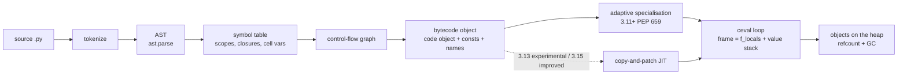
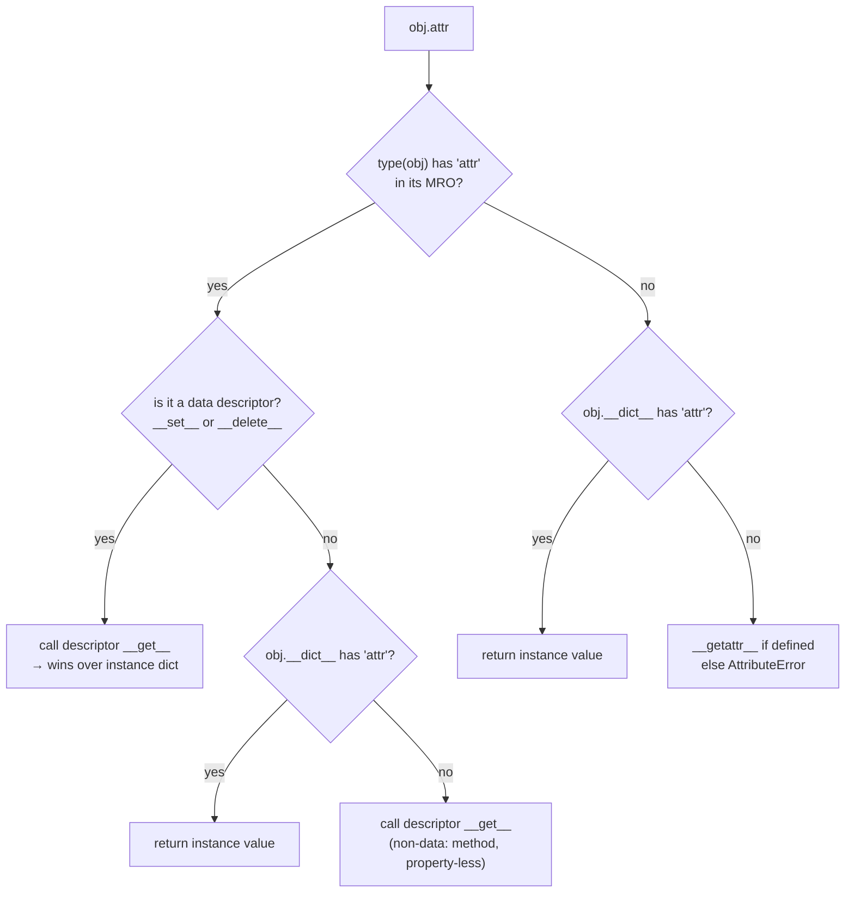
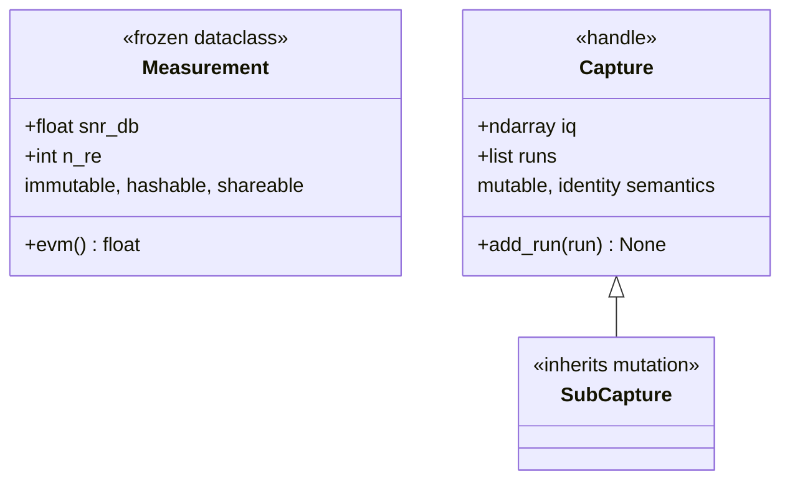
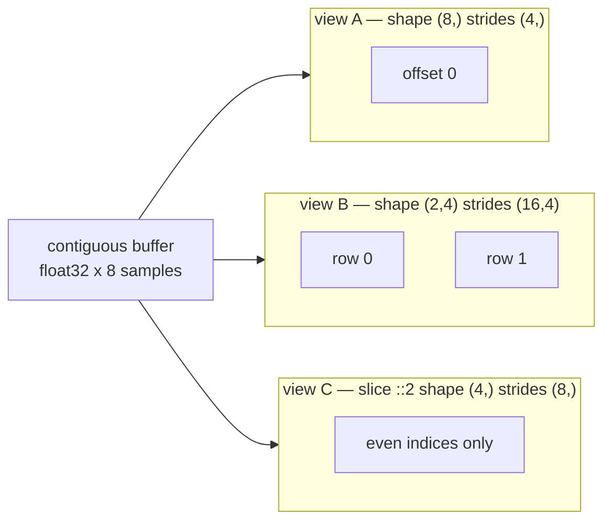
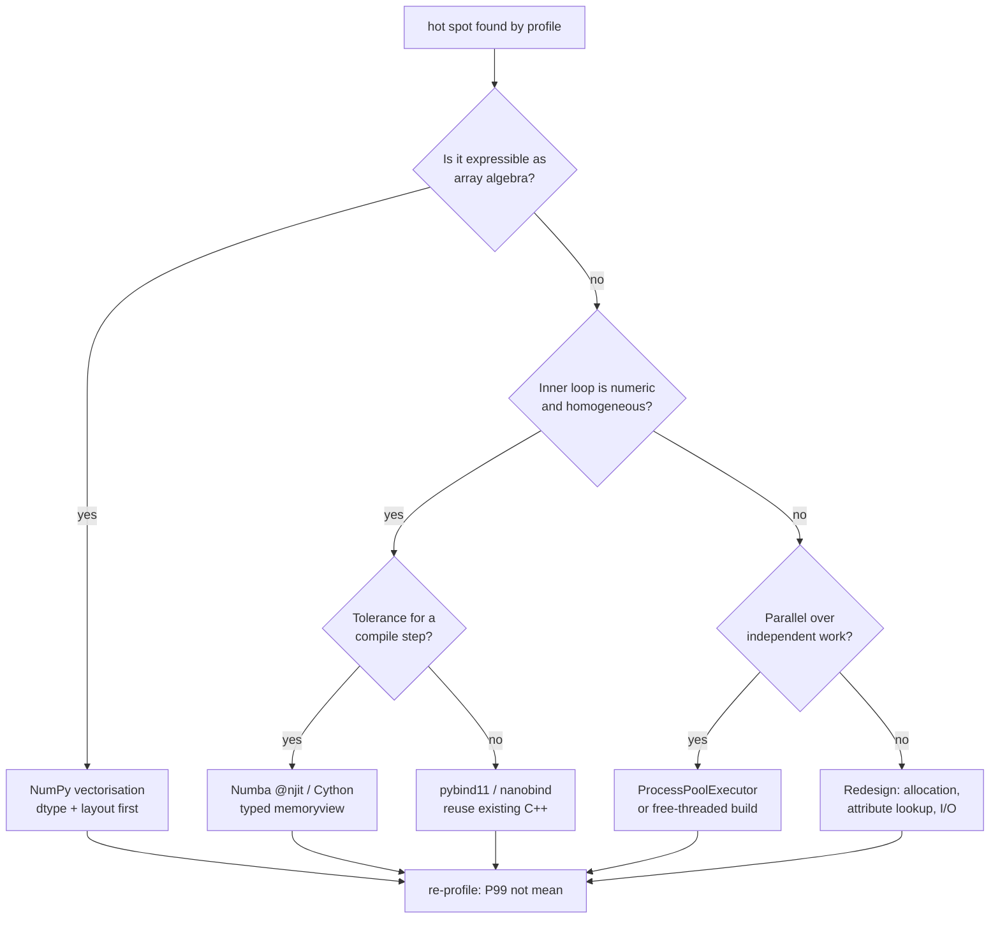

# Python Programming — Language, Object Model and Engineering Practice

Python is the language this project uses for everything that is *not* on the hot path: link-level simulation, capture-file analysis, test-vector generation, tooling, plotting, and the glue that drives C/C++ and RTL flows. It is also the language most likely to be asked about in an interview at the level of "why is this slow, and what would you do about it" rather than "what does `yield` do".

The single thesis of this note: **Python's cost model is *attribute lookup plus allocation*, and every serious optimisation is an attack on one of those two.** Everything else — the GIL, free-threading, NumPy views, `__slots__`, dataclasses, async — is a corollary.

Companion notes: [[08-1 Programming Languages Toolchain and Performance Engineering]] (build systems, profiling method), [[08-2 C and C++ Programming - Language Features, STL and Systems Practice]] (the extension-language side), [[08-4 MATLAB and Simulink - Programming, Modelling and Code Generation]] (the other modelling environment), [[06-1 LLM Inference Engines and xLLM]] (where Python drives a C++ engine).

---

## 1. Where Python sits, and what that dictates

| Role | Typical code | What matters | What does not |
| --- | --- | --- | --- |
| Experiment harness | Sweep SNR, run 10⁴ drops, collect BLER | Iteration speed, reproducibility | Per-call overhead |
| Signal / IQ analysis | Read capture, filter, FFT, EVM | Vectorisation, dtype discipline | Object purity |
| Test-vector generation | Emit `.mem`/`.hex` for RTL testbenches | Bit-exactness, endianness | Speed |
| Tooling / CI | Parse logs, drive simulators, plot | Robustness, clear errors | Micro-optimisation |
| Service glue | FastAPI in front of a C++ engine | Concurrency model, tail latency | Raw throughput |
| On-device inference | Rare; only where latency budget allows | Startup, memory | — |

The rule that follows: **write the outer loop in Python and the inner loop in something else** — vectorised NumPy, Numba, Cython, or a C++ extension. A per-sample Python loop over 10⁷ IQ samples costs minutes; the same work as one NumPy expression costs tens of milliseconds.

---

## 2. Execution model — what actually runs

CPython does not interpret source text. It tokenises and parses to an AST, compiles to bytecode, and executes that bytecode in the `ceval` loop, over a stack frame per invocation.



Facts that change how you write code:

- **A function call is expensive** relative to an arithmetic operation — roughly two orders of magnitude. That is why `sum(x*x for x in v)` loses to `np.dot(v, v)`.
- **Name resolution is a chain**: local → enclosing (cell) → global → builtin. Locals are array-indexed and fast; a global lookup is a dict probe. Hoisting a global into a local inside a hot loop is a real, measurable win.
- **Specialisation (PEP 659, 3.11+)** rewrites bytecode per call site after it observes stable types. This is why polymorphic call sites in a loop are much slower than monomorphic ones — and why "just add a type hint" does nothing at runtime.
- **Memory is reference counting plus a cycle collector.** Refcount handles the common case immediately and deterministically; the generational GC exists only to reclaim cycles. 3.13 made the collector incremental (bounded pause), which matters for tail latency.
- **The JIT is copy-and-patch.** 3.15 reports a 7–8 % geometric-mean gain over the standard interpreter on x86-64 Linux. It is a bonus, not a design assumption; do not architect around it.

### 2.1 The two concurrency stories

| Mechanism | Real parallelism | Cost | Use when |
| --- | --- | --- | --- |
| `threading` | No (GIL) on a standard build | ~50 µs per thread, cheap | I/O-bound, blocking C calls that release the GIL |
| Free-threaded build (`python3.13t`+, PEP 703) | Yes | Single-thread throughput lower; extension ecosystem must opt in | CPU-bound shared-memory work in pure Python |
| `multiprocessing` / `concurrent.futures.ProcessPoolExecutor` | Yes | Process spawn + pickle per task | CPU-bound, coarse-grained, data is picklable |
| `concurrent.interpreters` (PEP 734, 3.14) | Yes, in-process | Own GIL per interpreter, no shared mutable objects | Isolate plugins; avoid process overhead |
| `asyncio` | No, but high concurrency | ~µs per task | Thousands of sockets, timers, subprocess pipes |

The GIL is a *language-implementation* decision, not a language property: Jython and IronPython never had one, and CPython's free-threaded build (officially supported as of 3.14, PEP 779) is the long-term answer. Saying "Python can't do threads" in an interview is now wrong; say "CPython serialises bytecode under the GIL, so threads buy you I/O concurrency and C-level parallelism, not CPU parallelism in pure Python".

---

## 3. The object model — one protocol, no magic

Every "Pythonic" feature is a dunder method the interpreter calls at a defined point. `len(x)` is `type(x).__len__(x)`; `a + b` is `type(a).__add__(a, b)` with `__radd__` fallback; `with` is `__enter__`/`__exit__`; `for` is `iter()` then `__next__` until `StopIteration`.

### 3.1 Attribute lookup — the algorithm to be able to draw



Consequences worth stating out loud:

- A **property is a data descriptor**, so it wins over the instance `__dict__`. That is why a property cannot be shadowed by assigning to the same name.
- MRO is computed by the **C3 linearisation** and is visible as `Cls.__mro__`. Diamond inheritance resolves left-to-right, depth-first, *with the constraint that a class precedes its parents* — the constraint that plain DFS violates.
- `__slots__` removes `__dict__`, cutting per-instance memory and one indirection. It also forbids dynamic attributes and interacts badly with multiple inheritance of slotted bases.

### 3.2 Classes — from plain to metaprogrammed

The progression an interviewer will walk you through, in order of increasing power and decreasing frequency of legitimate use:

| Level | Construct | What it buys | Cost / constraint |
| --- | --- | --- | --- |
| 1 | `class` with `__init__` | Encapsulation | Boilerplate |
| 2 | `@dataclass` | `__init__`/`__repr__`/`__eq__` generated | Fields are annotations; mutable defaults rejected |
| 2b | `@dataclass(frozen=True, slots=True, kw_only=True)` | Immutable value object, low memory, keyword-only | No inheritance from non-frozen; `slots` blocks dynamic attrs |
| 3 | `@property` | Computed/validated attribute | Data descriptor — slower than a plain attribute |
| 4 | `abc.ABC` + `@abstractmethod` | Nominal interface, instantiation blocked | Forces inheritance |
| 4b | `typing.Protocol` | **Structural** interface, no inheritance | Static only; `@runtime_checkable` checks names, not signatures |
| 5 | `__init_subclass__`, `__set_name__` | Registration, descriptor wiring | Implicit control flow |
| 6 | Metaclass | Control class creation itself | Almost always the wrong tool now |

A concrete, domain-shaped example — a scheduler interface with two implementations, using a Protocol so the C++-side scheduler can be adapted without inheritance:

```python
from typing import Protocol, runtime_checkable
from dataclasses import dataclass

@dataclass(frozen=True, slots=True)
class Grant:
    ue_id: int
    prbs: int
    mcs: int

@runtime_checkable
class Scheduler(Protocol):
    def schedule(self, tti: int, demand: dict[int, int]) -> list[Grant]: ...

class RoundRobin:
    def __init__(self) -> None:
        self._last = 0
    def schedule(self, tti: int, demand: dict[int, int]) -> list[Grant]:
        ues = sorted(demand)
        if not ues:
            return []
        self._last = (self._last + 1) % len(ues)
        order = ues[self._last:] + ues[:self._last]
        return [Grant(ue, demand[ue], 20) for ue in order]

class ProportionalFair:
    def __init__(self) -> None:
        self._avg: dict[int, float] = {}
    def schedule(self, tti: int, demand: dict[int, int]) -> list[Grant]:
        for ue in demand:
            self._avg[ue] = 0.9 * self._avg.get(ue, 1.0) + 0.1 * demand[ue]
        # highest instantaneous rate over average rate wins
        ranked = sorted(demand, key=lambda u: demand[u] / self._avg[u], reverse=True)
        return [Grant(ue, demand[ue], 20) for ue in ranked]

def run(sched: Scheduler, ttis: int = 100) -> None:
    demand = {1: 10, 2: 40, 3: 5}
    for t in range(ttis):
        sched.schedule(t, demand)
```

`isinstance(RoundRobin(), Scheduler)` is `True` under `@runtime_checkable`, but it only checked that `schedule` exists — not its signature. That distinction is a favourite follow-up.

Value versus reference semantics is the other class question that matters, because it decides whether a struct crossing a module boundary can be mutated behind your back:



`Measurement` is a frozen dataclass: hashable, safe as a dict key, safe to hand to another thread. `Capture` is a normal class: two names can refer to the same object, so mutating through one is visible through the other. Choosing wrong here produces the classic "my baseline changed after I computed the delta" bug.

### 3.3 The protocols you will actually implement

| Protocol | Methods | Typical use here |
| --- | --- | --- |
| Iterable / Iterator | `__iter__`, `__next__` | Stream frames from a capture without loading it |
| Container | `__len__`, `__getitem__`, `__contains__` | Lazy, memory-mapped sample access |
| Context manager | `__enter__`, `__exit__` | Open/close a VISA instrument or a socket deterministically |
| Callable | `__call__` | Config object as a function; `functools.partial` replacement |
| Comparison | `__eq__`, `__lt__`, `functools.total_ordering` | Sortable measurement records |
| Hashing | `__hash__`, `__eq__` | Deduplicate test vectors |
| Numeric | `__add__`, `__mul__`, `__radd__`, `__iadd__` | Units and dB types that refuse to add dBm to dB |

The dB example is worth having ready, because it shows why operator overloading in Python is a *type-safety* tool rather than a syntax trick: `dBm + dB` is legal and yields `dBm`; `dBm + dBm` must raise, because adding two absolute powers in dB is meaningless.

---

## 4. Generators, coroutines and async

`yield` turns a function into a generator; `yield` inside `async def` plus `await` makes it a coroutine. The mechanism is the same: a frame that can be suspended and resumed. PEP 342 (2005) added `send`/`throw`/`close`, PEP 380 added `yield from`, PEP 492 (3.5) added `async`/`await` and the event loop.

```python
async def capture_stream(n_frames: int, period_s: float):
    for i in range(n_frames):
        await asyncio.sleep(period_s)      # yields control, does not block
        yield i, b"\x00" * 1024            # back-pressure via the consumer

async def main() -> None:
    async with asyncio.TaskGroup() as tg:   # 3.11+: structured concurrency
        async for idx, buf in capture_stream(5, 0.01):
            tg.create_task(process(idx, buf))
```

Key points that separate a good answer from a memorised one:

- **`asyncio` is single-threaded cooperative scheduling.** One blocking call (`time.sleep`, a synchronous driver read, a CPU-heavy loop) stalls every task on that loop. The correct fix is `run_in_executor` or a separate process, not "more `await`s".
- **`TaskGroup` is structured concurrency**: if one child raises, siblings are cancelled and the errors are raised as an `ExceptionGroup` (PEP 654). This replaces the `gather(return_exceptions=True)` + manual-cancel pattern.
- **Cancellation is a `CancelledError` injected at an `await`.** Code that swallows `Exception` also swallows cancellation — a real source of hung shutdowns.
- **Timeouts are scoped**: `async with asyncio.timeout(0.5):` (3.11+), not `wait_for` wrappers scattered around.

---

## 5. Typing — what the annotations actually do

Annotations are **not enforced at runtime**. They are metadata consumed by static checkers (mypy, pyright, pyrefly), IDEs, and libraries such as pydantic and dataclasses.

| Feature | Version | Why it exists |
| --- | --- | --- |
| `typing` module, PEP 484 | 3.5 | Gradual typing |
| Variable annotations, PEP 526 | 3.6 | `x: int = 0` |
| Postponed evaluation, PEP 563 | 3.7 | `from __future__ import annotations`, forward refs as strings |
| Builtin generics, PEP 585 | 3.9 | `list[int]` instead of `List[int]` |
| Union operator, PEP 604 | 3.10 | `int \| None` |
| `ParamSpec` / `Concatenate`, PEP 612 | 3.10 | Typing decorators that preserve signatures |
| Variadic generics, PEP 646 | 3.11 | `*Ts` for shape-aware array code |
| `Self`, PEP 673 | 3.11 | Fluent builders that return the subclass type |
| Type parameter syntax, PEP 695 | 3.12 | `def f[T](x: T) -> T`, `type Vec = list[float]` |
| `@override`, PEP 698 | 3.12 | Catch a renamed base method |
| Deferred annotations, PEP 649 | 3.14 | Lazy `__annotations__`; the eventual replacement for PEP 563 |

Practical rules: annotate **public boundaries** (module API, dataclass fields, function signatures) and leave locals alone; run `mypy --strict` on new modules but not on a legacy tree in one go; use `Protocol` at the seam where a C++/NumPy object arrives, because it documents the duck-typed contract that actually exists.

---

## 6. NumPy — the array model that makes Python usable for signals

NumPy is not "lists but faster". It is a **strided view over a flat buffer plus a dtype**, and almost every surprise is explained by that sentence.



- **A slice is a view; fancy indexing is a copy.** `a[::2]` shares memory; `a[[0, 2, 4]]` allocates. Writing into a slice therefore mutates the original, which is either the feature or the bug.
- **Broadcasting** compares shapes right-to-left, with size-1 dimensions stretching. `(1024, 1) * (1, 8)` gives `(1024, 8)` without materialising intermediate copies.
- **Promotion changed in NumPy 2.0** (NEP 50): a Python `float` scalar no longer silently upgrades a `float32` array to `float64`, so `arr32 * 2.0` stays `float32`. Code that relied on the old value-based casting will silently lose or gain precision.
- **Cache layout matters.** C order is row-major, so iterating the last axis is contiguous. For a filter applied per-antenna across time, keep time on the last axis, or your "vectorised" code will be memory-bound rather than compute-bound.
- **Complex baseband is native**: `np.complex64` is the right dtype for IQ unless you have a measured reason for `complex128`.

A complete, idiomatic inner loop — FIR filtering 10⁷ complex samples — is one call, not a loop:

```python
import numpy as np

def fir(x: np.ndarray, taps: np.ndarray) -> np.ndarray:
    # 'valid' convolution; float32/complex64 kept throughout
    return np.convolve(x, taps, mode="valid").astype(x.dtype, copy=False)

def evm(ref: np.ndarray, meas: np.ndarray) -> float:
    err = meas - ref
    return float(np.sqrt(np.mean(np.abs(err) ** 2) / np.mean(np.abs(ref) ** 2)))
```

Both saturate memory bandwidth on a modern core. That is the point: at this level, Python is not the bottleneck, and further micro-optimisation is wasted unless the profile says otherwise.

---

## 7. Performance — the decision tree, not a list of tricks



The ordered checklist, because most "Python is slow" reports are one of these five:

1. **Allocation.** Growing a list in a loop, concatenating arrays, creating a dataclass per sample. Preallocate with `np.empty`, accumulate into an array, or batch.
2. **Attribute lookup in a loop.** Hoist `self.foo` to a local; avoid `getattr` in hot paths; `__slots__` for millions of small objects.
3. **dtype drift.** A single `float64` constant turning a `float32` pipeline into double precision costs bandwidth and vector width. Assert dtypes at boundaries.
4. **Copying.** `np.array(x)` where `np.asarray(x)` would do; `.copy()` in a pipeline that never mutates.
5. **Wrong parallelism.** Threads for CPU work; a process pool for a 1 ms task (pickle dominates); blocking calls inside an event loop.

Profiling tools, in the order you should reach for them: `cProfile` + `pstats` (call counts, cumulative time), `line_profiler` (per line), `py-spy` (sampling, no code change, works on production processes), `tracemalloc` (allocation sites), and from 3.15 the **Tachyon** high-frequency statistical profiler (PEP 799). Memory: `sys.getsizeof` is shallow — use `tracemalloc` or `pympler`.

---

## 8. Packaging and engineering practice

| Concern | Modern answer | Note |
| --- | --- | --- |
| Project metadata | `pyproject.toml`, PEP 621 `[project]` | `setup.py` is legacy; keep only for exotic builds |
| Build backend | `hatchling`, `setuptools`, `maturin` (Rust), `scikit-build-core` (CMake/C++) | Match the backend to the extension language |
| Environment / lock | `uv`, `pip-tools`, `poetry`, `conda` | Lock file is the reproducibility artefact, not the venv |
| Lint / format | `ruff` (lint + format) | Replaces flake8/isort/black in one tool |
| Types | `mypy` or `pyright`/`pyrefly` | Gate CI on new code only |
| Tests | `pytest` with fixtures and `parametrize` | `tmp_path`, `monkeypatch`, `capsys` cover most needs |
| Property tests | `hypothesis` | Ideal for quantiser and fixed-point code |
| Numeric regression | `np.testing.assert_allclose` with explicit tolerance | Never `==` on floats |

Two habits that matter more than tool choice: **pin and test the same environment you ship** (the library-vs-application distinction), and **make the numerics testable** — every DSP function should have a golden vector and a stated tolerance in units of dB or LSB, not a bare `assertAlmostEqual`.

---

## 9. Applied patterns for this domain

```python
# 1. Memory-mapped capture: never load a 40 GB IQ file
import numpy as np, pathlib

def open_capture(path: pathlib.Path, dtype=np.complex64, offset: int = 0):
    raw = np.memmap(path, dtype=dtype, mode="r", offset=offset)
    return raw                      # a view; slicing is free

# 2. Test-vector emission for an RTL testbench: fixed width, explicit hex
def emit_hex(x: np.ndarray, width: int, path: pathlib.Path) -> None:
    q = np.clip(np.round(x.real * (2 ** (width - 1) - 1)), -(2**(width-1)), 2**(width-1)-1)
    q = q.astype(np.int64) & ((1 << width) - 1)          # two's complement
    path.write_text("\n".join(f"{v:0{width//4}x}" for v in q) + "\n")

# 3. Deterministic experiment: seed everything, log the seed
import random
def seed_all(s: int) -> None:
    random.seed(s); np.random.default_rng(s)
```

The three rules behind those snippets: **never materialise what you can view**, **make the bit-width explicit when crossing into hardware**, and **make every stochastic run reproducible from a logged seed** — otherwise a BLER curve is not a result, it is an anecdote.

---

## 10. Interview anchors

1. **"Is Python compiled or interpreted?"** — Both. CPython compiles to bytecode once (cached in `__pycache__/*.pyc`, invalidated by mtime+size or hash), then interprets the bytecode. The 3.13+ JIT compiles hot traces to machine code.
2. **"Why is `x += [1]` different from `x = x + [1]`?"** — `__iadd__` mutates in place for mutable types, so aliases see the change; `+` rebinds. Same trap with `+=` on a default argument.
3. **"Classic mutable default bug?"** — `def f(a=[])` evaluates the default once at definition time. Use `None` then create, or `field(default_factory=list)` in dataclasses.
4. **"`__new__` vs `__init__`?"** — `__new__` allocates and returns the instance (needed for immutables, singletons, `NamedTuple`); `__init__` initialises an already-created instance and returns `None`.
5. **"MRO?"** — C3 linearisation, `Cls.__mro__`; a class precedes its bases, and the order is deterministic for diamonds. `super()` follows the MRO, not the parent class.
6. **"`@staticmethod` vs `@classmethod`?"** — Neither receives an implicit first argument beyond the class in the classmethod case; classmethods are the correct factory idiom because they respect subclassing.
7. **"Metaclass use case in 2026?"** — Registering subclasses, enforcing an interface at creation time, ORMs. `__init_subclass__` covers most registration cases with no metaclass conflict risk. Prefer it.
8. **"`is` vs `==`?"** — Identity vs equality; `is` is only correct for `None`, `True`, `False`, sentinels, and deliberate interning.
9. **"Does `asyncio` make code faster?"** — No. It makes I/O-bound code *concurrent* at lower cost per task than threads. It cannot speed up CPU work and it will not help if any coroutine blocks.
10. **"How would you make this 100× faster?"** — Profile, then vectorise; if still hot, compile (Numba/Cython) or move to C++ with pybind11; if independent, parallelise across processes. State the expected speedup and the cost (build complexity, debugging difficulty) for each step.
11. **"Why does NumPy beat a loop by 100×?"** — One interpreter dispatch per array op instead of per element, contiguous typed memory, SIMD inside the ufunc loop, and no per-element boxing.

---

## Anchors — verified facts

- **Python 3.15.0 released 9 October 2026** (PEP 790 schedule said 2026-10-01; the release page states Oct. 9, 2026), 5,643 commits from 1,012 contributors. Headline features: **PEP 810** explicit lazy imports, **PEP 814** `frozendict`, **PEP 661** `sentinel` builtin, **PEP 686** UTF-8 as default encoding, **PEP 798** unpacking in comprehensions, **PEP 799** profiling package plus **Tachyon** sampling profiler, **PEP 831** frame pointers enabled by default, stable ABI for free-threaded builds (PEP 803/820/793). Experimental JIT: **7–8 % geometric-mean speedup on x86-64 Linux**, 11–12 % on AArch64 macOS.
- **Python 3.14** (released October 2025): free-threading **officially supported** (PEP 779), deferred annotation evaluation (PEP 649/749), `concurrent.interpreters` in the standard library (PEP 734), incremental GC, `t`-strings (PEP 750), multiple `except` types without parentheses (PEP 758).
- **Python 3.13** (October 2024): experimental JIT (copy-and-patch), free-threaded build (PEP 703) as an experimental option, incremental cyclic GC, `locals()` semantics fixed (PEP 667), `typing.ReadOnly` for TypedDict (PEP 705).
- **Python 3.12**: PEP 695 type-parameter syntax and `type` alias statement, PEP 701 f-string grammar, PEP 688 buffer protocol in Python (`__buffer__`), per-interpreter GIL (PEP 684).
- **Python 3.11**: PEP 659 adaptive specialising interpreter (~1.25× on pyperformance), PEP 654 exception groups and `except*`, `asyncio.TaskGroup`, `asyncio.timeout`, `tomllib` (PEP 680).
- **NumPy 2.0** (June 2024) implemented **NEP 50** promotion: Python scalars no longer change array dtype; `np.float32(1) + 1.0` stays `float32`. NumPy 2.x also removed long-deprecated aliases (`np.float_`, `np.unicode_`).
- **`asyncio`** entered the standard library in **3.4** (PEP 3156); `async`/`await` syntax in **3.5** (PEP 492); `async` generators and comprehensions also 3.6.
- **`dataclasses`** entered the standard library in **3.7** (PEP 557). `slots=True` exists from **3.10**.
- **Structural pattern matching** (`match`/`case`) is **3.10** (PEP 634). **Assignment expressions** (`:=`) are **3.8** (PEP 572).
- **`dict` preserves insertion order** as a language guarantee from **3.7** (implementation detail in 3.6).
- **Reference-count + generational GC**: `gc.get_threshold()` default `(700, 10, 10)`; cycles are only collected by `gc`, which is why an object graph with `__del__` and cycles can survive longer than expected.
- **`sys.getsizeof` is shallow**; it excludes referenced objects and, for arrays, the base buffer.
- **PyPI**: `pip install` resolves wheels tagged for the interpreter ABI (the `cp315-…` family for 3.15), so a free-threaded build needs its own `t`-suffixed wheel variant. `VERIFY` the exact platform tag on your target before pinning it in a build script.

## Related

- [[08-1 Programming Languages Toolchain and Performance Engineering]] — profile method, build systems, kernel-bypass context
- [[08-2 C and C++ Programming - Language Features, STL and Systems Practice]] — the extension side of pybind11/nanobind
- [[08-4 MATLAB and Simulink - Programming, Modelling and Code Generation]] — the other modelling environment; `py.` interop from MATLAB
- [[08-5 Verilog HDL - RTL Design, Verification and Synthesis Practice]] — test-vector consumers for the emitter above
- [[06-3 Machine Learning - Foundations, Core Algorithms and Applications]] — the main consumer of the array semantics above: vectorised losses, broadcasting in metric code, and why the naive Python loop is the bottleneck
- [[06-1 LLM Inference Engines and xLLM]] — Python front end over a C++ engine, GIL and batching implications
- [[05-2 Cloud-Edge-End Collaboration and Heterogeneous Computing]] — where the Python/C++ boundary sits in an edge pipeline
- [[01-3 AI-ML for RAN and O-RAN RIC]] — training/serving harness code, often Python

## References

**Language and standard library**

1. Python Software Foundation. *The Python Language Reference*, release 3.15. <https://docs.python.org/3/reference/>
2. Python Software Foundation. *What's New In Python 3.15*. <https://docs.python.org/3/whatsnew/3.15.html>
3. PEP 790 — *Python 3.15 Release Schedule* (Hugo van Kemenade). <https://peps.python.org/pep-0790/>
4. PEP 659 — *Specializing Adaptive Interpreter* (Mark Shannon). <https://peps.python.org/pep-0659/>
5. PEP 703 — *Making the Global Interpreter Lock Optional in CPython* (Sam Gross). <https://peps.python.org/pep-0703/>
6. PEP 779 — *Criteria for accepting free-threading as officially supported*. <https://peps.python.org/pep-0779/>
7. PEP 810 — *Explicit lazy imports*. <https://peps.python.org/pep-0810/>
8. PEP 484 — *Type Hints* (Guido van Rossum, Jukka Lehtosalo, Łukasz Langa). <https://peps.python.org/pep-0484/>
9. PEP 544 — *Protocols: Structural subtyping (static duck typing)* (Ivan Levkivskyi, Jukka Lehtosalo, Łukasz Langa). <https://peps.python.org/pep-0544/>
10. PEP 557 — *Data Classes* (Eric V. Smith). <https://peps.python.org/pep-0557/>
11. PEP 649 — *Deferred Evaluation Of Annotations Using Descriptors* (Eric V. Smith). <https://peps.python.org/pep-0649/>
12. PEP 654 — *Exception Groups and except\** (Irit Katriel, Yury Selivanov, Guido van Rossum). <https://peps.python.org/pep-0654/>

**Books**

13. Ramalho, L. *Fluent Python: Clear, Concise, and Effective Programming*, 2nd ed. O'Reilly Media, 2022. ISBN 978-1-492-05635-5.
14. McKinney, W. *Python for Data Analysis*, 3rd ed. O'Reilly Media, 2022. ISBN 978-1-098-10403-0.
15. Beazley, D., and Jones, B. K. *Python Cookbook*, 3rd ed. O'Reilly Media, 2013. ISBN 978-1-449-34037-7.
16. Slatkin, B. *Effective Python: 90 Specific Ways to Write Better Python*, 2nd ed. Addison-Wesley, 2019. ISBN 978-0-13-485398-7.

**NumPy and numerical work**

17. Harris, C. R., Millman, K. J., van der Walt, S. J., et al. "Array programming with NumPy." *Nature* 585, 357–362 (2020). DOI 10.1038/s41586-020-2649-2.
18. NumPy Developers. *NumPy Reference* and *NEP 50 — Promotion rules for non-numerical types*. <https://numpy.org/doc/stable/>
19. Numba documentation — `@njit`, typed lists, `prange`. <https://numba.readthedocs.io/>
20. Cython documentation — typed memoryviews, `cdef class`. <https://cython.readthedocs.io/>

**Tooling and interfaces**

21. pybind11 documentation — type casters, GIL management, `py::class_`. <https://pybind11.readthedocs.io/>
22. nanobind documentation — lighter alternative to pybind11. <https://nanobind.readthedocs.io/>
23. pytest documentation — fixtures, `parametrize`, plugins. <https://docs.pytest.org/>
24. *pyproject.toml* specification, PEP 621. <https://peps.python.org/pep-0621/>
25. uv documentation — resolver, lock file, Python version management. <https://docs.astral.sh/uv/>

---

_Copyright (c) 2026 Washington Ruan and contributors · licensed under **GPL-3.0-or-later** or **AGPL-3.0-or-later**, at your option · see `LICENSE` and `LICENSE-AGPL`._
