# Engineering Project Management — Methodology, Lifecycle, Tools and Best Practice

Engineering projects do not usually fail because the physics was wrong. They fail because the wrong thing was
built, or the right thing was built in the wrong order, or nobody with authority was told the truth early
enough, or the plan was a negotiation rather than a forecast. The technology in this vault — a modem, a Wi-Fi
scheduler, an LLM inference runtime — is hard; what decides whether it ships is mostly not.

That is why this note exists, and why it is its own group. Groups `01` through `08` are the technical
substance. This group is the discipline that decides which of that substance gets attempted, in what order,
with whose time, and when the attempt is stopped.

Say this sentence early in any interview where project management comes up: **project management is the
discipline of deciding what to build, in what order, with whose time, and when to stop — and the empirical
base says the dominant failure modes are organisational, not technical: on Flyvbjerg's database of more than
16,000 projects, 47.9% came in on budget, 8.5% on budget and on time, and 0.5% on budget, on time and with
the promised benefits.**

## 0. How to read this note

Read it in this order; the rest is reference.

| Order | Question | Where |
| --- | --- | --- |
| 1 | Is any of this actually evidence-based, or is it folklore? | §2 |
| 2 | What is a project, and how is it different from a programme and from operations? | §1 |
| 3 | Which methodology fits my situation, and why is that a decision rather than a preference? | §3, §4 |
| 4 | What does the lifecycle look like, and where do the kill decisions live? | §5 |
| 5 | How do scope, schedule and cost actually get controlled? | §6, §7, §8 |
| 6 | How do I handle the part I cannot predict? | §9, §10, §11 |
| 7 | Who decides what, and how is that made explicit? | §12, §13 |
| 8 | What do I actually use, day to day? | §14, §15 |
| 9 | What do organisations that reliably deliver actually do? | §16 |
| 10 | How does this go wrong, and what do I measure? | §17, §18, §19 |

If you only have ten minutes: read §2, the decision tree in §4, the gate structure in §5, and §16.

## 1. What engineering project management is

### 1.1 Three words that get used interchangeably and must not be

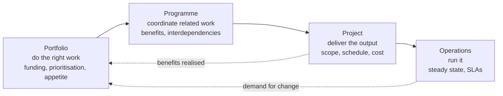

- A **project** is a temporary endeavour undertaken to create a unique product, service or result. It ends.
- A **programme** is a coordinated group of related projects managed together because the benefit is only
  available from the combination. A 5G feature programme is not one project: it is a PHY project, an L2/3
  project, a conformance-test project and a field-trial project, none of which delivers value alone.
- A **portfolio** is everything the organisation is funding, managed to strategy and to risk appetite. Its
  job is to say no.
- **Operations** is the steady state that the project hands over to, and that generates the demand for the
  next project.

The three are governed differently, at different cadences, by different people. Conflating them is the single
most common structural error in engineering organisations: a portfolio problem (we are funding too many
things) gets escalated as a project problem (we are behind), and the project team is asked to fix it.

### 1.2 The five questions a project manager owns

Every framework in this note is an answer to the same five questions, and none of them is "how do I use the
tool".

| Question | Formal name | Artefact that answers it |
| --- | --- | --- |
| Why are we doing this, and what makes it worth more than the alternatives? | Business case, benefits | Business case, benefits management plan |
| What exactly is in, and what is explicitly out? | Scope | Scope statement, WBS, WBS dictionary |
| When will it be done, and what has to happen in what order? | Schedule | Network, milestone list, baseline |
| Who does what, and who decides when they disagree? | Organisation and governance | OBS, RACI, decision log, tolerances |
| How much, and what is the confidence on that number? | Cost and risk | Estimate with range, contingency, risk register |

Add a sixth that the standards are oddly quiet about: **when do we stop?** Every project needs a pre-agreed
condition under which it is cancelled rather than fed. §5 puts it on the lifecycle as an explicit branch.

### 1.3 What makes an *engineering* project different

Three properties separate engineering work from general business project work, and each one changes the
method:

1. **Verification is against physics and standards, not against user acceptance.** A modem either passes the
   conformance test or it does not; a scheduler either meets the slot budget or it does not. This forces a
   verification-heavy lifecycle (§10) and makes "we'll test it at the end" fatal.
2. **Irreversibility is physical.** Once the board is taped out or the tooling is cut, a design change costs
   orders of magnitude more — the reason defect cost escalates by phase and the reason for front-loading
   (§10, §16.1).
3. **Uncertainty is technical, and it is concentrated.** Most of the schedule risk sits in three or four
   things nobody has done before. Everything else is known work with an unknown duration. Treating the two
   the same is why estimates are simultaneously too pessimistic and too optimistic.

## 2. The evidence base: why this is not folklore

The field has a bad reputation because most of what circulates is opinion wearing a suit. It does have a real
empirical base, and knowing five studies — and their limitations — is most of what separates a credible
argument from a confident one.

| Study | Sample | Headline | Use it for |
| --- | --- | --- | --- |
| Flyvbjerg and Gardner, *How Big Things Get Done*, 2023 | 16,000+ projects, 136 countries | 47.9% on budget · 8.5% on budget and on time · 0.5% on budget, on time and on benefits | The iron law of megaprojects. The cost/time/benefits triple is the honest success definition |
| Flyvbjerg et al., transport study | 258 transport projects, 20 nations, 1927–1998 | Cost underestimated in ~9 of 10; average overrun ~28%; rail ~45%, fixed links ~34%, roads ~20% | Reference class forecasting. This is the study that put optimism-bias uplifts into UK Treasury Green Book guidance from 2003 |
| McKinsey and University of Oxford, 2012 | 5,400+ IT projects above $15M | 45% over budget, 7% over time, 56% less value; every extra scheduled year adds ~15% to cost overrun; 17% become "black swans" above 200% overrun | Large IT programmes. Note that time overruns are small and value shortfalls are huge — the failure is in scope and benefit, not in calendar |
| Standish Group, CHAOS 2020 | Ongoing database since 1994 | ~31% successful, ~50% challenged, ~19% failed; success 61% for small projects versus 6% for the largest | The size effect: splitting work is the single largest lever. Sponsor maturity moves success from 18% to 67% |
| Budzier and Flyvbjerg, HBR 2011 | 1,471 IT projects | Average 27% overrun hides a fat tail: one in six projects is a black swan at ~200% cost overrun | Distributions, not averages. Plan for the tail |
| PMI, Pulse of the Profession 2020 | Global survey of practitioners | 11.4% of investment wasted due to poor project performance; organisations that undervalue PM report ~67% more projects failing outright | The cost of treating project management as administration |

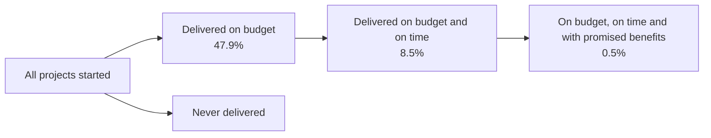

**Four caveats you must state whenever you quote these numbers**, because the person across the table will
know at least one of them:

1. **Definitions do the work.** "On time" in CHAOS means within 10% of the target; a "failed" project is one
   cancelled or never used, not one that disappointed somebody.
2. **Survivorship bias runs the wrong way.** Completed-project databases can only count projects that
   finished, so the class that never finishes is underrepresented. Even these numbers are flattering.
3. **Self-reporting.** The PMI and KPMG figures are surveys of practitioners, not measurements of projects.
4. **Optimism bias and strategic misrepresentation are different things.** Flyvbjerg's own paper title asks
   the question: "Error or Lie?" For public works, a large share of the underestimate is deliberate — the
   number was chosen to get approval. No amount of estimation technique fixes that; only changed incentives
   and independent estimates do.

## 3. The methodology landscape

There are more named methodologies than there are distinct ideas. Almost everything is a combination of four
moves: **decide up front**, **iterate**, **limit work in progress**, and **pool the safety margin**. The
family tree:

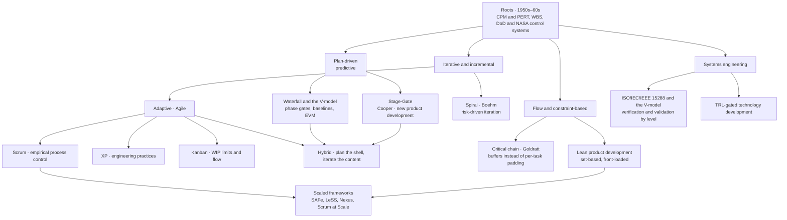

Five things worth knowing about the tree:

- **"Waterfall" is a misreading.** Winston Royce's 1970 paper described a sequential model and then argued
  it was risky, recommending an iteration before build and customer involvement during development. The
  rigid single-pass waterfall that people attack is closer to the procurement standards that followed
  (US DoD Std 2167 and its successors) than to Royce. This matters in arguments: the originator agreed with
  the critics.
- **The V-model is not the enemy of iteration; it is a statement about verification.** Left side
  decomposes, right side integrates, and every level on the left has a matching verification level on the
  right (§10). You can iterate inside that structure.
- **Agile is not "no planning".** Scrum replaces a plan with an empirical loop: make the next increment,
  inspect the result, adapt. It increases planning frequency and reduces planning horizon.
- **Critical chain and Kanban are the same insight applied to different things.** Both say the padding
  belongs in one visible place instead of hidden in every task; one pools it as time buffers, the other as
  WIP limits.
- **Hybrid is the normal case, not the compromise.** Hardware, certification and supply commitments are
  plan-driven whether or not you like it; the parts that are genuinely unknown are iterative. The skill is
  putting the seam in the right place, not choosing a side.

## 4. Choosing a methodology: a decision, not a preference

The most useful thing a project manager does before planning is refuse to inherit a methodology by default.
The choice is a function of the work's uncertainty and its consequences.

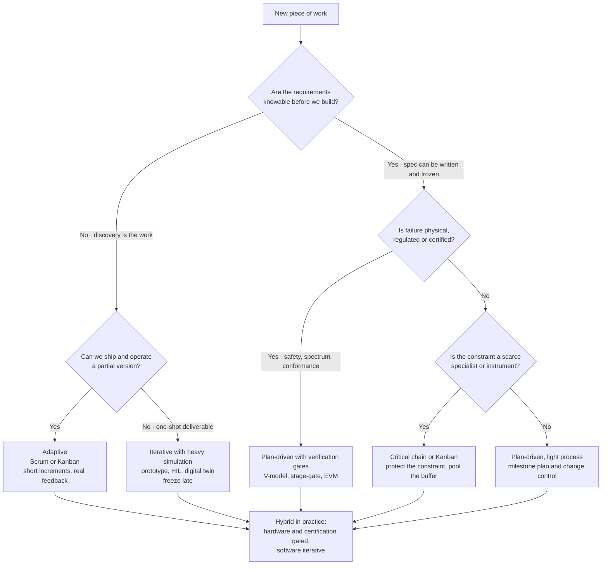

Two well-known framings say the same thing from different angles:

- **Stacey matrix** — agreement on *what* × certainty about *how*. Close to agreement and close to certainty
  → simple, plan it. Far from one or both → complexity or anarchy, and you must run experiments rather than
  plans. Not a maturity scale: it is a fit test.
- **Cynefin** — clear, complicated, complex, chaotic. In the *complicated* domain, expert diagnosis and good
  practice apply; in the *complex* domain, only probe-sense-respond works. Most engineering projects are
  complicated with a complex core, which is exactly why hybrid is the norm.

Mapping this onto the domains in this vault, as a sanity check that the framework does real work:

| Work | Requirements knowable? | Failure consequence | Scarce constraint | Method that fits |
| --- | --- | --- | --- | --- |
| NR feature in a shipped modem | Yes, in the spec | Conformance and interoperability | RF lab slots, conformance lab | Plan-driven gate structure with iterative internal drops |
| Wi-Fi scheduler tuning | Partly — the target is a latency profile, not a spec clause | Field performance, not safety | Chamber time, real devices | Iterative with a measured exit criterion per iteration |
| FPGA baseband RTL | Yes, but the timing closure is not knowable up front | Tape-out or not | One or two RTL engineers | Iterative inside a hard gate; critical chain if one person is the constraint |
| AI/ML research component | No | Model quality, not correctness | GPU hours, labelled data | Time-boxed experiments with a kill criterion, not a schedule |
| Driver bring-up on new silicon | No — the silicon's behaviour is the unknown | Blocking everything downstream | Sample availability, vendor support | Front-loaded risk retirement: get the unknowns into week one |

Note what the table says that no methodology debate says: **the binding constraint is usually a calendar
resource — a lab, a chamber, a sample, a specialist — not the team's capacity.** Schedule the constraint
first.

## 5. The lifecycle and where the kill decisions live

Every standard draws the lifecycle slightly differently, and all of them draw the same shape: a start, a
period of increasing commitment, a period of verification, and a handover. The differences are in where the
decision points sit and who sits behind them.

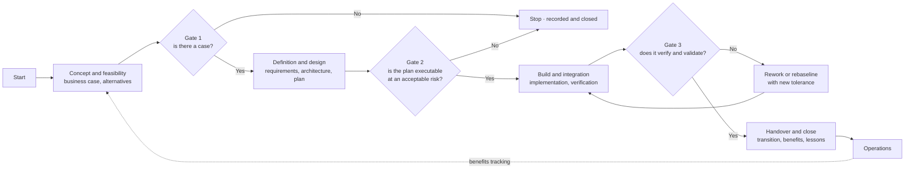

Three concrete instantiations worth being able to name:

**PMBOK.** The 6th edition organised the work into five process groups (initiating, planning, executing,
monitoring and controlling, closing) crossed with ten knowledge areas. The 7th edition (2021) dropped that
matrix for **12 principles** — stewardship, team, stakeholders, value, systems thinking, leadership,
tailoring, quality, complexity, risk, adaptability and resilience, change — and **8 performance domains**
(stakeholders, team, development approach and lifecycle, planning, project work, delivery, measurement,
uncertainty). Because practitioners complained, PMI published *Process Groups: A Practice Guide* in 2022 to
restore the input/output view. Practical consequence: PMBOK 7 is a principles-and-outcomes standard, and
"tailoring" is now an explicit, examinable act rather than an admission of guilt.

**PRINCE2 Project Management (Version 7)**, published September 2023 by PeopleCert, which acquired the
portfolio from AXELOS in 2021: seven principles (continued business justification, learn from experience,
defined roles/responsibilities/relationships, manage by stages, manage by exception, focus on products,
tailor to suit), seven **practices** — the 6th edition's seven *themes* reframed as business case,
organising, plans, quality, risk, issues, progress — seven processes (starting up, directing, initiating,
controlling a stage, managing product delivery, managing a stage boundary, closing), plus **people** as an
integrated element and **sustainability** added as a seventh performance target. Principles cannot be
tailored away; practices and processes can.

**NASA**, which is the most useful model for anything with a physical artefact: pre-phase A through F, split
into Formulation (A: concept and technology development; B: preliminary design) and Implementation (C: final
design and fabrication; D: assembly, integration, test, launch and checkout; E: operations; F: closeout),
with a **Key Decision Point** at each boundary (KDP A … KDP F) and a Standing Review Board providing
non-advocacy assessment. Its distinctive move is that cost and schedule confidence is a *number with a
probability attached* (§9).

**Stage-Gate** (Robert Cooper) is the new-product-development equivalent: a series of gates where a
cross-functional leadership team reviews a standard deliverable set and makes a go / kill / hold / recycle
decision. Its most valuable contribution is the explicit **kill** outcome, and the observation that the
majority of gates in practice never use it.

The generic rule: **a gate is not a meeting, it is a decision with pre-agreed entry criteria.** A gate
without written entry and exit criteria is a status review with better catering.

And the iterative loop that runs inside any of these:

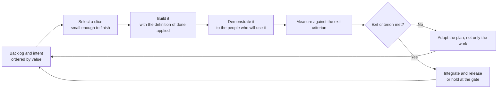

The loop is the same at every scale: a two-week sprint, a 10-week planning increment, a NASA phase. What
changes is the cost of being wrong and therefore the length of the loop.

## 6. Scope: requirements, the WBS and the 100% rule

### 6.1 Requirements

Requirements work is the highest-leverage activity in the whole discipline and the most commonly skipped,
because it produces no visible artefact that looks like progress. The NASA-linked finding from the evidence
base is the sharpest available: projects that spend 5–10% of effort on requirements run roughly 50% over
budget, while those spending about 20% run about 10% over. Treat that as directional — it is a widely
repeated secondary figure, not a controlled experiment — but the direction is consistent with everything
else in the literature.

A usable requirement is a single testable statement, and a good requirements set carries four columns
through to verification:

| Column | Content | Why it exists |
| --- | --- | --- |
| Identifier | Stable, never reused | Traceability survives renaming |
| Requirement | One "shall" statement, unambiguous, no "and" | Testability |
| Verification method | Test, analysis, inspection, demonstration, or similarity | Decides who and what proves it |
| Trace | Up to the need, down to the design element and test case | Proves nothing was invented and nothing was lost |

The distinction that catches teams: **verification** is "did we build it right", **validation** is "did we
build the right thing". A modem can pass every conformance test and still be the wrong product.

### 6.2 The work breakdown structure

The WBS is a hierarchical, **deliverable-oriented** decomposition of the total scope. Four rules:

1. **The 100% rule** — the WBS contains 100% of the work defined by the scope, including project management
   itself, integration, and verification. Anything not in the WBS is out of scope; anything in the scope and
   not in the WBS is a hole in the plan.
2. **Mutually exclusive** — no work appears in two branches, so cost and progress can be aggregated without
   double counting.
3. **Deliverables, not activities** — "RF front-end design" is a WBS element; "design work" is not. Verbs
   belong in the activity list under each work package, not in the WBS.
4. **Decompose to a work package you can estimate and assign** — commonly quoted as the 8-to-80-hour rule of
   thumb. Below that, you are micromanaging; above it, you cannot tell whether it is 20% done.

ISO 21511:2018 is the standard for WBS in project and programme management. Scope baseline = scope statement
+ WBS + WBS dictionary, where the dictionary is what turns a two-word WBS element into something somebody
can actually start: description, acceptance criteria, owner, inputs, outputs, assumptions, and the estimate.

```mermaid
flowchart TD
    A["MLO feature delivery<br/>1.0"] --> B["1.1 Requirements and architecture"]
    A --> C["1.2 MAC and L2 implementation"]
    A --> D["1.3 Driver and firmware"]
    A --> E["1.4 Verification"]
    A --> F["1.5 Certification and field"]
    A --> G["1.6 Project management"]
    B --> B1["1.1.1 Spec gap analysis against 802.11be"]
    B --> B2["1.1.2 Link-selection policy design"]
    B --> B3["1.1.3 Architecture review and sign-off"]
    C --> C1["1.2.1 Link state machine"]
    C --> C2["1.2.2 Reordering and address translation"]
    C --> C3["1.2.3 QoS mapping across links"]
    D --> D1["1.3.1 Firmware interface extension"]
    D --> D2["1.3.2 Host driver changes"]
    D --> D3["1.3.3 Debug and telemetry"]
    E --> E1["1.4.1 Unit and simulation"]
    E --> E2["1.4.2 Over-the-air throughput"]
    E --> E3["1.4.3 Latency and roaming"]
    E --> E4["1.4.4 Regression on existing bands"]
    F --> F1["1.5.1 Pre-conformance scan"]
    F --> F2["1.5.2 Interoperability event"]
    F --> F3["1.5.3 Field trial and exit report"]
    G --> G1["1.6.1 Gate packs and reporting"]
    G --> G2["1.6.2 Risk register and change control"]
```

The two elements that novices omit — and that later become the whole problem — are **1.4.4 regression** and
**1.6 project management**. Integration and regression is where schedules actually die, and project
management is real work with real hours.

## 7. Schedule: CPM, PERT, critical chain and probability

### 7.1 The tools and where they came from

- **Gantt chart** — Henry Gantt's bar chart in the 1910s; the earlier, arguably better version is Karol
  Adamiecki's *harmonogram* of 1896. Its value is legibility, not analysis: it shows overlap and slack to a
  human in one glance.
- **CPM (Critical Path Method)** — developed around 1957 by Morgan R. Walker of DuPont and James E. Kelley
  Jr of Remington Rand, first tested in 1958 on the construction of a chemical plant, and applied in March
  1959 to a maintenance shutdown at DuPont's Louisville works, where idle time fell from 125 to 93 hours.
  Deterministic: one duration per activity, with an explicit time–cost trade-off.
- **PERT (Program Evaluation and Review Technique)** — created in 1958 by the US Navy Special Projects
  Office with Lockheed and Booz Allen Hamilton for the Polaris programme. Probabilistic: three estimates per
  activity, expected time `te = (O + 4M + P) / 6` and variance `((P − O) / 6)²`, so the probability of
  meeting a date can be estimated. Polaris is also where the term "critical path" was coined.
- **Monte Carlo** — sample the duration distributions thousands of times and get a probability distribution
  of the finish date. This is the honest answer to "when will it be done": a date, or better a P50 and a P80.
- **Critical chain** — Goldratt's 1997 method (§7.3).

Four dependency types: finish-to-start (overwhelmingly the common case), start-to-start, finish-to-finish,
start-to-finish. Plus leads and lags. Float (slack) is `LS − ES`, and the critical path is the longest chain
of dependencies, where total float is zero.

### 7.2 A worked network

Take the MLO example, at the work-package level:

| ID | Activity | Depends on | Duration, days |
| --- | --- | --- | --- |
| A | Spec gap analysis | — | 5 |
| B | Architecture design and sign-off | A | 10 |
| C | MAC and L2 implementation | B | 15 |
| D | Driver and firmware | B | 20 |
| E | Simulation and unit verification | C | 8 |
| F | Over-the-air bring-up | D, E | 8 |
| G | Latency and roaming verification | F | 6 |
| H | Pre-conformance scan | G | 5 |
| I | Field trial and exit report | H | 10 |

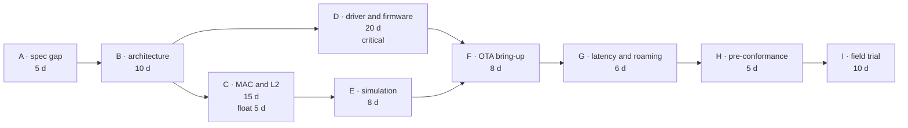

Critical path: A → B → D → F → G → H → I = 5 + 10 + 20 + 8 + 6 + 5 + 10 = **64 days**. Chain C has 5 days of
float: C plus E takes 23 days against D's 20, so a slip of more than 5 days in C moves the finish date.

Three practical notes:

- The critical path is **not** "the most important work". It is the longest chain. A safety-critical
  component with 40 days of float still needs your attention; the critical path only tells you what moves the
  date.
- The critical path moves. Re-run the calculation at every update; a team that "knows" its critical path
  without recomputing is usually watching last month's one.
- **CPM ignores resource contention.** If the one RTL engineer is on both C and D, the network above is
  fiction. Resource levelling will lengthen the chain, and the result is the critical *chain*, not the
  critical path.

### 7.3 Critical chain: pooling the safety margin

Goldratt's argument, from *Critical Chain* (1997), is behavioural rather than mathematical. Every task
estimate contains hidden safety, typically sized so the estimator is ~90% confident. That safety is then
destroyed by three effects:

- **Student syndrome** — with visible slack, work starts at the last responsible moment.
- **Parkinson's law** — work expands to fill the time available.
- **Multitasking** — splitting a person across three tasks lengthens all three; delays accumulate while
  early finishes are rarely passed on.

Critical chain's four moves:

1. Estimate at a **50% confidence** duration — an aggressive median, not a safe number.
2. Take the removed safety and pool it as explicit **buffers**: a project buffer at the end of the chain,
   feeding buffers where a non-critical chain joins it, and resource buffers that warn a scarce resource it
   is needed soon.
3. Identify the **critical chain**: the longest path after resource levelling, not before.
4. Manage by **buffer consumption**, not by task dates.

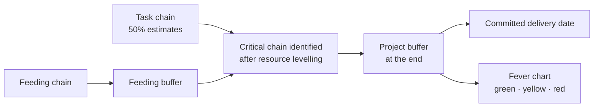

The management artefact is the fever chart — buffer consumed against chain completion, in three zones:

```text
buffer consumed
  100% |                                        .........RED
       |                              ..........
       |                    ..........
   66% |------------------------------------------------- act now
       |          .........
       |    ......
   33% |------------------------------------------------- make a plan
       |  ..
       |..
    0% +-------------------------------------------------
       0%            50%          100%
              chain complete

green  : consumption below ~1/3    -> continue
yellow : consumption 1/3 to ~2/3   -> the team prepares a recovery plan
red    : consumption above ~2/3    -> the plan is executed, sponsor is told
```

The method's real contribution is not the arithmetic; it is that **one number replaces a hundred red and
green cells**, and that number is legible to a sponsor in five seconds.

## 8. Cost, estimation and earned value

### 8.1 Estimation is a forecast, not a commitment

The single most useful habit in the whole discipline: **never give a number without a range and a confidence
level.** "64 days" is a promise; "P50 at 64 days, P80 at 79 days, with the risk register saying why" is a
forecast. Only one of them is defensible when the date slips.

The techniques, in increasing order of defensibility:

| Technique | How | Use when | Weakness |
| --- | --- | --- | --- |
| Expert judgement | Ask someone who has done it | Always, as a cross-check | Anchoring, recency |
| Analogous | Scale from a similar finished project | Early, little detail | Requires a real reference class |
| Parametric | Rate × quantity, from a calibrated model | Repetitive work, clear drivers | Model only as good as its calibration |
| Bottom-up | Sum of work-package estimates | Once the WBS exists | Sums the optimism of every estimator |
| Three-point / PERT | `(O + 4M + P) / 6` | Genuine uncertainty | Assumes a distribution shape |
| Monte Carlo | Sample the distributions | When the answer is a date with a probability | Needs honest input distributions |
| Reference class forecasting | Take the *outside view*: outcomes of comparable completed projects, then adjust only as far as your case demonstrably differs | Large, one-off, publicly justified work | Requires a real database, and it will be unpopular |

Reference class forecasting deserves emphasis because it is the only technique that addresses the actual
mechanism of failure. Kahneman and Tversky's planning fallacy finding — that people misforecast their own
projects while judging other people's accurately — is the diagnosis; the outside view is the treatment, and
it has been embedded in UK Treasury Green Book guidance as optimism-bias uplifts on public cost estimates
since 2003.

### 8.2 Earned value management

EVM integrates scope, schedule and cost into three numbers measured at a point in time:

| Term | Meaning | Formula |
| --- | --- | --- |
| PV / BCWS | Planned value — budgeted cost of work scheduled | from the baseline S-curve |
| EV / BCWP | Earned value — budgeted cost of work performed | PV profile × % complete of the work package |
| AC / ACWP | Actual cost of work performed | from the ledger |
| SV, CV | Schedule and cost variance | `SV = EV − PV`, `CV = EV − AC` |
| SPI, CPI | Performance indices | `SPI = EV / PV`, `CPI = EV / AC` |
| EAC | Estimate at completion | `EAC = BAC / CPI` (typical), or `AC + (BAC − EV)` (atypical), or `AC + (BAC − EV) / (CPI × SPI)` |
| VAC | Variance at completion | `VAC = BAC − EAC` |
| TCPI | To-complete performance index — the efficiency now required to hit the target | `(BAC − EV) / (BAC − AC)`, or against a new EAC |

```text
 cost
  |                                     .......... BAC
  |                            .....***
  |                     ...***    AC  (over budget)
  |                ..**
  |            .**      EV  (behind: below PV)
  |         .**
  |      .**
  |   .**   PV  (the baseline S-curve)
  | .*
  +------------------------------------------------ time
        ^                    ^
        |                    |
     data date        planned completion

CV < 0 and SV < 0: over cost and behind. CPI < 1 means every unit of
spend is buying less than a unit of work, and EAC = BAC / CPI says what
the project will actually cost if nothing changes.
```

The lineage is worth knowing because it explains why EVM feels bureaucratic: it was designed as a
government *oversight* instrument, not as a team tool.

| Year | Event |
| --- | --- |
| 1958 | PERT and PERT/Cost on Polaris; the earned-value concept survives even after PERT/Cost itself is abandoned |
| 1963–1964 | Earned value concept on Minuteman; cost-accomplishment concept on Titan III |
| 1966 | USAF Cost/Schedule Planning and Control Specification |
| 1967 | DoD issues **35** Cost/Schedule Control Systems Criteria (C/SCSC) |
| 1991 | Secretary of Defense cancels the A-12 after performance problems detected by EVM — proof that the number reaches secretary-level decisions |
| 1996 | NDIA rewrites the criteria, reducing 35 to **32**; DoD accepts them |
| 1998 | ANSI/EIA-748 adopts the 32 criteria; EVM becomes an industry standard rather than a government rule |
| 2013 / 2019 | EIA-748-C and -D, clarifications only |
| Feb 2026 | **EIA-748-E** published by SAE International, reducing the guidelines from 32 to 27, merging overlaps and strengthening the emphasis on management *use* of the data. `VERIFY`: this is from a specialist EVM source rather than the standard itself |

ISO 21508 and ISO 21512:2024 are the ISO-side equivalents for earned value management and its
implementation guidance.

Two rules of thumb, both to be treated as heuristics rather than laws: the cumulative CPI tends to stabilise
relatively early in a project — commonly quoted at around the 20% completion point — which is why an early
CPI is taken seriously (`VERIFY`: the original empirical work is Christensen and Heise, and the exact
stability point varies by project type); and EVM's blind spot is that it reports progress against a plan
without distinguishing progress on the constraint from progress elsewhere, which is precisely the objection
that motivates critical chain's buffer management.

## 9. Risk and uncertainty: the part nobody can predict

### 9.1 The standard frame

ISO 31000:2018 defines risk as the **effect of uncertainty on objectives** — deliberately neutral, so it
covers opportunities as well as threats. The vocabulary that matters:

- **Risk appetite / tolerance** — how much uncertainty the organisation will accept in pursuit of value.
  Without a stated appetite, every risk discussion is a negotiation.
- **Risk register** — the live list. Minimum useful fields: identifier, description, cause, effect on
  objectives, owner, probability, impact, score, response strategy, action, trigger, review date, status.
  A register without an owner and a trigger is a diary.
- **Contingency reserve** — for identified risks, inside the cost baseline, spent by the project manager.
  **Management reserve** — for unidentified risks, outside the baseline, released by the sponsor.
  Confusing the two is how overruns get hidden.

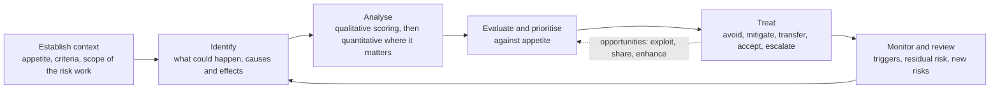

Response strategies: **avoid** (change the plan to remove the cause), **mitigate** (reduce probability or
impact), **transfer** (contract, insurance — the risk does not disappear, the consequence moves),
**accept** (actively, with a contingency, or passively), **escalate** (it belongs to the portfolio).
Opportunities get the mirror set: exploit, share, enhance, accept.

### 9.2 Qualitative and quantitative

The qualitative matrix is cheap and should be built once per project, with the scales written down — "high"
must mean something in days or dollars, or the matrix is decoration.

| Probability ↓ / Impact → | 1 · negligible | 2 · minor | 3 · moderate | 4 · major | 5 · severe |
| --- | --- | --- | --- | --- | --- |
| 5 · almost certain | Medium | High | High | Critical | Critical |
| 4 · likely | Low | Medium | High | High | Critical |
| 3 · possible | Low | Medium | Medium | High | Critical |
| 2 · unlikely | Low | Low | Medium | Medium | High |
| 1 · rare | Low | Low | Low | Medium | Medium |

Quantitative analysis is for the small number of risks that can actually move the answer: Monte Carlo on the
cost and schedule model, decision-tree analysis for a discrete choice, sensitivity analysis (usually
presented as a tornado chart) to show which input dominates the variance.

### 9.3 The best single risk instrument in use anywhere: NASA's joint confidence level

NASA's JCL is the clearest example of making schedule risk a number with a probability attached, and it
applies to ordinary engineering work by analogy.

Per NPR 7120.5E §2.4.4, tightly coupled and single-project programmes (regardless of life-cycle cost) and
any project with an estimated life-cycle cost above **$250 million** must, at KDP I / KDP C, build a
resource-loaded schedule and run a risk-informed probabilistic analysis producing a **joint cost and
schedule confidence level**: the probability that cost comes in at or below target **and** schedule at or
before target. Mission Directorates plan and budget at **70% JCL**, funding must in no case fall below the
equivalent of **50% JCL**, anything below 70% must be justified and documented, and the JCL is recalculated
whenever the project is rebaselined. The analysis window runs from KDP-C through handover to operations.

The policy history is instructive: GAO recommended probabilistic cost estimating in 2004, NASA implemented a
70% cost confidence level that year, moved to joint cost and schedule in 2005 and 2009, and shifted the
requirement into NPR 7120.5E in 2012. The practical lesson for a team without a NASA budget: **state a
confidence level with your date and fund to it.** "We will be done in June" is unmanaged; "P80 in June, P50
in early May, and we are funded to P80" is managed.

### 9.4 Techniques that find risks before they arrive

- **Premortem** (Gary Klein) — before the plan is approved, the team is told it is six months in the future
  and the project has failed, and asked to write down why. It legitimises dissent that a risk workshop
  suppresses.
- **Reference class forecasting** (§8.1) — the outside view on cost and schedule.
- **Independent estimate** — for anything where the estimator has an incentive. This is the structural fix
  for strategic misrepresentation.
- **FMEA** — failure mode and effects analysis, with severity × occurrence × detection giving an RPN;
  standard in automotive and medical, underused in software.
- **Fault tree analysis** — top-down Boolean decomposition from an undesired top event; developed at Bell
  Labs and Boeing in the early 1960s for Minuteman.
- **Bowtie** — cause side, top event, consequence side, with barriers on both. Excellent for communicating a
  risk to a non-specialist.
- **HAZOP** — guide-word-driven systematic deviation analysis from process engineering.
- **Five whys and the fishbone diagram** — cheap root-cause tools; the fishbone is Ishikawa's, the five whys
  trace to Toyota. Use them on incidents, not on schedules.
- **Risk burndown** — plot total exposure over time. A flat burndown on a project that is 60% through means
  the register has stopped being maintained, which is itself the finding.

## 10. Quality, verification and validation

### 10.1 The V-model

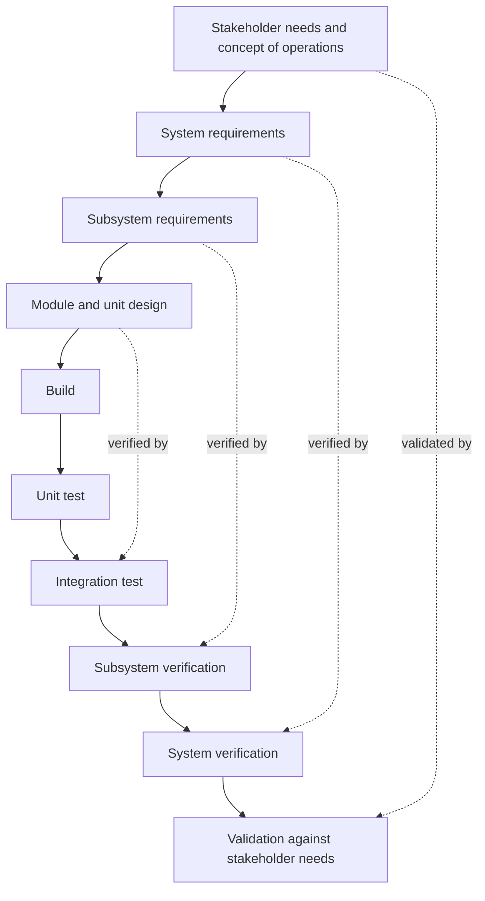

Every level of definition has a matching level of verification, defined **at the same time as the
requirement**. That pairing is the whole point, and it is why the V-model survives every methodology war:
it says nothing about how long the iterations are, only that each requirement carries its own proof.

- **Verification** — are we building the product right? Conformity to specified requirements.
- **Validation** — are we building the right product? Fitness for the intended use, in the intended
  environment.
- **QA** — confidence in the *process* (audits, standards, reviews). **QC** — conformance of the *product*
  (inspection, test). Confusing them produces teams that test diligently and design badly.
- **Cost of quality** — prevention, appraisal, internal failure, external failure. The economic argument
  for front-loading: spend on prevention, and external failure cost falls.

### 10.2 Why defects get expensive, and what to do about it

Barry Boehm's 1981 data is the source of the widely repeated claim that the cost of fixing a defect rises by
roughly an order of magnitude per phase — requirements, design, code, test, operation — giving the 1-10-100
rule of thumb. Treat the exact multipliers as historical and context-specific (`VERIFY` for any precise
figure you quote), but the mechanism is not in dispute: a defect found late invalidates work built on top
of it, and the later it is found the more work that is.

What mature organisations actually do about it, in order of leverage:

1. **Front-load the design** (§16.1): spend the cheap time resolving the decisions that are expensive to
   reverse.
2. **Definition of done** — an explicit, per-artefact checklist that must be satisfied before the item
   counts as finished. Without it, "done" means "coded".
3. **Continuous integration with a real gate** — every change integrated and tested on the mainline, at
   least daily.
4. **Review before merge** — the cheapest defect detector in software, and one of the few practices with
   consistent evidence behind it.
5. **Static analysis and, where applicable, formal checks** — for anything where a defect is a safety issue.
6. **Model-based verification** — SIL, PIL and HIL in the loop long before hardware exists. See
   [[08-4 MATLAB and Simulink - Programming, Modelling and Code Generation]].
7. **Measure escape rate, not only defect count** — defects found by the customer are the ones that matter;
   those found by you are the system working.

### 10.3 The quality families, briefly

| Family | Origin | Core move | Fits |
| --- | --- | --- | --- |
| Statistical process control | Shewhart, 1920s–30s | Distinguish common from special cause variation | Manufacturing, and any repeated process |
| TQM and Deming | Deming, *Out of the Crisis*, 1982 | 14 points; PDCA/PDSA; quality cannot be inspected in; drive out fear | Organisation-wide, cultural |
| Juran trilogy | Juran | Quality planning, quality control, quality improvement; the Pareto principle applied to defects | Structured programmes |
| Six Sigma | Motorola, 1986, Bill Smith and Mikel Harry; GE from 1995 | DMAIC for existing processes, DMADV/DFSS for new ones; belt hierarchy; DPMO | High-volume, measurable processes |
| Lean | Toyota Production System, Ohno | Remove waste; respect for people; pull, flow, levelling | Development as well as production |
| Zero defects, cost of quality | Crosby | "Quality is free" — prevention is cheaper than failure | Executive argument |

Six Sigma's famous "3.4 defects per million opportunities" figure assumes a 1.5-sigma long-term shift in the
process mean; quoting it without that caveat is a tell. Lean's contribution to *project* work is the
largest (§16.1), because most project waste is waiting, handover and rework, not defects.

**Technical debt belongs on the project's books.** Ward Cunningham's 1992 metaphor describes a genuine
liability: shipping the quick design now, with interest paid as reduced velocity later. The management
error is treating it as an engineering preference. It is a schedule and risk item: it has a principal, an
interest rate, and a repayment plan, and it should appear in the risk register like any other liability.

## 11. Change, baselines and configuration

Nothing about a project is controllable until something is frozen. That is what a baseline is: an approved
version of the plan, with a defined change path.

Three baselines plus one:

| Baseline | Contains | Change path |
| --- | --- | --- |
| Scope | Scope statement, WBS, WBS dictionary | Change request → impact analysis → CCB |
| Schedule | Milestone list, network, activity dates | Same request, separate impact |
| Cost | Time-phased budget, control accounts | Same request, separate impact |
| Configuration | The product's identified items and their versions | Configuration control board, ECO |

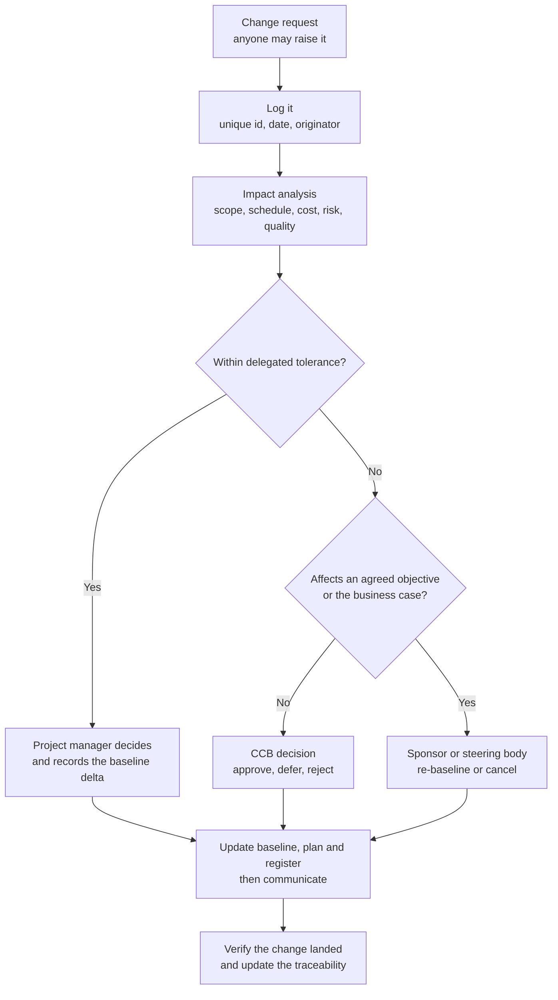

Two disciplines that pay for themselves immediately:

- **No change without a three-baseline impact statement.** "It is only a small change" is answered by
  showing what it does to scope, schedule, cost and the risk register on one page.
- **Configuration management is four things**, not one: *identification* (what items exist and how they are
  named), *change control* (the path above), *status accounting* (what is where, right now), and *audit*
  (does the record match reality). Engineering teams do identification and change control well and neglect
  status accounting, which is why nobody can answer "what firmware is on the units in the field".

In software, the equivalent modern practice set is: version control on everything, trunk-based development
with short-lived branches, **feature flags to decouple deploy from release**, reproducible builds,
immutable artefacts, and a release record that maps artefact to commit to requirement. Feature flags are the
single most effective change-control instrument in software because they turn "release" from an event into a
policy.

## 12. Organisation, roles and decision rights

### 12.1 Structural choices

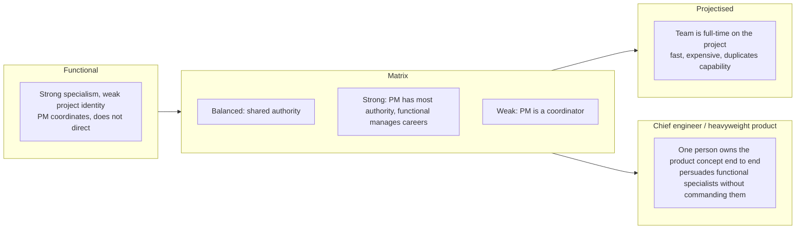

There is no right answer; there is a right answer for the constraint you are managing. Specialism depth
favours functional, speed favours projectised, and the chief-engineer model (§16.1) exists precisely because
pure matrix loses the product concept.

### 12.2 Decision rights: RACI, DACI and the one-owner rule

| Framework | Roles | Use when |
| --- | --- | --- |
| RACI | Responsible, Accountable, Consulted, Informed | Repeatable decisions with clear roles |
| DACI | Driver, Approver, Contributors, Informed | One-off decisions with a single named approver |
| RAPID | Recommend, Agree, Perform, Input, Decide | Cross-functional decisions in large organisations |

Three rules that matter more than the choice of acronym:

1. **Exactly one Accountable per deliverable.** Two accountable people means zero.
2. **Consulted is a small list.** Everyone else is Informed. A RACI with twelve Consulted cells is a
   committee.
3. **Publish it at the level of decisions, not of people.** "Who decides a scope change above 5% of the
   baseline" is answerable; "who is responsible for quality" is not.

The Standish finding from §2 belongs here: sponsor maturity moves project success from 18% to 67%, a larger
effect than methodology, tooling or project-manager experience. A mature sponsor, defined behaviourally,
decides in days rather than waiting for the monthly steering committee, actively owns the business case as
it changes, and engages on outcomes rather than on status.

### 12.3 Two organisational patterns worth stealing

- **Single-threaded leader** (Amazon) — one skilled person owns one thing, full time. The quoted internal
  line is "the best way to fail at inventing something is by making it somebody's part-time job". The
  mechanism is not heroism; it is that the coordination cost of a shared owner exceeds the work.
- **Chief engineer / shusa** (Toyota) — §16.1. Note the crucial difference from the Amazon version: the
  chief engineer typically has *no* authority over the functional specialists they must integrate, and
  works through persuasion plus structural authority such as drawing sign-off.

## 13. Governance: gates, tolerances and the portfolio

Governance is the system by which the sponsor gets assurance without running the project. Done well it is
three things:

1. **Manage by exception.** The sponsor sets tolerances — time, cost, scope, quality, risk — and the project
   manager acts freely inside them. Only a *forecast breach* is escalated. This is PRINCE2's central move,
   and it is the difference between governance and micromanagement.
2. **Independent review.** Someone without a stake in the outcome assesses the plan and the evidence. NASA
   uses a Standing Review Board; large programmes use independent cost estimates and technical authorities.
   The point is not accuracy, it is that an advocate cannot self-assess.
3. **Benefits tracking after handover.** The business case is a forecast too, and it should be revisited
   after the project closes. ISO 21513:2026 is the standard for post-project and post-programme evaluation.

A gate worth having has written entry and exit criteria. A generic template:

| Gate | Entry criteria | Exit criteria | Possible outcomes |
| --- | --- | --- | --- |
| Concept | Business case, alternatives considered, rough order of magnitude with a range | Approved case, budget for definition, named sponsor | Go to definition · Hold · **Kill** |
| Definition | Requirements baselined, architecture reviewed, plan with P50/P80, risk register with owners | Plan executable within appetite, resources committed, tolerances agreed | Go to build · Recycle · **Kill** |
| Build checkpoints | Increment demonstrated, definition of done satisfied, exit criterion measured | Verified increment, updated forecast | Continue · Replan inside tolerance · Escalate |
| Readiness | Verification complete, validation evidence, operational readiness, training done | Approved handover, support model funded | Release · Conditional release · Rework |
| Close | Benefits plan, lessons captured, configuration baselined, contract closed | Formal acceptance | Close · Retain for benefits tracking |

The outcome almost never used is the one that matters. Gate processes decay into rubber stamps because
killing a project is treated as failure by the people who proposed it; the fix is institutional, not
procedural — reward early termination, and record it as a success in the lessons system.

Above the project sits the portfolio (ISO 21504:2022), whose job is strategic alignment, total funding
versus capacity, and risk balance. Lean portfolio management adds transparency, value-based prioritisation,
WIP limits at the portfolio level, and continuous adaptation. **OKRs** — Intel's iMBOs under Andy Grove,
carried by John Doerr to Google in 1999 — are the goal-setting layer: objectives are qualitative and
ambitious, key results are measurable, and crucially they are graded, not scored into compensation.

## 14. Tools: the stack, and the failure mode of each

The tool question is usually asked backwards. The tool does not create the discipline; it makes a discipline
cheap to keep. Pick the process first, then the cheapest tool that keeps it.

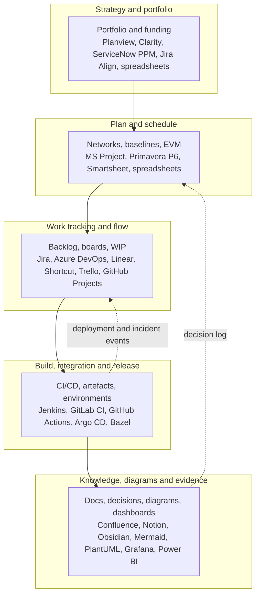

| Tool class | Representative tools | What it is genuinely for | How it fails |
| --- | --- | --- | --- |
| Scheduling with a network | MS Project, Oracle Primavera P6 | Critical path, levelling, baselines, EVM on cost-loaded schedules | Becomes a reporting artefact maintained separately from reality |
| Work tracking | Jira, Azure DevOps, Linear | Flow: who is waiting on what, WIP, cycle time, age of work | Becomes a ticketing system; status by tribal knowledge; "story points" used as a productivity target |
| Docs and knowledge | Confluence, Notion, Obsidian | Decisions, architecture, runbooks, lessons | Write-only; three competing sources of truth |
| Diagrams | Mermaid, PlantUML, draw.io, Miro | Making the structure visible in review | Diagram exists, nobody updates it, it lies |
| CI/CD | Jenkins, GitLab CI, GitHub Actions, Argo CD | Making integration continuous and release boring | Pipelines that are red and ignored |
| Risk and Monte Carlo | @RISK, Safran, GoldSim, a spreadsheet | Probability distributions on cost and date | Used once for the bid, never updated |
| Delivery metrics | DORA dashboards, Grafana, Power BI | Lead time, deployment frequency, failure rate, recovery | Metrics without counter-metrics; gaming |
| Portfolio | Planview, ServiceNow PPM, Jira Align | Capacity versus demand, strategic alignment | Annual planning theatre |

Five principles that survive contact with any of them:

1. **One system of record per concept.** One place where the plan lives, one where the work lives, one where
   the decision log lives. Two is zero.
2. **The tool follows the process.** Implementing a tool to fix a process gap imports the gap.
3. **Automate the measurement, never the judgement.** A dashboard can tell you the P85 cycle time rose 40%;
   it cannot tell you whether that is a problem.
4. **If it is not in the tool, it does not exist** — which is why the tool must be cheap enough that
   updating it is not a separate task.
5. **A green dashboard is a hypothesis, not evidence.** Go and see.

## 15. The plan itself

### 15.1 What goes in a project management plan, in the order you need it

| Component | Answers |
| --- | --- |
| Business case and benefits | Why, measured how, reviewed when |
| Scope statement and exclusions | What is in, and explicitly what is not |
| WBS and dictionary | The whole of the work, decomposed to assignable packages |
| Schedule with P50 and P80 | When, and with what confidence |
| Cost baseline and reserves | How much, contingency versus management reserve |
| Organisation, roles, RACI | Who does and decides what |
| Risk register with owners and triggers | What could move it, who is watching |
| Quality and verification approach | How we will know it works, level by level |
| Change and configuration control | How the baseline moves |
| Communications and cadence | Who is told what, how often, in what form |
| Stakeholder and sponsor engagement | Who has to be on side, and what they need |
| Procurement and external dependencies | What we buy, what we wait for |
| Governance: gates and tolerances | When the sponsor is asked, and at what threshold |
| Transition and close | Handover, support, benefits tracking, lessons |

### 15.2 The one-page plan

A plan nobody reads is worse than no plan. The A3 / one-page version is what actually gets used:

```text
+---------------------------------------------------------------+
| WHY      the outcome, the benefit, the measure, the date      |
| WHAT     three to five outcomes, each with an exit criterion  |
| NOT      what we are explicitly not doing this time           |
| WHEN     three to six milestones with dates and confidence    |
| WHO      single-threaded owner per outcome, sponsor, RACI     |
| RISK     top five, each with owner, trigger and response      |
| STATUS   one traffic light per outcome, plus buffer consumed  |
| ASKS     the decisions we need, with a date and a decider     |
+---------------------------------------------------------------+
```

Milestones must be defined with entry and exit criteria, not just dates. "Design complete, 12 June" is not a
milestone; "design review held, all severity-1 and severity-2 actions closed, architecture document signed
by the system architect" is.

### 15.3 A worked plan: Wi-Fi 7 multi-link operation feature

Combining §6, §7 and §15 into one artefact, because the interaction is the point.

**Milestones** (network from §7.2, 64-day critical path, P80 at 79 days):

| Milestone | Date | Entry criteria | Exit criteria | Gate |
| --- | --- | --- | --- | --- |
| M1 Architecture signed off | Day 15 | Spec gap analysis complete; link-selection policy drafted | Architecture review held; severity-1 actions closed; signed by system architect | Definition gate |
| M2 Software feature complete | Day 35 | M1 exit; test environment available | Unit and simulation suite green; definition of done satisfied for all work packages | Internal |
| M3 Over-the-air bring-up | Day 43 | M2 exit; lab and devices booked | OTA link established; throughput within 10% of simulation | Internal |
| M4 Verification complete | Day 49 | M3 exit | Latency and roaming targets met; regression on existing bands clean | Build gate |
| M5 Certification ready | Day 54 | M4 exit | Pre-conformance scan clean; interoperability event attended | Readiness gate |
| M6 Field trial exit | Day 64 | M5 exit | Field trial report; stability over 72 hours; sponsor acceptance | Close gate |

**Buffer plan** (critical chain applied to the same network): estimate each activity at 50% confidence,
remove roughly half the difference to the safe estimate, and place a 12-day project buffer before the
committed date, plus a 3-day feeding buffer where C and E join F. Report weekly on buffer consumption, not
on task colours.

**Risk register extract**:

| ID | Risk | Prob | Impact | Score | Response | Owner | Trigger |
| --- | --- | --- | --- | --- | --- | --- | --- |
| R1 | Lab slots unavailable in the bring-up window | 4 | 4 | High | Book 6 weeks ahead; reserve a second chamber; mitigate | Test lead | Booking system shows <80% availability at M1 |
| R2 | Vendor firmware interface changes under us | 3 | 4 | High | Freeze an interface version in writing; weekly sync; mitigate | Driver lead | Vendor release notes mention interface change |
| R3 | Latency target not achievable with current link policy | 3 | 5 | Critical | Time-box an alternative policy in the simulation environment; mitigate | Architect | Simulation P95 latency above target at M2 |
| R4 | Regression on existing bands | 2 | 5 | High | Automated regression in CI from day one; mitigate | QA lead | Any regression failure |
| R5 | Field trial site access delayed | 3 | 3 | Medium | Two candidate sites; transfer to site owner with a fallback | Field lead | Access request unacknowledged 14 days out |

**Cadence**: daily 15-minute stand-up on blockers only; weekly one-hour review against the buffer chart and
the risk triggers with a written decision log; monthly steering review on tolerances and forecast; gate
packs one week before each gate.

**Metrics**: buffer consumption, cycle time of work packages P50/P85, regression pass rate, open defects by
age, and one outcome metric — measured P95 latency in the target scenario, updated at every milestone.

## 16. Best practice from organisations that reliably deliver

This is the part that is worth more than the certifications: what mature, successful organisations actually
do, written down as mechanisms rather than as values. A mechanism is a repeatable process that produces the
right outcome by default; a value is what an organisation says when the mechanism is missing.

### 16.1 Toyota — lean product and process development

The strongest evidence-based practice set for *engineering* development, documented in Morgan and Liker's
*The Toyota Product Development System* (2006, 13 principles across process, people, tools) and Allen Ward's
*Lean Product and Process Development* (2007).

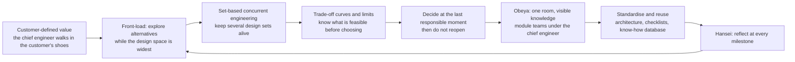

The mechanisms, and why each one works:

- **Chief engineer / shusa** — one senior engineer owns the vehicle concept from planning to launch. The
  crucial detail, often lost in translation: the chief engineer generally has *no* formal authority over the
  functional specialists they must integrate, so the role works through persuasion *plus* structural
  authority. Adachi's account puts it bluntly — if the shusa did not sign, the drawing did not exist. This is
  "heavyweight project manager" with teeth, and it is the organisational answer to the matrix's weakness.
- **Set-based concurrent engineering** — instead of picking one design early and iterating it, teams develop
  several feasible sets in parallel, using trade-off curves and knowledge of limits, and narrow slowly. This
  is Ward's "second Toyota paradox": it looks slower and is faster, because it avoids the rework of
  committing before the knowledge exists.
- **Front-loading** — "plan carefully, execute exactly". Effort is spent where design space is largest,
  because that is where decisions are cheap.
- **Obeya** — the big room where the cross-functional team works with the knowledge on the walls. It is a
  latency reduction on decision-making, not a meeting.
- **Nemawashi and hansei** — build consensus quietly before the formal decision; reflect honestly after
  every milestone. Nemawashi looks slow and prevents the meeting where the decision is made twice.
- **Supplier integration** — keiretsu partners are brought in at concept stage, not at sourcing stage.
- **Ward's principle** — "almost all defective projects result from not having the right knowledge in the
  right place at the right time". Development is a *learning* system, and the project plan should be judged
  by how fast it converts uncertainty into knowledge.

The comparative data point that started the whole field: the MIT IMVP study found Japanese programmes
needing roughly 1.7 million engineering hours over 46 months against about 3 million hours over 60 months
for Western programmes. Treat the exact figures as 1990s data, but the shape of the gap — twice the effort
and a third longer — is the reason this body of work exists.

### 16.2 Amazon — single-threaded ownership and written narrative

Documented in Bryar and Carr, *Working Backwards* (2021) and in AWS's own Executive Insights material.

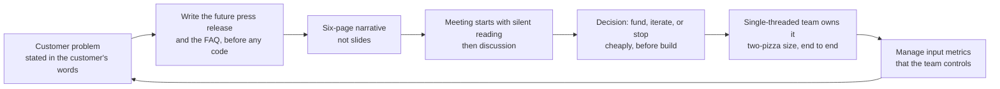

- **Single-threaded leaders and two-pizza teams** — one skilled person, one job, full time; a team small
  enough to be fed by two pizzas (conventionally under ten). The quoted internal line: "the best way to fail
  at inventing something is by making it somebody's part-time job."
- **Working backwards and the PR/FAQ** — write the launch press release and the FAQ before building. It is a
  cheap product experiment: if you cannot write a compelling release, you do not have a compelling product.
- **The six-page narrative, and no slides** — writing forces structure; slides permit gloss. Meetings open
  with silent reading, so discussion starts from shared understanding rather than from whoever speaks best.
- **Bar raiser** — an interviewer from outside the hiring team, trained and with veto power, so the average
  does not drift under hiring pressure.
- **Input metrics over output metrics** — manage what the team can control (price, selection, latency,
  defect rate) rather than what it cannot (revenue, share price).
- **The 70% rule** — most decisions should be made with about 70% of the information you wish you had;
  waiting for 90% is usually being slow. Combined with "disagree and commit": argue hard, then commit fully.
- **Mechanisms over intent** — the deepest lesson. Culture is what your processes produce by default.

### 16.3 Google — team dynamics and the reliability bargain

**Project Aristotle** (from 2012, two years, 180+ teams) found that *who* was on a team mattered far less
than *how* the team worked. Five dynamics, in order of importance: psychological safety (the foundation),
dependability, structure and clarity, meaning, impact. Colocation, seniority, tenure, team size, workload and
extroversion showed no meaningful relationship to effectiveness. The reported sales-organisation spread is a
36-point swing: teams high on psychological safety exceeded target by 17%, teams low on it fell short by up
to 19%.

Amy Edmondson's framing is the practical one — psychological safety and accountability are independent
axes:

|  | Low accountability | High accountability |
| --- | --- | --- |
| **High psychological safety** | Comfort zone — pleasant, little learning | **Learning and high performance** — speak up *and* deliver |
| **Low psychological safety** | Apathy | Anxiety — delivery under fear, no learning |

**Site Reliability Engineering** (Treynor Sloss coined the term at Google in 2003) turned reliability into a
negotiated, numeric bargain:

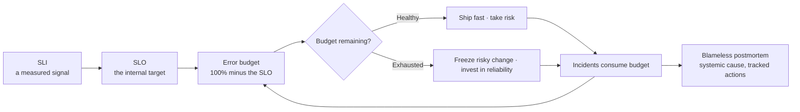

- **Error budget** — 100% is the wrong reliability target for almost everything; the complement of the SLO is
  a budget the team is explicitly permitted to spend. This converts a structural conflict between product and
  operations into an arithmetic one.
- **Toil cap at 50%** — operational work for SREs is capped at half their time; excess operational work is
  redirected to the product teams. It is a feedback mechanism that forces the product to need less manual
  intervention. Toil is defined precisely: manual, repetitive, automatable, tactical, devoid of enduring
  value, and scaling linearly with service growth.
- **On-call load** — at most about two events per 8–12-hour shift; more than that and nobody learns from
  anything.
- **Blameless postmortems** — written for every significant incident, focused on systemic causes, with
  action items judged by quality: "train Bob not to push bad configs" is a bad item; "add safety checks to
  the deployment pipeline" is a good one.

### 16.4 NASA — technical authority, independent review, and probabilistic commitment

The transferable parts are not the paperwork:

- **Phases with key decision points** (§5), with Formulation deliberately slow and Implementation
  deliberately fast — the "think slow, act fast" shape that Flyvbjerg's data endorses.
- **Standing Review Boards and non-advocacy review** — the plan is assessed by people whose incentive is not
  to approve it.
- **70% joint cost and schedule confidence level** (§9.3) — commitment expressed as a probability, recalculated
  on every rebaseline.
- **Technology readiness levels** — a 9-level scale from observed principle to flight-proven, used to gate
  technology insertion. The discipline is that a TRL is assessed, not asserted.
- **Lessons learned as an institution**, including "Pause and Learn" sessions at phase transitions.

The counter-example is inside the same institution and worth knowing: the "faster, better, cheaper" era
produced the 1999 loss of the Mars Climate Orbiter, where ground software supplied impulse in pound-force
seconds while the spacecraft's software expected newton-seconds. A unit error that a verification step with
independent units would have caught — the lesson is about interface verification and independent checking,
not about carelessness.

### 16.5 USDS, 18F and the Healthcare.gov turnaround

HealthCare.gov launched on 1 October 2013 and effectively did not work. A "tech surge" of private-sector
engineers and product managers joined CMS staff and contractors and worked the problem for three months; by
March 2014, 8 million Americans had enrolled and the site was stable. In August 2014 the White House created
the **US Digital Service**, with Mikey Dickerson, an SRE from the surge, as its first administrator; 18F was
formed in parallel inside GSA.

What was actually done, and what generalises:

- A small, empowered, senior team placed next to the people who owned the outcome, in one room.
- Systematic measurement before speculation — application monitoring installed, then triage.
- Incremental delivery: components rebuilt by small teams using agile and iterative development, rather than
  one big-bang replacement.
- Modular procurement: 18F's advice to California on a child-welfare system was to split one large contract
  into several, so competition could work — the procurement equivalent of splitting a project.
- Measured outcomes, not activity: the Scalable Login System reached 99.99% uptime, and the application
  conversion rate rose from about 55% to about 85%.

### 16.6 FBI Sentinel versus Virtual Case File — the same organisation, two outcomes

The cleanest natural experiment in the literature, because the work, the customer and the budget scale were
the same.

|  | Virtual Case File | Sentinel |
| --- | --- | --- |
| Approach | Big-bang, contractor-led, requirements fixed up front | Incremental, in-house, Scrum with two-week increments |
| Contractor | SAIC as prime; roughly 730,000 lines of code | Lockheed Martin as prime, then the FBI took over direct management in 2010 |
| Feedback | None until delivery | Demonstrations every other Friday to real users |
| Outcome | Cancelled 2005 after about $170M | Full operational capability May 2012, live to about 30,000 users on 1 July 2012, delivered under the $451M rebaselined budget |

The mechanism is not "agile beats waterfall". It is that **the second attempt put the people who would use
the system in the loop every two weeks and moved the delivery decision inside the organisation.** The FBI's
own description — a small team in one room with the cube panels removed, "a tech startup in the basement of
the Hoover Building" — is closer to obeya than to a framework.

### 16.7 DevOps and DORA — the measurement layer

DORA (DevOps Research and Assessment, now part of Google Cloud) has run the State of DevOps survey since
2014. Four key metrics, two for throughput and two for stability:

| Metric | What it measures | 2024 bands: Elite · High · Medium · Low |
| --- | --- | --- |
| Deployment frequency | Throughput | On demand, multiple per day · daily to weekly · weekly to monthly · monthly to every six months |
| Lead time for changes | Throughput | Under one day · one day to one week · one week to one month · one month to six months |
| Change failure rate | Stability | ~5% · ~20% · ~10% · ~40% as published per cluster |
| Failed deployment recovery time | Stability | Under one hour · under one day · under one day · one week to one month |

Two caveats that matter when quoting these: the levels are **clusters found in one year's survey data**, not
targets and not a standard — 2024 is the last year with directly comparable Elite-through-Low bands, since
the 2025 report moved to team archetypes; and the Medium cluster's change failure rate is *lower* than the
High cluster's, because slower-moving teams are more stable. Overall performance is bounded by the weakest
metric, not the average.

The capabilities that repeatedly predict the outcomes: version control for everything, continuous
integration, continuous delivery, trunk-based development, loosely coupled architecture, empowered teams,
and a generative culture.

### 16.8 What not to copy

- **The Spotify model.** Kniberg and Ivarsson's 2012 paper described squads, tribes, chapters and guilds.
  Spotify itself has repeatedly said it was a description of how it worked at that moment, not a framework,
  and the model was substantially reworked internally; Jeremiah Lee's 2020 account documents the problems —
  accountability voids, guilds without authority, coordination failures between squads. Kniberg's own
  comment is fair: companies can and do benefit from looking at another organisation critically, as long as
  they adapt to local context. The lesson is about copying the *mechanism* and not the vocabulary.
- **SAFe as a template.** SAFe 6.0 was released in March 2023. It is genuinely the most widely adopted
  scaling framework — around 40% of respondents in the 15th State of Agile report — and, in its Essential
  configuration, a reasonable starting picture for a large organisation. Its critics are right about the
  specific risk: a Planning Interval of 8–12 weeks is a real limit on how fast the organisation can change
  direction, and a lot of vocabulary arrives with the framework. Adopt the flow measurement; be suspicious
  of the ceremony.
- **Agile in name only.** Renaming phases as sprints, keeping the phase gates, and adding a daily meeting is
  worse than either parent, because it carries the overhead of both and the honesty of neither.

## 17. How it goes wrong

### 17.1 The anti-pattern table

| Anti-pattern | Symptom | Mechanism | Counter |
| --- | --- | --- | --- |
| Brooks's law | Adding people makes it later | Newcomers need training, work must be repartitioned, and communication paths grow as n(n−1)/2 | Add people early or not at all; add to the constraint, not to the crowd; remove scope instead |
| Death march | Everything is a crunch | Yourdon's definition: roughly 50% compression on schedule, budget or staff | It is a business decision, not a heroism test: renegotiate scope or cancel |
| 100% utilisation | Everyone is busy, nothing finishes | Queueing: as utilisation approaches 1, waiting time grows without bound | Leave slack; limit WIP; manage the queue, not the people |
| Estimate as commitment | Dates are negotiated, then defended | An estimate is a forecast with a distribution; a commitment is a decision | Publish P50 and P80; commit only to the one you funded |
| Vanity metrics | Story points, lines of code, hours logged go up | A metric used as a target stops measuring (Goodhart) | Pair every metric with a counter-metric; measure outcomes |
| Water-scrum-fall | Agile teams inside waterfall governance | The constraint is the governance layer, not the team | Move the seam: iterative scope inside gated integration |
| Status theatre | Everything is amber-green; the dashboard is always green | Reporting optimism is rewarded; bad news is punished | Go and see; measure; protect the bearer of bad news |
| Hero culture | The same three people save every release | Key-person risk is invisible until they leave | Bus factor as an explicit risk; rotate; write it down |
| Big-bang integration | First integration is at the end | Interfaces are where the uncertainty actually lives | Integrate continuously; stub early; verify interfaces first |
| Strategic misrepresentation | The number was chosen to get approved | Incentives, not estimation technique | Independent estimate; separate the estimator from the approver |

### 17.2 Utilisation and queueing, in one picture

```text
cycle time
   |
   |                                                        .
   |                                             ...........
   |                                    ..........
   |                          ..........
   |                 ........
   |         .......
   |   ......
   |...
   +--------------------------------------------------------
    0%      50%      70%      85%     95%    100%
                        utilisation

Waiting time is roughly proportional to 1 / (1 - utilisation) near
100%. A team at 95% utilisation has about twice the waiting time of
a team at 90%, and a team at 99% has ten times. "Everyone is at
full capacity" is not efficiency; it is the definition of a queue.
```

### 17.3 Denver International Airport — the canonical systems-engineering failure

The automated baggage system is taught because every cause is structural rather than technical. As recorded
in the SEBoK case study: the airport opened in February 1995, **16 months late with a delay cost of about
$500 million**; the baggage system alone cost about **$238 million** and comprised 17 miles of track, 4,000
radio-controlled carts, over 100 networked computers, 5,000 electric eyes, 400 radio receivers and 56
barcode scanners. A fixed scope, schedule and budget arrangement precluded meaningful simulation or physical
testing of the full design; system design began *after* airport construction was under way; the change
management system accepted changes that required redesign of completed work; there was no meaningful backup
system; and the number of tugs and carts was insufficient for the volume, so carts jammed and misaligned
with the conveyors and bags were mangled. The automated system was finally abandoned in August 2005.

The generalisable findings: complexity was underestimated and the people who said so were overridden; the
schedule was set before the design existed; and the experts' warnings were treated as a negotiation position.

### 17.4 Boeing 737 MAX — what governance failure looks like

The House Transportation and Infrastructure Committee's final report (September 2020) is the most
thoroughly documented case of schedule pressure reaching through to technical decisions. Its five themes:

1. **Production pressures** — extensive efforts to cut cost and hold schedule "jeopardized the safety of the
   flying public". Senior programme officials kept a **countdown clock** in their conference room; the
   former VP/GM described it as an excitement generator, and also acknowledged "the value of a day".
2. **Faulty assumptions** — MCAS was permitted to rely on a **single** angle-of-attack sensor, and was not
   classified as safety-critical, which would have brought greater scrutiny; the Committee found the
   operation violated Boeing's own internal design guidelines.
3. **Culture of concealment** — the existence of MCAS was not disclosed to pilots; the AOA Disagree alert was
   inoperable on most of the fleet despite being certified as standard.
4. **Conflicted representation** — Boeing employees acting as FAA authorised representatives failed to
   represent the FAA's interest.
5. **Influence over oversight** — FAA management overruled its own technical experts at Boeing's behest.

Concrete numbers from the same report: in 2012, to lower cost, Boeing cut avionics regression testing on the
MAX by **2,000 hours**, and examined cuts of 3,000 hours to flight-test support and 8,000 hours to the
engineering flight-deck simulator. In January 2021 Boeing entered a deferred prosecution agreement with a
**$243.6 million** criminal penalty, **$1.77 billion** in compensation to customers and **$500 million** for
a crash-victim beneficiaries fund.

What makes this a project-management case and not only a safety case: the reductions were *management
decisions about verification*, taken to protect a date, by people who did not own the technical
consequence. That is exactly the failure mode the independent technical authority and the non-advocacy
review exist to prevent.

### 17.5 A diagnosis tree

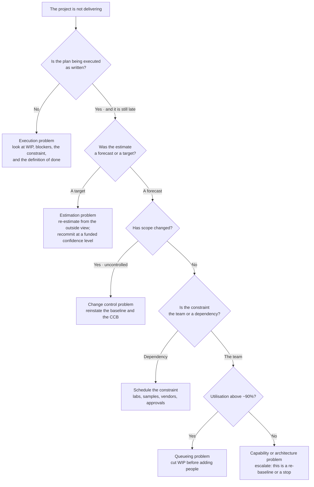

## 18. Metrics that actually work

**Little's Law** is the only equation in this note that is worth memorising:

```text
WIP = throughput x cycle time

so  cycle time = WIP / throughput

If a team finishes 5 items a week and carries 25 items in progress,
the average item takes 5 weeks. You cannot negotiate that number;
you can only lower WIP or raise throughput.
```

| Metric | Definition | Why it is used | Counter-metric |
| --- | --- | --- | --- |
| Lead time | Commit to production, or request to delivery | What the customer experiences | Quality — lead time at any cost is not a win |
| Cycle time | Start to finish of an item, reported at P50 and P85 | The distribution, not the mean | Age of the oldest WIP item |
| Throughput | Items completed per unit time | Capacity, empirically measured | Defect escape rate |
| WIP | Items started but not finished | The lever on cycle time | Blocked-time ratio |
| Flow efficiency | Active time / total lead time | Shows how much of the time is waiting | — |
| Buffer consumption | Fraction of project buffer used versus chain complete | One number a sponsor can read | Replan frequency |
| SPI, CPI | Earned value indices | Integrated cost and schedule against baseline | Forecast accuracy |
| Say/do ratio | Committed versus delivered per iteration | Trust in the plan | Whether commitments were realistic |
| Change failure rate | Share of changes causing a failure | Stability | Recovery time |
| Recovery time | Time to restore after a failure | Resilience | Frequency of incidents |
| Defect escape rate | Defects found by the customer versus by us | Verification effectiveness | Cost of finding them |
| Team health | Sustainable pace, engagement, on-call load | People are the constraint | Attrition, after-hours work |

Six rules for using them:

1. **Measure outcomes and flow, not activity.** Hours logged, tickets closed and story points completed are
   activity; lead time and escape rate are outcomes.
2. **Never use a metric as an individual performance target.** The moment you do, it stops being a
   measurement.
3. **Pair every metric with a counter-metric.** Deployment frequency without change failure rate rewards
   recklessness; velocity without escape rate rewards cutting corners.
4. **Prefer distributions to averages.** Report P50 and P85; the tail is where projects live.
5. **Forecast from throughput, not from remaining work divided by velocity.** A Monte Carlo run on observed
   throughput answers "when", with a probability.
6. **Measure your own baseline before comparing outward.** The DORA bands are descriptive clusters from a
   survey; the right target for a Medium team is the High band, not Elite.

And the cumulative flow diagram, which is the single most informative chart for a flowing system:

```text
 items
   |                                        .......... done
   |                              ............
   |                    .....................
   |          ................................  testing
   |    ......................................  in progress
   | .........................................  ready
   +------------------------------------------------ time

The vertical thickness of a band is its WIP. The horizontal distance
between "ready" and "done" is the lead time. Thickening bands mean
WIP is rising and cycle time is about to follow; the fix is to stop
starting and start finishing, not to work harder.
```

## 19. Putting it together: an operating rhythm

| Cadence | Attendees | Purpose | Output |
| --- | --- | --- | --- |
| Daily, 15 min | Delivery team | Blockers only, not status | Blockers with owners and dates |
| Weekly, 60 min | Team plus sponsor when needed | Progress against outcomes, buffer or burndown, risk triggers | Updated plan, decision log entries, escalations |
| Per increment | Team plus stakeholders | Demonstrate working software or hardware | Verified increment, measured exit criteria |
| Monthly | Steering group | Tolerances, forecast, business case still true | Continue, intervene, or re-baseline |
| Per gate | Sponsor plus independent reviewer | Entry and exit criteria | Go, hold, recycle, or kill |
| Quarterly | Portfolio | Strategic alignment, capacity versus demand, risk balance | Reallocated funding, stopped work |
| Post-project | Team plus operations | Lessons, benefits tracking, configuration handed over | Lessons register entry, benefits review date |

And the first 30 days of a new project, as a checklist:

1. Write the one-page plan (§15.2) and get the sponsor to change it — the argument is the alignment.
2. Name the single-threaded owner for each outcome, and one accountable person per deliverable.
3. Build the WBS to work packages, with project management and regression as explicit elements.
4. Identify the binding constraint — a lab, a sample, a specialist, an approval — and schedule it first.
5. Estimate at 50% confidence, get an outside view on the whole, and publish P50 and P80.
6. Open the risk register with owners and triggers; run a premortem.
7. Agree tolerances, the gate set, and who approves a re-baseline.
8. Set up the measurement: lead time, throughput, WIP, and the two or three outcome metrics.
9. Write the decision log and use it in the first weekly meeting.
10. Agree, in writing, the condition under which the project is stopped.

## 20. Ten short answers

1. **"What is the difference between a project, a programme and a portfolio?"** A project delivers an output
   and ends; a programme coordinates related projects because the benefit only exists in the combination; a
   portfolio is everything being funded, managed to strategy and risk appetite. They are governed
   differently, and treating a portfolio problem as a project problem is the commonest structural error.
2. **"How do you choose a methodology?"** From the work, not from preference: can the requirements be known
   before building; can a partial version be shipped; is failure physical, regulated or certified; is the
   constraint a scarce specialist or instrument. Most engineering work is hybrid — gated hardware and
   certification, iterative discovery — and the skill is placing the seam.
3. **"What is the strongest empirical result in the field?"** The iron law of megaprojects: on 16,000+
   projects, 47.9% on budget, 8.5% on budget and on time, 0.5% on all three including benefits. And the size
   effect from CHAOS: 61% success for small projects versus 6% for the largest. Split the work.
4. **"How do you estimate honestly?"** Never give a single number. Estimate at 50% confidence, take the
   outside view from comparable completed projects, run a Monte Carlo, and publish P50 and P80 with the risk
   register that explains the gap. Commit only to the level that is funded.
5. **"What does an earned-value CPI below 1.0 actually tell you?"** That each unit of spend is buying less
   than a unit of work, and — if the cause is typical rather than one-off — that `EAC = BAC / CPI` is what
   the project will cost if nothing changes. It says nothing about progress on the constraint, which is what
   critical chain's buffer management was invented to fix.
6. **"What is the difference between verification and validation?"** Verification is building the product
   right, against specified requirements; validation is building the right product, fit for its intended use
   in its intended environment. A modem can pass conformance and still be the wrong product.
7. **"What does a good gate look like?"** Written entry and exit criteria, a non-advocacy reviewer, and a
   real possibility of kill, hold or recycle. A gate without those is a status meeting.
8. **"What is the most reliable thing you can do to improve delivery?"** Limit work in progress. By Little's
   Law, cycle time equals WIP divided by throughput, so cutting WIP is the fastest available lever, and it
   costs nothing.
9. **"What is the most reliable thing you can do to improve a team?"** Raise psychological safety while
   holding accountability — Google's Project Aristotle found it the strongest of five dynamics, ahead of
   talent, seniority and team composition. Then make it safe to deliver bad news early.
10. **"What do the best organisations do that everyone else does not?"** They build mechanisms rather than
    declaring values: a single-threaded owner, a written narrative instead of slides, one room with the
    knowledge on the wall, buffers instead of hidden padding, blameless postmortems with tracked actions, and
    an independent reviewer who can say no.

## 21. Anchors

Dated, checkable facts. Anything not independently confirmed is marked `VERIFY`.

- **Flyvbjerg and Gardner, *How Big Things Get Done*, 2023** — database of 16,000+ projects in 136
  countries: 47.9% on budget, 8.5% on budget and on time, 0.5% on budget, on time and with promised
  benefits. The earlier 258-project transport study (20 nations, 1927–1998): cost underestimated in about
  nine of ten projects, average overrun about 28%, rail about 45%, fixed links about 34%, roads about 20%.
- **McKinsey and the University of Oxford BT Centre, October 2012** — 5,400+ IT projects above $15M: 45%
  over budget, 7% over time, 56% less value than predicted; each additional scheduled year adds about 15% to
  cost overrun; 17% become black swans above 200% overrun, up to 400% at the extreme; total cost overrun in
  the sample $66 billion.
- **Standish Group CHAOS 2020** — about 31% successful, 50% challenged, 19% failed. By project size: small
  61% successful against 6% for the largest. Sponsor maturity moves success from 18% to 67%. `VERIFY`: the
  full 2020 report is paywalled and these are the widely reported secondary figures; the public CHAOS 2015
  figures are 29/52/19.
- **PMI Pulse of the Profession 2020** — 11.4% of investment wasted due to poor project performance;
  organisations that undervalue project management report about 67% more projects failing outright.
- **CPM** — developed around 1957 by Morgan R. Walker of DuPont and James E. Kelley Jr of Remington Rand;
  first tested 1958 on a chemical plant; applied March 1959 to a maintenance shutdown at DuPont's Louisville
  works, reducing idle time from 125 to 93 hours.
- **PERT** — created 1958 by the US Navy Special Projects Office with Lockheed and Booz Allen Hamilton for
  the Polaris programme; `te = (O + 4M + P) / 6`, variance `((P − O) / 6)²`. The term "critical path" was
  coined by the PERT team.
- **EVM lineage** — 1967 DoD C/SCSC with 35 criteria; 1996 revised to 32; 1998 ANSI/EIA-748; EIA-748-C in
  2013 and -D in 2019 (clarifications only); **EIA-748-E published February 2026 by SAE International,
  reducing the guidelines from 32 to 27**. `VERIFY` on the -E details: sourced from a specialist EVM
  publication rather than the standard text.
- **NASA JCL** — NPR 7120.5E §2.4.4: tightly coupled and single-project programmes, and projects with a
  life-cycle cost above $250 million, are budgeted at 70% joint cost and schedule confidence level at KDP
  I / KDP C, funded at no less than the equivalent of 50%, recalculated on rebaselining. GAO recommended
  probabilistic estimating in 2004; NASA required JCL from 2009; the requirement moved to 7120.5E in 2012.
- **PMBOK 7th edition, 2021** — 12 principles and 8 performance domains; *Process Groups: A Practice Guide*
  published 2022 to restore the process view.
- **PRINCE2 Project Management (Version 7)** — published September 2023 by PeopleCert, which acquired the
  portfolio from AXELOS in 2021: 7 principles, 7 practices (replacing the 6th edition's themes), 7
  processes, people as an integrated element, sustainability added as a seventh performance target.
- **ISO/TC 21500 family** — ISO 21500:2021 (context and concepts), 21502:2020 (project management),
  21503:2022 (programme), 21504:2022 (portfolio), 21505:2017 (governance), 21506:2024 (vocabulary),
  21508 (earned value management), 21511:2018 (WBS), 21512:2024 (EVM implementation), 21513:2026
  (post-project and post-programme evaluation).
- **Google Project Aristotle** — from 2012, two years, 180+ teams; five dynamics with psychological safety
  far and away the most important; reported sales-organisation spread of 17% above target versus 19% below.
- **Google SRE** — term coined by Ben Treynor Sloss in 2003; operational work capped at 50% of SRE time;
  about two events per 8–12-hour on-call shift; error budget as the complement of the SLO; blameless
  postmortems.
- **DORA 2024 bands** — Elite: on-demand deployment, lead time under one day, recovery under one hour,
  change failure rate about 5%. 2024 is the last year with directly comparable Elite-through-Low clusters;
  the 2025 report moved to team archetypes.
- **SAFe 6.0** — released March 2023. Around 40% of respondents in the 15th State of Agile report used SAFe.
- **Denver International Airport baggage system** — opened February 1995, 16 months late, about $500 million
  delay cost; the $238 million system had 17 miles of track, 4,000 carts, 100+ computers; abandoned August
  2005.
- **FBI Virtual Case File and Sentinel** — VCF cancelled 2005 after about $170 million; Sentinel contracted
  2006, rebaselined to $451 million, moved to in-house agile management with two-week increments from
  October 2010, full operational capability May 2012, live to about 30,000 users on 1 July 2012.
- **HealthCare.gov** — launched 1 October 2013; tech surge; 8 million enrolled by March 2014; US Digital
  Service created August 2014 with Mikey Dickerson as first administrator; Scalable Login System at 99.99%
  uptime; application conversion rate from about 55% to about 85%.
- **Boeing 737 MAX, House T&I final report, September 2020** — five themes including production pressure
  (a countdown clock in the programme conference room) and 2,000 hours cut from avionics regression testing
  in 2012; deferred prosecution agreement January 2021 with a $243.6 million criminal penalty, $1.77 billion
  in customer compensation and $500 million for a victims fund.
- **UK Treasury Green Book** — optimism-bias uplifts required on public cost estimates since 2003, the
  policy expression of reference class forecasting.
- `VERIFY` — the exact multiplier in the defect-cost escalation curve (Boehm 1981, the 1-10-100 rule of
  thumb); the point at which cumulative CPI stabilises (commonly quoted around 20% completion); and the
  MIT IMVP engineering-hour comparison (about 1.7 million hours over 46 months versus 3 million over 60).

## 22. Related

- [[01-8 5G NR - OpenAirInterface - Architecture of an Open-Source NR Stack]] — the same discipline applied
  to a real codebase: what a research-grade softmodem does and does not implement, the per-slot budget its
  threads must fit inside, and the honest distance between a platform and a product. Read it as the answer to
  "why does scope discipline matter": every un-owned scope item in a stack like this becomes a real-time
  miss.
- [[01-6 NR DU MAC Scheduler - Resource Allocation, HARQ and Real-Time Implementation]] — the per-slot time
  budget is the hardest schedule constraint in the whole vault, and the reason verification planning cannot
  be left to the end of a modem project.
- [[08-4 MATLAB and Simulink - Programming, Modelling and Code Generation]] — SIL, PIL and HIL: the
  model-based verification path that lets a hardware-dependent project retire risk before hardware exists.
- [[08-5 Verilog HDL - RTL Design, Verification and Synthesis Practice]] — where front-loading and
  verification-by-level are literal: tape-out is the most expensive gate in engineering.
- [[04-6 Linux Device Drivers - Model, Probe, Data Path, Power and Bring-Up]] — the bring-up method and
  fault-localisation table, which is the engineering version of §17's diagnosis tree.
- [[02-13 WLAN - Reliability, Low Latency and Determinism - What the Wi-Fi Stack Can Actually Do]] — how to
  write an exit criterion that is a measurement rather than an opinion, which is what §15.3's milestone
  table depends on.
- [[08-1 Programming Languages Toolchain and Performance Engineering]] — the measurement discipline behind
  any number you put on a dashboard, and the reason "it feels faster" is not a metric.
- [[05-2 Cloud-Edge-End Collaboration and Heterogeneous Computing]] — the portfolio-level version of the
  same question: what runs where, and who owns the decision.
- [[06-3 Machine Learning - Foundations, Core Algorithms and Applications]] — the clearest example of work
  whose requirements are not knowable up front, and therefore of the time-boxed experiment rather than the
  schedule.
- [[04-3 Embedded Software Architecture - Patterns, Layering and Wireless System Structure]] — architecture
  as the mechanism that decides how much of the work can be done in parallel, which is what the schedule
  network is really describing.

## 23. References

1. Flyvbjerg, B. and Gardner, D. *How Big Things Get Done: The Surprising Factors That Determine the Fate of
   Every Project, from Home Renovations to Space Exploration and Everything in Between*. Crown Currency,
   2023. ISBN 978-0-593-23450-4.
   — The 16,000-project database, the iron law, reference class forecasting, modularity, and Pixar as the
   model of slow planning and fast delivery. The empirical spine of §2.
2. Flyvbjerg, B., Holm, M. S. and Buhl, S. "Underestimating Costs in Public Works Projects: Error or Lie?"
   *Journal of the American Planning Association*, 68(3), 2002.
   — The paper whose title is the argument: optimism bias and strategic misrepresentation are different
   things and need different fixes.
3. Flyvbjerg, B., Bruzelius, N. and Rothengatter, W. *Megaprojects and Risk: An Anatomy of Ambition*.
   Cambridge University Press, 2003. ISBN 978-0-521-00946-1.
   — The 258-project transport study behind the 28% average overrun and the rail/road/bridge split.
4. Kahneman, D. and Tversky, A. "Intuitive Prediction: Biases and Corrective Procedures." *Management
   Science*, 1979.
   — The planning fallacy and the outside view, the two ideas behind every estimation technique in §8.
5. Bloch, M., Blumberg, S. and Laartz, J. "Delivering large-scale IT projects on time, on budget, and on
   value." McKinsey and Company, October 2012.
   — The 5,400-project study: 45% over budget, 7% over time, 56% less value, 17% black swans, 15% per
   additional year.
6. Budzier, A. and Flyvbjerg, B. "Why Your IT Project May Be Riskier Than You Think." *Harvard Business
   Review*, September 2011.
   — 1,471 projects; the average hides a fat tail, and one in six is a black swan.
7. The Standish Group. *CHAOS Report 2020: Beyond Infinity*, March 2020.
   — 31/50/19, the size effect, and sponsor maturity. The full report is paywalled; treat secondary
   reporting with care.
8. Project Management Institute. *Pulse of the Profession 2020: Ahead of the Curve — Forging a
   Future-Focused Culture*.
   — 11.4% of investment wasted, and the 67% figure for organisations that undervalue project management.
9. Project Management Institute. *A Guide to the Project Management Body of Knowledge (PMBOK Guide)*, 7th
   edition, 2021; and *Process Groups: A Practice Guide*, 2022.
   — The 12 principles and 8 performance domains, plus the companion that restores the process view.
10. AXELOS / PeopleCert. *Managing Successful Projects with PRINCE2 — Version 7*, September 2023.
    — Seven principles, seven practices, seven processes, people, and sustainability as a performance target.
11. ISO/TC 258. *ISO 21500:2021* (context and concepts), *ISO 21502:2020* (project management),
    *ISO 21503:2022* (programme), *ISO 21504:2022* (portfolio), *ISO 21505:2017* (governance),
    *ISO 21506:2024* (vocabulary), *ISO 21508* (earned value management), *ISO 21511:2018* (work breakdown
    structures), *ISO 21512:2024* (EVM implementation), *ISO 21513:2026* (post-project evaluation).
    <https://www.iso.org/committee/624837.html>
    — The international family, and the correct citation whenever someone asks what "the standard" says.
12. ISO. *31000:2018 — Risk management — Guidelines*.
    — Risk as the effect of uncertainty on objectives, and the framework §9 follows.
13. NASA. *NPR 7120.5E — NASA Space Flight Program and Project Management Requirements*, §2.4.4.
    — The joint cost and schedule confidence level policy: 70% budget level, 50% funding floor, $250 million
    threshold, recalculation on rebaselining.
14. NASA Office of Inspector General. *Audit of NASA's Joint Cost and Schedule Confidence Level Process*,
    IG-15-024, 2015.
    — The history: GAO 2004, the 70% cost confidence level, JCL from 2005 and 2009, into 7120.5E in 2012.
15. Kelley, J. E. and Walker, M. R. "Critical-Path Planning and Scheduling." *Proceedings of the Eastern
    Joint Computer Conference*, 1959.
    — CPM from DuPont and Remington Rand, with the Louisville shutdown result.
16. US Navy Special Projects Office with Lockheed and Booz Allen Hamilton. *Program Evaluation Research
    Task / PERT*, 1958.
    — PERT and the Polaris programme; the origin of the three-point estimate and of the term critical path.
17. Goldratt, E. M. *Critical Chain*. North River Press, 1997. ISBN 978-0-88427-153-6.
    — 50% estimates, buffers, student syndrome, Parkinson's law, multitasking, and buffer management
    instead of task-date management.
18. Goldratt, E. M. and Cox, J. *The Goal*. North River Press, 1984. ISBN 978-0-88427-061-4.
    — The Theory of Constraints origin: throughput, drum-buffer-rope, and why local efficiency is not
    global efficiency.
19. Brooks, F. P. *The Mythical Man-Month: Essays on Software Engineering*. Addison-Wesley, 1975; anniversary
    edition 1995. ISBN 978-0-201-83595-3.
    — Brooks's law, the conceptual-integrity argument for the chief-engineer equivalent, and "no silver
    bullet".
20. Royce, W. W. "Managing the Development of Large Software Systems." *Proceedings of IEEE WESCON*, 1970.
    — The paper everyone cites as the source of waterfall, which actually argues for iteration before build.
21. Beck, K. *Extreme Programming Explained: Embrace Change*. Addison-Wesley, 1999.
    — The engineering practice set: test-first, continuous integration, small releases, pair programming.
22. Schwaber, K. and Sutherland, J. *The Scrum Guide*, 2020.
    — The 13-page definition: empirical process control, the three accountabilities, and the Product Goal.
23. Anderson, D. J. *Kanban: Successful Evolutionary Change for Your Technology Business*. Blue Hole Press,
    2010. ISBN 978-0-9845214-0-1.
    — Visualise, limit WIP, manage flow, make policies explicit, improve collaboratively.
24. Morgan, J. M. and Liker, J. K. *The Toyota Product Development System: Integrating People, Process and
    Technology*. Productivity Press, 2006. ISBN 978-1-56327-282-3.
    — The 13 principles, the chief engineer system, set-based concurrent engineering, obeya, and the
    Prius programme as a worked example.
25. Ward, A. C. *Lean Product and Process Development*. Lean Enterprise Institute, 2007.
    ISBN 978-1-934109-10-9.
    — "Almost all defective projects result from not having the right knowledge in the right place at the
    right time", and the case for set-based design and trade-off curves.
26. Liker, J. K. *The Toyota Way: 14 Management Principles from the World's Greatest Manufacturer*.
    McGraw-Hill, 2004. ISBN 978-0-07-139231-0.
    — The management system behind the development system, including respect for people.
27. Womack, J. P., Jones, D. T. and Roos, D. *The Machine That Changed the World*. Free Press, 1990.
    ISBN 978-0-02-905334-9.
    — The MIT IMVP study and the source of the term "lean".
28. Bryar, C. and Carr, B. *Working Backwards: Insights, Stories, and Secrets from Inside Amazon*.
    St. Martin's Press, 2021. ISBN 978-1-250-26702-8.
    — Single-threaded leaders, two-pizza teams, the six-page narrative, PR/FAQ, bar raisers, input metrics,
    and mechanisms rather than intent.
29. Amazon Web Services. *AWS Executive Insights: Product Management at Amazon*.
    <https://aws.amazon.com/executive-insights/content/product-management-at-amazon/>
    — The organisation's own account of single-threaded product managers, working backwards and mechanisms.
30. Duhigg, C. "What Google Learned From Its Quest to Build the Perfect Team." *The New York Times*,
    25 February 2016; and Google re:Work, *Understand Team Effectiveness*.
    — Project Aristotle: 180+ teams, five dynamics, psychological safety first.
31. Edmondson, A. *The Fearless Organization: Creating Psychological Safety in the Workplace for Learning,
    Innovation, and Growth*. Wiley, 2018. ISBN 978-1-119-45723-7.
    — The accountability × psychological safety framing in §16.3, and how to build it.
32. Beyer, B., Jones, C., Petoff, J. and Murphy, N. R. *Site Reliability Engineering: How Google Runs
    Production Systems*. O'Reilly, 2016. <https://sre.google/sre-book/>
    — SLI, SLO, error budget, the 50% toil cap, on-call load, and blameless postmortems.
33. Forsgren, N., Humble, J. and Kim, G. *Accelerate: The Science of Lean Software and DevOps*. IT Revolution,
    2018. ISBN 978-1-945055-01-1.
    — The four key metrics and the capabilities that predict them, with the research method behind them.
34. DORA / Google Cloud. *Accelerate State of DevOps Report 2024*. <https://dora.dev/research/>
    — The 2024 performance clusters quoted in §16.7.
35. Humble, J. and Farley, D. *Continuous Delivery: Reliable Software Releases through Build, Test, and
    Deployment Automation*. Addison-Wesley, 2010. ISBN 978-0-321-60191-9.
    — The deployment pipeline as the mechanism that makes release a policy rather than an event.
36. Kim, G., Behr, K. and Spafford, G. *The Phoenix Project: A Novel about IT, DevOps, and Helping Your
    Business Win*. IT Revolution, 2013. ISBN 978-0-9882625-0-5.
    — The three ways, the four types of work, and the constraint as a business concept.
37. DeMarco, T. and Lister, T. *Peopleware: Productive Projects and Teams*, 3rd ed. Addison-Wesley, 2013.
    ISBN 978-0-321-93411-6.
    — The evidence that team space, focus and uninterrupted time dominate individual capability.
38. Yourdon, E. *Death March: The Complete Software Developer's Guide to Surviving "Mission Impossible"
    Projects*. Prentice Hall, 1997. ISBN 978-0-13-748310-9.
    — The definition of a death march and how to recognise one before joining it.
39. Boehm, B. W. *Software Engineering Economics*. Prentice Hall, 1981. ISBN 978-0-13-822122-5.
    — The defect-cost escalation curve and the COCOMO family of cost models.
40. Deming, W. E. *Out of the Crisis*. MIT Press, 1982. ISBN 978-0-911379-01-3.
    — The 14 points, PDCA, and why quality cannot be inspected in.
41. United States Digital Service. *Report to Congress, December 2016 — Stabilizing and Improving
    HealthCare.gov*. <https://usds.gov/report-to-congress/2016/healthcare-dot-gov/>
    — The tech surge, the 8 million enrolments by March 2014, USDS creation in August 2014, the 99.99% SLS
    uptime and the 55% to 85% conversion improvement.
42. House Committee on Transportation and Infrastructure. *The Design, Development and Certification of the
    Boeing 737 MAX*, final report, September 2020.
    — The five themes, the countdown clock, the 2,000-hour reduction in avionics regression testing, and the
    governance failures behind them.
43. Federal News Network. "FBI turns troubled into triumph with Sentinel system", August 2012; and
    Computerworld, "How the FBI proves agile works for government agencies", 2012.
    — VCF cancelled at about $170 million; Sentinel's in-house agile recovery and July 2012 deployment.
44. SEBoK. *Denver Airport Baggage Handling System* case study. <https://www.sebokwiki.org/>
    — The 16-month delay, the $500 million delay cost, the $238 million system, and the eight structural
    causes.
45. NASA. *Systems Engineering Handbook*, and *NPR 7120.5E* — the phase A–F structure, key decision points,
    technical authority and standing review boards.
46. Cooper, R. G. *Winning at New Products: Creating Value through Innovation*, 4th ed. Basic Books, 2017.
    ISBN 978-0-465-05784-9.
    — Stage-gate: the gate criteria, the kill decision, and the data on what separates winners.
47. Scaled Agile. *SAFe 6.0*, March 2023. <https://scaledagileframework.com/>
    — The framework, the Essential configuration, and the flow accelerators.
48. Kniberg, H. and Ivarsson, A. "Scaling Agile at Spotify with Tribes, Squads, Chapters and Guilds", 2012;
    and Lee, J. "Failed #SquadGoals", 2020.
    — The model everyone copied, and the correction from inside.
49. Doerr, J. *Measure What Matters: How Google, Bono, and the Gates Foundation Rock the World with OKRs*.
    Portfolio, 2018. ISBN 978-0-525-53623-9.
    — OKRs from Grove's iMBOs to Google, and why grading matters more than scoring.
50. UK HM Treasury. *The Green Book: Central Government Guidance on Appraisal and Evaluation*.
    — Optimism-bias uplifts since 2003: reference class forecasting as government policy.

- [[10-1 Value-Driven Business Model - Methodology, Process, Tools and Best Practice]] — the sibling discipline: this note decides which value is worth pursuing and how it is captured, and 09-1 decides whether the attempt is planned, resourced, gated and stopped - a business model without a kill criterion is a funding commitment, and a project plan without a value model is a schedule for the wrong thing
---

_Copyright (c) 2026 Washington Ruan and contributors · licensed under **GPL-3.0-or-later** or **AGPL-3.0-or-later**, at your option · see `LICENSE` and `LICENSE-AGPL`._
