# NR DU MAC Scheduler — Resource Allocation, HARQ and Real-Time Implementation

The scheduler is the only part of L2 that has a hard wall-clock deadline, and the only part whose mistakes are
invisible in a trace: a bad allocation is not an error, it is a cell that quietly underperforms.
[[01-2 5G NR RAN Layer 2 Protocol Stack]] lists what MAC does; this note is about how a DU actually implements
it — module by module, with the per-slot budget that forces the structure.

Say this sentence early in any interview about it: **the scheduler does not allocate PRBs, it allocates four
different resources at once — CCE, PRB, PUCCH and HARQ processes — and the binding constraint rotates between
them.**

## 1. Where the scheduler sits

### 1.1 The CU/DU split and why the scheduler cannot move up

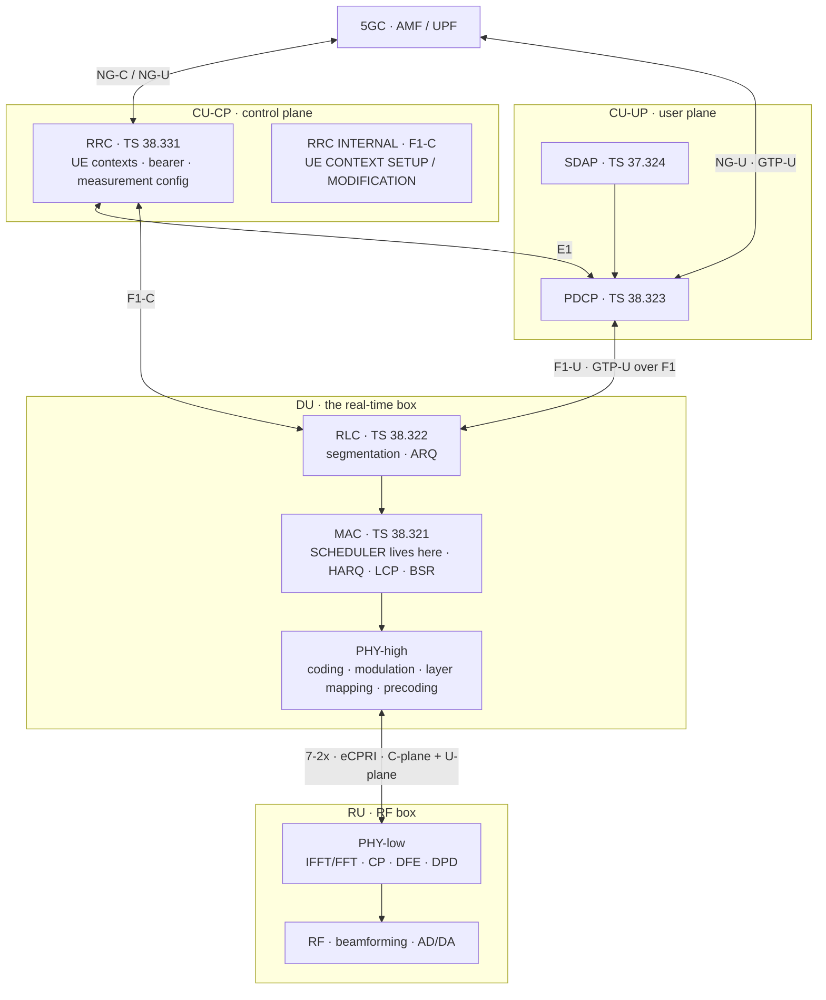

The split is a latency argument. F1-U carries PDCP PDUs and its budget is milliseconds; the slot budget is
0.5 ms at 30 kHz. If the scheduler sat in the CU, every grant would traverse a transport delay comparable to
the interval it is scheduling. So the scheduler, the HARQ entities, the RLC and the PDCP-in-the-CU's opposite
number all land in the DU, and the CU keeps only what can run at configuration time scale.

The consequence that matters: **the DU is the only network element that must be correct in wall-clock time.
Everything else can be correct on average.**

### 1.2 The 7-2x fronthaul — what the DU hands to the RU

In the O-RAN 7-2x split the PHY is cut: PHY-high stays in the O-DU, PHY-low goes to the O-RU. Four logical
planes cross the interface:

| Plane | Carries | Transport | Notes |
| --- | --- | --- | --- |
| **U-plane** | frequency-domain IQ samples, one eCPRI message type **0** per symbol | eCPRI over Ethernet | only occupied REs are sent; BFP compression to ~9 bits per sample |
| **C-plane** | per-slot scheduling commands, eCPRI message type **2** | eCPRI over Ethernet | must lead the U-plane it describes |
| **S-plane** | IEEE 1588 PTP + SyncE | separate | non-negotiable; without lock nothing else works |
| **M-plane** | NETCONF/YANG configuration and fault management | TCP 830 | initialisation and supervision |

A C-plane message is a sequence of **sections**. The section type tells the RU what to do with the REs it
names:

| Section type | Purpose |
| --- | --- |
| **0** | unused REs/symbols — idle or guard periods, transmit blanking for power saving |
| **1** | most DL/UL radio channels, with a beamforming index or weight per section |
| **3** | PRACH and mixed-numerology channels |
| **4** | slot configuration for one or more eAxC_IDs |
| **5** | **UE scheduling information** — the ueId-to-section assignment, so the RU can compute beamforming weights itself |
| **6** | periodic UE channel information, same purpose |
| **7** | LAA / LBT configuration and outcome |
| **8** | ACK/NACK feedback from the RU for the section descriptions the O-DU sent |

Section types 5 and 6 are the interesting ones, because they are how a **category B** O-RU does real-time
beamforming: the DU sends the per-UE scheduling decision and the channel information, and the RU derives the
weights. A **category A** O-RU receives already-precoded data and only applies it. Every flow is tagged with an
**eAxC ID** (extended Antenna-Carrier), a 16-bit field that names the DU port, band sector, component carrier
and RU port; the DU and RU must agree on the subdivision and on which values mean DL, UL and PRACH.

The bandwidth arithmetic is what makes 7-2x viable versus the CPRI it replaced. A 100 MHz, 30 kHz carrier has
273 PRBs = 3276 subcarriers and 28 000 OFDM symbols per second; at 16+16 bits one antenna stream at full load
is 3276 × 28 000 × 32 bit ≈ **2.9 Gbit/s**, and less when PRBs are empty because only occupied REs are sent. A
split-8 link would carry the full 122.88 Msps sample stream ≈ 3.9 Gbit/s per antenna continuously. That is the
whole point: 7-2x fits on commodity 10/25 Gbit/s Ethernet and scales with load.

### 1.3 The L2/L1 interface inside the box

Between the MAC scheduler and PHY sits the **Small Cell Forum FAPI** interface (5G FAPI 222.10.x), normally
carried as **nFAPI** over UDP/SCTP when L2 and L1 are separate processes, or as a direct function call or
shared-memory ring when they are not.

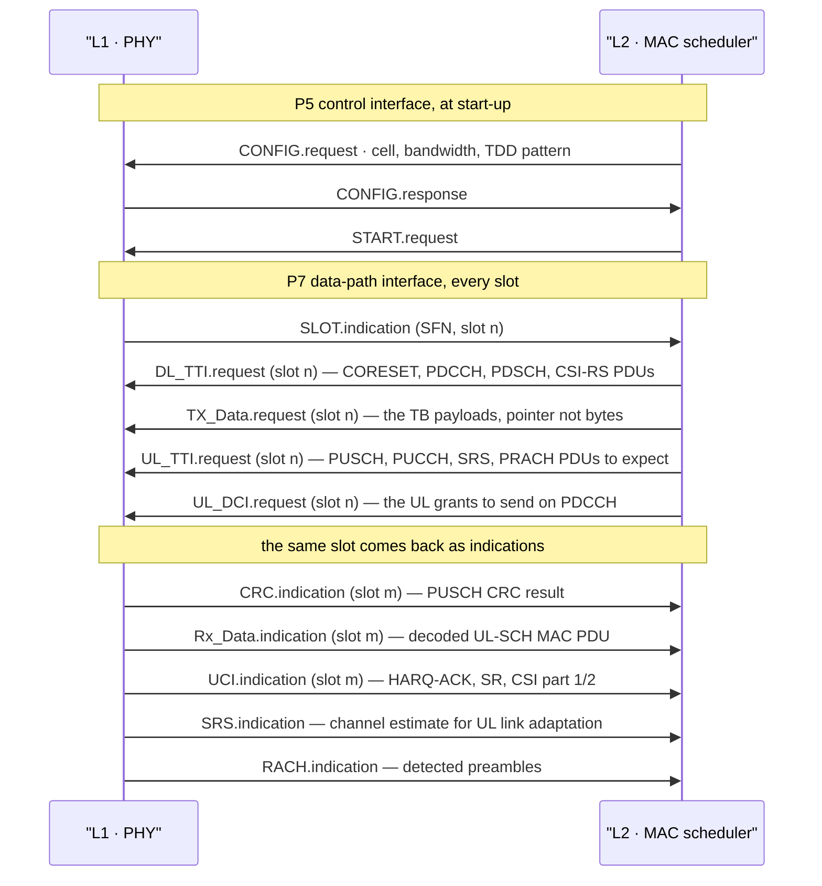

The message IDs are fixed: **DL_TTI.request 0x80**, **UL_TTI.request 0x81**, **UL_DCI.request 0x83**,
**TX_Data.request 0x84**. Note what the split means: `DL_TTI.request` carries the *description* of the
transmission (BWP, MCS, PRBs, layers, HARQ process ID, DCI bits and candidate position), while
`TX_Data.request` carries the *payload*. They are deliberately separated because a TB can be hundreds of
kilobytes and must travel by DMA or shared memory, not by a duplicated structure.

Two design decisions fall out of this immediately:

- **`TX_Data.request` must be passed as a reference, not a copy.** The MAC PDU was assembled by RLC and MAC
  into a pre-allocated pool buffer; L1's job is to encode it in place. Any memcpy of a 100 kByte TB inside the
  slot budget is a design error.
- **`SLOT.indication` is the clock.** The scheduler does not have a timer; it is called. If L1 and L2 disagree
  about SFN/slot, L1 discards the requests until L2 resynchronises — which is why the FAPI sequence has a
  defined resynchronisation behaviour and why a slot-number mismatch is a recoverable condition, not a crash.

## 2. The object being allocated

### 2.1 The resource grid in three axes

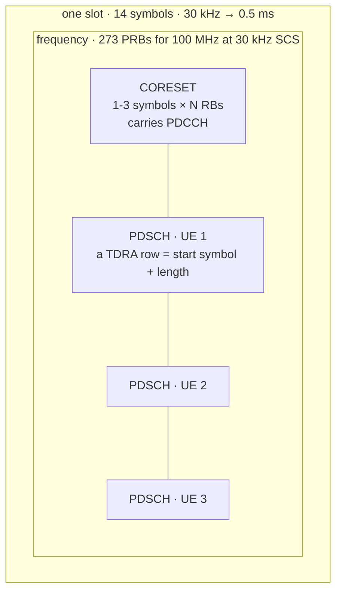

Three things in that picture are not data:

- **CORESET** — a CORESET is 6-RB groups by 1 to 3 symbols, placed anywhere in the BWP. Inside it, control is
  built from **REGs** (1 PRB × 1 OFDM symbol = 12 REs) grouped into **CCEs** of 6 REGs, so
  **N_CCE = RBs × symbols / 6**.
- **DMRS** — front-loaded by default, configurable additional positions. Every PRB carries DMRS REs, and they
  are subtracted before TBS is computed (§6.5).
- **CSI-RS, PTRS, SSB** — further rate-matching shadows. `xOverhead` in `PDSCH-ServingCellConfig` tells the UE
  how much to assume: xOh6, xOh12 or xOh18, or nothing.

The grid is per **BWP**: up to 4 configured DL and 4 UL BWPs per serving cell, **one active at a time**. That
is a scheduler constraint, not a UE convenience — a UE in a 20 MHz BWP can only be given PRBs inside that BWP,
so BWP configuration directly caps what the scheduler can hand out.

### 2.2 The four resources, and which one runs out first

| Resource | Unit | What limits it | Typical binding case |
| --- | --- | --- | --- |
| **PDCCH** | CCE | CORESET size and the per-slot UE blind-decode budget | FR2, many UEs, high aggregation level |
| **PDSCH/PUSCH** | PRB × symbol | BWP bandwidth and TDD symbol availability | full-buffer downloads, small bandwidth |
| **PUCCH** | PUCCH resource | one PUCCH per UE per slot, and collisions between ACK/SR/CSI | TDD DL-heavy with many CA cells |
| **HARQ processes** | process ID | 4-bit DCI field, 16 by default, 8 if unconfigured | high SCS, long RTT, NTN |

A cell that is PRB-limited is easy to see in a KPI. A cell that is PDCCH-limited looks like a cell with spare
PRBs and lower throughput than it should have, and it is the failure mode most often missed.

## 3. The per-slot time budget

### 3.1 The scheduler decides the future

A scheduler does not schedule the slot it was called in. It is invoked by `SLOT.indication` for slot *n* and
must have already delivered the description of slot *n + P*, where *P* is the L2→L1 pipeline depth — typically
one to two slots.

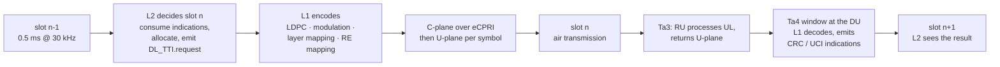

Each hop has a name in O-RAN and each is a window, not a point:

| Parameter | Side | Meaning |
| --- | --- | --- |
| **T1a** | O-DU transmit | how far ahead of air time the DU sends DL C-plane and U-plane; configured separately as `T1a_cp_dl`, `T1a_cp_ul`, `T1a_up` |
| **T2a** | O-RU receive | the window in which the O-RU accepts that traffic. The DU's T1a minus transport delay must fall inside it |
| **Tcp_adv_dl** | O-RU receive | how far the C-plane must lead the U-plane it describes |
| **Ta3** | O-RU transmit | when the O-RU sends UL U-plane after the symbol's air time |
| **Ta4** | O-DU receive | the window after air time in which the DU accepts UL U-plane, including PRACH |

Every packet that arrives outside a window is classed early or late and counted. On a working 7-2 rig the
first thing anyone reads is the on-time/early/late counter set, and a misconfigured `ta4_max` is the classic
cause of PRACH that never arrives: the LiteOn-class example is that with `ta4_max: 500` every PRACH is
reported late, and with `ta4_max: 1960` there are none.

### 3.2 k0, k1, k2 and the floors under them

Three offsets are signalled in DCI, and each has a physical floor set by UE processing capability:

| µ | SCS | N1 PDSCH decode, symbols | N2 PUSCH prepare, symbols | Practical floor on k2 |
| --- | --- | --- | --- | --- |
| 0 | 15 kHz | 8 | 10 | 1 |
| 1 | 30 kHz | 10 | 12 | 1, and 2 in most deployments |
| 2 | 60 kHz | 17 | 23 | 2 or 3 |
| 3 | 120 kHz | 20 | 36 | 3 or 4 |

That table is UE **processing capability 1**; capability 2 (`processingType2Enabled`) roughly halves it and is
what makes sub-slot URLLC scheduling possible at all.

- **k0** — DCI → PDSCH, taken from the selected row of `pdsch-TimeDomainAllocationList`. A TDRA list has at
  most 16 rows, so the TDRA field is 4 bits and indexes row *m + 1*.
- **k1** — PDSCH → HARQ-ACK, taken from `dl-DataToUL-ACK`: up to 8 entries, each 0…15 slots.
- **k2** — DCI → PUSCH, taken from `pusch-TimeDomainAllocationList`; the row value ranges 0…32.

Note the asymmetry: **k0 can be 0**, because the UE can prepare the PDSCH reception while the PDCCH is still
arriving. **k2 cannot**, because between DCI and PUSCH the UE has to blind-decode, parse, look up the TDRA row,
assemble a MAC PDU, encode it and get it to the transmitter.

A TDRA list copied from a 30 kHz cell into a 120 kHz cell without adjusting k2 produces uplink grants the UE
cannot honour, and the UE's response is to **not transmit, with no error indication anywhere**.

### 3.3 The second floor on k1: reachability, not latency

In TDD, `dl-DataToUL-ACK` is not a latency knob — it is a **reachability list**. Every DL slot in the pattern
needs at least one configured k1 that lands on a slot with usable UL symbols.

Worked: TDD pattern DDDSU with 2.5 ms periodicity, 30 kHz, so slot *s* is uplink when *s* mod 5 = 4. A PDSCH
is sent in slot 7. With `dl-DataToUL-ACK = {2, 4}`:

- k1 = 2 → slot 9, 9 mod 5 = 4 → uplink, reachable
- k1 = 4 → slot 11, 11 mod 5 = 1 → downlink, impossible

But for a PDSCH in slot 1 both fail: 1 + 2 = 3 is the special slot, 1 + 4 = 5 is downlink. **The cell quietly
loses a fifth of its downlink capacity**, and the symptom is a scheduler that never uses certain slots with no
error anywhere. This is the single most useful TDD scheduling fact to carry into an interview.

### 3.4 The budget itself

At 30 kHz a slot is **0.5 ms**; at 120 kHz **0.125 ms**. That is the entire time to: consume the previous
slot's indications, update every HARQ process, update every buffer, rank every UE, allocate CCEs, allocate
PRBs, allocate PUCCH, build every DCI, and hand L1 the descriptions.

Everything about the scheduler's internal structure — the two-stage decomposition, the pre-allocated pools,
the absence of locks, the fixed-size UE context array, the fact that logging is deferred — follows from this
one number. See [[04-4 Linux Interrupts - Types, Handlers, Threaded IRQs and Deferred Work]] for the
execution environment and [[04-5 Linux Concurrency - Kernel and User Mode, Processes, Threads and IPC]] for
the concurrency model that has to hold inside it.

## 4. The scheduler's internal structure

### 4.1 The module graph

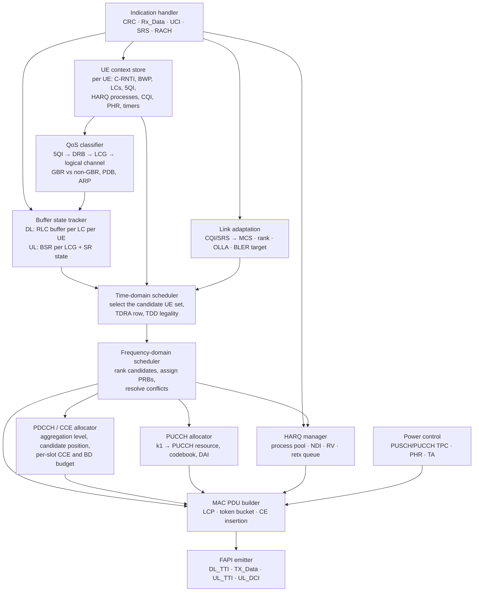

### 4.2 What each module owns

| # | Module | Input | Output | Cadence |
| --- | --- | --- | --- | --- |
| 1 | Indication handler | L1 indications arriving in the Ta4 window | updated HARQ state, buffer state, CQI, SR/BSR, TA | every slot, at the top |
| 2 | UE context store | RRC configuration over F1-C | the per-UE scheduling state | on configuration, read every slot |
| 3 | QoS classifier | 5QI per QoS flow, DRB and LC mapping | per-LC priority, PBR, BSD, GBR or non-GBR flag | on configuration |
| 4 | Buffer state tracker | DL RLC occupancy; UL BSR MAC CEs | bytes pending per LC / per LCG | every slot |
| 5 | Link adaptation | CQI, RI, PMI, SRS, CRC history | MCS index, rank, OLLA delta | every slot |
| 6 | TD scheduler | candidate set, TDD pattern, TDRA table | the UEs scheduled this slot + their time allocation | every slot |
| 7 | FD scheduler | TD output, CQI per subband, PF metric | PRB allocation type 0 or type 1, PRB list | every slot |
| 8 | PDCCH allocator | number and size of DCIs, link quality per UE | AL, CCE positions, DCI candidate index | every slot, before or interleaved with 7 |
| 9 | PUCCH allocator | k1 per scheduled PDSCH, SR/CSI occasions | PUCCH resource, PRI, DAI counters | every slot |
| 10 | HARQ manager | CRC results, NACKs, max retransmissions | process state, NDI toggle, RV, retx queue | every slot |
| 11 | MAC PDU builder | LC list, grant size, CEs pending | the TB, and the LCP allocation that produced it | every slot |
| 12 | FAPI emitter | all of the above | L1 requests | every slot, before the deadline |

Modules 6 and 7 are the decomposition that every real scheduler uses. Modules 8 and 9 are the ones that make
it a scheduler rather than a resource allocator.

## 5. The per-slot decision pipeline

### 5.1 The master flow

```mermaid
flowchart TB
    S0["SLOT.indication for slot n"] --> S1["1 · consume indications<br/>CRC → HARQ process outcomes<br/>UCI → ACK/SR/CSI<br/>SRS → UL channel estimate<br/>RACH → new UE contention"]
    S1 --> S2["2 · update state<br/>release completed HARQ processes<br/>decrement DRX and BSR timers<br/>recompute OLLA per UE"]
    S2 --> S3["3 · build the candidate set<br/>drop UEs outside DRX Active Time<br/>drop UEs in BWP switch or measurement gap<br/>drop UEs with no data and no retx"]
    S3 --> S4["4 · UL scheduling FIRST<br/>SR → BSR → grant chain,<br/>because k2 means the decision affects a later slot"]
    S4 --> S5["5 · PDCCH budgeting<br/>estimate CCEs needed, set the AL per UE,<br/>drop the lowest-priority UEs that do not fit"]
    S5 --> S6["6 · DL time-domain<br/>pick TDRA row per UE, check TDD legality"]
    S6 --> S7["7 · DL frequency-domain<br/>rank by PF or policy, allocate PRBs,<br/>resolve PRB conflicts"]
    S7 --> S8["8 · PUCCH reservation<br/>k1 → slot → PUCCH resource,<br/>resolve ACK/SR/CSI collisions"]
    S8 --> S9["9 · TBS and MCS finalisation<br/>PRB count + MCS + layers → TBS,<br/>fit to the buffer, add CEs"]
    S9 --> S10["10 · build DCIs and emit<br/>DL_TTI.request + TX_Data.request<br/>UL_TTI.request + UL_DCI.request"]
    S10 --> S11["11 · defer everything else<br/>metrics to a ring buffer,<br/>logging and RRC interaction to a worker thread"]
```

### 5.2 Why UL is scheduled before DL

The order in step 4 is not stylistic. A UL grant in slot *n* schedules a PUSCH in slot *n + k2*, and k2 has a
floor of 1–4 slots depending on numerology — so the UL decision made this slot is for a slot further out than
the DL decision. Doing UL first also means the DCI that carries the UL grant and the DCI that carries the DL
grant can be budgeted together in step 5, which matters because they compete for the same CCEs.

### 5.3 Step by step, with what goes wrong

**Step 1 — consume indications.** The scheduler cannot trust a missing indication. A CRC indication that never
arrives for a PUSCH leaves the HARQ process in a state that must be resolved by a timer, not by waiting,
because the next transmission on that process has to be sent regardless. A `Rx_Data.indication` with zero
length means a decode failure, and the UL grant for that process must be reissued or abandoned.

**Step 2 — update state.** Every per-UE timer that the scheduler depends on is advanced here: `retxBSR-Timer`,
`periodicBSR-Timer`, `sr-ProhibitTimer`, the DRX timers, `dataInactivityTimer`. Missing this step produces a
scheduler that works for 10 ms and then drifts.

**Step 3 — build the candidate set.** This is where the UE is excluded for reasons the scheduler did not
choose: DRX, measurement gaps, BWP switching, per-slot LBT failure. A scheduler that skips it sends grants into
gaps and loses them silently.

**Step 4 — UL scheduling.** See §7.

**Step 5 — PDCCH budgeting.** See §9. The important structural point is that this happens **before** the PRB
allocation, because if a UE has no CCEs available its PDSCH allocation is worthless. Some implementations
iterate 5–7 twice; the disciplined ones make 5 a hard filter.

**Step 6 — TD selection.** The TDRA row is chosen per UE from its configured list, and must satisfy: the
symbols it names are available (not UL in the TDD pattern, not reserved for CORESET/SSB/CSI-RS), and the PDSCH
does not collide with a rate-matching resource.

**Step 7 — FD allocation.** See §6.2.

**Step 8 — PUCCH reservation.** See §8.4. This step can force a change to step 6: if no PUCCH resource is
reachable at the k1 the TDRA and `dl-DataToUL-ACK` combination implies, the PDSCH cannot be acknowledged and
the allocation must be withdrawn.

**Step 9 — TBS finalisation.** TBS is a function of PRB count, MCS, layers and overhead — all now known.
The final TBS is then compared with the bytes the LCP procedure wanted to send, and the difference becomes
padding or a trimming of the allocation.

**Step 10 — emit.** All four FAPI messages leave together. The deadline is the T1a window.

**Step 11 — defer.** Metrics, logging, RRC-triggered actions and anything that can allocate memory is handed
to a worker. This is the discipline that separates a real-time scheduler from a prototype: nothing in steps
1–10 may block, allocate or take a lock.

## 6. Downlink scheduling

### 6.1 The two-stage decomposition

A joint optimisation over UEs × symbols × PRBs × MCS is intractable inside a slot. Every practical scheduler
splits it.

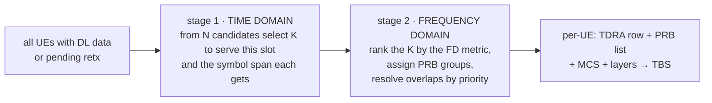

Why the split is legitimate: the TD stage handles everything that is common across the whole allocation —
TDD legality, CORESET and SSB avoidance, the CCE budget, the retx-before-new rule. The FD stage handles the
part that is genuinely per-subband — which UE gets which PRBs given its CQI. They interact only through *K*,
the number scheduled, and a good implementation feeds the CCE occupancy back from the FD stage to bound *K*.

In the FD stage the PRB allocation is expressed one of two ways:

| | Type 0 | Type 1 |
| --- | --- | --- |
| Encoding | bitmap over **resource block groups** | **RIV** = start PRB + length |
| Granularity | PRB group, size 2/4/8/16 by BWP | single PRB |
| Contiguity | non-contiguous allowed | contiguous required |
| DCI cost | scales with BWP width | constant, ~log₂ of the BWP |

`dynamicSwitch` in the DCI lets the scheduler choose per grant, at the cost of one bit. A scheduler in a
frequency-selective channel with a rank-2 or rank-4 UE wants type 0 to place allocations on the good
subbands; a scheduler doing small-packet URLLC wants type 1 to keep the grant small and the DCI short.

### 6.2 The ranking policies

| Policy | Metric | Behaviour | When it is right |
| --- | --- | --- | --- |
| **Round robin** | none — take turns | fair in the number of scheduling opportunities, ignores channel | a test reference, nothing else |
| **Max C/I** | instantaneous rate | maximum cell throughput, starves the cell edge | a throughput upper bound, never deployed |
| **Proportional fair** | rate / average rate | balances throughput and fairness | **the industry baseline** |
| **QoS-weighted PF** | weight × rate / average rate | the same, tilted by 5QI priority and PDB | what a real scheduler runs |
| **M-LWDF / EXP-PF** | PF × a function of head-of-line delay and the delay budget | adds a delay term | GBR and delay-critical GBR bearers |

The PF metric for UE *i* on PRB *j* at slot *t* is

```
metric(i, j, t) = r(i, j, t) / R(i, t)

R(i, t) = (1 - 1/Tc) · R(i, t - 1) + (1/Tc) · (bits actually sent to i at t - 1)
```

The subtlety worth being able to state: **PF optimises a sum-log-utility objective, so it is fair over time,
not fair per slot** — the fairness criterion is Kelly's proportional fairness, and "proportional" is not the
same thing as "equal", which is why a good-channel UE is served more often and the average catches up later. A UE with a momentarily good channel gets the PRBs and the average catches up later. In an
interview the follow-up question is always "so is PF fair?" and the answer is "no, it is log-fair, and the
averaging window Tc is the knob that decides how unfair it looks on a 1-second graph."

The GBR path is separate. For a GBR or delay-critical GBR bearer the scheduler maintains a token bucket and
targets a guaranteed rate; the PF metric is only used to distribute whatever is left. Getting this wrong shows
up as a VoNR or a URLLC flow that meets its average rate and misses its packet delay budget.

### 6.3 Link adaptation — the closed loop

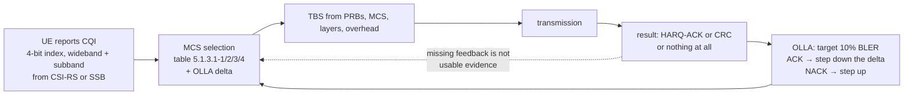

The target operating point is **10 % BLER on first transmission**. That sounds high and it is deliberate: the
first transmission is allowed to fail one time in ten because HARQ retransmission with incremental redundancy
is cheaper than the margin needed to make the first transmission reliable.

Two traps in the loop:

- **Missing feedback must not be counted as a NACK.** An undetected ACK (the UE's PUCCH was lost, or the
  UE did not transmit) drives OLLA down and the scheduler into a low-MCS spiral. The correct treatment is to
  ignore it, or to treat it separately from a decoded NACK.
- **CQI is not SINR.** The CQI index is the UE's own report of the MCS it thinks it can decode, and it
  includes the UE's receiver implementation. Two UEs at identical SINR report different CQI. The OLLA loop
  exists precisely to absorb that.

### 6.4 MCS tables

| Table | Max modulation | Use | Top spectral efficiency |
| --- | --- | --- | --- |
| 5.1.3.1-1 | 64-QAM | default | 5.55 bit/RE/layer |
| 5.1.3.1-2 | 256-QAM | high-SINR, configured by `mcs-Table` | 7.41 bit/RE/layer |
| 5.1.3.1-3 | 64-QAM, low SE | URLLC | low-rate, robust |
| 5.1.3.1-4 | 1024-QAM | Rel-17, very high SINR | ~9.26 bit/RE/layer |

Indices 29, 30 and 31 are reserved and used to signal a retransmission when the DCI cannot carry the MCS
itself. Which table a UE uses is RRC configuration, not scheduler choice — but a scheduler that does not know
which table is active will compute the wrong TBS and the UE will decode nothing.

### 6.5 TBS determination

Four steps, from TS 38.214 clause 5.1.3.2. This is worth being able to do on paper because it is the one
computation the scheduler must get exactly right or every TB fails its CRC.

```
1 · REs per PRB:      N_RE' = 12 · N_sh_symb - N_DMRS_per_PRB - N_oh_per_PRB
                      N_oh comes from xOverhead: 0, 6, 12 or 18

2 · total REs:        N_RE = min(156, N_RE') · n_PRB

3 · information bits: N_info = N_RE · R · Q_m · v
                      R = code rate from the MCS table /1024, Q_m = 2/4/6/8/10, v = layers

4 · quantise:         N_info <= 3824  →  look up Table 5.1.3.2-1, take the smallest TBS >= N_info'
                      N_info >  3824  →  TBS = 8·C·ceil((N_info' + 24)/(8·C)) - 24
                                          C = ceil((N_info' + 24)/8424) for R > 1/4
```

The `min(156, N_RE')` clamp is the one that surprises people: the UE never assumes more than 156 REs available
in a PRB. The 3824 threshold is the LDPC base-graph boundary: below it, one code block with a 16-bit CRC and
base graph 2; above it, segmentation with a 24-bit CRC and base graph 1.

Worked, approximately: 273 PRBs, 13 data symbols, one DMRS symbol, 12 DMRS REs per PRB, xOverhead 0, MCS 20
from table 2 →

```
N_RE' = 12·13 - 12 - 0 = 144
N_RE  = min(156,144)·273 = 39 312
R = 517/1024, Q_m = 8, v = 2
N_info = 39 312 · 0.5049 · 8 · 2 ≈ 317 600 bits → segment: C = ceil(317 624/8424) = 38
TBS ≈ 8·38·ceil(317 624/(8·38)) - 24 ≈ 317 320 bits ≈ 39 665 bytes
```

That is one PDSCH occupying the whole BWP for one slot. A scheduler that gets this arithmetic wrong by one
step does not get a partial decode — it gets a CRC failure and a retransmission, and the KPI looks like a
radio problem.

## 7. Uplink scheduling

### 7.1 The chain and its cost

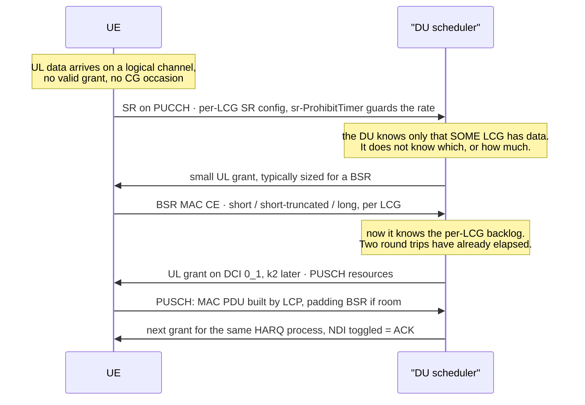

The added latency before user data moves is roughly one SR period plus one PUSCH round trip. Two mechanisms
exist to remove it and both are scheduler features:

- **Pre-scheduling** — the scheduler grants a small UL allocation to active UEs continuously, without waiting
  for an SR. Costs PRBs at low duty cycle, removes the SR and one BSR round trip.
- **Configured grant** — see §7.5. Removes the whole chain.

### 7.2 SR handling

A positive SR tells the scheduler that *some* logical channel in *some* LCG has data. It carries no quantity
and no identity. The scheduler must therefore:

1. Grant enough for a BSR MAC CE, not for the data.
2. If the UE has multiple SR configurations, infer the LCG from which SR resource was used — this is the only
   identity information available.
3. Respect `sr-ProhibitTimer` and `sr-TransMax`: when the counter reaches `srTransMax` the UE releases its
   PUCCH/SRS and falls back to random access. A scheduler in a cell where UEs are frequently hitting
   `sr-TransMax` has an SR-detection or a PUCCH-power problem, not a capacity problem.

### 7.3 BSR: why UL scheduling is always approximate

NR defines **4 logical channel groups**. Every BSR — short, short-truncated or long — reports per LCG, and the
long BSR's per-LCG field is 8 bits encoding an index into a table of byte ranges, not a byte count.

Three consequences:

- **The scheduler cannot schedule per DRB.** It knows a LCG has, say, between 5 486 and 8 207 bytes, across
  every logical channel in that LCG. Per-flow UL scheduling is impossible by construction.
- **The buffer keeps filling after the BSR was sent.** The scheduler works from a stale snapshot. Most
  implementations grant the reported amount plus a margin; some deliberately grant slightly less and use the
  next BSR to converge.
- **Two UEs with traffic in the same LCG are indistinguishable from the BSR alone.** Anything finer needs
  the delay status report or knowledge of the traffic type.

A regular BSR is triggered by new data on a higher-priority logical channel, or by `retxBSR-Timer` expiry; a
periodic one by `periodicBSR-Timer` expiry; a padding one when the MAC PDU has room. A scheduler that never
sees a regular BSR but always sees padding BSRs has a `retxBSR-Timer` that is too long, and its UL view is
permanently stale.

### 7.4 Sizing the grant

The decision every UL scheduler makes:

| Approach | Result |
| --- | --- |
| Grant exactly the BSR | correct at that instant; the next byte that arrives starts the whole SR chain again |
| Grant BSR + margin | fewer round trips, more PRBs wasted on padding |
| Grant the reported amount once, then track HARQ and RLC arrivals | what a good scheduler does |
| Grant the whole BWP to maximise rate | maximises instantaneous rate, wastes a scarce resource, and the UE may not have power for it |

The pathology to name in an interview: **the UL ping-pong.** A scheduler that always grants exactly the BSR
produces a stream of small grants each followed by a new SR, and the measured throughput is bounded by the SR
period rather than by the channel.

### 7.5 Configured grant state

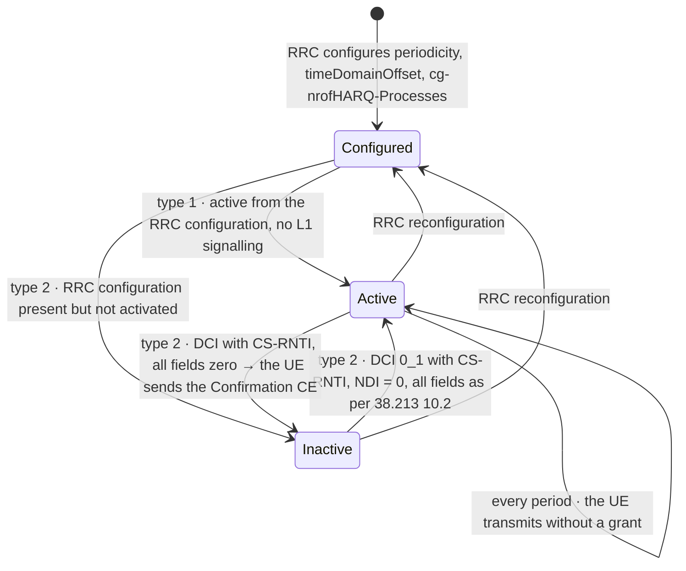

Type 1 is active as soon as RRC configures it; type 2 is RRC-configured but L1-activated and
L1-deactivated, and the UE answers a deactivation with a **Configured Grant Confirmation MAC CE**. The
scheduler must keep the CG occasions and the dynamic grants from colliding on the same HARQ processes —
`harq-ProcID-Offset` exists exactly for that, and `nrofHARQ-Processes` bounds a separate small pool for the
CG so it cannot consume the dynamic pool.

### 7.6 Power, PHR and the uplink MCS limit

Unlike the downlink, UL link budget is shared between rate and coverage. A UE at the cell edge cannot use a
high MCS *and* many PRBs, because transmit power is fixed and spread over the allocation.

- **PHR (power headroom report)** tells the scheduler how much is left. A PHR near zero is the scheduler's
  instruction to trade PRBs for MCS: fewer PRBs at a higher MCS, same rate, less power per PRB.
- **π/2-BPSK and QPSK at low SNR** — the UL MCS tables include low-SE entries precisely to let the scheduler
  keep a cell-edge UE connected at a usable rate.
- **TPC** — DCI 0_1 carries a 2-bit TPC command for PUSCH; DCI 1_1/1_2 carry 2-bit TPC for PUCCH. Group
  power control uses DCI 2_2 for PUSCH and DCI 2_3 for PUCCH. Accumulation versus absolute is per-UE
  configuration; a scheduler that ignores PHR and relies only on TPC accumulate will drift.

### 7.7 Where the UL decision differs from the DL one

The differences that matter structurally:

| | Downlink | Uplink |
| --- | --- | --- |
| Buffer knowledge | exact — the DU has the RLC data | approximate — per LCG, quantised, stale |
| Feedback | explicit HARQ-ACK on PUCCH | **none**; the next grant for the same process with NDI toggled is the ACK |
| Scheduling offset | k0 can be 0 | k2 has a hard floor of 1–4 slots |
| Timing source | the DU decides | TA must be valid, or the UE's signal lands outside its own symbol |
| Power | the DU's, and not scarce | the UE's, and binding |

There is no PHICH in NR. The uplink acknowledgement is implicit in the next DCI for that HARQ process.

## 8. HARQ — the scheduler's most contended resource

### 8.1 The per-process state machine

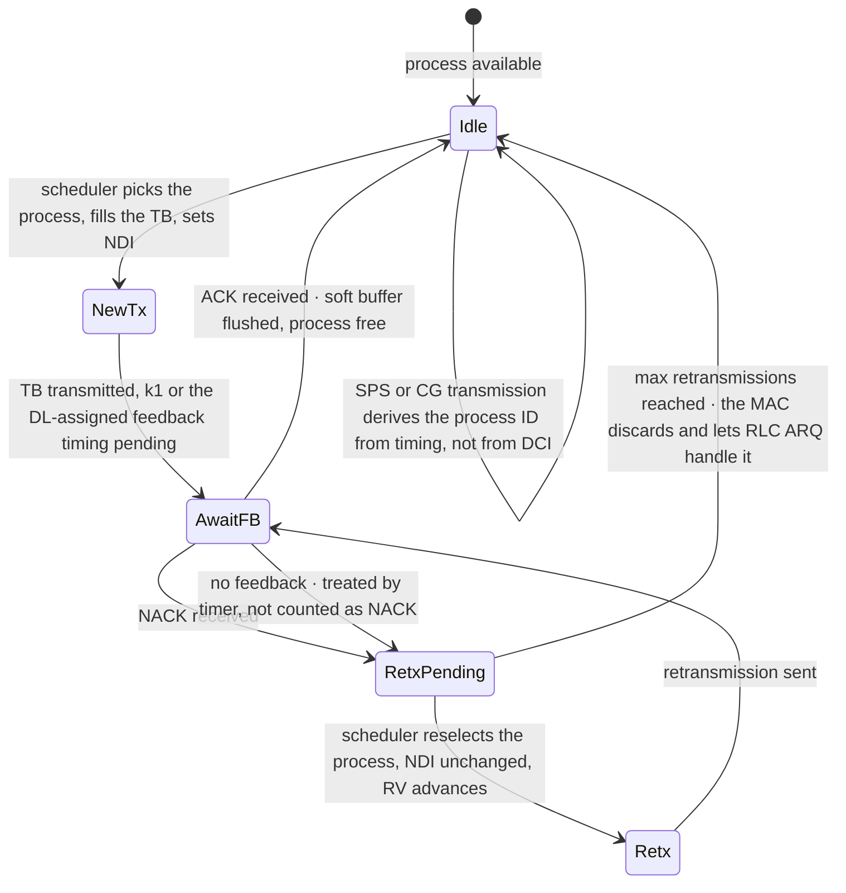

Three rules govern the machine:

1. **The NDI toggle is the only signal that distinguishes a new TB from a repeat.** Same PID, same RNTI, same
   TBS — only the NDI changed. Nothing else in the DCI tells the receiver.
2. **Retransmissions are scheduled before new transmissions.** A retx holds a soft buffer and a UE waiting on
   it; every slot it is delayed is a slot of added latency and a slot closer to the RLC reassembly timer.
3. **There is no maximum retransmission count in the MAC for the general case** — the scheduler's own policy
   decides when to give up and let RLC ARQ take over. Getting this wrong wastes PRBs on hopeless retx or,
   worse, drops a TB into RLC ARQ too early and blows the PDCP discard timer.

### 8.2 Adaptive versus non-adaptive retransmission

| | Non-adaptive | Adaptive |
| --- | --- | --- |
| DCI | may be absent for the UL; the UE repeats on the same resources | always present, resources may change |
| PRBs | identical to the original | may differ — the scheduler can move the retx to better PRBs |
| MCS | identical | may differ — the scheduler can drop MCS for a marginal UE |
| Cost | no CCEs | CCEs, and a PDCCH candidate |
| When | UL, when the original grant is still valid and the CCE budget is tight | everything else |

NR retransmission is **adaptive** in both directions, which is what makes the "same PID, different PRBs"
trick possible, and it is a genuine scheduler lever: a retx for a cell-edge UE can be moved to the subbands
its CQI says are good and dropped to a lower MCS, at the cost of one PDCCH candidate.

### 8.3 How many processes, and what the count must cover

`nrofHARQ-ProcessesForPDSCH` takes values **n2, n4, n6, n10, n12, n16**, and if absent the UE assumes **8** —
not 16, which is a common surprise when comparing two cells that look identically configured. Rel-17 added
`nrofHARQ-ProcessesForPDSCH-v1700` with **n32**. For PUSCH the count is fixed at **16** in Rel-15/16, with
Rel-17 adding an n32 option. The PID field in DCI is 4 bits in Rel-15/16, which is why 16 was the ceiling at
all.

The number you actually need is

```
processes_needed ≈ round_trip_time / slot_duration
```

and since the round trip is dominated by fixed processing time while the slot shrinks with numerology, the
required count rises with SCS — which is exactly why FR2-2 and NTN needed the 5-bit field and 32 processes.

The count is not free. Every process needs its own soft buffer and the UE's total soft-buffer memory is a
**capability, not a configuration**. Doubling the process count halves the soft bits available per process
unless limited buffer rate matching is in play. Configuring n16 on a cell that only ever needs six does not
improve throughput; it can reduce the combining gain available to each retransmission.

### 8.4 PUCCH: one resource, many things to acknowledge

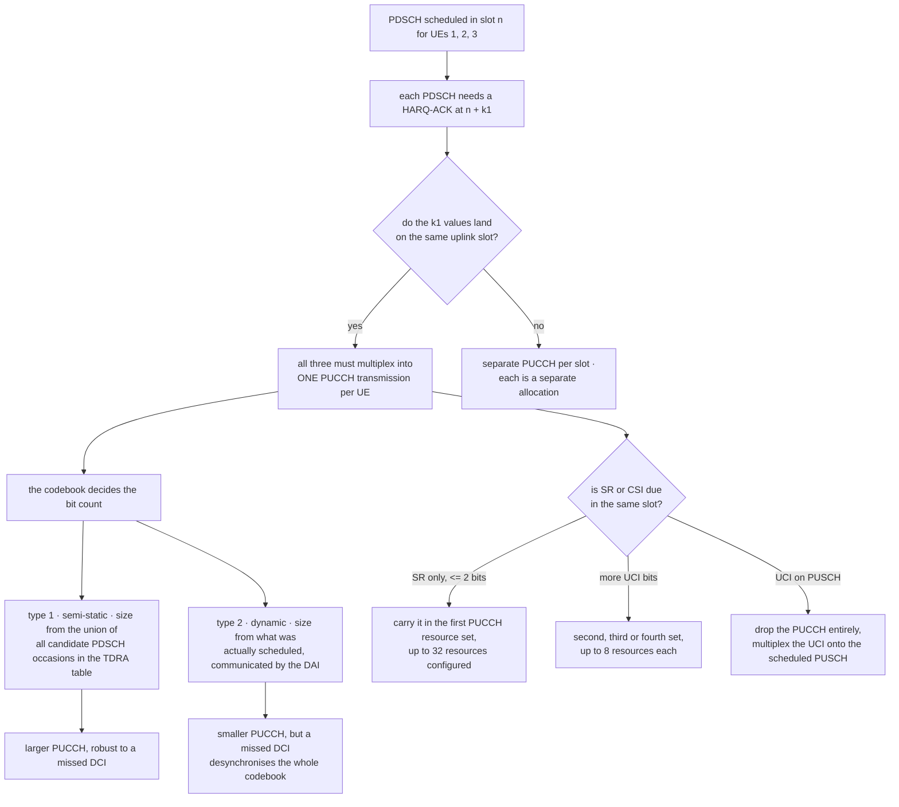

Key facts behind that:

- Up to **4 PUCCH resource sets**; the first carries at most 2 UCI bits and up to **32** resources, the
  others up to **8** each. The gNB signals which resource to use with a 3-bit **PUCCH resource indicator**.
- `maxNrofPUCCH-Resources` = 128 per UE.
- **A UE transmits at most one PUCCH with HARQ-ACK in a slot.** Every PDSCH in every downlink slot whose k1
  lands on that uplink slot, across every configured carrier, must be acknowledged inside that one
  transmission.
- The HARQ-ACK codebook is the agreement about how many bits that PUCCH carries and what each bit means. If
  the two sides disagree about the size, **every bit is misaligned and the feedback is worse than useless.**

This is why CA makes PUCCH the binding resource in a DL-heavy TDD cell: the number of bits to acknowledge
grows with the number of carriers, but the number of PUCCH transmissions per slot does not.

## 9. PDCCH — the resource you run out of first

### 9.1 The budget, in both currencies

The structure: **REG** = 1 PRB × 1 OFDM symbol = 12 REs. **CCE** = 6 REGs. An aggregation level L means L
CCEs carrying one DCI.

| Aggregation level | CCEs | Candidates in a USS | Candidates in a Type0 CSS |
| --- | --- | --- | --- |
| 1 | 1 | 6 | — |
| 2 | 2 | 6 | — |
| 4 | 4 | 4 | 4 |
| 8 | 8 | 2 | 2 |
| 16 | 16 | 1 | 1 |

Each UE has a per-slot budget, in two currencies at once:

| µ | SCS | Max monitored PDCCH candidates per slot | Max non-overlapped CCEs per slot |
| --- | --- | --- | --- |
| 0 | 15 kHz | 44 | 56 |
| 1 | 30 kHz | 36 | 56 |
| 2 | 60 kHz | 22 | 48 |
| 3 | 120 kHz | 20 | 32 |

CCEs are "non-overlapped" if they are in different CORESETs or start at different symbols. Past the limit the
UE is **not required to monitor the excess** — it drops monitoring occasions by a defined priority rule. A
grant in a dropped occasion is a grant the UE never sees, and there is no error anywhere.

### 9.2 The scheduler must reproduce the UE's own hash

For a UE-specific search space the CCEs of candidate *m* at aggregation level *L* in CORESET *p*, slot *n*
are

```
L · { (Y_p,n + floor(m · N_CCE,p / (L · M_p,L)) + n_CI) mod floor(N_CCE,p / L) } + i,   i = 0 … L-1

CSS:  Y_p,n = 0
USS:  Y_p,n = (A_p · Y_p,n-1) mod D,  Y_p,-1 = n_RNTI ≠ 0
      A_p = 39827 | 39829 | 39839 for p mod 3 = 0 | 1 | 2,   D = 65537
```

Two things follow that a scheduler implementation cannot afford to get wrong:

- **The gNB must compute exactly what the UE computes, with no signalling between them.** The recursion is
  deterministic and seeded by the C-RNTI, so the scheduler holds the same `Y_p,n` state per UE.
- **A wrong C-RNTI produces a UE that searches entirely the wrong CCEs and finds nothing.** There is no
  error, no NACK, no retransmission — just a UE that is silent. This is the first thing to check when a UE
  has good radio conditions and no throughput.

### 9.3 The allocation loop

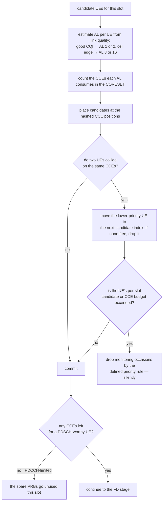

### 9.4 The chicken-and-egg, and the fix

The number of DCIs depends on how many UEs are scheduled, but how many UEs can be scheduled depends on the
CCEs available. Practical implementations break the loop in one of three ways:

1. **Reserve a CCE pool.** A fixed fraction of the CORESET is reserved for the common search space and for
   retransmissions; the rest is allocated to the FD output.
2. **Two-pass.** Pass one sizes the DCIs optimistically, pass two drops UEs that do not fit. The cost is that
   the second pass must be cheap enough to run inside the slot.
3. **Bound K directly.** The TD stage caps the number of scheduled UEs at a value derived from
   `N_CCE / average_AL`. Simplest, most common, and it wastes CCEs when the ALs are low.

### 9.5 Recognising a PDCCH-limited cell

| Symptom | Reading |
| --- | --- |
| PRB utilisation moderate, throughput low, no HARQ failures | candidates or CCEs exhausted before PRBs |
| CCE utilisation near 100 % while PRB utilisation is 60 % | the classic signature |
| UEs at the cell edge served but mid-cell UEs starved | AL 8/16 consuming the whole CORESET |
| Sporadic missed grants with clean radio | over-budget monitoring occasions being dropped |

Mitigations, in the order they are usually applied: widen the CORESET, split PDCCH across more symbols to
create more non-overlapped CCEs, reduce candidates at the ALs that are rarely used, lower the AL for
good-coverage UEs, and reduce the number of UEs scheduled per slot by giving each one more PRBs.

## 10. TDD, SFI and the slot-format dimension

### 10.1 What the scheduler must know before every allocation

The TDD pattern comes from `tdd-UL-DL-ConfigurationCommon` and optionally
`tdd-UL-DL-ConfigurationDedicated`: a reference SCS, a periodicity, and per-slot a downlink / uplink /
flexible marking. On top of that, DCI format **2-0** (SFI-RNTI) can override the flexible symbols slot by
slot.

The scheduler's obligations per candidate TDRA row:

1. Every symbol the PDSCH spans must be downlink or, if flexible, currently indicated downlink.
2. The PDSCH must be rate-matched around SSB, CORESET and any CSI-RS it overlaps.
3. A k1 must exist that lands on a slot with usable uplink symbols (§3.3).
4. For UL, a k2 must exist that exceeds the UE's N2 and lands on an uplink slot.

That third and fourth check is where TDD schedulers lose capacity without producing a single error.

### 10.2 Dynamic TDD and cross-link interference

With dynamic TDD, neighbouring cells can be in opposite directions in the same slot, and the interferer is
another base station transmitting into your receiving antennas — cross-link interference, far worse than
UE-to-UE interference because the geometry is unfavourable. It is the reason commercial dynamic TDD is rare
despite being specified, and it directly constrains the scheduling: a scheduler in a dynamic-TDD cell has to
coordinate the direction, not just allocate it.

## 11. Carrier aggregation and the multi-cell scheduler

- **Cross-carrier scheduling**: a DCI on one cell schedules another, identified by the 3-bit **CIF**
  (Carrier Indicator Field). With self-carrier scheduling the CIF is absent and the DCI size shrinks — the
  scheduler must keep both sizes straight, because the UE blind-decodes a limited set of DCI sizes.
- **The PDCCH budget scales with the number of configured cells, up to a UE capability** — the per-slot
  tables are per serving cell for single-cell operation and there are separate tables for the span and
  multi-cell cases.
- **BSR is per LCG, not per carrier.** So buffer-state granularity limits cross-carrier scheduling precision:
  the scheduler knows the LCG is backlogged but not which carrier's data is waiting.
- **HARQ-ACK across carriers** has to multiplex into one PUCCH — see §8.4. This is the usual reason a
  CA cell becomes PUCCH-limited before it becomes PRB-limited.
- **SCell activation and deactivation** is a MAC CE, and a deactivated SCell is one the scheduler cannot
  allocate on, whatever its buffer state.

## 12. DRX and the power cost of scheduling

### 12.1 The DRX state machine

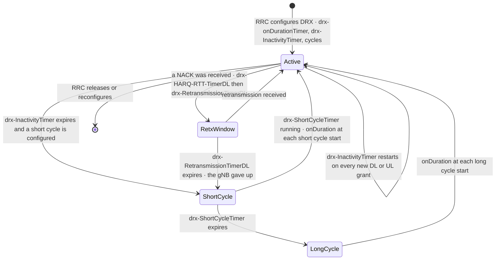

### 12.2 What the scheduler must do about it

- **No grants outside Active Time.** A PDSCH sent in a slot the UE is asleep in is a lost PDSCH, and it
  burns PRBs and a HARQ process.
- **Schedule at the start of onDuration.** The DRX cycle is a periodicity in the scheduler's own calendar;
  a good implementation packs the burst it expects into the first slots of the Active Time so the UE can
  return to sleep. This is the single biggest scheduling contribution to UE battery life.
- **The HARQ RTT timer must be respected.** `drx-HARQ-RTT-TimerDL` is the earliest the UE will look for a
  retransmission; scheduling earlier than that is wasted.
- **Every late or missed retransmission costs power, not just throughput**, because it keeps the UE awake
  through `drx-RetransmissionTimerDL`.

## 13. Real-time implementation

### 13.1 The execution model

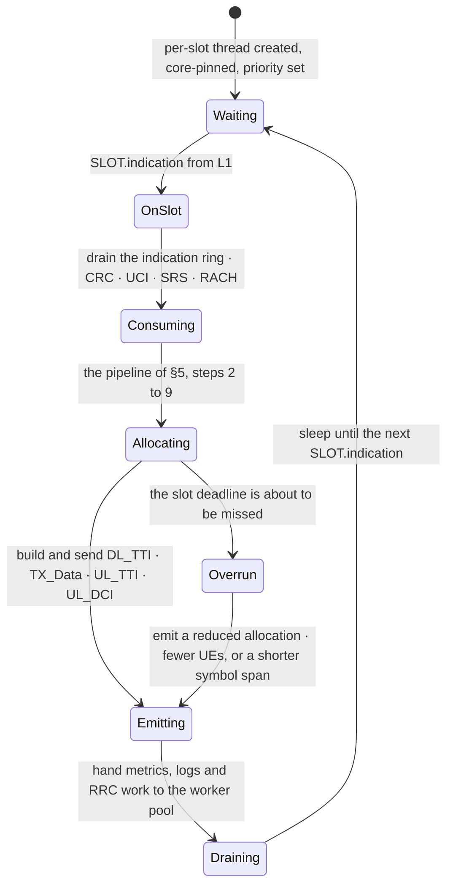

The properties that follow from that diagram are the ones an interviewer will probe:

| Property | Why |
| --- | --- |
| **One thread owns the slot decision** | no locks in the hot path; a lock is a deadline miss with an unknown duration |
| **Core-pinned, isolated from interrupts and from other processes** | a scheduler that takes a device interrupt mid-allocation has no bound on the delay; see [[04-4 Linux Interrupts - Types, Handlers, Threaded IRQs and Deferred Work]] |
| **All memory pre-allocated** | there is no `malloc` with a bounded worst case; every TB buffer, DCI and PDU comes from a pool sized at configuration |
| **UE contexts in a fixed array, hot data contiguous** | the allocation loop iterates every candidate UE every slot; a pointer-chase per UE costs more than the arithmetic |
| **Metrics and logging deferred to a ring buffer** | a `printf` in the slot loop is a syscall, and a syscall is an unbounded delay |
| **The FAPI payload travels by reference** | `TX_Data.request` names a buffer; it does not carry a copy |
| **A deadline overrun degrades, it does not abort** | an empty slot is worse than a half-full one |

Concurrency with the F1-C / RRC side is a different problem. RRC configuration arrives asynchronously and
mutates the UE context the scheduler is reading. The usual pattern is a deferred-apply queue: the RRC thread
does not write into the context directly, it enqueues a configuration command that the per-slot thread applies
at a slot boundary. See
[[04-5 Linux Concurrency - Kernel and User Mode, Processes, Threads and IPC]] for the primitives.

### 13.2 Where the work actually is

A useful correction to the mental model: **the scheduler arithmetic is not the expensive part.** Ranking 50
UEs with a PF metric is microseconds. The expensive parts are:

- **MAC PDU assembly** — LCP over the logical channels, per-UE, per TB, touching every byte.
- **TB transfer** — getting hundreds of kilobytes to L1 and then across the fronthaul as U-plane.
- **The O-RAN U-plane** — one eCPRI message per OFDM symbol per eAxC; a hundred-megahertz cell at 30 kHz
  produces 28 000 symbols per second and the DU has to emit, compress and pace them.

That is why the acceleration boundary usually sits at L1 and at the fronthaul, and why the scheduler itself
is often plain C on a general-purpose core — see
[[08-1 Programming Languages Toolchain and Performance Engineering]] and
[[07-1 RISC-V for Communication Infrastructure]].

### 13.3 What to measure

| Measurement | Why it matters |
| --- | --- |
| Worst-case slot processing time, not the mean | the deadline is per slot; a mean of 100 µs with a 5 ms tail is a broken scheduler |
| P99.9 of the slot loop | the tail is what drops allocations |
| C-plane-to-U-plane spacing against Tcp_adv_dl | the O-RU will discard a U-plane whose C-plane did not lead it |
| UL U-plane arrivals inside Ta4 | outside the window they are counted and discarded |
| CCE utilisation, separated from PRB utilisation | the only way to see a PDCCH-limited cell |
| Time from DCI to PDSCH, and from PDSCH to the ACK arriving at L2 | the two halves of the RTT that sets the HARQ process requirement |

## 14. Metrics the scheduler must expose

| KPI | Definition | A bad value means |
| --- | --- | --- |
| DL PRB utilisation | scheduled PRBs / available PRBs in DL slots | high = capacity; low with high traffic = PDCCH or TDD-reachability limited |
| UL PRB utilisation | same for UL | low with high BSR = grant sizing or SR handling |
| CCE utilisation | used CCEs / total CCEs | > 90 % = PDCCH-limited |
| PDCCH blocking rate | scheduling opportunities lost for want of CCEs | > 0 and rising = the CORESET is too small |
| Initial BLER | NACK or CRC-fail on first transmission / first transmissions | far from 10 % = OLLA or CQI mapping is wrong |
| Residual BLER | failures after all HARQ attempts | > 1 % = RLC ARQ is carrying the load and latency is suffering |
| Average DL MCS | distribution over the scheduled UEs | bimodal = a two-population cell; low and flat = power or interference |
| DL/UL throughput per UE and per cell | MAC-layer, above the RLC | the only throughput number that isolates the scheduler |
| Scheduling delay | time from data arriving at RLC to the first grant | isolates SR/BSR latency from radio latency |
| HARQ retransmission rate | retx / total transmissions | high with low BLER = feedback is being lost, not the channel |
| Active UEs per slot | distinct UEs scheduled in a slot | high with low throughput = too many small allocations and too much CCE |

These are also exactly the measurements an O-RAN xApp consumes over E2 — see
[[01-3 AI-ML for RAN and O-RAN RIC]] for where that loop lives.

## 15. Troubleshooting

### 15.1 The decision tree

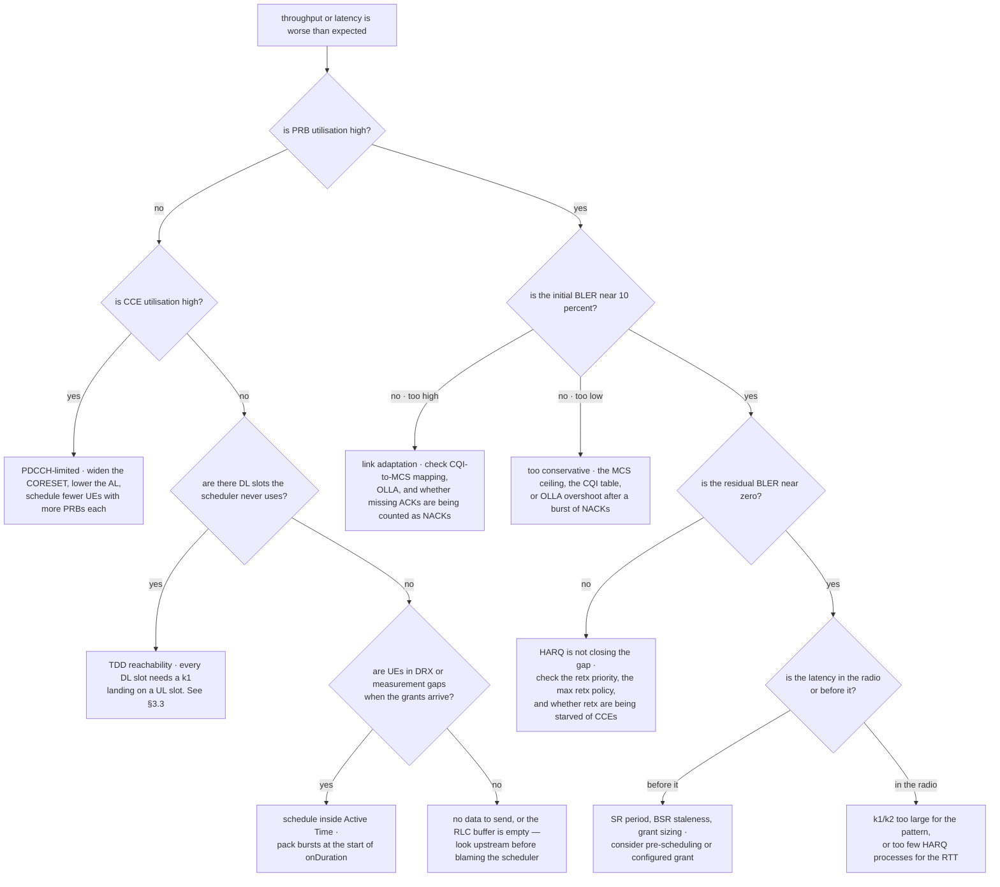

### 15.2 Symptom table

| Symptom | Most likely cause | First thing to check |
| --- | --- | --- |
| Spare PRBs, throughput below expectation | CCE exhaustion | CCE utilisation separated from PRB utilisation |
| A UE with good CQI and no throughput | wrong C-RNTI → wrong CCE hash, or PDCCH over budget | does the DCI decoding succeed at all? is the UE's monitoring budget exceeded? |
| UEs intermittently miss grants, clean radio | monitoring occasions dropped over budget | configured candidates per AL × number of search spaces |
| UL throughput far below DL on the same cell | SR/BSR round trips, or grant sizing | SR-to-grant delay, BSR-to-actual-data ratio |
| UL grants issued but nothing received | k2 below N2 for the numerology, or the target slot is not uplink | the TDRA table against the SCS and the TDD pattern |
| Throughput collapses at high SCS | too few HARQ processes for the RTT | `nrofHARQ-ProcessesForPDSCH` vs the measured RTT |
| PUCCH errors rising with the number of carriers | CA acknowledgement overflowing one PUCCH | codebook type, PUCCH resource set, DAI counters |
| DL capacity lost in a TDD cell with no errors | k1 unreachability for some DL slots | every DL slot against every configured k1 |
| PRACH never detected on a 7-2x rig | Ta4 window too narrow, or the PRACH eAxC not requested on the C-plane | the on-time/late counters and the eAxC mapping |
| Scheduler works for seconds then drifts | per-UE timers not advanced every slot | the step-2 timer update in §5.3 |

### 15.3 The method

1. **Separate the four resources first.** PRB, CCE, PUCCH, HARQ processes. Every throughput problem is a
   shortage in one of them and the treatment is different.
2. **Then separate the radio from the pipeline.** Is the loss in the air interface or in the SR/BSR/grant
   chain before it?
3. **Then separate the scheduler from the configuration.** Many "scheduler problems" are a TDRA table, a
   CORESET, a k1 list or a BWP that was configured for a different cell.
4. **Only then look at the algorithm.** Changing PF to something clever on a PDCCH-limited cell changes
   nothing.

## Anchors — verified facts

- **Architecture**: the scheduler, HARQ entities, RLC and MAC live in the DU; PDCP and SDAP in the CU-UP; RRC
  in the CU-CP. F1-C and F1-U between them, E1 between CU-CP and CU-UP.
- **Fronthaul**: O-RAN 7-2x puts PHY-high in the O-DU and PHY-low in the O-RU. U-plane is eCPRI message type
  **0**, C-plane is eCPRI message type **2**. C-plane section types: **0** unused, **1** most DL/UL channels,
  **3** PRACH and mixed numerology, **4** slot configuration, **5** UE scheduling information, **6** channel
  information, **7** LAA, **8** ACK/NACK feedback. Category A O-RU receives precoded data; category B computes
  beamforming weights itself.
- **FAPI**: DL_TTI.request **0x80**, UL_TTI.request **0x81**, UL_DCI.request **0x83**, TX_Data.request
  **0x84**. Uplink indications: Rx_Data, CRC, UCI, SRS, RACH.
- **PDCCH**: REG = 1 PRB × 1 OFDM symbol = 12 REs; CCE = 6 REGs; N_CCE = RBs × symbols / 6. Aggregation levels
  **1, 2, 4, 8, 16**. USS candidates per AL: **6, 6, 4, 2, 1**. Type0 CSS: AL 4→4, AL 8→2, AL 16→1 candidates.
  Per-slot budget (TS 38.213 Tables 10.1-2 and 10.1-3): **44/56** at 15 kHz, **36/56** at 30 kHz, **22/48** at
  60 kHz, **20/32** at 120 kHz, for monitored candidates / non-overlapped CCEs. USS CCE positions
  `Y_p,n = (A_p · Y_p,n-1) mod D` with `A_p ∈ {39827, 39829, 39839}`, `D = 65537`, `Y_p,-1 = n_RNTI`; CSS uses
  `Y = 0`.
- **Timing**: k0 can be 0; k1 from `dl-DataToUL-ACK`, up to 8 entries each 0…15; k2 0…32. UE processing
  capability 1 gives N1/N2 in symbols of **8/10** at 15 kHz, **10/12** at 30 kHz, **17/23** at 60 kHz,
  **20/36** at 120 kHz; capability 2 roughly halves them. TDRA lists hold at most 16 rows, so the TDRA field
  is 4 bits and indexes row *m + 1*.
- **TBS** (TS 38.214 clause 5.1.3.2): `N_RE' = 12·N_symb − N_DMRS − N_oh`; `N_RE = min(156, N_RE')·n_PRB`;
  `N_info = N_RE · R · Q_m · v`; the quantisation threshold is **3824** bits.
- **MCS**: Tables 5.1.3.1-1 (64-QAM), -2 (256-QAM), -3 (low SE, URLLC), -4 (1024-QAM, Rel-17). Indices 29, 30,
  31 reserved for retransmission signalling.
- **HARQ**: `nrofHARQ-ProcessesForPDSCH` ∈ {n2, n4, n6, n10, n12, n16}, default **8**; Rel-17 adds **n32**.
  PUSCH fixed at 16 in Rel-15/16, n32 in Rel-17. The PID field is 4 bits in Rel-15/16 and 5 bits where 32 is
  supported. Retransmission is adaptive in both directions; the NDI toggle is the only new-versus-repeat
  signal.
- **PUCCH**: up to **4** resource sets; the first carries ≤ 2 UCI bits with up to **32** resources, the others
  up to **8**. `maxNrofPUCCH-Resources` = 128. The PUCCH resource indicator is 3 bits. A UE transmits at most
  one PUCCH with HARQ-ACK per slot.
- **Uplink**: NR defines **4** logical channel groups. There is no PHICH in NR — the next grant for the same
  HARQ process with NDI toggled is the acknowledgement.
- **Bandwidth arithmetic**: 100 MHz at 30 kHz SCS = **273 PRBs** = 3276 subcarriers; 7-2x U-plane for one
  antenna at full load ≈ 2.9 Gbit/s at 16+16 bits versus ≈ 3.9 Gbit/s continuously for split 8.

## Related
- [[01-8 5G NR - OpenAirInterface - Architecture of an Open-Source NR Stack]] — one concrete instance of everything in this note: `gNB_dlsch_ulsch_scheduler()`, the preprocessor and postprocessor split, the VRB map, the HARQ `NR_list_t` pools, and the real-time threads that enforce the per-slot budget

- [[02-10 WLAN - Baseband and Driver Architecture for Wi-Fi 6, 7 and 8 - Qualcomm as the Reference Design]] — the contrast in full: a scheduler handed a slot by a grant against a scheduler inside a chip that must first win the medium, and what changes when the queue lives in hardware rather than in the scheduler
- [[01-2 5G NR RAN Layer 2 Protocol Stack]] — the layer this note implements: what MAC is specified to do, the
  LCP and BSR summaries, and the QoS chain that the scheduler is the last hop of
- [[01-5 NR Random Access - UE RACH Procedure, Signalling and Tuning]] — where the UE contexts the scheduler
- [[02-9 WLAN - Time-Sensitive Networking Across Wi-Fi Generations]] — the same contrast carried to its conclusion: what a scheduler has to become when the requirement is a bound rather than a rate, and how the cellular answer differs from the Wi-Fi one
- [[02-8 WLAN - Scheduling - Channel Access, EDCA, OFDMA Resource Allocation, Airtime and Implementation]] — the sharpest contrast case: a scheduler handed a slot by a grant, versus one that must win a contended medium before it can schedule anything at all
  consumes come from: Msg1 to Msg4, the RAR, and §10's gNB-side RAR assembly and grant sizing
- [[01-3 AI-ML for RAN and O-RAN RIC]] — the near-RT RIC and the xApps that consume scheduler KPIs and
  propose parameter changes on the other side of the E2 interface
- [[01-1 5G-Advanced and 6G Radio Access]] — the release map: which scheduling-relevant features arrived in
  which release, and the AI-native air interface question
- [[01-7 NR HARQ - Retransmission Flow, Timelines and LTE Comparison]] — the fourth resource in full: what a HARQ process holds, the NDI and RV decision, the k1 and k2 floors from N1 and N2, the HARQ-ACK codebook and PUCCH resource problem, and the process-pool view of §8 in this note
- [[01-4 Cellular IoT RedCap eRedCap and NTN]] — the scheduling extremes: RedCap's reduced BWP and bandwidth,
  and NTN's 32 HARQ processes with per-process feedback disabling
- [[04-3 Embedded Software Architecture - Patterns, Layering and Wireless System Structure]] — the L1/L2
  real-time boundary, layering of the modem stack and the host interface
- [[04-4 Linux Interrupts - Types, Handlers, Threaded IRQs and Deferred Work]] — the interrupt and
  deferred-work environment the per-slot thread has to be isolated from
- [[04-5 Linux Concurrency - Kernel and User Mode, Processes, Threads and IPC]] — the thread model, the
  lock-free hot path and the deferred-apply queue for RRC reconfiguration
- [[05-1 DPDK User Plane and 5G UPF]] — the other end of the chain: the same per-packet discipline in the
  user plane, and where the air-interface time scale meets the flow time scale
- [[07-1 RISC-V for Communication Infrastructure]] — the silicon the DU runs on, and where the acceleration
  boundary is drawn
- [[08-1 Programming Languages Toolchain and Performance Engineering]] — making the slot loop fit: data
  layout, SIMD and the measurement discipline

## References

1. 3GPP. *TS 38.321 — Medium Access Control (MAC) protocol specification*.
   <https://www.etsi.org/deliver/etsi_TS/138300_138399/138321/>
   — clause 5.4.3.1 logical channel prioritisation, clause 5.4.5 BSR, clause 5.4.4 scheduling request, clause
   5.13.2 DRX, clause 6.1.3.40 PUCCH spatial relation activation. The normative source for every MAC-side
   scheduler behaviour in this note.
2. 3GPP. *TS 38.213 — Physical layer procedures for control*.
   <https://www.etsi.org/deliver/etsi_TS/138200_138299/138213/>
   — clause 10.1 PDCCH assignment and the CCE aggregation levels (Table 10.1-1), the per-slot candidate and
   non-overlapped-CCE budgets (Tables 10.1-2 and 10.1-3), clause 9.2.1 PUCCH resource sets, clause 9.2.3 the
   HARQ-ACK timing and the DCI 1_0 k1 table, clause 11.2 uplink power control, clause 11.3 SRS.
3. 3GPP. *TS 38.214 — Physical layer procedures for data*, v18.9.0 (ETSI TS 138 214 V18.9.0).
   <https://www.etsi.org/deliver/etsi_ts/138200_138299/138214/18.09.00_60/ts_138214v180900p.pdf>
   — clause 5.1 the maximum of 16 DL HARQ processes and the default of 8, clause 5.1.3.1 MCS tables
   5.1.3.1-1 to -4, clause 5.1.3.2 TBS determination, clause 5.1.2.1.1 the default k0 tables, clause 5.3 the
   PDSCH processing time N1, clause 6.1.2.1 the default k2 tables, clause 6.4 the PUSCH preparation time N2.
4. 3GPP. *TS 38.211 — Physical channels and modulation*.
   <https://www.etsi.org/deliver/etsi_TS/138200_138299/138211/>
   — clause 4 the frame structure and slot durations, clause 7.3.2 CORESET and the REG/CCE structure, clause
   7.3.2.1 the supported PDCCH aggregation levels, clause 7.4 PDSCH DMRS.
5. 3GPP. *TS 38.331 — Radio Resource Control (RRC) protocol specification*.
   <https://www.etsi.org/deliver/etsi_TS/138300_138399/138331/>
   — `PDSCH-ServingCellConfig` (`nrofHARQ-ProcessesForPDSCH`, `xOverhead`, `mcs-Table`,
   `processingType2Enabled`), `PDSCH-Config` (`pdsch-TimeDomainAllocationList`), `PUSCH-Config`
   (`pusch-TimeDomainAllocationList`), `PDCCH-Config` (`controlResourceSetToAddModList`, `searchSpacesToAddModList`),
   `PUCCH-Config` (`PUCCH-ResourceSet`, `maxPayloadSize`, `dl-DataToUL-ACK`), `ConfiguredGrantConfig`,
   `DRX-Config`, and the multiplicity constraints `maxNrofPUCCH-Resources = 128`, `maxNrofPUCCH-ResourceSets = 4`,
   `maxNrofPUCCH-ResourcesPerSet = 32`, `maxNrofDL-Allocations = 16`.
6. i TecSpec. *TS 38.213 §9.2.1 — PUCCH Resource Sets*. <https://itecspec.com/3gpp/38.213/s/9.2.1>
   — the exact text for the four resource sets, the 32-resource first set, the 8-resource others and the
   `maxPayloadSize` selection rule.
7. i TecSpec. *TS 38.331 — Multiplicity and type constraint definitions*.
   <http://itecspec.com/3gpp/38.331/s/multiplicity-and-type-constraint-definitions>
   — the ASN.1 constants quoted in §9 and §12.
8. 3GPP. *TS 38.212 — Multiplexing and channel coding*.
   <https://www.etsi.org/deliver/etsi_TS/138200_138299/138212/>
   — clause 5.4.2 rate matching and the limited buffer rate matching circular buffer `Ncb = min(N, Nref)`,
   clause 5.2.2 the CQI and the base-graph selection behind the 3824-bit TBS threshold.
9. 3GPP. *TS 38.300 — NR; Overall description; Stage 2*.
   <https://www.etsi.org/deliver/etsi_TS/138300_138399/138300/>
   — clause 16 the CU/DU split and what each node owns; the L2 data flow.
10. 3GPP. *TS 38.473 — F1 application protocol (F1AP)*.
    <https://www.etsi.org/deliver/etsi_TS/138400_138499/138473/>
    — the UE Context Setup and Modification procedures that create and mutate the contexts the scheduler reads.
11. O-RAN ALLIANCE. *O-RAN.WG4.CUS — Control, User and Synchronization Plane Specification*.
    <https://www.o-ran.org/specifications>
    — the eCPRI message types, the C-plane section types 0–8, the eAxC identifier, and the T1a/T2a/Ta3/Ta4/
    Tcp_adv_dl timing windows quoted in §1.2 and §3.1.
12. O-RAN ALLIANCE. *O-RAN.WG1.OAD — O-RAN Architecture Description*. <https://www.o-ran.org/specifications>
    — the O-CU/O-DU/O-RU functional split and the 7-2x categories A and B.
13. Small Cell Forum. *SCF222.10.02 / 222.10.04 — 5G NR FAPI specification*.
    <https://www.smallcellforum.org/>
    — the P5 control and P7 data-path messages named in §1.3 and their message IDs.
14. NVIDIA. *SCF FAPI support — Aerial cuBB release notes*.
    <https://docs.nvidia.com/aerial/>
    — the supported-message matrix, including that TX_Data.request and Rx_Data.indication carry a 32-bit PDU
    length in 222.10.03 and that the PDU is delivered in a separate buffer.
15. OpenAirInterface. *P7 user plane interface, open-nFAPI*.
    <https://github.com/OPENAIRINTERFACE/openairinterface5g>
    — a readable reference implementation of the pack/unpack functions for DL_TTI.request, UL_TTI.request,
    UL_DCI.request and TX_Data.request, and of the corresponding uplink indications.
16. srsRAN Project. *MAC and scheduler source*. <https://github.com/srsran/srsRAN_Project>
    — an open reference scheduler: the per-slot UE context, the two-stage DL allocation, the PDCCH CCE
    allocation and the PUCCH reservation in one readable codebase.
17. ShareTechnote. *Open RAN — eCPRI and the O-RAN C/U-plane*.
    <https://www.sharetechnote.com/html/OpenRAN/OR_eCPRI.html>
    — the section-type table and the eAxC sequence-id rules quoted in §1.2.
18. COSMOS. *O-RAN architecture and the 7.2x fronthaul*.
    <https://www.cosmos-lab.org/wiki/public/tutorials/cellular-4g5g-oran/oran-intro>
    — the T1a/T2a/Ta3/Ta4 window definitions, the early/on-time/late counters, and the worked examples of a
    `ta4_max` that is too narrow and a `T1a` that falls outside the O-RU's window.
19. Intel. *O-RAN Intel FPGA IP User Guide*. <https://cdrdv2-public.intel.com/812720/ug_oran-683238-812720.pdf>
    — how t2a_min_up / t2a_max_up / ta3_min_up are programmed from the O-RU's processing delay, which is what
    makes the reception and transmission windows concrete.
20. Eurecom. *Experimental analysis of massive MIMO antennas in O-RAN systems*.
    <https://www.eurecom.fr/publication/8398>
    — the 7.2x functional allocation figure and the case for centralising high-PHY in the O-DU.
21. AxeeTech. *5G NR transport block size explained*. <https://axeetech.com/5g-nr-transport-block-size/>
    — a secondary walkthrough of the four-step TBS procedure and the 3824-bit threshold.
22. HiCellTek. *MCS, TBS and code rate reference*. <https://hicelltek.com/en/mcs-tbs-code-rate/>
    — the per-index Qm and code rates for MCS tables 1–4, and the resulting spectral-efficiency ceilings.
23. lte5ghub. *HARQ in 5G NR — downlink and uplink*. <https://lte5ghub.com/harq>
    — the process-count table, the NDI-toggle pipeline and the asynchronous-in-both-directions comparison
    with LTE.
24. lte5ghub. *TS 38.214: time-domain resource allocation and SLIV in 5G NR*.
    <https://lte5ghub.com/time-domain-allocation>
    — the N1/N2 table and the practical k2 floors per numerology quoted in §3.2.
25. lte5ghub. *TS 38.321: scheduling — dynamic, SPS and configured grant in 5G NR*.
    <https://lte5ghub.com/scheduling>
    — the CCE candidate-to-CCE mapping formula and the per-slot PDCCH monitoring limits.
26. 5G/6G Academy. *CORESET and search spaces in 5G NR*. <https://www.5g6gacademy.com/learn/coreset-and-search-spaces>
    — the per-slot blind-decode and CCE budgets and the argument for why the caps tighten with SCS.
27. Dahlman, E., Parkvall, S., Sköld, J. *5G NR: The Next Generation Wireless Access Technology*, 2nd ed.
    Academic Press, 2021. ISBN 978-0-12-822320-8.
    — chapters 6, 10 and 13: the L2 structure, the scheduling and link-adaptation chain, and the TDD
    considerations, written by the people who specified them.
28. Kelly, F. P., Maulloo, A. K., Tan, D. K. H. "Rate control for communication networks: shadow prices,
   proportional fairness and stability". *Journal of the Operational Research Society*, vol. 49, no. 3,
   pp. 237–252, March 1998. DOI 10.1057/palgrave.jors.2600523
   — the origin of the proportional-fairness criterion behind §6.2. It is the reason PF is described as
   log-fair rather than fair: the objective is the sum of log rates.
29. 3GPP. *TS 38.306 — UE radio access capabilities*.
    <https://www.etsi.org/deliver/etsi_TS/138300_138399/138306/>
    — where the 16- versus 32-HARQ-process capability and the PDCCH monitoring capability are signalled.
30. TREA. *HARQ process identification and soft buffer management for non-terrestrial networks*.
    <https://trea.com/information/harq-process-identification-and-soft-buffer-management-for-non-terrestrial-netwo/>
    — the `nrofHARQ-ProcessesForPDSCH` enumeration and the soft-buffer scaling factor when more than 16
    processes are configured.

- [[02-13 WLAN - Reliability, Low Latency and Determinism - What the Wi-Fi Stack Can Actually Do]] — what a scheduled medium looks like: the comparison case for every Wi-Fi determinism claim, where the grant replaces contention

- [[09-1 Engineering Project Management - Methodology, Lifecycle, Tools and Best Practice]] — the hardest schedule constraint in the whole vault — the per-slot budget — and the reason verification cannot be left to the end of a modem project
- [[10-1 Value-Driven Business Model - Methodology, Process, Tools and Best Practice]] — where the hardest engineering constraints live, and why the value of a latency bound has to be negotiated against a per-slot budget rather than promised
---

_Copyright (c) 2026 Washington Ruan and contributors · licensed under **GPL-3.0-or-later** or **AGPL-3.0-or-later**, at your option · see `LICENSE` and `LICENSE-AGPL`._
