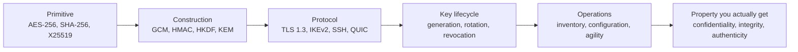
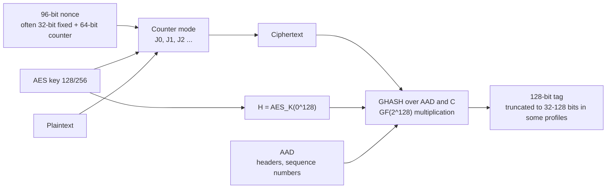
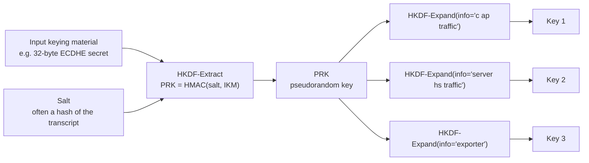
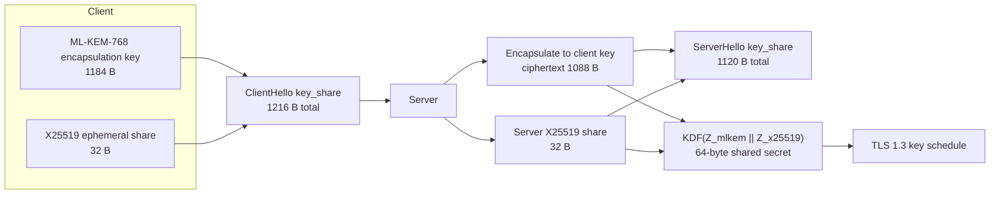
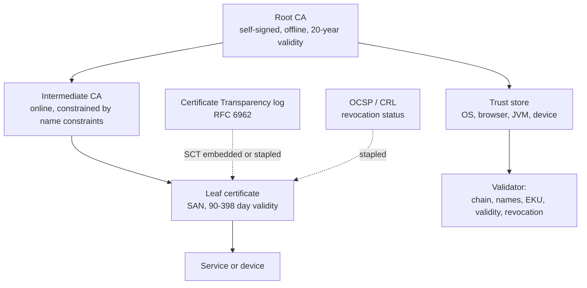
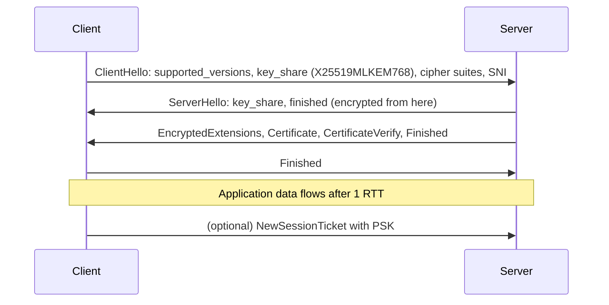
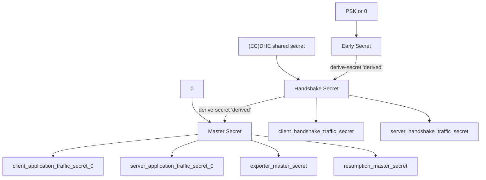

# SECURITY — Cryptographic Foundations

> **A cipher is not a security property.** Security is a property of a *chain* — a primitive, a
> construction around it, a protocol that composes the construction, a key lifecycle that keeps the
> keys alive no longer than they should be, and an operational layer that knows which of the five is
> deployed where. Every serious cryptographic failure of the last twenty years broke a joint in that
> chain, not a primitive: POODLE broke padding, ROBOT broke RSA padding oracles, DROWN broke version
> negotiation, KRACK broke a state machine, Dual EC broke the random number generator, and Debian
> 2008 broke the entropy source. This note walks the chain from the bottom and stops at every joint
> where it has broken before.

The companion note [[02-19 WLAN - Security - RSNA, WPA3, Mesh Security and the Threat Horizon|02-19]]
applies this material to 802.11 specifically; this one is the substrate. Read §1–§3 here before
arguing about WPA3 or TLS at an interview, because the questions are always about the construction,
never about the primitive.

---

## 1. The five questions, and the sixth

Every mechanism in this note exists to answer one of five questions about a message, and a sixth
about the system around it:

| Question | Mechanism | What failure looks like |
| --- | --- | --- |
| Can anyone else read it? | Encryption (AES-GCM, ChaCha20-Poly1305) | Passive decryption; the weakest link is usually key management, not the cipher |
| Was it changed? | MAC or AEAD tag (HMAC, GHASH, Poly1305) | Silent modification; the attacker edits a field the tag does not cover |
| Is it fresh, or a replay? | Nonce, sequence number, timestamp, challenge | A recorded handshake or command replayed verbatim |
| Who sent it? | Signature, MAC with a shared key, certificate | Impersonation; the identity claim is bound to a key the attacker also holds |
| Who is the other party, *really*? | PKI, pinning, transparency logs, key transparency | A rogue CA or a mis-issued certificate defeats everything above |
| What happens when a key leaks? | Forward secrecy, rotation, revocation, crypto-agility | One compromise decrypts years of recorded traffic |

The sixth question is the one engineers skip, and it is the one that decides the *cost* of an
incident. A system with perfect primitives and no rotation is a system whose breach has no end date.

**The chain is only as strong as its weakest joint, and the weakest joint moves.** In the 1990s it
was the cipher (DES key length). In the 2010s it was the construction (padding oracles, nonce reuse).
In the 2020s it is the operational layer: which algorithm is deployed where, and whether anyone can
answer that question in under a week. The post-quantum migration in §6 is almost entirely an
inventory problem disguised as a mathematics problem.

---

## 2. The primitive map

Five families do all the work. Everything else is composition.

| Family | Job | Standard representatives | Security assumption |
| --- | --- | --- | --- |
| Block cipher | Pseudorandom permutation on a fixed block | AES-128/192/256 (FIPS 197), SM4 | No practical distinguisher; AES-128 has no better attack than $2^{126}$ |
| Stream cipher / AEAD | Pseudorandom keystream plus authentication | ChaCha20-Poly1305 (RFC 8439), AES-GCM | Keystream indistinguishable; nonce uniqueness is a *hard* requirement |
| Hash | Collision-resistant digest, and an XOF | SHA-256/512 (FIPS 180-4), SHA3-256 (FIPS 202), BLAKE3 | Collision resistance 128 bits for a 256-bit digest |
| MAC / KDF | Keyed integrity, key derivation | HMAC (RFC 2104), KMAC, HKDF (RFC 5869) | PRF security of the underlying hash |
| Public key | Key establishment and signatures | RSA (FIPS 186-5), ECDH/X25519, ECDSA/Ed25519, ML-KEM, ML-DSA | Factoring, discrete log, or lattice problems |

Two things about this table are worth internalising because they explain most design decisions:

1. **Symmetric and public-key cryptography have different cost structures.** AES-256 encrypts at a
   few cycles per byte; an X25519 key exchange costs tens of microseconds and an RSA-2048 signature
   verification costs roughly a millisecond on a small core. That three-order-of-magnitude gap is
   why every protocol uses public-key cryptography only to establish a symmetric key and then
   switches — the "hybrid" pattern in TLS, IKEv2, SSH and QUIC alike.
2. **Security levels are not linear in key length.** A 256-bit AES key gives 256-bit security against
   brute force but only ~128-bit security against a quantum adversary running Grover's algorithm;
   a 256-bit elliptic curve point gives 128-bit classical security. Tables below state the level,
   not the length, because "256-bit" means three different things in three different families.

| Level | Symmetric | Hash (collision) | RSA / DH | Elliptic curve | PQC (NIST category) |
| --- | --- | --- | --- | --- | --- |
| 112-bit | 3DES (deprecated), AES-112 n/a | SHA-224 | RSA-2048, DH-2048 | P-224 | — |
| 128-bit | AES-128 | SHA-256 | RSA-3072, DH-3072 | P-256, X25519 | ML-KEM-512 (1), ML-DSA-44 (2) |
| 192-bit | AES-192 | SHA-384 | RSA-7680 | P-384 | ML-KEM-768 (3), ML-DSA-65 (3) |
| 256-bit | AES-256 | SHA-512 | RSA-15360 | P-521 | ML-KEM-1024 (5), ML-DSA-87 (5) |

---

## 3. Symmetric cryptography: where nonces go to die

### 3.1 AES

AES is a substitution-permutation network on a 128-bit block: 10 rounds for a 128-bit key, 12 for
192, 14 for 256. Each round is SubBytes (the S-box), ShiftRows, MixColumns, AddRoundKey; the last
round omits MixColumns. The design is byte-oriented so that a 32-bit CPU can implement it with
table lookups, which is exactly why cache-timing attacks against table-based implementations keep
appearing — constant-time AES needs either hardware instructions (AES-NI, ARMv8 Crypto Extensions)
or a bitsliced software implementation.

**AES is not the interesting part.** In twenty-five years the best published attack on full AES-128
is still biclique cryptanalysis at $2^{126.1}$ — academically interesting, operationally irrelevant.
Every real AES compromise has come from the *mode*, the *nonce*, or the *key*.

### 3.2 Modes, and how each one fails

| Mode | Construction | Failure mode you must know |
| --- | --- | --- |
| ECB | Encrypt each block independently | Identical plaintext blocks produce identical ciphertext — leaks structure; never use |
| CBC | XOR previous ciphertext block, then encrypt | Padding oracle if decryption errors are observable (POODLE, Lucky Thirteen); no integrity at all |
| CTR | Encrypt a counter, XOR the keystream | **Nonce reuse is catastrophic**: $C_1 \oplus C_2 = P_1 \oplus P_2$, and the keystream is recoverable from known plaintext |
| GCM | CTR plus GHASH over the ciphertext and AAD | Nonce reuse breaks both confidentiality *and* the authentication key (the GHASH key can be solved from two collisions) |
| CCM | CTR plus CBC-MAC | Two passes; no parallelism; used in 802.11 and constrained IoT |
| SIV / AES-GCM-SIV | Synthetic IV derived from the plaintext | Nonce misuse resistant — reuse leaks only equality of plaintexts, not the key |

### 3.3 AEAD, concretely

AES-GCM is the default in TLS, QUIC, IPsec, 802.11 and most storage encryption. The construction:

Three operational rules follow, and violating any of them has produced real breaches:

1. **The nonce must never repeat under one key.** GCM's 96-bit IV is designed as a counter; a random
   IV is safe only up to roughly $2^{32}$ messages under a single key before birthday collisions
   become likely. TLS 1.3 derives a fresh key per record *and* uses an implicit sequence-number
   nonce, which removes the choice from the implementer — a security improvement disguised as a
   performance decision.
2. **Everything that matters must be in the AAD.** The tag authenticates the ciphertext and the AAD,
   nothing else. A header field left outside the AAD is an unauthenticated field, and unauthenticated
   fields are where protocol attacks live — the A-MSDU present bit in 802.11 was outside the CCMP
   MIC, which is precisely the FragAttacks class (see [[02-19 WLAN - Security - RSNA, WPA3, Mesh Security and the Threat Horizon|02-19]] §8.3).
3. **Do not truncate the tag below 96 bits without a documented reason.** 802.11 allows a 64-bit
   MIC for some management frames; each bit removed halves the forgery cost.

ChaCha20-Poly1305 (RFC 8439) is the software-friendly alternative: a 256-bit key, a 96-bit nonce,
a 32-bit counter, and Poly1305 over the ciphertext with the lengths and AAD. It is the default where
AES hardware is absent and the choice where cache-timing attacks against table-based AES are a
concern. Its security story is the same: nonce reuse destroys it.

---

## 4. Hashes, MACs and KDFs

### 4.1 Hash functions

| Property | Meaning | Why an attacker cares |
| --- | --- | --- |
| Preimage resistance | Given $h$, find $m$ with $H(m)=h$ | Forging a password hash or a commitment |
| Second preimage resistance | Given $m_1$, find $m_2 \neq m_1$ with the same digest | Substituting a document that still verifies |
| Collision resistance | Find any $m_1 \neq m_2$ with equal digests | Forging a certificate or a signed update |

For an $n$-bit digest, collision resistance is only $n/2$ bits by the birthday bound — SHA-256 gives
128-bit collision resistance, not 256. SHA-1's 80-bit collision resistance was reached in practice
in 2017 (SHAttered), which is why certificate authorities stopped issuing SHA-1 certificates in 2016
and browsers stopped accepting them in 2017.

SHA-3 (FIPS 202) is Keccak with a sponge construction: absorb the message, then squeeze the output.
Its practical advantage over SHA-2 is not security — both are unbroken — but diversity: a
length-extension-free design with a different algebraic structure, so a break in one family does not
take the other with it. That is why TLS 1.3, X.509 and post-quantum schemes all offer SHA-3 variants.

**Length extension** is the trap in Merkle-Damgård hashes: given $H(k \| m)$ you can compute
$H(k \| m \| \text{pad} \| m')$ without knowing $k$. This is why "hash the secret then the message"
is wrong and HMAC exists.

### 4.2 HMAC and KMAC

HMAC (RFC 2104) is $H((K \oplus \text{opad}) \| H((K \oplus \text{ipad}) \| m))$. The nested
construction defeats length extension and remains secure even if the hash's collision resistance
weakens — HMAC-MD5 is still believed unforgeable, which is why legacy protocols survive longer than
they should. KMAC (SP 800-185) is the SHA-3 equivalent, built on cSHAKE.

### 4.3 HKDF: the piece everyone uses and nobody explains

HKDF (RFC 5869) turns a non-uniform secret — a Diffie-Hellman shared secret, a KEM output, a
password-derived key — into as many independent keys as a protocol needs:

The `info` parameter is the domain separation, and it is load-bearing: TLS 1.3 labels every key in
the schedule (`c hs traffic`, `s hs traffic`, `c ap traffic`, `exp master`, `res master`) so that a
key negotiated for one purpose cannot be substituted for another. Protocols that omit domain
separation get cross-protocol attacks; ALPACA (2021) is the TLS-adjacent example.

---

## 5. Public-key cryptography

### 5.1 The three problems

| Family | Hard problem | Used for | Broken by |
| --- | --- | --- | --- |
| RSA | Integer factorisation | Encryption (OAEP), signatures (PSS) | Shor's algorithm; classical progress has been slow but steady |
| Finite-field / elliptic-curve DH | Discrete logarithm | Key establishment (DH, ECDH) | Shor's algorithm; ECC needs far smaller keys for the same level |
| Lattice (ML-KEM, ML-DSA) | Module-LWE / Module-SIS | KEM, signatures | No known efficient quantum algorithm; the security estimates are less mature |

### 5.2 RSA, and the padding is the protocol

Textbook RSA is multiplicatively homomorphic — $m_1^e \cdot m_2^e = (m_1 m_2)^e$ — so it is never
used raw. Two paddings exist and they behave completely differently:

- **RSAES-OAEP** for encryption: randomised, provably secure in the random-oracle model. Almost all
  real attacks are *implementation* oracles — Bleichenbacher's 1998 padding oracle, and its
  descendants (ROBOT in 2017, and the 2023–2024 timing variants against PKCS#1 v1.5 in TLS).
- **RSASSA-PSS** for signatures: randomised salt, tight security proof. PKCS#1 v1.5 signatures
  remain widely deployed and are acceptable only because the padding is deterministic and no
  decryption oracle exists.

**The rule that survives every RSA incident:** a padding oracle is a decryption oracle, and a
decryption oracle is a key-recovery oracle. Any code path that distinguishes "bad padding" from
"bad MAC" from "bad length" — in timing, in error text, in TCP behaviour — is the vulnerability.
Constant-time, single-error-path implementations are the only defence.

### 5.3 Elliptic curves, X25519 and Ed25519

ECDH over Curve25519 (RFC 7748) is the modern default for key establishment: 32-byte keys, ~128-bit
security, constant-time by construction (Montgomery ladder, no branching on secret data), and no
parameter choices for an implementer to get wrong. Ed25519 (RFC 8032) is the signature counterpart,
with deterministic nonces derived from the private key and message — which removes the entire class
of nonce-reuse failures that broke ECDSA and DSA implementations (Sony PS3, 2010; several Android
Bitcoin wallets, 2013).

| Scheme | Public key | Signature / ciphertext | Security level | Notes |
| --- | --- | --- | --- | --- |
| RSA-2048 | 256 B | 256 B | 112-bit | Legacy; large keys, slow |
| RSA-3072 | 384 B | 384 B | 128-bit | Certificate chains grow accordingly |
| ECDSA P-256 | 64 B (uncompressed 65) | 64 B DER ~70 B | 128-bit | Nonce reuse fatal; many implementations leak |
| Ed25519 | 32 B | 64 B | 128-bit | Deterministic nonce; preferred for new designs |
| X25519 | 32 B | 32 B | 128-bit | Key establishment only |
| ML-KEM-768 | 1184 B | 1088 B | ~192-bit (category 3) | See §6 |
| ML-DSA-65 | 1952 B | 3309 B | ~192-bit (category 3) | See §6 |

The two orders of magnitude between X25519's 32 bytes and ML-KEM-768's 1184 bytes is the entire
subject of §6, and the reason every migration plan is also a packet-size and certificate-chain
budget exercise.

---

## 6. The post-quantum transition

### 6.1 What breaks, and when

A cryptographically relevant quantum computer running Shor's algorithm breaks RSA, finite-field DH,
ECDH, ECDSA and EdDSA. It does *not* meaningfully break AES-256 (Grover gives a quadratic speedup,
so 256-bit keys retain ~128-bit security) or SHA-256/384/512. The asymmetry is the whole problem:
the symmetric half of every protocol survives, the public-key half does not, and the public-key
half is what establishes the symmetric keys.

Three NIST standards were published on **13 August 2024**:

| Standard | Algorithm | Basis | Parameter sets | Public key | Ciphertext / signature |
| --- | --- | --- | --- | --- | --- |
| FIPS 203 | ML-KEM (from CRYSTALS-Kyber) | Module-LWE | 512 / 768 / 1024 | 800 / 1184 / 1568 B | 768 / 1088 / 1568 B |
| FIPS 204 | ML-DSA (from CRYSTALS-Dilithium) | Module-LWE + Module-SIS | 44 / 65 / 87 | 1312 / 1952 / 2592 B | 2420 / 3309 / 4627 B |
| FIPS 205 | SLH-DSA (from SPHINCS+) | Hash-based, stateless | 128s/128f, 192s/192f, 256s/256f | 32 / 48 / 64 B | 7856 to 49856 B |

FN-DSA (Falcon, expected as FIPS 206) is still in draft; HQC was selected on **11 March 2025** as a
code-based KEM alternative to ML-KEM. Both matter for diversity, not for the first migration wave.

### 6.2 Hybrid, and why the packet size is the story

No one deploys a post-quantum algorithm alone. The deployment pattern is **hybrid**: run the
classical and the post-quantum exchange together and combine the secrets, so the connection is
secure if *either* survives. TLS 1.3 has a standard for this: **RFC 10024 (August 2026)** defines
three hybrid groups — X25519MLKEM768 (code point 0x11EC), SecP256r1MLKEM768 (0x11EB) and
SecP384r1MLKEM1024 (0x11ED) — replacing the pre-standard Kyber768 experiments.

The arithmetic that ruins whiteboard plans: a hybrid ClientHello key share grows from 32 bytes to
1216, and the server's from 32 to 1120. That is ~2.3 KB of extra first-flight data, which interacts
badly with:

- **TCP initial congestion window.** A 2.3 KB increase can push the first flight past the initial
  window on paths with small MSS, adding a round trip before the handshake completes.
- **QUIC's amplification limit.** A server may send at most three times the bytes it has received
  before address validation, so a large ClientHello helps, but large server certificates work
  against it.
- **Certificate chains.** An ML-DSA-65 signature is 3309 bytes against Ed25519's 64. A three-certificate
  chain with two ML-DSA signatures and two ML-KEM public keys can exceed 10 KB, which is larger than
  many middleboxes' tolerance and larger than a single TLS record's 16 KB plaintext limit once
  wrapped in handshake framing.
- **Embedded devices.** A secure boot image with an SLH-DSA-256s signature carries 49 KB of signature;
  firmware update slots sized for ECDSA must be resized, and the resizing has to survive an A/B
  update.

### 6.3 The migration clock

| Authority | Milestone | Date |
| --- | --- | --- |
| NIST IR 8547 | 112-bit classical algorithms deprecated | after 2030 |
| NIST IR 8547 | All quantum-vulnerable public-key algorithms disallowed for federal use | after 2035 |
| Executive Order 14412 (2026) | Federal high-value assets: key establishment / signatures | 2030 / 2031 |
| NSA CNSA 2.0 | Networking equipment (VPN, routers) support and prefer | 2026 |
| NSA CNSA 2.0 | New NSS acquisitions must be CNSA 2.0 | 1 January 2027 |
| NSA CNSA 2.0 | Software/firmware signing and networking equipment exclusively CNSA 2.0 | 2030 |
| NSA CNSA 2.0 | Browsers, servers, cloud, operating systems exclusively | 2033 |
| EU coordinated roadmap | High-risk systems and critical infrastructure migrated | end of 2030 |
| EU coordinated roadmap | All systems | 2035 |
| UK NCSC | Discovery and planning complete / high-priority migrated / all systems | 2028 / 2031 / 2035 |

The dates are not the interesting part; the *ordering* is. **Signature migration and key-establishment
migration are different projects.** Key establishment is urgent because of harvest-now-decrypt-later:
traffic recorded today can be decrypted once a quantum computer exists, so the secrecy lifetime of
the data matters more than the date of the machine. Signatures are urgent for a different reason —
a forged signature breaks trust retroactively and breaks long-lived firmware and certificate chains —
but a signature made today cannot be forged *later* by a quantum computer in the way a recorded key
exchange can be broken later. That is why NIST's schedule deprecates 112-bit algorithms for key
establishment first, and why CNSA 2.0 puts firmware signing on the earliest track: a device shipping
in 2027 with a 15-year support life will still be verifying signatures in 2042.

### 6.4 What to do first

1. **Build a cryptographic inventory.** Not a policy document — a query. Which TLS versions, which
   curves, which signature algorithms, which libraries and versions, which devices, which certificates,
   which keys in which HSM. You cannot migrate what you cannot enumerate, and most organisations
   discover in this step that they run more cryptography than they have engineers.
2. **Measure the size budget.** Re-run the handshake and chain arithmetic above against your actual
   MTU, your actual certificate chain, and your actual firmware slot sizes. The migration fails on
   bytes before it fails on mathematics.
3. **Turn on hybrid key establishment where it is free.** X25519MLKEM768 is a configuration change in
   OpenSSL 3.5+, BoringSSL, Go 1.24+ and recent browsers. It costs bandwidth and nothing else.
4. **Make crypto-agile by design.** Algorithm identifiers negotiated, not compiled in; no hard-coded
   key sizes; no assumption that a signature is 64 bytes. The systems that will suffer most are the
   ones with the algorithm baked into a binary and the key baked into a device.
5. **Plan for the long tail.** Industrial controllers, medical devices, vehicles and meters have
   15–25 year lives. They will outlive the deprecation dates in the table above, which means the
   answer for them is either a gateway that terminates PQC or a replacement cycle started now.

---

## 7. PKI: the trust anchor and its failure modes

Public-key cryptography answers "is this message signed by the key?" It does not answer "whose key is
this?" That is PKI's job, and PKI is where the largest blast radius lives: one compromised
certificate authority can impersonate every site.

| Control | What it stops | What it does not stop |
| --- | --- | --- |
| Name constraints | A compromised intermediate issuing for domains outside its scope | A compromised root |
| Certificate Transparency | Silent mis-issuance — someone eventually sees the log entry | Mis-issuance that is detected after the fact |
| Short lifetimes (398 days max, moving to 90) | Long-lived abuse of a stolen key | Theft within the lifetime window |
| OCSP stapling | Privacy loss and latency of live OCSP; soft-fail revocation bypass | A revoked-but-stapled-old response |
| Pinning / public-key pinning | Rogue CAs, corporate interception | Losing the pin and bricking the client |
| CAA records | CAs issuing without authorisation | A CA that ignores CAA |

Two historical failures define the current design: **DigiNotar (2011)**, where a compromised CA
issued a wildcard for `*.google.com` and the Dutch government's own certificates, ending in the CA's
bankruptcy; and **Symantec (2017)**, where mis-issuance at scale led to distrust by Chrome and a
transfer of the CA business to DigiCert. Both produced the same architectural response: log
everything (CT), constrain everything (name constraints, CAA), and shorten everything (lifetimes).

**Private PKI is the enterprise's answer and its problem.** Internal CAs sign for VPN, 802.1X, service
mesh and device identity, usually with weaker governance than public CAs, no transparency log, and
certificates measured in years. When an enterprise is breached, the internal CA is frequently the
persistence mechanism: forge a certificate, authenticate forever. The controls that matter are
HSM-backed keys, short lifetimes, name constraints, and an inventory that includes every certificate
issued by every internal CA.

---

## 8. Protocol layer: TLS 1.3 as the reference design

TLS 1.3 is the cleanest worked example of everything above, which is why it is asked about in every
security interview. The current specification is **RFC 9846 (July 2026)**, which obsoletes RFC 8446
(August 2018) — a detail worth knowing, because most study material still cites 8446 and interviewers
notice.

### 8.1 The handshake

Four design decisions distinguish TLS 1.3 from 1.2:

1. **One round trip, and 0-RTT for resumption.** The client guesses the key-exchange group and sends
   its share immediately; the server completes in one flight. Resumption with a PSK allows 0-RTT data,
   which is **replayable by design** — acceptable for an idempotent GET, unacceptable for a payment.
2. **Everything after ServerHello is encrypted**, including the certificate. This hides the server's
   identity and the certificate chain from passive observers, and it broke a generation of middleboxes
   that expected to parse certificates — which is why version negotiation is now encrypted and
   GREASE exists.
3. **Forward secrecy is mandatory.** Static RSA key transport is gone; every connection uses an
   ephemeral (EC)DHE or a PSK with DHE. Recorded traffic cannot be decrypted with a stolen long-term
   key.
4. **The cipher suite is small and orthogonal.** TLS 1.3 separates key exchange, authentication and
   AEAD, and permits only AEAD ciphers: AES-128-GCM, AES-256-GCM, ChaCha20-Poly1305, and the CCM
   variants. No CBC, no RC4, no static RSA, no compression (CRIME).

### 8.2 The key schedule

The TLS 1.3 key schedule is HKDF applied five times, each with a distinct label, chaining a running
secret:

Why this matters in practice: each secret is derived from the transcript hash, so any tampering with
the handshake changes every subsequent key. That is what makes the downgrade attacks of the 2010s
structurally impossible in 1.3 rather than merely patched.

### 8.3 The other four protocols

| Protocol | Layer | Key exchange | Forward secrecy | Typical use | Note |
| --- | --- | --- | --- | --- | --- |
| TLS 1.3 (RFC 9846) | Transport | (EC)DHE, hybrid KEM, PSK | Yes | Web, APIs, QUIC handshake | The reference design |
| IPsec / IKEv2 (RFC 7296) | Network | DH, PFS per CHILD_SA | Yes (with PFS) | Site-to-site VPN, 5G N3/N2 | Protects IP packets; policy is complex |
| WireGuard | Network | Noise IK, Curve25519 | Yes | Point-to-point tunnels, mobile | ~4,000 lines; stateless; no cipher agility by design |
| SSH (RFC 4251–4254) | Application | DH/ECDH, hybrid KEX | Optional but standard | Device management, git | Host keys are the weak point — TOFU |
| QUIC (RFC 9000, 9001) | Transport | TLS 1.3 embedded | Yes | HTTP/3, mobile apps | Encrypts transport metadata; connection IDs survive address changes |

Two observations that make the table useful:

- **WireGuard deliberately refuses cipher agility.** It fixes ChaCha20-Poly1305, Curve25519, BLAKE2s
  and SipHash and says so. That is a defensible 2016–2020 decision — small attack surface, no
  negotiation downgrades — but it is exactly the wrong architecture for the post-quantum transition,
  because agility has to be added by a version bump rather than negotiated. Watch how WireGuard adds
  a hybrid KEM; it is a case study in the cost of the design choice.
- **SSH's weak point is not cryptography, it is trust on first use.** The algorithms are fine; the
  operational model accepts whatever key answers first. That is why SSH key management, not SSH
  ciphers, is what auditors find.

---

## 9. Key lifecycle: the part that decides the cost of a breach

| Stage | What good looks like | What usually happens |
| --- | --- | --- |
| Generation | CSPRNG in a validated module; HSM for long-term keys | Keys generated in software on a general-purpose host, backed up in a wiki |
| Distribution | Wrapped by a KEK, enrolled over an authenticated channel | Copied by hand, stored in a config file, committed to git |
| Storage | HSM / KMS / TPM / secure enclave; envelope encryption for data keys | Plaintext in a database column, encrypted with a key in the same database |
| Use | Least privilege, per-purpose keys, audited operations | One key for everything, shared by every service |
| Rotation | Automated, short periods, re-encrypt or re-wrap | "We rotate annually" — meaning nobody has done it since 2019 |
| Revocation | CRL/OCSP, key version in the token, deny-list | Revocation is theoretical; the key is trusted until expiry |
| Destruction | Crypto-shredding, escrow release, documented ceremony | The key is deleted from one system and remains in six backups |

**Envelope encryption** is the pattern that makes rotation tractable: data is encrypted with a data
encryption key (DEK); the DEK is encrypted with a key encryption key (KEK) held in an HSM or KMS.
Rotating the KEK re-wraps DEKs, not data. Rotating a DEK requires re-encrypting its data, which is
why DEKs are per-object or per-tenant and why the design decision is made early.

**Crypto-agility** is the meta-property: the ability to change algorithm without changing the system.
It has three concrete requirements — algorithm identifiers are negotiated rather than compiled in;
key and signature sizes are discovered from metadata rather than assumed; and the code has a tested
path for "this algorithm is now forbidden". Systems that fail the third requirement do not migrate,
they get replaced.

---

## 10. Where the chain actually breaks

Every entry below is a real, named failure. The right-hand column is the lesson, not the CVE.

| Failure | Year | Joint that broke | Lesson |
| --- | --- | --- | --- |
| WEP RC4 + CRC32 | 2001 | Construction | A 24-bit IV and a linear checksum; the cipher was never the problem |
| Debian OpenSSL entropy | 2008 | RNG | A "fix" that removed all entropy; predictable keys for two years |
| Sony PS3 ECDSA nonce | 2010 | Implementation | A constant nonce reveals the private key from one signature |
| DigiNotar | 2011 | Trust anchor | One compromised CA impersonates everything |
| Dual EC DRBG | 2013 | RNG | A backdoored generator in a standard; removed in SP 800-90A Rev 1 |
| Heartbleed (CVE-2014-0160) | 2014 | Implementation | A bounds check in a heartbeat extension leaked 64 KB per request |
| POODLE (CVE-2014-3566) | 2014 | Mode / version | CBC padding oracle in SSL 3.0; the fix was to stop negotiating it |
| FREAK / Logjam | 2015 | Negotiation | Export-grade 512-bit DH accepted by modern clients |
| DROWN (CVE-2016-0800) | 2016 | Cross-protocol | SSLv2 on the same key broke TLS 1.2 |
| KRACK | 2017 | State machine | Key reinstallation reset the nonce; see [[02-19 WLAN - Security - RSNA, WPA3, Mesh Security and the Threat Horizon|02-19]] |
| ROBOT | 2017 | Padding oracle | Bleichenbacher's 1998 attack, still alive in 2017 implementations |
| ALPACA | 2021 | Cross-protocol | A TLS server on another port answered with a different protocol's certificate |
| Marvin / RSA timing | 2023–24 | Implementation | A remote timing side channel in PKCS#1 v1.5 decryption |

The pattern is unmistakable: **one primitive failure (WEP's RC4 was weak but the construction was
worse), and twelve failures in construction, implementation, negotiation, RNG or trust.** That is
the argument for the rest of this vault's security material: spend your review budget on the joins.

---

## 11. Verification: how you know any of this is true

| Evidence | What it proves | Where to get it |
| --- | --- | --- |
| Test vectors | The implementation matches the specification | NIST CAVP / ACVP, RFC appendices, Wycheproof |
| FIPS 140-3 validation | The module meets a defined security level, including physical and side-channel requirements | NIST CMVP certificate with a level (1–4) |
| Constant-time analysis | No secret-dependent branches or memory access | `dudect`, `ctgrind`, valgrind-based tooling, manual review |
| Formal verification | The protocol or the implementation satisfies a model | ProVerif, Tamarin, HACL*, the BoringSSL/F* work |
| Differential testing | Two implementations agree on edge cases | Wycheproof's 10,000+ edge-case vectors |
| Cryptographic inventory | You know what is deployed | Discovery tooling plus configuration queries; this is the one nobody has |

Two practical notes. **FIPS 140-3 is a procurement requirement, not a security guarantee** — it
certifies a module against a documented set of requirements at a level, and a Level 1 software module
says almost nothing about resistance to a local attacker. **Wycheproof finds what test vectors miss**:
its edge cases (small-order points, non-canonical encodings, invalid curve points, ASN.1 quirks) are
where libraries actually differ, and where the next CVE comes from.

---

## 12. The interview package

Ten questions that separate reading from understanding, with the answer each is testing for:

1. **Why is AES-GCM's nonce reuse worse than AES-CTR's?** CTR reuse leaks plaintext XOR; GCM reuse
   also leaks the GHASH authentication key, so the attacker can forge.
2. **Why does TLS 1.3 encrypt the certificate?** To hide identity from passive observers and to stop
   middleboxes from making policy on fields they should not see; it is why version negotiation moved
   into an extension.
3. **What does forward secrecy actually buy, and what does it not?** It protects recorded sessions
   from a future long-term key compromise; it does not protect a session whose ephemeral key was
   compromised, and it does not help if the endpoint is compromised during the session.
4. **Why is hybrid key exchange the default rather than PQC-only?** Because ML-KEM's security
   estimates are younger than RSA's, and a hybrid fails only if both components fail.
5. **What is the actual cost of the PQC transition?** Bytes: ~2.3 KB per handshake for hybrid
   key establishment, and kilobytes per signature in certificate chains and firmware.
6. **Why does HMAC survive a collision attack on its hash?** Because forgery requires a PRF
   distinguisher, not a collision, and the nested construction preserves that.
7. **What is the difference between a MAC and a signature?** Symmetry: a MAC can only be verified by
   someone who could also forge it, so it proves possession of the key, not identity to a third party.
8. **Why is certificate pinning controversial?** It closes the rogue-CA hole and creates an
   operational failure mode — an unrotatable pin bricks the client.
9. **Why is 0-RTT dangerous?** It is replayable by construction; the client sends data before the
   server has proven freshness.
10. **What would you audit first in an unknown system?** The cryptographic inventory and the key
   lifecycle, because that is where the blast radius is decided, and because almost nobody can
   produce either on demand.

---

## 13. Anchors

Checkable facts, with dates. Anything not confirmed here is marked **`VERIFY`**.

- **AES**: FIPS 197 (2001, updated 2023); 128-bit block; 10/12/14 rounds; best published attack on
  full AES-128 is biclique at $2^{126.1}$ (Bogdanov et al., 2011).
- **AES-GCM**: NIST SP 800-38D (2007); 96-bit IV recommended; 128-bit tag; GHASH over GF(2^128);
  plaintext limit $2^{39}-256$ bits per invocation.
- **ChaCha20-Poly1305**: RFC 8439 (June 2018); 256-bit key, 96-bit nonce, 128-bit tag.
- **SHA-2**: FIPS 180-4 (2015); SHA-256 collision resistance 128 bits. **SHA-3**: FIPS 202
  (August 2015), Keccak sponge.
- **SHAttered**: first practical SHA-1 collision, 23 February 2017; CA/Browser Forum stopped issuing
  SHA-1 certificates in 2016.
- **HKDF**: RFC 5869 (May 2010), extract-then-expand.
- **X25519**: RFC 7748 (January 2016). **Ed25519**: RFC 8032 (January 2017).
- **RSA**: FIPS 186-5 (February 2023); RSA-2048 ≈ 112-bit, RSA-3072 ≈ 128-bit; OAEP in RFC 8017.
- **TLS 1.3**: **RFC 9846 (July 2026)**, obsoleting RFC 8446 (August 2018). AEAD only; 1-RTT
  handshake; 0-RTT resumption; record plaintext limit 16 KB.
- **Hybrid TLS groups**: **RFC 10024 (August 2026)** — X25519MLKEM768 = 0x11EC with a 1216-byte client
  share (1184 ML-KEM + 32 X25519) and a 1120-byte server share (1088 ciphertext + 32); shared secret
  64 bytes. SecP256r1MLKEM768 = 0x11EB, SecP384r1MLKEM1024 = 0x11ED.
- **PQC standards**: FIPS 203 (ML-KEM), FIPS 204 (ML-DSA), FIPS 205 (SLH-DSA), all **13 August 2024**.
  FN-DSA (FIPS 206) in draft; HQC selected **11 March 2025**.
- **ML-KEM sizes**: 512 = 800/768 B; 768 = 1184/1088 B; 1024 = 1568/1568 B (encapsulation key /
  ciphertext). **ML-DSA-65**: 1952-byte public key, 3309-byte signature.
- **NIST migration**: NIST IR 8547, initial public draft 12 November 2024, finalized October 2026 —
  112-bit algorithms deprecated after 2030, all quantum-vulnerable public-key algorithms disallowed
  after 2035. **EO 14412** (2026) requires federal high-value assets to migrate by 2030 (key
  establishment) and 2031 (signatures).
- **CNSA 2.0**: announced 7 September 2022, algorithm list updated May 2025. Networking equipment
  support/prefer by 2026 and exclusively by 2030; new NSS acquisitions CNSA 2.0 from **1 January 2027**;
  browsers/servers/cloud/OS exclusively by 2033.
- **Certificate lifetimes**: CA/Browser Forum maximum 398 days since 1 September 2020; the announced
  direction of travel is 90 days by 2029 (`VERIFY` the exact phased schedule at the time of reading).
- **Certificate Transparency**: RFC 6962 (June 2013). **OCSP**: RFC 6960.
- **IPsec/IKEv2**: RFC 7296 (October 2014). **SSH**: RFC 4251–4254 (January 2006).
  **QUIC**: RFC 9000 and RFC 9001 (May 2021).
- **FIPS 140-3**: ISO/IEC 19790:2012 adopted as FIPS 140-3 in 2019; CMVP validates modules.
- **Historical incidents**: DigiNotar breach disclosed 30 August 2011; Symantec distrust announced
  2017; Debian OpenSSL CVE-2008-0166 (May 2008); Heartbleed CVE-2014-0160 (April 2014);
  DROWN CVE-2016-0800 (March 2016); ROBOT disclosed 2017.

---

## 14. Related

- [[02-19 WLAN - Security - RSNA, WPA3, Mesh Security and the Threat Horizon|02-19]]
  — the same principles under 802.11: RSNA, the 4-way handshake, SAE, PMF, and the design-flaw class
  where unauthenticated header fields break otherwise sound ciphers.
- [[12-2 SECURITY - Threats and Defences - Attack Surface, Detection and Incident Response|12-2]]
  — what an attacker does with the failures catalogued in §10, and what actually stops them.
- [[12-3 SECURITY - Standards and Architecture - Risk, Controls, Compliance and Zero Trust|12-3]]
  — how cryptographic controls become auditable requirements, and why compliance is not the same thing.
- [[12-4 SECURITY - The Frontier - AI-Native Threats, Post-Quantum Migration and the Next Decade|12-4]]
  — where the migration in §6 collides with AI systems, constrained devices and regulation.
- [[04-6 Linux Device Drivers - Model, Probe, Data Path, Power and Bring-Up|04-6]]
  — where kernel crypto lives, and why the implementation is the attack surface.
- [[05-1 DPDK User Plane and 5G UPF|05-1]] — IPsec and QUIC at line rate; the
  performance cost of the primitives in §2.
- [[01-1 5G-Advanced and 6G Radio Access|01-1]] — the cellular key hierarchy that
  mirrors §9, and where 6G's quantum-safe plans are being written.

---

## 15. References

1. National Institute of Standards and Technology. *FIPS 197, Advanced Encryption Standard (AES)*.
   DOI 10.6028/NIST.FIPS.197. 2001, updated 2023.
2. Dworkin, M. *NIST SP 800-38D, Recommendation for Block Cipher Modes of Operation: Galois/Counter
   Mode (GCM) and GMAC*. DOI 10.6028/NIST.SP.800-38D. November 2007.
3. Nir, Y., Langley, A. *ChaCha20 and Poly1305 for IETF Protocols*. RFC 8439, June 2018.
4. National Institute of Standards and Technology. *FIPS 180-4, Secure Hash Standard (SHS)*. 2015.
   *FIPS 202, SHA-3 Standard: Permutation-Based Hash and Extendable-Output Functions*. August 2015.
5. Krawczyk, H., Eronen, P. *HMAC-based Extract-and-Expand Key Derivation Function (HKDF)*.
   RFC 5869, May 2010.
6. Langley, A., Hamburg, M., Turner, S. *Elliptic Curves for Security*. RFC 7748, January 2016.
7. Josefsson, S., Liusvaara, I. *Edwards-Curve Digital Signature Algorithm (EdDSA)*. RFC 8032,
   January 2017.
8. Jonsson, J., Kaliski, B. *Public-Key Cryptography Standards (PKCS) #1: RSA Cryptography
   Specifications Version 2.2*. RFC 8017, November 2016.
9. Rescorla, E. *The Transport Layer Security (TLS) Protocol Version 1.3*. **RFC 9846**, July 2026,
   obsoleting RFC 8446 (August 2018).
10. Kwiatkowski, K., Kampanakis, P., Westerbaan, B., Stebila, D. *Post-Quantum Traditional (PQ/T)
    Hybrid Key Agreement Mechanisms for TLS 1.3*. RFC 10024, August 2026.
11. National Institute of Standards and Technology. *FIPS 203, Module-Lattice-Based
    Key-Encapsulation Mechanism Standard*; *FIPS 204, Module-Lattice-Based Digital Signature
    Standard*; *FIPS 205, Stateless Hash-Based Digital Signature Standard*. 13 August 2024.
12. Moody, D., Perlner, R., Regenscheid, A., Robinson, A., Cooper, D. *NIST IR 8547, Transition to
    Post-Quantum Cryptography Standards*. Initial public draft November 2024; final October 2026.
13. National Security Agency. *Announcing the Commercial National Security Algorithm Suite 2.0*.
    CSA U/OO/194427-22, 7 September 2022; algorithm list updated May 2025.
14. European Commission, NIS Cooperation Group, ENISA. *Coordinated Implementation Roadmap for the
    Transition to Post-Quantum Cryptography*. 23 June 2025.
15. UK National Cyber Security Centre. *Timelines for migration to post-quantum cryptography*.
    20 March 2025.
16. Barker, E., Chen, L., Davis, R. *NIST SP 800-56C Rev. 2, Recommendation for Key-Derivation
    Methods in Key-Establishment Schemes*. August 2020. And *SP 800-227, Recommendations for
    Key-Encapsulation Mechanisms*, September 2025.
17. Cooper, D., Santesson, S., Farrell, S., et al. *Internet X.509 Public Key Infrastructure
    Certificate and CRL Profile*. RFC 5280, May 2008.
18. Laurie, B., Langley, A., Kasper, E. *Certificate Transparency*. RFC 6962, June 2013.
19. Kaufman, C., Hoffman, P., Nir, Y., Eronen, P., Kivinen, T. *Internet Key Exchange Protocol
    Version 2 (IKEv2)*. RFC 7296, October 2014.
20. Ylonen, T., Lonvick, C. *The Secure Shell (SSH) Protocol Architecture*. RFC 4251, January 2006.
21. Iyengar, J., Thomson, M. *QUIC: A UDP-Based Multiplexed and Secure Transport*. RFC 9000, and
    *Using TLS to Secure QUIC*. RFC 9001, May 2021.
22. Donenfeld, J. A. *WireGuard: Next Generation Kernel Network Tunnel*. NDSS 2017.
23. National Institute of Standards and Technology. *FIPS 140-3, Security Requirements for
    Cryptographic Modules*. 2019, with ISO/IEC 19790:2012.
24. Bleichenbacher, D. *Chosen Ciphertext Attacks Against Protocols Based on the RSA Encryption
    Standard PKCS #1*. CRYPTO 1998. And Böck, H., Somorovsky, J., Young, C. *Return Of the
    Bleichenbacher's Oracle Threat (ROBOT)*. USENIX Security 2018.
25. Bhargavan, K., Leurent, G., Mercier, C., et al. *ALPACA: Application Layer Protocol
    Confusion — Analyzing and Mitigating Cross-Protocol Attacks*. USENIX Security 2021.
26. Stevens, M., Bursztein, E., Karpman, P., Albertini, A., Markov, Y. *The First Collision for
    Full SHA-1*. CRYPTO 2017.
27. Bernstein, D. J., Lange, T. *SafeCurves: choosing safe curves for elliptic-curve cryptography*,
    <https://safecurves.cr.yp.to/>. — The criteria behind Curve25519's design choices.
28. Project Wycheproof, <https://github.com/C2SP/wycheproof>. — Edge-case test vectors used in §11.
29. OpenSSL, BoringSSL, Go `crypto/tls` and `rustls` source and release notes — the implementations
    that confirm the RFC 10024 behaviour described in §6.2.

---

_Copyright (c) 2026 Washington Ruan and contributors · licensed under **GPL-3.0-or-later** or **AGPL-3.0-or-later**, at your option · see `LICENSE` and `LICENSE-AGPL`._
