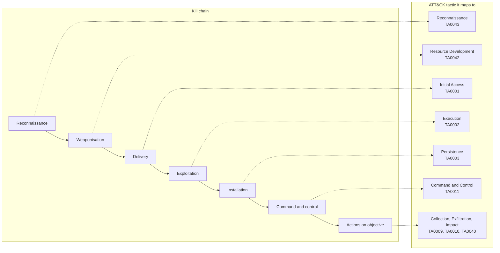
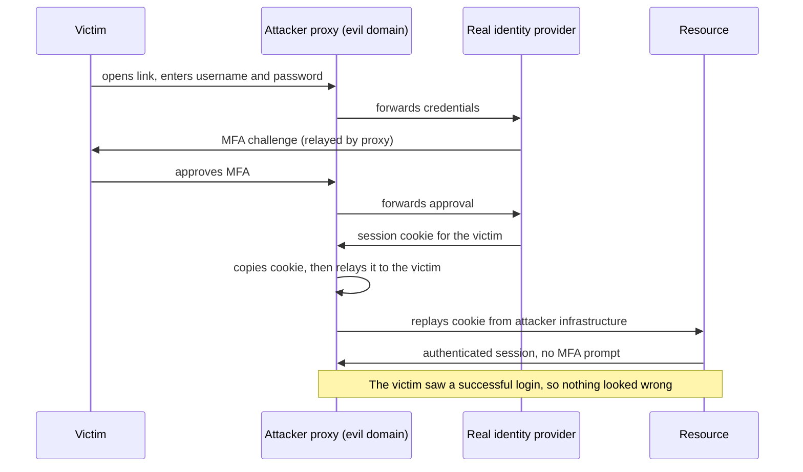
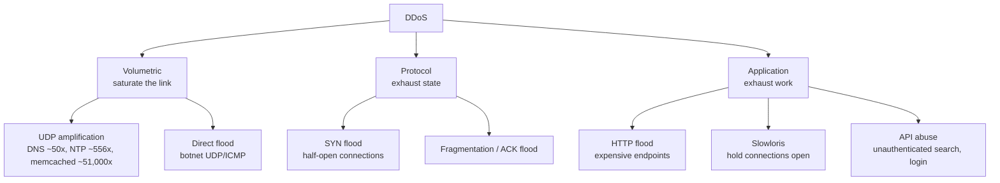
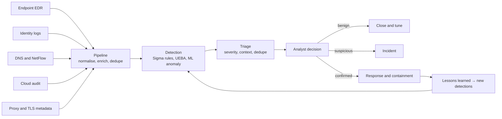
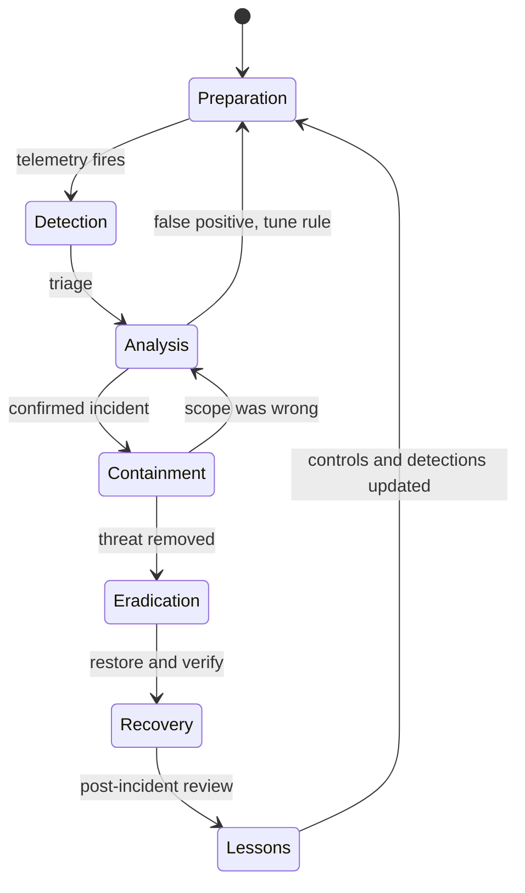
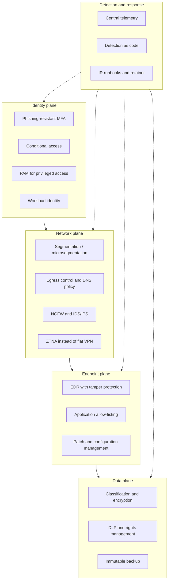

# SECURITY — Threats and Defences

> **Attacks are economic, not technical.** An adversary chooses the cheapest path to a monetisable
> outcome, and the defender's job is not to make attack impossible — that is unachievable — but to
> raise its cost above the value of the target and to bound the damage when it succeeds. Everything
> in this note is one of those two moves: increase cost, or reduce blast radius. Controls that do
> neither are compliance theatre, and the 2025–2026 incident record is a catalogue of organisations
> that had the controls and lost anyway because they had not bounded the blast radius.

The pairing with [[12-1 SECURITY - Cryptographic Foundations - Primitives, Protocols and Trust Anchors|12-1]]
is deliberate: that note explains why the locks work, this one explains why the doors are opened
anyway. Almost nothing in the incident record below required breaking a cipher. It required finding
a token, a password, a trust relationship or an unpatched edge.

---

## 1. The adversary, priced

| Adversary | Motivation | Typical capability | What they actually do |
| --- | --- | --- | --- |
| Opportunistic scanner | Volume | Public exploits, default credentials | RDP/SMB brute force, unpatched VPN, exposed database |
| Initial access broker | Resale | Phishing, credential stuffing, edge exploits | Sells a foothold to a ransomware affiliate for $1k–$100k |
| Ransomware affiliate | Revenue share | Post-exploitation, lateral movement, EDR evasion | Encrypt, exfiltrate, double extort |
| Insider | Grievance, money, coercion | Legitimate access | Data theft, sabotage, credential sale |
| Organised crime SaaS | Scale | OAuth abuse, vishing, SaaS integration abuse | Bulk data theft and extortion, no malware |
| Nation-state | Strategic | Zero-days, supply chain, long dwell | Persistence, collection, pre-positioning |
| Hacktivist | Ideology | DDoS, defacement, leaked tooling | Availability attacks, reputational damage |
| AI-assisted operator | Mixed | Automation of recon, coding, social engineering | The 2026 multiplier on all of the above |

Two numbers structure the economics. **Dwell time** — how long an intruder sits undetected — is the
variable that determines whether an incident is a contained intrusion or a breach; the industry
consensus is measured in weeks for ransomware and months for espionage, and the third-party-involved
cases are the slowest (IBM's 2025 study reports ~267 days to identify and contain for supply-chain
involved breaches). **Cost per record** is the number that makes the business case, and it is
dominated not by the data but by detection, notification, legal and downtime — which is why
availability attacks on manufacturers (Jaguar Land Rover, £1.9 bn) cost more than many data breaches.

### 1.1 The kill chain, and where it now leaks

The Lockheed Martin kill chain (2011) is still the clearest mental model, but it is a *linear* model
and modern intrusions are not linear: identity theft skips exploitation entirely, and supply-chain
compromise starts at the target's supplier rather than at reconnaissance of the target.

**ATT&CK is the model to actually use**, because it is a knowledge base of observed behaviour rather
than a theory of stages. As of the 2025–2026 matrix it has **15 enterprise tactics**, not the 14 that
most study material still lists: *Defense Evasion* was renamed **Stealth** (TA0005), and a new tactic
**Defense Impairment** (TA0112) was split out to cover attacks that break the defenders' tooling —
disabling logging, tampering with EDR, poisoning detection pipelines. The split is a useful signal:
attackers have moved from *hiding* to *blinding*, and a detection programme that only models stealth
misses the case where the telemetry simply stops.

---

## 2. Identity is the perimeter

The single biggest shift of the last five years is that the initial access vector moved from
"exploit a service" to "use a valid account". ATT&CK's *Valid Accounts* (T1078) appears in initial
access, persistence, privilege escalation and defence evasion simultaneously, which is exactly why
identity controls dominate the effective-control list in §11.

### 2.1 The credential attack tree

| Attack | Mechanism | Why it works | Control that actually stops it |
| --- | --- | --- | --- |
| Password spraying | One password, many accounts | Password reuse and predictable seasonal patterns | Phishing-resistant MFA; banned-password lists; smart lockout |
| Credential stuffing | Breach corpus replay | Users reuse passwords across sites | MFA; breached-password detection; passkeys |
| Phishing (link/attachment) | User clicks, enters credentials | It targets the human, not the protocol | FIDO2/passkeys; mail authentication (SPF/DKIM/DMARC); link isolation |
| Adversary-in-the-middle (AiTM) | Reverse proxy between user and IdP | It steals the *session cookie* after MFA succeeds | Token binding, conditional access on token anomaly, short session lifetimes, phishing-resistant origin-bound credentials |
| MFA fatigue / push bombing | Repeated push prompts until approval | Human irritation | Number matching, additional context, rate limits (Uber, 2022) |
| OAuth consent phishing | User grants a malicious app access | Consent screens look legitimate; no password needed | App allow-listing, admin consent workflow, grant review |
| Token theft from endpoint | Infostealer reads browser/DPAPI stores | Tokens bypass MFA entirely | EDR, token protection, device-bound credentials |
| Kerberoasting (T1558.003) | Request service tickets, crack offline | Service accounts with weak passwords and SPNs | gMSA, 25+ character service passwords, AES-only |
| Pass-the-hash / pass-the-ticket | Reuse NTLM hash or Kerberos ticket | NTLM still enabled | Credential Guard, disable NTLM, tiered admin model |
| Session hijack in SaaS | Steal cookie via XSS or proxy | Session is already authenticated | HttpOnly/SameSite, CSP, continuous access evaluation |

### 2.2 Why AiTM broke the "MFA fixes phishing" story

Classic MFA assumes the attacker gets a one-time code and cannot use it. AiTM removes the assumption:
the attacker proxies the real login page, the victim completes MFA against the *real* IdP through the
proxy, and the attacker keeps the resulting session cookie.

The defensive conclusion is not "more MFA" but **origin-bound, phishing-resistant credentials**:
FIDO2/WebAuthn passkeys are bound to the relying party's origin, so a proxy on `evil.example` cannot
use the assertion even if it relays it. Everything else — number matching, conditional access,
impossible-travel — raises cost but does not close the hole.

### 2.3 Non-human identity

Service accounts, API keys, OAuth grants, CI/CD tokens, certificates and now AI agent credentials
outnumber human identities in most enterprises, and they are governed worse. The 2025 SaaS breaches
were almost entirely token theft: one stolen OAuth token from a marketing integration gave access to
hundreds of downstream tenants (Salesloft Drift, August 2025). The controls that matter are
**inventory** (every grant, every token, every key), **short lifetimes**, **audience restriction**,
and **revocation that works** — a token that cannot be revoked in minutes is a permanent backdoor.

---

## 3. Layer 2 and layer 3: the protocols that never had authentication

### 3.1 Local network attacks

| Attack | How it works | Detection | Mitigation |
| --- | --- | --- | --- |
| ARP spoofing | Gratuitous ARP claims the gateway's IP | ARP table changes, duplicate IP alerts | Dynamic ARP Inspection, DHCP snooping, static entries for gateways |
| DHCP starvation / rogue server | Exhaust the pool, then serve your own | Pool exhaustion, rogue DHCP alerts | DHCP snooping, port security, 802.1X |
| VLAN hopping (double tagging) | 802.1Q-in-Q frame reaches another VLAN | Native VLAN mismatch, unexpected tagged frames | Disable unused ports, never use VLAN 1 as native, explicit trunk allowed lists |
| STP root takeover | Become root bridge, intercept traffic | Topology change storms | BPDU Guard, Root Guard, Loop Guard |
| LLDP/CDP disclosure | Leaks model, firmware, management VLAN | Passive only | Disable on access ports |
| MAC flooding | Overflow CAM table, force hub behaviour | CAM table churn | Port security, MAC limits |

The structural point: Ethernet's control protocols were designed for a trusted wire, and every
mitigation above is a bolt-on that must be configured per port. That is why **segmentation is more
reliable than L2 hardening** — if the port cannot reach anything interesting, spoofing it buys little.

### 3.2 BGP: the internet's unauthenticated routing protocol

BGP has no built-in authentication of route origin. Any AS can announce any prefix, and the global
routing table will believe it until someone notices.

| Incident | Year | What happened |
| --- | --- | --- |
| Pakistan Telecom / YouTube | 2008 | A /24 announcement for YouTube's prefix blackholed the site worldwide for ~2 hours |
| Malaysia Telecom leak | 2015 | A route leak redirected traffic for a large block of addresses |
| Amazon Route 53 leak | 2017 | A configuration error propagated thousands of prefixes |
| Facebook withdrawal | 2021 | Facebook withdrew its own routes, taking itself off the internet for ~6 hours |
| Ongoing | 2022–2026 | Route leaks and hijacks continue; RPKI adoption is the only structural fix |

**RPKI** (Resource Public Key Infrastructure, RFC 6480) lets a prefix holder publish a signed Route
Origin Authorisation; routers performing Route Origin Validation drop announcements that do not match.
Adoption has grown substantially but is uneven, and **ROV only validates origin, not the full path** —
so a forged AS path with a valid origin still passes. BGPsec would sign the path, but deployment is
negligible because it requires signing every hop. That gap is the honest answer to "is BGP fixed?":
no, it is partially constrained.

### 3.3 DNS: the highest-leverage protocol to attack

DNS is unauthenticated by default, widely allowed through firewalls, and used by malware for command
and control because blocking it breaks everything.

| Attack | Mechanism | Mitigation |
| --- | --- | --- |
| Cache poisoning | Race the legitimate response with a forged one (Kaminsky, 2008) | Source-port randomisation, 0x20 encoding, DNSSEC |
| DNS tunnelling | Encode data in queries to an attacker-controlled authoritative server | Resolver logging, entropy analysis, allow-listing |
| Typosquatting / homoglyph | `rnicrosoft.com`, Cyrillic characters | Brand monitoring, registrar takedowns, IDN policy |
| DNS hijacking at registrar | Change NS records with stolen registrar credentials | Registrar MFA, registry lock |
| DoH bypass | Encrypted DNS bypasses enterprise inspection | Block or broker DoH; inspect at the resolver, not the wire |

**DNSSEC** signs records but does not encrypt them, and it has a fatal operational property: a
misconfigured signature makes the domain *unresolvable*, so outages are loud. That is why adoption
sits where it does — high in government and banking, patchy elsewhere. **DoH/DoT** encrypt the
transport but move trust to the resolver; for an enterprise, the practical answer is a controlled
resolver with logging, not a blanket block.

---

## 4. Denial of service: the numbers moved

DDoS used to be a bandwidth problem, then a packet-rate problem, then an application-layer problem.
In 2025–2026 it became all three at once, and the mitigation window collapsed below human reaction
time.

| Metric | Value | Source/date |
| --- | --- | --- |
| Largest publicly disclosed attack | **31.4 Tbps**, 14.1 billion packets per second, ~35 seconds | Cloudflare, December 2025 (Aisuru/Kimwolf botnet) |
| Previous records in the same year | 7.3 Tbps (May 2025), 11.5 Tbps (September 2025), 22.2 Tbps, 29.7 Tbps | Cloudflare disclosures |
| Prior standing record | 3.8 Tbps (October 2024) | Cloudflare |
| Total attacks mitigated in 2025 | **47.1 million**, up 121% year on year | Cloudflare 2026 threat report |
| Botnet size behind the record | 1–4 million hosts, mostly Android TV boxes and consumer routers | Cloudflare |
| Application-layer peak in the same campaign | > 200 million requests per second | Cloudflare |

The operational lesson is in the duration, not the size: **35 seconds**. A scrubbing centre that
requires a human to approve a diversion, or a BGP announcement that takes two minutes to propagate,
arrives after the attack is over. Mitigation has to be **always-on and autonomous** — which is why
the large providers now advertise detection-and-mitigation in single-digit seconds, and why on-premise
appliances cannot win a volumetric fight.

### 4.1 The three shapes

Amplification works because UDP allows source-address spoofing and the response is larger than the
request. The memcached factor (~51,000×) is the historical extreme: a 200-byte request could produce
a 10 MB response, which is how GitHub received 1.35 Tbps in February 2018. The fix is not on the
victim side — it is **BCP 38 ingress filtering** at the spoofing source, which is still not universal
thirty years after it was specified.

### 4.2 What actually defends

| Layer | Control | What it buys |
| --- | --- | --- |
| Upstream | Always-on anycast + scrubbing | Absorbs volume before it reaches your link |
| Routing | RTBH / flowspec | Drops specific attack traffic at the edge, at line rate |
| Protocol | SYN cookies, connection limits | Survives state-exhaustion without losing legitimate clients |
| Application | Rate limits, caching, challenge pages | Raises the cost per request |
| Economic | Autoscaling caps, budget alerts | Prevents denial-of-wallet |
| Organisational | Pre-agreed runbook, provider contacts, tested failover | Converts a panic into a procedure |

**Denial-of-wallet** deserves its own line: if every request costs you money (LLM inference, search,
geo lookups) and nothing authenticates or rate-limits it, the attacker does not need to take you
offline, only to make you unprofitable.

---

## 5. Supply chain: the trust you did not audit

The 2020s moved the decisive attack from "exploit the target" to "compromise something the target
installs". Four archetypes:

| Archetype | Example | Year | What it exploited |
| --- | --- | --- | --- |
| Build system | SolarWinds Orion (SUNBURST) | 2020 | Signed malicious update distributed to ~18,000 customers |
| Developer tooling | 3CX desktop app | 2023 | Trojanised installer via a compromised build chain |
| Open-source maintainer | xz-utils backdoor (CVE-2024-3094) | 2024 | Social engineering of a maintainer; a backdoor in `liblzma` aimed at sshd |
| SaaS integration / OAuth | Salesloft Drift | 2025 | Stolen OAuth tokens gave access to 700+ downstream Salesforce tenants |

Two more recent patterns matter for 2026. **Package-registry worms** (the Shai-Hulud npm campaigns)
propagate through maintainer tokens and post-install scripts, turning a single compromised package
into thousands of repositories. **AI tooling as a supply chain** — MCP servers, agent skills, model
artifacts — is the newest and least governed: a malicious MCP server is a plugin with network access
and no review process, and a downloaded model file can carry a deserialisation payload.

### 5.1 The controls that are actually load-bearing

| Control | Format | What it changes |
| --- | --- | --- |
| SBOM | SPDX (ISO/IEC 5962:2021), CycloneDX | You can answer "are we affected?" in hours, not weeks |
| Provenance / build attestation | SLSA levels, in-toto | Proves the artifact came from the source it claims |
| Signature verification | Sigstore/cosign, TUF | Blocks tampered artifacts at deploy time |
| Dependency pinning + private mirror | Lockfiles, internal registry | Removes the "latest" supply-chain gamble |
| Egress restriction for build agents | Network policy | Stops post-install scripts from calling home |
| Vendor security evidence | SOC 2 Type II, ISO 27001, pen-test reports | Raises the floor, does not prove the ceiling |
| Contractual breach notification | DPA clauses, CRA obligations | Converts a surprise into a timeline |

The uncomfortable economics: SBOMs are cheap to produce and expensive to *operate*. A stored SBOM
that is never matched against vulnerability feeds is a compliance artifact; the value comes from
automated ingestion, matching and patch workflow, which is a programme, not a document.

---

## 6. Ransomware and extortion

Ransomware is not a malware category, it is a **business model**: initial access brokers sell
footholds, affiliates execute, developers sell encryptors, negotiators handle payment, and the
"brand" provides trust between criminals. That structure explains the behaviour better than any
malware analysis: affiliates are paid on speed, so they exfiltrate first (double extortion) and
encrypt second, and they target organisations where downtime is expensive.

| Incident | Year | What it demonstrated |
| --- | --- | --- |
| Colonial Pipeline | 2021 | A single compromised VPN password halted fuel distribution for days; ~$4.4 M paid |
| MOVEit (CVE-2023-34362) | 2023 | One managed file-transfer flaw, mass exploitation, thousands of downstream organisations |
| Change Healthcare | 2024 | Single point of failure in US healthcare billing; ~190 million individuals affected; ~$22 M paid |
| Marks & Spencer | 2025 | Social engineering of a help desk; ~£300 M impact; online orders halted for weeks |
| Jaguar Land Rover | 2025 | ~5 weeks of production halted; ~£1.9 bn estimated UK economic damage |
| Stryker | 2026 | Destructive wiper at a medical-device maker — damage rather than extortion |

### 6.1 Why backup is necessary and not sufficient

The standard answer — "we have backups" — fails in three specific ways, and each has a control:

1. **The backups are reachable.** Domain admin credentials delete the backups before encryption.
   Control: immutable/object-lock storage, separate credentials, offline copy.
2. **The restore is untested.** Restoring 400 TB at 2 GB/s takes 55 hours before anyone logs in.
   Control: measured restore time, documented RTO, quarterly restore drills.
3. **The data is already stolen.** Restoration does not undo the disclosure, so extortion survives.
   Control: detection and exfiltration controls, not just encryption controls.

The practical rule is **3-2-1-1-0**: three copies, two media, one off-site, one offline or immutable,
zero errors on verification.

---

## 7. Detection: the part that decides the outcome

Prevention eventually fails; detection determines whether failure is an incident or a breach. A
detection programme is an engineering discipline with inputs, code, tests and metrics — not a
dashboard.

### 7.1 Telemetry, ranked by value per byte

| Source | Answers | Retention that matters |
| --- | --- | --- |
| Identity provider logs | Who authenticated, from where, with what method, and what changed | 12 months, hot 90 days |
| EDR telemetry | What process ran, what it touched, what it spawned | 30–90 days hot, 12 months cold |
| DNS queries | What resolved, including C2 and tunnelling | 30–90 days |
| NetFlow / IPFIX | Who talked to whom, how much, how often | 30 days |
| Proxy / TLS metadata | SNI, JA3/JA4, bytes in and out | 30–90 days |
| Cloud audit logs (CloudTrail, Activity, GCP Audit) | Control-plane changes | 12 months |
| Network device logs | Config changes, ACL hits, routing changes | 90 days |
| Application logs | Business-level anomalies | Per regulation |
| OT/ICS telemetry | Process anomalies, not packet anomalies | Months to years |

The most common failure is **not a missing tool but missing joins**: identity logs without device
context, EDR without network, network without DNS. Detection value comes from correlating two
sources, which is why SIEM data models and common schemas matter more than the query language.

### 7.2 Detection as code

| Practice | Tooling | Why |
| --- | --- | --- |
| Rule versioning | Git, review, CI | A detection rule is code and needs the same discipline |
| Portable rule format | Sigma | Vendor-neutral rules, compiled to each backend |
| Coverage mapping | ATT&CK Navigator | Shows which tactics have no detection at all |
| Test data | Atomic Red Team, CALDERA, replayable PCAP | A rule that has never fired is a hypothesis |
| Tuning loop | False-positive budget per rule | Alert fatigue is a security failure, not an annoyance |
| Metrics | MTTD, precision, coverage, time-to-detect per technique | Lead with precision and coverage, not alert volume |

**A rule that fires 400 times a day is worse than no rule**, because it trains the analyst to ignore
the one that mattered. The precision budget is the constraint that separates a working SOC from a
noisy one.

### 7.3 The detection stack, end to end

---

## 8. Response: the first hour decides the cost

NIST SP 800-61 (Rev. 3, 2024) frames incident response as part of the CSF 2.0 lifecycle rather than a
standalone checklist, but the operational content is unchanged: prepare, detect and analyse, contain,
eradicate, recover, and learn.

### 8.1 Decisions that cannot wait

| Decision | Default | When to break the default |
| --- | --- | --- |
| Isolate the host | Yes, network-contain, keep memory | If it is a domain controller or a clinical system, isolate by ACL, not by shutdown |
| Preserve memory | Yes, before reboot | Never reboot "to see if it comes back" — you lose the only copy of the implant |
| Pay the ransom | No | Only with legal, insurance and law-enforcement input; payment does not guarantee deletion and may violate sanctions |
| Notify | Per legal trigger and clock | Regulatory clocks run from *awareness*, not from confirmation |
| Rebuild vs clean | Rebuild | Cleaning a domain-joined host is a hope, not a control |

**Order of volatility** (RFC 3227) still governs forensics: registers and cache, then memory, then
network state, then disk, then remote logs, then archival media. Every step you take changes the
system, so the first question is "what evidence does this action destroy?"

### 8.2 The communication failure mode

The technical response is usually better than the communication response. Three rules that come out
of every large incident review: **one incident commander** with authority to make calls; **one
narrative** updated on a fixed cadence even when there is nothing new; and **legal counsel in the
room from hour one**, because privilege, notification duties and regulatory clocks all start before
the technical picture is clear.

---

## 9. Defence in depth, drawn honestly

The diagram makes an argument the prose cannot: **the layers are not independent**. Identity
compromise walks through the network layer without touching it, which is why "defence in depth" as
a stack of boxes is misleading. The correct mental model is a set of *choke points* — identity,
egress, execution, data access — and the question for each is "if this is bypassed, what else sees
it?"

| Choke point | If it fails | The compensating control |
| --- | --- | --- |
| Identity | Attacker is a valid user | Behavioural detection, least privilege, short sessions, PAM |
| Egress | C2 and exfiltration work | DNS policy, TLS inspection where lawful, proxy allow-listing, volume anomaly |
| Execution | Malware runs | EDR, allow-listing, memory protection, least privilege |
| Data access | Data leaves | DLP, rights management, watermarking, audit |
| Backup | Recovery impossible | Immutability, offline copy, tested restore |

---

## 10. What actually works, ranked

This ranking is uncomfortable because it puts training last and boring engineering first. It is
based on incident data rather than vendor surveys: the controls that appear in post-incident reviews
as "would have prevented this" are almost always the unglamorous ones.

| Rank | Control | Why it ranks here |
| --- | --- | --- |
| 1 | Patch internet-facing systems, fast | Most mass exploitation is of known vulnerabilities with available patches |
| 2 | Phishing-resistant MFA on every identity, especially admins | Closes the dominant initial-access path, including AiTM |
| 3 | Immutable, tested backups | Converts ransomware from existential to inconvenient |
| 4 | Segmentation and egress control | Bounds blast radius when prevention fails |
| 5 | Centralised logging with 90-day hot retention | You cannot respond to what you cannot see |
| 6 | EDR with tamper protection and a monitored console | Catches the post-exploitation behaviour that patching misses |
| 7 | Least privilege and removal of standing admin | Turns a workstation compromise into a workstation compromise |
| 8 | Asset and identity inventory | Every other control depends on knowing what exists |
| 9 | Tested incident response, including comms | Reduces cost per incident more than any product |
| 10 | Security awareness training | Helps, measurably, but is the weakest control per pound spent |

The corollary is that **compliance frameworks do not rank controls this way**. An audit can pass
with weak patching if the policy exists, and fail with excellent patching if the evidence is missing.
That gap is the subject of [[12-3 SECURITY - Standards and Architecture - Risk, Controls, Compliance and Zero Trust|12-3]].

---

## 11. The interview package

1. **Walk me through what happens when a user clicks a phishing link.** Testing for: delivery, AiTM
   vs credential capture, token theft, lateral movement, and which control breaks the chain.
2. **Why did MFA stop being sufficient?** Testing for: AiTM, token replay, MFA fatigue, and the
   difference between possession and origin binding.
3. **How would you detect lateral movement with only NetFlow and identity logs?** Testing for:
   service-account anomaly, SMB/RDP fan-out, impossible travel, first-seen pairs.
4. **A 2 Tbps attack is inbound. What do you do in the first five minutes?** Testing for: upstream
   diversion, anycast, whether the runbook exists, and the difference between volumetric and
   application-layer response.
5. **Your vendor's update was trojanised. How do you find out whether you are affected?** Testing
   for: SBOM, artifact hashes, egress logs, and the honest answer that you may not be able to.
6. **What is the difference between a route leak and a hijack, and does RPKI fix both?** Testing for:
   origin validation vs path validation.
7. **The CEO says "we have backups, so we do not pay". What is wrong with that?** Testing for:
   reachability, restore time, exfiltration, and the fact that extortion survives restoration.
8. **What would you instrument first in a network you have never seen?** Testing for: identity logs
   and DNS, because they give the widest coverage per unit of effort.
9. **How do you know a detection rule works?** Testing for: test data, precision, ATT&CK coverage,
   and a tuning loop.
10. **Give me a control that is popular and useless.** Testing for judgement — e.g. password
    complexity rules and forced rotation (contradicted by NIST SP 800-63B), or blocking all USB
    while leaving RDP exposed.

---

## 12. Anchors

- **ATT&CK Enterprise**: **15 tactics** as of the 2025–2026 matrix — Defense Evasion renamed
  **Stealth** (TA0005), new **Defense Impairment** (TA0112). ~200 techniques, ~450 sub-techniques.
  <https://attack.mitre.org/tactics/>
- **Kill chain**: Hutchins, Cloppert, Amin, *Intelligence-Driven Computer Network Defense*, 2011.
- **Largest DDoS**: **31.4 Tbps** and 14.1 Bpps for ~35 seconds, December 2025, mitigated
  autonomously by Cloudflare; attributed to the Aisuru/Kimwolf botnet of 1–4 million hosts. Prior
  records: 3.8 Tbps (Oct 2024), 7.3 Tbps (May 2025), 11.5 Tbps (Sep 2025), 22.2 and 29.7 Tbps later
  in 2025.
- **DDoS volume**: 47.1 million attacks mitigated in 2025, +121% year on year (Cloudflare 2026 threat
  report, 3 March 2026).
- **Memcached amplification**: up to ~51,000×; GitHub absorbed 1.35 Tbps in February 2018.
- **BCP 38 / RFC 2827**: network ingress filtering, 2000 — still incompletely deployed.
- **RPKI**: RFC 6480 (February 2012); Route Origin Authorisation + ROV. Origin validation only, not
  path validation; BGPsec (RFC 8205) exists with negligible deployment.
- **BGP incidents**: Pakistan Telecom/YouTube, 24 February 2008; Amazon Route 53 leak, December 2017;
  Facebook self-withdrawal, 4 October 2021 (~6 hours).
- **DNS cache poisoning**: Kaminsky disclosure, July 2008. **DNSSEC**: RFC 4033–4035 (March 2005).
  **DoH**: RFC 8484 (October 2018).
- **Salesloft Drift OAuth compromise**: disclosed August 2025; stolen OAuth tokens used against
  700+ downstream Salesforce instances.
- **Jaguar Land Rover**: production halted ~5 weeks from late August/1 September 2025; UK economic
  impact estimated ~£1.9 bn.
- **Marks & Spencer**: April 2025, social engineering of a help desk; ~£300 M impact.
- **MOVEit**: CVE-2023-34362, exploited May 2023, Cl0p; thousands of downstream organisations
  (commonly cited as ~2,700 — `VERIFY` the final count).
- **Change Healthcare**: February 2024, ALPHV/BlackCat; ~190 million individuals; ~$22 M ransom paid.
- **SolarWinds SUNBURST**: disclosed December 2020; ~18,000 customers received the trojanised update.
- **xz-utils backdoor**: CVE-2024-3094, discovered 29 March 2024.
- **Colonial Pipeline**: May 2021; ~5,500 miles of pipeline; ~$4.4 M ransom.
- **Mirai**: September–October 2016; Dyn DNS outage 21 October 2016.
- **NIST SP 800-61 Rev. 3**: *Incident Response Recommendations and Considerations for Cybersecurity
  Risk Management*, 2024. **RFC 3227**: *Guidelines for Evidence Collection and Archiving*, 2002.
- **NIST SP 800-63B**: no composition rules, no forced periodic rotation, blocklist + length;
  phishing-resistant authenticators are AAL3.
- **SBOM**: SPDX is ISO/IEC 5962:2021; CycloneDX is an OWASP standard (Ecma-424 since 2023 —
  `VERIFY` the edition). US EO 14028 (May 2021) drove SBOM adoption.
- **Backup rule**: 3-2-1-1-0 (three copies, two media, one off-site, one offline/immutable, zero
  verification errors).

---

## 13. Related

- [[12-1 SECURITY - Cryptographic Foundations - Primitives, Protocols and Trust Anchors|12-1]]
  — the mechanisms these attacks target, and why the joins fail before the primitives do.
- [[12-3 SECURITY - Standards and Architecture - Risk, Controls, Compliance and Zero Trust|12-3]]
  — how the controls in §10 become auditable requirements, and where compliance diverges from security.
- [[12-4 SECURITY - The Frontier - AI-Native Threats, Post-Quantum Migration and the Next Decade|12-4]]
  — how AI changes both sides of §1, and what replaces the perimeter.
- [[02-19 WLAN - Security - RSNA, WPA3, Mesh Security and the Threat Horizon|02-19]]
  — the same attack classes on 802.11: evil twin, deauth, mesh peering, and client isolation.
- [[05-1 DPDK User Plane and 5G UPF|05-1]] — where DDoS scrubbing and flow-based
  filtering are actually implemented in a packet plane.
- [[06-2 Agent Systems and Edge Orchestration|06-2]] — the agent and tool-permission
  model that makes *Excessive Agency* an operational risk rather than a slide.
- [[01-1 5G-Advanced and 6G Radio Access|01-1]] — the cellular control plane whose
  signalling storms are a denial-of-service surface of their own.

---

## 14. References

1. Hutchins, E. M., Cloppert, M. J., Amin, R. M. *Intelligence-Driven Computer Network Defense
   Informed by Analysis of Adversary Campaigns and Intrusion Kill Chains*. Leading Issues in
   Information Warfare and Security, 2011.
2. MITRE. *ATT&CK Enterprise Matrix*, <https://attack.mitre.org/>. Tactics list including TA0112
   Defense Impairment, accessed November 2026.
3. Cloudflare. *2026 Cloudflare Threat Report* and *2025 Q4 DDoS Threat Report*, March 2026.
4. National Institute of Standards and Technology. *SP 800-61 Rev. 3, Incident Response
   Recommendations and Considerations for Cybersecurity Risk Management*. 2024.
5. National Institute of Standards and Technology. *SP 800-63B, Digital Identity Guidelines:
   Authentication and Lifecycle Management*. 2017, with subsequent revisions.
6. Grassi, P. A., Garcia, M. E., Fenton, J. L. *NIST SP 800-63B-4 ipd*, 2024 — authenticator
   assurance levels and phishing resistance.
7. Fenton, J., et al. *FIDO2 / WebAuthn: W3C Web Authentication Level 2 Recommendation*, 2021, and
   *Level 3* draft.
8. RFC 3227. Brezinski, D., Killalea, T. *Guidelines for Evidence Collection and Archiving*.
   February 2002.
9. Ferguson, P., Senie, D. *Network Ingress Filtering: Defeating Denial of Service Attacks which
   employ IP Source Address Spoofing*. BCP 38 / RFC 2827, May 2000.
10. Lepinski, M., Kent, S. *An Infrastructure to Support Secure Internet Routing*. RFC 6480,
    February 2012. And Lepinski, M., Sriram, K. *BGPsec Protocol Specification*. RFC 8205,
    September 2017.
11. Arends, R., Austein, R., Larson, M., Massey, D., Rose, S. *DNS Security Introduction and
    Requirements*. RFC 4033, March 2005.
12. Hoffman, P., McManus, P. *DNS Queries over HTTPS (DoH)*. RFC 8484, October 2018.
13. ISO/IEC 5962:2021. *Information technology — SPDX Specification V2.2.1*. 2021.
14. OpenSSF. *SLSA: Supply-chain Levels for Software Artifacts*, <https://slsa.dev/>. And
    *in-toto* attestation framework, <https://in-toto.io/>.
15. Sigstore project, <https://www.sigstore.dev/>. — Keyless signing and transparency log for
    software artifacts.
16. Verizon. *Data Breach Investigations Report*, 2025 and 2026 editions. — Pattern distribution
    across incidents; used for the ranking in §10.
17. IBM Security. *Cost of a Data Breach Report 2025*. — 267-day mean identify-and-contain figure
    for supply-chain-involved breaches.
18. Cybersecurity and Infrastructure Security Agency. *Zero Trust Maturity Model v2.0*. April 2023.
19. National Institute of Standards and Technology. *SP 800-207, Zero Trust Architecture*.
    August 2020.
20. ENISA. *Threat Landscape Report*, 2025 and 2026 editions. — Sector distribution of DDoS,
    ransomware and supply-chain incidents in the EU.
21. Microsoft. *Digital Defense Report 2025*. — Identity-based attack telemetry and token theft.
22. Google Threat Intelligence Group. *ShinyHunters / UNC6040 Salesforce campaign advisory*, 2025.
23. Estonia, Information System Authority (RIA). *Cyber Security in Estonia 2026*. February 2026. —
    Independent summary of the 2025 JLR, M&S, AWS and Cloudflare outages cited in §4 and §6.

---

_Copyright (c) 2026 Washington Ruan and contributors · licensed under **GPL-3.0-or-later** or **AGPL-3.0-or-later**, at your option · see `LICENSE` and `LICENSE-AGPL`._
