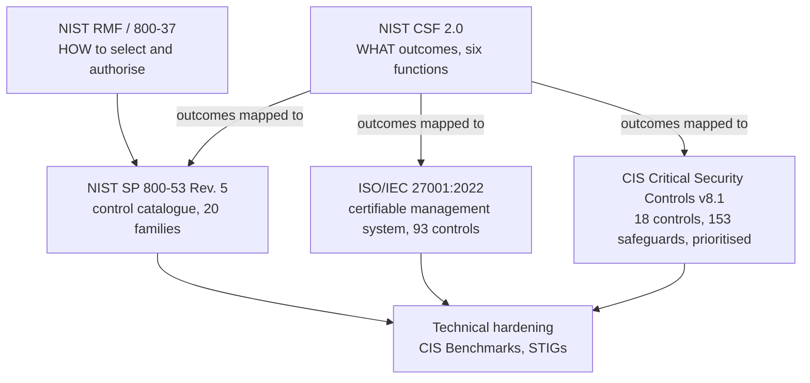
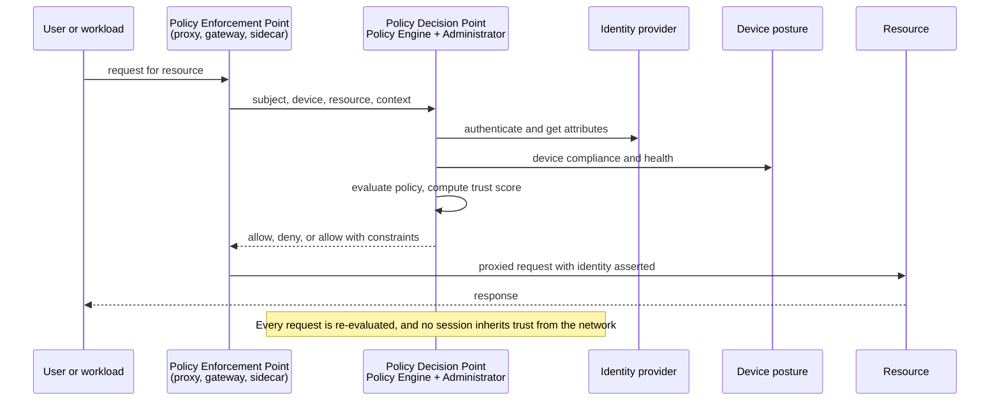
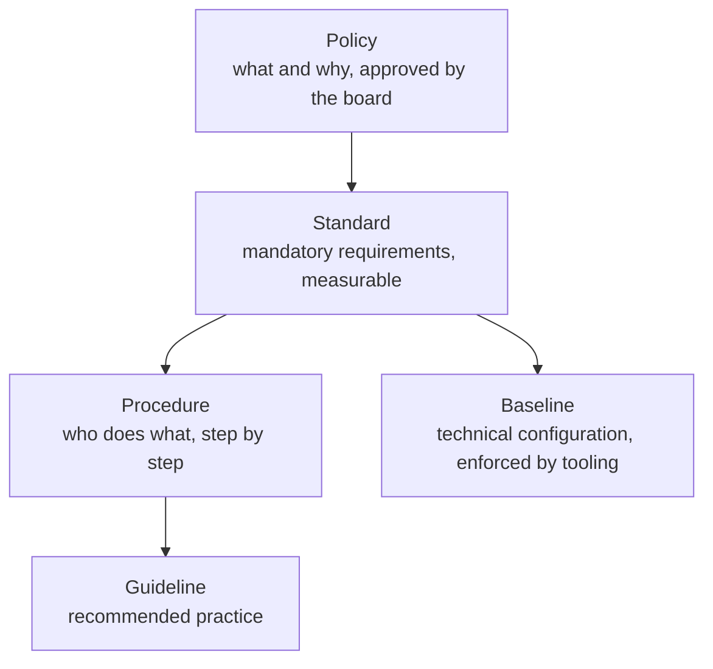
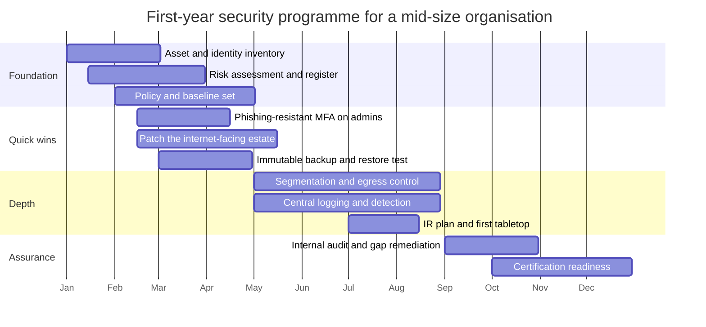

# SECURITY — Standards and Architecture

> **A framework is a vocabulary, not a control.** NIST CSF, ISO 27001, 800-53 and CIS all describe
> outcomes or catalogues; none of them makes a system safer. What makes a system safer is a decision
> about *which risk to reduce first*, taken by someone with the authority to fund it and the evidence
> to defend it. Frameworks exist so that decision can be explained to an auditor, a board, a customer
> and a regulator using the same words. This note is about making that decision well — and about the
> specific way organisations substitute the artefact for the decision.

The distinction matters commercially. A certificate proves an auditor saw evidence on a date. It does
not prove that the internet-facing VPN was patched, that the backup restored, or that anyone would
notice an intrusion. The 2025–2026 incidents in [[12-2 SECURITY - Threats and Defences - Attack Surface, Detection and Incident Response|12-2]]
include organisations with mature certificates and no detection.

---

## 1. Risk: the only thing that orders the work

Security has more possible work than budget. The only defensible way to order it is risk, and the
only defensible definition of risk is the one that combines **likelihood** and **impact** against
something the organisation values.

### 1.1 Three methods, three levels of rigour

| Method | Question it answers | Effort | Output |
| --- | --- | --- | --- |
| ISO 31000:2018 | What is the process for managing risk at all? | Framework, not a method | Principles, process, governance |
| NIST SP 800-30 Rev. 1 | What is the risk of this system, qualitatively? | Days per system | Threat source → vulnerability → likelihood → impact → risk rating |
| FAIR (Open Group O-RA) | What does this risk cost per year, in money? | Weeks for a first model | Loss event frequency × loss magnitude = annualised loss exposure |

Most programmes use 800-30 to triage and FAIR to argue for money. That split is correct: qualitative
assessment is fast enough to cover everything, and quantitative analysis is only needed for the three
or four decisions where the answer changes the budget.

### 1.2 A worked FAIR calculation

The scenario: ransomware against a 900-person manufacturer with revenue of £400 M.

| Factor | Value | Reasoning |
| --- | --- | --- |
| Threat event frequency (TEF) | 2.0 per year | Two credible campaigns per year reach this sector and size |
| Vulnerability (V) | 0.25 | Phishing-resistant MFA on 60% of staff, EDR on 90%, no egress control |
| Loss event frequency (LEF) | 0.5 per year | TEF × V |
| Primary loss | £2.0 M | Response, forensics, overtime, lost production for 6 days |
| Secondary loss | £1.0 M | Regulatory, legal, customer churn, insurance excess |
| Loss magnitude | £3.0 M | Primary + secondary |
| **Annualised loss exposure (ALE)** | **£1.5 M** | LEF × loss magnitude |

Now price the control: egress filtering plus immutable backup plus 90% MFA coverage costs £400 k in
year one. It reduces V from 0.25 to 0.08 — not to zero, because phishing still works and insiders
still exist.

| After control | Value |
| --- | --- |
| LEF | 2.0 × 0.08 = 0.16 |
| ALE | 0.16 × £3.0 M = **£480 k** |
| Risk reduction | £1.02 M per year |
| Cost | £400 k year one, £120 k per year thereafter |
| Payback | ~5 months |

That is the entire argument for a security budget, in one table, and it is far more persuasive than
"we are below industry average on the maturity model". The numbers are estimates; the *structure* is
what makes the conversation rational, because it forces both sides to state their assumptions.

### 1.3 The risk register, and what makes it useless

| Field | Why it exists | Failure mode |
| --- | --- | --- |
| Risk ID and statement | Traceability | Written as "cyber risk" — unactionable |
| Asset and owner | Accountability | Owner is "IT" — nobody |
| Threat and vulnerability | Explains the likelihood | Copied from a template, never updated |
| Inherent likelihood / impact | The starting position | Left blank because it is uncomfortable |
| Controls | What exists today | Lists tools, not effectiveness |
| Residual likelihood / impact | What is left | Never recalculated after controls |
| Treatment (accept/mitigate/transfer/avoid) | The decision | "Mitigate" for everything, with no date |
| Target date and cost | The commitment | Absent, which is why nothing happens |
| Review date | Currency | Annual, so the register is stale for 11 months |

A register with 400 rows and no owners is a compliance artefact. A register with 15 rows, a named
owner, a cost and a date is a management tool. The second is harder to produce and worth ten times
more.

---

## 2. The catalogues, and how they relate

Five frameworks do most of the work in practice, and they operate at different altitudes.

### 2.1 NIST CSF 2.0 — the vocabulary layer

Published **26 February 2024**, CSF 2.0 has **six Functions, 22 Categories and 106 Subcategories**
(CSF 1.1 had five Functions, 23 Categories, 108 Subcategories). The new Function is **Govern**, and
it is the one that changed the framework's politics: it makes cybersecurity an enterprise risk
subject with board-level ownership rather than a technical programme.

| Function | Question it answers | Typical evidence |
| --- | --- | --- |
| **Govern (GV)** | Who decides, with what authority, and how is supply chain risk owned? | Risk appetite statement, roles, policy set, board minutes |
| **Identify (ID)** | What do we have, and what could happen to it? | Asset inventory, data map, risk assessment |
| **Protect (PR)** | What stops it happening? | Access control, MFA, training, hardening, encryption |
| **Detect (DE)** | How would we know? | Logging, monitoring, detection rules, triage |
| **Respond (RS)** | What do we do when it happens? | IR plan, playbooks, comms, reporting |
| **Recover (RC)** | How do we get back? | Backup, restore tests, continuity plan |

The framework is deliberately silent on *how*. That is why it is useful for the board and useless as
an implementation checklist — and why every real programme maps CSF outcomes to 800-53 or ISO
controls underneath.

### 2.2 NIST SP 800-53 Rev. 5 — the catalogue layer

Rev. 5 (September 2020, Release 5.2.0 in August 2025) organises roughly a thousand controls and
enhancements into **20 families**, from AC (Access Control) to SR (Supply Chain Risk Management), with
PT (PII Processing and Transparency) added in Rev. 5. Baselines live in SP 800-53B (Low, Moderate,
High, Privacy); assessment procedures in SP 800-53A.

Its strengths are granularity and traceability — it is the source of truth that CSF, SOC 2 and most
control-mapping tools reference by ID. Its weakness is that a Moderate baseline is ~325 controls, and
no organisation implements them because a document said so; they implement them because an auditor,
a customer or a regulator asked, and then they map backwards.

### 2.3 ISO/IEC 27001:2022 — the management-system layer

The 2022 revision (published October 2022) restructured Annex A from 114 controls in 14 domains to
**93 controls in four themes**:

| Theme | Clause | Count | Covers |
| --- | --- | --- | --- |
| Organisational | A.5 | 37 | Policy, roles, threat intelligence, assets, suppliers, cloud, incidents, continuity, compliance |
| People | A.6 | 8 | Screening, terms, awareness, disciplinary, remote working, reporting |
| Physical | A.7 | 14 | Perimeters, entry, monitoring, equipment, media, clear desk |
| Technological | A.8 | 34 | Access, endpoints, hardening, vulnerabilities, logging, network, crypto, secure development |

The important thing about 27001 is not the 93 controls; it is **clauses 4–10** — the management
system: context, leadership, planning, support, operation, performance evaluation, improvement. That
is what gets certified. Annex A is a reference set you select from, and the **Statement of
Applicability** records, for all 93, whether each applies, why, and whether it is implemented.
Transition from the 2013 edition closed on **31 October 2025**, so every live certificate is now
against 2022.

### 2.4 CIS Critical Security Controls v8.1 — the prioritisation layer

**18 controls, 153 safeguards**, grouped into three Implementation Groups: IG1 (56 safeguards,
"essential cyber hygiene"), IG2 (130), IG3 (153). CIS is the only major framework that says out loud
"do these first", and its ordering is empirical — derived from attack data rather than from a
taxonomy. The accompanying **CIS Benchmarks** are the concrete configuration guidance (100+ system
profiles) that turns control 4 into a hardening script.

If a small organisation can only adopt one thing, adopt IG1 and the benchmarks. If a large one wants
to know whether its ISO programme is actually defended, map it to CIS and count the IG1 gaps.

### 2.5 IEC 62443 — OT, where availability outranks confidentiality

Industrial control systems invert the priority order: safety first, availability second, integrity
third, confidentiality last. IEC 62443 expresses this with **zones and conduits** (group assets by
required security level, then control the paths between them) and **Security Levels SL1–SL4** (SL4 =
protection against a nation-state with extended resources). The practical consequence for IT
security people: patching windows are measured in months, active scanning can stop a process, and
"segment and monitor" beats "scan and patch".

### 2.6 Mapping across frameworks

| Outcome | CSF 2.0 | 800-53 Rev. 5 | ISO 27001:2022 | CIS v8.1 |
| --- | --- | --- | --- | --- |
| Inventory of assets | ID.AM | CM-8, PM-5 | A.5.9 | 1, 2 |
| Phishing-resistant MFA | PR.AA | IA-2(1), IA-2(6) | A.8.5 | 6.3–6.5 |
| Vulnerability management | ID.RA, PR.PS | RA-5, SI-2 | A.8.8 | 7 |
| Logging and monitoring | DE.CM | AU-2, AU-6, SI-4 | A.8.15, A.8.16 | 8, 13 |
| Backup and recovery | PR.DS, RC.RP | CP-9, CP-10 | A.8.13 | 11 |
| Supply chain | GV.SC | SR-1 to SR-12 | A.5.19–A.5.22 | 15 |
| Incident response | RS.MA | IR-1 to IR-10 | A.5.24–A.5.28 | 17 |
| Secure development | PR.PS | SA-11, SA-15 | A.8.25–A.8.31 | 16 |

**Map once, satisfy many.** The reason to build this table is not audit convenience; it is that a
single control implementation with a single piece of evidence can discharge ISO, NIS2, DORA and a
customer questionnaire at the same time — if the mapping exists before the auditor arrives.

---

## 3. Architecture: from perimeter to policy

### 3.1 Why the perimeter model failed

The perimeter model assumed a trusted inside and an untrusted outside, with a firewall as the
boundary. Four developments broke the assumption: cloud workloads that are neither inside nor
outside; remote workers who connect from anywhere; SaaS data that never touches the corporate
network; and attackers who arrive with valid credentials and therefore *are* inside. Once the
attacker can be a legitimate user, "inside" stops being a security property.

### 3.2 Zero trust, precisely

NIST SP 800-207 (August 2020) defines zero trust as a set of paradigms that move defences from static
network perimeters to users, assets and resources. Its **seven tenets** are the checkable part:

1. All data sources and computing services are resources.
2. All communication is secured regardless of network location.
3. Access to individual enterprise resources is granted per session.
4. Access is determined by dynamic policy — identity, application, device state, and observed behaviour.
5. All owned and associated devices are monitored and kept in the most secure state feasible.
6. All resource authentication and authorisation is dynamic and strictly enforced before access.
7. Telemetry about asset state, network infrastructure and communications is collected and used to
   improve posture.

The architecture is a **Policy Decision Point** and a **Policy Enforcement Point**, with the decision
separated from the data path:

The three deployment approaches 800-207 describes are still the right taxonomy: **enhanced identity
governance** (identity is the control plane), **microsegmentation** (network-enforced fine-grained
policy), and **software-defined perimeter** (authenticate before any network connection exists). Most
real programmes combine all three, and the combination is what people mean by "ZTNA plus
segmentation plus PAM".

### 3.3 The maturity model, and how it is misused

CISA's Zero Trust Maturity Model **v2.0 (April 2023)** has five pillars — Identity, Devices, Networks,
Applications and Workloads, Data — three cross-cutting capabilities (Visibility and Analytics,
Automation and Orchestration, Governance), and four stages (Traditional, Initial, Advanced, Optimal).
It is a planning tool, not a score.

The misuse is treating "Advanced" as a target for every pillar. The correct use is to pick the two
pillars where the organisation's actual risk lives and push those to Advanced, while leaving others
at Initial deliberately. A hospital should push Devices and Data; a software company should push
Applications and Identity. Uniform maturity is uniform mediocrity.

### 3.4 The architecture patterns that survive contact with operations

| Pattern | What it does | Cost | When it is right |
| --- | --- | --- | --- |
| Network segmentation + firewall | Bounds blast radius by subnet | Medium; policy sprawl over time | Any environment with east-west traffic |
| Microsegmentation (host or service mesh) | Per-workload policy, identity-based | High; needs workload identity | Cloud, containers, flat networks |
| ZTNA instead of VPN | Per-application access, no network foothold | Medium | Remote and third-party access |
| SASE / SSE | Converges network and security at the edge | Subscription; latency trade-off | Distributed workforce, SaaS-heavy |
| Privileged access management | Broker and record admin sessions | High | Always, for every organisation |
| Deception (honeypots, canaries) | Early warning with near-zero false positives | Low | High-value flat networks |
| Immutable backup + isolated recovery | Guarantees a recovery path | Medium | Everywhere, before anything else |

**SASE** (Gartner, 2019) is worth a paragraph because it is oversold. It converges SD-WAN with a
security service edge (secure web gateway, CASB, ZTNA, FWaaS). It genuinely simplifies a distributed
estate and genuinely creates a single point of failure and a single policy language to get wrong. The
architectural question is not "SASE or not" but "where does the enforcement point sit relative to the
workload", and for a single data centre the answer is usually "not at a distant PoP".

---

## 4. Regulation: the map a design has to survive

Regulation changed character between 2018 and 2026: it moved from *disclosure and accountability*
(GDPR) to *product requirements* (CRA) and *operational resilience* (DORA, NIS2). The practical
consequence is that security requirements now attach to shipping dates and support periods, not just
to breaches.

| Instrument | Scope | Key dates | Exposure |
| --- | --- | --- | --- |
| **GDPR** (EU) 2016/679 | Personal data of EU residents | Applies 25 May 2018 | Up to €20 M or 4% of global turnover |
| **NIS2** (EU) 2022/2555 | Essential and important entities, expanded sectors | In force 16 Jan 2023; transposition 17 Oct 2024 | €10 M or 2% (essential); €7 M or 1.4% (important); management liability |
| **DORA** (EU) 2022/2554 | Financial entities and their ICT providers | Applies 17 Jan 2025 | Supervisory; contractual and register obligations |
| **CRA** (EU) 2024/2847 | Products with digital elements sold in the EU | In force 10 Dec 2024; Art. 14 reporting 11 Sep 2026; fully applicable 11 Dec 2027 | Withdrawal, fines, CE-mark loss |
| **AI Act** (EU) 2024/1689 | AI systems and GPAI models | In force 1 Aug 2024; prohibitions 2 Feb 2025; GPAI 2 Aug 2025; transparency 2 Aug 2026; high-risk Annex III 2 Dec 2027; Annex I 2 Aug 2028 | Up to €35 M or 7% for prohibited practices |
| **PCI DSS v4.0.1** | Anyone storing, processing or transmitting card data | v4.0 31 Mar 2022; v4.0.1 11 Jun 2024; 51 future-dated requirements mandatory 31 Mar 2025 | Card-brand fines, acquirer termination |
| **HIPAA** (US) | Protected health information | 1996, with HITECH 2009 | Tiered, up to ~$2 M per violation category per year |
| **SEC cyber disclosure** (US) | Public companies | Rules effective 2023 | Material incidents on Form 8-K within 4 business days |
| **China CSL / DSL / PIPL** | Network operators, data processors, personal information | CSL 1 Jun 2017; DSL 1 Sep 2021; PIPL 1 Nov 2021 | Fines, suspension, personal liability |
| **China MLPS 2.0** (GB/T 22239-2019) | Network operators by system level 1–5 | Effective 1 Dec 2019 | Level 3+ annual assessment; CII at least level 3 |

### 4.1 What each one actually demands of an engineer

| Regulation | The engineering consequence people miss |
| --- | --- |
| GDPR | Data minimisation and retention limits are *design* constraints; a log pipeline that keeps everything forever is a liability |
| NIS2 | Supply-chain security is a legal duty — vendor questionnaires become evidence, and management can be personally liable |
| DORA | Contract clauses with ICT providers, a register of information, and exit strategies; testing includes threat-led pen testing |
| CRA | A support period is declared and security updates are free for it; SBOM and coordinated disclosure become market-access requirements |
| AI Act | Risk classification drives documentation, logging and human oversight; transparency obligations apply to chatbots and synthetic media |
| MLPS 2.0 | "Triple protection" architecture — secure communication network, secure area boundary, secure computing environment, plus a management centre |

### 4.2 The 2026 state of play

Three things changed in 2026 that invalidate most study material written in 2024:

1. **The CRA's reporting clock started.** From **11 September 2026**, manufacturers of products with
   digital elements must report actively exploited vulnerabilities and severe incidents through the
   single reporting platform. Full obligations apply from 11 December 2027, but the reporting duty is
   already live.
2. **The AI Act's high-risk timetable slipped.** The Digital Omnibus, in force **27 July 2026**,
   moved Annex III high-risk obligations to **2 December 2027** and Annex I product-embedded systems
   to **2 August 2028**. Transparency obligations (Article 50) still applied from 2 August 2026 —
   so "the AI Act was delayed" is only half true.
3. **ISO 27001:2013 certificates are gone.** The transition ended 31 October 2025. Any organisation
   still holding a 2013 certificate is holding an expired one.

---

## 5. Audit and certification: what the certificate means

| Scheme | What is certified | Cycle | What it does not tell you |
| --- | --- | --- | --- |
| ISO/IEC 27001 | The management system, against clauses 4–10 and a Statement of Applicability | Stage 1 + Stage 2, then surveillance annually, recertification every 3 years | Whether the controls are effective against a real adversary |
| SOC 2 Type I | Design of controls at a point in time | Annual report | Nothing about operating effectiveness |
| SOC 2 Type II | Operating effectiveness over a period (typically 6–12 months) | Annual | Scope is chosen by the vendor; carve-outs are common |
| PCI DSS ROC / SAQ | Card-data environment against the standard | Annual | Everything outside the CDE |
| CSA STAR | Cloud controls, with CCM | Annual | Whether the provider's claims are true in your configuration |
| FedRAMP | Cloud service against 800-53 baselines | Continuous monitoring | Only the authorised boundary |

### 5.1 How to design evidence once

The efficient approach is to make evidence a **by-product of operations**, not a project:

| Control | Evidence that is cheap to produce | Evidence that is expensive |
| --- | --- | --- |
| Access review | Quarterly export from the IdP with reviewer sign-off | Screenshots of a spreadsheet |
| Patching | Ticket system query, SLA dashboard | Manual sample of 20 hosts |
| Backup restore | Automated restore test log with a timestamp | "We tested it in March" |
| Logging | Retention configuration as code plus a sample query | A screenshot of a SIEM dashboard |
| Vendor risk | Continuous monitoring feed plus annual review record | A PDF questionnaire from onboarding |

The pattern: **automate the artefact, then audit the automation**. An auditor who can re-run the query
is satisfied faster than one who is handed a document, and the organisation gets a control that is
actually monitored rather than a folder that is actually stale.

### 5.2 The audit findings that recur

1. **The Statement of Applicability is a copy of Annex A.** No justification, no exclusions, no risk
   linkage — which means the risk assessment and the controls are two unrelated documents.
2. **The risk assessment is annual and the register is not.** Changes between assessments are invisible.
3. **Access reviews are signed without being performed.** The most common fraud in a compliance
   programme, and the easiest to detect: ask two reviewers to explain a decision.
4. **The incident log has no near-misses.** An organisation with zero near-misses is not recording,
   not learning, or both.
5. **Supplier assurance stops at onboarding.** The vendor was assessed in 2021 and has been breached
   twice since.

---

## 6. Governance: who decides, and with what authority

### 6.1 The three lines, applied

| Line | Role | Security example |
| --- | --- | --- |
| First | Owns and manages risk | Product teams, platform teams, the CTO |
| Second | Sets frameworks, advises, monitors | CISO, risk, compliance |
| Third | Independent assurance | Internal audit |

The recurring organisational failure is a CISO placed in the first line without the authority to
change engineering practice, held accountable for outcomes they cannot control. The structural fix is
not a better CISO; it is a **risk appetite statement approved by the board** and a **decision right**
for the CISO to block a release that violates it.

### 6.2 The policy hierarchy

Most organisations have too many policies and no baselines. A baseline that is enforced by
configuration management is worth more than ten policies that are acknowledged in an LMS.

### 6.3 Reporting to the board

Boards do not need vulnerability counts. They need four things, once a quarter:

1. **The top five risks in business terms**, with the trend and the owner.
2. **The control failures that matter** — not "98% patched" but "the two systems that cannot be patched
   and what we did instead".
3. **The incidents and near-misses**, with what changed as a result.
4. **The regulatory position** — which obligations are met, which are at risk, and what it costs.

Anything more is a distraction; anything less is abdication.

---

## 7. Metrics: leading, lagging and vanity

| Metric | Type | Good use | Failure mode |
| --- | --- | --- | --- |
| Patch SLA compliance | Lagging but actionable | Trend by system class | Averages hide the one unpatchable domain controller |
| MTTD / MTTR | Lagging | Compare quarters, not vendors | Improves by reclassifying severity |
| Phishing simulation click rate | Leading, weak | Trend, not target | Teaches people to spot simulations, not phishing |
| MFA coverage | Leading | Drive to 100% on privileged accounts | Counts enrolled users, not enforcing users |
| Backup restore success | Leading | Quarterly proof | Restores one small VM and calls it tested |
| Attack surface exposure | Leading | External scan trend | Counts findings, not exploitable findings |
| Control effectiveness test pass rate | Leading | Sample-based, independent | Self-assessed, so always 100% |
| Mean time to remediate critical | Both | Board-level single number | Gaming by downgrading severity |

**Vanity metrics** share a property: they can improve without the risk changing. Number of alerts
closed, number of policies published, percentage of staff trained, "maturity score" from a
self-assessment tool. The test to apply: *if this number doubled, would the organisation be safer?*
If the answer is "not necessarily", it is vanity.

---

## 8. Building the programme: a 12-month shape

The ordering is deliberate and worth defending: **inventory → risk → quick wins → depth → assurance**.
Programmes that start with certification spend the year writing documents about controls they have not
built. Programmes that start with inventory discover what they actually have, which makes the risk
assessment real and the quick wins obvious.

| Phase | Deliverable | Failure if skipped |
| --- | --- | --- |
| Inventory | Asset, identity, data and certificate registers | You cannot scope anything, including an incident |
| Risk | Register with owners, costs, dates | Budget goes to the loudest vendor |
| Quick wins | MFA, patching, backup | A breach in month three ends the programme |
| Depth | Segmentation, detection, IR | Every incident becomes a crisis |
| Assurance | Audit, certification, metrics | You cannot prove progress to a board or a regulator |

---

## 9. The interview package

1. **What is the difference between CSF, 800-53 and ISO 27001?** Outcomes, catalogue, management
   system — and which one you would use to convince a board versus an auditor.
2. **How would you justify a £400 k security investment?** FAIR, with stated assumptions and a
   sensitivity analysis, not a maturity score.
3. **Your auditor found no findings. What does that tell you?** Usually that the scope or the sampling
   was weak, not that the organisation is secure.
4. **What is zero trust, in one sentence, without the marketing?** Per-request authorisation based on
   identity, device and context, with enforcement separated from decision.
5. **Where does zero trust fail?** Legacy protocols that cannot carry identity, OT that cannot be
   proxied, and the operational cost of policy sprawl.
6. **How do you map one control to five frameworks?** Build the mapping before the audit, keep evidence
   as a by-product, and treat the frameworks as views over one control set.
7. **What is the CRA's effect on a hardware product team?** A declared support period, free security
   updates, an SBOM, coordinated disclosure, and reporting from September 2026.
8. **Which metric would you put on the board slide?** Time to remediate critical exposures, with the
   count of exceptions — because it captures both speed and the honest residue.
9. **Why is "we are ISO 27001 certified" a weak answer to a customer?** It attests a management system
   at a point in time; it says nothing about the specific product or the last 12 months.
10. **How do you handle a risk the business accepts?** Written acceptance by the owner with a date, a
    review trigger, and a compensating control — not silence.

---

## 10. Anchors

- **NIST CSF 2.0**: published **26 February 2024**; six Functions (Govern, Identify, Protect, Detect,
  Respond, Recover); **22 Categories, 106 Subcategories**; CSF 1.1 was 5/23/108. Tiers: Partial, Risk
  Informed, Repeatable, Adaptive. DOI 10.6028/NIST.CSWP.29.
- **NIST SP 800-53 Rev. 5**: September 2020 (updated December 2020); **20 control families**;
  ~1,000+ controls and enhancements; Release 5.2.0 on **27 August 2025**; baselines in SP 800-53B,
  assessment in SP 800-53A.
- **ISO/IEC 27001:2022**: published October 2022; **93 controls in four themes** (37 organisational,
  8 people, 14 physical, 34 technological); transition from the 2013 edition closed **31 October 2025**;
  certification cycle three years with annual surveillance.
- **CIS Critical Security Controls v8.1**: **18 controls, 153 safeguards**; IG1 = 56, IG2 = 130,
  IG3 = 153.
- **IEC 62443**: zones and conduits; Security Levels SL1–SL4; 62443-3-3 (system), 62443-4-1 (product
  development), 62443-4-2 (component).
- **FAIR**: Open Group standard *Risk Analysis (O-RA)*, Version 2.0 (2018); loss event frequency ×
  loss magnitude.
- **NIST SP 800-30 Rev. 1**: *Guide for Conducting Risk Assessments*, September 2012.
- **ISO 31000:2018**: risk management guidelines.
- **Zero trust**: NIST SP 800-207, **August 2020** — seven tenets, PDP/PEP, three deployment
  approaches. CISA ZTMM **v2.0, April 2023** — five pillars, three cross-cutting capabilities, four
  stages. OMB M-22-09, **26 January 2022**. DoD Zero Trust Strategy, November 2022 (target FY2027).
- **GDPR**: Regulation (EU) 2016/679; applicable 25 May 2018; fines up to €20 M or 4% of global
  annual turnover.
- **NIS2**: Directive (EU) 2022/2555; in force 16 January 2023; transposition deadline 17 October
  2024; fines up to €10 M or 2% (essential), €7 M or 1.4% (important).
- **DORA**: Regulation (EU) 2022/2554; applies **17 January 2025**; lex specialis for financial
  entities relative to NIS2.
- **CRA**: Regulation (EU) 2024/2847; in force **10 December 2024**; Chapter IV from 11 June 2026;
  Article 14 reporting from **11 September 2026**; fully applicable **11 December 2027**.
- **AI Act**: Regulation (EU) 2024/1689; in force 1 August 2024; prohibitions 2 February 2025;
  GPAI obligations 2 August 2025; transparency (Art. 50) 2 August 2026; Annex III high-risk
  **2 December 2027** and Annex I **2 August 2028** after the Digital Omnibus (in force 27 July 2026).
- **PCI DSS**: v4.0 published 31 March 2022; v4.0.1 published 11 June 2024; v4.0 retired
  31 December 2024; 51 future-dated requirements mandatory **31 March 2025**.
- **China**: Cybersecurity Law effective 1 June 2017; Data Security Law 1 September 2021; Personal
  Information Protection Law 1 November 2021; MLPS 2.0 core standard **GB/T 22239-2019**, effective
  1 December 2019, five levels, level 3 assessed annually (level 2 biennially), CII at level 3 or above.
- **SOC 2**: AICPA Trust Services Criteria (2017, revised points of focus 2022); Type I point-in-time,
  Type II over a period.

---

## 11. Related

- [[12-1 SECURITY - Cryptographic Foundations - Primitives, Protocols and Trust Anchors|12-1]]
  — the controls these frameworks keep asking you to implement, and why the implementation decides
  whether the control exists.
- [[12-2 SECURITY - Threats and Defences - Attack Surface, Detection and Incident Response|12-2]]
  — the threats the risk assessment is estimating, and the controls ranked by what actually works.
- [[12-4 SECURITY - The Frontier - AI-Native Threats, Post-Quantum Migration and the Next Decade|12-4]]
  — how AI systems, post-quantum migration and product regulation change the framework map.
- [[09-1 Engineering Project Management - Methodology, Lifecycle, Tools and Best Practice|09-1]]
  — the programme discipline this note assumes: risk registers, governance, stage gates.
- [[10-1 Value-Driven Business Model - Methodology, Process, Tools and Best Practice|10-1]]
  — why a security investment argument has to be expressed as value, not as absence of incidents.
- [[02-19 WLAN - Security - RSNA, WPA3, Mesh Security and the Threat Horizon|02-19]]
  — a worked example of a domain where the standard, the certification and the threat model disagree.

---

## 12. References

1. National Institute of Standards and Technology. *The NIST Cybersecurity Framework (CSF) 2.0*.
   NIST CSWP 29, DOI 10.6028/NIST.CSWP.29, 26 February 2024.
2. National Institute of Standards and Technology. *SP 800-53 Rev. 5, Security and Privacy Controls
   for Information Systems and Organizations*. September 2020, with Release 5.2.0, 27 August 2025.
3. National Institute of Standards and Technology. *SP 800-53B, Control Baselines for Information
   Systems and Organizations*. September 2020.
4. International Organization for Standardization. *ISO/IEC 27001:2022, Information security,
   cybersecurity and privacy protection — Information security management systems — Requirements*.
   October 2022. And *ISO/IEC 27002:2022*, implementation guidance.
5. Center for Internet Security. *CIS Critical Security Controls v8.1*. June 2024.
6. International Electrotechnical Commission. *IEC 62443 series, Security for industrial automation
   and control systems*. Parts 3-3, 4-1 and 4-2.
7. Open Group. *Risk Analysis (O-RA), Version 2.0*. Open FAIR, 2018.
8. National Institute of Standards and Technology. *SP 800-30 Rev. 1, Guide for Conducting Risk
   Assessments*. September 2012.
9. International Organization for Standardization. *ISO 31000:2018, Risk management — Guidelines*.
10. National Institute of Standards and Technology. *SP 800-207, Zero Trust Architecture*.
    August 2020.
11. Cybersecurity and Infrastructure Security Agency. *Zero Trust Maturity Model, Version 2.0*.
    April 2023.
12. Office of Management and Budget. *M-22-09, Federal Zero Trust Strategy*. 26 January 2022.
13. National Institute of Standards and Technology. *SP 800-37 Rev. 2, Risk Management Framework for
    Information Systems and Organizations*. December 2018.
14. European Parliament and Council. *Regulation (EU) 2016/679 (General Data Protection Regulation)*.
    27 April 2016.
15. European Parliament and Council. *Directive (EU) 2022/2555 (NIS2)*. 14 December 2022.
16. European Parliament and Council. *Regulation (EU) 2022/2554 (DORA)*. 14 December 2022.
17. European Parliament and Council. *Regulation (EU) 2024/2847 (Cyber Resilience Act)*.
    23 October 2024.
18. European Parliament and Council. *Regulation (EU) 2024/1689 (Artificial Intelligence Act)*.
    13 June 2024, as amended in application dates by the Digital Omnibus, 2026.
19. PCI Security Standards Council. *PCI DSS v4.0.1*. 11 June 2024.
20. AICPA. *Trust Services Criteria for Security, Availability, Processing Integrity, Confidentiality
    and Privacy*. 2017, revised 2022.
21. American Institute of Certified Public Accountants. *SOC 2 reporting guidance*,
    <https://www.aicpa-cima.com/>.
22. Institute of Internal Auditors. *The IIA's Three Lines Model*. July 2020.
23. Standards Administration of China. *GB/T 22239-2019, Information security technology — Baseline
    for classified protection of cybersecurity*. 2019.
24. Standing Committee of the National People's Congress. *Cybersecurity Law of the People's Republic
    of China* (2016, effective 1 June 2017); *Data Security Law* (2021, effective 1 September 2021);
    *Personal Information Protection Law* (2021, effective 1 November 2021).
25. Gartner. *The Future of Network Security Is in the Cloud* (SASE). 2019. — Origin of the SASE
    term and its four-component definition.

---

_Copyright (c) 2026 Washington Ruan and contributors · licensed under **GPL-3.0-or-later** or **AGPL-3.0-or-later**, at your option · see `LICENSE` and `LICENSE-AGPL`._
