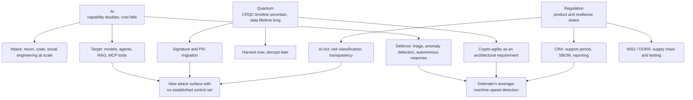
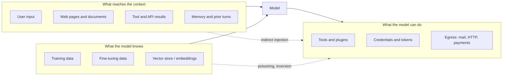
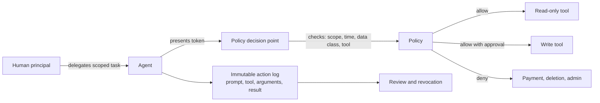
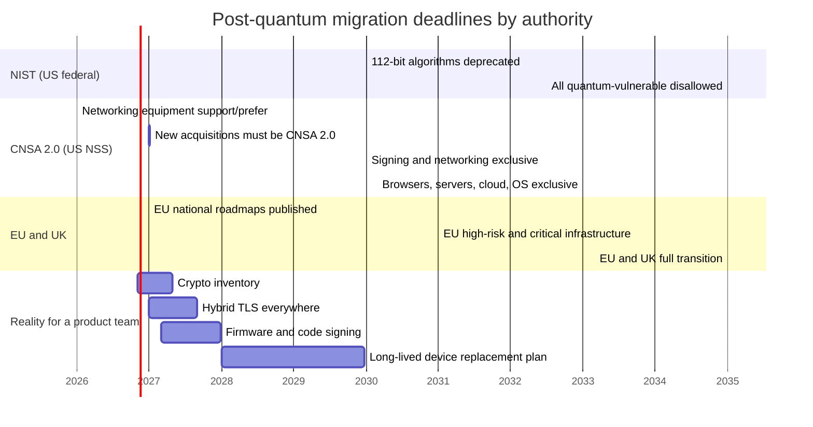

# SECURITY — The Frontier

> **Three forces are reshaping the threat model at once, and they interact.** AI moves the cost of
> finding and exploiting a weakness close to zero and creates a new class of target that cannot be
> patched in the ordinary sense. Quantum computing puts a deadline on every public-key algorithm
> deployed today, with a clock that started when the first long-lived secret was recorded. Regulation
> has stopped asking what you disclose after a breach and started specifying what you must build
> before you may sell. Any plan that addresses one of the three in isolation will be wrong within
> two years, because each one changes the economics of the other two.

This note is deliberately a forecast, and forecasts age badly. Everything with a date is checkable
and cited in §8; everything without one is either reasoning from current evidence or marked
**`VERIFY`**. Read it as an argument about direction, not as a specification.

---

## 1. The three forces, and where they intersect

The intersection labelled X is the interesting one: **AI systems that process long-lived secrets,
built from a supply chain nobody inventories, sold under a regulation that requires a support period
longer than the model's useful life.** That is the concrete shape of the next five years' problems.

---

## 2. AI as an attack surface

### 2.1 The OWASP list changed, and most material has not caught up

The 2023 OWASP LLM Top 10 is still widely quoted and is out of date. The **2025** list reordered and
renamed most entries:

| ID | 2025 risk | What it actually means |
| --- | --- | --- |
| LLM01 | Prompt injection | Attacker-controlled text changes behaviour; direct (user) or indirect (retrieved document, web page, tool output) |
| LLM02 | Sensitive information disclosure | The model reveals PII, credentials, other tenants' data, or the system prompt's secrets |
| LLM03 | Supply chain | Poisoned base models, malicious adapters, packages, plugins and MCP servers |
| LLM04 | Data and model poisoning | Corrupted training, fine-tuning or embedding data; backdoors triggered by a phrase |
| LLM05 | Improper output handling | Model output flows unvalidated into SQL, shell, HTML or a downstream API |
| LLM06 | Excessive agency | More tools, permissions or autonomy than the task needs |
| LLM07 | System prompt leakage | Instructions and embedded secrets extracted, exposing logic to work around |
| LLM08 | Vector and embedding weaknesses | RAG corpus poisoning, embedding inversion, retrieval that ignores per-user ACLs |
| LLM09 | Misinformation | Confident falsehoods that a human acts on |
| LLM10 | Unbounded consumption | Denial of wallet, resource exhaustion, model extraction by volume |

Two things about this list matter more than the items. First, **LLM01 has no general fix.** Prompt
injection is not a bug in a model; it is the consequence of a design in which instructions and data
share one channel, and there is no equivalent of parameterised queries. Every mitigation is partial:
input filtering, output filtering, privilege separation, and architectural constraints. Second,
**LLM05 and LLM06 are ordinary application-security failures wearing new clothes** — unvalidated
input and excessive privilege — which means the existing control set applies and is usually missing.

### 2.2 The agentic list is separate

In December 2025 OWASP published a **Top 10 for Agentic Applications** (labelled 2026), with IDs
ASI01–ASI10, covering goal hijacking, tool misuse, identity and privilege abuse, memory poisoning,
insecure inter-agent communication and human-agent trust exploitation. The distinction is useful:
the LLM list covers model input and output, the agentic list covers *actions*. An agent with a shell,
a browser and an email account is not an LLM application; it is a privileged user that happens to
be software.

### 2.3 The three boundaries

Every LLM system has three trust boundaries, and almost every incident crosses one of them:

The dashed edges are the point. **Indirect prompt injection bypasses the model entirely as a security
boundary** — a document the model reads can instruct it to use a tool. Simon Willison's "lethal
trifecta" (2025) names the condition precisely: private data, untrusted content and an outbound
channel, present in one agent, is exploitable regardless of model quality. Remove any one of the
three and the attack class collapses; that is a design decision, not a model upgrade.

### 2.4 The model supply chain

| Artifact | Risk | Control |
| --- | --- | --- |
| Base model weights | Trojaned or backdoored model from a public hub | Verify hashes, prefer signed/pinned artifacts, evaluate behaviour before deployment |
| Serialisation format | `pickle` executes code on load | Use `safetensors` or equivalent non-executable formats |
| Adapters / LoRAs | Small files, rarely reviewed, change behaviour | Treat as code: review, version, test |
| Embedding model | Determines retrieval behaviour and can be poisoned | Pin versions; re-index on change; monitor retrieval quality |
| Vector corpus | Poisoned documents, stale permissions | Ingest with provenance, enforce ACLs at retrieval time, log sources |
| MCP servers / plugins | Network access, tool definitions, no review process | Allow-list, pin versions, sandbox, audit tool calls |
| Evaluation datasets | Contaminate results, hide regressions | Hold out, version, and rotate |

**MCP deserves its own sentence.** The Model Context Protocol (Anthropic, November 2024) standardised
how models call tools, and in doing so created an installable unit of privilege with no permission
model of its own. A malicious MCP server is a plugin with network access; a "rug pull" is a server
that changes its tool description after approval; tool poisoning is instructions hidden in a tool
description that the model reads as context. The protocol is not the vulnerability — the absence of an
approval, pinning and sandboxing story around it is.

### 2.5 Confidentiality failures specific to models

Three attacks have no analogue in classical software:

- **Membership inference** — determine whether a specific record was in the training set. Matters
  wherever training data is sensitive (health, finance, customer records).
- **Model extraction** — reconstruct a functionally equivalent model by querying it. The defence is
  rate limiting and output perturbation, both of which cost utility.
- **Embedding inversion** — recover approximate source text from vectors, which turns a "harmless"
  embedding database into a readable copy of the corpus.

Differential privacy is the principled defence for the first, and it is rarely deployed because it
costs accuracy and requires a privacy budget that product teams do not want to spend.

---

## 3. AI as an attacker

### 3.1 What has actually changed

| Capability | Before | With AI | Net effect on defence |
| --- | --- | --- | --- |
| Reconnaissance | Manual enumeration | Automated, continuous, multilingual | Attack surface discovery is now cheap for the attacker too |
| Exploit development | Scarce skill | Assisted code analysis and variant generation | Time from patch to exploit shrinks |
| Social engineering | Human-operated, expensive | Synthetic voice, video, personalised text at scale | The dominant initial access vector gets cheaper |
| Malware polymorphism | Manual rewrites | Automated mutation and recompilation | Signature detection degrades further; behaviour detection matters more |
| Post-exploitation | Manual | Agents that plan and execute steps | Dwell time compresses; detection windows shrink |
| Denial of service | Botnets | Botnets plus application-layer automation | Already at 31.4 Tbps and 200 M requests per second |

The honest summary: **AI has not invented a new attack, it has reduced the marginal cost of every
existing one.** That changes the *volume* and the *speed*, which is why the defences that matter are
the ones that scale without humans — rate limits, allow-lists, immutable infrastructure, automated
containment — rather than the ones that require an analyst per alert.

### 3.2 Deepfakes and the collapse of voice as identity

A staff member in a Hong Kong office transferred HK$200 M (~US$25 M) after a video conference in
which every other participant was a deepfake (Arup, February 2024). The lesson is not "deepfakes are
good"; it is that **any control whose assurance depended on recognising a face or a voice is now
void**, and the replacement is out-of-band verification: a callback to a known number, a shared
secret, a hardware token, a second approver who is physically present.

| Control that used to work | Status | Replacement |
| --- | --- | --- |
| Recognise the caller's voice | Broken | Callback to a directory number; code word |
| Video call confirms identity | Broken | Out-of-band approval; signed instruction |
| Email from the boss's address | Weak | DMARC plus internal header marking plus workflow |
| "Urgent, confidential, skip the process" | Never worked | A process that cannot be skipped by urgency |

### 3.3 Vulnerability discovery at machine speed

The most durable effect is on the **patch-to-exploit interval**. When variant analysis and fuzzing
are automated, the window between a CVE being published and a working exploit existing shrinks from
weeks to hours for whole classes of bugs. The defensive implication is not "patch faster" — everyone
says that — but **reduce the number of things that must be patched in a hurry**: fewer exposed
services, immutable infrastructure that is replaced rather than patched, and compensating controls
that do not depend on the vendor shipping.

---

## 4. AI as a defender, and the limits

| Use | Mature? | Where it fails |
| --- | --- | --- |
| Alert triage and enrichment | Yes, shipping | Explainability; analysts cannot audit a score |
| User and entity behaviour analytics | Yes, shipping | Baseline drift; false positives in small populations |
| Phishing detection | Yes | Attacker iterates faster than the classifier retrains |
| Autonomous DDoS mitigation | Yes — the 31.4 Tbps attack was mitigated without humans | Only works at sufficient scale and anycast footprint |
| Malware classification | Yes | Packing and polymorphism; adversarial evasion |
| Code review and vulnerability finding | Partly | High false positive rate; misses design flaws |
| Automated response (isolate, block, revoke) | Partly | Blast radius of a wrong decision; needs a kill switch and an audit trail |
| Threat hunting | Early | Hallucinated correlation; needs verification |

Two structural limits deserve emphasis.

**Adversarial machine learning is asymmetric.** The attacker can query the defender's model and adapt;
the defender cannot query the attacker's. Every classifier deployed in a security product is, in
principle, being optimised against — and the security industry has not yet adopted the evaluation
practices (robustness testing, red-teaming of the model itself) that this implies.

**Automation moves the human bottleneck rather than removing it.** An autonomous system that
mitigates 99% of attacks leaves the 1% that is novel, and the analyst's skill at handling the novel
case decays when 99% of the work is automated. This is the automation paradox, and the mitigation is
deliberate practice on synthetic incidents, not more dashboards.

---

## 5. Identity after the perimeter: humans, workloads and agents

### 5.1 Three populations, one policy engine

| Population | Authenticates with | Lifetime | Control |
| --- | --- | --- | --- |
| Humans | Passkeys, SSO, MFA | Session, hours | Conditional access, PAM, just-in-time elevation |
| Workloads | SPIFFE SVID, cloud IAM role, mTLS certificate | Minutes to hours | Workload identity, short-lived credentials, policy as code |
| Agents | Delegated OAuth grant, service account, API key | Often indefinite — the problem | Scoped, time-bound, auditable delegation |

The agent population is the new one and the worst governed. An agent acting on a user's behalf needs a
**delegation** that is narrower than the user's own rights, time-bound, auditable, and revocable —
which is the opposite of how most integrations are built, where an OAuth grant gives a third-party app
persistent access to everything the user can see.

**Least agency** is the principle: give an agent only the autonomy and tool access the task requires.
It is least privilege applied to action rather than access, and it is the only control that bounds the
damage of a successful prompt injection.

### 5.2 Passkeys, finally

Phishing-resistant authentication has been technically available since FIDO2/WebAuthn (2019) and
became operationally normal when the major platforms shipped passkey support in 2022–2023. The
security argument is settled — origin-bound public-key credentials cannot be relayed by an AiTM
proxy — and the remaining obstacles are account recovery (the weak link that attackers now target),
device replacement, and shared-device scenarios. **Recovery is the new attack surface**: an
organisation with perfect passkeys and a help desk that resets MFA on request has neither.

---

## 6. Post-quantum migration as an engineering programme

[[12-1 SECURITY - Cryptographic Foundations - Primitives, Protocols and Trust Anchors|12-1]] §6
gives the algorithms and the byte counts. This section is about the programme, because the programme
is where the failures will be.

### 6.1 The clock, drawn

### 6.2 Why "harvest now, decrypt later" sets the real deadline

A recorded TLS session protected by ECDHE cannot be decrypted today, but it can be stored. Once a
cryptographically relevant quantum computer exists, every stored session becomes readable. The
consequence: **the migration deadline for confidentiality is not the date of the quantum computer, it
is (date of the quantum computer) minus (how long the data must stay secret).** For a 25-year mortgage
record, that deadline may already have passed. For a session token that expires in an hour, it can
wait a decade.

| Data class | Secrecy lifetime | Practical migration urgency |
| --- | --- | --- |
| Session tokens, ephemeral telemetry | Hours to days | Low — the machine will not arrive in time |
| Customer PII, financial records | 5–10 years | High — migrate key establishment now |
| Health records, legal holds | 20–50 years | Critical — assume recorded traffic is compromised |
| Firmware signing keys, root CAs | 15–25 years | Critical, and different: signatures, not confidentiality |
| State secrets | 25+ years | Already late |

The asymmetry between the two migration tracks is the most commonly missed point. **Key establishment
is a confidentiality problem with a retroactive clock. Signatures are an integrity problem with a
forward-looking clock** — a signature forged in 2035 can impersonate a device manufactured in 2027,
and a firmware image signed today must still verify in 2042. That is why CNSA 2.0 puts firmware
signing on the earliest track (2025 support, 2030 exclusive) while leaving browsers until 2033.

### 6.3 The five workstreams

| Workstream | What it produces | Typical duration | Owner |
| --- | --- | --- | --- |
| Discovery | Cryptographic inventory: algorithms, libraries, keys, certificates, protocols, devices | 3–9 months | Security architecture |
| Protocol migration | Hybrid key establishment in TLS, QUIC, IPsec, SSH; PQC certificates | 6–18 months | Platform and network |
| Signing migration | Firmware, code, package and document signing; root and intermediate CAs | 12–36 months | Product security, PKI |
| Device and supply chain | Replacement or gateway strategy for long-lived and constrained devices | 24–60 months | Hardware and procurement |
| Governance | Policy, exceptions, crypto-agility requirements in the SDLC | Continuous | CISO and engineering leadership |

### 6.4 Where it breaks

1. **The inventory cannot be produced.** Keys and algorithms are embedded in firmware, config files,
   compiled binaries and third-party appliances. Discovery is the long pole, not the crypto.
2. **The certificate chain explodes.** An ML-DSA-65 signature is 3309 bytes against 64 for Ed25519.
   A three-certificate chain can exceed 10 KB, which breaks assumptions in middleboxes, constrained
   clients, and any protocol with a 16 KB record limit once handshake framing is added.
3. **The firmware slot is too small.** A secure-boot image signed with SLH-DSA-256s carries a 49 KB
   signature. Devices designed for 64-byte ECDSA signatures need a partition change, which needs a
   field update, which needs the old signature to still verify. Plan two release cycles.
4. **The HSM does not support it.** Many HSMs have fixed algorithm sets and firmware update policies
   measured in years. Check before promising a date.
5. **The protocol has no agility.** WireGuard's fixed cipher suite is the clearest example: adding a
   hybrid KEM requires a version negotiation that the design deliberately omitted.
6. **The long tail is out of your control.** Meters, controllers, vehicles and medical devices with
   15–25 year lives will outlive the deprecation dates. The realistic answer is a terminating gateway
   plus a replacement plan, not a firmware update.

### 6.5 QKD is not the answer, and it is worth knowing why

Quantum key distribution (BB84, 1984) distributes a symmetric key with information-theoretic security
over a point-to-point link. It does not solve the problem that PQC solves:

- **It needs authentication.** Without an authenticated classical channel, QKD is vulnerable to
  man-in-the-middle; the authentication itself needs signatures, which are the thing you were trying
  to replace.
- **It does not scale beyond point-to-point** without trusted relays, each of which is a point of
  trust and a point of failure.
- **It protects the link, not the data at rest or the signature**, and most enterprise traffic is
  endpoint-to-endpoint through many links.
- **NSA's position** has been that QKD provides no additional security over properly implemented PQC
  for national security systems, and adds operational and physical burdens.

QKD has real uses — metro backbone diversity, high-assurance links between fixed sites — but a
migration plan built on it is a plan to buy hardware rather than to fix cryptography.

---

## 7. Confidential computing, and the honesty about it

A trusted execution environment (TEE) — Intel SGX/TDX, AMD SEV-SNP, Arm CCA — runs code in an
encrypted memory region with a hardware-signed attestation that a remote party can verify. The
security argument is that the cloud operator, the hypervisor and the host kernel are removed from the
trust boundary. That is genuinely valuable for multi-party computation, for regulated data in public
cloud, and for model inference where the model weights and the prompt are both sensitive.

| Claim | Reality |
| --- | --- |
| "The cloud provider cannot see the data" | True for memory and CPU state; false for I/O, metadata, timing and network |
| "Attestation proves the code" | True if you verify the measurement against a known-good value; most deployments do not |
| "TEEs are secure" | They have a long side-channel record — Foreshadow (2018), Plundervolt (2019), ÆPIC Leak (2022) — and each generation fixes the last |
| "Confidential AI is solved" | Inference in a TEE is practical for small models; large models hit memory bandwidth and attestation-of-weights problems |

**The honest position:** TEEs are a meaningful reduction in trust surface and not a replacement for
it. Use them where the threat is a curious or compromised operator, do not use them as the only
control protecting data from a determined local attacker, and always verify the attestation rather
than merely collecting it.

---

## 8. Resilience: the property that survives contact with reality

Every previous section is about preventing or detecting. Resilience is about **continuing to operate
while compromised**, and it is the only property that holds when prevention and detection both fail.

| Property | Question | How it is engineered | How it is tested |
| --- | --- | --- | --- |
| Containment | How far can it spread? | Segmentation, least privilege, workload identity | Assume-breach exercises, red team |
| Recovery time | How long to restore? | Immutable backup, IaC, runbooks | Timed restore drills, not restores |
| Recovery point | How much data is lost? | Replication, journaling, RPO design | Failover test with measured data loss |
| Graceful degradation | Can we operate at reduced capability? | Circuit breakers, manual fallbacks | Chaos engineering, dependency removal |
| Communication | Who says what, when? | Pre-drafted statements, one commander | Tabletop with legal and comms present |
| Learning | Does the next incident cost less? | Blameless review, tracked actions | Audit that actions actually closed |

**Assume breach** is not a slogan; it is a design constraint with a testable consequence. The test is
a question: *if an attacker has domain admin today, what stops them, what detects them, and how long
until we are back?* An organisation that cannot answer in numbers has not engineered resilience, it
has bought insurance.

---

## 9. The research agenda: what is genuinely unsolved

| Problem | Why it is hard | What progress looks like |
| --- | --- | --- |
| Prompt injection | Instructions and data share one channel; no equivalent of parameterised queries | Architectural separation of control and data flow, enforced outside the model |
| Agent accountability | Actions are composed at runtime; attribution to a principal is indirect | Delegation tokens with provenance, immutable action logs, policy at the tool boundary |
| Model provenance | Weights are large opaque artifacts; supply chain is immature | Signed model artifacts, reproducible training, behavioural attestation |
| Testability of learned components | A learned policy has no specification to test against | Contracts, envelopes, and bounds enforced outside the learner (cf. [[02-18 WLAN - AI in Wi-Fi - Learning Inside the Protocol and the 802.11bx Vision for PHY and MAC|02-18]]) |
| Crypto-agility in constrained devices | Fixed silicon, long lifetimes, no spare flash | Algorithm-agnostic secure elements, gateway termination, replaceable roots |
| Post-quantum signatures at scale | Size, not security | Smaller lattice/hash schemes, Merkle-tree caching, aggregated signatures |
| TEE side channels | Microarchitectural leakage is a moving target | Formally verified enclaves, leakage-resilient design, minimal TCB |
| Detection under encryption | ECH, DoH, QUIC encrypt the metadata defenders used | On-endpoint telemetry, flow analytics, privacy-preserving detection |
| Privacy-preserving detection | Detection wants data; privacy wants minimisation | Federated analytics, secure aggregation, differential privacy in production |
| Measuring security | No unit of account, adversarial environment | Better loss models, incident data sharing, actuarial rigour |

Two of these are worth expanding because they determine the others.

**Testability of learned components** is the same problem that blocks an AI-native Wi-Fi MAC
([[02-18 WLAN - AI in Wi-Fi - Learning Inside the Protocol and the 802.11bx Vision for PHY and MAC|02-18]] §11):
a bit stream can be checked against a specification, a decision cannot. The resolution in safety-critical
domains has been to standardise the **envelope** — the interface, the permitted range, the fallback —
and to prove properties about the envelope rather than the model. Security will follow the same path,
because it has no alternative.

**Measuring security** is why the field keeps substituting compliance for evidence. Without a unit of
account, the only defensible claims are relative ("this control reduces this loss event frequency by
this much, under these assumptions"), which is exactly what FAIR does in
[[12-3 SECURITY - Standards and Architecture - Risk, Controls, Compliance and Zero Trust|12-3]] §1.
The research gap is data: nobody shares loss distributions, so every model is built on priors.

---

## 10. Regulatory trajectory, and what it does to architecture

| Direction | Evidence | Architectural consequence |
| --- | --- | --- |
| From disclosure to product requirements | CRA, AI Act, UK PSTI, US Cyber Trust Mark | Security becomes a release gate and a support-period commitment, not an incident-response obligation |
| From entity to supply chain | NIS2 Art. 21, DORA third-party regime, CRA | Vendor assurance becomes continuous and contractual; SBOM becomes operational |
| From process to evidence | CRA conformity, AI Act documentation, DORA testing | Audit artefacts must be generated by systems, not written by hand |
| From national to extraterritorial | GDPR, CRA, AI Act | A product sold in the EU meets EU requirements regardless of where it is built |
| From voluntary to liability | Software liability debates, CRA penalties, SEC disclosure | "Best effort" stops being a defence; design decisions become discoverable |

The practical read for an engineering organisation: **the support period is now a design parameter**.
If a product must receive security updates for five or ten years, then the chip choice, the update
mechanism, the key hierarchy and the crypto-agility decision are all constrained by a date that
marketing has already promised. Teams that treat security as a late-stage review will discover that
the expensive decisions were made in the first month.

---

## 11. A ten-year view, stated as bets

Five propositions, each falsifiable, offered as the note's actual argument:

1. **Prompt injection will be managed architecturally, not solved.** Systems that separate control
   flow from data flow — with the model unable to reach privileged tools directly — will be the ones
   that survive. Model-level defences will keep improving and keep being bypassed.
2. **Agent identity will become a first-class product category.** Delegation, scoping, time-bounding
   and action logging for non-human principals will look like PAM did in 2005: obvious in hindsight,
   absent in most enterprises now.
3. **Post-quantum migration will fail on inventory, not on mathematics.** The organisations that
   succeed will be the ones that treated it as a discovery and asset-management programme, and
   started before the deadline was urgent.
4. **Confidential computing will be normal for inference and marginal for general workloads.** The
   performance and operational cost is real; the threat it addresses is real for a subset of data.
5. **Resilience will outrank prevention in budgets.** As attacks become cheaper and patches become
   faster than exploitation, the marginal return moves from "keep them out" to "operate through".

If any of these is wrong, it will be wrong in a specific way that a reader can check against the
record in five years. That is the point of writing them down.

---

## 12. The interview package

1. **What is prompt injection, and why is there no patch?** Testing for: the instruction/data channel
   conflation, the lethal trifecta, and architectural rather than model-level mitigation.
2. **An agent has a shell and an email account. What is your threat model?** Testing for: excessive
   agency, egress as the exfiltration channel, and least agency.
3. **How does a TEE change your trust model, and what does it not change?** Testing for: attestation,
   I/O and metadata leakage, and side-channel history.
4. **Your board asks why you are spending on PQC when no quantum computer exists.** Testing for:
   harvest-now-decrypt-later, data lifetime arithmetic, and signature lifetime asymmetry.
5. **What breaks first in a PQC migration, technically?** Testing for: certificate chain size,
   handshake bytes, firmware slots, HSM algorithm support.
6. **Why is QKD not the migration strategy?** Testing for: authentication, trusted relays, and
   link-versus-endpoint protection.
7. **How would you detect an attack that never runs malware?** Testing for: identity telemetry,
   OAuth grant anomalies, impossible travel, data access patterns.
8. **What does "assume breach" change in a design review?** Testing for: containment, recovery time,
   and the difference between a control and a hope.
9. **Which AI control would you not deploy, and why?** Testing for judgement: autonomous containment
   without a kill switch, or a classifier nobody can audit.
10. **What is the security consequence of the CRA support period?** Testing for: the recognition that
    it constrains hardware and key-hierarchy choices years before the certificate is issued.

---

## 13. Anchors

- **OWASP Top 10 for LLM Applications 2025**: LLM01 prompt injection, LLM02 sensitive information
  disclosure, LLM03 supply chain, LLM04 data and model poisoning, LLM05 improper output handling,
  LLM06 excessive agency, LLM07 system prompt leakage, LLM08 vector and embedding weaknesses,
  LLM09 misinformation, LLM10 unbounded consumption. The 2023 list had a different order and
  different names (e.g. insecure output handling at LLM02, model denial of service at LLM04).
- **OWASP Top 10 for Agentic Applications**: released December 2025, labelled 2026, IDs ASI01–ASI10.
- **MCP**: Model Context Protocol published by Anthropic, November 2024; tool poisoning and rug-pull
  classes documented by OWASP and vendor research in 2025.
- **Arup deepfake fraud**: February 2024, Hong Kong; ~HK$200 M (≈US$25 M) transferred after a video
  conference in which the other participants were synthetic.
- **Largest DDoS**: 31.4 Tbps, 14.1 Bpps, ~35 seconds, December 2025, mitigated autonomously by
  Cloudflare; >200 M requests per second at the application layer in the same campaign.
- **FIPS 203/204/205**: 13 August 2024. **NIST IR 8547**: initial public draft 12 November 2024,
  final October 2026 — 112-bit algorithms deprecated after 2030, quantum-vulnerable public-key
  algorithms disallowed after 2035. **EO 14412** (2026): federal high-value assets by 2030
  (key establishment) and 2031 (signatures).
- **CNSA 2.0**: 7 September 2022, algorithm list updated May 2025. Software/firmware signing
  support/prefer 2025, exclusive 2030; networking equipment 2026/2030; browsers, servers, cloud, OS
  2033; new NSS acquisitions must be CNSA 2.0 from 1 January 2027.
- **EU PQC roadmap**: published 23 June 2025 — national roadmaps by end 2026, high-risk and critical
  infrastructure by end 2030, all systems by 2035. **UK NCSC**: discovery and planning by 2028,
  high-priority migration 2031, complete 2035.
- **Hybrid TLS**: RFC 10024, August 2026 — X25519MLKEM768 (0x11EC), SecP256r1MLKEM768 (0x11EB),
  SecP384r1MLKEM1024 (0x11ED).
- **Signature sizes**: ML-DSA-65 = 3309-byte signature, 1952-byte public key; SLH-DSA-256s =
  49,856-byte signature. Compare Ed25519: 64 bytes.
- **QKD**: BB84, Bennett and Brassard, 1984. NSA guidance advises against QKD for national security
  systems in favour of PQC (`VERIFY` the current edition of the NSA FAQ at the time of reading).
- **TEE**: Intel SGX (2015), TDX (2023–2024); AMD SEV (2016), SEV-SNP (2021); Arm CCA (2024–2025).
  Side channels: Foreshadow (2018), Plundervolt (2019), ÆPIC Leak (2022).
- **Passkeys**: FIDO2/WebAuthn, W3C Recommendation 2019 (Level 2, 2021); platform passkey support
  shipped across Apple, Google and Microsoft in 2022–2023.
- **CRA**: Regulation (EU) 2024/2847 — in force 10 December 2024, Article 14 reporting from
  11 September 2026, fully applicable 11 December 2027.
- **AI Act**: Regulation (EU) 2024/1689 — in force 1 August 2024, GPAI obligations 2 August 2025,
  transparency 2 August 2026, Annex III high-risk 2 December 2027, Annex I 2 August 2028.
- **NIST AI RMF**: NIST AI 100-1, January 2023; Generative AI Profile NIST AI 600-1, July 2024.
  **ISO/IEC 42001:2023**: AI management system.
- **Deepfake detection**: no reliable general detector exists; the operational control is out-of-band
  verification, not classification (`VERIFY` any specific detector accuracy claim).

---

## 14. Related

- [[12-1 SECURITY - Cryptographic Foundations - Primitives, Protocols and Trust Anchors|12-1]]
  — the algorithms this note migrates away from, with the byte counts that decide the plan.
- [[12-2 SECURITY - Threats and Defences - Attack Surface, Detection and Incident Response|12-2]]
  — the attack classes AI accelerates, and the defences that scale without humans.
- [[12-3 SECURITY - Standards and Architecture - Risk, Controls, Compliance and Zero Trust|12-3]]
  — the frameworks these new obligations land in, and how to fund the work.
- [[02-18 WLAN - AI in Wi-Fi - Learning Inside the Protocol and the 802.11bx Vision for PHY and MAC|02-18]]
  — the testability problem in §9, worked through for a MAC layer: what a learned component can and
  cannot be asked to prove.
- [[06-2 Agent Systems and Edge Orchestration|06-2]] — the orchestration model whose
  permission design determines whether §5 is achievable.
- [[06-1 LLM Inference Engines and xLLM|06-1]] — where KV cache, weights and prompts
  live in memory, which is what a TEE has to protect.
- [[05-2 Cloud-Edge-End Collaboration and Heterogeneous Computing|05-2]] — the
  distributed trust boundaries that SASE and confidential computing are trying to redraw.
- [[01-1 5G-Advanced and 6G Radio Access|01-1]] — 6G's AI-native air interface and
  quantum-safe ambitions, and the security work in 3GPP SA3 behind them.

---

## 15. References

1. OWASP GenAI Security Project. *OWASP Top 10 for LLM Applications 2025*,
   <https://genai.owasp.org/llm-top-10/>.
2. OWASP GenAI Security Project. *OWASP Top 10 for Agentic Applications*, December 2025.
3. Willison, S. *The lethal trifecta for AI agents*, 2025 — private data, untrusted content, external
   communication.
4. Greshake, K., Abdelnabi, S., Mishra, S., Endres, C., Holz, T., Fritz, M. *Not What You've Signed
   Up For: Compromising Real-World LLM-Integrated Applications with Indirect Prompt Injection*.
   AISec 2023.
5. National Institute of Standards and Technology. *AI Risk Management Framework (AI 100-1)*.
   January 2023; *Generative AI Profile (AI 600-1)*, July 2024.
6. International Organization for Standardization. *ISO/IEC 42001:2023, Information technology —
   Artificial intelligence — Management system*. 2023.
7. National Institute of Standards and Technology. *FIPS 203, FIPS 204, FIPS 205*. 13 August 2024.
8. Moody, D., et al. *NIST IR 8547, Transition to Post-Quantum Cryptography Standards*. Initial
   public draft November 2024; final October 2026.
9. National Security Agency. *CNSA 2.0 FAQ*, PP-24-4014, December 2024 update; *Announcing the
   Commercial National Security Algorithm Suite 2.0*, 2022, updated May 2025.
10. European Commission, NIS Cooperation Group, ENISA. *Coordinated Implementation Roadmap for the
    Transition to Post-Quantum Cryptography*. 23 June 2025.
11. UK National Cyber Security Centre. *Timelines for migration to post-quantum cryptography*.
    20 March 2025.
12. Kwiatkowski, K., Kampanakis, P., Westerbaan, B., Stebila, D. *Post-Quantum Traditional (PQ/T)
    Hybrid Key Agreement Mechanisms for TLS 1.3*. RFC 10024, August 2026.
13. Bennett, C. H., Brassard, G. *Quantum Cryptography: Public Key Distribution and Coin Tossing*.
    IEEE International Conference on Computers, Systems and Signal Processing, 1984.
14. National Security Agency. *Quantum Key Distribution (QKD) and Quantum Cryptography (QC)*, FAQ.
    2020.
15. Costan, V., Devadas, S. *Intel SGX Explained*. IACR ePrint 2016/086.
16. Van Bulck, J., et al. *Foreshadow: Extracting the Keys to the Intel SGX Kingdom with Transient
    Out-of-Order Execution*. USENIX Security 2018.
17. Murdock, K., et al. *Plundervolt: Software-based Fault Injection Attacks against Intel SGX*.
    IEEE S&P 2020.
18. Borrello, P., et al. *ÆPIC Leak: Architecturally Leaking Uninitialized Data from the
    Microarchitecture*. USENIX Security 2022.
19. Cloudflare. *2026 Cloudflare Threat Report* and *2025 Q4 DDoS Threat Report*. March 2026.
20. European Parliament and Council. *Regulation (EU) 2024/2847 (Cyber Resilience Act)*; *Regulation
    (EU) 2024/1689 (Artificial Intelligence Act)*.
21. FIDO Alliance. *FIDO2 / Client to Authenticator Protocol* specifications, and W3C *Web
    Authentication: An API for accessing Public Key Credentials, Level 2*. 2021.
22. Model Context Protocol specification, <https://modelcontextprotocol.io/>. Anthropic, November
    2024, with subsequent revisions.

---

_Copyright (c) 2026 Washington Ruan and contributors · licensed under **GPL-3.0-or-later** or **AGPL-3.0-or-later**, at your option · see `LICENSE` and `LICENSE-AGPL`._
