# WLAN — Baseband and Driver Architecture for Wi-Fi 6, 7 and 8: Qualcomm as the Reference Design

> Part of the [[00 MOC - Comms x Compute x AI Knowledge Graph|Comms × Compute × AI knowledge graph]] · group **02 · WLAN**

Every other note in this group treats the radio as a black box that emits and absorbs frames.
[[02-8 WLAN - Scheduling - Channel Access, EDCA, OFDMA Resource Allocation, Airtime and Implementation]] describes
the scheduler as if the hardware merely executed decisions made above it.
[[02-4 WLAN - Packet TX-RX Datapath and Offload Evolution]] traces the packet path and stops at the point where
"offload" begins. [[02-9 WLAN - Time-Sensitive Networking Across Wi-Fi Generations]] asks for a latency bound and
discovers that the bound is spent somewhere between a socket and an antenna, in a place most software engineers
never look.

This note opens the box. It is about **what a Wi-Fi baseband actually is, what the firmware inside it owns, where
the driver's boundary falls, and how all three have had to change** to carry Wi-Fi 6, Wi-Fi 7 and Wi-Fi 8.
Qualcomm is used as the reference design throughout, for one reason that is not marketing: it is the only major
Wi-Fi silicon family whose Linux driver is in mainline and maintained upstream, so every claim below can be checked
against source you can read (`drivers/net/wireless/ath/ath11k/`, `ath12k/`) rather than against a datasheet you
cannot.

The single sentence to carry into an interview: **a modern Wi-Fi chip is a computer running a real-time MAC, and the
Linux driver is not a device driver at all — it is the north half of a distributed system whose south half is an
opaque firmware binary on a Hexagon DSP inside the chip.**

---

## 0. Vocabulary — say these precisely or the whole answer collapses

| Term | What it actually means | The mistake people make |
| --- | --- | --- |
| **Baseband** | The digital half of the radio: everything between the ADC/DAC and the MAC hardware. Sample-rate DSP, FFT, channel estimation, MIMO detection, LDPC decode | Calling the whole chip "the baseband". The RF/analog front end and the MAC are separate things |
| **WCSS** | Wireless Connectivity Subsystem — Qualcomm's name for the on-chip block containing the WLAN MAC/PHY hardware, the processors that run firmware, and the host interface | Treating it as one IP block. It is a subsystem with its own CPUs, memory, interrupt controller and DMA engines |
| **Q6 / Hexagon** | The Qualcomm DSP core the WLAN firmware runs on. In AP SoCs it is brought up by `remoteproc` via the `qcom-q6v5-wcss-pil` driver; in client chips it is booted over MHI or bundled into the boot chain | Assuming firmware runs on the host CPU. It does not, and it cannot be debugged with a debugger you own |
| **M3** | A second, smaller processor in the WLAN subsystem, with its own firmware image (`m3.bin`) on some parts; on others (WCN6750) it is bundled into the Q6 image | Assuming every chip has one. `needs_m3_fw` is a per-chip driver parameter |
| **WMI** | Wireless Module Interface — the **control plane** protocol between host driver and firmware: TLV command/event pairs for scan, vdev, peer, keys, MLO, power save | Calling it "the firmware API". It is one of at least four distinct interfaces |
| **HTT** | Host-Target Transport — the **data plane** protocol: TX descriptors, RX indication, PPDU statistics, per-peer and per-TID events | Assuming data and control share a transport. They share a transport layer (HTC) but not a protocol |
| **HTC** | Host-Target Communication — the multiplexing layer both WMI and HTT ride on, credit-based, over copy-engine pipes | Skipping it. It is why a control-message storm can starve the data path |
| **CE** | Copy Engine — a hardware DMA pipe with a standard ring interface (SRNG) at each end, moving descriptors between host memory and the chip | Calling it "DMA". A CE is a numbered, bidirectional, interrupt-capable channel with its own tasklet |
| **QMI** | Qualcomm MSM Interface — a separate, out-of-band service used for chip identification, firmware memory negotiation, BDF download and the "firmware ready" handshake | Confusing it with WMI. QMI runs *before* WMI exists |
| **MHI** | Modem Host Interface — the PCIe transport Qualcomm uses to boot and power-manage the WLAN subsystem on discrete parts; on SoC parts `remoteproc`/PIL does the same job | Assuming PCIe means "just another PCI device". There is a boot protocol underneath |
| **SRNG** | Standard Ring Interface — the generic hardware ring descriptor format used for every queue in the chip: TCL, REO, WBM, RXDMA, CE | Thinking of "the TX ring" as one thing. There are rings inside the chip the host never sees |
| **TCL / TQM / TXDMA** | Transmit Classification → Transmit Queue Manager → TX DMA. The three on-chip stages a transmitted frame passes through after the host posts a descriptor | Thinking the host writes frames to the air |
| **RXDMA / REO / WBM** | Receive DMA → Reorder Engine → Wireless Buffer Manager. The three on-chip stages an received frame passes through before the host hears about it | Thinking reordering is a driver job. It is hardware |
| **BDF / board-2.bin** | Board Data File: per-board RF calibration, antenna table, power limits, regulatory data, matched to the hardware by `bus`, `qmi-chip-id`, `qmi-board-id` and `variant` strings at probe time | Treating it as optional. With the wrong BDF you get a radio that transmits at the wrong power or not at all |
| **FullMAC vs SoftMAC** | Whether the 802.11 MAC state machines live in firmware (FullMAC, e.g. `brcmfmac`) or in `mac80211` on the host (SoftMAC, e.g. ath9k). Qualcomm is a **hybrid**: SoftMAC above, firmware MAC below, split at WMI | Assuming the split is binary. Modern chips are split somewhere in the middle and the split point is the whole design |
| **UMAC / LMAC** | Upper MAC (association, keys, scanning policy, aggregation decisions) vs Lower MAC (channel access, backoff, ACK/BlockAck, retransmission, timing). In Qualcomm's design both are in firmware, split by real-time-ness | Assuming UMAC = host. On Qualcomm it does not; on some MediaTek designs more of it is host-side |
| **Split-PHY** | One radio silicon supporting two independently configurable PHYs (two bands, or two links of an MLD) inside one device | Assuming MLO requires two chips. A "single split-phy device" does MLO in one |
| **NSS / ECM / SFE / PPE** | Network SubSystem: the **SoC-side** forwarding accelerator. ECM (Enhanced Connection Manager) and SFE (Shortcut Forwarding Engine) build flows; PPE is the packet-processing engine. This is *not* in the Wi-Fi chip | Confusing the Wi-Fi offload plane with the wired-forwarding offload plane. They are different accelerators that both make packets disappear from the CPU's view |

---

## 1. Two boundaries, and everything else follows from them

A Wi-Fi subsystem is defined by where two lines are drawn. Get these right and the rest of the architecture is
mechanical; get them wrong and every debugging session starts in the wrong place.

**Boundary 1 — the bus: host ↔ chip.** PCIe for discrete radios and for client chipsets in laptops; AHB/SNOC for
radios integrated into a Qualcomm SoC; SDIO or USB for cheap client modules. This boundary determines latency, DMA
coherence, how firmware is loaded, and what a firmware crash costs.

**Boundary 2 — the protocol: driver ↔ firmware.** Above it, the driver is an ordinary `mac80211` driver: it
registers a `wiphy`, implements `ieee80211_ops`, and looks like any other SoftMAC driver. Below it, the driver is a
messaging client: it formats TLVs, posts ring descriptors, and waits for events. Almost every "why is this slow" or
"why did this hang" question resolves to one of these two lines.

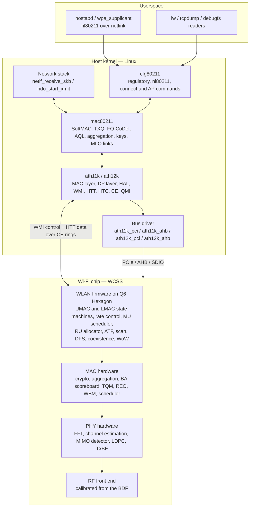

The thing to notice is that **`mac80211` is not the MAC**. On this architecture `mac80211` implements the parts of
802.11 that are policy, configuration and bookkeeping; the parts that have to happen within microseconds of a
medium event are in firmware and hardware. That split is not a Qualcomm quirk — it is forced by the bus. Anything
that must respond inside one SIFS (16 µs at 5/6 GHz) cannot round-trip a PCIe transaction.

---

## 2. System anatomy — what the parts actually are

### 2.1 Access point

A Wi-Fi 7 AP is a small computer with three radios hanging off it. The Qualcomm reference is the **Networking Pro
series**: a CPU complex (IPQ9574 is a quad-core Arm Cortex-A73 at 2.2 GHz on 14 nm), an integrated Ethernet switch
with 2.5/5/10 GbE ports, four PCIe controllers, and — critically — **no Wi-Fi radio in the SoC at all**. The radios
are separate QCN chips on PCIe.

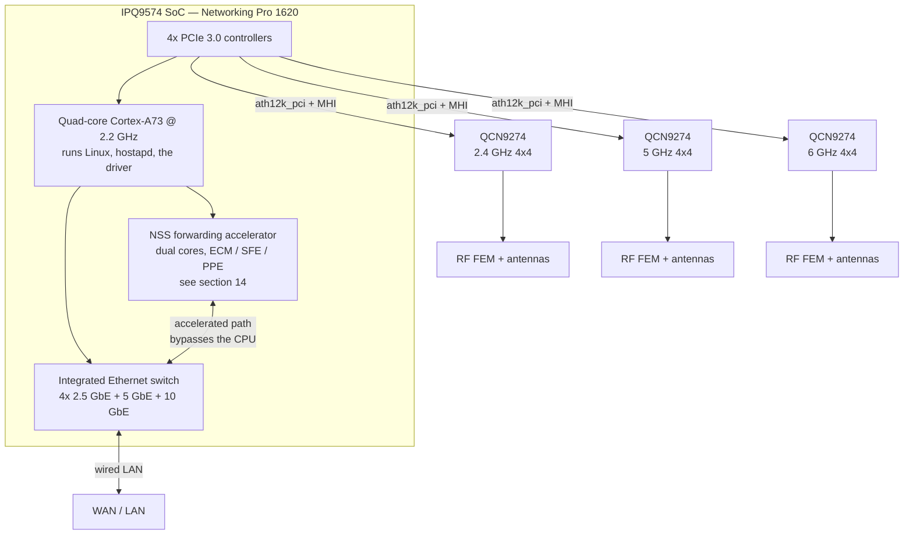

Qualcomm's own product brief for the Networking Pro 1620 platform gives the numbers worth quoting: quad-band
16-stream, 33 Gbps peak PHY rate, 320 MHz channels in 6 GHz, 240 MHz for regions without 6 GHz, 4K QAM,
"up to 37-user OFDMA support per channel", "4-user UL/DL MU-MIMO support per channel", sustained throughput for up
to 2000 clients, an embedded crypto accelerator, and Automated Frequency Coordination (AFC) for standard-power 6 GHz
operation. Note the asymmetry in those two numbers: OFDMA scales to tens of users; MU-MIMO is limited by the
sounding and precoding arithmetic, not by ambition.

The radios are not interchangeable. A **QCN9274** is a 4×4 Wi-Fi 7 radio supporting 4096-QAM and 320 MHz; community
teardowns of shipping routers report a maximum of 512 associated clients per radio and 37 OFDMA users on 5/6 GHz
with 18 on 2.4 GHz — treat the per-radio client figure as a community observation rather than a specification.

### 2.2 Client

On the client side the radio is integrated into the connectivity chip or the mobile SoC:

| Part | Generation | Configuration | Interface | Notes |
| --- | --- | --- | --- | --- |
| QCA6390 / QCA6391 | Wi-Fi 6 / 6E | 2×2 | PCIe | Common in laptops; `ath11k` from v5.10 |
| WCN6855 / WCN6856 | Wi-Fi 6 / 6E | 2×2 | PCIe | `ath11k` from v5.17; supports alternate firmware via a DT `firmware-name` property |
| WCN6750 | Wi-Fi 6 | 2×2 | SNOC/AHB | Integrated in Snapdragon; 12 MB reserved "MSA" region for firmware, M3 image bundled into the Q6 image |
| WCN7850 (FastConnect 7800) | Wi-Fi 7 | 2×2 | PCIe | `ath12k` from v6.3 |
| FastConnect 7900 | Wi-Fi 7 | 2×2, 6 nm | On-platform | Qualcomm's own brief: 5.8 Gbps with 4K QAM on 320 MHz, or 160+160 with High Band Simultaneous; 4.3 Gbps using 240 MHz of 5 GHz; Wi-Fi + Bluetooth + UWB in one chip; described by Qualcomm as "AI-optimized" |
| FastConnect 8800 | Wi-Fi 8 | **4×4**, 6 nm | On-platform | Announced at MWC on 2 March 2026: first mobile connectivity system with a 4×4 Wi-Fi radio, peak rates beyond 10 Gbps, up to 2× the performance and up to 3× the gigabit range of the previous generation, Bluetooth High Data Throughput raising BT from 2 Mbps to 7.5 Mbps, Wi-Fi 8 + Bluetooth 7.0 + UWB 802.15.4ab + Thread 1.5 in one chip, centimetre-level "Proximity AI" |
| IPQ5332 | Wi-Fi 7 | 2.4 GHz 2×2 | AHB | Radio integrated in the SoC; `ath12k` AHB support (`CONFIG_ATH12K_AHB`, example IPQ5332) |
| IPQ5424 | Wi-Fi 7 | — | AHB | Added to `ath12k` AHB later than IPQ5332 |
| Dragonwing NPro A8 Elite | Wi-Fi 8 | **5×5** | SoC platform | Announced 2 March 2026: penta-core CPU, integrated Hexagon NPU for agentic AI at the edge, up to 40% more throughput at typical distance, latency reduced by 2.5× at peak usage, up to 30% lower daily energy — all against the previous generation |

Two observations that matter more than the product names. First, the client is moving from 2×2 to **4×4**
(FastConnect 8800), which is a change in the RF front end, the number of ADCs, and the size of the MIMO detector —
not a firmware update. Second, the AP SoC is acquiring an **NPU** (Dragonwing NPro A8 Elite) whose stated purpose is
"agentic AI at the edge"; that is the first time a Wi-Fi infrastructure SoC has shipped a neural accelerator whose
job includes the network itself.

---

## 3. What is inside a Wi-Fi baseband

"Baseband" is a DSP pipeline with a hardware MAC wrapped around it. Both halves are worth naming, because each
Wi-Fi generation asks for a different piece of each.

```mermaid
flowchart LR
    subgraph TXCHAIN["Transmit chain"]
        T1["MAC header + A-MSDU / A-MPDU construction"]
        T2["Scrambler + FEC encoder<br/>LDPC, codeword 648 / 1296 / 1944 bits<br/>Wi-Fi 8 adds 3888"]
        T3["Stream parser + interleaver"]
        T4["Constellation mapper<br/>up to 1024-QAM, Wi-Fi 7 up to 4096-QAM"]
        T5["Spatial mapping / beamforming<br/>precoding matrix from sounding"]
        T6["IFFT + cyclic prefix<br/>256 to 4096 points depending on bandwidth"]
        T7["Digital front end<br/>CFR, DPD, IQ imbalance and DC correction"]
        T8["DAC + RF upconversion"]
        T1 --> T2 --> T3 --> T4 --> T5 --> T6 --> T7 --> T8
    end

    subgraph RXCHAIN["Receive chain"]
        R1["ADC + digital downconversion"]
        R2["Time and frequency synchronisation<br/>preamble detection, CFO estimation"]
        R3["FFT"]
        R4["Channel estimation<br/>LTF / UHT-LTF, interpolation, smoothing"]
        R5["MIMO detector<br/>linear MMSE or successive interference cancellation"]
        R6["LLR demapping + deinterleaver"]
        R7["LDPC decoder<br/>iterative, the largest single block of baseband area and power"]
        R8["Descrambler + MAC header parse + reorder"]
        R1 --> R2 --> R3 --> R4 --> R5 --> R6 --> R7 --> R8
    end

    subgraph MACHW["MAC hardware — not firmware"]
        M1["Crypto engine<br/>AES-CCMP, AES-GCMP, TKIP, WAPI, WEP"]
        M2["Aggregation and de-aggregation<br/>A-MSDU, A-MPDU, BlockAck scoreboard"]
        M3["Transmit queue manager<br/>per-TID, per-peer, per-AC hardware queues"]
        M4["Reorder engine<br/>per-TID and per-peer sequence-number windows"]
        M5["Buffer manager<br/>owns the descriptor and MSDU free lists"]
        M6["Hardware scheduler<br/>MU grouping, RU allocation assist, airtime accounting"]
    end

    T1 --- MACHW
    R8 --- MACHW
```

Three facts follow from this picture and are worth saying out loud in an interview:

1. **The LDPC decoder is the biggest block in the chip.** Its area and power scale with codeword length, iteration
   count and throughput. When Wi-Fi 8 doubles the maximum codeword from 1944 to 3888 bits, it is not a firmware
   change — it is a change in buffering, iteration scheduling and, above all, *decoding latency*, which is a term
   that appears in every latency budget.
2. **Aggregation and reordering are hardware** on this architecture. The driver does not reassemble A-MPDUs; the
   REO does, per TID and per peer, and hands the driver ordered MPDUs. This is why a driver bug that corrupts a
   peer ID produces silent loss rather than an error.
3. **The "scheduler" the marketing material talks about is split three ways**: the firmware decides *who* gets the
   next transmit opportunity and *which* RUs; the hardware executes the timing and the aggregation; the host
   `mac80211` layer decides how much it is allowed to queue.

---

## 4. Generation by generation — what each one asked the silicon for

The useful way to read a Wi-Fi generation is not "how fast" but **which block had to grow, and what that cost**.

| | Wi-Fi 6 / 6E (802.11ax) | Wi-Fi 7 (802.11be) | Wi-Fi 8 (802.11bn) |
| --- | --- | --- | --- |
| **Maximum bandwidth** | 160 MHz | 320 MHz (240 MHz for 5-GHz-only regions) | unchanged at 320 MHz |
| **FFT size at maximum bandwidth** | 2048-point (78.125 kHz spacing) | 4096-point | unchanged |
| **Highest modulation** | 1024-QAM (MCS 10, 11) | 4096-QAM (MCS 12, 13) | unchanged, plus **new intermediate MCS**: QPSK 2/3, 16-QAM 2/3, 16-QAM 5/6, 256-QAM 2/3 |
| **Per-stream modulation** | equal modulation (EQM) | equal modulation | **UEQM** — unequal modulation across spatial streams, defined for 2–4 streams, LDPC only |
| **FEC** | LDPC, codewords 648 / 1296 / 1944 bits | unchanged | **2× LDPC**, maximum codeword 1944 → **3888 bits**; reported gain 0.5–1 dB depending on channel |
| **Spatial streams** | 8 | 8 (16 in the standard) | unchanged |
| **Multi-link** | none | **MLO**: one MLD, several links, TID-to-link mapping | MLO plus **multi-AP coordination** and **SMD roaming** |
| **Resource units** | contiguous RUs, MRU only in Wi-Fi 7 | MRU, preamble puncturing | **DRU** (distributed RUs): 26/52/106/242/484 tones spread over up to 80 MHz, uplink OFDMA only, at most two spatial streams, new UHT-LTF, not available for uplink MU-MIMO |
| **Edge coverage** | — | — | **ELR**: a dedicated frame format with data quadruplication and a specialised preamble; **DRU** raises uplink power under a PSD cap |
| **Channel access** | EDCA + trigger-based access | EDCA, trigger-based, r-TWT | **P-EDCA / DS-CTS**, **NPCA** (non-primary channel access), **preemption**, group-based TXOP sharing, DSO/DBE |
| **What the baseband had to grow** | Wider FFT, more OFDMA users, longer symbol | Twice the FFT, 4096-QAM, two radios in one MAC | Twice the LDPC buffer, per-stream modulation control, a new preamble path, a second CCA state machine for NPCA |
| **What the firmware had to grow** | RU allocator, MU scheduler, trigger-frame machinery | MLO link management and link selection, Multi-Link scheduling | Cross-AP coordination state, latency-aware scheduling, unavailability reporting (PUO/DUO) |

Two things in that table are easy to miss and are excellent interview material:

- **Wi-Fi 8 does not raise the peak rate.** Its PAR targets are reliability, coverage and latency
  (throughput +25%, latency at the 95th percentile −25%, MPDU loss −25%). Every PHY change in the table buys
  *range or robustness*, not headline speed: doubling the LDPC codeword buys coding gain, DRU buys uplink power
  under a spectral-density cap, ELR buys a link budget at the cell edge, UEQM buys throughput where streams are
  unequal. A candidate who answers "Wi-Fi 8 is faster" has not read the PAR.
- **DRU is an uplink-only, two-stream, sub-80 MHz mechanism.** It exists because 6 GHz transmit power is capped per
  MHz, so a station using a 26-tone RU cannot use its full power budget. Spreading the tones over a wider band
  raises the total power while keeping the power spectral density legal. It is a regulatory workaround implemented
  in the tone mapper.

---

## 5. Inside the chip — processors, memory and the boot chain

The WCSS is not a peripheral; it is a subsystem with its own compute. Qualcomm's own software-architecture document
describes the WLAN firmware as running on **a dedicated Q6 processor**, with the firmware binary containing: the
802.11 protocol state machines; performance algorithms (rate adaptation, coexistence, MIMO, OFDMA); core MAC
hardware programming recipes; a unified MAC/PHY service interface; and core PHY/RF recipes including RF calibration,
BDF handling and radar detection. Sub-blocks named in the same document include a performance-algorithm block
covering the transmit scheduler, MU scheduler, MU grouping, RU allocator and airtime fairness; a HAL-PHY layer;
PHY/RF software; and platform system software.

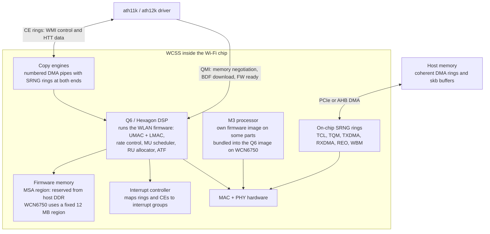

**How it boots** differs by bus, and the difference is the answer to "what happens when firmware dies":

- **SoC parts (AHB).** The Q6 is a remote processor. The kernel's `remoteproc` subsystem and the
  `qcom-q6v5-wcss-pil` driver load it, start it, and — crucially — **notice when it dies** and reload it. On
  IPQ8074 you can see this in a crash log as `qcom-q6v5-wcss-pil cd00000.q6v5_wcss: fatal error received`.
- **Discrete parts (PCIe).** There is no remoteproc. The driver registers as an **MHI** client; the MHI layer
  handles firmware download and power management, and reports a firmware crash as an `MHI_CB_EE_RDDM` execution
  environment event, which the driver's status callback turns into a reset.

### 5.1 Firmware files and board data

The host supplies three kinds of file, and confusing them is a classic bring-up mistake:

| File | What it is | How it is selected |
| --- | --- | --- |
| `amss.bin` | The Q6 WLAN firmware image (AMSS) | Path built from the chip's `hw_params.fw.dir`, e.g. `ath11k/QCN9074/hw1.0/`; can be overridden per usecase by a device-tree `firmware-name` property |
| `m3.bin` | The M3 processor firmware, where the part has one | Same directory; on WCN6750 it is bundled into the Q6 image instead and is not loaded separately |
| `board-2.bin` | Board Data File: RF calibration, antenna and power tables, regulatory data | Matched at runtime. QMI reports bus type, chip id and board id; the driver reads candidate BDF headers and selects the one whose metadata (`bus=pci,qmi-chip-id=0,qmi-board-id=255,variant=...`) matches |
| `firmware-2.bin` | Firmware API 2: one IE container holding both `amss.bin` and `m3.bin` | Preferred where available; simplifies updates to a single file |

The `variant` string is matched exactly, including case. A BDF whose variant does not match the board produces a
radio that associates but transmits at the wrong power, which is the worst possible failure mode: it looks like a
range problem, and no amount of driver debugging will find it.

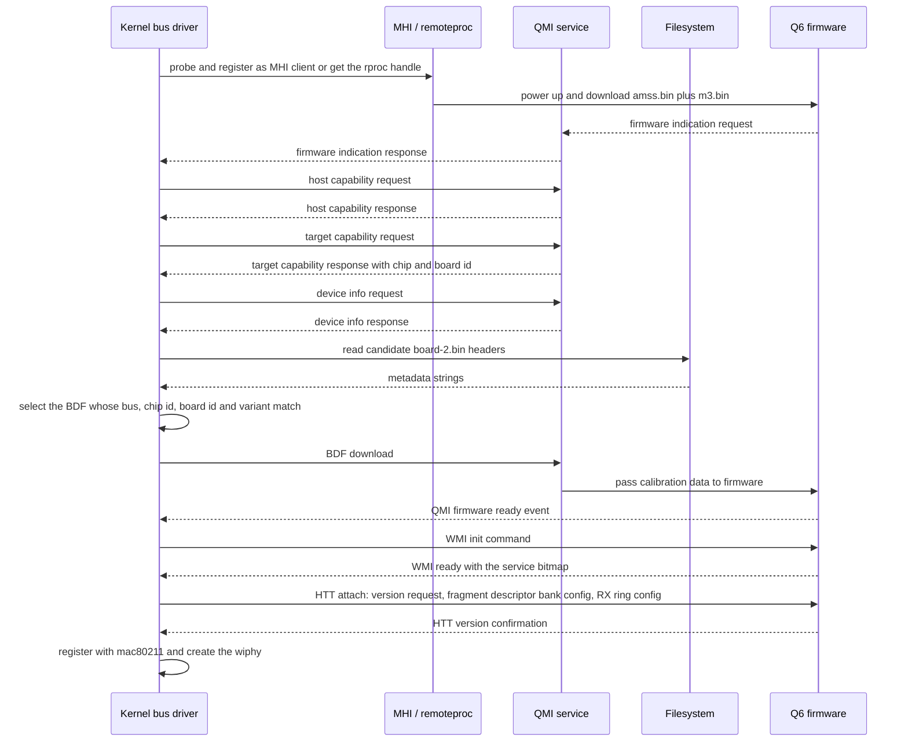

That last exchange is worth memorising: the HTT handshake is **three mandatory messages** — version request,
fragment-descriptor-bank configuration, and RX ring configuration. Until the RX ring base address and size have
been configured, the firmware has nowhere to put a received frame, and nothing works. When a Qualcomm driver hangs
at probe, it is almost always before, during, or immediately after this handshake.

---

## 6. Who owns what — the single most useful table in this note

Every architecture argument about Wi-Fi silicon reduces to "where does this function live". Here is the split for
the Qualcomm design, which is representative of all modern Wi-Fi 6/7/8 silicon.

| Function | Host kernel | Firmware (Q6) | Hardware |
| --- | --- | --- | --- |
| Association, authentication, 4-way handshake state | `cfg80211` + `hostapd`/`wpa_supplicant` | vdev and peer state machines | — |
| Key installation and cipher selection | `mac80211` | key cache programming | crypto engine |
| Scanning policy and results | `cfg80211` | scan state machine, dwell, off-channel scheduling | — |
| Channel access: backoff, CCA, SIFS timing, ACK | — | LMAC | MAC hardware timers |
| Retransmission and BlockAck | — | LMAC | BA scoreboard |
| Rate adaptation | — | **firmware** (one of the "performance algorithms") | — |
| Aggregation: A-MSDU / A-MPDU sizing | `mac80211` sets limits | firmware builds and schedules aggregates | aggregation hardware, REO |
| Reordering | — | — | **REO** |
| Scheduling: which station, which RU, which MCS | — | **firmware**: transmit scheduler, MU scheduler, MU grouping, RU allocator, ATF | TQM, TXDMA |
| Airtime fairness | `mac80211` if the driver advertises it | firmware ATF | — |
| Queue depth control | `mac80211` AQL and FQ-CoDel **if the driver advertises AQL** | — | hardware ring depth |
| Encryption per frame | — | — | crypto engine |
| Buffer ownership and free lists | driver maps and unmaps | — | WBM |
| Statistics: per-PPDU rate, duration, retries | driver consumes HTT PPDU stats | firmware emits them | PPDU status ring |
| DFS and radar detection | regulatory agent consumes events | firmware pattern matching | — |
| Thermal management | `ATH11K_THERMAL` | firmware throttles | — |
| WoW, ARP/NS offload, packet filters | configures | firmware answers while the host sleeps | — |
| Firmware crash detection and recovery | driver + `remoteproc`/MHI | — | — |

Read this table top to bottom and one conclusion dominates: **the host does not schedule, does not retransmit, does
not choose the rate, and does not reorder.** It configures, queues within a limit, accounts, and gets out of the
way. A driver engineer's job on this architecture is (a) to keep the firmware correctly configured, (b) to keep the
rings fed and drained, and (c) to make sure the host does not queue so much that the firmware's own scheduling has
nothing left to decide.

That third point is where most real-world Wi-Fi latency bugs live, and section 12 is about it.

## 7. The host-to-firmware protocol stack

Five layers sit between `ieee80211_ops` and the air. Naming them correctly is most of what distinguishes someone who
has worked on this stack from someone who has read about it.

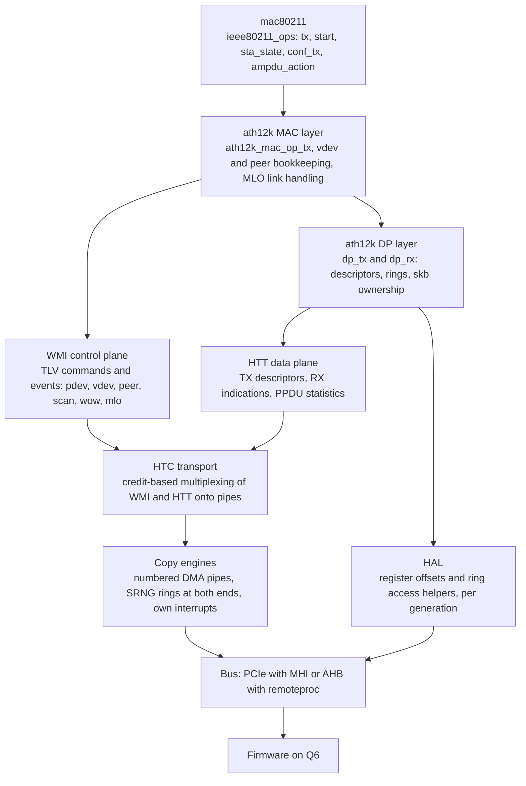

| Layer | Direction | Carries | What breaks when it is wrong |
| --- | --- | --- | --- |
| **WMI** | Both, asynchronous TLV command/response plus unsolicited events | vdev and peer creation, keys, scan, regulatory, EDCA parameters, TWT, MLO setup, WoW filters, statistics requests | A refused or mis-encoded command leaves firmware and host disagreeing about state. Symptoms are "the AP is up but nothing associates" |
| **HTT** | Both, high rate | TX descriptors posted by the host, RX indications, TX completion, PPDU statistics, per-peer rate | Ring configuration errors. No RX ring means no frames, silently |
| **HTC** | Both | Multiplexes WMI and HTT onto CE pipes with credits | Control traffic starving data, or a credit leak that halts the pipe |
| **CE** | Both, DMA | Descriptor rings in coherent host memory, doorbelled through MMIO | Interrupt storms, or "ce desc not available" when a pipe is starved |
| **QMI** | Boot and lifecycle only | Chip identification, firmware memory negotiation, BDF download, firmware-ready | Probe failure with a BDF or memory error and no further diagnostics |
| **HAL** | Host-local | Register offsets and ring access sequences for one hardware generation | Correct code running against the wrong generation reads garbage |

The service bitmap that arrives in the **WMI ready event** is the contract: firmware advertises which optional
features it implements, and the driver gates every feature on a bit in that map. This is why an old firmware and a
new driver usually work together, and why a new firmware with an old driver silently omits features — the driver
never asks.

### 7.1 The ring inventory

Rings are the whole data plane. The host sees some of them; the rest are inside the chip.

| Ring | Direction | Who writes | Who reads | Purpose |
| --- | --- | --- | --- | --- |
| **SW2TCL1** | Host → TCL | driver | chip | Posted transmit descriptors. On ath11k there are three TCL rings and the driver picks one by the sending CPU, which spreads a burst across rings |
| **TCL2TQM** | TCL → TQM | chip | chip | Classification result feeding the transmit queue manager |
| **TQM2TXDMA** | TQM → TXDMA | chip | chip | Frames released for transmission on a granted opportunity |
| **RXDMA2REO** | RXDMA → REO | chip | chip | Received MPDUs entering reordering |
| **REO2SW** | REO → host | chip | driver | Reordered MPDUs handed to the host, several rings, each with its own interrupt group |
| **WBM2SW** | WBM → host | chip | driver | Release and completion ring: buffers returning to the host, TX completion status, PPDU statistics |
| **RXDMA error / monitor status** | chip → host | chip | driver | Frames the REO could not place, and monitor-mode status |
| **CE rings** | Both | both | both | WMI, HTT and diagnostics over copy-engine pipes |

The important asymmetry: **the host posts and reaps, but cannot see the queues that decide timing.** TQM holds
per-peer, per-TID, per-AC queues with retry state inside the chip. That is why "how many packets are queued" is a
question a driver engineer often cannot answer from the host, and why queue-depth control has to be done by
*refusing to post* rather than by draining.

---

## 8. The transmit data path

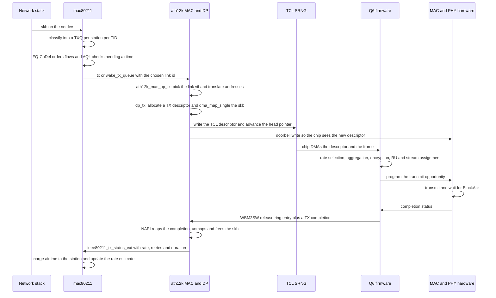

Five details in that flow carry the engineering:

1. **The driver has no queue of its own.** On the mainline Qualcomm drivers, `mac80211` hands frames straight to the
   hardware rings. Everything the stack believes about backlog has to be accounted *above* the driver, or the
   backlog disappears into the chip where no AQM can reach it.
2. **The doorbell is a register write**, not an interrupt. The driver updates the ring head pointer in shared
   memory and writes a doorbell register; the chip picks up whatever is between tail and head. Getting the memory
   barrier wrong here produces a chip that transmits stale descriptors.
3. **DMA mapping happens per frame** in the hot path. Under 320 MHz and 4096-QAM a single radio can complete on the
   order of a hundred thousand frames per second, so the difference between a mapped and a copied path is the
   difference between a working product and a CPU-bound one.
4. **Rate, aggregation and retransmission are invisible to the driver.** It learns what happened only from the
   completion and from per-PPDU statistics. Any latency debugging that does not start from those statistics is
   guessing.
5. **MLO changes step 4.** For an 802.3 data frame on a multi-link device the driver always enqueues on the
   **primary (association) link**, and the *firmware* chooses the link, builds the 802.11 header and does the
   address translation. The driver's link id only selects which link's addressing to prepare.

### 8.1 What a transmit descriptor contains

Without dumping a struct, the fields that matter: the DMA address of the frame; the length; the vdev and peer IDs;
the TID and access category; the encap type (native Wi-Fi, or 802.3 with firmware-built header); the cipher and key
index; the link id on an MLD; and a software cookie the driver uses to find the `sk_buff` again when the completion
comes back. The cookie is the whole reason a completion can be matched without a search — and the reason a
corrupted peer or cookie field produces a leaked skb rather than an error.

---

## 9. The receive data path

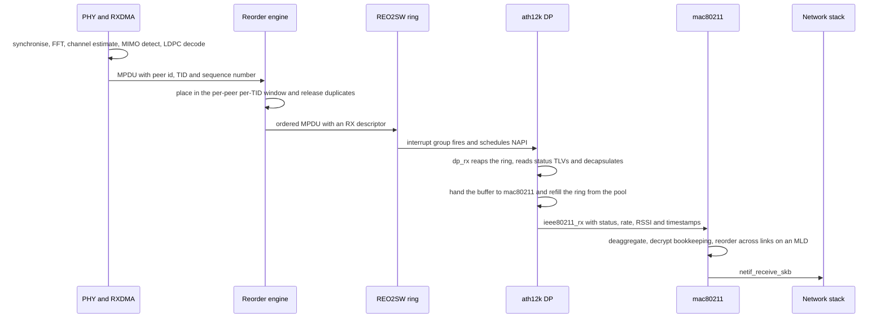

The receive path has three properties that surprise people:

- **Reordering is done before the host sees a frame.** The REO maintains sequence-number windows per peer and TID.
  A driver bug that misprograms a peer therefore produces out-of-order or lost frames with no software error.
- **Buffers are pooled and recycled, not allocated per frame.** The driver refills the ring from a pool; when the
  pool is empty and the ring is not refilled fast enough, frames are dropped in hardware and the drop counter is the
  only evidence.
- **PPDU statistics arrive on a separate path.** Per-PPDU rate, duration, retry counts and RSSI come back through
  the buffer manager ring as HTT statistics. These feed the host-side rate estimate that `mac80211` uses for airtime
  accounting — which means **the accuracy of the host's latency control depends on the freshness of firmware
  statistics**, not on anything the driver measures itself.

---

## 10. Interrupts, NAPI, and where the CPU actually goes

The chip does not raise one interrupt per frame. It has an **interrupt controller that maps rings and copy engines
to interrupt groups**, and the driver builds a NAPI instance per group.

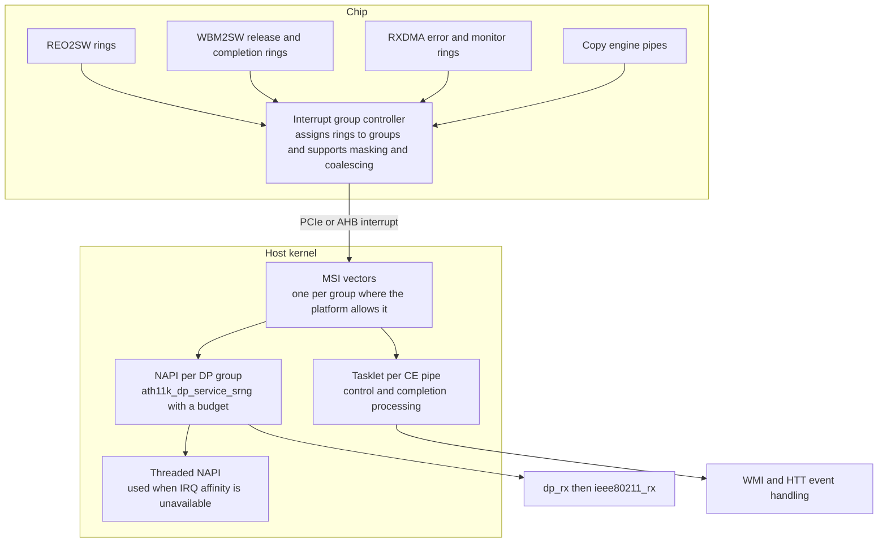

Design points that come up constantly in practice:

- **One group, one NAPI, one budget.** The poll function drains every ring in the group up to the budget, and
  re-enables the interrupt only when it has drained everything. Work above the budget means the NAPI is rescheduled
  and the interrupt stays masked, which is the intended behaviour but also the mechanism by which a slow RX handler
  turns into latency.
- **Copy engines use tasklets, not NAPI.** Control traffic has a different latency profile from data and is
  processed in a tasklet per pipe. When the two interact badly you get the classic "ce desc not available" symptom.
- **MSI vectors are a luxury, not a guarantee.** Platforms with a single MSI vector are supported by falling back to
  sharing one vector and handling enable and disable uniformly, at a real throughput cost.
- **Threaded NAPI is a throughput fix, not a latency fix.** On a platform where the data-path interrupt cannot be
  affined to a CPU, running the poll in a thread rather than in softirq has been measured on ath12k hardware to take
  EHT160 UDP downlink from 802 Mbit/s to 2.58 Gbps — because the softirq was otherwise pinned to one CPU and
  starved. The lesson generalises: on these drivers, **where** the poll runs matters as much as how fast it is.
- **Interrupt coalescing and mitigation are configured in firmware**, with thresholds exposed through WMI. Tuning
  them is a latency-versus-CPU trade, and it is one of the few knobs that changes tail latency without changing
  throughput.

---

## 11. Where a frame waits — queueing, AQL, and the measurement that matters

This is the most under-appreciated part of the whole architecture, and it is where Wi-Fi latency is won or lost.

```mermaid
flowchart LR
    A["Socket / TCP<br/>congestion window"]
    B["Qdisc on the netdev"]
    C["mac80211 TXQ per station per TID<br/>FQ-CoDel flow queueing"]
    D["AQL check<br/>pending airtime against a limit"]
    E["Hardware TCL rings<br/>posted descriptors"]
    F["On-chip TQM queues<br/>per peer per TID per AC"]
    G["The medium<br/>contention, retransmission, aggregation"]

    A --> B --> C --> D --> E --> F --> G
    D -.->|"if over the limit the frame stays here"| C
    E -.->|"no AQM and no flow separation"| F
```

Everything to the left of the AQL check is visible to Linux and manageable; everything to the right is inside the
chip and invisible. **If the driver does not advertise AQL to `mac80211`, the AQL check does not happen**, and every
queued byte of a saturated download ends up as posted descriptors in the hardware rings.

That is not a hypothetical on the Qualcomm drivers. A 2026 patch series for ath11k states the problem plainly and
measures it:

| Arm | Download rate | Round-trip time seen by the sender |
| --- | --- | --- |
| Stock | 94.6 Mbit/s | 155 ms |
| With the series, default limit | 94.0 Mbit/s | 157 ms |
| With the series, `aql_txq_limit` 500/1000 | 74.3 Mbit/s | 22 ms |
| With the series, completion-driven scheduling reverted | 33.7 Mbit/s | 21 ms |
| Stock, rate pinned to MCS0 | 23.6 Mbit/s | 502–523 ms (peak 871–1139 ms) |
| Series with limit, rate pinned to MCS0 | 23.3 Mbit/s | 30–32 ms |

Three conclusions worth carrying:

1. **The default limit does not bind.** At 94 Mbit/s the pending airtime averages 4–5.5 ms against the 12 ms default
   high limit, so nothing is held back and the latency is simply the depth of the hardware queue. Latency only
   responds below roughly 2 ms of allowed airtime — which means the useful setting is a deliberate choice to give
   up some throughput.
2. **The curve is a continuous trade, not a free win.** On the same hardware: 900/1800 µs gives 92 Mbit/s at
   127 ms; 550/1100 gives 81 Mbit/s at 31–46 ms; 500/1000 gives 72 Mbit/s at 19–21 ms. Anyone who tells you a
   setting "fixes bufferbloat" without naming the throughput cost is not describing a measurement.
3. **The host's airtime estimate is systematically low.** Comparing what `mac80211` charges against what the radio
   reports for the same station: 47–51 µs per MSDU charged against 91–92 µs measured, a ratio of about 1.85. Part
   of that is structural — the firmware's frame-exchange duration includes the responding BlockAck, while the
   estimator amortises overhead over an assumed aggregate — but the consequence is that **the limit you set is not
   the queue depth you get**, and it must be chosen with measurement rather than arithmetic.

Two more facts from the same work, both worth knowing: with two stations on one radio, a slow 1×1 client takes
63–72% of the medium on stock while a fast 2×2 client gets the rest; enabling airtime fairness moves the split to
about 44% at equal weights. And `ath10k` and `mt76` already advertise the feature bits that ath11k does not — so
"does this driver do AQL" is a real question with a real answer per driver, not a property of Linux.

---

## 12. MLO in silicon and in the driver

Multi-link operation is the Wi-Fi 7 feature with the largest architectural consequence, because it moves a decision
that used to be made per radio into a place that spans radios.

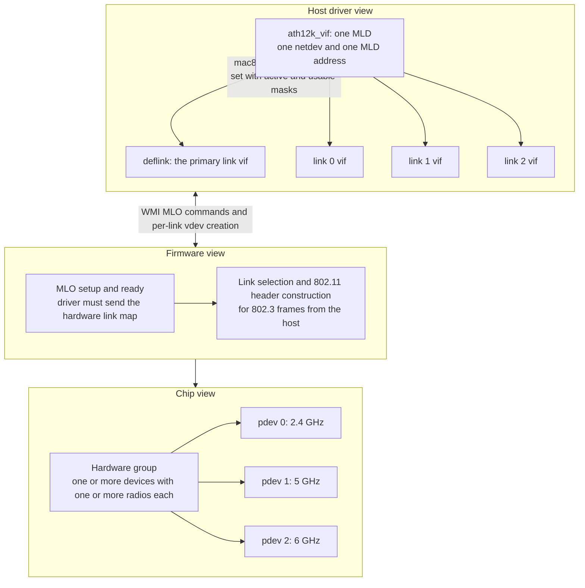

What the driver actually has to do, from the merged ath12k MLO work:

- **Represent one MLD as one vif with several link vifs.** `struct ath12k_vif` carries a `deflink` plus an array of
  link vifs; a station has the same shape. Every operation that used to take a vif now takes a link vif.
- **Carry a link id on the skb.** The transmit path stores it in the driver's skb control block and uses it to
  translate RA and TA to the corresponding link station and link vif addresses.
- **Let the firmware choose the link for data.** For 802.3 frames the driver always enqueues on the primary
  association link; firmware does link selection, header construction and address translation. Management frames go
  over WMI on the correct link vif.
- **Handle group-addressed frames specially.** Per IEEE 802.11be-2024 §10.3.2.14.2 an AP MLD must transmit the same
  group-addressed frame with the **same sequence number on every link**. The driver submits these with a special
  vdev id (the actual vdev id plus 128) so firmware recognises them as host-inspected, and places the multicast
  global sequence number in the HTT metadata.
- **Tell firmware the hardware link map.** On a **single split-phy device** — one device doing MLO internally — the
  driver must send WMI MLO setup, ready and teardown commands, or firmware does not know the `hw_links` component of
  the operation and can assert during multi-link association.
- **Activate partner links at the right moment.** An ML station starts with one link; once authorised, the driver
  calls into `mac80211` to activate the partner links, gated on a `can_activate_links` operation.

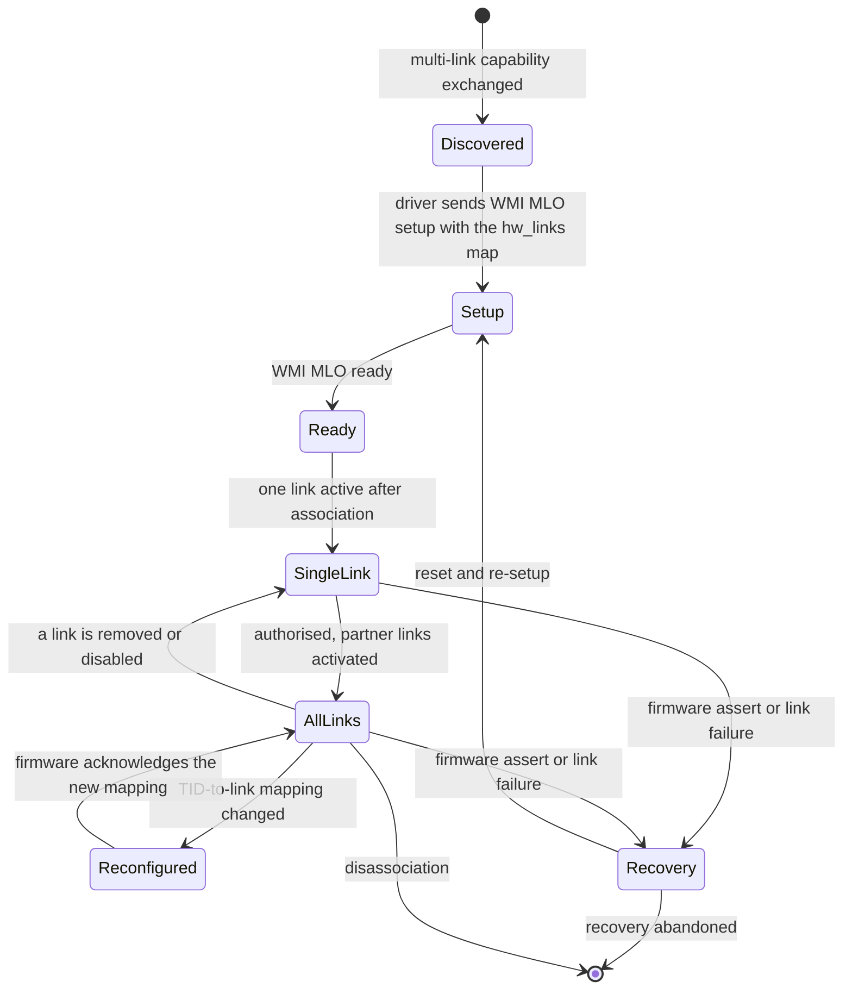

The failure mode worth remembering: **a missing WMI MLO setup on a split-phy device is a firmware assert, not a
degraded link.** The chip crashes and the whole radio restarts. On an SoC part that can take the board with it, as
section 13 shows.

## 13. Power, thermal, and what happens when firmware dies

### 13.1 Lifecycle

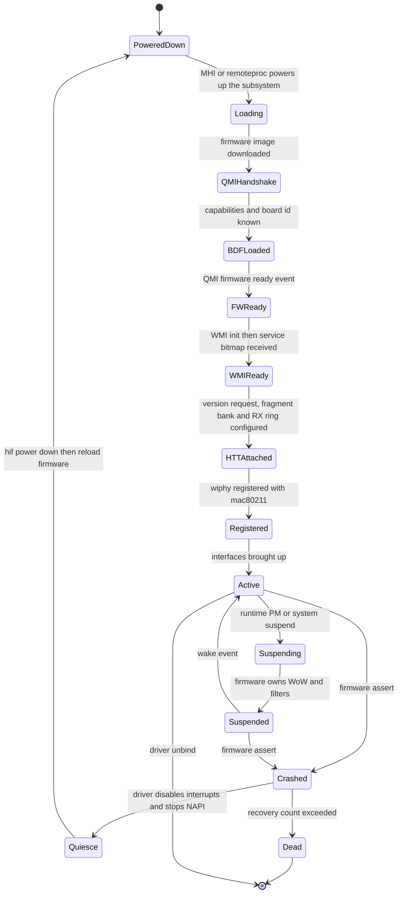

The `Quiesce` state is where a real bug lived, and it is the best worked example of what "firmware is a computer"
implies for the driver. On IPQ8074 a firmware assert took the **entire SoC down**: the crash path tore down the data
path and cleared the ring list while the data-path NAPI was still polling, so the poll serviced a ring whose address
had just been cleared. The kernel read from unreadable memory and the board rebooted — with no kernel panic you can
see, because the failure happens below the level Linux records.

The fix is instructive: interrupts have to be **disabled on the crash path before the data path is freed**, and the
copy-engine half of that quiesce was a no-op on AHB because the AHB bus never implemented the CE interrupt
operations. Both were corrected upstream, and the reproduction is worth quoting: with the debugfs
`simulate_fw_crash` assert trigger, before the fix two of two asserts panicked and rebooted the SoC; after it, three
of three recovered with five firmware boots in a single 397-second uptime and both radios staying up. Note that the
debugfs `hw-restart` trigger does *not* reproduce it, because that path still disables interrupts — **only a real
assert does**. A fix validated on the wrong trigger would have looked correct.

### 13.2 What a crash looks like from outside

The visible form depends on the bus:

- **AHB (SoC).** `qcom-q6v5-wcss-pil cd00000.q6v5_wcss: fatal error received`, followed by the firmware image
  version, the source file and line of the assertion, then `remoteproc0: crash detected ... type fatal error`. The
  remote processor is reloaded automatically on parts where the platform allows it.
- **PCIe.** An MHI execution-environment event (`MHI_CB_EE_RDDM`) reaches the driver's status callback, which starts
  a reset: power the host interface down, power it up, let MHI reload firmware, then reconfigure.

A real-world example of the second-order effects: an IPQ8074 router entered a reboot loop every 20–40 seconds
because a firmware assertion fired — `wal_peer_control.c:2904 Assertion is_graceful_to_handle failed` — when two
BSSes shared the 2.4 GHz radio *and* a client repeatedly failed peer creation. Either condition alone was harmless;
together they crashed firmware in about 40 seconds, and because the whole board reset rather than just the radio,
wired clients were affected too. Diagnosing that from Linux is impossible; diagnosing it from the firmware version
string and the assertion line is straightforward.

### 13.3 Power and thermal

Runtime power management suspends the host interface while firmware keeps the association alive; WoW, ARP and
neighbour-solicitation offload, and configurable packet filters let the host sleep while the chip answers. Thermal
management (`CONFIG_ATH11K_THERMAL`) exposes the radio as a thermal zone so the kernel can throttle it. None of this
is visible in the data path until it misbehaves — at which point the symptom is "throughput collapses after ten
minutes", and the cause is a throttle you were not plotting.

---

## 14. The other offload plane: NSS, ECM and SFE on the SoC

There are two accelerators in a Qualcomm AP, and conflating them is a common mistake. The **WCSS** is inside the
Wi-Fi chip and does MAC and PHY work. The **NSS** (Network Subsystem) is inside the *SoC* and does **forwarding**
work: Ethernet-to-Wi-Fi bridging, NAT, PPPoE, VLAN, multicast snooping and shaping. Its software front ends are
**ECM** (Enhanced Connection Manager) and **SFE** (Shortcut Forwarding Engine), with **PPE** the packet-processing
engine underneath and **MCS** handling multicast.

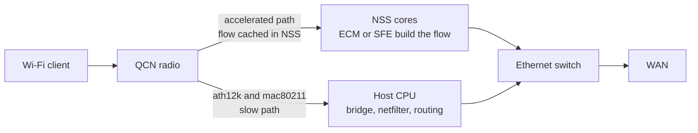

The consequence for anyone doing latency or QoS work: **a flow that has been short-cut is invisible to the host.**
It does not traverse the bridge, netfilter or the qdisc, so it never sees FQ-CoDel, never sees AQL, and never
appears in a capture taken on the wireless interface. It also produces distinctive artifacts: when a shortcut
bypasses the bridge, the bridge's forwarding database is not updated by the accelerated traffic, and systems that
assume it is see stale L2 state. So the honest engineering rule is: *measure with the offload plane in a known
state*, and treat "the QoS setting had no effect" as a question about which plane the traffic is in before it is a
question about the setting.

---

## 15. How the driver architecture itself evolved

The driver family is a better history of Wi-Fi than the marketing names are, because each generation of driver
exists because a hardware assumption broke.

| Driver | First mainline | Hardware | What changed architecturally |
| --- | --- | --- | --- |
| **ath9k** | 2.6.27 (2008) | 802.11n | SoftMAC with **no firmware MAC**: `mac80211` owns the state machines and the host CPU does the real-time work. Still the reference for "what a wireless driver looks like" and increasingly unrepresentative |
| **ath10k** | 3.11 (merged 2013-07-14) | 802.11ac QCA988x | The first Qualcomm driver with a real firmware MAC: "a major difference from ath9k is that there's now a firmware and that's why we had to implement a new driver". WMI over copy engines |
| **ath11k** | 5.6 (March 2020), IPQ8074 on AHB | 802.11ax | A deliberate clean start rather than a shared code base: **"the datapath is completely different"**, it supports multiple MACs (called "soc" in the firmware interface), and there is only one WMI interface. IPQ6018 followed in 5.10, QCA6390 in 5.10, QCN9074 in 5.14, WCN6855 / QCA6698AQ / QCA2066 in 5.17 |
| **ath12k** | 6.3 (May 2023), QCN9274 and WCN7850 on PCIe | 802.11be | EHT, MLO and a hardware-group model where several devices form one MLO-capable group. AHB support for SoC parts such as IPQ5332 came later, with IPQ5424 added after that |
| **ath12k split** | In development | Wi-Fi 7 and beyond | `ath12k.ko` holds everything generation-agnostic (mac80211 interface, WMI/HTT stack, shared data path, core init) and a second module holds everything tied to one silicon generation (HAL register offsets, copy-engine pipe assignments, MHI channel setup, firmware TLV negotiation), in a `wifi7/` directory |

The split is the interesting one, because it reveals how Qualcomm expects the next decade to go. Reported figures
for the series: 13 commits, 33 files changed, about 1956 lines added and 1480 removed for a net increase of 476,
with the largest new file being the copy-engine configuration at roughly 973 lines — which is exactly what you would
expect, since copy-engine layout is the most hardware-specific part of any Qualcomm wireless driver. The stated
intent is that a future Wi-Fi 8 implementation adds a generation module rather than rewriting DMA management or PCIe
enumeration, and that the same platform could eventually host a Wi-Fi 6 module and let two drivers converge.

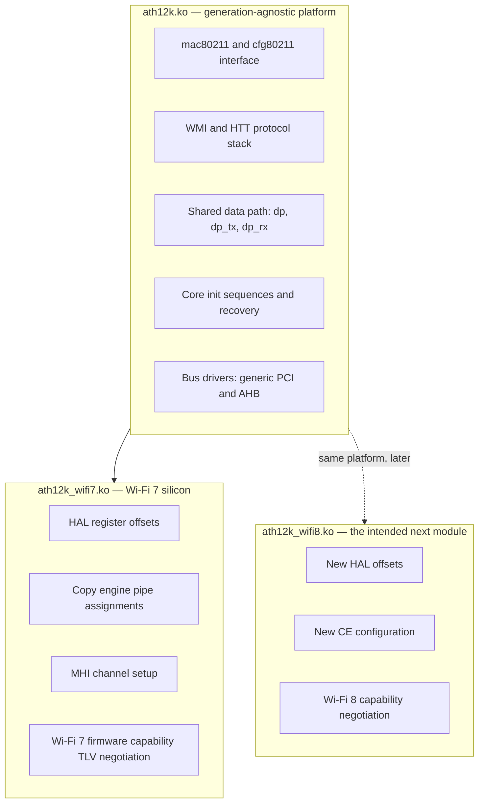

Treat the specific commit counts as reported by a secondary write-up of work in progress rather than as merged
history — check the list before quoting them. The architectural direction, however, is not in doubt: **the driver is
becoming a platform that hosts silicon-generation modules**, which is the only way to support four Wi-Fi
generations from one tree without four copies of the data path.

### 15.1 The chip is an untrusted writer

One more architectural property deserves its own paragraph, because it is the reason this driver class is audited
the way a network protocol is audited rather than the way a device driver usually is. The rings are **coherent DMA
memory the device writes into**. The driver then reads those descriptors and validates them. An IOMMU, where
present, bounds *where* the device may write — not *when*; inside its own mapped ring the firmware is a concurrent
writer for the entire duration of a reap. On top of that, several descriptor fields (peer id, MSDU length, frame
control bits) are derived by firmware and hardware **from over-the-air frames**, so a remote attacker influences
their values even with honest firmware.

The practical consequence: on this architecture the kernel is parsing data that originates on the far side of the
radio. Any new ring, any new status TLV, and any new descriptor field is a new parser with a hostile input.

---

## 16. What Wi-Fi 8 asks of the baseband, the firmware and the driver

Read the 802.11bn feature list as a set of demands on this architecture, and the shape of the next generation of
silicon becomes legible.

| Wi-Fi 8 feature | What must change in silicon | What must change in firmware | What must change in the host or driver API |
| --- | --- | --- | --- |
| **2× LDPC** (1944 → 3888 bits, about 0.5–1 dB) | Larger decoder buffering, longer decode pipelines, and **more decode latency** | Scheduling must account for the longer decode and for the latency it adds to the HARQ-free retry loop | Latency budgets and AQL estimates have to be revised; nothing in `mac80211` knows the codeword changed |
| **New intermediate MCS** (QPSK 2/3, 16-QAM 2/3 and 5/6, 256-QAM 2/3) | Fine-grained rate steps in the mapper and demapper | Rate adaptation gets a denser search space | The host rate estimate gets finer; AQL's expected-airtime arithmetic improves |
| **UEQM** (per-stream modulation, 2–4 streams, LDPC only) | Per-stream mapper and per-stream LLR scaling; more precise CSI | Rate control becomes **a vector**, not a scalar; sounding and feedback change | Per-PPDU statistics must report per-stream rates, or the host estimate is wrong |
| **ELR** (quadruplicated data plus a specialised preamble) | A new transmit path and a new preamble correlator in the receiver | Policy: when to spend 4× airtime on one client | Needs a way to express "this client is at the edge" from the host |
| **DRU** (26/52/106/242/484 tones spread over up to 80 MHz, uplink only, at most two streams, new UHT-LTF) | Tone-mapping hardware and a new LTF; not available for uplink MU-MIMO | RU allocator must handle distributed RUs; trigger frames change | Trigger-frame and RU configuration APIs grow |
| **NPCA** (access on a non-primary channel when the primary is busy) | A **second CCA state machine** — the radio must know channel state somewhere other than its primary | Two-channel access policy and TXOP management | Channel and bandwidth configuration becomes richer than "primary plus width" |
| **Preemption** (stop an ongoing transmission for an urgent one) | The ability to abandon a transmit opportunity mid-aggregate, and to repair the BlockAck state | The hardest scheduling change in the generation | Frames in flight can be cancelled — the completion path must handle it |
| **P-EDCA / DS-CTS** | A defer signal that other stations must decode | Contention policy and a new control-frame exchange | EDCA parameter configuration gains new objects |
| **Multi-AP coordination** (Co-TDMA, Co-SR, Co-BF, Co-RTWT) | Precise shared timing; possibly dedicated coordination messaging between devices | **The scheduler becomes distributed**: one AP's decision depends on another's state | This is the largest host-API question in the generation: how does a controller configure, observe and debug a schedule that spans APs |
| **SMD roaming** (connect-before-disconnect) | Two simultaneous associations with shared security context | Peer and key state held for two APs at once | Station and key state machines must allow a second association before the first is torn down |
| **DSO / DBE** (per-TXOP subband assignment, dynamic bandwidth expansion) | Per-TXOP bandwidth configuration at short notice | Per-TXOP bandwidth decisions | Bandwidth becomes a per-transmission property rather than a per-BSS property |
| **Unavailability reporting** (PUO, DUO) | — | The scheduler honours a station's declared unavailability windows | A configuration path for coexistence-driven unavailability |
| **Interference-mitigation pilots** | New pilot patterns | Receiver policy | — |
| **QoS signalling** (larger BSR queues, repurposed AC indices, strict latency requirements) | — | Queue management and admission | **An application's latency requirement has to reach the firmware.** Today there is no general host-to-firmware path for "this flow needs 5 ms"; there will need to be one |

The pattern in that table: **almost every Wi-Fi 8 feature is invisible to the host except as a configuration knob,
and almost all of them make firmware's job harder in a way the host cannot see.** That is the opposite of what a
software engineer wants, and it is why the interesting work in Wi-Fi 8 is in the measurement and the API, not in the
mechanism.

The gap is easiest to see as a path. A latency requirement is stated by an application, and it has to travel to the
one entity that can honour it — the firmware scheduler — through every layer of this note's architecture:

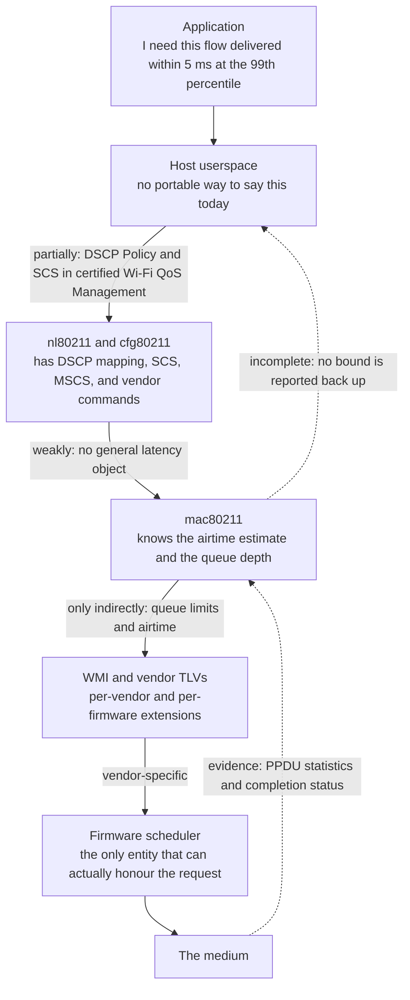

Both directions are incomplete. The requirement rarely reaches the scheduler, and evidence of whether it was met
never reaches the application. Closing that loop is a driver-API problem more than a radio problem, and it is the
single most valuable thing a software engineer can contribute to this generation.

---

## 17. Eight directions the architecture is actually moving in

1. **More MAC in firmware, and the host becoming a configurator.** Already true for rate, retransmission,
   aggregation and scheduling; Wi-Fi 8 pushes link selection, bandwidth per TXOP and unavailability into firmware
   too. The host's remaining real jobs are queueing policy, accounting and configuration.
2. **Neural acceleration inside connectivity silicon.** FastConnect 7900 was marketed as the first AI-optimized
   connectivity system; FastConnect 8800 adds centimetre-level "Proximity AI" fusing UWB, Bluetooth channel sounding
   and Wi-Fi ranging; the Dragonwing NPro A8 Elite puts a Hexagon NPU in the AP SoC explicitly for "agentic AI at
   the edge". The plausible uses are traffic classification, interference classification, channel estimation and
   scheduling policy — all of which are things the firmware does today with heuristics.
3. **The driver as a platform hosting generation modules.** The ath12k split is the first concrete step; the same
   pattern is the only sustainable answer to supporting four generations.
4. **The scheduler becoming a network function.** Multi-AP coordination means the entity that decides who transmits
   is no longer inside one chip. That requires shared timing, inter-AP messaging, telemetry, and a controller that
   can observe a distributed schedule — none of which exists as a standard host API today.
5. **Determinism as a first-class driver interface.**
   [[02-9 WLAN - Time-Sensitive Networking Across Wi-Fi Generations]] states the requirement; the missing piece is
   a host API that carries an application's latency bound down to the thing that can honour it, and an accounting
   path that carries evidence back up.
6. **One chip, many radios, and coexistence as a firmware discipline.** FastConnect 8800 integrates Wi-Fi 8,
   Bluetooth 7.0, UWB (802.15.4ab) and Thread 1.5. Coexistence used to be a pin and a scheduling hint; it is now a
   resource-allocation problem inside one firmware.
7. **Security boundaries moving into the subsystem.** Secure boot, signed firmware, protection-domain handling and
   the fact that the device writes the descriptors the kernel parses together mean the driver is an input-validation
   layer, not just a hardware abstraction.
8. **Open-source drivers as a product requirement.** Qualcomm's Wi-Fi 6 and Wi-Fi 7 drivers are developed upstream,
   with public mailing lists, public patch review and `Tested-on` tags naming the exact firmware build. That is why
   this note can make claims about real internals; for competing silicon, equivalent claims are usually unavailable.

Put those eight together and the shape of a Wi-Fi 8 platform is recognisable:

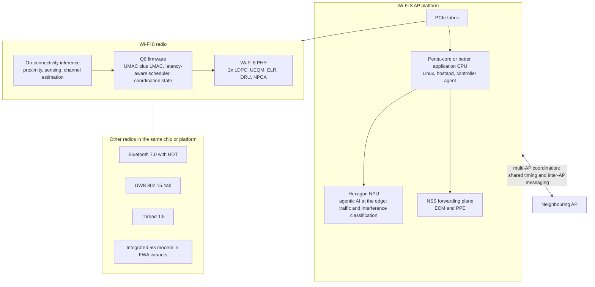

Three properties of that picture are new relative to Wi-Fi 6. There is **inference inside the connectivity chip**,
not only in the SoC. There is a **second processor in the platform whose job includes the network itself**. And the
scheduler is no longer contained by the box: the arrow to the neighbouring AP is the one that makes Wi-Fi 8's
latency targets achievable in a real deployment, and it is the one with no standard host interface yet.

---

## 18. Ten answers worth having on the tip of your tongue

1. **"What is the baseband?"** The digital half of the radio between the converters and the MAC: synchronisation,
   FFT, channel estimation, MIMO detection, LDPC decoding, and the transmit mirror of all of it. The LDPC decoder is
   the largest block, which is why doubling the codeword in Wi-Fi 8 is a silicon decision.
2. **"Where does the 802.11 MAC run?"** Split. On Qualcomm, `mac80211` runs the policy half on the host and firmware
   on a Q6 DSP runs the real-time half, because anything that must respond inside a SIFS cannot round-trip PCIe.
3. **"What is the difference between WMI and HTT?"** WMI is control (TLV commands and events: vdev, peer, scan,
   MLO); HTT is data (TX descriptors, RX indications, PPDU statistics). Both ride HTC over copy-engine pipes.
4. **"How does a frame get transmitted?"** The driver builds a descriptor, maps the buffer, posts it to a TCL ring
   and writes a doorbell. The chip DMAs it, and firmware chooses rate, aggregation, RU and stream. Completion comes
   back on a separate release ring.
5. **"Who does reordering?"** The REO, in hardware, per peer and per TID, before the host sees anything.
6. **"Why is Wi-Fi latency bad on a saturated download?"** Because the driver keeps no queue of its own: with no AQL
   advertised, the backlog becomes posted descriptors in hardware rings where there is no AQM. Measured on ath11k:
   155 ms at 94.6 Mbit/s stock, 22 ms at 74.3 Mbit/s with a binding airtime limit. The trade is explicit.
7. **"What does MLO change in the driver?"** One vif with several link vifs, a link id on the skb, firmware-side
   link selection for 802.3 frames, a special vdev id plus global sequence number for group-addressed frames, and a
   mandatory WMI MLO setup that, if omitted on a split-phy device, is a firmware assert.
8. **"How does the chip boot?"** Over MHI on PCIe, or as a remote processor via `remoteproc` and
   `qcom-q6v5-wcss-pil` on SoC parts. Then a QMI handshake, BDF selection by variant string, firmware-ready, WMI
   init, and a three-message HTT attach including the RX ring configuration.
9. **"What happens when firmware crashes?"** On SoC parts remoteproc notices and reloads; on PCIe parts an MHI
   execution-environment event triggers a driver reset. The hard part is quiescing correctly: disabling interrupts
   before freeing the data path, or the NAPI polls a freed ring and takes the board down.
10. **"What is Wi-Fi 8 actually for?"** Not peak rate. Twice the LDPC codeword, distributed RUs, enhanced long
    range, unequal modulation, non-primary channel access, preemption, multi-AP coordination and seamless mobility
    — all aimed at reliability, coverage and the latency tail, against quantified targets of +25% throughput,
    −25% latency at the 95th percentile and −25% MPDU loss.

---

## 19. How to localise a fault in this stack

| Symptom | Most likely layer | What to check first |
| --- | --- | --- |
| Probe fails with a BDF or board-data error | Bring-up | The `variant` string in `board-2.bin` against what QMI reported; it is matched exactly, including case |
| Probe hangs with no further output | HTT attach | Whether the version request, fragment-descriptor-bank config and RX ring config all completed |
| "ce desc not available" | Copy engine | Interrupt and tasklet handling for CE pipes, especially with threaded NAPI enabled |
| Radio works but range is poor | BDF | A mismatched BDF transmits at the wrong power. This looks like a coverage problem and is not one |
| Throughput collapses after minutes | Thermal or power | The thermal zone and any firmware throttling; plot temperature against throughput |
| Throughput collapses when interrupt affinity is unavailable | NAPI context | Whether threaded NAPI is enabled; measured on ath12k hardware as 802 Mbit/s against 2.58 Gbps |
| Latency is huge under download but fine when idle | Queueing | Whether the driver advertises AQL, and what the station's pending airtime reads against the limit |
| Throughput good but one slow client dominates the medium | Airtime fairness | Whether airtime fairness is advertised and whether the limit binds; without it a slow client took 63–72% |
| QoS or shaping settings have no effect | Offload plane | Whether the flow has been short-cut by NSS/ECM and is bypassing the host entirely |
| Whole board reboots with no kernel panic | Firmware crash | The firmware version string and the assertion line in the remoteproc or MHI log, on the serial console |
| Association works but nothing passes | WMI state | Whether a command was refused; firmware and host can disagree about vdev or peer state without either failing loudly |
| Firmware asserts during multi-link association | MLO setup | Whether WMI MLO setup and ready were sent with the hardware link map on a single split-phy device |

---

## Anchors — verified facts

- **Driver generations.** ath9k in Linux 2.6.27 (2008, SoftMAC, no firmware MAC). ath10k merged into 3.11-rc1 on
  2013-07-14, the first Qualcomm driver with a firmware MAC. ath11k first included in **v5.6 (March 2020)** for
  IPQ8074 over the shared-memory AHB bus; IPQ6018 and QCA6390 in v5.10; QCN9074 in v5.14; WCN6855, QCA6698AQ and
  QCA2066 in v5.17. ath12k in **v6.3 (May 2023)** for QCN9274 and WCN7850 over PCIe; AHB support
  (`CONFIG_ATH12K_AHB`, example **IPQ5332**, an 802.11be 2.4 GHz 2×2 device) added later, with **IPQ5424** after
  that.
- **ath11k was a clean start.** The posted rationale states that although it shares WMI heritage with ath10k, the
  **datapath is completely different**, it supports multiple MACs called "soc" in the firmware interface, and there
  is only one WMI interface.
- **Qualcomm's own component list.** The driver contains a MAC interface (through `ath11k_ops`), a control path, a
  data path, the host–software-to-firmware interface (WMI and HTT plus HAL), host-interface bus abstraction, PCIe,
  and the copy engine, described as "a hardware pipe, standard ring interface based communication channel between
  the host driver and firmware". WLAN firmware runs on a dedicated **Q6** processor and contains the 802.11
  protocol state machines, performance algorithms (rate adaptation, coexistence, MIMO, OFDMA), core MAC hardware
  programming recipes, a unified MAC/PHY service interface, and core PHY/RF recipes including RF calibration, BDF
  and radar. A named performance-algorithm block covers the transmit scheduler, MU scheduler, MU grouping, RU
  allocator and airtime fairness.
- **Firmware files.** `amss.bin` (Q6 image), `m3.bin` (M3 image where the part has one), `board-2.bin` (BDF), and
  `firmware-2.bin` (API 2 IE container holding both images). On **WCN6750** the M3 image is bundled into the Q6
  image and downloaded as part of Q6 boot, and firmware uses a fixed **12 MB** reserved MSA memory region rather
  than requesting DDR through QMI. The QMI sequence for that part is: firmware indication, host capability, target
  capability, device info, BDF download, firmware ready. BDF selection matches `bus`, `qmi-chip-id`,
  `qmi-board-id` and `variant` exactly, including case. A device-tree `firmware-name` property selects a
  usecase-specific firmware directory; the documented example is WCN6855 default firmware against an `nfa765`
  variant adding commercial-quality SAP and IoT power optimisation, both sharing one BDF.
- **HTT handshake.** After the HTC connection is established, three mandatory messages are sent: version request
  (answered with a version confirmation that negotiates capability), fragment-descriptor-bank configuration, and RX
  ring configuration (base address and size). Without them the radio will not respond.
- **Rings.** Transmit: SW2TCL1 (host to TCL), TCL2TQM, TQM2TXDMA. Receive: RXDMA2REO, REO2SW. Completion and buffer
  return: WBM2SW. On ath11k, frames are spread over **three TCL rings chosen by the sending CPU**.
- **Interrupts.** Rings and copy engines are mapped to interrupt groups by the chip's interrupt controller; the
  driver creates a NAPI instance per data-path group whose poll drains the group's rings to a budget and re-enables
  the interrupt only when drained. Copy-engine interrupts are handled in a tasklet per pipe. Single-MSI-vector
  platforms are supported with a fallback path. Enabling **threaded NAPI** on ath12k when IRQ affinity is
  unavailable took EHT160 UDP downlink from **802 Mbit/s to 2.58 Gbps** on the reported platform (QCC2072).
- **AQL on ath11k.** A 2026 patch series records that ath11k advertises neither `NL80211_EXT_FEATURE_AQL` nor
  `NL80211_EXT_FEATURE_AIRTIME_FAIRNESS`, that every user of either inside `mac80211` is gated on the bit, and that
  the driver keeps no queue of its own. Measured on an IPQ8074 AP: stock 94.6 Mbit/s at 155 ms; with the series and
  `aql_txq_limit` 500/1000 µs, 74.3 Mbit/s at 22 ms; with the completion-driven scheduling reverted, 33.7 Mbit/s at
  21 ms; at MCS0, stock 23.6 Mbit/s at 502–523 ms against 23.3 Mbit/s at 30–32 ms. With two stations, the slow
  client took 63–72% of the medium on stock and about 44% with fairness at equal weights. The host charge was
  47–51 µs per MSDU against 91–92 µs measured by the radio, a ratio near 1.85. `ath10k` and `mt76` advertise both
  bits. **Status caveat: this series was posted and revised through 2026; verify whether it has merged before
  asserting that mainline ath11k enables AQL.**
- **MLO in ath12k.** For an ML vif, `mac80211` supplies the transmit link id and the driver converts RA and TA to
  the corresponding link station and link vif addresses; for 802.3 data frames the frame is always enqueued on the
  **primary (association) link** and firmware performs link selection, header construction and address translation.
  Group-addressed frames on an MLD must use the same sequence number on every link (IEEE 802.11be-2024
  §10.3.2.14.2); the driver submits them with the actual vdev id **plus 128** and a multicast global sequence number
  in the HTT metadata. A `can_activate_links` operation lets `mac80211` activate partner links once the station is
  authorised. On a **single split-phy device**, the driver must send WMI MLO setup, ready and teardown commands or
  firmware is unaware of the `hw_links` component and may assert during multi-link association. Tested-on tags in
  that work name QCN9274 hw2.0 and WCN7850 hw2.0.
- **Firmware crash and recovery.** On AHB parts `remoteproc` detects the fatal error and reloads; on PCIe parts an
  `MHI_CB_EE_RDDM` event reaches the driver's MHI status callback, which starts a reset that powers the host
  interface down and up and lets MHI reload firmware. A recovery path exists for PCIe parts precisely because
  remoteproc is absent there. Debugfs offers a `simulate_fw_crash` trigger; the **`assert`** trigger reproduces the
  crash path while **`hw-restart`** does not, because the latter goes through the reset path that still disables
  interrupts. On IPQ8074, a firmware assert rebooted the SoC because the data-path NAPI kept polling while the crash
  path freed the data path and cleared the ring list; disabling interrupts on the crash path, plus implementing the
  copy-engine interrupt enable and disable operations for AHB, fixed it — validated as 2/2 panics before and 3/3
  clean recoveries afterwards, with five firmware boots in a 397-second uptime.
- **A crash in the wild.** An IPQ8074 router reboot-looped every 20–40 seconds from
  `wal_peer_control.c:2904 Assertion is_graceful_to_handle failed` under `qcom-q6v5-wcss-pil`, requiring two BSSes
  on one 2.4 GHz radio *and* a client repeatedly failing peer creation. Either condition alone was harmless.
- **Networking Pro 1620 (IPQ9574), from Qualcomm's own brief.** Quad-band 16-stream Wi-Fi 7 platform, 33 Gbps peak
  PHY rate, 320 MHz in 6 GHz and 240 MHz for regions without 6 GHz, 4K QAM, up to **2000 clients**, "up to 37-user
  OFDMA support per channel", "4-user UL/DL MU-MIMO support per channel", embedded crypto accelerators, 10 GbE WAN
  and LAN, PCIe for platform extension, AFC for 6 GHz standard power. SoC: quad-core Arm Cortex-A73 at 2.2 GHz,
  14 nm, four PCIe 3.0 controllers, 2× USXGMII, integrated Ethernet switch.
- **QCN9274.** Wi-Fi 7 radio: 4096-QAM, 320 MHz, 4×4. Community teardowns report 512 clients per radio and a
  maximum of 37 OFDMA users on 5/6 GHz with 18 on 2.4 GHz — **VERIFY** the per-radio client figure against a
  datasheet; it is a community observation, not a specification.
- **FastConnect 7900.** Single-chip 2×2 connectivity system on 6 nm integrating Wi-Fi 7, Bluetooth and UWB; up to
  5.8 Gbps using 4K QAM on 320 MHz, or 160+160 MHz via High Band Simultaneous; up to 4.3 Gbps with 4K QAM on 240 MHz
  of 5 GHz; described by Qualcomm as AI-optimized, with 40% lower power than the previous generation.
- **FastConnect 8800, announced at MWC on 2 March 2026.** First mobile connectivity system with a **4×4** Wi-Fi
  radio, peak rates beyond 10 Gbps, up to 2× the performance and up to 3× the gigabit range of the previous
  generation, Bluetooth High Data Throughput raising Bluetooth from 2 Mbps to 7.5 Mbps, and the only mobile
  connectivity system to offer Wi-Fi 8, Bluetooth 7.0, UWB 802.15.4ab and Thread 1.5 in a single chip, on 6 nm, with
  centimetre-level Proximity AI.
- **Dragonwing networking platforms, announced 2 March 2026.** NPro A8 Elite: **5×5** Wi-Fi 8 radio system, up to
  40% throughput gain at typical distance, latency reduced by **2.5×** at peak usage, up to 30% lower daily energy,
  a next-generation penta-core CPU and an integrated **Hexagon NPU** for agentic AI at the edge. FiberPro A8 Elite
  adds 10G PON; FWA Gen 5 Elite pairs the platform with the X85 5G modem-RF system; N8 and F8 are the mainstream
  Ethernet and fibre tiers. Sampling at announcement, with commercial products expected in late 2026.
- **Wi-Fi 8 PHY specifics.** LDPC maximum codeword **doubled from 1944 to 3888 bits**, with measured gains of
  0.5–1 dB depending on channel conditions; new MCS entries QPSK 2/3, 16-QAM 2/3, 16-QAM 5/6 and 256-QAM 2/3;
  **UEQM** defined for two to four streams and exclusively with LDPC; **DRU** sizes 26, 52, 106, 242 and 484 tones
  with distribution bandwidths up to 80 MHz, defined for **uplink OFDMA only**, limited to two spatial streams, with
  new UHT-LTF signals, not supported for uplink MU-MIMO, and able to coexist with regular RUs in different 80 MHz
  segments; **ELR** as a dedicated frame format using data quadruplication and a specialised preamble; enhanced
  beamforming and sounding work including CSI compression techniques and interference-mitigation pilots.
- **Two open items.** The `ath12k` module split figures (13 commits, 33 files, 33-file change stats, `wifi7/ce.c`
  around 973 lines, a future `ath12k_wifi8.ko`) come from a secondary write-up of work on a development branch —
  **VERIFY against the mailing list before quoting.** The identification of Dragonwing NPro A8 Elite with a specific
  IPQ part number is also secondary and unverified.

---

## Related

- [[02-4 WLAN - Packet TX-RX Datapath and Offload Evolution]] — the packet-path view this note's silicon view sits under: SoftMAC and FullMAC, the five offload planes, and what "offload" costs you in observability
- [[02-8 WLAN - Scheduling - Channel Access, EDCA, OFDMA Resource Allocation, Airtime and Implementation]] — what the firmware scheduler in section 6 is actually deciding, and why a Wi-Fi scheduler must win the medium first
- [[02-9 WLAN - Time-Sensitive Networking Across Wi-Fi Generations]] — the requirement that section 11's queueing numbers and section 16's host-API gap exist to serve
- [[02-1 WLAN - Wi-Fi Generations Evolution]] — which generation introduced each feature whose silicon cost section 4 itemises
- [[02-2 WLAN - Power Saving Mechanisms and Evolution]] — TWT and the power states section 13 suspends into
- [[02-5 WLAN - STA-AP Discovery, Authentication and Association]] — the state the host half of section 6's ownership table maintains
- [[02-6 WLAN - Multi-AP Roaming, Healing and Steering]] — the transition that SMD in section 16 is designed to remove
- [[02-7 WLAN - Wi-Fi EasyMesh, Operation, Tuning and Troubleshooting]] — the management plane a multi-AP coordination deployment has to configure, and what a controller can actually observe
- [[02-3 WLAN Ecosystem - WFA, EasyMesh and prpl]] — certification and what vendors actually ship, which is the only reliable guide to which of these features exist in products
- [[04-6 Linux Device Drivers - Model, Probe, Data Path, Power and Bring-Up]] — the generic driver model this driver is a guest in: probe ordering, devres, DMA ownership, runtime PM and the bring-up method section 8 assumes
- [[04-4 Linux Interrupts - Types, Handlers, Threaded IRQs and Deferred Work]] — the NAPI and tasklet machinery of section 10 in full, including why threaded NAPI changes the picture
- [[04-5 Linux Concurrency - Kernel and User Mode, Processes, Threads and IPC]] — the locking and context rules a driver whose rings are written concurrently by a device has to obey
- [[01-6 NR DU MAC Scheduler - Resource Allocation, HARQ and Real-Time Implementation]] — the cellular contrast: a scheduler handed a slot by a grant, with the queue in the scheduler rather than in a chip
- [[05-1 DPDK User Plane and 5G UPF]] — the other answer to "get the CPU out of the data path", and why Wi-Fi resists kernel bypass
- [[08-1 Programming Languages Toolchain and Performance Engineering]] — profiling a path whose cost is per-descriptor, not per-packet
- [[08-2 C and C++ Programming - Language Features, STL and Systems Practice]] — the kernel C idioms this driver is written in: `container_of`, `FIELD_GET`, `READ_ONCE` and `WRITE_ONCE`, and the barriers that make a doorbell correct

- [[02-11 WLAN - OpenWrt and the Software Architecture of a Wireless System]] — the other side of the driver: how a router configures what section 6 describes, and where the firmware and board data come from
- [[02-12 WLAN - openwifi - An Open-Source FPGA 802.11 Platform]] — the same low MAC and PHY, but in Verilog you can edit and registers you can read

- [[02-13 WLAN - Reliability, Low Latency and Determinism - What the Wi-Fi Stack Can Actually Do]] — why AQL exists — the firmware queue the host cannot see — and what the offload paths cost when you are trying to bound latency

---

## References

1. Qualcomm Technologies. *Wi-Fi software architecture* — ath11k driver software architecture, document 80-80021-14. <https://docs.qualcomm.com/doc/80-80021-14/topic/wlan_sw_overview.html> — The vendor's own component list for the driver and the firmware: MAC interface, control path, data path, WMI/HTT/HAL, bus abstraction, copy engine, and the Q6 firmware's contents. The primary source for sections 5, 6 and 7.
2. Valo, K. *"ath11k: driver for Qualcomm IEEE 802.11ax devices"* — Linux Kernel Mailing List, 2019. <https://lwn.net/Articles/796850> — The original posting: why ath11k was a clean start, that the datapath is completely different from ath10k, that it supports multiple MACs called "soc", and that there is only one WMI interface.
3. WikiDevi. *ath11k* — supported devices and the kernel version each chipset first appeared in. <https://wikidevi.wive-ng.ru/Ath11k> — IPQ8074 in v5.6, IPQ6018 and QCA6390 in v5.10, QCN9074 in v5.14, WCN6855, QCA6698AQ and QCA2066 in v5.17.
4. *GNU/Linux Atheros Wi-Fi driver installation* — driver-to-kernel-version table. <https://tutorialforlinux.com/gnu-linux-atheros-wifi-driver-installation/> — ath9k in 2.6.27, ath10k in 3.11, ath11k in 5.6, ath12k in 6.3.
5. Linux Wireless. *About ath10k*. <https://www.linuxwireless.sipsolutions.net/en/users/Drivers/ath10k/> — "A major difference from ath9k is that there's now a firmware and that's why we had to implement a new driver", and the 2013-07-14 merge into 3.11-rc1.
6. Kolli, A., and Valo, K. *"ath11k: add firmware-2.bin support"* — LKML, January 2023. <https://patchwork.kernel.org/project/linux-wireless/patch/20230111092547.21425-4-kvalo@kernel.org/> — Firmware API 2, the IE container format, and how the MHI layer receives the amss image by pointer.
7. Pubbisetty, M. *"ath11k: Add QMI changes for WCN6750"* — ath11k mailing list, January 2022. <https://lists.infradead.org/pipermail/ath11k/2022-January/002590.html> — The QMI message sequence, the fixed 12 MB MSA region, and the M3 image being bundled into the Q6 image on that part.
8. Pan, M. *"wifi: ath11k: support usecase-specific firmware overrides"* — LKML, May 2025. <https://patchwork.ozlabs.org/project/devicetree-bindings/cover/20250522013444.1301330-1-miaoqing.pan@oss.qualcomm.com> — The `firmware-name` device-tree property and the WCN6855 default-versus-`nfa765` firmware split.
9. *OpenWrt firmware_qca-wireless: ATH11K platform support* — DeepWiki generated documentation. <https://deepwiki.com/openwrt/firmware_qca-wireless/3-ath11k-platform-support-(wi-fi-66e)> — Board-data file naming, the QMI hardware-detection and BDF-matching sequence, and the exact-match rule for the `variant` string.
10. Bairaktaris, J. *"wifi: ath11k: airtime queue limits, fairness and a driver TXQ scheduler"* — LWN, 2026. <https://lwn.net/Articles/1090342> and <https://lwn.net/Articles/1093204> — The measurement that section 11 rests on: AQL and airtime fairness inert on ath11k, throughput against latency for several limit settings, two-station fairness, and the 1.85 ratio between the host charge and the radio's own measurement.
11. Bairaktaris, J. *"[PATCH v1 0/4] wifi: ath11k: enable airtime queue limits and fairness"* — ath11k mailing list, August 2026. <https://lists.infradead.org/pipermail/ath11k/2026-August/008943.html> — Why AQL matters more for a driver with no queue of its own, and why the airtime-fairness bit cannot be set without reporting.
12. Bairaktaris, J. *"[PATCH ath-next v2 0/2] wifi: ath11k: fix SoC reboot on firmware crash on AHB"* — LKML, July 2026. <https://lkml.iu.edu/hypermail/linux/kernel/2608.0/08477.html> — The IPQ8074 assert-reboots-the-SoC bug, why only the `assert` trigger reproduces it, and the before-and-after recovery counts.
13. OpenWrt. *mac80211: ath11k: stop a firmware crash from rebooting the SoC on AHB* — package changelog, September 2026. <https://git.openwrt.org/openwrt/openwrt/atom/package/kernel/mac80211/patches/ath11k> — The backport of the two upstream fixes, with the call trace through `ath11k_dp_rx_process_mon_rings` and `ath11k_dp_service_srng`.
14. OpenWrt Forum. *"MX4200v2 / IPQ8074: continuous reboot loop caused by ath11k firmware crash with two SSIDs on one 2.4 GHz radio"*. <https://forum.openwrt.org/t/mx4200v2-ipq8074-continuous-reboot-loop-caused-by-ath11k-firmware-crash-with-two-ssids-on-one-2-4ghz-radio/252958> — The worked example of a firmware assert taking a whole board down, with the assertion line and the two conditions that trigger it.
15. Gong, W. *"[PATCH v3 0/3] ath11k: add feature for device recovery"* — LKML, October 2021. <https://lore.kernel.org/linux-wireless/20211015035459.14190-1-wgong@codeaurora.org/t/> — Why PCIe parts need their own recovery logic, the `MHI_CB_EE_RDDM` event, and the reset path through host-interface power down and up.
16. Huang, C. *"ath11k: supports one MSI vector"* — LKML, December 2020. <https://patchwork.kernel.org/project/linux-wireless/patch/20201223030225.2345-6-cjhuang@codeaurora.org/> — The single-MSI fallback and the copy-engine interrupt handling behind section 10.
17. Zhu, H. *"[RESEND PATCH 2/2] wifi: ath12k: enable threaded NAPI when DP IRQ affinity is unavailable"* — LKML, 2026. <https://lkml.iu.edu/2605.2/04437.html> — The 802 Mbit/s to 2.58 Gbps measurement on QCC2072, and the runtime test for whether IRQ affinity can be set.
18. Bhagat, R. K. *"wifi: ath12k: add Ath12k AHB driver support for IPQ5332"* — LWN, 2025. <https://lwn.net/Articles/1015075> — IPQ5332 as an 802.11be 2.4 GHz 2×2 device, the separate CE register space, fixed QMI firmware memory, and the WCSS secure PIL userPD handling.
19. LKDDb. *CONFIG_ATH12K_AHB*. <https://cateee.net/lkddb/web-lkddb/ATH12K_AHB.html> — The device-tree compatibles and kernel versions for ath12k AHB, including IPQ5332 and IPQ5424.
20. Sriram, R., Sundaram, R., and Valo, K. *"[PATCH 02/10] wifi: ath12k: ath12k_mac_op_tx(): MLO support"* — LKML, November 2024. <https://lore.kernel.org/all/20241126171139.2350704-3-kvalo@kernel.org/> — The transmit link id, address translation per link, and the rule that 802.3 frames are enqueued on the primary association link with firmware doing link selection.
21. Mahalingam, B. *"[PATCH 2/2] wifi: ath12k: Add support for MLO Multicast handling in driver"* — LKML, January 2025. <https://lore.kernel.org/all/20250109184932.1593157-3-quic_bmahalin@quicinc.com/> — IEEE 802.11be-2024 §10.3.2.14.2, the same sequence number on every link, the vdev id plus 128 trick and the multicast global sequence number in HTT metadata.
22. Singh, A. K., and Valo, K. *"[PATCH 0/7] wifi: ath12k: MLO support part 9/9"* — LKML, December 2024. <https://lkml.kernel.org/linux-wireless/20241211154358.776279-7-kvalo@kernel.org/T/> — `can_activate_links` and partner-link activation on authorisation.
23. Sahu, A. *"wifi: ath12k: report proper tx completion status to mac80211"* — LKML, 2025. <https://lore.kernel.org/ath12k/20250505221419.2672473-315-sashal@kernel.org/T/> — WMI MLO setup, ready and teardown for a single split-phy device, and the firmware assert that follows when they are not sent.
24. LibrePhone. *The ath11k Driver*. <https://librephone.fsf.org/site/ath11k/> — The layer stack from HDD down to SNOC/AHB or PCIe and CE, and the three mandatory HTT initialisation messages.
25. *Qualcomm-Atheros-Ath12k-documentation*, Chapter 4: TX Path in ath12k. <https://github.com/shibinkr/Qualcomm-Atheros-Ath12k-documentation> — The ring mechanics of the transmit path: descriptor allocation, DMA mapping, pushing to the TCL SRNG, and the head and tail pointers.
26. Aerlync. *The ath12k Unified Driver Model*. <https://www.aerlync.com/Company/Blogs/ath12k> — A secondary write-up of the two-module split, the `wifi7/` directory, and the per-commit change statistics. **VERIFY against the mailing list before quoting the numbers.**
27. Qualcomm Technologies. *Networking Pro 1620 Platform product brief*, 87-PW325-1. <https://www.qualcomm.com/content/dam/qcomm-martech/dm-assets/documents/Networking-Pro-1620-product-brief_87-PW325-1.pdf> — 33 Gbps, 16 streams, 320 MHz, 4K QAM, 2000 clients, 37-user OFDMA, 4-user MU-MIMO, AFC, and the ordering part number IPQ9574.
28. CNX Software. *"Qualcomm Wi-Fi 7 Networking Pro Series SoCs support up to 33 Gbps PHY rate, up to 2,000 clients"*. <https://www.cnx-software.com/?p=98625> — The IPQ9574 SoC detail: quad-core Cortex-A73 at 2.2 GHz, 14 nm, four PCIe 3.0 controllers, 2× USXGMII, integrated switch, and the per-tier lineup 1620/1220/820/620.
29. Qualcomm Technologies. *FastConnect 7900 Mobile Connectivity System product brief*, 87-73970-1. <https://docs.qualcomm.com/bundle/publicresource/87-73970-1_REV_B_Qualcomm_FastConnect_7900_Mobile_Connectivity_System_Product_Brief.pdf> — 6 nm single-chip 2×2, 5.8 Gbps with 4K QAM on 320 MHz, 4.3 Gbps on 240 MHz, HBS, and 40% lower power.
30. Qualcomm Technologies. *"Qualcomm Debuts AI-Native Wi-Fi 8 Portfolio Unifying Client and Network Connectivity for AI Era Performance"* — press release, 2 March 2026, Barcelona. <https://www.qualcomm.com/news/releases/2026/03/qualcomm-debuts-ai-native-wifi-8-portfolio-unifying-client-and-n> — FastConnect 8800 (4×4, beyond 10 Gbps, 2× performance, 3× gigabit range, Bluetooth HDT at 7.5 Mbps, Wi-Fi 8 plus Bluetooth 7.0 plus UWB 802.15.4ab plus Thread 1.5) and the five Dragonwing platforms including NPro A8 Elite with 5×5, 2.5× latency reduction and an integrated Hexagon NPU.
31. Qualcomm Technologies. *"Wi-Fi 8 under the hood: The technologies powering ultra-high reliability"* — OnQ, November 2025. <https://www.qualcomm.com/news/onq/2025/11/wi-fi-8-technologies-powering-ultra-high-reliability> — A vendor engineering account of longer LDPC block lengths, UEQM, new MCS levels, ELR and DRU, and what each is for.
32. MaxLinear. *Wi-Fi 8 for Broadband Service Providers*. <https://www.maxlinear.com/document?id=23470> — The numbers in section 4 and 16: 2× LDPC at 3888 bits with 0.5–1 dB measured gain, the new MCS entries, UEQM for two to four streams with LDPC only, and DRU sizes, distribution bandwidth, uplink-only operation and the two-stream limit.
33. Karamyshev, A., Levitsky, I., Bankov, D., and Khorov, E. *"A Tutorial on Wi-Fi 8: The Journey to Ultra High Reliability."* *Problems of Information Transmission* 61(2):164–210, 2025. DOI 10.1134/S003294602502005X. — DRUs, interference-mitigation pilots, UEQM, the doubled LDPC codeword, ELR with data quadruplication, and the whole MAC candidate list: P-EDCA, NPCA, preemption, DSO, DBE, unavailability reporting and QoS signalling.
34. *OpenWrt NSS acceleration and optimisations* — DeepWiki generated documentation. <https://deepwiki.com/LiBwrt/openwrt-6.x/5.3-nss-acceleration-and-optimizations> — The NSS driver, ECM, the WiFi offload module, and the accelerated-path-versus-standard-path packet flow behind section 14.
35. *nss-packages: Qualcomm NSS offload packages for the OpenWrt qualcommax EDMA stack*. <https://github.com/juliusbairaktaris/nss-packages> — The component list: `qca-nss-drv`, `qca-nss-ecm`, `qca-mcs`, PPPoE, bridge and VLAN managers, NSS SQM, and the NSS firmware package.
36. Gunbark security research. *ath11k driver audit notes*. <https://gunbark.dev/content/51b398b0-9cf2-4075-b5ed-54d48a2a5ce7> — The trust-boundary argument in section 15.1: coherent DMA rings the device writes, an IOMMU that bounds where but not when, and descriptor fields derived from over-the-air frames.

---

_Copyright (c) 2026 Washington Ruan and contributors · licensed under **GPL-3.0-or-later** or **AGPL-3.0-or-later**, at your option · see `LICENSE` and `LICENSE-AGPL`._
