# WLAN — Wi-Fi Fundamentals: History, Architecture, PHY, MAC and the Road to Wi-Fi 7

The substrate note. [[02-1 WLAN - Wi-Fi Generations Evolution]] is a feature-by-feature reference for
802.11n → 802.11bn; this note answers the questions that come *before* it: where Wi-Fi came from, what an
802.11 network physically is, why the MAC is contention-based and what that costs, where the bits per second
actually come from, and what Wi-Fi 7 changed. It is built from two books that approach the same standard from
opposite ends of the industry.

| | *Wi-Fi 7 In Depth* | *Wi-Fi 7: Principles, Technology, and Applications* |
| --- | --- | --- |
| Authors | Jerome Henry, Binita Gupta, Brian Hart, Malcolm Smith | Gang Cheng, Yiming Jiang, Zhijie Yang, Zhihong Qian, Thirumurthy Rajamanickam |
| Affiliation | Cisco — Office of the Wireless CTO and wireless engineering | Nokia — Broadband Device BU (Shanghai and Raleigh) |
| Publisher, year | Addison-Wesley / Cisco Press, 2024 · 385 pp. | Springer, 2025 · XXVI + 464 pp., 392 figures |
| Chapters | 9: fundamentals → the limits of legacy Wi-Fi → Wi-Fi 6 → 802.11be ideas → EHT PHY → EHT MAC for MLO → EHT MAC operation → deployment → future directions | 8: Wi-Fi overview (pp. 1–77) → Wi-Fi 6 (79–158) → Wi-Fi 7 principles (159–295) → product development and test (297–389) → industry alliance (391–403) → applications (405–433) → Wi-Fi 7 and 5G convergence (435–455) → outlook (457–464) |
| Lens | **Protocol and deployment.** Written by 802.11 voters who sat in the task groups; explains the *why* of each clause and what it does to cell design and roaming | **Product and system.** Written by a device-BU team that shipped the boxes; explains what the standard means for hardware bring-up, test coverage, certification and operator deployment |
| Read it for | The join sequence, channel access, PPDU fields, MLO modes and their performance consequences, site-survey practice | The Wi-Fi 6 → 7 delta, product validation flow, test taxonomy, WFA programme mechanics, 5G interworking, market outlook |

The two books agree on the standard and disagree on almost nothing technical; they differ in what they think
is hard. Book 1 thinks **the hard part is the protocol's behaviour under real clients**, and spends its MLO
chapter on why a client's MLO mode changes what a network designer may promise. Book 2 thinks **the hard part
is getting a compliant product out of the door**, and spends a quarter of its length on development and test.
Read together, they cover the two failure modes of a Wi-Fi engineer: explaining the protocol correctly but
designing a network that cannot deliver it, and building a product that passes certification but behaves badly
in a dense cell.

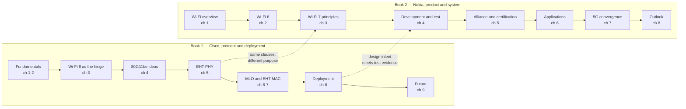

## 0. How this note is organised

| § | Question it answers | Where it comes from |
| --- | --- | --- |
| 1 | What is Wi-Fi, and why is its MAC unlike Ethernet's | Book 1 ch 1 |
| 2 | Where did the generations come from, what was each one *for*, and which amendments never became a generation | Book 1 ch 2, book 2 ch 1 |
| 3 | What is an 802.11 network made of | Book 1 ch 1 |
| 4 | How does a station join, frame by frame, and what the security exchange establishes | Book 1 ch 1 |
| 5 | How is the medium shared, and why does it collapse under load | Book 1 ch 1–2 |
| 6 | Where do the bits per second come from — numerology | Book 1 ch 5, book 2 ch 2 |
| 7 | The rate equation, and the arithmetic that explains five generations | Derived from the standards; book 1 ch 5 |
| 8 | MIMO, sounding and beamforming | Book 1 ch 5 |
| 9 | MAC efficiency: aggregation and Block Ack | Book 1 ch 3 |
| 10 | Wi-Fi 6 as the hinge: OFDMA, triggers, colour, TWT | Book 1 ch 3, book 2 ch 2 |
| 11 | Wi-Fi 7 PHY: 320 MHz, 4096-QAM, MRU, puncturing | Book 1 ch 5, book 2 ch 3 |
| 12 | Wi-Fi 7 MAC: multi-link operation | Book 1 ch 6, book 2 ch 3 |
| 13 | Wi-Fi 7 MAC: latency, QoS and priority | Book 1 ch 7, book 2 ch 3 |
| 14 | Designing a Wi-Fi 7 network | Book 1 ch 8, book 2 ch 6 |
| 15 | Building and testing a Wi-Fi 7 product | Book 2 ch 4 |
| 16 | What certification actually guarantees | Book 2 ch 5, book 1 ch 8 |
| 17 | Wi-Fi and 5G: competition, or one access network | Book 2 ch 7 |
| 18 | Where the next five years go | Book 1 ch 9, book 2 ch 8 |
| 19 | The interview package: ten answers, ten numbers, ten corrections | Synthesis |

---

## 1. What Wi-Fi is, and why its MAC is not Ethernet's

Wi-Fi is the marketing name for products that implement IEEE 802.11 and pass Wi-Fi Alliance certification.
The name was coined in 1999 for the Wireless Ethernet Compatibility Alliance — the industry body renamed
itself after its own brand in 2002 — and it has never been a technology. The technology is 802.11, and the
distinction matters in interviews: "Wi-Fi 6" is a certification programme for products implementing
802.11ax; "802.11ax" is the standard. A product can implement 802.11ax and fail certification; a product can
carry the logo and still be unable to interoperate at a specific feature level, because certification tests a
subset.

Three properties separate 802.11 from every wired LAN, and all three are consequences of the medium:

1. **The medium is shared and unlicensed.** There is no installer, no permission and no admission control.
   Any device may transmit, at any time, within regulatory power limits. A protocol that cannot rely on
   coordination must therefore *create* coordination, frame by frame.
2. **The medium is half-duplex and lossy at the physical layer.** A radio cannot listen while it transmits at
   the same frequency, so collision detection — the mechanism 802.3 uses — is impossible. Collisions can only
   be *avoided* (CSMA/CA) and *detected afterwards*, by the absence of an acknowledgement.
3. **The transmitter cannot be sure the receiver heard it.** Hidden nodes, fading and interference mean that
   "the medium was idle at my antenna" implies nothing about the medium at the receiver's antenna. This is why
   802.11 has an acknowledgement for essentially every frame, a virtual carrier-sense mechanism (NAV) and an
   optional RTS/CTS handshake that 802.3 does not need.

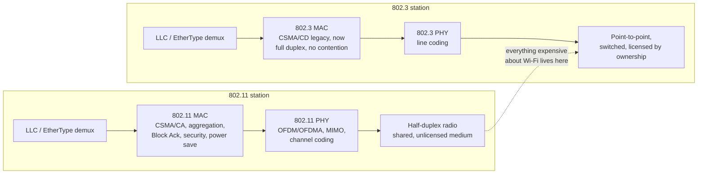

The consequence is an inversion that candidates often miss. In Ethernet, the MAC is trivial and the PHY got
complicated. In 802.11, the PHY is now extraordinary — 4096-QAM, 320 MHz, eight spatial streams — and **the
MAC is where the difficulty lives**, because the MAC is the part that has to arbitrate a shared medium
between devices that do not trust each other and cannot see each other. Every generation after Wi-Fi 4 is a
MAC story wearing PHY clothing.

Three design tensions recur throughout the standard, and every feature in this note is an answer to one of
them:

| Tension | Why it cannot be resolved once | Where you see it |
| --- | --- | --- |
| **Peak rate vs robustness** | Higher modulation and wider channels raise the peak only in the best channel conditions | 4096-QAM vs 6 GHz range; 320 MHz vs puncturing |
| **Efficiency vs fairness** | Serving many small-packet clients efficiently starves the one client that wants a large transfer, and vice versa | OFDMA RU sizing, airtime fairness, AQL |
| **Backward compatibility vs design freedom** | A new generation must interoperate with 25 years of devices on the same channel | preamble formats, protection modes, 6 GHz as the escape hatch |

---

## 2. History: from ALOHAnet to Wi-Fi 7

The history is not decoration. Every generation exists because a specific mechanism ran out of headroom, and
the standard's own structure — an ever-growing set of amendments to a base document — records that sequence.

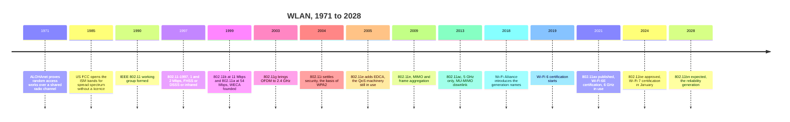

Two threads run through it, and they are usually taught separately when they should be taught together.

**Thread one — the PHY race.** Rate came from four levers, applied in sequence: wider channels
(20 → 40 → 80 → 160 → 320 MHz), denser modulation (64 → 256 → 1024 → 4096-QAM), more spatial streams
(1 → 4 → 8), and better coding (convolutional → LDPC). Each lever is now at a practical ceiling. 320 MHz is
the widest block that fits in any unlicensed band; 4096-QAM is the densest constellation anyone ships;
eight streams is the most that fits in a client's thermal and antenna envelope; and the 16-stream option
that would have doubled the headline number was removed from 802.11be before publication.

**Thread two — the coordination race.** The MAC has been rebuilt, amendment by amendment, to turn a
best-effort random-access network into something that can carry voice, video and industrial traffic:
802.11e (2005) gave frames priorities; 802.11i (2004) gave them security; 802.11k/r/v (2008–2011) gave
stations and APs the information to move between cells; 802.11n (2009) amortised the per-frame overhead with
aggregation; 802.11ax (2021) gave the AP a scheduler (OFDMA and trigger frames) and a way to ignore distant
BSSs (BSS colour); 802.11be (2024) gave a device several links at once; 802.11bn (≈2028) gives neighbouring
APs a way to coordinate. Read that list as a single argument: **the standard has been steadily importing
scheduling into a network that was designed to have none.**

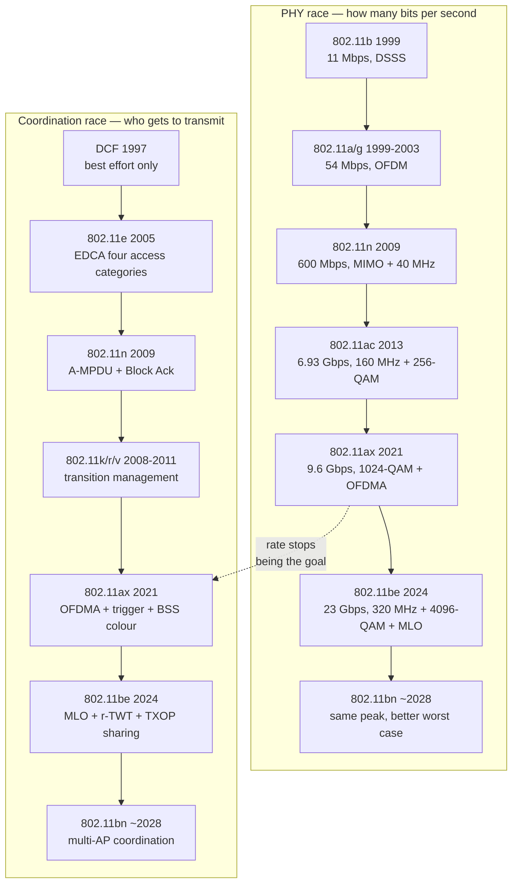

### 2.1 The generation table, with the problem each one solved

| Generation | Standard | Year | Bands | What it added | The problem it actually solved |
| --- | --- | --- | --- | --- | --- |
| Legacy | 802.11-1997 | 1997 | 2.4 GHz | DSSS/FHSS/IR, 1–2 Mbps | Cable replacement for a few terminals |
| — | 802.11b | 1999 | 2.4 GHz | HR-DSSS, 11 Mbps | Usable shared throughput |
| — | 802.11a | 1999 | 5 GHz | OFDM, 54 Mbps | Multipath robustness, less interference |
| — | 802.11g | 2003 | 2.4 GHz | OFDM at 2.4 GHz, 54 Mbps | Rate without moving band |
| — | 802.11e / i | 2004–05 | — | EDCA, WPA2 basis | Voice over Wi-Fi, and security that holds |
| Wi-Fi 4 | 802.11n | 2009 | 2.4 / 5 GHz | MIMO, 40 MHz, A-MPDU, Block Ack | Per-frame overhead, not PHY rate, was the limit |
| Wi-Fi 5 | 802.11ac | 2013 | 5 GHz | 160 MHz, 256-QAM, DL MU-MIMO | Peak rate per client; interference-free spectrum |
| Wi-Fi 6 | 802.11ax | 2021 | 2.4 / 5 / 6 GHz | OFDMA, UL MU-MIMO, BSS colour, TWT | Dense deployments: many clients, small packets |
| Wi-Fi 7 | 802.11be | 2024 | 2.4 / 5 / 6 GHz | 320 MHz, 4096-QAM, MRU, puncturing, MLO | Multi-gigabit *and* bounded latency at once |
| Wi-Fi 8 | 802.11bn | ≈2028 | 2.4 / 5 / 6 GHz | Multi-AP coordination, DRU, ELR, UEQM | The worst case, not the peak |

The naming decision of 2018 is worth a paragraph because it changed the industry's vocabulary and the
standard's politics. Renaming 802.11n as "Wi-Fi 4" and 802.11ac as "Wi-Fi 5" — retroactively — gave the
Alliance a single monotonic counter that consumers could follow, and it made the *generation* rather than the
*amendment* the unit of purchase. That is why vendors now ship "Wi-Fi 8 ready" hardware before 802.11bn
exists: the counter runs ahead of the standard. When you quote a generation number in an interview, say which
of the two you mean.

### 2.2 Where the two books place the turning point

Both books put the turning point at the same place and for the same reason: **Wi-Fi 6 is not a rate
generation, and that was deliberate.** Book 1 devotes an entire chapter (ch 3) to 802.11ax before it will
discuss 802.11be, on the argument that every EHT feature is either an extension of an HE mechanism (MRU
extends RU allocation, puncturing extends channelisation) or a fix for a problem HE exposed (single-link
operation is the limit that MLO removes). Book 2 does the same with a different emphasis: its Wi-Fi 6 chapter
is about efficiency *as a product requirement* — battery, density, and the operator's cost per subscriber.

The numbers make the point. From Wi-Fi 5 to Wi-Fi 6 the peak rate rose 1.39×; from Wi-Fi 6 to Wi-Fi 7 it rose
2.4×. But between Wi-Fi 5 and Wi-Fi 7 the *aggregate* capacity of a dense cell rose far more than either
number, because OFDMA and BSS colour changed how airtime is shared, not how fast one radio can go. Section 7
derives the 1.39× arithmetically, and it is the single most useful piece of arithmetic in this note.

### 2.3 The amendments that are not generations

The generation counter hides a second family of amendments: the ones that do not raise the rate and therefore
never got a Wi-Fi number. They matter because several of them are now load-bearing — TWT came from the
sub-1 GHz amendment, and the sensing amendment is where Wi-Fi's next market may be.

| Amendment | Scope | Why it matters to a generalist |
| --- | --- | --- |
| **802.11p** | Vehicular access in the 5.9 GHz band | DSRC's radio layer; largely displaced by cellular V2X in practice, but the origin of many outdoor-mobility assumptions |
| **802.11s** | Mesh networking: path selection, mesh portals | The ancestor of today's multi-AP backhaul thinking, superseded commercially by vendor mesh and EasyMesh |
| **802.11ad / 802.11ay** | 60 GHz millimetre wave, multi-gigabit short range | The greenfield MAC experiment: no legacy protection, beam training, and a link budget measured in metres |
| **802.11af** | TV white space | Regulatory-driven; taught the industry how to build a database-assisted spectrum model, which 6 GHz AFC now reuses |
| **802.11ah** | Sub-1 GHz, long range, low power | Where **TWT** was invented; the reason 802.11ax could adopt it |
| **802.11az** | Ranging and positioning | Turns Wi-Fi into a location sensor, with centimetre-class claims under good conditions |
| **802.11ba** | Wake-up radio | A second, ultra-low-power receiver that wakes the main radio, so the main radio can be truly off |
| **802.11bb** | Light communications | LiFi; the other greenfield with no legacy devices |
| **802.11bf** | WLAN sensing | Uses channel-state information from ordinary traffic to detect motion and presence — Wi-Fi as a sensor, not a network |

---

## 3. The architecture: what an 802.11 network is made of

802.11 defines a small vocabulary with precise meanings, and interviews punish imprecision here.

| Term | Meaning | Common confusion |
| --- | --- | --- |
| **STA** | A station: any device with an 802.11 MAC | "Client" is not a standard term |
| **AP** | A station that provides access to a distribution system | An AP is a STA with extra responsibilities, not a different species |
| **BSS** | Basic service set: one AP and its associated STAs, identified by **BSSID** (typically the AP's MAC) | BSSID is not the SSID |
| **SSID** | The network name, up to 32 octets, carried in beacons and probes | SSID identifies a network, BSSID identifies a radio |
| **DS** | Distribution system: the wired (or wireless) backbone that joins BSSs | It is not specified by 802.11 — it is whatever you build |
| **ESS** | Extended service set: multiple BSSs with the same SSID joined by a DS | Roaming happens *inside* an ESS |
| **Portal** | The point where the DS meets a non-802.11 network | Usually a bridge or router port |
| **IBSS** | Ad-hoc BSS: no AP, stations associate with each other | Rare; different rules for power save |

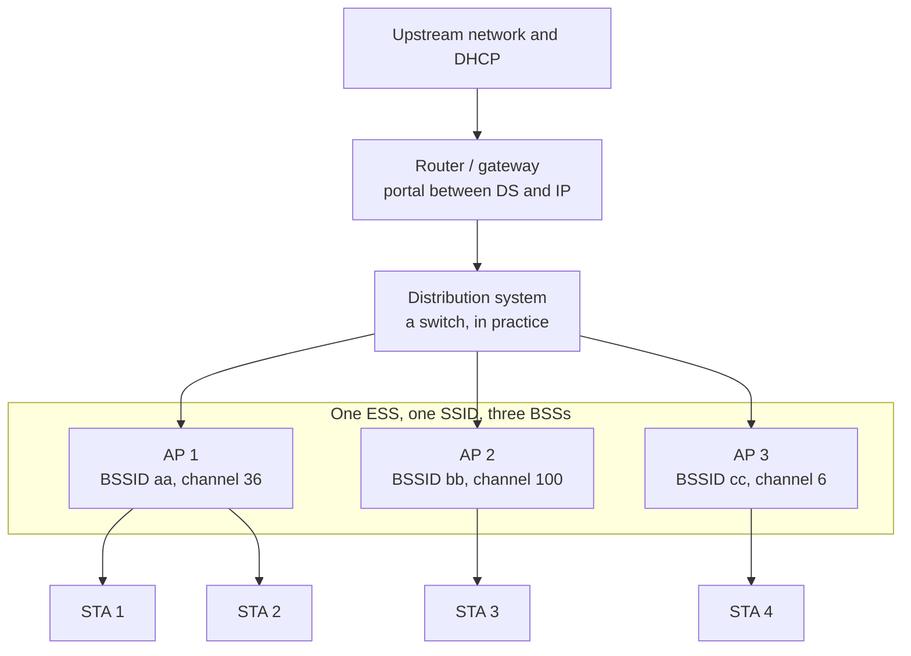

The layering is worth drawing because it explains where features land. 802.11 replaces the 802.3 MAC and PHY;
above it sits LLC, which is why an IP packet does not know or care that it travelled over radio — and why the
Wi-Fi-specific problems (retries, reordering, roaming, airtime) are invisible to IP unless something above
the MAC makes them visible.

### 3.1 Frames: three classes, and only one of them carries your data

| Class | Purpose | Examples | Notes |
| --- | --- | --- | --- |
| **Management** | Join, leave, and change the network | Beacon, Probe Request/Response, Authentication, (Re)Association, Action, Disassociation, Deauthentication | Action frames carry the extensible machinery: 802.11k/v/r, SCS, TTLM, r-TWT setup |
| **Control** | Make data transfer possible | RTS, CTS, ACK, BlockAck, BlockAckReq, PS-Poll, Trigger, MU-RTS TXS | Sent at basic rates or at the rates the exchange requires |
| **Data** | Carry MSDUs | Data, QoS Data, QoS Null, Null | QoS Data carries the TID that selects the EDCA access category |

The addressing is where most candidates slip. A frame has up to four address fields, and which ones are used
is determined by the ToDS and FromDS bits:

| ToDS | FromDS | Meaning | Address 1 | Address 2 | Address 3 | Address 4 |
| --- | --- | --- | --- | --- | --- | --- |
| 0 | 0 | STA to STA in an IBSS, or a management frame | DA | SA | BSSID | — |
| 0 | 1 | Frame from the DS to a STA | DA | BSSID | SA | — |
| 1 | 0 | Frame from a STA to the DS | BSSID | SA | DA | — |
| 1 | 1 | Wireless distribution between APs | RA | TA | DA | SA |

The fourth address exists only for AP-to-AP bridging (WDS). If you remember one thing: **in infrastructure
mode the BSSID occupies the address slot that marks the direction of travel**, which is why a sniffer trace
shows the same frame differently depending on which side captured it.

---

## 4. The connection process, frame by frame

Everything a station does before it has an IP address. The sequence is fixed by the standard, but each phase
has grown optional machinery over the years — and that machinery is where most deployment failures live.

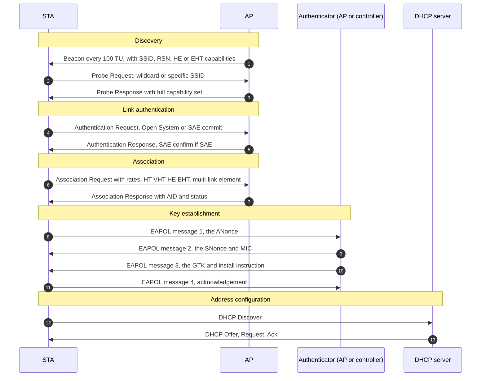

Four things in that diagram are worth pausing on.

**Scanning dominates the join time.** Passive scanning must dwell on each channel long enough to catch a
beacon — typically 100 ms or more per channel — so a full 2.4 + 5 + 6 GHz passive sweep is a second-class
experience. Active scanning (probe request, wait for probe responses, minimum channel time) is faster and is
what client devices actually do. This single fact drives most roaming design: *the scan is the cost, not the
association.*

**Link authentication is not user authentication.** The Authentication frame in 802.11 establishes a link-level
relationship (Open System means "no link authentication"; SAE is the exception, because it is a real
cryptographic exchange). Identity, if any, happens later, inside 802.1X/EAP or with a PSK. Candidates who say
"the client authenticates with WPA2 at association" have the order wrong.

**Association grants an AID**, an association identifier in the range 1–2007, and with it the right to be
addressed and to use power-save buffering. The AID is the AP's handle for the station; in 802.11be one AID is
shared across all links of an MLD.

**The four-way handshake is where WPA2/WPA3 actually happen** — PTK derivation from the ANonce/SNonce pair,
GTK delivery, and (with 802.11w) protection of the management frames that follow.

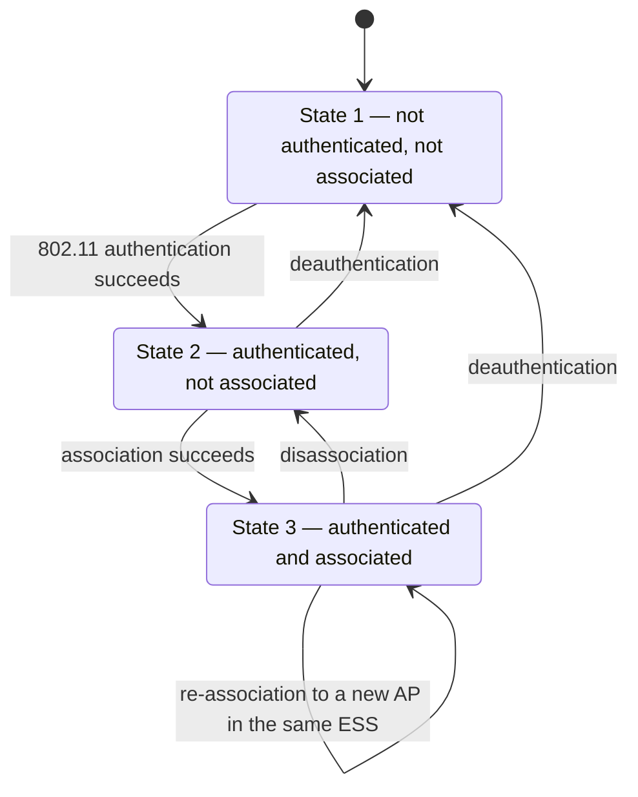

The three-state model is not academic: it defines which frames are legal. A station in State 2 may not send
data frames; a station in State 1 may only send authentication and probe frames. Most "the client connects but
nothing works" problems sit in the transition between State 2 and State 3, and most "the client keeps
reconnecting" problems are the 802.11w protection of those transitions failing.

| Phase | Typical duration | What can go wrong |
| --- | --- | --- |
| Passive scan, full band | hundreds of ms to seconds | Client dwells on DFS channels and misses the AP |
| Active scan | tens of ms per channel | Probe response suppression, hidden SSID |
| Link authentication | 1–2 round trips | SAE with a slow client, or an anti-clogging token mismatch |
| Association | 1 round trip | Capability mismatch: the AP rejects an unsupported MCS or bandwidth |
| 802.1X/EAP | tens of ms to seconds | RADIUS timeout, certificate expiry |
| 4-way handshake | 2 round trips | PMF required but not supported; key reinstallation countermeasures |
| DHCP | tens of ms to seconds | VLAN or pool exhaustion, which looks exactly like a Wi-Fi failure |

These figures are indicative field values, not standardised; the point of the table is that **the join is a
chain of seven independent failure opportunities**, and a design review that only considers RF misses six of
them.

### 4.1 Security in one page

The security architecture is a layer below the join, and it is the part most often mis-stated. There are only
four things to know.

| Scheme | What it authenticates | Key agreement | Its weakness |
| --- | --- | --- | --- |
| **WPA2-Personal** | A shared passphrase | PBKDF2 over the passphrase and the SSID produces the PMK; the 4-way handshake derives the PTK | Anyone who captures a handshake can attack the passphrase offline, and the passphrase is shared by everyone |
| **WPA3-Personal (SAE)** | The passphrase, via a password-authenticated key exchange | SAE (Dragonfly) replaces the PSK handshake and gives forward secrecy | Still a shared secret; a weak passphrase is still weak, just not offline-crackable in one capture |
| **WPA2/WPA3-Enterprise** | The user or device, via 802.1X/EAP and a RADIUS server | The MSK from EAP becomes the PMK | Certificate and server-validation mistakes are the usual failure; full EAP is slow, which is why FT exists |
| **OWE** | Nobody — there is no identity | Unauthenticated Diffie-Hellman per association | Protects against passive eavesdropping on open networks, and nothing else |

The four-way handshake exists to **derive fresh per-session keys from a shared secret**, not to authenticate a
user: it proves both sides hold the PMK (via the MIC), contributes both nonces, and delivers the group key. It
is also the reason PMF (802.11w) matters — without it, an attacker can forge the deauthentication frames that
break the association, and a forged frame is cheaper than a key attack. WPA3 requires PMF, and 6 GHz requires
WPA3, which is why Wi-Fi 6E and Wi-Fi 7 deployments are effectively greenfield from a security standpoint.

The one-line summary for an interview: **802.11i gave Wi-Fi encryption, 802.11w gave it integrity of control,
and SAE gave it a handshake that survives capture** — and none of them solves the shared-password problem,
which is why enterprise deployments use 802.1X.

---

## 5. Channel access: CSMA/CA, DCF and EDCA

This is the part of Wi-Fi that everything else is built on, and the part most often explained badly.

### 5.1 The mechanism

A station with a frame to send runs the same loop every time:

1. **Carrier sense, physical.** Energy above the clear-channel-assessment threshold, or a valid preamble, means
   the medium is busy. In 802.11ax and later, the threshold and the rule depend on the detected BSS colour.
2. **Carrier sense, virtual.** The NAV is a timer set from the Duration field of frames the station overhears;
   while it is non-zero the medium is reserved, regardless of what the energy detector says.
3. **Wait the interframe space.** The IFS depends on the frame type, which is how the standard encodes
   priority *without* a scheduler: shorter gaps win.
4. **Back off.** Choose a random number of slots uniformly from `[0, CW]`, decrement only while the medium is
   idle, and freeze the counter when it is busy.
5. **Transmit.** If the exchange requires an acknowledgement and none arrives, double the contention window up
   to `CWmax` and retry, up to the retry limit.
6. **Release the medium.** After a successful exchange, the NAV expires, and everyone contends again.

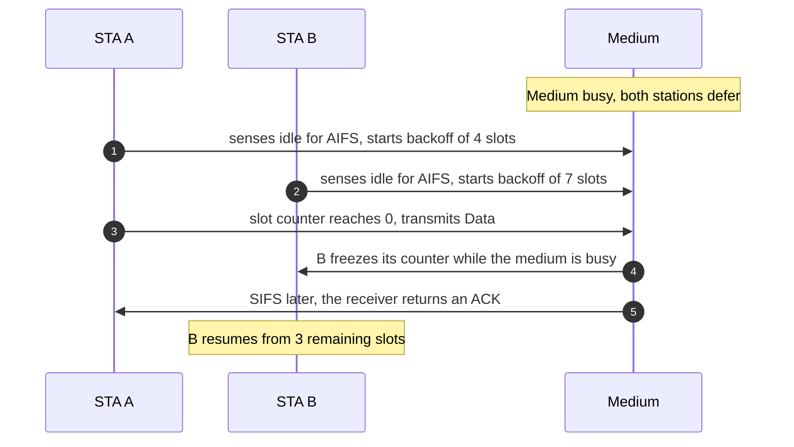

The interframe spaces are the whole trick, so they deserve a table. In every row, the shorter space is the
one that gets to transmit first:

| IFS | 2.4 GHz DSSS | 5 GHz OFDM | 2.4 GHz ERP-OFDM | Used for |
| --- | --- | --- | --- | --- |
| SIFS | 10 µs | 16 µs | 10 µs | ACK, CTS, data in a TXOP, BlockAck — cannot be interrupted |
| PIFS | 30 µs | 25 µs | 30 µs | Point coordination function, and AP priority in some schemes |
| DIFS | 50 µs | 34 µs | 34 µs | Legacy DCF data |
| AIFS | derived | derived | derived | `AIFS = AIFS-number × slot + SIFS`, per access category |
| EIFS | — | — | — | After a bad frame: DIFS + ACK time at the basic rate |

Slot times are 20 µs for DSSS and 9 µs for OFDM. The asymmetry is why 2.4 GHz is slower to access even at the
same PHY rate, and why a single legacy 802.11b client on a 2.4 GHz channel degrades everyone: **protection
mechanisms force the whole BSS onto the slower IFS and the slower preamble.**

### 5.2 EDCA: priorities without a scheduler

802.11e replaced DCF's single queue with four access categories, each with its own IFS, contention window and
TXOP limit. This is still, in 2026, the primary QoS mechanism on every Wi-Fi network in the world.

| Access category | Typical traffic | AIFS-number | CWmin | CWmax | TXOP limit (802.11n/ac OFDM) |
| --- | --- | --- | --- | --- | --- |
| AC_VO (voice) | VoIP, real-time control | 2 | 3 | 7 | 47 (1.504 ms) |
| AC_VI (video) | Streaming, gaming | 2 | 7 | 15 | 94 (3.008 ms) |
| AC_BE (best effort) | Web, bulk data | 3 | 15 | 1023 | 0 (one frame, or one A-MPDU) |
| AC_BK (background) | Updates, telemetry | 7 | 15 | 1023 | 0 |

Two facts about this table are consistently under-appreciated.

**The differentiation is statistical, not absolute.** AC_VO wins *more often*, because its backoff range is
four slots wide instead of sixteen and its AIFSN is one slot smaller. It does not win *always*. Under load,
voice frames still collide and still back off — which is why every serious voice-over-Wi-Fi design budgets for
retries rather than pretending EDCA is a reservation.

**A TXOP converts a random-access win into a scheduled burst.** Having won the medium, the holder may send
multiple frames separated by SIFS for up to the TXOP limit, and nobody else may interrupt. This is the
mechanism that later generations generalised: 802.11ax's trigger frame is a TXOP holder allocating *uplink*
resources inside its own TXOP, and 802.11be's TXOP sharing is the same idea with the TXOP lent to a station.

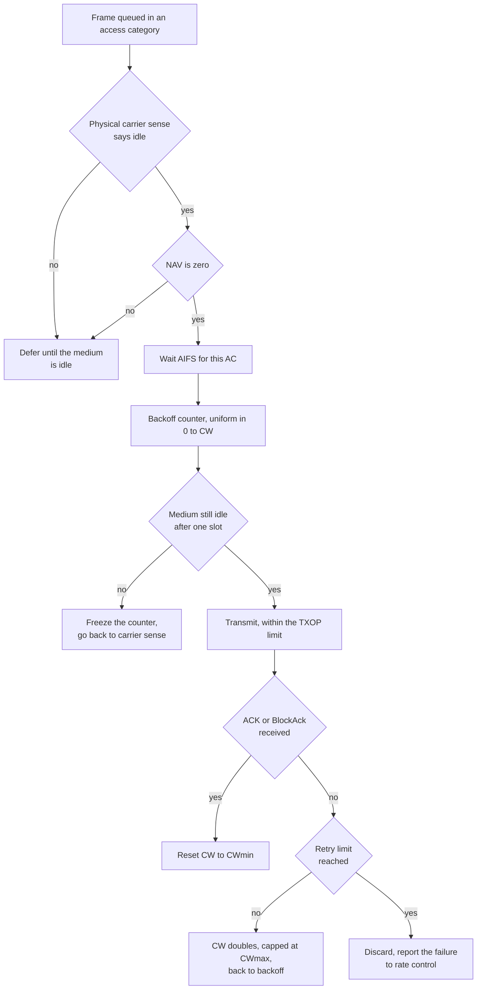

### 5.3 Why it collapses under load, in one line of arithmetic

With `n` stations all backlogged, each transmitting in a slot with probability `τ`, the collision probability
for a station is `1 − (1 − τ)^(n−1)`. As `n` grows, `τ` falls but not fast enough: throughput per station
falls roughly as `1/n`, and the *channel-access delay* grows faster than `n` because failed attempts also
consume airtime. This is the analytical result behind every field observation that "the Wi-Fi got slow when
the office filled up", and it is the reason 802.11ax introduced a scheduler instead of another backoff tweak.

The mitigation is not a better random number generator. It is **fewer contenders**: BSS colour so distant
BSSs stop deferring, OFDMA so many stations transmit inside one contention win, TWT so idle stations sleep
instead of contending, MLO so one device contends on several channels at once, and multi-AP coordination so
APs stop contending with each other. The whole of §10–§12 is that list.

---

## 6. PHY fundamentals, part 1: the numerology

OFDM splits a wide channel into many narrow, mutually orthogonal subcarriers. Each subcarrier carries a slow
symbol, so the symbol duration is long compared with the channel's delay spread — which is the entire reason
OFDM survives multipath: a long symbol means the echo arrives within the guard interval instead of smearing
into the next symbol.

Two numbers define a generation's numerology: **subcarrier spacing** and **symbol duration**. They are
reciprocals. 802.11a/g/n/ac use 312.5 kHz spacing and a 3.2 µs symbol; 802.11ax and 802.11be use 78.125 kHz
and a 12.8 µs symbol, with a 4× larger FFT.

| Property | 802.11a/g | 802.11n | 802.11ac | 802.11ax / 802.11be |
| --- | --- | --- | --- | --- |
| Subcarrier spacing | 312.5 kHz | 312.5 kHz | 312.5 kHz | **78.125 kHz** |
| Useful symbol | 3.2 µs | 3.2 µs | 3.2 µs | **12.8 µs** |
| Guard interval | 0.8 / 0.4 µs | 0.8 / 0.4 µs | 0.8 / 0.4 µs | **0.8 / 1.6 / 3.2 µs** |
| FFT size at 20 MHz | 64 | 64 | — | 256 |
| FFT size at 320 MHz | — | — | — | 4096 |
| Data subcarriers, 20 MHz | 48 | 52 | — | 234 |
| Data subcarriers, 80 MHz | — | — | 234 | 980 |
| Data subcarriers, 160 MHz | — | — | 468 | 1960 |
| Data subcarriers, 320 MHz | — | — | — | **3920** |

The 4× change in Wi-Fi 6 was a trade, and it is the most important trade in the standard's recent history:

- **Gain:** a 12.8 µs symbol makes delay spread a 4× smaller fraction of the symbol, so the same modulation
  survives much worse multipath. This is why Wi-Fi 6 works better outdoors and in factories, and why its
  3.2 µs guard interval exists at all.
- **Cost:** every symbol now lasts four times as long, so the *per-symbol* rate falls by 3.78× (13.6 µs of
  symbol-plus-GI against 3.6 µs). The rate had to be recovered with 4× as many subcarriers and a denser
  constellation — which is exactly what happened, and exactly why Wi-Fi 6 raised the peak by only 1.39×.
- **Second cost:** a longer symbol is a longer minimum transmission. Small-packet efficiency depends on
  packing many users into one symbol, which is why OFDMA arrived *with* the new numerology and not before.

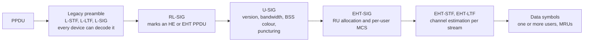

The preamble is the most expensive part of a short frame, and it is why the standard keeps it as short as
compatibility allows. A 320 MHz EHT preamble with eight streams is a substantial fixed cost; sending 100 bytes
inside it is a waste, which is precisely what OFDMA and aggregation exist to amortise.

---

## 7. PHY fundamentals, part 2: where the bits per second come from

Every PHY rate in every generation is the same equation:

```
R = Nsd × Nss × log2(M) × Rc / Tsym
```

- `Nsd` — data subcarriers in the channel (the tone plan)
- `Nss` — spatial streams
- `log2(M)` — bits per subcarrier per stream, set by the constellation (64-QAM gives 6, 4096-QAM gives 12)
- `Rc` — coding rate (1/2, 2/3, 3/4, 5/6); the product `log2(M) × Rc` is the "bits per subcarrier" in the
  MCS tables
- `Tsym` — symbol plus guard interval

That is all a headline PHY rate is. Nothing else contributes. Which means the history of Wi-Fi rate is the
history of four multipliers, and the table below is the whole story of five generations in five rows.

| | Nsd | Nss | bits/subcarrier | Tsym | PHY rate |
| --- | --- | --- | --- | --- | --- |
| Wi-Fi 4, 40 MHz, MCS 31 | 108 | 4 | 5.0 (64-QAM, 5/6) | 3.6 µs | **600 Mbps** |
| Wi-Fi 5, 160 MHz, MCS 9 | 468 | 8 | 6.667 (256-QAM, 5/6) | 3.6 µs | **6.93 Gbps** |
| Wi-Fi 6, 160 MHz, MCS 11 | 1960 | 8 | 8.333 (1024-QAM, 5/6) | 13.6 µs | **9.61 Gbps** |
| Wi-Fi 7, 320 MHz, MCS 13 | 3920 | 8 | 10.0 (4096-QAM, 5/6) | 13.6 µs | **23.06 Gbps** |
| Wi-Fi 7, 320 MHz, 16 streams | 3920 | 16 | 10.0 | 13.6 µs | 46.08 Gbps — **not in the standard** |

Read the Wi-Fi 5 → Wi-Fi 6 row pair carefully, because it settles an argument. Subcarriers rose 4.2×, bits
per subcarrier rose 1.25×, streams stayed at 8 — and the symbol grew 3.78×. The net is 1.39×. **Wi-Fi 6 bought
robustness with rate**, and that was the right trade for the problem it was built to solve.

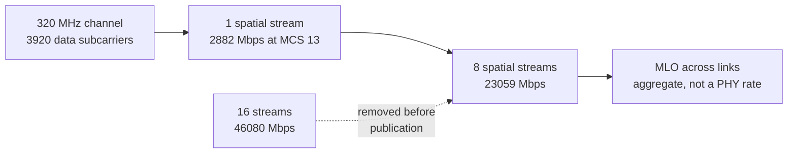

### 7.1 The MCS table for 320 MHz, computed rather than quoted

Because `3920 / 13.6 µs = 288.2 Mbps` per unit of bits per subcarrier per stream, the EHT MCS table for a
single stream at 320 MHz with a 0.8 µs guard interval follows directly. Vendor tables frequently contain
transcription errors in the middle rows; this one does not, and every value can be reproduced from the
equation above.

| MCS | Modulation | Coding rate | Bits per subcarrier | One stream, 320 MHz |
| --- | --- | --- | --- | --- |
| 0 | BPSK | 1/2 | 0.5 | 144.1 Mbps |
| 1 | QPSK | 1/2 | 1.0 | 288.2 Mbps |
| 2 | QPSK | 3/4 | 1.5 | 432.4 Mbps |
| 3 | 16-QAM | 1/2 | 2.0 | 576.5 Mbps |
| 4 | 16-QAM | 3/4 | 3.0 | 864.7 Mbps |
| 5 | 64-QAM | 2/3 | 4.0 | 1152.9 Mbps |
| 6 | 64-QAM | 3/4 | 4.5 | 1297.1 Mbps |
| 7 | 64-QAM | 5/6 | 5.0 | 1441.2 Mbps |
| 8 | 256-QAM | 3/4 | 6.0 | 1729.4 Mbps |
| 9 | 256-QAM | 5/6 | 6.667 | 1921.6 Mbps |
| 10 | 1024-QAM | 3/4 | 7.5 | 2161.8 Mbps |
| 11 | 1024-QAM | 5/6 | 8.333 | 2402.0 Mbps |
| 12 | 4096-QAM | 3/4 | 9.0 | 2594.1 Mbps |
| 13 | 4096-QAM | 5/6 | 10.0 | 2882.4 Mbps |

Two sanity checks that make the same numbers memorable: 802.11ax at 160 MHz, MCS 11, one stream is
**1201 Mbps** — the familiar Wi-Fi 6 figure, and exactly half of the EHT 320 MHz value because the channel is
half as wide. And an 802.11ax 26-tone RU at MCS 11 is **14.7 Mbps**, which is `24 × 8.333 / 13.6 µs`: a
26-tone RU carries 24 data subcarriers, about 1/163 of the 3920 a 320 MHz channel has, and that ratio is why
OFDMA trades per-client rate for aggregate efficiency.

### 7.2 Modulation costs SNR, and the cost is brutal

Each fourfold increase in constellation size — 64 → 256 → 1024 → 4096-QAM — adds two bits per subcarrier and
requires roughly **6 dB more SNR** for the same error rate, as a rule of thumb. From 64-QAM to 4096-QAM is
therefore about 18 dB, which is the difference between "anywhere in the cell" and "in the same room as the
AP". This is why 4096-QAM exists for marketing and matters for one use case: a laptop and a router in
line of sight, on a clean 6 GHz channel.

| Modulation | Bits per symbol | Relative SNR requirement | Practical range in a home |
| --- | --- | --- | --- |
| 64-QAM | 6 | baseline | most of the coverage area |
| 256-QAM | 8 | ~+6 dB | same room, or one wall |
| 1024-QAM | 10 | ~+12 dB | line of sight, short distance |
| 4096-QAM | 12 | ~+18 dB | line of sight, a few metres, and only on a quiet channel |

Doubling the channel width has a similar price: 320 MHz collects twice the noise power of 160 MHz, so keeping
the same MCS requires **3 dB more received signal**. Wider is not free; it is a bet that the signal is strong
enough to fill the extra bandwidth.

---

## 8. PHY fundamentals, part 3: MIMO, sounding and beamforming

MIMO is three different techniques that share hardware, and conflating them is the most common PHY error in
interviews.

| Technique | What it does | Gain | Requirement |
| --- | --- | --- | --- |
| **Spatial multiplexing (SDM)** | Sends independent streams in parallel | Throughput, roughly linear in streams | A channel with enough rank — rich scattering, and antennas at both ends |
| **Transmit beamforming (BF)** | Steers energy toward the receiver | SNR, therefore range and MCS | Channel knowledge at the transmitter, i.e. sounding |
| **Space-time block coding (STBC)** | Transmits redundant copies | Diversity, robustness | No channel knowledge; costs rate |
| **MU-MIMO** | Sends independent streams to *different* stations in the same resource | Aggregate throughput, especially downlink | Orthogonal-ish channels between the co-scheduled stations and accurate CSI |

The key distinction: SDM and STBC are about *one* link; MU-MIMO is about *several* links sharing one
time-frequency resource, and its gain depends entirely on the scheduler's ability to group stations whose
channels are sufficiently orthogonal. Bad grouping produces interference instead of gain — which is why
MU-MIMO in the field delivers far less than the theoretical multiplier unless the AP has many antennas and a
good grouping algorithm.

Explicit beamforming requires the transmitter to know the channel, and in 802.11 that means a sounding
exchange:

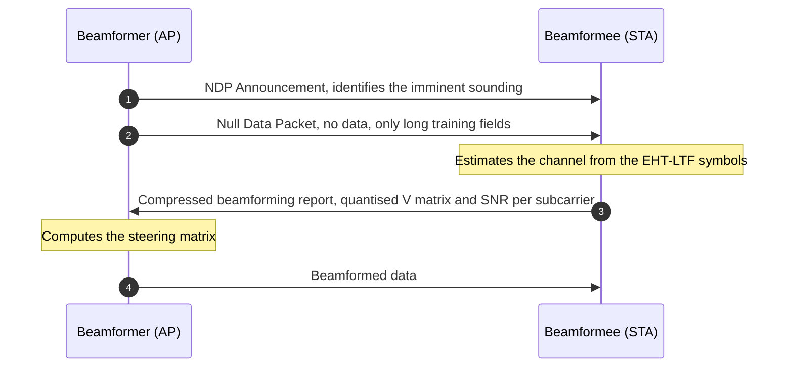

The cost is real: the report is large, the exchange consumes airtime, and it must be repeated as the channel
changes. That is why beamforming pays only for stations with enough queued traffic to amortise the sounding —
a design rule that shows up in every commercial AP's steering logic, and the reason 802.11ax introduced
sounding for *groups* of stations rather than one at a time.

Eight streams is the practical ceiling for a client, and not because the standard forbids more. Each stream
needs its own antenna, RF chain, ADC/DAC and baseband path; a phone has room for two, a laptop for two to
four, an AP for four to eight. The 16-stream option in early 802.11be drafts would have doubled the headline
rate and roughly doubled the AP's power and cost, with no client able to use it. It was removed. **When a
vendor quotes 46 Gbps, they are quoting a configuration the standard does not contain** — the arithmetic is
right and the product does not exist.

---

## 9. MAC efficiency: aggregation, Block Ack, and the overhead that dominates

At 600 Mbps, a 1500-byte frame is 12,000 bits — 20 µs of airtime. The surrounding overhead — preamble,
interframe space, acknowledgement, backoff — is on the order of hundreds of microseconds if it has to be paid
per frame. Without aggregation, a 600 Mbps PHY delivers a small fraction of 600 Mbps, and the fraction gets
*worse* as the PHY gets faster, because the overhead does not shrink.

802.11n's answer was to stop paying per frame:

| Mechanism | What is aggregated | Header cost | Failure granularity | Practical rule |
| --- | --- | --- | --- | --- |
| **A-MSDU** | Several MSDUs into one MPDU | One MAC header for all | The whole aggregate is lost if any part is corrupt | Only on clean links, small payloads |
| **A-MPDU** | Several MPDUs into one PPDU | One header and FCS per MPDU | Only the corrupt MPDU is retransmitted | Default choice, always |

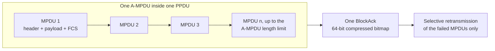

The **Block Ack** is the other half, and it is not optional: sixty-four acknowledgements per aggregate would
recreate the problem aggregation solved. A BlockAck agreement is set up with ADDBA, carries a compressed
64-bit scoreboard bitmap, and lets the sender retransmit only the MPDUs that were not received. The
receiver's reorder buffer is the price: MPDUs must be delivered in sequence to the upper layer, so a single
lost MPDU can stall the buffer if the retry takes too long.

Three design consequences follow, and they are the basis of most throughput debugging:

1. **Aggregation only helps if the queue is deep enough to fill an aggregate.** A latency-sensitive flow with
   two small packets in the queue gains nothing and pays the aggregation decision cost. This is the tension
   between throughput and latency that AQL and fq_codel exist to manage.
2. **The aggregate must fit the TXOP.** An aggregate that would overrun the TXOP limit is truncated; a station
   with a background access category has a TXOP limit of zero and therefore no aggregation benefit at all.
3. **Retries are visible in the aggregate, not the frame.** A 10% MPDU loss inside a 64-MPDU aggregate costs
   one BlockAck and one partial retransmission, which is why block-ack loss rates rather than frame loss rates
   are the right metric for a Wi-Fi link.

---

## 10. Wi-Fi 6 as the hinge: OFDMA, triggers, colour and TWT

802.11be is built on 802.11ax, and four HE mechanisms are the foundation. Each is treated in depth in
[[02-8 WLAN - Scheduling - Channel Access, EDCA, OFDMA Resource Allocation, Airtime and Implementation]] and
[[02-2 WLAN - Power Saving Mechanisms and Evolution]]; here is the minimum needed to understand EHT.

**OFDMA.** The channel is divided into resource units, and different stations get different RUs inside the
same PPDU. One contention win serves many users, and the fixed preamble cost is shared.

| Bandwidth | RU sizes available | Largest RU |
| --- | --- | --- |
| 20 MHz | 26, 52, 106, 242 | 242 tones, 234 data |
| 40 MHz | 26, 52, 106, 242, 484 | 484 tones |
| 80 MHz | 26, 52, 106, 242, 484, 996 | 996 tones, 980 data |
| 160 MHz | all of the above, plus 2×996 | 2×996 tones, 1960 data |
| 320 MHz (EHT) | all of the above, plus 4×996, and MRUs | 4×996 tones, 3920 data |

**Trigger-based uplink.** The AP sends a Trigger Frame allocating RUs, MCS and target RSSI; stations respond
SIFS later with trigger-based PPDUs. This is the mechanism that puts an uplink scheduler where previously
there was only contention.

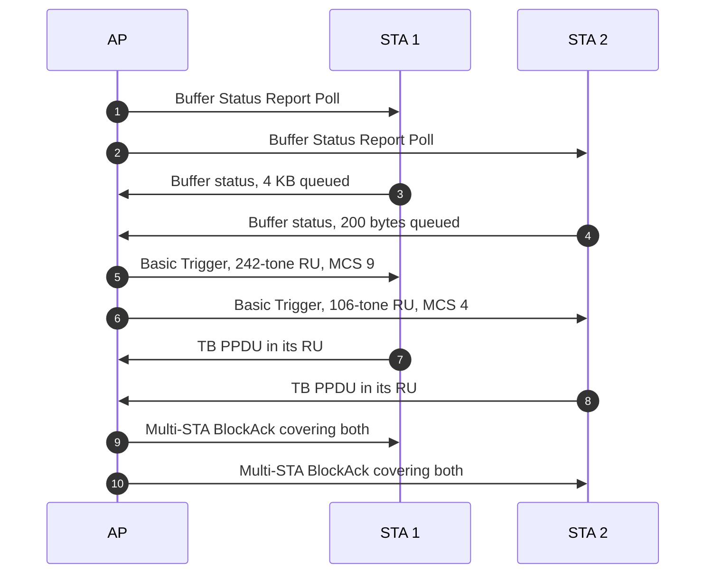

Note what the exchange costs: five frame exchanges minimum before any data is delivered, and a round of
roughly **500–800 µs at 2.4 GHz / 40 MHz regardless of payload size**. OFDMA buys aggregate efficiency and
pays for it in latency. That is the trade that 802.11be's TXOP sharing and r-TWT later try to soften.

**BSS colour and spatial reuse.** Each BSS carries a 6-bit colour in the SIG field. Frames from a different
colour may be treated with a relaxed carrier-sense rule, so a station stops deferring to a distant BSS it
could never have collided with. Dual NAV and an adjustable OBSS packet-detect threshold (−82 to −62 dBm at
20 MHz, coupled to transmit power) complete the mechanism. This is the first standardised answer to the
"everyone defers to everyone" problem that makes dense deployments slow.

**Legacy power save.** A station sets the Power Management bit and sleeps; the AP buffers its frames and
announces them in the TIM carried in every beacon, with the DTIM flag marking buffered broadcast and multicast.
The station wakes for each DTIM interval and either waits for the beacon or sends a PS-Poll to fetch what is
buffered. U-APSD refines this: delivery-enabled access categories let a QoS data frame act as the trigger,
which is what makes voice over Wi-Fi compatible with sleeping. The cost is latency — a sleeping station is
reachable only at beacon granularity, so power save and responsiveness are the same dial.

**TWT.** AP and station agree on wake times; the station sleeps in between. Originally a battery mechanism,
it became a *contention* mechanism: fewer awake stations means fewer contenders, which is why 802.11be's
r-TWT is a latency feature rather than a power feature.

---

## 11. Wi-Fi 7 PHY: 320 MHz, 4096-QAM, MRU and puncturing

802.11be raises four PHY dials, and — importantly — it is the last generation that can.

### 11.1 320 MHz, and the channelisation problem it creates

320 MHz doubles the widest channel, and it exists only in 6 GHz: no other unlicensed band has 320 MHz of
contiguous spectrum. In the 1200 MHz the US opened, the amendment defines six 320 MHz positions in two
alignment families (320-1 and 320-2), of which **three are non-overlapping**.

That single fact governs Wi-Fi 7 network design. Three channels is a small number for a multi-AP deployment;
every AP that takes a 320 MHz channel removes a third of the band from its neighbours. In practice, high-density
designs run 80 or 160 MHz and rely on puncturing and MLO for the peak, reserving 320 MHz for the one AP that
serves a line-of-sight laptop. Chapter 8 of book 1 makes this argument at length, and it is the difference
between a Wi-Fi 7 design and a Wi-Fi 7 specification sheet.

### 11.2 4096-QAM

4096-QAM carries 12 bits per subcarrier, a 20% gain over 1024-QAM, and requires roughly 6 dB more SNR. It is
available only at MCS 12 and 13, only with a 3/4 or 5/6 code rate, and in practice only at short range. Its
value is in the peak-rate headline and in very high-SNR small cells; its cost is in EVM budgets and PA
linearity, which is why it appears in the product-development chapter of book 2 rather than in the deployment
chapter of book 1.

### 11.3 Multiple resource units (MRU)

In 802.11ax a station could be assigned exactly one RU. In 802.11be a station may be assigned several,
which matters when the ideal-size contiguous RU is unavailable because of puncturing or because the spectrum
is fragmented.

| Class | Combinations | Where usable |
| --- | --- | --- |
| Small MRU | 52+26, 106+26 | OFDMA, uplink and downlink |
| Large MRU | 484+242, 996+484, 2×996+484, 3×996, 3×996+484 | OFDMA and non-OFDMA |
| Non-OFDMA only | 996+484+242 | Single-user transmissions |

The rules are asymmetric on purpose: small RUs may only be combined with small RUs, and large with large, so
that the resulting allocation still fits a regular tone-plan grid the receiver can describe in a bitmap.

### 11.4 Preamble puncturing

A wide channel is usually not clean across its whole width. Puncturing lets the transmitter switch off the
part of the channel that is occupied and use the rest, instead of dropping to the next narrower width.

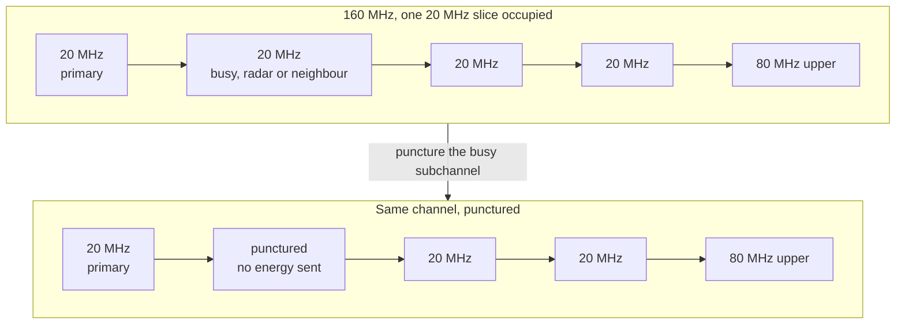

802.11ax allowed a limited set of puncturing patterns; 802.11be generalises them, signals the pattern in
U-SIG so the receiver knows which tones to skip, and combines puncturing with MRU so the freed spectrum is
reused rather than merely avoided. The permitted pattern set differs by bandwidth and PPDU type — check the
clause before asserting that a specific pattern is legal.

### 11.5 The EHT PPDU

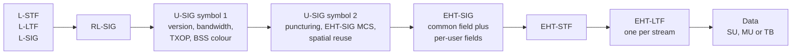

U-SIG is the part that matters architecturally: it is designed to be **forward compatible**, so a future
amendment can add fields without a receiver having to parse the whole preamble. That is a deliberate lesson
from 802.11ax, where the HE-SIG-A field ran out of room.

| | Wi-Fi 6 (HE) | Wi-Fi 7 (EHT) |
| --- | --- | --- |
| Max channel | 160 MHz | **320 MHz** |
| Max modulation | 1024-QAM (MCS 11) | **4096-QAM (MCS 13)** |
| Max streams | 8 | 8 (16 dropped) |
| RU assignment | One RU per station | **Multiple RUs per station** |
| Puncturing | Limited patterns | **Generalised, bitmap in U-SIG** |
| Max PHY rate | 9.6 Gbps | **23.06 Gbps** |
| Multi-link | No | **MLO, up to 15 links** |

---

## 12. Wi-Fi 7 MAC: multi-link operation

MLO is the defining feature of Wi-Fi 7, and the one most often described incorrectly. It is not channel
bonding, and it is not band steering with a faster switch.

### 12.1 What a multi-link device is

An **MLD** is one device with one MAC service access point — one IP address, one association, one security
context — operating over several **links**. Each link is an independent 802.11 radio with its own channel and
its own channel access. The AP side is an AP MLD (also called an affiliated AP, one per link); the client is a
non-AP MLD.

The MAC splits in two, and the split is the whole design:

| | Upper MAC (link-independent) | Lower MAC (per link) |
| --- | --- | --- |
| Association and re-association | Yes — once, across all links | No |
| Security: authentication, key derivation, encryption | Yes | Per-link keys derived from the shared context |
| Sequence numbers, per-TID Block Ack sessions | Yes — one sequence space | No |
| Beaconing, probing, RTS/CTS, ACK | No | Yes |
| Channel access, backoff, EDCA per link | No | Yes |
| Power management per link | No | Yes |
| Link selection, TID-to-link mapping | Yes | No |

The consequences are what a network engineer actually experiences: **discovery and association happen once**,
with one AID across all radios; one authentication produces per-link keys; a Block Ack session and its
sequence numbers span links, so a frame sent on 5 GHz and retransmitted on 6 GHz does not confuse the
receiver; and the device has one MAC address at the MLD level plus one per link.

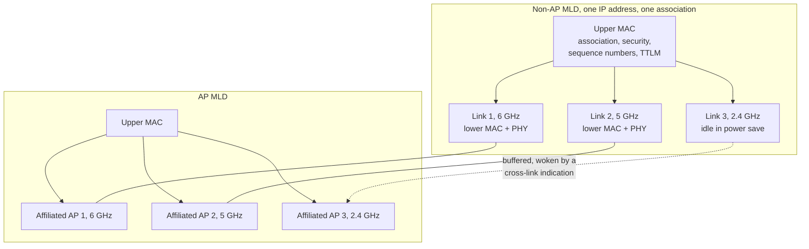

### 12.2 The five modes, and why they decide what you may promise

Book 1's most useful contribution to deployment practice is its insistence that clients ship in **five
distinct MLO modes**, and that the mode determines the performance you can honestly claim.

| Mode | Radios | Behaviour | What it is good for |
| --- | --- | --- | --- |
| **MLSR** | 1 | One link active at a time; the others are in power save. The baseline everyone must support | Nothing much; it is a compatibility floor |
| **EMLSR** | 1 | One radio listens on several links at once by splitting antennas, then switches all antennas to whichever link the AP used first | Latency, at low cost — gets most of the benefit of MLO without a second radio |
| **MLMR, STR** | ≥2 | Simultaneous transmit and receive on different links | Throughput aggregation and the lowest latency |
| **MLMR, NSTR** | ≥2 | Two radios, but not simultaneous transmit and receive; requires PPDU end-time alignment across links | Throughput, with a scheduling constraint |
| **EMLMR** | ≥2 | MLMR plus dynamic reconfiguration of spatial multiplexing across links | Highest performance, highest complexity |

The reason NSTR exists is worth stating plainly: two radios in one enclosure interfere with each other. If
link A transmits while link B receives, the transmission leaks into the receiver and destroys the incoming
frame unless the antenna isolation is sufficient. NSTR devices therefore align the *end times* of their
PPDUs so that a reception on one link never overlaps a transmission on the other — a constraint the AP must
respect when it schedules, and the reason an NSTR client can be slower than expected under a scheduler that
ignores it.

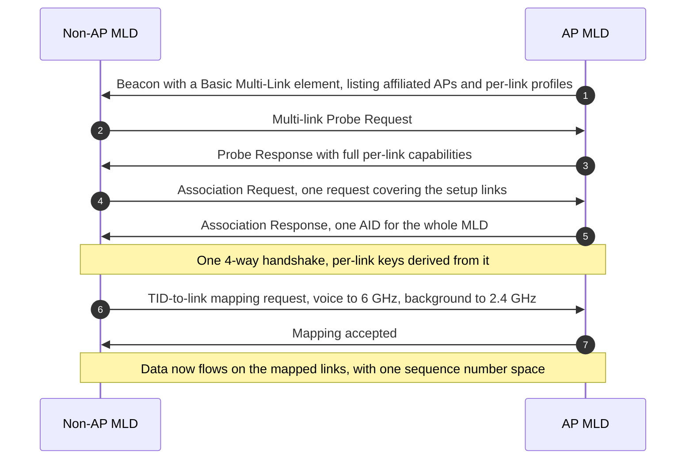

### 12.3 What MLO actually buys

1. **Aggregation** — traffic spread across links, so throughput exceeds any single link's.
2. **Latency** — transmit on whichever link wins contention first, instead of waiting for one channel.
3. **Redundancy** — duplicate a frame across links for flows that cannot tolerate loss.
4. **Steering** — per-flow placement via TID-to-link mapping, changed without re-association.
5. **Make-before-break roaming** — stay associated on one link while scanning on another, which removes the
   scan cost from the handover.

And what it costs: several radios awake (power), overlapping coverage required in *every* band (planning),
in-device interference (RF design), and a scheduler that must reason about more than one channel at a time
(implementation). The honest summary for an interview: **MLO converts bandwidth into latency and
reliability, and it only pays if the deployment has clean spectrum in more than one band.**

### 12.4 TID-to-link mapping

TTLM maps traffic identifiers to links: voice to 6 GHz, background updates to 2.4 GHz, video to whichever link
has airtime. The mapping is negotiated, has a default (all TIDs on all links), and can be changed without
tearing down the association — which is what makes it a policy tool rather than a configuration.

| Mapping type | Meaning | When to use |
| --- | --- | --- |
| Default | Every TID may use every setup link | Baseline; the AP schedules freely |
| Non-default, TID-to-link | Specific TIDs restricted to specific links | Isolating a latency-critical flow from contention |
| Non-default, link-to-TID | A link carries only specific TIDs | Keeping a 2.4 GHz link for IoT only |

---

## 13. Wi-Fi 7 MAC: latency, QoS and priority

MLO gets the attention, but 802.11be's latency tools are what make its bounded-latency claims possible. Each
one attacks a different source of delay.

| Mechanism | What it does | The delay it removes | Limit |
| --- | --- | --- | --- |
| **Triggered uplink** | AP allocates uplink RUs rather than stations contending | Backoff and collision delay | Costs a scheduling round trip |
| **Triggered TXOP sharing** | AP lends part of its TXOP to one station via an MU-RTS TXS trigger frame | The station's own contention, and the SIFS-response problem | Mode 1: uplink to the AP only. Mode 2: uplink plus peer-to-peer |
| **r-TWT** | Reserves a service period in which non-member stations must not contend | Contention from other traffic in the BSS | Does not protect aperiodic urgent traffic |
| **SCS** | Lets a station declare a stream's QoS characteristics so the AP can reserve for it | Scheduling uncertainty | Requires AP support and admission control |
| **EPCS priority access** | Gives emergency-services traffic priority access | Queueing behind ordinary traffic | Narrow applicability |
| **Enhanced DCM** | Duplicates a low-rate transmission across RUs for diversity | Loss and retransmission at cell edge | Costs rate; aimed at 6 GHz coverage |

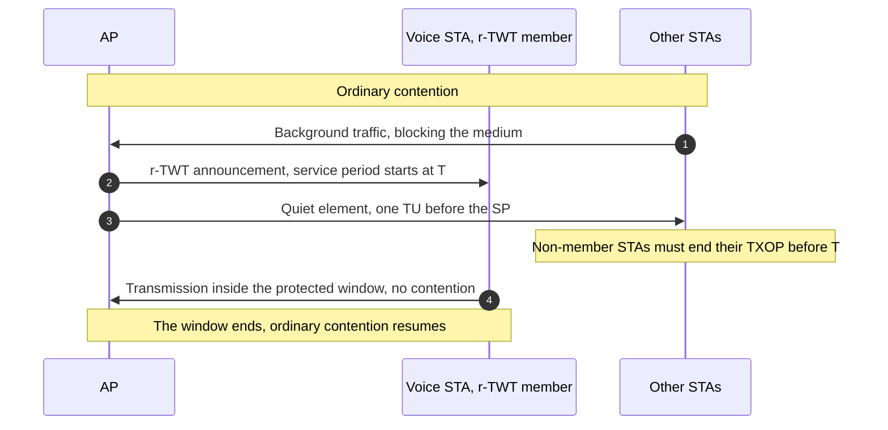

The honest reading of the latency numbers is the one in
[[02-13 WLAN - Reliability, Low Latency and Determinism - What the Wi-Fi Stack Can Actually Do]]: r-TWT plus
SCS delivers bounded latency in the **tens of milliseconds**, which is right for XR and cloud gaming and
wrong for industrial control that needs single-digit milliseconds. Wi-Fi 7 is a latency *improvement*, not a
deterministic network. Determinism is 802.11bn's stated goal, and even there the number is a 25% improvement
at the 95th percentile, not a guarantee.

---

## 14. Designing a Wi-Fi 7 network

Book 1's chapter 8 is the part of the literature that most candidates skip and most deployments need. The
design method is unglamorous and it is the same as it was in 2013; what changed is the number of dimensions.

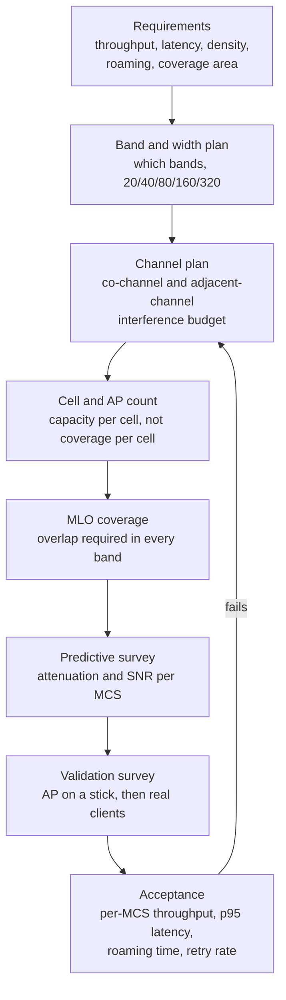

The inputs and the decisions they force:

| Design input | Decision it forces | The Wi-Fi 7 complication |
| --- | --- | --- |
| Peak throughput target | 320 MHz, 4096-QAM, MLO | Only three 320 MHz channels exist, and 4096-QAM needs line of sight |
| Client mix | How much airtime to reserve for legacy | A single 802.11b client still forces protection at 2.4 GHz |
| Latency target | r-TWT, SCS, MLO mode expectations | A client in MLSR mode gains nothing from your MLO design |
| Coverage area | AP count from capacity, not from range | 6 GHz has ~1.6 dB more free-space loss than 5 GHz and worse penetration |
| Roaming requirement | 802.11k/v/r, MLO make-before-break | MLO roaming is only seamless if all bands overlap |
| Density | BSS colour plan, OBSS_PD tuning | Colour exhaustion in large venues; six bits is 63 usable colours |
| Backhaul | Multi-gigabit Ethernet or 6 GHz wireless backhaul | A 23 Gbps AP behind a 1 Gbps port is a 1 Gbps AP |

Three planning truths deserve to be stated as rules:

**Rule 1 — capacity, not coverage, decides AP count.** Coverage planning puts one AP where the signal reaches;
capacity planning puts APs where the *airtime* is needed. In any dense venue the second number is larger, and
it is the one that determines whether video works at 3 p.m.

**Rule 2 — wide channels are a spectrum allocation decision, not a performance setting.** Every 320 MHz
channel is a third of the band. Choosing 320 MHz for one AP is choosing co-channel interference for its
neighbours.

**Rule 3 — you cannot design MLO you have not surveyed.** MLO requires usable coverage on two or three bands
in the same place. If 6 GHz coverage is a patchy overlay, MLO degrades to MLSR and the promised latency never
appears.

---

## 15. Building and testing a Wi-Fi 7 product

This is book 2's distinctive chapter, and it is the part of the literature that device engineers need and
network engineers rarely see. The flow is a stage-gate process, and each gate exists to catch a class of
defect that is cheap to fix at that stage and expensive later.

```mermaid
flowchart LR
    C["Concept<br/>chipset selection,<br/>feature list"] --> E["EVT<br/>engineering validation<br/>does it work at all"]
    E --> D["DVT<br/>design validation<br/>does it work across<br/>the spec envelope"]
    D --> P["PVT<br/>production validation<br/>does the factory<br/>build it the same way"]
    P --> M["MP<br/>mass production"]
    E -->|"fail"| C
    D -->|"fail"| E
    P -->|"fail"| D
```

| Stage | Question answered | Typical test content |
| --- | --- | --- |
| **EVT** | Does the design function? | Bring-up, RF calibration, basic TX/RX, first throughput number, firmware boot |
| **DVT** | Does it meet the specification across temperature, voltage and attenuation? | Conducted and OTA RF conformance, throughput versus attenuation sweep, MLO operation, latency, stability soak, thermal, coexistence |
| **PVT** | Does production match the design? | Calibration limits, yield, unit-to-unit variation, regulatory spot checks |
| **Certification** | Will it interoperate and may it be sold? | WFA programme tests, regulatory approval (FCC, CE), operator acceptance |

The test taxonomy is where the engineering judgement sits, because "Wi-Fi 7 support" is not a testable
statement:

| Test domain | What is measured | Why it catches what RF tests miss |
| --- | --- | --- |
| **Conducted RF** | EVM, spectral mask, power, sensitivity per MCS | The only way to see 4096-QAM's EVM margin |
| **OTA** | EIRP, pattern, MIMO correlation | Antenna and enclosure effects that conducted tests hide |
| **Throughput vs attenuation** | TCP and UDP throughput at each MCS step | Where rate control actually sits, and where it collapses |
| **MLO behaviour** | Per-link and aggregate throughput, per mode | Confirms which MLO mode the client really uses |
| **Latency** | p50 and p95 under load, with and without r-TWT | The number that decides whether XR works |
| **Stability** | Multi-day soak, reassociation storms, memory and descriptor leaks | The defects that only appear in the field |
| **Interoperability** | Matrix of client chipsets and OS versions | The only defence against a client that mis-implements a clause |
| **Coexistence** | Bluetooth, 2.4 GHz neighbours, USB 3 radiation | The most common cause of "Wi-Fi is slow" tickets |
| **Power and thermal** | Consumption per state, sustained throughput under thermal throttling | Where the peak rate disappears after ten minutes |

The methodological point, which book 2 makes explicitly and book 1 only implies: **test against the client
you will meet, not against the reference client on your desk.** A Wi-Fi 7 AP validated only against a
top-of-range laptop will ship into a world of phones in MLSR mode, IoT devices in power save, and one
neighbour's 802.11b printer.

---

## 16. What certification actually guarantees

The Wi-Fi Alliance programme is the reason a phone from one vendor associates with an AP from another. It is
also routinely over-read.

| Programme | What it certifies | What it does not |
| --- | --- | --- |
| Wi-Fi CERTIFIED 6 / 6E | 802.11ax features at a tested level, including OFDMA and TWT | That every optional feature is implemented, or that performance is good |
| Wi-Fi CERTIFIED 7 | MLO, 320 MHz, 4096-QAM, MRU and puncturing at a tested level; WPA3 | Which MLO mode a client implements, or its latency under load |
| WPA3 | SAE, PMF, and the security test suite | That the deployment's key management is sane |
| EasyMesh | Multi-AP interoperability and the controller/agent protocol | That steering decisions are good |
| 6 GHz operation | Regulatory and protocol conformance for the band | That the band is available where you are deploying |

The gap between "certified" and "good" is the space where every real deployment lives. Both books make the
same point from different sides: book 1 from the protocol (a client may be conformant and still behave badly
because the standard permits a range of behaviours), book 2 from the product (certification is a gate on the
way to market, not a measure of quality).

---

## 17. Wi-Fi and 5G: competition, or one access network

Book 2's chapter 7 is unusual in a Wi-Fi book and worth reading for that reason alone: it treats Wi-Fi 7 and
5G as two access technologies that a single operator may own, rather than as rivals.

The mechanisms, in increasing order of integration:

| Mechanism | What it does | The standard or body that defines it |
| --- | --- | --- |
| **Traffic offload** | Operator steers subscribers to Wi-Fi where it is cheaper | ANDSF historically, now ATSSS policy |
| **Untrusted non-3GPP access** | A UE reaches the 5G core over any Wi-Fi through an N3IWF, with IPsec | 3GPP TS 23.501 |
| **Trusted non-3GPP access** | An operator-trusted Wi-Fi reaches the core through a TNGF, without IPsec | 3GPP TS 23.501 |
| **Wireline 5G access** | A 5G-RG is a 5G UE; the wireline access gateway function (W-AGF) presents it to the core as a UE | 3GPP TS 23.316 |
| **ATSSS** | Simultaneous use of 3GPP and non-3GPP access with steering, switching and splitting | 3GPP TS 23.793 |
| **5G FWA** | Fixed wireless access replacing the last drop, with Wi-Fi inside the home | Operator deployment, not a 3GPP feature |

```mermaid
flowchart TD
    UE["UE or 5G-RG<br/>Wi-Fi 7 plus cellular"] -->|"trusted Wi-Fi"| TNGF["TNGF"]
    UE -->|"untrusted Wi-Fi"| N3IWF["N3IWF"]
    UE -->|"wireline, 5G-RG"| WAGF["W-AGF"]
    UE -->|"3GPP radio"| GNB["gNB"]
    TNGF --> UPF["UPF and SMF/AMF"]
    N3IWF --> UPF
    WAGF --> UPF
    GNB --> UPF
    UPF --> DN["Data network"]
    PCF["PCF and ATSSS rules"] -.->|"steering and splitting policy"| UE
```

The engineering point is that convergence is a **policy and measurement problem**, not a radio problem. ATSSS
needs per-access measurements (round-trip time, loss) to decide where each flow goes, and those measurements
must be cheap because they run continuously. That is the same requirement Wi-Fi 8's multi-AP coordination
places on APs, and the same requirement edge AI places on any scheduler: **measure continuously, act locally,
report upward.**

Where each technology wins, stated plainly:

| Dimension | Wi-Fi 7 | 5G |
| --- | --- | --- |
| Cost per bit indoors | Lower: unlicensed spectrum, customer-owned infrastructure | Higher: licensed spectrum, operator-managed |
| Mobility at speed | Poor above a few tens of km/h | Designed for it |
| Coverage outdoors | Poor without careful planning | Designed for it |
| Latency floor | Tens of ms, best effort | Single-digit ms with configured QoS |
| Deployment control | Total, by the owner | By the operator |

---

## 18. Trends: where the next five years go

Four forcing functions, each visible already, and each with a standard activity attached.

```mermaid
quadrantChart
    title Where each generation sits
    x-axis Low airtime efficiency --> High airtime efficiency
    y-axis Low determinism --> High determinism
    quadrant-1 The target
    quadrant-2 Reliable but wasteful
    quadrant-3 Legacy
    quadrant-4 Fast but unpredictable
    Wi-Fi 4: [0.25, 0.15]
    Wi-Fi 5: [0.40, 0.18]
    Wi-Fi 6: [0.65, 0.35]
    Wi-Fi 7: [0.80, 0.55]
    Wi-Fi 8: [0.90, 0.80]
```

**1. Spectrum stops growing.** 6 GHz is open, 320 MHz is the widest channel that fits anywhere, and the next
frontier is 60 GHz (TGbq, integrated mmWave) and light (802.11bb). Both are greenfield: no legacy devices, no
backward-compatibility constraint, and therefore the freedom to redesign the MAC.

**2. Coordination moves from the device to the network.** Every generation has widened the circle of
coordination: one link, then one AP to many users, then many users across frequency and space, then many links,
then many APs. Wi-Fi 8's multi-AP coordination (Co-SR, Co-BF, coordinated TDMA/OFDMA, joint transmission) is
the current end of that line, and its cost is an inter-AP control channel plus tight synchronisation.

**3. Determinism becomes a requirement.** Industrial, XR and automotive use cases all need bounded latency,
and Wi-Fi's contention heritage is the obstacle. The 802.11bn targets — 25% better throughput at a given
SINR, 25% lower 95th-percentile latency, 25% fewer dropped frames including during roaming — are modest
numbers aimed at the *bad moments* rather than the peak, which is itself the important signal.

**4. AI arrives at both ends of the stack.** Sensing (802.11bf), AI-assisted rate and channel selection, and
model distribution to APs are all in progress. The gating question for every one of them is the same: does the
benefit exceed the compute, power and latency cost, while remaining compatible with devices that have none of
it.

| Trend | Evidence to watch | What would falsify it |
| --- | --- | --- |
| Multi-AP coordination | 802.11bn draft progress, vendor demonstrations on live hardware | Products that ship the feature but require identical silicon on every AP |
| 6 GHz becoming the primary band | Regulatory adoption of the full band, AFC deployments | 6 GHz staying an overlay used only by laptops |
| Determinism | r-TWT adoption by clients, not just APs | Latency-critical traffic staying on 5G |
| Sensing | 802.11bf-2025 products | Sensing remaining a research demonstration |
| AI-native PHY | Pilotless reception, learned receivers in products | Compute cost exceeding the spectral-efficiency gain |

For the standards-level detail behind these, including the 802.11bn ballot history and the Wi-Fi 9 discussion
in the Wireless Next Generation Standing Committee, see [[02-1 WLAN - Wi-Fi Generations Evolution]] §5 and §7.

---

## 19. The interview package

### 19.1 Ten answers, each about thirty seconds

1. **Why CSMA/CA and not CSMA/CD?** A radio cannot hear while it transmits, so collisions cannot be detected;
   they are avoided with interframe spaces and backoff, and detected afterwards by a missing ACK.
2. **What does an ACK actually prove?** That the frame was received and its FCS passed. It does not prove
   delivery to the application, and it does not survive the reorder buffer.
3. **Where does a PHY rate come from?** `Nsd × Nss × log2(M) × Rc / Tsym`. Nothing else contributes.
4. **Why did Wi-Fi 6 raise the peak rate by only 1.39×?** Because the symbol grew 3.78× to buy multipath
   robustness, and the 4× subcarrier count plus 1024-QAM only just covered it.
5. **What is OFDMA for?** Sharing one contention win and one preamble across many small-packet users. It does
   not improve a single client's throughput; a 26-tone RU is about 14.7 Mbps at MCS 11.
6. **What problem does BSS colour solve?** Stations deferring to BSSs they could never collide with. It
   relaxes carrier sense for other colours, at the cost of a colour-planning problem.
7. **What is MLO, in one sentence?** One device, one association and one sequence-number space across several
   independent links, with a link-independent upper MAC and a per-link lower MAC.
8. **Why do MLO clients behave so differently?** Because the five modes (MLSR, EMLSR, MLMR-STR, MLMR-NSTR,
   EMLMR) have completely different performance envelopes, and a client in MLSR gains almost nothing.
9. **Is Wi-Fi 7 deterministic?** No. r-TWT and SCS bound latency in the tens of milliseconds. Determinism is
   the Wi-Fi 8 goal, and even there it is expressed as a 25% improvement at the 95th percentile.
10. **What is the hard limit after Wi-Fi 7?** Every PHY dial is maxed — 320 MHz, 4096-QAM, 8 streams. Further
    gains must come from coordination and scheduling, which is why Wi-Fi 8 is a reliability release.

### 19.2 Ten numbers to memorise

| Number | What it is |
| --- | --- |
| 312.5 kHz / 78.125 kHz | Subcarrier spacing before / after Wi-Fi 6 |
| 3.2 µs / 12.8 µs | Symbol duration before / after Wi-Fi 6 |
| 234 / 980 / 1960 / 3920 | Data subcarriers at 20 / 80 / 160 / 320 MHz in HE and EHT |
| 600 Mbps / 6.93 Gbps / 9.6 Gbps / 23.06 Gbps | PHY ceilings of Wi-Fi 4 / 5 / 6 / 7 |
| 46.08 Gbps | The 16-stream figure that 802.11be does not contain |
| 3 | Non-overlapping 320 MHz channels in 1200 MHz of 6 GHz |
| 15 | Maximum number of MLO links, from a 4-bit link ID |
| 100 TU | Default beacon interval, where 1 TU = 1024 µs |
| 1–2007 | The AID range, one AID per MLD in Wi-Fi 7 |
| 500–800 µs | A full uplink OFDMA round at 2.4 GHz / 40 MHz, regardless of payload |

### 19.3 Ten statements to correct

| The claim | The correction |
| --- | --- |
| "Wi-Fi 7 does 46 Gbps" | 802.11be tops out at 8 streams, 23.06 Gbps. 46 Gbps is the 16-stream arithmetic from early drafts |
| "Wi-Fi 7 means 320 MHz everywhere" | 320 MHz exists only in 6 GHz, and only three non-overlapping channels fit |
| "MLO doubles throughput" | Only in MLMR-STR with clean spectrum in two bands. In MLSR it does nothing measurable |
| "OFDMA makes Wi-Fi faster" | It makes a dense cell more efficient. A single client on a small RU is slower |
| "MU-MIMO multiplies capacity by the stream count" | It multiplies it by the number of well-separated stations the scheduler can group |
| "Wi-Fi 6 is faster than Wi-Fi 5" | 1.39× on peak, and it was designed for efficiency, not rate |
| "4096-QAM is a Wi-Fi 7 selling point" | It needs roughly 18 dB more SNR than 64-QAM; it is a short-range, line-of-sight mode |
| "Puncturing is new in Wi-Fi 7" | 802.11ax allowed limited patterns; 802.11be generalises them and combines them with MRU |
| "The 4-way handshake authenticates the user" | It derives keys. User authentication is 802.1X/EAP or the PSK |
| "Wi-Fi 8 will be faster" | The stated targets are throughput at a given SINR, 95th-percentile latency and loss. Peak rate is not the point |

---

## Anchors — verified facts

**Books.** *Wi-Fi 7 In Depth* — Jerome Henry, Binita Gupta, Brian Hart, Malcolm Smith, Addison-Wesley /
Cisco Press, 2024, 385 pp., ISBN 978-0-13-532351-9, 9 chapters, foreword by Matt MacPherson (CTO of Wireless,
Cisco). *Wi-Fi 7: Principles, Technology, and Applications* — Gang Cheng, Zhihong Qian, Yiming Jiang, Zhijie
Yang, Thirumurthy Rajamanickam (Nokia Broadband Device BU), Springer, 2025, XXVI + 464 pp., 392 illustrations
(174 in colour), ISBN 978-981-97-9025-8 (print) / 978-981-97-9026-5 (eBook), DOI 10.1007/978-981-97-9026-5,
8 chapters with the page ranges given in §0.

**History.** ALOHAnet demonstrated random access over a shared radio channel in 1971 (University of Hawaii,
Norman Abramson). The US FCC opened the ISM bands for unlicensed spread-spectrum use in **1985**. IEEE 802.11
working group formed **1990**; **802.11-1997** specified 1 and 2 Mbps with FHSS, DSSS or infrared;
**802.11b** (11 Mbps, 2.4 GHz, HR-DSSS) and **802.11a** (54 Mbps, 5 GHz, OFDM) were both published **1999**,
the year WECA was founded; WECA renamed itself the Wi-Fi Alliance in **2002**. **802.11g** brought OFDM to
2.4 GHz in **2003**; **802.11i** (security, basis of WPA2) in **2004**; **802.11e** (EDCA) in **2005**;
**802.11n** in **2009**; **802.11ac** in **2013**; **802.11ax** published **2021**; **802.11be** approved
**2024**, published **22 July 2025**. Generation naming (Wi-Fi 4/5/6, retroactive) introduced **2018**;
Wi-Fi 6 certification **2019**; Wi-Fi 6E **January 2021**; Wi-Fi 7 certification **January 2024**.

**Numerology.** 802.11a/g/n/ac: **312.5 kHz** spacing, **3.2 µs** symbol, GI **0.8** or **0.4 µs**, FFT 64 at
20 MHz. 802.11ax/be: **78.125 kHz**, **12.8 µs**, GI **0.8 / 1.6 / 3.2 µs**, FFT 256 at 20 MHz and **4096**
at 320 MHz. Data subcarriers: 48 (11a/g, 20 MHz), 52 / 108 (11n, 20 / 40 MHz), 234 / 468 (11ac, 80 / 160 MHz),
234 / 980 / 1960 (11ax, 20 / 80 / 160 MHz), **3920** (11be, 320 MHz).

**Rate arithmetic.** `3920 / 13.6 µs = 288.2 Mbps` per bit-per-subcarrier per stream at 320 MHz;
MCS 13 (4096-QAM, 5/6) is therefore **2882.4 Mbps** per stream and **23,059 Mbps** at 8 streams. The
16-stream configuration gives **46,080 Mbps** and is **not** in the standard. Cross-checks: 802.11ax 160 MHz
MCS 11 = **1201 Mbps** per stream (9,608 at 8 streams); 802.11ax 20 MHz MCS 11 = **143.4 Mbps**; a 26-tone RU
(24 data subcarriers) at MCS 11 = **14.7 Mbps**; 802.11ac 80 MHz MCS 9 = **433.3 Mbps** per stream; 802.11n
20 MHz MCS 7 = **65 Mbps**, 40 MHz 4 streams = **600 Mbps**.

**Channel access.** Slot 20 µs (DSSS) / 9 µs (OFDM); SIFS 10 µs (DSSS, and 2.4 GHz ERP-OFDM) / 16 µs (OFDM);
DIFS 50 µs / 34 µs. EDCA defaults: AC_VO AIFSN 2, CW 3–7, TXOP 47; AC_VI AIFSN 2, CW 7–15, TXOP 94;
AC_BE AIFSN 3, CW 15–1023, TXOP 0; AC_BK AIFSN 7, CW 15–1023, TXOP 0. Beacon interval default **100 TU**,
TU = **1024 µs**. AID range **1–2007**. A-MPDU limits: **64 KB** in 802.11n, **1 MB** from 802.11ac.

**Wi-Fi 7.** 320 MHz in 6 GHz only; six 320 MHz channel positions in two alignment families (320-1, 320-2),
three non-overlapping in 1200 MHz. 4096-QAM at MCS 12/13 only. **8** spatial streams (16 removed before
publication). RUs 26/52/106/242/484/996/2×996/4×996 tones; MRUs include 52+26, 106+26, 484+242, 996+484,
2×996+484, 3×996, 3×996+484, and 996+484+242 for non-OFDMA only. Puncturing signalled in **U-SIG**; EHT-SIG
carries RU allocation. **Up to 15 links** from a 4-bit link ID; one AID per MLD; per-link keys derived from a
single authentication. Triggered TXOP sharing is allocated with an **MU-RTS TXS trigger frame**: **mode 1**
allows transmission to the associated AP only, **mode 2** also allows peer-to-peer. Enhanced DCM duplicates a
low-rate transmission across RUs (484 / 996 / 2×996 tones at 80 / 160 / 320 MHz).

**6 GHz.** US allocation **1200 MHz** (5925–7125 MHz), **59** × 20 MHz channels, **7** × 160 MHz, **3** ×
320 MHz. Three device classes: low-power indoor, very low power, and standard power with AFC. Free-space loss
at 6 GHz is **1.58 dB** higher than at 5 GHz (`20·log10(6/5)`), before material penetration.

**Convergence.** 3GPP **TS 23.316** (5G wireline access, 5G-RG and W-AGF); **TS 23.501** (untrusted non-3GPP
via N3IWF and trusted via TNGF); **TS 23.793** (ATSSS: steering, switching, splitting, with MP-TCP, MP-QUIC
and ATSSS-LL). 5G FWA is an operator deployment model, not a 3GPP feature.

**VERIFY.** (i) The exact EHT preamble-puncturing pattern set per bandwidth and PPDU type — check the clause
before claiming a specific pattern is permitted. (ii) The "6 dB per 4× constellation" and "18 dB from 64-QAM to
4096-QAM" figures are engineering rules of thumb, not quoted requirements; real thresholds depend on the
target error rate and the receiver implementation. (iii) The 500–800 µs uplink-OFDMA round is a measured
figure from the literature cited in [[02-8 WLAN - Scheduling - Channel Access, EDCA, OFDMA Resource Allocation, Airtime and Implementation]],
not a standardised value. (iv) The EVT/DVT/PVT content in §15 is industry practice as described in book 2
chapter 4; the stage names are not standardised across companies. (v) 802.11bn's publication month differs
between sources (March or May 2028).

---

## Related

- [[02-1 WLAN - Wi-Fi Generations Evolution]] — the same territory at feature granularity: every amendment
  from 802.11n to 802.11bn with its PHY and MAC parameters, plus the Wi-Fi 8 ballot history and the Wi-Fi 9
  discussion
- [[02-5 WLAN - STA-AP Discovery, Authentication and Association]] — the join sequence of §4 in full: SAE,
  OWE, 802.1X, PMF, FT, 6 GHz discovery and multi-link setup
- [[02-8 WLAN - Scheduling - Channel Access, EDCA, OFDMA Resource Allocation, Airtime and Implementation]] —
  the scheduler behind §5 and §10: EDCA parameters, the RU grid, trigger frames, airtime fairness, mac80211
- [[02-4 WLAN - Packet TX-RX Datapath and Offload Evolution]] — what §9's aggregation costs in the packet
  path, and the host/device split that implements it
- [[02-2 WLAN - Power Saving Mechanisms and Evolution]] — TWT from the energy side, and why power save became
  a contention mechanism
- [[02-9 WLAN - Time-Sensitive Networking Across Wi-Fi Generations]] — §13's latency tools framed as TSN, and
  the converged wired-wireless network
- [[02-10 WLAN - Baseband and Driver Architecture for Wi-Fi 6, 7 and 8 - Qualcomm as the Reference Design]] —
  what §7's PHY arithmetic costs in silicon, and how the baseband implements the tone plans
- [[02-13 WLAN - Reliability, Low Latency and Determinism - What the Wi-Fi Stack Can Actually Do]] — the honest
  limits of Wi-Fi 7's latency claims, and where the stack itself adds delay
- [[02-3 WLAN Ecosystem - WFA, EasyMesh and prpl]] — §16's certification questions in full, plus the Multi-AP
  specifications that Wi-Fi 8's coordination will need
- [[01-1 5G-Advanced and 6G Radio Access]] — the cellular side of §17: what 5G does with the same scheduling
  problem
- [[05-1 DPDK User Plane and 5G UPF]] — the UPF that terminates the N3/N6 paths in §17's convergence diagram

---

## References

1. Henry, J., Gupta, B., Hart, B., and Smith, M. *Wi-Fi 7 In Depth: Your Guide to Mastering Wi-Fi 7, the
   802.11be Protocol, and Their Deployment*. Addison-Wesley / Cisco Press, 2024. ISBN 978-0-13-532351-9. —
   ch 1 fundamentals (architecture, connection process, channel access), ch 2 the limits of legacy Wi-Fi and
   the QoS gap, ch 3 802.11ax as the foundation, ch 4 the ideas behind 802.11be, ch 5 EHT PHY and PPDU fields,
   ch 6 EHT MAC for multi-link operation and the five MLO modes, ch 7 EHT MAC operation including r-TWT, SCS,
   triggered uplink and TXOP sharing, ch 8 planning, survey and deployment, ch 9 future directions.
2. Cheng, G., Qian, Z., Jiang, Y., Yang, Z., and Rajamanickam, T. *Wi-Fi 7: Principles, Technology, and
   Applications*. Springer, Singapore, 2025. DOI 10.1007/978-981-97-9026-5. ISBN 978-981-97-9026-5. —
   ch 1 Wi-Fi overview and history, ch 2 Wi-Fi 6 high efficiency, ch 3 Wi-Fi 7 principles and innovations,
   ch 4 product development and test methods, ch 5 the industry alliance, ch 6 applications and experience
   upgrades, ch 7 convergence with 5G, ch 8 outlook.
3. IEEE Std 802.11-2020 and 802.11-2024. *Wireless LAN Medium Access Control (MAC) and Physical Layer (PHY)
   Specifications*. — The base standard: MAC architecture, frame formats, DCF and EDCA, block acknowledgement.
4. IEEE Std 802.11-1997. — 1 and 2 Mbps, FHSS, DSSS and infrared; the original MAC.
5. IEEE Std 802.11b-1999 and 802.11a-1999. — HR-DSSS at 2.4 GHz, and OFDM at 5 GHz with 52 subcarriers.
6. IEEE Std 802.11g-2003. — ERP-OFDM at 2.4 GHz and the protection mechanisms it forced.
7. IEEE Std 802.11e-2005. — EDCA, the four access categories, TXOP, and the Block Ack foundation.
8. IEEE Std 802.11i-2004. — RSN, the 4-way handshake, and the basis of WPA2.
9. IEEE Std 802.11n-2009. — MIMO, 40 MHz, A-MSDU and A-MPDU, Block Ack.
10. IEEE Std 802.11ac-2013. — 80/160 MHz, 256-QAM, downlink MU-MIMO, NDP sounding.
11. IEEE Std 802.11ax-2021. — OFDMA, trigger frames, BSS colour, TWT, the 78.125 kHz numerology.
12. IEEE Std 802.11be-2024. — EHT: 320 MHz, 4096-QAM, MRU, puncturing, MLO, r-TWT, SCS, triggered TXOP
    sharing.
13. Gast, M. S. *802.11 Wireless Networks: The Definitive Guide*, 2nd ed. O'Reilly, 2005. — The clearest
    account of DCF, the interframe spaces, NAV and frame taxonomy; the source for §3 and §5.
14. Perahia, E., and Stacey, R. *Next Generation Wireless LANs: 802.11n and 802.11ac*, 2nd ed. Cambridge
    University Press, 2013. — MIMO, sounding and channel bonding, with the design rationale.
15. Khorov, E., Kiryanov, A., Lyakhov, A., and Bianchi, G. "A Tutorial on IEEE 802.11ax High Efficiency
    WLANs." *IEEE Communications Surveys & Tutorials* 21(1), 2019, pp. 197–216. — The Wi-Fi 6 mechanisms in
    §10, including the RU plan and the uplink scheduling analysis.
16. Garcia-Rodriguez, A., López-Pérez, D., Galati-Giordano, L., and Geraci, G. "IEEE 802.11be: Wi-Fi 7
    Strikes Back." *IEEE Communications Magazine* 59(4), 2021, pp. 102–108. — EHT features and the latency
    argument for multi-AP coordination.
17. López-Pérez, D., Garcia-Rodriguez, A., Galati-Giordano, L., Kasslin, M., and Doppler, K. "IEEE 802.11be
    Extremely High Throughput: The Next Generation of Wi-Fi Technology Beyond 802.11ax." *IEEE
    Communications Magazine* 57(9), 2019, pp. 113–119. — The early feature set, useful for seeing what was
    dropped.
18. Geraci, G., Meneghello, F., Wilhelmi, F., López-Pérez, D., Val, I., Galati Giordano, L., Cordeiro, C.,
    Ghosh, M., Knightly, E., and Bellalta, B. "Wi-Fi: Twenty-Five Years and Counting." *Proceedings of the
    IEEE* 113(11), 2025, pp. 1290–1336. arXiv:2507.09613. — A mechanism-organised history from 802.11b to
    802.11bn; the best single cross-check for §2.
19. Abramson, N. "The ALOHA System — Another Alternative for Computer Communications." *Proceedings of the
    AFIPS Fall Joint Computer Conference*, 1970. — The origin of random access over a shared medium.
20. FCC. *Report and Order, Unlicensed Use of the 6 GHz Band*, ET Docket No. 18-295 and GN Docket No.
    17-183, adopted 23 April 2020. — The 1200 MHz allocation, the device classes, and the AFC framework.
21. Wi-Fi Alliance. *Wi-Fi CERTIFIED 7* programme launch, January 2024; *Wi-Fi CERTIFIED 6E*, January 2021.
    — Certification scope and the features tested at each generation.
22. 3GPP TS 23.501. *System Architecture for the 5G System (5GS)*. — Non-3GPP access: N3IWF for untrusted,
    TNGF for trusted access.
23. 3GPP TS 23.316. *Wireless and Wireline Convergence Access Support for the 5G System*. — 5G-RG, FN-RG and
    the wireline access gateway function.
24. 3GPP TS 23.793. *Access Traffic Steering, Switching and Splitting (ATSSS)*. — The ATSSS rules and the
    MP-TCP, MP-QUIC and ATSSS-LL implementations.
25. IEEE Std 802.11bf-2025. *WLAN Sensing*. — The sensing amendment referenced in §18.
26. IEEE Std 802.11bb-2023. *Light Communications*. — LiFi, the other greenfield named in §18.
27. IEEE P802.11bn (TGbn). *Ultra High Reliability* draft and the task group's PAR and CSD. — The 25/25/25
    targets and the multi-AP coordination feature set in §18.
28. Karamyshev, A., Levitsky, I., Bankov, D., and Khorov, E. "A Tutorial on Wi-Fi 8: The Journey to Ultra
    High Reliability." *Problems of Information Transmission* 61(2), 2025, pp. 164–210. DOI
    10.1134/S003294602502005X. — Feature-level detail behind §18's coordination ladder.
29. TP-Link. *What is Wi-Fi 7* — PHY rate derivation table. <https://www.tp-link.com/wifi7/> — A vendor
    secondary source that reproduces the 3920-subcarrier arithmetic; used only as a cross-check for §7, not
    as an authority.
30. Nokia and Wi-Fi 7 MLO latency measurements, as cited in
    [[02-13 WLAN - Reliability, Low Latency and Determinism - What the Wi-Fi Stack Can Actually Do]]. — The
    95th-percentile latency figures behind §13's caution.

---

_Copyright (c) 2026 Washington Ruan and contributors · licensed under **GPL-3.0-or-later** or **AGPL-3.0-or-later**, at your option · see `LICENSE` and `LICENSE-AGPL`._
