# WLAN — The Transceiver: From Superheterodyne to Wi-Fi 7 and the AI-Native Radio

> Part of the [[00 MOC - Comms x Compute x AI Knowledge Graph|Comms × Compute × AI knowledge graph]] · group **02 · WLAN**

Every other note in this folder treats the radio as a given. [[02-14 WLAN - Wi-Fi Fundamentals - History, Architecture, PHY, MAC and the Road to Wi-Fi 7]]
derives the waveform as arithmetic; [[02-10 WLAN - Baseband and Driver Architecture for Wi-Fi 6, 7 and 8 - Qualcomm as the Reference Design]]
explains the digital half and the firmware around it. This note is about the part in between — the
transceiver — the block that turns a stream of complex samples into a voltage on an antenna and back again.

The one sentence to carry out of it:

> **The standard does not specify a radio. It specifies what the waveform must look like at the antenna, and every
> EVM and sensitivity number in 802.11 is a purchase order written to the analog designer.**

That is why the generations look so different inside. 802.11b needed −10 dB of modulation accuracy and could be built
with a 1997 superheterodyne and a handful of gallium-arsenide parts. 802.11be needs −38 dB, coherent across three
bands and eight chains, at 320 MHz, from a CMOS die that also runs the MAC. Nothing about that progression came from
the MAC layer; it all came from the transceiver, and it is the least documented part of the Wi-Fi story.

---

## 0. The claim, in one table

| Era | Years | What the radio had to become | Why the change happened | The transceiver's own bottleneck |
| --- | --- | --- | --- | --- |
| **Valve-and-hybrid** | 1918–1995 | A superheterodyne with an IF | Gain at 2.4 GHz was expensive and unstable; a fixed IF is where you can build gain and selectivity | Image rejection, discrete component count |
| **Integration** | 1995–2003 | One die per function, then one die for everything | CMOS at 2.4 GHz became cheap enough; 802.11b's −10 dB EVM was forgiving | DC offset, IQ imbalance, 1/f noise — the price of zero-IF |
| **Linearity** | 2003–2009 | An OFDM-grade linear transmitter | 802.11a/g forced 64-QAM at −25 dB EVM; a saturated PA destroys OFDM | PA backoff, PAPR, spectral mask |
| **Arrays** | 2009–2019 | N phase-coherent chains with per-chain calibration | 802.11n/ac turned MIMO from a research idea into a shipping requirement | Chain-to-chain phase, coupling, LO distribution |
| **Precision** | 2019–2024 | An instrument: 320 MHz, 4096-QAM, three bands at once | 802.11ax/be bought rate with constellation and bandwidth, not with new spectrum | EVM budget of 1.26% rms, phase noise, ADC dynamic range |
| **Reliability and sense** | 2024– | A receiver that hears weaker signals and a sensor that measures the channel | 802.11bn's 25% targets and 802.11bf sensing cannot be met by the transmitter | Receiver noise figure, LO coherence, self-interference |
| **Learned** | 2026– | A radio whose calibration, linearisation and estimation are models, not equations | AI is cheaper than a better process node for some of these jobs | Latency, conformance, testability — not accuracy |

The rest of this note is that table unrolled, with the arithmetic behind each row.

---

## 1. What "the radio" is in a shipping product

A Wi-Fi product is not one chip. It is at least three, and the partition explains most of the cost and most of the
design arguments.

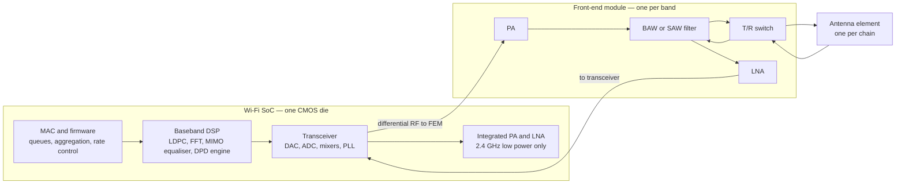

Three consequences that show up in every teardown:

- **The PA cannot live in the digital node.** A modern SoC is 6–16 nm; a Wi-Fi PA wants a higher-voltage, higher-breakdown
  process, usually GaAs or a specialised SiGe/SOI BiCMOS. That is why the front-end module (FEM) became a separate
  component business — Skyworks, Qorvo, Murata, Broadcom's own — and why the FEM, not the SoC, is often the second most
  expensive line on the bill of materials.
- **The antenna count is the product segmentation.** A phone is 2×2; a mesh node is 2×2 or 4×4; an enterprise AP is
  4×4 per band. Every extra chain costs a PA, an LNA, a filter, a switch, a board area and roughly 150–250 mW.
- **The digital side scaled, the analog side did not.** Between 2000 and 2025 the baseband moved through roughly
  fifteen process nodes; the PA's efficiency at a given linearity moved by a few percentage points. Almost every hard
  trade-off in this note is a consequence of that asymmetry.

---

## 2. Five jobs, and the one metric each one owns

A transceiver is not a thing; it is five functions that happen to share a die.

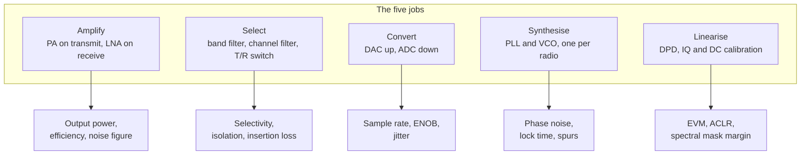

| Job | The block | The metric it owns | What breaks when it is marginal |
| --- | --- | --- | --- |
| Amplify | PA / LNA | Output power at a given EVM; noise figure | Range (LNA) or regulatory margin (PA) |
| Select | Filter, switch | Rejection of the adjacent channel and the image | Desense from a neighbouring band; EVM under blockers |
| Convert | DAC / ADC | Sample rate, ENOB, clock jitter | 4096-QAM collapses; wide channels alias |
| Synthesise | PLL / VCO | Integrated phase noise, lock time | Common-phase error on every subcarrier; slow channel switch |
| Linearise | DPD, calibration | EVM and ACLR at the antenna | The PA must be backed off, and the product loses power and efficiency |

The organising insight: **four of the five jobs are analog impairments, and the fifth exists only to cancel them.**
A Wi-Fi transceiver is a machine for producing a clean constellation out of imperfect parts, and the calibration
subsystem is as much of the design as the signal path.

---

## 3. The budget that decides everything

### 3.1 Noise floor

Thermal noise at 290 K is −174 dBm/Hz. Over a channel of width *B* the noise power is −174 + 10·log₁₀(*B*):

| Channel | 10·log₁₀(B) | Noise floor | Sensitivity penalty vs 20 MHz |
| --- | --- | --- | --- |
| 20 MHz | 73.0 dB | **−101.0 dBm** | baseline |
| 40 MHz | 76.0 dB | −98.0 dBm | +3 dB |
| 80 MHz | 79.0 dB | −95.0 dBm | +6 dB |
| 160 MHz | 82.0 dB | −92.0 dBm | +9 dB |
| 320 MHz | 85.1 dB | **−88.9 dBm** | +12 dB |

This single table explains the most counter-intuitive fact in Wi-Fi 7: **widening the channel costs exactly as much
sensitivity as the rate it buys.** 320 MHz doubles the rate against 160 MHz and gives back 3 dB of range. Wi-Fi's
rate-versus-range curve is not a curve; it is a straight line whose slope is set by this table.

### 3.2 Sensitivity, and why the standard's table is not a measurement

$$S = -174 + 10\log_{10}(B) + NF + SNR_{req}$$

The IEEE minimum sensitivity table is generated by this formula with a *fixed* SNR per MCS. That is why it scales
exactly 3 dB per doubling of bandwidth, and why it is a compliance floor rather than a description of a good radio:

| MCS | Modulation | 20 MHz | 80 MHz | 160 MHz | 320 MHz | Implied SNR at 20 MHz with NF = 7 dB |
| --- | --- | --- | --- | --- | --- | --- |
| 0 | BPSK 1/2 | −82 | −76 | −73 | −70 | 12 dB |
| 4 | 16-QAM 3/4 | −70 | −64 | −61 | −58 | 24 dB |
| 7 | 64-QAM 5/6 | −64 | −58 | −55 | −52 | 30 dB |
| 9 | 256-QAM 5/6 | −57 | −51 | −48 | −45 | 37 dB |
| 11 | 1024-QAM 5/6 | −52 | −46 | −43 | −40 | 42 dB |
| 13 | 4096-QAM 5/6 | −46 | −40 | −37 | −34 | 48 dB |

Two readings of that last column matter:

- **MCS 13 implies a 48 dB SNR**, against roughly 40 dB that a 4096-QAM demodulator actually needs. The 8 dB
  difference is implementation margin — the standard is telling you what a cheap front end may get away with, not what
  a good one achieves.
- **Vendors quote 8–12 dB better** than the floor (an enterprise AP publishing −56 to −58 dBm at EHT20 MCS 13 is
  implying a noise figure near 3 dB, not 7). Comparing a datasheet number against the IEEE minimum is a common way to
  lose an argument; they are different quantities measured at different error rates.

### 3.3 EVM — the number that commissions the analog design

EVM is the RMS distance between the transmitted symbol and its ideal position, normalised to the constellation's
peak. Every generation's EVM limit is the single most consequential line in the PHY specification for a radio
engineer:

| MCS | Modulation | 802.11be allowed relative constellation error | Roughly what it demands of the radio |
| --- | --- | --- | --- |
| 0 | BPSK 1/2 | −5 dB | Any working transmitter; a saturated PA is acceptable |
| 1–2 | QPSK 1/2, 3/4 | −10, −13 dB | 802.11b-class analog, 1999 vintage |
| 3–4 | 16-QAM 1/2, 3/4 | −16, −19 dB | First OFDM radios; IQ imbalance begins to matter |
| 5–7 | 64-QAM 2/3, 3/4, 5/6 | −22, −25, −27 dB | PA backoff; DPD becomes necessary |
| 8–9 | 256-QAM 3/4, 5/6 | −30, −32 dB | Phase noise and ADC jitter enter the budget |
| 10–11 | 1024-QAM 3/4, 5/6 | −35 dB | Every calibration loop must be closed per channel |
| 12–13 | 4096-QAM 3/4, 5/6 | **−38 dB** | 1.26% rms total error; a system-level budget, not a component spec |

Note the shape of the last three rows: **3 dB for every quadrupling of the constellation**, where theory asks for
about 6 dB. The gap was paid for twice — by LDPC coding gain, which arrived with 802.11n, and by the analog designer
closing more loops each generation. The last 3 dB, between 1024-QAM and 4096-QAM, is where a product's bill of
materials is actually decided: it is the difference between a PA with DPD and a PA without one.

### 3.4 From EVM to range — the arithmetic that ends arguments

Take a 6 GHz access point at 30 dBm EIRP, 8 dB of indoor excess loss, and free-space loss at 6 GHz of
48.0 dB at 1 m (20·log₁₀(4π·1/0.05)). Received power is then approximately −26 − 20·log₁₀(*d*) dBm. Inverting that
against the sensitivity table gives the range at which each MCS stops working:

| MCS | Sensitivity at 20 MHz | Range at 20 MHz | Sensitivity at 320 MHz | Range at 320 MHz |
| --- | --- | --- | --- | --- |
| 0 (BPSK) | −82 dBm | 630 m † | −70 dBm | 158 m † |
| 7 (64-QAM 5/6) | −64 dBm | 79 m † | −52 dBm | 20 m |
| 11 (1024-QAM) | −52 dBm | 20 m | −40 dBm | 5.0 m |
| 13 (4096-QAM) | −46 dBm | 10 m | −34 dBm | **2.5 m** |

† Extrapolation beyond the model: past about 20 m, walls and furniture make the exponent worse than free space, so
the low-MCS figures are optimistic. The high-MCS figures — the ones that matter for the peak-rate claim — sit inside
the region where the model is honest.

That last cell is the honest answer to "how fast is Wi-Fi 7". A 2×2 phone at 320 MHz has a 5.8 Gbps PHY rate and
reaches it in the same room as the AP, at about 2.5 metres, with a clear channel. Everything else in the product is
designed around the fact that this is true.

---

## 4. Era 1 — the superheterodyne, 1918 to 1995

The first Wi-Fi radios were not new architecture. They were 1918 architecture, re-tuned.

Edwin Armstrong's superheterodyne converts the received signal to a fixed intermediate frequency, where gain and
selectivity are cheap and stable, instead of trying to build both at the carrier frequency. Every radio from the
1920s to the 1990s worked that way, and so did the first wireless LANs — NCR's WaveLAN, designed in Nieuwegein from
1986 and shipped in 1990 at 2 Mbps in the 900 MHz and 2.4 GHz bands, was a superheterodyne with a discrete radio
section behind an Intel 82586 Ethernet controller.

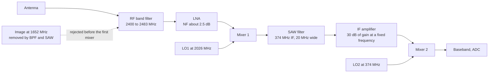

Why it was the only option in 1990:

- **Gain at 2.4 GHz was expensive.** With 1 µm CMOS, a 2.4 GHz LNA had barely 10 dB of gain and a poor noise figure;
  the process of choice was GaAs MESFET or bipolar, and the parts were hybrid modules, not a die.
- **The image problem is solvable at a high IF and insoluble at zero IF.** With a 374 MHz IF, the image sits at
  1.65 GHz — hundreds of megahertz away, where a printed filter and a SAW do the job. At zero IF the image *is* the
  signal, and only matched I and Q can separate it.
- **802.11b did not need a good radio.** DSSS and CCK at 11 Mbps were specified with a peak vector error of tens of
  percent — roughly −10 dB, and measured as peak rather than RMS, which is the more forgiving of the two. A 1999 radio
  with 60 dB of image rejection and 5% IQ error met that comfortably. This is the clearest case of the note's thesis:/n  the PHY's tolerance determined the radio's cost.

What the superheterodyne cost: two LO synthesizers, an off-chip SAW filter (a component that does not scale), a
large bill of materials, and power consumption in the watts for a 100 mW radio.

---

## 5. Era 2 — zero-IF wins, and brings four impairments

Between 1999 and 2003 the industry moved to direct conversion: mix the RF straight down to DC in one step, digitise
I and Q, and do the channel selection in the digital domain.

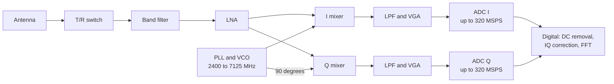

It removes the SAW, one synthesizer and most of the bill of materials — and it imports four problems that the entire
modern calibration subsystem exists to solve:

| Impairment | Physical cause | Symptom in the constellation | Mitigation |
| --- | --- | --- | --- |
| **DC offset** | LO leaking into the mixer and self-mixing; second-order distortion | A spike at the centre subcarrier; the AGC is fooled into thinking signal is present | Digital DC removal; the standard *excludes* the centre subcarrier and ±3 neighbours from EVM, precisely because this cannot be fully removed |
| **IQ gain and phase imbalance** | I and Q paths are never identical in gain or exactly 90° apart | A mirror image of the constellation, growing with frequency offset from DC | Factory and per-temperature calibration; digital compensation using a known tone |
| **LO leakage** | Finite isolation between the synthesizer and the PA input | An unmodulated carrier at the channel centre, which is an out-of-band emission and an EVM penalty | Cancellation DAC injecting an equal and opposite signal |
| **1/f noise and IIP2** | Direct conversion puts the signal at DC, where flicker noise is highest | Degraded SNR at low data rates and at high temperature | Chopping, correlated double sampling, or a low IF for the worst cases |

The exclusion of the centre subcarrier in the EVM test is worth pausing on. It is a standards body admitting that a
direct-conversion radio cannot suppress its own LO leak at DC, and choosing to measure around it rather than require
a superheterodyne. Read a specification for what it *excuses* and you learn more than from what it requires.

The move to zero-IF is also why the LNA, mixer, filter, VGA and ADC ended up on one die: once the signal is at
baseband, everything downstream is CMOS-standard, and the only special part left is the front-end module.

---

## 6. Era 3 — the digital-assisted analog radio

From 802.11n onward, the radio stopped being an analog design with digital control and became an analog design
*whose accuracy is manufactured digitally*. Three loops do most of the work.

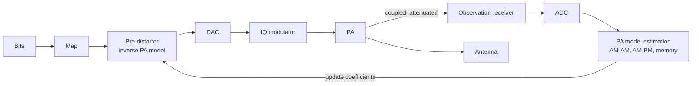

| Loop | What it observes | What it corrects | Typical benefit |
| --- | --- | --- | --- |
| **DPD** | The PA's output envelope and phase, via a coupler and a low-speed observation path | AM-AM compression, AM-PM conversion, memory effects | 10–15 dB of ACLR, or 3–6 dB more output power at the same mask — the difference between a 15 dBm and a 19 dBm FEM at the same EVM |
| **TX IQ and LO leakage** | A detector at the modulator output, or the observation path | Gain and phase mismatch, carrier leak | Takes a 2% IQ error to 0.3%, i.e. EVM from −34 to −50 dB |
| **RX IQ and DC** | A test tone injected at the LNA input | Receive-path imbalance and offset | Removes the image that would otherwise limit 1024-QAM and above |

The commercial effect is easy to miss. A CMOS PA at 5 GHz with no DPD reaches 64-QAM at −25 dB EVM only when backed
off to the point where it delivers about 12 dBm and 8% efficiency. With DPD, the same device delivers 18 dBm at
−32 dB and 15% efficiency. **DPD is what made high-order QAM affordable in a phone**, and it is the reason a Wi-Fi 7
client can transmit 1024-QAM from a 3.7 V battery.

The cost is calibration time and complexity: a modern Wi-Fi SoC runs dozens of calibration routines at boot, per
channel, and on temperature change. Those routines are the natural home of the first real machine-learning content in
a Wi-Fi radio — a subject §16 returns to.

---

## 7. Generation by generation — what changed inside the radio

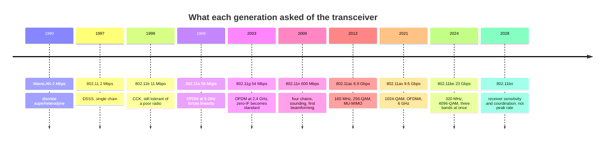

| Generation | Band | Max BW | Highest modulation | Chains | TX EVM | The one transceiver change that mattered |
| --- | --- | --- | --- | --- | --- | --- |
| 802.11-1997 | 2.4 GHz | 20 MHz | DSSS 1–2 Mbps | 1 | −10 dB class | A working 2.4 GHz radio at all |
| 802.11b-1999 | 2.4 GHz | 20 MHz | CCK 11 Mbps | 1 | −10 dB class | Cheaper integration; still a forgiving mask |
| 802.11a-1999 | 5 GHz | 20 MHz | 64-QAM 5/6 | 1 | −25 dB | **Linearity**: OFDM's PAPR breaks saturated PAs |
| 802.11g-2003 | 2.4 GHz | 20 MHz | 64-QAM 5/6 | 1 | −25 dB | Zero-IF becomes the default; IQ calibration appears |
| 802.11n-2009 | 2.4 / 5 | 40 MHz | 64-QAM 5/6 | up to 4 | −28 dB | **Arrays**: shared LO, per-chain calibration, sounding |
| 802.11ac-2013 | 5 | 160 MHz | 256-QAM 5/6 | up to 8 | −32 dB | Wider bandwidth forces ADC and phase-noise discipline |
| 802.11ax-2021 | 2.4 / 5 / 6 | 160 MHz | 1024-QAM 5/6 | up to 8 | −35 dB | 6 GHz adds a third radio; DPD becomes universal |
| 802.11be-2024 | 2.4 / 5 / 6 | 320 MHz | 4096-QAM 5/6 | up to 8 per link | −38 dB | **Concurrency**: two or three radios on at once, isolated |
| 802.11bn (UHR) | 2.4 / 5 / 6 | 320 MHz | 4096-QAM | unchanged | unchanged | **Receiver-first**: ELR, repetition, coordination |

Three things to notice in that table.

1. **The peak rate grew 11,500×; the output power did not move.** Every generation from 802.11b to 802.11be ships at
   roughly the same 15–23 dBm per chain, because the limit is regulatory and thermal, not technological. All the
   growth came from bandwidth, constellation, chains and coding — the first three of which are the transceiver's
   problem.
2. **The EVM column moves in 3 dB steps**, and each step is roughly one generation of analog design: a better PA
   linearity point, a lower phase-noise synthesizer, one more bit of ADC, one more calibration loop.
3. **The last row breaks the pattern.** 802.11bn does not raise the constellation, the bandwidth or the chain count.
   Its gains come from the receiver and from coordination between access points — the first generation in which the
   transmitter is not the thing being improved.

---

## 8. The transmit chain, stage by stage, with numbers

Take the hardest case a Wi-Fi 7 client will ever be asked to produce: 320 MHz, 4096-QAM, rate 5/6, one spatial
stream, 20 dBm at the antenna.

```mermaid
flowchart LR
    B["Bits<br/>rate 5/6 LDPC"] --> S["Scramble and encode<br/>1 codeword per 1944 bits"]
    S --> M["4096-QAM map<br/>12 bits per subcarrier"]
    M --> P["Pilots and DC nulls<br/>3920 data of 4096 tones"]
    P --> I["4096-point IFFT<br/>78.125 kHz spacing"]
    I --> G["0.8 microsecond guard interval<br/>13.6 microsecond symbol"]
    G --> W["Window and clip<br/>PAPR 10 to 12 dB"]
    W --> D["DAC at 320 MSPS<br/>10 to 11 ENOB"]
    D --> F["Reconstruction filter"]
    F --> Q["IQ modulator<br/>LO 5945 MHz"]
    Q --> A["PA<br/>20 dBm average, 32 dBm peak"]
    A --> FE["Filter and switch<br/>1.5 dB loss"]
    FE --> AN["Antenna<br/>EIRP 30 dBm or less"]
```

| Node | What it contributes to the error budget | Typical value |
| --- | --- | --- |
| LDPC and mapping | Nothing analog; sets the required SNR | 40 dB for 4096-QAM 5/6 |
| Windowing and clipping | Deliberate distortion to control PAPR | 0.4% EVM if clipping is set at 7 dB |
| DAC | Quantisation and clock jitter | 0.3% EVM at 10 ENOB, 320 MSPS |
| Reconstruction filter | Group delay and passband ripple | 0.2% EVM |
| IQ modulator | Gain and phase mismatch, LO leak | 0.5% EVM after calibration |
| PA | AM-AM and AM-PM compression, memory | 0.8% EVM with DPD |
| Synthesizer | Integrated phase noise | 0.6% EVM |
| **RSS total** | √(0.4² + 0.3² + 0.2² + 0.5² + 0.8² + 0.6²) | **1.24% ≈ −38.1 dB** |

That table is how a radio is actually designed: a −38 dB requirement becomes six numbers, each owned by a different
engineer, each with a test. The 1.24% is deliberately just inside the limit, because the product also needs margin
for temperature, voltage and the front-end module's own 1.5 dB of loss.

The peak-to-average ratio is the reason the PA cannot simply be designed for 20 dBm. An OFDM signal at 320 MHz and
4096-QAM has a PAPR of about 10–12 dB at the 0.1% probability point, so the PA must remain linear to 32 dBm while
averaging 20 dBm — a 12 dB backoff from a device that is only efficient near compression.

---

## 9. The receive chain, and the time it has

The receiver's problem is not accuracy; it is that it must be accurate *within the preamble*. Every acquisition task
has a deadline written into the PPDU format.

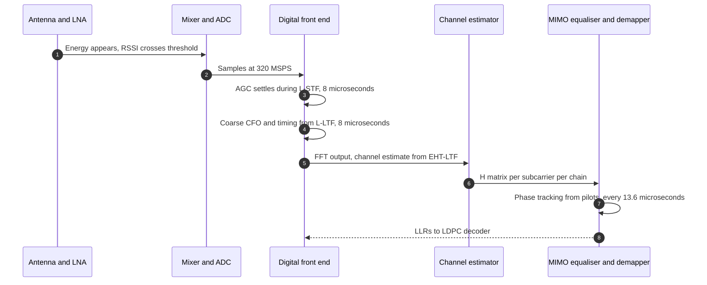

| Phase | Signal | Duration at 320 MHz | What must be finished |
| --- | --- | --- | --- |
| Detection and AGC | L-STF | 8 µs | Gain settled to within 1 dB, otherwise the LTF clips |
| Coarse frequency and timing | L-LTF | 8 µs | CFO to within a few hundred Hz, symbol timing to a fraction of a sample |
| Signalling | L-SIG, RL-SIG, U-SIG, EHT-SIG | 20–32 µs | Bandwidth, MCS, spatial configuration, puncture pattern |
| Channel estimation | EHT-LTF | 4 µs per symbol, up to 8 | One estimate per chain pair |
| Data | Data symbols | 13.6 µs each | Per-symbol phase tracking from pilots |

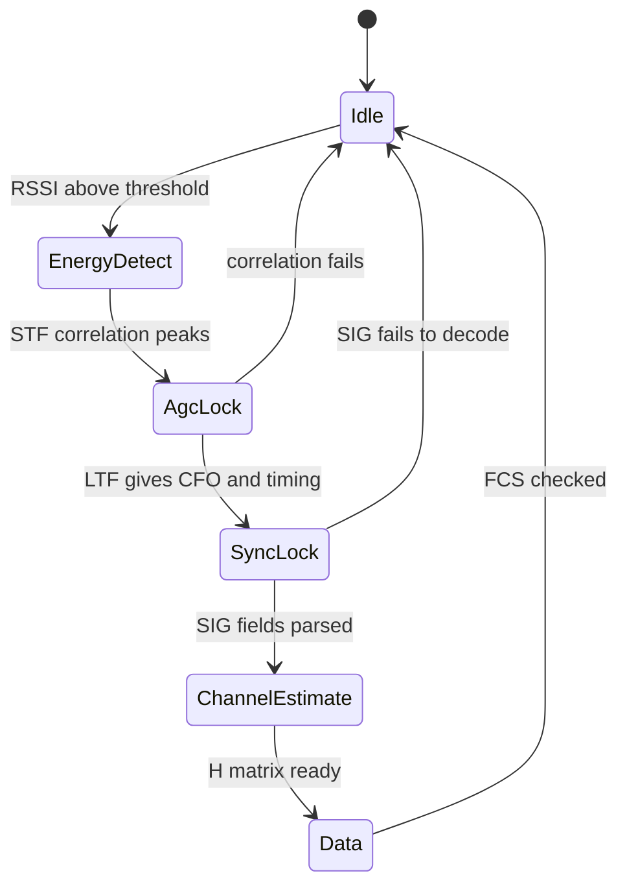

Two design consequences follow from those numbers, and they recur in every later section:

- **AGC has 8 µs.** That is the entire settling budget, including the time the RSSI threshold took to fire. It is why
  Wi-Fi receivers use fast, coarse AGC followed by digital gain, and why a strong adjacent-channel blocker arriving
  mid-preamble is so damaging.
- **Channel estimation has 4 µs per LTF symbol.** Everything the equaliser knows about the channel comes from a
  handful of symbols at the start of the frame, extrapolated across the rest of it by pilot-based phase tracking. A
  receiver that could *predict* rather than extrapolate would gain real margin — which is exactly where learned
  receivers have their best argument (§17).

---

## 10. The fixed cost: why the preamble now costs more than the payload

At the top of the rate table, a Wi-Fi frame is mostly preamble. This is arithmetic, not opinion.

| Configuration | Preamble (approx.) | 1500-byte payload | Preamble share |
| --- | --- | --- | --- |
| 20 MHz, MCS 0, 8.6 Mbps | ~44 µs | 1,400 µs | 3% |
| 20 MHz, MCS 11, 143 Mbps | ~56 µs | 84 µs | 40% |
| 160 MHz, MCS 13, 1,441 Mbps | ~56 µs | 8.3 µs | **87%** |
| 320 MHz, MCS 13, 2,882 Mbps | ~56 µs | 4.2 µs | **93%** |

Three implications that shape both the radio and the future of the standard:

1. **At 320 MHz the radio spends most of its energy on training, not data.** Every efficiency argument about Wi-Fi 7
   peak rates has to survive this table; a 4.2 µs payload behind a 56 µs preamble is a 7% duty cycle.
2. **The receiver is the bottleneck at high rate, not the transmitter.** Detecting, synchronising and estimating in
   56 µs is the hard real-time problem; transmitting 4.2 µs of 4096-QAM is comparatively easy.
3. **This is where 802.11bn spends its budget.** The ELR PPDU of §18 exists precisely because the preamble, not the
   payload, is what fails at the edge of coverage.

---

## 11. From one chain to many — MIMO's bill

802.11n turned the transceiver from a device into an array. Every chain needs its own PA, LNA, filter, mixer and
ADC; all of them need a phase-coherent LO and a calibration that holds across temperature.

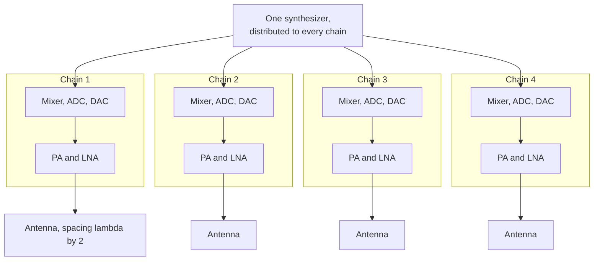

| What has to be calibrated | Why | How well |
| --- | --- | --- |
| **Chain-to-chain phase** | Beamforming is the sum of four phasors; a 20° error costs about 1 dB of array gain | Within 3–5° after factory calibration, drifting with temperature |
| **Chain-to-chain amplitude** | Unequal chains skew the effective pattern | Within 0.5 dB |
| **Antenna coupling** | Elements at λ/2 couple at about −10 to −15 dB; the transmitted pattern is not the array factor | Modelled in the beamforming matrix, or measured per unit |
| **Per-chain EVM** | The worst chain sets the MCS, because the receiver cannot tell which chain was bad | Each chain specified to the same limit, with margin |
| **LO distribution** | A shared LO avoids per-chain phase drift but couples leakage between chains | Shared, with buffers and isolation |

Two limits are worth stating because they are usually misunderstood:

- **More chains do not buy range in the way people expect.** Four chains buy about 6 dB of array gain on receive and
  the same on transmit — genuinely useful — but they also buy four times the DC power, four times the board area and
  a coupling problem. The reason 16-stream products exist is throughput in a single room, not coverage.
- **Eight streams is already a packaging problem.** Eight chains at 5 GHz occupy about 8 × 200 mW = 1.6 W of RF
  board, plus filters, and need a heat spreader. The often-quoted 46 Gbps of Wi-Fi 7 is a 16-stream sum that no
  shipping product implements, because 16 chains would need roughly 3 W of RF and a chassis that a client device does
  not have.

---

## 12. Multi-link — two radios in one box

802.11be's multi-link operation is usually described as a MAC feature. It is also, and more expensively, a
transceiver feature: a device must have two or three radios operating simultaneously in different bands, sharing one
association.

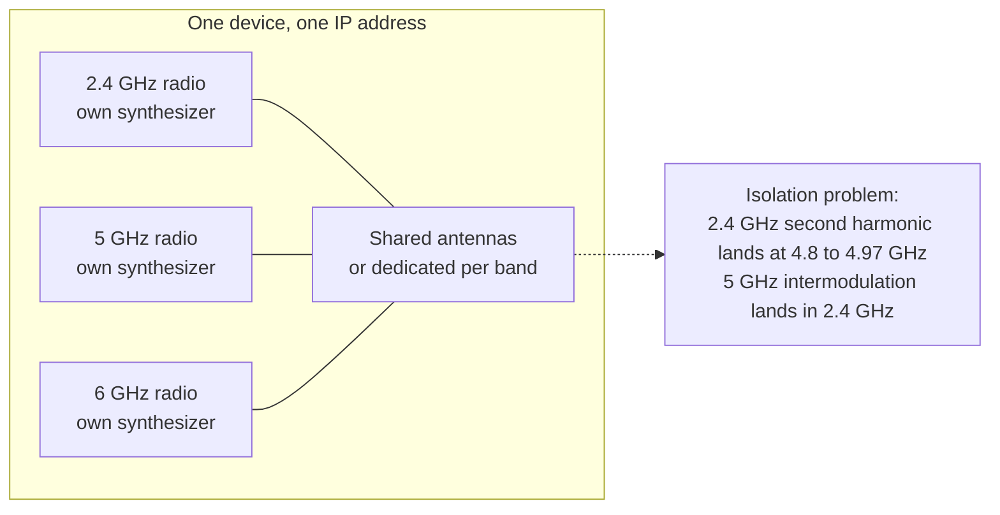

| Problem | Mechanism | Mitigation | Cost |
| --- | --- | --- | --- |
| Harmonic coupling | 2.4 GHz transmit at 20 dBm produces a second harmonic at 4.8–4.97 GHz, just below UNII-1 and inside the 4.9 GHz public-safety band | Filter, or avoid channel combinations that put the harmonic in the other radio's band | Board area, insertion loss |
| Receiver desense | One radio transmitting while another receives in an adjacent band | High-linearity LNAs, band filters, coordinated scheduling (in-device coexistence) | Sensitivity, latency |
| LO pulling | Two synthesizers close in frequency couple and pull each other | Separate supply domains, shielding, different reference planning | Design complexity |
| Power | Two or three radios active at once | EMLSR-style single-radio tricks, which trade latency for power | The very latency MLO was meant to buy |

The honest summary: **MLO is where the analog cost of Wi-Fi 7 is concentrated.** The PHY features (320 MHz,
4096-QAM) are hard but local; running three radios in one plastic box without desensing each other is a system-level
RF problem, and it is why Wi-Fi 7 access points are physically larger than Wi-Fi 6 ones with the same stream count.

---

## 13. Power and heat — the limit nobody puts in a datasheet

PA efficiency is quoted at the compression point, and Wi-Fi never operates there.

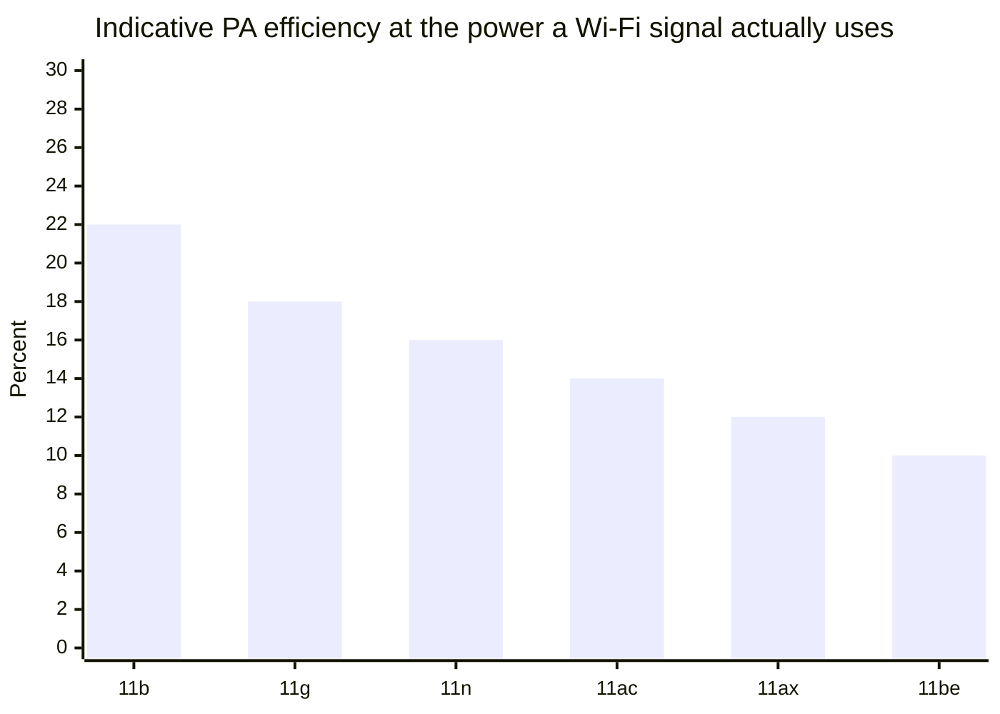

| Quantity | 2×2 client at 20 dBm total | 4×4 AP per band at 20 dBm per chain |
| --- | --- | --- |
| RF output | 100 mW | 400 mW |
| PA efficiency at the required backoff | 10–15% | 15–20% |
| DC into the PAs | 0.7–1.0 W | 2.0–2.7 W |
| Baseband and MAC | 0.3–0.6 W | 3–5 W |
| Total radio subsystem | ~1.0–1.5 W | 5–8 W per band |

Three consequences:

- **A phone transmitting at full power for an hour consumes about a third of its battery.** This is why clients drop
  to 1024-QAM and 80 MHz rather than chase the peak, and why the rate control algorithm is really a power control
  algorithm wearing a different hat.
- **A tri-band Wi-Fi 7 AP dissipates 20–35 W**, most of it in the RF front end and the switch. That is why enterprise
  APs have metal cases and PoE budgets of 30–60 W, and why the "green Wi-Fi" argument is mostly an argument about PA
  backoff.
- **The PA's efficiency curve is the reason 4096-QAM exists mainly on paper for clients.** To hit −38 dB EVM a client
  PA must back off to about 8–10 dB below compression, where efficiency is in the single digits. The AP can afford
  it; the phone usually cannot, which is why uplink 4096-QAM is rare in practice even where it is supported.

---

## 14. Coexistence — the transceiver's least glamorous job

| Coexistence problem | Where it appears | Mechanism | What it costs |
| --- | --- | --- | --- |
| Wi-Fi and Bluetooth in 2.4 GHz | Every phone and laptop | Time-division arbitration (PTA signalling) or adaptive frequency hopping | Up to 30% of Wi-Fi airtime in the worst case |
| LTE band 40 and Wi-Fi 2.4 GHz | India, China, dense urban | Filter isolation; B40 sits at 2300–2400 MHz, directly below the band | Desense of 10–20 dB without a good filter |
| 5 GHz and weather radar | UNII-2A/2C | DFS: detect, vacate in 10 s, wait 60 s | Channel availability, false triggers |
| 6 GHz and fixed links | 6 GHz standard power | AFC: query a database for the location, register the device | A network round trip at installation; the reason LPI exists |
| Adjacent-channel in the same box | MLO | Filter and linearity | Insertion loss, which costs range |
| Second harmonic of 2.4 into 5 | MLO, dual-band APs | Filter, channel plan | Board area |

The regulatory limits that frame all of it, for reference:

| Band | Regime | Conducted / EIRP limit | Note |
| --- | --- | --- | --- |
| 2.4 GHz | FCC 15.247 | 30 dBm conducted, 36 dBm EIRP with 6 dBi | The classic 20 dBm + antenna arithmetic most products actually ship |
| 5 GHz | FCC 15.407 | 30 dBm conducted, 36 dBm EIRP for UNII-1/3 | UNII-2A/2C carry DFS obligations |
| 6 GHz, LPI | FCC 15.407 | 24 dBm EIRP | Indoor only, no AFC |
| 6 GHz, standard power | FCC 15.407 | 30 dBm EIRP | Requires AFC registration |
| 6 GHz, very low power | FCC 15.407 | 14 dBm EIRP | The class that made 6 GHz usable for tethering |
| EU, 2.4 / 5 / 6 | EN 300 328, EN 301 893 | 20 / 23 / 23 dBm EIRP | Lower than the US, which is why EU SKUs have different power tables — `VERIFY` exact limits per sub-band |

The practical rule: **an access point's transmit power is set by the antenna gain and the regulatory class, not by
the PA.** A PA capable of 26 dBm is routinely run at 18 dBm because the antenna has 5 dBi and the limit is EIRP.

---

## 15. The radio as a sensor — 802.11bf changes the requirements

IEEE 802.11bf-2024 (published September 2024) makes WLAN sensing a standardised function rather than a research
exploit. It defines sensing measurement instances, initiation and feedback frames, and both monostatic (one device)
and bistatic (two devices) configurations.

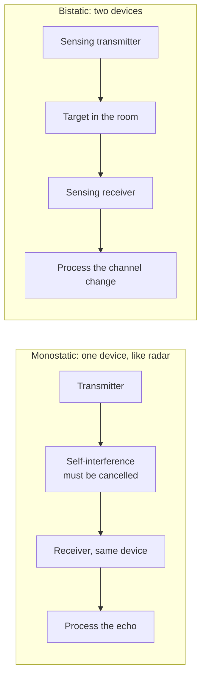

| Requirement | For communication | For sensing | Why it is harder |
| --- | --- | --- | --- |
| **Channel information** | A channel estimate good enough to equalise | Raw CSI per subcarrier per antenna pair, exported | The datapath has to give the host the CSI, not just the equalised bits |
| **Phase coherence** | Within one frame, tracked by pilots | Across frames seconds apart | The LO's phase must be repeatable or tracked; a random phase per frame destroys Doppler |
| **Dynamic range** | Enough for the MCS in use | Enough to see a reflection 40–60 dB below the direct path | The LNA's linearity becomes the sensing range |
| **Self-interference** | Not applicable | 50–60 dB of cancellation for monostatic operation | Not a solved problem in commodity hardware |
| **Antenna count** | Throughput | Angular resolution | More receive chains help sensing more than transmit chains do |

The resolution arithmetic is the useful part, because it is the same for radar and for Wi-Fi:

| Quantity | Formula | At 20 MHz | At 320 MHz |
| --- | --- | --- | --- |
| Range resolution | c / (2B) | 7.5 m | **0.47 m** |
| Maximum unambiguous range | Depends on measurement repetition | Tens of metres indoors | Tens of metres |
| Velocity resolution | λ / (2·T_dwell) | Depends on dwell time, not bandwidth | Same |
| Angular resolution | ~ λ / (N·d) | 30° with 4 elements | 30° with 4 elements |

So 320 MHz gives 47 cm of range resolution — enough to separate a person from a wall, not enough to resolve a hand
from a torso without Doppler processing. This is why Wi-Fi sensing products mostly classify motion and presence
rather than image: the physics supports presence and gross motion, and the marketing does not always say so.

---

## 16. The AI era, part 1 — what AI already does inside the radio

It is worth separating what is shipping from what is demonstrated, because the gap is larger here than anywhere else
in wireless.

| Function | Where it runs | Is it standardised? | Evidence |
| --- | --- | --- | --- |
| DPD coefficient adaptation | In the SoC, per transmit burst | No — invisible to the standard | Vendor implementations; the loop of §6 |
| IQ, DC and LO-leak calibration | In the SoC, at boot and on temperature change | No | Universal in Wi-Fi 6/7 silicon |
| Rate adaptation, MLO link steering | Driver or firmware | No | Vendors already describe ML-based RRM |
| CSI compression | 3GPP Rel-18, cellular | **Yes, in 3GPP** `TR 38.843`, 8–79% overhead reduction | No 802.11 equivalent as of the 2026 drafts — `VERIFY` |
| Beam prediction | 3GPP Rel-18 study | Cellular only | 60–90% top-1 accuracy in the study |
| Neural receiver | Research and prototypes | No | `arXiv:2312.02601`, within 1 dB of LMMSE plus K-best |
| Learned constellation | Research | No, and blocked by conformance | End-to-end autoencoders, 2017 onward |

The pattern is clear and it is the key to predicting the next five years: **AI has already won everywhere the
standard cannot see it, and has won nowhere the standard can see it.** Calibration and DPD are inside one vendor's
silicon, tested by that vendor, invisible to certification. Waveform and constellation are in the public
specification, tested against a mask, and interoperable with a competitor's receiver.

---

## 17. The AI era, part 2 — the learned receiver and the 16 µs wall

The most credible AI result in radio is the neural receiver: one network that jointly performs channel estimation,
equalisation and demapping, replacing three hand-designed blocks. NVIDIA's 5G NR version processes an entire slot
with about 730,000 weights and lands within 1 dB of an LMMSE + K-best baseline, while being cheaper to run.

Then put it next to a Wi-Fi frame:

| Deadline | Duration | What must happen |
| --- | --- | --- |
| SIFS, last symbol to ACK on air | **16 µs** | Decode the frame, check the FCS, build and start the response |
| One OFDM symbol at 320 MHz | **13.6 µs** | Demodulate and track phase for one symbol |
| Preamble, energy detect to channel estimate | **56 µs** | AGC, sync, CFO, channel estimation |
| One 1500-byte MPDU at MCS 13, 320 MHz | **4.2 µs** | The entire payload the network is trying to deliver |
| Neural receiver inference, published result | **< 1 ms on an A100 with TensorRT** | The whole slot |

A millisecond is 60 times the SIFS budget and 70 times a symbol. That is not a gap that a smaller model closes; it is
a gap that says **the learned receiver cannot sit in the per-symbol path of a Wi-Fi chip at 2026 silicon budgets.**
The 730k-weight network is not the problem — a Wi-Fi SoC has room for it. The problem is that the arithmetic has to
finish inside 13.6 µs, in a device that must also decode four streams, on a battery.

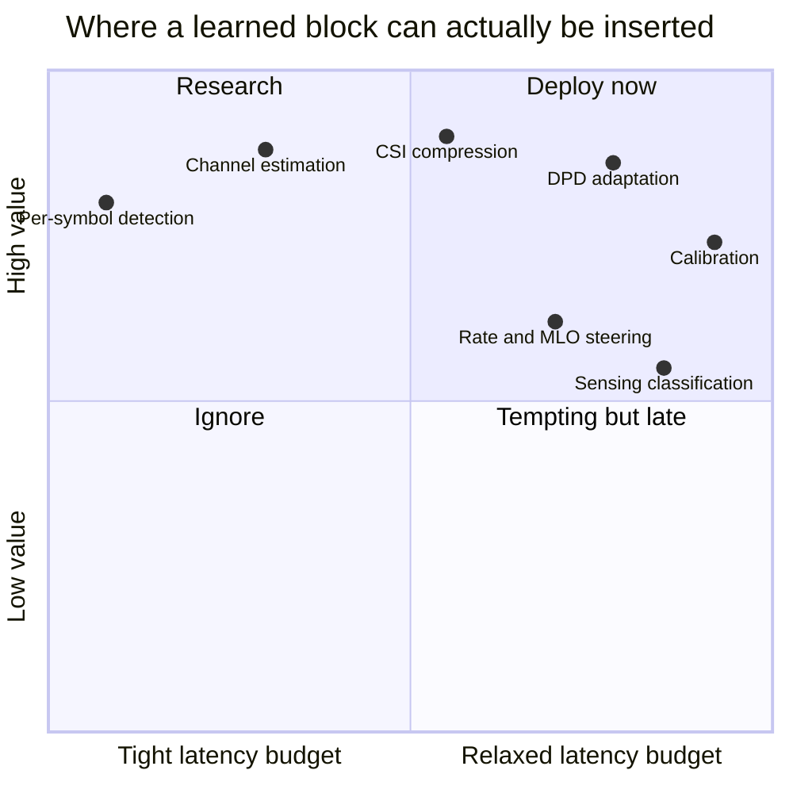

The four insertion points, in the order they will actually ship:

1. **Slow loops — DPD, calibration, thermal compensation.** Latency budget in milliseconds or seconds, value in
   yield and power. Already happening. This is where "AI in the radio" is true today, and it is invisible because it
   lives inside a vendor's bring-up code.
2. **Medium loops — rate adaptation, MLO link selection, roaming.** Budget in tens of milliseconds. Already
   partly ML. Has nothing to do with the PHY and everything to do with the driver.
3. **Receiver internals behind a compliant interface.** Channel estimation, equalisation, demapping, phase tracking.
   This is the neural receiver's natural home: the *bits on the air are unchanged*, so conformance is untouched. It
   is blocked only by latency and by the fact that a Wi-Fi receiver has 56 µs, not 1 ms. Expect it first in access
   points with a dedicated inference block, where power is cheap and a few extra microseconds can be found.
4. **The waveform itself — learned constellations, pilotless transmission, AI-native air interface.** Blocked, and
   not primarily by technology. The standard specifies the PPDU so that a 2026 device can hear a 2016 one; a learned
   constellation is a new PPDU. A regulatory spectral mask is defined in terms of the emitted waveform. And
   certification requires reproducibility across vendors' test equipment. This is a 6G research programme, not a
   Wi-Fi 8 feature.

The distinction that makes the whole section usable in an interview:

> **AI can replace anything behind the antenna. It cannot, under the current conformance model, replace the waveform
> in front of it.** That is why the credible AI-in-radio work is all receivers, calibration and control, and why the
> "AI-native PHY" headlines are about 6G.

---

## 18. The AI era, part 3 — AI changes the traffic, and the traffic changes the radio

The second-order effect is easier to miss and more certain than the first. AI applications are changing what Wi-Fi
carries, and the change moves the bottleneck from the transmitter to the receiver.

| Traffic shift | What changes in the air | What changes in the radio |
| --- | --- | --- |
| **Uplink-heavy clients** — glasses, cameras, always-on agents | More uplink OFDMA, more triggered access, more small frames | The *client* PA becomes the constraint: lower power, worse EVR, worse thermal headroom than the AP |
| **Bursty inference** | Short, latency-critical exchanges rather than long downloads | Preamble overhead (§10) dominates; power save and r-TWT matter more than peak rate |
| **Deterministic control** — robotics, industrial | Bounded latency, jitter and loss | Reliability features, not constellation; this is 802.11bn's entire thesis |
| **Sensing as a service** | Measurement traffic alongside data | LO coherence, CSI export, self-interference |
| **On-device models** | Model download and update bursts | Rare, large, bandwidth-bound transfers — the one case where the old peak-rate race still matters |

And this is exactly where 802.11bn lands. Its PAR asks for 25% more throughput at a given SINR, 25% lower
95th-percentile latency, and 25% fewer dropped MPDUs — not a higher constellation. The most transceiver-relevant
feature in the draft is the **Enhanced Long Range (ELR) PPDU**: 20 MHz only, one spatial stream, BPSK or QPSK only,
1.67 and 3.33 Mbps, with repetition at resource-unit level, a separate preamble for detection at low SNR, and 3 dB of
power boosting on the UHR-STF and UHR-LTF.

Read that list of restrictions again. **Wi-Fi 8's headline range feature is a PPDU that is deliberately worse at
everything the transmitter does, in order to be detectable by a better receiver.** After twenty-five years of buying
range with transmit power and rate with constellation, the standard has turned around and spent its budget on
sensitivity, repetition and coordination between access points. That is the clearest available signal about where
the next decade of radio work sits.

---

## 19. Where the silicon goes next

| Bet | What it replaces | The physics that makes it attractive | The physics that holds it back |
| --- | --- | --- | --- |
| **Direct RF sampling** | Mixers and analog filters; sample at 6 GHz directly | High-speed ADC at 10+ GSPS makes the mixer digital, and digital filters are exact | Power per GSPS; jitter; the ADC alone can cost more than the whole radio |
| **Digital PA with envelope tracking** | Class-AB PA and fixed supply | Efficiency of 30–40% instead of 10–15% at backoff, which is where Wi-Fi actually operates | Envelope bandwidth must exceed the signal bandwidth; complexity moves to the supply |
| **DPD everywhere, learned** | Conservative backoff | Recovers 3–6 dB of output power at the same mask | Observation path and calibration time |
| **Antenna-in-package and metamaterial steering** | Discrete antennas and a fixed pattern | Pattern gain without more chains | Aperture, loss, and the fact that a phone is held in a hand |
| **Coordination instead of power** — 802.11bn MAPC | Each AP's own radio | Nulls and joint transmission turn interference into gain | Phase and timing synchronisation across access points, which is a transceiver problem again |
| **Sub-THz and 60 GHz** — 802.11bq | Sub-7 GHz spectrum | Bandwidth that does not exist below 7 GHz | Free-space loss of 68 dB at 1 m at 60 GHz, and oxygen absorption |

The unifying observation: **every one of these bets moves work from the analog domain into the digital domain, and
every one of them is limited by power rather than by accuracy.** That is the same asymmetry identified in §1, and it
is why the trajectory of the last twenty-five years is likely to continue: more digital, more calibration, more
coordination, and a PA that is still only 15% efficient.

---

## 20. Ten numbers, ten answers, ten corrections

**Ten numbers**

| Number | What it is |
| --- | --- |
| **−174 dBm/Hz** | Thermal noise density; the floor under every sensitivity figure |
| **−38 dB** | 4096-QAM EVM limit, i.e. 1.26% rms error, the whole analog design's target |
| **3 dB** | The cost of doubling the channel, in both rate and sensitivity |
| **13.6 µs** | One OFDM symbol at 320 MHz; the receiver's per-symbol deadline |
| **16 µs** | SIFS; the turnaround a learned receiver cannot meet |
| **2,882 Mbps** | One stream at 320 MHz, MCS 13; ×8 streams = 23 Gbps, ×16 = 46 Gbps |
| **~2.5 m** | Where 320 MHz MCS 13 actually works, at 30 dBm EIRP indoors |
| **56 µs** | Preamble length; 93% of a 1500-byte frame at peak rate |
| **48 dB** | SNR implied by the standard's MCS 13 sensitivity at 20 MHz |
| **0.47 m** | Range resolution at 320 MHz — what Wi-Fi sensing can and cannot see |

**Ten answers worth having ready**

1. *Why did Wi-Fi need zero-IF?* To delete the SAW filter and one synthesizer, at the cost of four impairments that
   calibration now manages.
2. *What does 4096-QAM cost?* Three dB of EVM, about 6 dB of SNR, and most of the link budget: 2.5 m instead of 250 m.
3. *Why is the PA the hardest part?* OFDM's 10–12 dB PAPR means the device must be linear 12 dB above its average
   output, where its efficiency is single-digit.
4. *What does DPD buy?* Three to six dB of output power at the same mask, or the ability to run 1024-QAM from a CMOS
   PA at all.
5. *Why does more bandwidth not always help?* Because sensitivity degrades 3 dB per doubling, so the rate gain and the
   range loss cancel in the middle of the cell.
6. *What is the real cost of MLO?* Two or three radios in one box, with harmonic and desense problems that no PHY
   feature has.
7. *Why is Wi-Fi 8 not about speed?* Because the PAR asks for 25% at a given SINR and 25% less tail latency; the
   constellation and bandwidth do not change.
8. *Where will AI actually land in a Wi-Fi radio?* DPD, calibration, rate and link steering, then receiver internals —
   never the waveform, because of conformance.
9. *Why can a neural receiver not go in the symbol path?* 1 ms of published inference against a 13.6 µs symbol and a
   16 µs SIFS.
10. *What makes Wi-Fi sensing hard?* Phase coherence across frames and self-interference cancellation, neither of
    which a communication radio was designed for.

**Ten corrections**

| Common claim | What is actually true |
| --- | --- |
| "Wi-Fi 7 does 46 Gbps" | 46 Gbps is 16 streams of arithmetic; shipping products are 2×2 to 4×4 per band, and a 2×2 client is 5.8 Gbps at 320 MHz |
| "Higher QAM is always better" | 4096-QAM needs ~48 dB SNR and reaches 2.5 m; rate control spends most of its time choosing *lower* MCS |
| "Wider channels increase throughput" | They increase peak rate and decrease sensitivity by the same 3 dB per doubling |
| "Sensitivity is one number" | It is a function of bandwidth, MCS and error rate; the IEEE value is a floor, vendor values are typical |
| "Wi-Fi 6E is a new PHY" | It is 802.11ax in 6 GHz, plus AFC and a power-class regime |
| "MLO doubles throughput" | It improves latency and peak, but the links share one medium and one device's power budget |
| "802.11bf makes Wi-Fi a radar" | It standardises the measurement protocol; resolution still comes from bandwidth, and 320 MHz gives 47 cm |
| "AI will replace the Wi-Fi PHY" | The standard specifies the waveform at the antenna; AI can replace everything behind it, which is where the real wins are |
| "More antennas means more range" | More chains buy array gain and throughput, and cost power, area and coupling; 16 streams is a packaging limit |
| "PA efficiency is the datasheet number" | Datasheets quote at compression; Wi-Fi operates 8–12 dB below it, where efficiency is a third of the quoted value |

---

## Anchors — verified facts

- **Noise floor**: kTB at 290 K is −174 dBm/Hz; 20 MHz is −101.0 dBm, 80 MHz −95.0, 160 MHz −92.0, 320 MHz −88.9.
  Every 3 dB per doubling of bandwidth in the sensitivity tables follows from this and nothing else.
- **802.11be EVM limits** (relative constellation error, EHT MU PPDU, `11-20/1253` and the published amendment,
  clause 36.3.19.4): BPSK 1/2 −5; QPSK 1/2 −10, 3/4 −13; 16-QAM 1/2 −16, 3/4 −19; 64-QAM 2/3 −22, 3/4 −25, 5/6 −27;
  256-QAM 3/4 −30, 5/6 −32; 1024-QAM 3/4 and 5/6 −35; **4096-QAM −38**. For 1024-QAM the requirement is −35 dB with
  amplitude-drift compensation enabled, and −32 dB without it. For EHT TB PPDUs, a second, looser set (−27 dB for
  the low constellations) applies when the transmit power is below the MCS 7 maximum.
- **The EVM test deliberately excludes LO leakage**: leakage at the centre frequency of the tone plan and within
  ±3 neighbouring subcarriers is excluded from the computation. This is a direct-conversion radio being accommodated
  by the measurement method.
- **802.11ax/be sensitivity** (20 MHz, IEEE minimum): MCS 0 −82 dBm, MCS 4 −70, MCS 7 −64, MCS 9 −57, MCS 11 −52,
  MCS 13 −46; each doubling of bandwidth moves every value 3 dB toward zero, so MCS 13 at 320 MHz is −34 dBm. Vendor
  datasheets quote typical values 8–12 dB better (an enterprise AP at −56 to −58 dBm for EHT20 MCS 13), which implies
  a noise figure near 3 dB rather than the 7 dB the standard's floor implies.
- **Preamble arithmetic at 320 MHz**: L-STF 8 µs, L-LTF 8 µs, L-SIG 4 µs, RL-SIG 4 µs, U-SIG 8 µs, EHT-SIG
  4–16 µs, EHT-STF 4 µs, EHT-LTF 4 µs each (1× LTF, 3.2 µs plus 0.8 µs GI). A 1500-byte MPDU at MCS 13 with one
  stream (2,882 Mbps) occupies about 4.2 µs, so the preamble is over 90% of the PPDU.
- **802.11bn (UHR)**, TGbn established November 2023, D1.0 in July 2025, publication expected 2028: PAR targets
  at least 25% higher throughput at a given SINR, 25% lower 95th-percentile latency, 25% fewer dropped MPDUs, in
  1–7.25 GHz, backward compatible with 2.4/5/6 GHz. The **ELR PPDU** is 20 MHz only, one spatial stream, BPSK and
  QPSK only, 1.67 and 3.33 Mbps, with RU-level repetition, two ELR-MARK symbols, and 3 dB power boosting on
  UHR-STF/UHR-LTF. Bandwidth, constellation and stream count are otherwise unchanged from 802.11be.
- **802.11bf-2024** (published September 2024; PAR September 2020): defines WLAN sensing in 1–7.125 GHz and above
  45 GHz, with sensing measurement instances, sensing initiation and feedback frames, and monostatic and bistatic
  configurations.
- **Range resolution** c/(2B): 7.5 m at 20 MHz, 0.47 m at 320 MHz. Angular resolution is set by element count and
  spacing, not bandwidth.
- **3GPP AI/ML for the air interface** (`TR 38.843`, Rel-18): three use cases — CSI feedback, beam management,
  positioning. Reported CSI overhead reduction 8–79% with 0–17% throughput gain; top-1 beam prediction 60–90%;
  positioning better than 1 m at 90% CDF versus worse than 15 m for the conventional baseline in the studied NLOS
  scenario.
- **Neural receiver** (`arXiv:2312.02601`, Cammerer et al., NVIDIA and Rohde & Schwarz): one network jointly
  performing channel estimation, equalisation and demapping for 5G NR PUSCH MU-MIMO, about 730k trainable weights for
  a whole slot, within 1 dB of LMMSE plus K-best, under 1 ms inference with TensorRT on an A100. 5G NR slot length is
  0.5 ms at 30 kHz SCS, so even the cellular case is at the edge of real time; a Wi-Fi symbol is 13.6 µs.
- **Origin**: NCR's WaveLAN, designed at Nieuwegein from 1986–87 and shipped in 1990 at 2 Mbps in 900 MHz and
  2.4 GHz, was a superheterodyne with a discrete radio section behind an Intel 82586 Ethernet controller; the design
  was contributed to IEEE 802 in 1991 and is the ancestor of 802.11.
- **Regulatory**: FCC 15.247 gives 30 dBm conducted and 36 dBm EIRP in 2.4 GHz; 15.407 gives 30 dBm conducted and
  36 dBm EIRP in UNII-1/3; the 6 GHz regime has LPI 24 dBm, standard power 30 dBm with AFC, and very low power
  14 dBm EIRP. EU limits (EN 300 328, EN 301 893) are lower and differ per sub-band — `VERIFY` before quoting a
  specific EU figure.
- **Open, marked `VERIFY`**: PA efficiency figures per generation (the chart in §13 is indicative, not measured);
  the claim that no 802.11 amendment defines a learned PHY as of the 2026 drafts; the 20–35 W AP dissipation figure;
  the "8 dB of indoor excess loss" used in the range table, which is an assumption, not a standard.

---

## Related

- [[02-14 WLAN - Wi-Fi Fundamentals - History, Architecture, PHY, MAC and the Road to Wi-Fi 7]] — the waveform this
  radio has to produce: tone plans, the rate equation, the EHT PPDU field by field, and the generation history this
  note assumes
- [[02-1 WLAN - Wi-Fi Generations Evolution]] — the same ladder told from the standard's side: what each amendment
  promised, and what it cost in silicon
- [[02-10 WLAN - Baseband and Driver Architecture for Wi-Fi 6, 7 and 8 - Qualcomm as the Reference Design]] — the
  digital half: where the DPD engine, the calibration firmware and the CSI export actually live
- [[02-4 WLAN - Packet TX-RX Datapath and Offload Evolution]] — what happens to a frame after the transceiver hands
  it over, and which of the five offload planes decides whether the host ever sees the CSI
- [[02-13 WLAN - Reliability, Low Latency and Determinism - What the Wi-Fi Stack Can Actually Do]] — why the SIFS and
  symbol budgets in §17 are the hard constraint on any AI in the radio
- [[02-9 WLAN - Time-Sensitive Networking Across Wi-Fi Generations]] — the determinism requirement that made 802.11bn
  a receiver-first generation
- [[02-8 WLAN - Scheduling - Channel Access, EDCA, OFDMA Resource Allocation, Airtime and Implementation]] — why a
  better radio does not fix a scheduling problem, and vice versa
- [[02-2 WLAN - Power Saving Mechanisms and Evolution]] — the other half of the energy budget in §13: sleep, TWT and
  what the radio costs when it is awake
- [[02-12 WLAN - openwifi - An Open-Source FPGA 802.11 Platform]] — the only place in this vault where the PHY is
  writable, and therefore the only place where these claims can be measured rather than believed
- [[01-8 5G NR - OpenAirInterface - Architecture of an Open-Source NR Stack]] — the cellular counterpart: the same
  transceiver-to-baseband split, with a FAPI interface instead of a firmware one
- [[05-1 DPDK User Plane and 5G UPF]] — where the samples go once they leave the radio, and why the host's memory
  bandwidth is the next wall

---

## References

**Radio architecture and design**

- Razavi, B. *RF Microelectronics*, 2nd ed. Prentice Hall, 2011. ISBN 978-0-13-713473-1. — The reference for
  §4–§6: superheterodyne versus direct conversion, the impairment mathematics, phase noise and its translation to
  EVM.
- Lee, T. H. *The Design of CMOS Radio-Frequency Integrated Circuits*, 2nd ed. Cambridge University Press, 2003.
  ISBN 978-0-521-83539-8. — Why the PA is the hard part, and why it does not scale with the digital node.
- Razavi, B. *Design of Analog CMOS Integrated Circuits*, 2nd ed. McGraw-Hill, 2016. — The LNA, mixer and VCO
  topologies behind §5 and §6.

**Standards — the numbers this note is built on**

- IEEE Std 802.11-2020, clause 27 (transmit and receive specifications), Table 27-49 (allowed relative constellation
  error). — The base document for EVM and sensitivity.
- IEEE Std 802.11ax-2021, clause 27.3.18 and Table 27-49; sensitivity tables for HE.
- IEEE Std 802.11be-2024, clause 36.3.19.4 (transmitter modulation accuracy), and the draft text in
  `IEEE 802.11-20/1253r6`, which records the −38 dB motion for 4096-QAM and the ±3-subcarrier LO-leakage exclusion.
- IEEE P802.11bn/D1.0 (July 2025) and the TGbn PAR — the 25% targets, the 1–7.25 GHz scope, and the ELR PPDU.
- IEEE Std 802.11bf-2024 — WLAN sensing.
- IEEE Std 802.11-1997, 802.11b-1999, 802.11a-1999, 802.11g-2003, 802.11n-2009, 802.11ac-2013 — for the generation
  table in §7. Read each scope clause for what the amendment said the problem was.

**Books on Wi-Fi**

- Henry, J., Gupta, B., Hart, B., and Smith, M. *Wi-Fi 7 In Depth*. Addison-Wesley / Cisco Press, 2024.
  ISBN 978-0-13-532351-9. — Chapters 3, 5 and 6 for the Wi-Fi 6 foundation, the EHT PPDU and MLO.
- Cheng, G., Qian, Z., Jiang, Y., Yang, Z., and Rajamanickam, T. *Wi-Fi 7: Principles, Technology, and
  Applications*. Springer, 2025. DOI 10.1007/978-981-97-9026-5. — Chapter 4, product development and test, is the
  closest published account of how a radio is brought up and characterised.
- Gast, M. S. *802.11 Wireless Networks: The Definitive Guide*, 2nd ed. O'Reilly, 2005. — The IFS and frame
  taxonomy that §9 and §10 still use.

**History**

- Geraci, G., et al. *Wi-Fi: Twenty-Five Years and Counting*. Proceedings of the IEEE 113(11), 2025.
  arXiv:2507.09613. — The independent cross-check for the generation timeline and for the 802.11bn status.
- NCR / AT&T / Lucent. *WaveLAN* product history, 1990–2000 — the first commercial wireless LAN, contributed to
  IEEE 802 in 1991.
- Abramson, N. *The ALOHA System — Another Alternative for Computer Communications*. AFIPS Fall Joint Computer
  Conference, 1970. — Where the medium-access problem began.

**Measurement**

- Rohde & Schwarz. *Hints for IEEE 802.11be EVM Measurements*, application note 1EF114. — Why measuring −38 dB EVM
  requires an analyser with 10 dB of residual margin, and what the analyser itself contributes to the number.

**AI and the physical layer**

- O'Shea, T. and Hoydis, J. *An Introduction to Deep Learning for the Physical Layer*. IEEE Transactions on
  Cognitive Communications and Networking 3(4), 2017, pp. 563–575. — The autoencoder framing that started this line
  of work.
- Cammerer, S., Aït Aoudia, F., Hoydis, J., Oeldemann, A., Roessler, A., Mayer, T., and Keller, A. *A Neural
  Receiver for 5G NR Multi-user MIMO*. arXiv:2312.02601, 2023. — The 730k-weight, sub-1 ms result quoted in §17.
- Aït Aoudia, F. and Hoydis, J. *End-to-End Learning of Communications Systems Without a Channel Model*. Asilomar,
  2018. — How to train through a channel you cannot differentiate.
- 3GPP TR 38.843, *Study on Artificial Intelligence (AI)/Machine Learning (ML) for NR Air Interface*, Release 18. —
  The only standardised AI-in-PHY framework, and the benchmark for what Wi-Fi has not done.
- Hoydis, J., et al. *Sionna: An Open-Source Library for Next-Generation Physical Layer Research*. arXiv:2203.11854.
  — The toolchain that makes these results reproducible.
- ITU-R Recommendation M.2160-0 (11/2023), *Framework and overall objectives of the future development of IMT for
  2030 and beyond*. — The six usage scenarios, including "AI and communication" and "integrated sensing and
  communication", that frame §18 and §19.

**Regulatory**

- FCC 47 CFR §15.247 (2.4 GHz) and §15.407 (5 and 6 GHz); *Report and Order*, ET Docket No. 18-295 (April 2020), for
  the 6 GHz power classes and AFC.
- ETSI EN 300 328 and EN 301 893 — the European limits, which are lower than the US and differ per sub-band.

---

_Copyright (c) 2026 Washington Ruan and contributors · licensed under **GPL-3.0-or-later** or **AGPL-3.0-or-later**, at your option · see `LICENSE` and `LICENSE-AGPL`._
